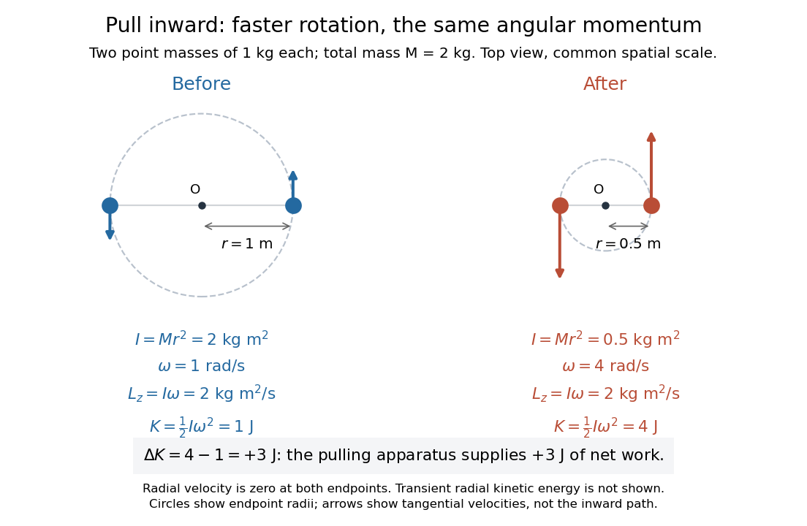

# Conservation of angular momentum

↑ **Parent:** [Angular momentum](angular-momentum.md)

[Conservation of angular momentum](conservation-of-angular-momentum.md) says that total [angular momentum](angular-momentum.md) stays fixed when the net external [torque](torque.md) about the chosen fixed inertial origin vanishes. Individual [angular momenta](angular-momentum.md) and [angular velocities](angular-velocity.md) can change. The [radius change at constant angular momentum](radius-change-at-constant-angular-momentum.md) below makes this distinction visible: pulling two rotating [point masses](point-mass.md) inward lowers the [moment of inertia](moment-of-inertia.md), raises the [angular velocity](angular-velocity.md), and supplies [work](work.md) that increases the [kinetic energy](kinetic-energy.md).

**[Figure 6](#image-pulling-two-point-masses-inward-preserves-angular-momentum-and-adds-three-joules-of-kinetic-energy). Pulling two point masses inward preserves angular momentum and adds three joules of kinetic energy**.

Follow the same constant-[mass](mass.md) [point masses](point-mass.md) throughout, in an [inertial frame](inertial-frame.md), with all [positions](position.md) measured from a fixed origin $O$. If the internal pair [forces](force-split.md) are opposite and central, meaning directed along each pair's separation, then

$$
\mathbf L_O=\sum_i\mathbf r_i\times\mathbf p_i,\qquad
\frac{d\mathbf L_O}{dt}=\boldsymbol\tau_O^{\mathrm{ext}}
=\sum_i\mathbf r_i\times\mathbf F_i^{\mathrm{ext}}.
$$

Thus zero net external [torque](torque.md) throughout an interval implies constant total [angular momentum](angular-momentum.md) throughout that interval. A vanishing external [torque](torque.md) component, such as $\tau_z^{\mathrm{ext}}=0$, conserves the corresponding $L_z$ even when the other components change. This is the balance law for a fixed collection; [angular-momentum flux](angular-momentum-flux.md) must also be accounted for when matter crosses its boundary. [OpenStax University Physics Volume 1, section 11.3: Conservation of Angular Momentum](https://openstax.org/books/university-physics-volume-1/pages/11-3-conservation-of-angular-momentum)

The central qualification is essential. Write $\mathbf F_{ij}$ for the internal [force](force-split.md) on member $i$ from member $j$. Under [Newton's third law](newton-s-third-law.md), $\mathbf F_{ji}=-\mathbf F_{ij}$, but the sum of their [torques](torque.md) is

$$
\mathbf r_i\times\mathbf F_{ij}+\mathbf r_j\times\mathbf F_{ji}
=(\mathbf r_i-\mathbf r_j)\times\mathbf F_{ij}.
$$

This vanishes when $\mathbf F_{ij}$ is parallel to $\mathbf r_i-\mathbf r_j$. Equal-and-opposite [forces](force-split.md) alone do not suffice: two opposite transverse [forces](force-split.md) with separated lines of action form a [couple](couple-mechanics.md) with nonzero [torque](torque.md). Cancellation of the internal pair [torques](torque.md), together with [Newton's second law](newton-s-second-law.md), proves the total balance above.

For one [point mass](point-mass.md) under a [central force](central-force.md) about $O$, $\mathbf F=f(r)\widehat{\mathbf r}$ gives $\boldsymbol\tau_O=\mathbf r\times\mathbf F=\mathbf0$. The [force](force-split.md) may still change the [speed](speed.md) and [kinetic energy](kinetic-energy.md); its zero [torque](torque.md) preserves [angular momentum](angular-momentum.md). With nonzero $\mathbf L_O$, $\mathbf r\cdot\mathbf L_O=0$ keeps the motion in a fixed plane. Choosing the $z$ axis perpendicular to that plane, $r^2\dot\theta=L_z/m$ governs its angular progress. This removes an unknown from the [central-force radial turning point](central-force-radial-turning-point.md) calculation and helps reduce the [Kepler orbit](kepler-orbit.md) to a radial problem.

There is a historical geometric version of this result. In Book I, Section II, Proposition I of the _Principia_, Newton proves that motion under a [central force](central-force.md) toward a fixed centre stays in a plane and sweeps equal [areas](surface-area.md) in equal [times](time-in-physics.md), using successive central [impulses](impulse.md) and equal [triangle](triangle.md) [areas](surface-area.md). [Newton, Principia, Book I, Proposition I, Motte translation, 1846 edition](https://en.wikisource.org/wiki/The_Mathematical_Principles_of_Natural_Philosophy_(1846)/BookI-II) In the modern notation above, constant [areal velocity](areal-velocity.md) is $\dot A=L_z/(2m)$: the old geometric proof and the [angular momentum](angular-momentum.md) calculation express the same invariant.

**Table of contents**

- [Quasi-static tether contraction](quasi-static-tether-contraction.md)
- [Radius change at constant angular momentum](radius-change-at-constant-angular-momentum.md)
- [Angular-momentum flux](angular-momentum-flux.md)
- [Central-force radial turning point](central-force-radial-turning-point.md)
  - [Attractive and repulsive inverse-square closest approaches](attractive-and-repulsive-inverse-square-closest-approaches.md)

## ↑ Ancestors (6)

1. [Angular momentum](angular-momentum.md)
2. [Momentum](momentum-split.md)
3. [Classical mechanics](classical-mechanics-split.md)
4. [Branches of physics](branches-of-physics.md)
5. [Physics](physics-split.md)
6. [Codex Wiki](split.md)

## ← Incoming links (67)

- [Acceleration in polar coordinates](acceleration-in-polar-coordinates.md)
- [Angular momentum](angular-momentum.md)
- [Attractive and repulsive inverse-square closest approaches](attractive-and-repulsive-inverse-square-closest-approaches.md)
- [Axisymmetric inviscid flow between moving parallel plates](axisymmetric-inviscid-flow-between-moving-parallel-plates.md)
- [Conservation of angular momentum](conservation-of-angular-momentum.md)
- [Einstein-de Haas effect](einstein-de-haas-effect.md)
- [Epicyclic ellipse](epicyclic-ellipse.md)
- [Gyroscope](gyroscope.md)
- [Gyroscope direction reference](gyroscope-direction-reference.md)
- [Intermediate axis theorem](intermediate-axis-theorem.md)
- [Kepler radial energy equation](kepler-radial-energy-equation.md)
- [Kepler's second law](kepler-s-second-law.md)
- [Keplerian disk evolution with a ring source](keplerian-disk-evolution-with-a-ring-source.md)
- [Landau angular-momentum argument for turbulent decay](landau-angular-momentum-argument-for-turbulent-decay.md)
- [Magnetomechanical angular momentum balance](magnetomechanical-angular-momentum-balance.md)
- [Solution](past-exam-of-the-advanced-quantum-physics-course-of-the-university-of-cambridge/2019/section-b/5/solution.md)
- [Solution](past-exam-of-the-astrophysical-fluid-dynamics-course-of-the-university-of-cambridge/2014/paper-1/2/b/solution.md)
- [Solution](past-exam-of-the-exoplanets-and-planetary-systems-course-of-the-university-of-cambridge/2016/paper-1/3/c/solution.md)
- [Solution](past-exam-of-the-formation-of-structure-in-the-universe-course-of-the-university-of-cambridge/2014/paper-1/2/solution.md)
- [Solution](past-exam-of-the-mathematics-course-of-the-university-of-cambridge/2001/iii/paper-35/4/solution.md)
- [Solution](past-exam-of-the-mathematics-course-of-the-university-of-cambridge/2001/iii/paper-40/4/i/solution.md)
- [Solution](past-exam-of-the-mathematics-course-of-the-university-of-cambridge/2001/iii/paper-42/1/solution.md)
- [Solution](past-exam-of-the-mathematics-course-of-the-university-of-cambridge/2002/iii/paper-46/1/i/solution.md)
- [Solution](past-exam-of-the-mathematics-course-of-the-university-of-cambridge/2003/iii/paper-65/2/i/solution.md)
- [Solution](past-exam-of-the-mathematics-course-of-the-university-of-cambridge/2004/iii/paper-68/1/a/solution.md)
- [Solution](past-exam-of-the-mathematics-course-of-the-university-of-cambridge/2004/iii/paper-68/2/b/solution.md)
- [Solution](past-exam-of-the-mathematics-course-of-the-university-of-cambridge/2005/iii/paper-78/1/solution.md)
- [Solution](past-exam-of-the-mathematics-course-of-the-university-of-cambridge/2007/iii/paper-70/1/solution.md)
- [Solution](past-exam-of-the-mathematics-course-of-the-university-of-cambridge/2008/ia/paper-4/10b/solution.md)
- [Solution](past-exam-of-the-mathematics-course-of-the-university-of-cambridge/2008/iii/paper-71/1/solution.md)
- [Solution](past-exam-of-the-mathematics-course-of-the-university-of-cambridge/2008/iii/paper-71/3/solution.md)
- [Solution](past-exam-of-the-mathematics-course-of-the-university-of-cambridge/2008/iii/paper-87/1/iii/solution.md)
- [Solution](past-exam-of-the-mathematics-course-of-the-university-of-cambridge/2009/ia/paper-4/4a/b/solution.md)
- [Solution](past-exam-of-the-mathematics-course-of-the-university-of-cambridge/2009/ia/paper-4/4a/c/solution.md)
- [Solution](past-exam-of-the-mathematics-course-of-the-university-of-cambridge/2009/iii/paper-68/1/solution.md)
- [Solution](past-exam-of-the-mathematics-course-of-the-university-of-cambridge/2013/iii/paper-54/1/a/solution.md)
- [Solution](past-exam-of-the-mathematics-course-of-the-university-of-cambridge/2013/iii/paper-56/1/solution.md)
- [Solution](past-exam-of-the-mathematics-course-of-the-university-of-cambridge/2015/iii/paper-62/3/solution.md)
- [Solution](past-exam-of-the-mathematics-course-of-the-university-of-cambridge/2015/iii/paper-64/2/d/solution.md)
- [Solution](past-exam-of-the-mathematics-course-of-the-university-of-cambridge/2015/iii/paper-65/2/solution.md)
- [Solution](past-exam-of-the-mathematics-course-of-the-university-of-cambridge/2017/ia/paper-4/10a/b/i/solution.md)
- [Solution](past-exam-of-the-mathematics-course-of-the-university-of-cambridge/2017/ia/paper-4/10a/b/iii/solution.md)
- [Solution](past-exam-of-the-mathematics-course-of-the-university-of-cambridge/2017/ib/paper-3/18d/solution.md)
- [Solution](past-exam-of-the-mathematics-course-of-the-university-of-cambridge/2017/iii/paper-316/1/i/solution.md)
- [Solution](past-exam-of-the-mathematics-course-of-the-university-of-cambridge/2017/iii/paper-322/2/solution.md)
- [Solution](past-exam-of-the-mathematics-course-of-the-university-of-cambridge/2017/iii/paper-322/3/solution.md)
- [Solution](past-exam-of-the-mathematics-course-of-the-university-of-cambridge/2018/iii/paper-321/1/e/solution.md)
- [Solution](past-exam-of-the-mathematics-course-of-the-university-of-cambridge/2019/iii/paper-321/1/b/solution.md)
- [Solution](past-exam-of-the-mathematics-course-of-the-university-of-cambridge/2019/iii/paper-322/1/solution.md)
- [Solution](past-exam-of-the-mathematics-course-of-the-university-of-cambridge/2019/iii/paper-347/2/c/solution.md)
- [Solution](past-exam-of-the-mathematics-course-of-the-university-of-cambridge/2021/iii/paper-322/2/solution.md)
- [Solution](past-exam-of-the-physics-a-course-of-the-university-of-cambridge/2011/paper-2/section-b/b6/solution.md)
- [Solution](past-exam-of-the-physics-b-course-of-the-university-of-cambridge/2015/paper-1/section-c/c10/solution.md)
- [Solution](past-exam-of-the-physics-course-of-the-year-1-of-the-natural-sciences-course-of-the-university-of-cambridge/2022/section-b/6/c/solution.md)
- [Solution](past-exam-of-the-physics-course-of-the-year-1-of-the-natural-sciences-course-of-the-university-of-cambridge/2022/section-b/6/e/solution.md)
- [Radius change at constant angular momentum](radius-change-at-constant-angular-momentum.md)
- [Roche-lobe radius response exponent](roche-lobe-radius-response-exponent.md)
- [Rutherford impact-parameter relation](rutherford-impact-parameter-relation.md)
- [Steady accretion disk with arbitrary rotation law](steady-accretion-disk-with-arbitrary-rotation-law.md)
- [Steady Keplerian accretion disk with an inner torque](steady-keplerian-accretion-disk-with-an-inner-torque.md)
- [Torque](torque.md)
- [Torque criterion for constant areal velocity](torque-criterion-for-constant-areal-velocity.md)
- [Two-boundary mass split of a ring-fed disk](two-boundary-mass-split-of-a-ring-fed-disk.md)
- [Two-particle relative coordinate](two-particle-relative-coordinate.md)
- [Vertically averaged viscous disk equations](vertically-averaged-viscous-disk-equations.md)
- [Wind-loaded Keplerian disk evolution](wind-loaded-keplerian-disk-evolution.md)
- [Wind-powered mass loss from a steady accretion disk](wind-powered-mass-loss-from-a-steady-accretion-disk.md)
