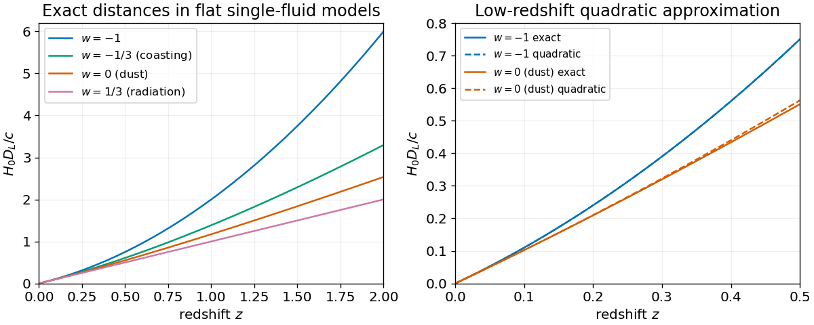

# Constant-equation-of-state luminosity distance

↑ **Parent:** [Luminosity distance](luminosity-distance.md)

For one conserved constant-$w$ [perfect fluid](perfect-fluid.md) in a flat expanding [FLRW metric](friedmann-lemaitre-robertson-walker-metric.md), $H(z)=H_0(1+z)^{3(1+w)/2}$. Integrating the radial [null geodesic](null-geodesic.md) gives

$$
D_L=\frac{2c(1+z)}{H_0(1+3w)}[1-(1+z)^{-(1+3w)/2}]
$$

when $w\ne-1/3$. Its continuous coasting limit is $D_L=c(1+z)\log(1+z)/H_0$. Expansion gives $D_L=(c/H_0)[z+(1-3w)z^2/4+O(z^3)]$, agreeing with the [deceleration parameter](deceleration-parameter.md) $q_0=(1+3w)/2$. Curvature, additional independently evolving fluids or a varying $w$ change this single-fluid expression.

**[Figure 6](#image-flat-single-fluid-luminosity-distances-and-their-quadratic-low-redshift-approximations). Flat single-fluid luminosity distances and their quadratic low-redshift approximations**.

## ↑ Ancestors (5)

1. [Luminosity distance](luminosity-distance.md)
2. [Cosmology](cosmology-split.md)
3. [Branches of physics](branches-of-physics.md)
4. [Physics](physics-split.md)
5. [Codex Wiki](split.md)

## ← Incoming links (1)

- [Solution](past-exam-of-the-general-relativity-and-cosmology-course-of-the-university-of-oxford/2013/4/d/solution.md)
