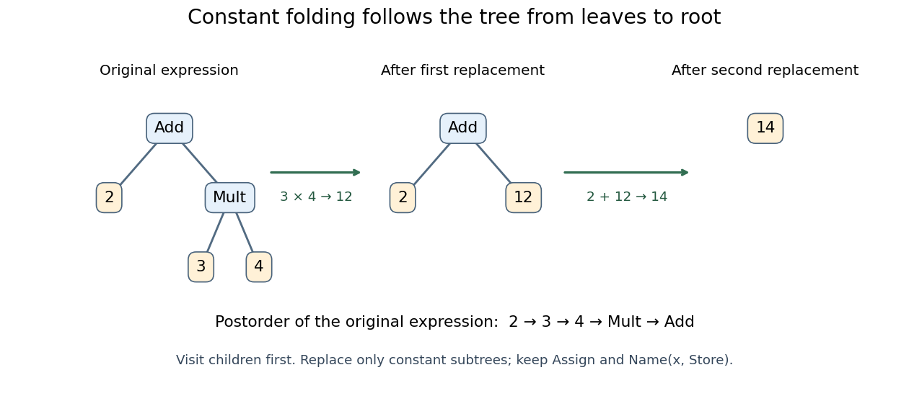

# Constant folding

↑ **Parent:** [Abstract syntax tree transformation](abstract-syntax-tree-transformation.md)  
ⓦ [Wiki](https://en.wikipedia.org/wiki/Constant_folding)

[Constant folding](constant-folding.md) replaces a [program expression](program-expression.md) whose value is known during translation by a [literal value](literal-value.md). For `x=2+3*4`, first replace the [multiplication](multiplication.md) subtree by `Constant(value=12)`, then replace the [addition](addition.md) subtree by `Constant(value=14)`. The [variable assignment](variable-assignment.md) and its `Store` target survive: the result still assigns to `x`. This illustrates why a bottom-up [abstract syntax tree traversal](abstract-syntax-tree-traversal.md) is convenient: replacing one child can make its parent eligible for the next replacement.

<a id="image-abstract-syntax-tree-constant-folding"></a>


**[Figure 60](#image-abstract-syntax-tree-constant-folding). Constant folding and postorder abstract syntax tree traversal for `2+3*4`: replace $3\cdot4$ by $12$, then $2+12$ by $14$**.

Here is a deliberately small [Python](python-programming-language.md) transformer. Calling `generic_visit` first transforms the children; returning a node replaces the visited node. The location helpers retain or supply the metadata expected for [compilation](compilation.md). [NodeTransformer, generic\_visit, copy\_location and fix\_missing\_locations](python-3-14-documentation/ast-abstract-syntax-trees-python-3-14-documentation.md)

```
class FoldIntegers(ast.NodeTransformer):
    def visit_BinOp(self, node):
        self.generic_visit(node)
        if (isinstance(node.left, ast.Constant)
                and isinstance(node.right, ast.Constant)
                and type(node.left.value) is int
                and type(node.right.value) is int
                and type(node.op) in OPS):
            value = OPS[type(node.op)](node.left.value, node.right.value)
            return ast.copy_location(ast.Constant(value=value), node)
        return node

tree = ast.parse("x=2+3*4", optimize=0)
folded = ast.fix_missing_locations(FoldIntegers().visit(tree))
namespace = {}
exec(compile(folded, "<folded example>", "exec"), namespace)
assert namespace["x"] == 14
assert ast.unparse(folded) == "x = 14"
```

This transformer folds literal [integer](integer.md) operands only. It leaves `a+3*4` as `a+12`, without inventing a value for the [program identifier](program-identifier.md) `a`. It leaves calls intact: replacing `0*f()` by `0` could discard a [side effect](side-effect-computer-science.md) or a failure. Nor does it reassociate [floating-point arithmetic](floating-point-arithmetic.md), where changing parentheses can change rounding. For the supported [integer arithmetic](integer-arithmetic.md), a short [structural induction](structural-induction.md) explains correctness: a retained [literal value](literal-value.md) has the same value; at each folded binary node, the already-correct child values are combined by exactly the original operation in the original left/right order. This claim concerns the supported fragment's values, not unrestricted equivalence of arbitrary [Python](python-programming-language.md) programs.

## ↑ Ancestors (5)

1. [Abstract syntax tree transformation](abstract-syntax-tree-transformation.md)
2. [Abstract syntax tree](abstract-syntax-tree.md)
3. [Programming language](programming-language.md)
4. [Computer science](computer-science-split.md)
5. [Codex Wiki](split.md)

## ← Incoming links (2)

- [Compiler](compiler.md)
- [Constant folding](constant-folding.md)
