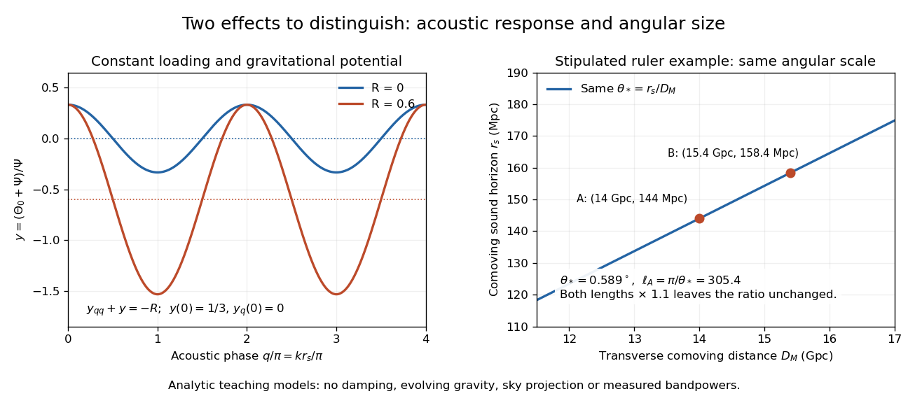

# Constant-loading acoustic model

↑ **Parent:** [Peebles primordial-plasma predictions](peebles-primordial-plasma-predictions.md)

A deliberately restricted [forced harmonic oscillator](forced-harmonic-oscillator.md) shows two effects of the [baryon loading parameter](baryon-loading-parameter.md) without duplicating the full [photon Boltzmann hierarchy](photon-boltzmann-hierarchy.md). Use [conformal time](conformal-time.md) $d\eta=dt/a$ in seconds, a comoving [wavenumber](wavenumber.md) $k$ in inverse metres, constant $R=3\rho_b/(4\rho_\gamma)$, and equal constant dimensionless [Newtonian gauge](newtonian-gauge.md) gravitational potentials $\Phi=\Psi\ne0$. The [energy densities](energy-density.md) $\rho_b$ and $\rho_\gamma$ use the same units. Neglect expansion drag, [Silk damping](cosmic-microwave-background-diffusion-damping.md) and evolution of the potentials. The [photon-baryon sound speed](photon-baryon-sound-speed.md) is $c_s=c/\sqrt{3(1+R)}$. Writing $\Theta_0$ for the [photon monopole](photon-monopole.md) temperature perturbation, the [photon-baryon acoustic oscillator](photon-baryon-acoustic-oscillator.md) reduces to

$$
\Theta_0''+k^2c_s^2\Theta_0=-\frac{k^2c^2}{3}\Psi.
$$

For $y=(\Theta_0+\Psi)/\Psi$ this gives the displayed forced equation. Constant loading and the neglected expansion drag make this a local teaching model, not a self-consistent expanding cosmology with $R$ fixed forever.

Choose $y(0)=1/3$ and $y'(0)=0$, the static matter-era [Sachs-Wolfe combination](sachs-wolfe-combination.md) normalized by $\Psi$. With $q=kc_s\eta$, direct substitution gives

$$
y(q)=\left(\frac13+R\right)\cos q-R,\qquad y_q(0)=0.
$$

At $R=0$, successive extrema have equal magnitudes $1/3$. At the stipulated $R=0.6$, $y(\pi)=-23/15$ whereas $y(2\pi)=1/3$. The shifted equilibrium $y=-R$ makes alternating extrema unequal. This is an elementary illustration of how the [baryon loading parameter](baryon-loading-parameter.md) changes acoustic amplitudes; these extrema are neither measured peak heights nor a complete [Cosmic microwave background power spectrum](cosmic-microwave-background-power-spectrum.md). Comparing curves at fixed $q$ isolates the response; at fixed $k$ and $\eta$, increasing $R$ also reduces the [photon-baryon sound speed](photon-baryon-sound-speed.md) and hence the phase.

For example, holding $c\eta_*=300\,\mathrm{Mpc}$ gives [sound horizons](sound-horizon.md) $r_s=173.2\,\mathrm{Mpc}$ at $R=0$ and $136.9\,\mathrm{Mpc}$ at $R=0.6$. Their ratio is $1/\sqrt{1.6}$. Each term of the forced equation has units of inverse seconds squared because $y$ and $R$ are dimensionless and $kc_s$ is an inverse time. In the actual [photon-baryon fluid](photon-baryon-fluid.md), $R$ grows with the [scale factor](scale-factor-cosmology.md) and the [sound horizon](sound-horizon.md) is the integral of the evolving [photon-baryon sound speed](photon-baryon-sound-speed.md).

**[Figure 1](#image-acoustic-loading-shifts-an-oscillator-an-angular-measurement-fixes-a-ratio). Acoustic loading shifts an oscillator; an angular measurement fixes a ratio**. Original analytic examples. The left panel holds the baryon loading parameter and gravitational potential constant and uses the stated initial conditions. The right panel independently stipulates two comoving rulers and distances with the same angular size. Neither panel is an observed cosmic microwave background spectrum.

## ↑ Ancestors (6)

1. [Peebles primordial-plasma predictions](peebles-primordial-plasma-predictions.md)
2. [Physical cosmology](physical-cosmology.md)
3. [Cosmology](cosmology-split.md)
4. [Branches of physics](branches-of-physics.md)
5. [Physics](physics-split.md)
6. [Codex Wiki](split.md)
