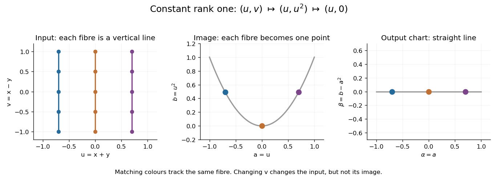

# Constant rank theorem

↑ **Parent:** [Inverse function theorem](inverse-function-theorem.md)  
ⓦ [Wiki](https://en.wikipedia.org/wiki/Constant_rank_theorem)

The constant rank theorem separates the directions a [smooth map](smooth-map-between-manifolds.md) preserves from the directions it forgets. If a [smooth map](smooth-map-between-manifolds.md) from an [open subset](open-set.md) of $\mathbb R^m$ to $\mathbb R^n$ has [derivative](derivative.md) of constant [rank](rank-one-quadratic-form.md) $r$ on a neighbourhood of a point, there are local [coordinate transformations](smooth-transition-map.md) in source and target in which it becomes

$$
(x^1,\ldots,x^m)\longmapsto(x^1,\ldots,x^r,0,\ldots,0).
$$

It keeps $r$ coordinates, discards the other $m-r$, and inserts $n-r$ zeros. This is stronger than simplifying the [Jacobian matrix](jacobian-matrix.md) at one point: it straightens the actual nonlinear map on a neighbourhood. [Eleny Ionel, Differential Topology, notes by Andrew Lin (2023), Theorem 44](https://web.stanford.edu/~lindrew/math215B.pdf)

For a worked example, take

$$
f(x,y)=(x+y,(x+y)^2),\qquad
Df(x,y)=
\begin{pmatrix}1&1\\2(x+y)&2(x+y)\end{pmatrix}.
$$

The two columns agree, and the first row is nonzero, so the [rank](rank-one-quadratic-form.md) is exactly one everywhere. The [image of a function](image-of-a-function.md) is the [parabola](parabola.md) $b=a^2$. Every [line](straight-line.md) $x+y=a$ is a [fiber](fiber-of-a-function.md) mapping to the same point $(a,a^2)$.

Choose input coordinates $u=x+y$, $v=x-y$, and output coordinates $\alpha=a$, $\beta=b-a^2$. Both [coordinate transformations](smooth-transition-map.md) are [diffeomorphisms](diffeomorphism.md): their inverses are $x=(u+v)/2$, $y=(u-v)/2$ and $a=\alpha$, $b=\beta+\alpha^2$. In these coordinates,

$$
(u,v)\longmapsto(u,u^2)\longmapsto(u,0).
$$

The curved image has become a straight [line](straight-line.md), and the unused coordinate $v$ is explicit.

**[Figure 13](#image-a-rank-one-map-collapses-input-fibres-to-a-parabola-which-a-change-of-output-coordinates-straightens). A rank-one map collapses input fibres to a parabola, which a change of output coordinates straightens**.

Constant [rank](rank-one-quadratic-form.md) on a neighbourhood is essential. The map $(x,y)\mapsto(x,y^2)$ has [rank](rank-one-quadratic-form.md) one when $y=0$ and two when $y\ne0$, so the constant rank theorem does not supply one rank-one form across that line. By contrast, the full-rank square case of the theorem forgets no coordinates and recovers the [inverse function theorem](inverse-function-theorem.md). The usefulness is that curved [fibers](fiber-of-a-function.md) and images can often be studied through this simpler local form.

**Table of contents**

- [Rank-one level curves from a characteristic differential equation](rank-one-level-curves-from-a-characteristic-differential-equation.md)

## ↑ Ancestors (9)

1. [Inverse function theorem](inverse-function-theorem.md)
2. [Differentiable map](differentiable-map.md)
3. [Multivariable calculus](multivariable-calculus-split.md)
4. [Calculus](calculus-split.md)
5. [Real analysis](real-analysis-split.md)
6. [Analysis](analysis-split.md)
7. [Area of mathematics](area-of-mathematics.md)
8. [Mathematics](mathematics-split.md)
9. [Codex Wiki](split.md)

## ← Incoming links (3)

- [Solution](past-exam-of-the-mathematics-course-of-the-university-of-cambridge/2012/iii/paper-17/1/2/solution.md)
- [Solution](past-exam-of-the-mathematics-course-of-the-university-of-cambridge/2019/iii/paper-115/2/solution.md)
- [Solution](past-exam-of-the-mathematics-course-of-the-university-of-cambridge/2024/iii/paper-115/2/b/solution.md)
