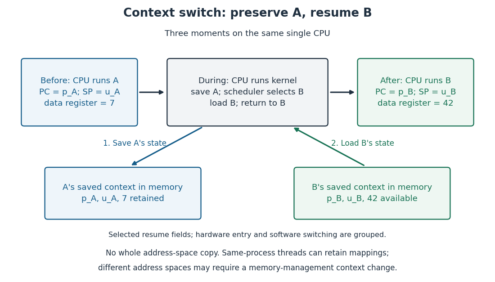

# Context switch

↑ **Parent:** [Process scheduling](process-scheduling.md)  
ⓦ [Wiki](https://en.wikipedia.org/wiki/Context_switch)

A [context switch](context-switch.md) transfers [CPU](central-processing-unit.md) execution from one [operating-system process](process-computing.md) or [software thread](thread-computing.md) to another while preserving enough [execution context](execution-context.md) for the suspended task to resume. The [operating-system kernel](kernel-operating-system.md) saves the outgoing task's [processor registers](processor-register.md), including its resume [program counter](instruction-pointer.md) and [stack pointer](stack-pointer.md), and restores the incoming task's saved state. Hardware entry and software switching divide this work differently across architectures; the diagram groups them into logical save and load steps. During the transition the same [CPU](central-processing-unit.md) executes the [operating-system kernel](kernel-operating-system.md)'s scheduler and switching code. [Remzi H. Arpaci-Dusseau and Andrea C. Arpaci-Dusseau, Operating Systems: Three Easy Pieces, chapter 6, section 6.3: saving and restoring context](https://pages.cs.wisc.edu/~remzi/OSTEP/cpu-mechanisms.pdf)

For a schematic switch from A to B, let A's resume [program counter](instruction-pointer.md) be $p_A$, its [stack pointer](stack-pointer.md) $u_A$, and one illustrative data [processor register](processor-register.md) contain 7. B's saved values are $p_B,u_B,42$. Saving A retains $(p_A,u_A,7)$ in A's [execution context](execution-context.md); loading B establishes $(p_B,u_B,42)$ before B resumes. These are selected fields, not a complete architecture-specific [execution context](execution-context.md). Later restoring A recovers its 7 even though B has used the same physical [processor register](processor-register.md) for 42.

**[Figure 46](#image-one-cpu-over-time-save-a-s-execution-context-run-the-scheduler-and-restore-b-s-execution-context). One CPU over time: save A's execution context, run the scheduler, and restore B's execution context**.

The useful invariant is that each suspended task retains its own resume state, so another task's use of the [processor registers](processor-register.md) does not erase it. This is what makes repeated turns under [round-robin scheduling](round-robin-scheduling.md) possible. Saving an [execution context](execution-context.md) does not copy the entire [address space](address-space.md). Switching between [software threads](thread-computing.md) of one [operating-system process](process-computing.md) can retain the same [address space](address-space.md); switching between [operating-system processes](process-computing.md) with different [address spaces](address-space.md) may also require changing the [memory management unit](memory-management-unit.md)'s translation context, such as the active [page table](page-table.md) and associated [address space identifier](address-space-identifier.md), depending on the architecture. Their contents remain in [computer memory](computer-memory.md). [Remzi H. Arpaci-Dusseau and Andrea C. Arpaci-Dusseau, Operating Systems: Three Easy Pieces, chapter 26, introduction: thread contexts and shared address spaces](https://pages.cs.wisc.edu/~remzi/OSTEP/threads-intro.pdf)

Entering the [operating-system kernel](kernel-operating-system.md) through an [interrupt](interrupt.md), [synchronous processor exception](synchronous-processor-exception.md) or [system call](system-call.md) does not automatically imply a [context switch](context-switch.md) to another task. The handler may return to the same task; [process scheduling](process-scheduling.md) determines whether another runnable task should take over. A [context switch](context-switch.md) consumes time, and a changed [memory cache](cache-computing.md) or [translation lookaside buffer](translation-lookaside-buffer.md) working environment can add subsequent costs. Those costs are excluded from the toy [process scheduling](process-scheduling.md) timelines, which are calculations rather than [operating system](operating-system.md) benchmarks. [Arpaci-Dusseau and Arpaci-Dusseau, OSTEP chapter 6, section 6.3: continue the current process or switch](https://pages.cs.wisc.edu/~remzi/OSTEP/cpu-mechanisms.pdf)[Arpaci-Dusseau and Arpaci-Dusseau, OSTEP chapter 7, section 7.7: direct and indirect switching costs](https://pages.cs.wisc.edu/~remzi/OSTEP/cpu-sched.pdf)

**Table of contents**

- [Execution context](execution-context.md)

## ↑ Ancestors (4)

1. [Process scheduling](process-scheduling.md)
2. [Operating system](operating-system.md)
3. [Computer science](computer-science-split.md)
4. [Codex Wiki](split.md)

## ← Incoming links (10)

- [Context switch](context-switch.md)
- [Interrupt](interrupt.md)
- [Microkernel communication cost](microkernel-communication-cost.md)
- [Solution](past-exam-of-the-mathematics-course-of-the-university-of-cambridge/2007/ia/paper-5/2/b/solution.md)
- [Solution](past-exam-of-the-mathematics-course-of-the-university-of-cambridge/2007/ia/paper-5/2/c/solution.md)
- [Process (computing)](process-computing.md)
- [Process scheduling](process-scheduling.md)
- [Scheduling quantum](scheduling-quantum.md)
- [Thread (computing)](thread-computing.md)
- [Translation lookaside buffer](translation-lookaside-buffer.md)
