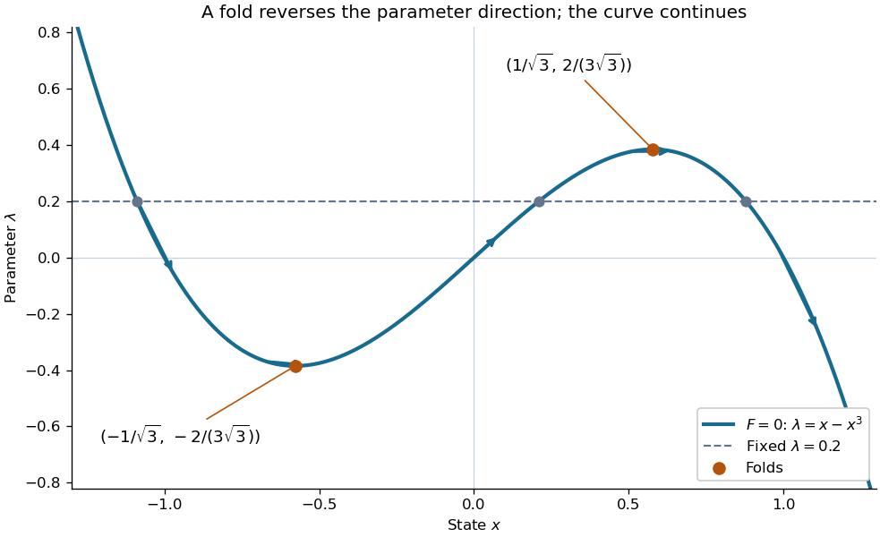

# Continuation method

↑ **Parent:** [Numerical analysis](numerical-analysis-split.md)  
ⓦ [Wiki](https://en.wikipedia.org/wiki/Continuation_method)

A [continuation method](continuation-method.md) follows a [solution branch](solution-branch.md) of a parameter-dependent equation from a known solution, using nearby solutions to guide the next solve. This is useful when one wants to understand how solutions change, rather than obtain just one isolated answer. A [continuation predictor-corrector step](continuation-predictor-corrector-step.md) follows a [tangent vector](tangent-vector-split.md) and then uses a [Newton method](newton-s-method-in-optimization.md) correction on a transverse section. The same geometry supports both [pseudo-arclength continuation](pseudo-arclength-continuation.md) through a [continuation fold](fold-of-a-solution-branch.md) and [transversal surface intersection tracing](transversal-surface-intersection-tracing.md).

Consider the original scalar [polynomial](polynomial-split.md) example

$$
F(x,\lambda)=x^3-x+\lambda=0,\qquad \lambda=x-x^3.
$$

Its [solution branch](solution-branch.md) bends back twice in $\lambda$. Increasing $\lambda$ alone eventually stops following the same nearby solutions; following the [curve](curve.md) in the $(x,\lambda)$ plane can continue around both bends. The [continuation folds](fold-of-a-solution-branch.md) are

$$
(x_-,\lambda_-)=\left(-\frac1{\sqrt3},-\frac2{3\sqrt3}\right),\qquad
(x_+,\lambda_+)=\left(\frac1{\sqrt3},\frac2{3\sqrt3}\right).
$$

For $|\lambda|<2/(3\sqrt3)$ there are three distinct real [zeros of a function](zero-of-a-function.md) at that fixed $\lambda$, all lying on this one connected [curve](curve.md). A [continuation method](continuation-method.md) keeps their geometric relationship visible.

**[Figure 6](#image-a-connected-cubic-solution-curve-with-two-folds-and-three-solutions-at-the-same-parameter-value). A connected cubic solution curve with two folds and three solutions at the same parameter value**. The arrows follow increasing $x$ along $\lambda=x-x^3$, even where $\lambda$ changes direction. The dashed horizontal line $\lambda=0.2$ meets the [solution branch](solution-branch.md) three times. The marked [continuation folds](fold-of-a-solution-branch.md) are extrema of $\lambda$, not singularities of the full [curve](curve.md).

Every [continuation method](continuation-method.md) needs a seed, supplied by an independent solve, an explicitly known solution, or another search. Following one [solution branch](solution-branch.md) does not guarantee finding every [connected component](connected-component.md) of the solution set. A large step can miss detail or make the correction converge to a distant solution. At branch intersections or a loss of [rank](rank-one-quadratic-form.md) of the full [Jacobian matrix](jacobian-matrix.md), the regular-[curve](curve.md) argument needs separate analysis. The seed and component limitations also matter in [transversal surface intersection tracing](transversal-surface-intersection-tracing.md).

**Table of contents**

- [Solution branch](solution-branch.md)
- [Parameter continuation](parameter-continuation.md)
- [Fold of a solution branch](fold-of-a-solution-branch.md)
- [Pseudo-arclength continuation](pseudo-arclength-continuation.md)
  - [Continuation predictor-corrector step](continuation-predictor-corrector-step.md)
- [Transversal surface intersection tracing](transversal-surface-intersection-tracing.md)
  - [Transversal intersection of two parametric surfaces](transversal-intersection-of-two-parametric-surfaces.md)

## ↑ Ancestors (5)

1. [Numerical analysis](numerical-analysis-split.md)
2. [Analysis](analysis-split.md)
3. [Area of mathematics](area-of-mathematics.md)
4. [Mathematics](mathematics-split.md)
5. [Codex Wiki](split.md)

## ← Incoming links (8)

- [Continuation method](continuation-method.md)
- [Solution](past-exam-of-the-mathematics-course-of-the-university-of-cambridge/2002/iii/paper-59/6/solution.md)
- [Solution](past-exam-of-the-mathematics-course-of-the-university-of-cambridge/2006/iii/paper-66/2/solution.md)
- [Solution](past-exam-of-the-mathematics-course-of-the-university-of-cambridge/2008/iii/paper-77/2/solution.md)
- [Solution](past-exam-of-the-mathematics-course-of-the-university-of-cambridge/2008/iii/paper-77/6/solution.md)
- [Plane section of a subdivision surface](plane-section-of-a-subdivision-surface.md)
- [Transversal intersection of two parametric surfaces](transversal-intersection-of-two-parametric-surfaces.md)
- [Transversal surface intersection tracing](transversal-surface-intersection-tracing.md)
