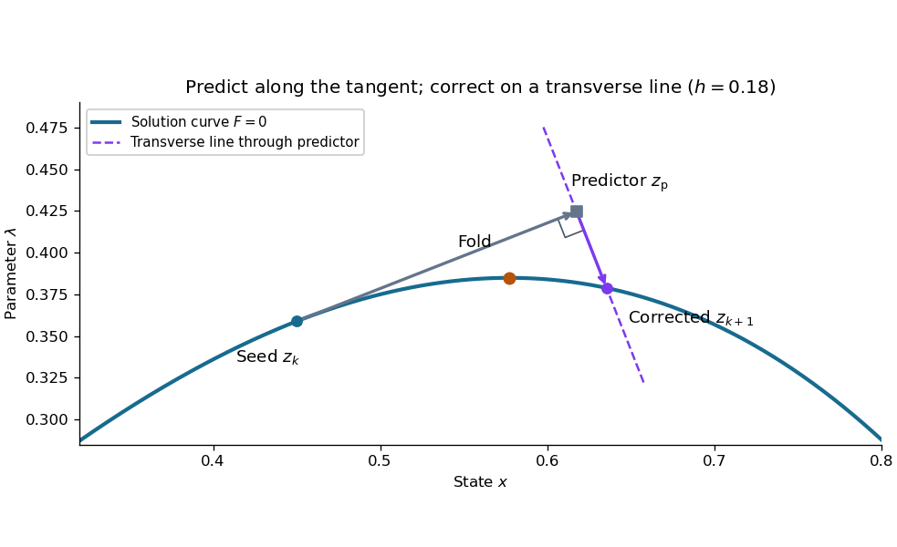

# Continuation predictor-corrector step

↑ **Parent:** [Pseudo-arclength continuation](pseudo-arclength-continuation.md)

For the cubic [polynomial](polynomial-split.md), an oriented, normalized [tangent vector](tangent-vector-split.md) is

$$
t_k=\frac{(1,\ 1-3x_k^2)}{\sqrt{1+(1-3x_k^2)^2}}.
$$

Its [Euclidean norm](euclidean-norm.md) is one and $DF(z_k)t_k=0$. The sign here follows increasing $x$; for a general [solution branch](solution-branch.md), choose the sign of each new [tangent vector](tangent-vector-split.md) so its [dot product](dot-product.md) with the previous one is positive. First predict $z_{\mathrm p}=z_k+h t_k$, then apply [Newton method](newton-s-method-in-optimization.md) starting at $z_{\mathrm p}$ to

$$
H(z)=\begin{pmatrix}F(z)\\t_k^{\mathsf T}(z-z_{\mathrm p})\end{pmatrix}=0,\qquad
DH(z)=\begin{pmatrix}3x^2-1&1\\t_{k,x}&t_{k,\lambda}\end{pmatrix}.
$$

The second equation keeps the correction on the transverse line in this two-dimensional example; in higher dimensions it is a [hyperplane](hyperplane.md). Solving the [linear system](system-of-linear-equations.md) $DH(z^{(j)})\delta z=-H(z^{(j)})$ and updating $z^{(j+1)}=z^{(j)}+\delta z$ corrects both coordinates together.

**[Figure 7](#image-a-tangent-predictor-and-transverse-correction-step-across-the-upper-fold). A tangent predictor and transverse correction step across the upper fold**. From $z_k=(0.45,0.358875)$ with $h=0.18$, the predictor lies above the largest attainable nearby $\lambda$. Correction along the transverse line returns to the [solution branch](solution-branch.md) on the far side of the [continuation fold](fold-of-a-solution-branch.md). Both axes use the same scale, so perpendicularity is visible.

This step gives $z_{\mathrm p}\approx(0.617556,0.424641)$ and $z_{k+1}\approx(0.635532,0.378840)$. Check both equations: the solution must satisfy $x^3-x+\lambda=0$ and $t_k^{\mathsf T}(z-z_{\mathrm p})=0$. Checking only the first could accept any point on the [solution branch](solution-branch.md). The new $x$ exceeds $1/\sqrt3$, so the step crosses the [continuation fold](fold-of-a-solution-branch.md), even though the predictor's $\lambda$ exceeds $2/(3\sqrt3)$.

At the seed, set $a=3x_k^2-1$. The [determinant](determinant.md) of the correction [Jacobian matrix](jacobian-matrix.md) with the exact [unit vector](unit-vector.md) above is

$$
\det DH(z_k)=-\sqrt{1+a^2}\ne0.
$$

At either [continuation fold](fold-of-a-solution-branch.md), $a=0$, $t_k=(1,0)$ and $DH(z_k)=\begin{pmatrix}0&1\\1&0\end{pmatrix}$: the correction remains invertible. More generally, if $DF$ has full [rank](rank-one-quadratic-form.md) and a one-dimensional [kernel](kernel-of-a-linear-map-split.md) spanned by $t_k$, adding $t_k^{\mathsf T}$ gives an [invertible matrix](invertible-matrix.md), since a [vector](vector.md) annihilated by both rows must be zero. This is a local argument; the old transverse [hyperplane](hyperplane.md) need not work arbitrarily far along the [curve](curve.md). Reduce $h$ and retry when correction fails, and check the equations and orientation after successful steps. Scaling state and parameter coordinates also matters, because it changes the [Euclidean norm](euclidean-norm.md) used to normalize the [tangent vector](tangent-vector-split.md).

// Target: analysis.bigb

## ↑ Ancestors (7)

1. [Pseudo-arclength continuation](pseudo-arclength-continuation.md)
2. [Continuation method](continuation-method.md)
3. [Numerical analysis](numerical-analysis-split.md)
4. [Analysis](analysis-split.md)
5. [Area of mathematics](area-of-mathematics.md)
6. [Mathematics](mathematics-split.md)
7. [Codex Wiki](split.md)

## ← Incoming links (2)

- [Continuation method](continuation-method.md)
- [Pseudo-arclength continuation](pseudo-arclength-continuation.md)
