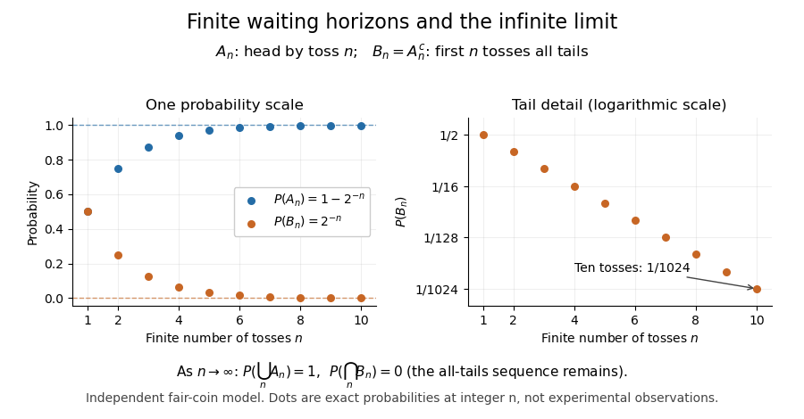

# Continuity of probability

↑ **Parent:** [Probability measure](probability-measure.md)

[Continuity of probability](continuity-of-probability.md) says that nested [events](event.md) can be approximated by their finite stages without losing [probability](probability.md) in the [limit of a sequence](limit-of-a-sequence.md). In a [probability space](probability-space-split.md) $(\Omega,\mathcal F,\mathbb P)$, let $A_n,B_n\in\mathcal F$. Then

$$
\begin{aligned}
A_1\subseteq A_2\subseteq\cdots,\quad A=\bigcup_{n=1}^{\infty}A_n
&\quad\Longrightarrow\quad \mathbb P(A_n)\uparrow\mathbb P(A),\\
B_1\supseteq B_2\supseteq\cdots,\quad B=\bigcap_{n=1}^{\infty}B_n
&\quad\Longrightarrow\quad \mathbb P(B_n)\downarrow\mathbb P(B).
\end{aligned}
$$

The [sigma-algebra](sigma-algebra.md) ensures that both limiting [events](event.md) belong to $\mathcal F$. These are [continuity from below of a measure](continuity-from-below-of-a-measure.md) and [continuity from above of a measure](continuity-from-above-of-a-measure.md). The first holds even for an infinite [measure](measure-split.md); the second requires finite [measure](measure-split.md) of the first [set](set-split.md), which is automatic for a [probability measure](probability-measure.md) because $\mathbb P(B_1)\leq1$.[Probability 1 lecture notes, Chapter 1: Axioms of probability by Durham Statistics and Probability teaching team](probability-1-lecture-notes-chapter-1-axioms-of-probability-by-durham-statistics-and-probability-teaching-team.md)

For a concrete model, toss a fair coin through a sequence of [independent](independent-random-variables.md) [Bernoulli trials](bernoulli-trial.md), and let $A_n$ be the [event](event.md) of at least one head in the first $n$ tosses. Its [complement](complement-of-a-set.md) $B_n=A_n^c$ is the [event](event.md) of $n$ initial tails. On the [sample space](sample-space.md) of infinite head-or-tail sequences,

$$
\mathbb P(A_n)=1-2^{-n},\qquad \mathbb P(B_n)=2^{-n},\qquad
\mathbb P\left(\bigcup_{n=1}^{\infty}A_n\right)=1,\qquad
\mathbb P\left(\bigcap_{n=1}^{\infty}B_n\right)=0.
$$

Every finite waiting horizon has positive [tail probability](tail-probability.md), yet the [event](event.md) of waiting forever has [probability](probability.md) zero. That [intersection](set-intersection.md) is not empty: it contains the all-tails sequence. Thus a [zero-probability event](zero-probability-event.md) need not be impossible as an outcome, and eventual success [almost surely](almost-sure-convergence.md) does not supply a deterministic deadline. The waiting time for the first head has a [geometric distribution](geometric-distribution.md) with success [probability](probability.md) $1/2$. After ten tosses, the remaining [tail probability](tail-probability.md) is exactly $1/1024<1/1000$; nine tosses leave $1/512>1/1000$.

**[Figure 3](#image-exact-fair-coin-model-success-by-toss-n-increases-to-probability-one-while-the-all-tails-prefix-probability-decreases-to-zero). Exact fair-coin model: success by toss n increases to probability one, while the all-tails prefix probability decreases to zero**.

A proof outline exposes what makes [countable additivity](countable-additivity.md) stronger than [finite additivity of a set function](finite-additivity-of-a-set-function.md). For increasing [events](event.md), put $D_1=A_1$ and $D_n=A_n\setminus A_{n-1}$ for $n\geq2$. These [set differences](set-difference.md) are pairwise [disjoint events](disjoint-events.md), their [union](set-union.md) is $A$, and the first $n$ pieces have [union](set-union.md) $A_n$. Consequently

$$
\mathbb P(A)=\sum_{j=1}^{\infty}\mathbb P(D_j)
=\lim_{n\to\infty}\sum_{j=1}^{n}\mathbb P(D_j)
=\lim_{n\to\infty}\mathbb P(A_n).
$$

For decreasing [events](event.md), their [complements](complement-of-a-set.md) increase to $B^c$; applying the increasing result and the [complement rule of probability](complement-rule-of-probability.md) gives $\mathbb P(B_n)=1-\mathbb P(B_n^c)\to1-\mathbb P(B^c)=\mathbb P(B)$. The finite-total-mass condition is essential for this subtraction. For comparison, the [counting measure](counting-measure.md) of each [set](set-split.md) $\{n,n+1,\ldots\}$ of [natural numbers](natural-number.md) is infinite, although their [intersection](set-intersection.md) is empty and has [measure](measure-split.md) zero.

Conversely, on a [sigma-algebra](sigma-algebra.md), a nonnegative normalized [set function](set-function.md) satisfying [finite additivity of a set function](finite-additivity-of-a-set-function.md) and $R_n\downarrow\varnothing\Rightarrow\mathbb P(R_n)\to0$ satisfies [countable additivity](countable-additivity.md). For pairwise [disjoint events](disjoint-events.md) $D_j$ with $E=\bigcup_jD_j$, the remainders $R_n=E\setminus\bigcup_{j=1}^nD_j$ decrease to the empty [set](set-split.md), and

$$
\mathbb P(E)=\sum_{j=1}^{n}\mathbb P(D_j)+\mathbb P(R_n).
$$

Taking the [limit of a sequence](limit-of-a-sequence.md) recovers the infinite sum. This equivalence explains why [continuity of probability](continuity-of-probability.md) is part of the foundations rather than a separate assumption about smooth curves.

One useful application controls infinitely many possible errors. If [events](event.md) $E_j$ satisfy $\sum_j\mathbb P(E_j)<\infty$, then the [events](event.md) $C_n=\bigcup_{j\geq n}E_j$ decrease, and the [union bound](boole-s-inequality.md) gives $\mathbb P(C_n)\leq\sum_{j\geq n}\mathbb P(E_j)\to0$. [Continuity of probability](continuity-of-probability.md) therefore makes $\mathbb P(\bigcap_nC_n)=0$: errors occur infinitely often with [probability](probability.md) zero. This is the [Borel-Cantelli first lemma](borel-cantelli-first-lemma.md), and it requires no [independence](independent-random-variables.md). For the illustrative bounds $\mathbb P(E_j)\leq2^{-j}$, the [probability](probability.md) of any error at index $n$ or later is at most $2^{1-n}$, an explicit truncation guarantee.

The word continuity here concerns nested [sets](set-split.md), not the absence of atoms in a [probability distribution](probability-distribution-split.md). For any real-valued [random variable](random-variable-split.md) $X$, the [events](event.md) $\{X\leq x+1/n\}$ decrease to $\{X\leq x\}$. Hence its [cumulative distribution function](cumulative-distribution-function.md) is [right-continuous](right-continuous-function.md) even when it has jumps, as for a [geometric distribution](geometric-distribution.md). The nesting hypothesis matters: an arbitrary sequence of [events](event.md) need not admit either displayed interchange of [limit](limit-of-a-function.md) and [probability](probability.md).

## ↑ Ancestors (7)

1. [Probability measure](probability-measure.md)
2. [Probability space](probability-space-split.md)
3. [Probability theory](probability-theory-split.md)
4. [Probability and statistics](probability-and-statistics-split.md)
5. [Area of mathematics](area-of-mathematics.md)
6. [Mathematics](mathematics-split.md)
7. [Codex Wiki](split.md)

## ← Incoming links (7)

- [Boole's inequality](boole-s-inequality.md)
- [Borel-Cantelli second lemma](borel-cantelli-second-lemma.md)
- [Continuity of probability](continuity-of-probability.md)
- [Infinitely many heads as a tail event](infinitely-many-heads-as-a-tail-event.md)
- [Kolmogorov axioms](kolmogorov-axioms.md)
- [Solution](past-exam-of-the-mathematics-course-of-the-university-of-cambridge/2008/iii/paper-34/2/a/solution.md)
- [Tail measurability of limits of sample averages](tail-measurability-of-limits-of-sample-averages.md)
