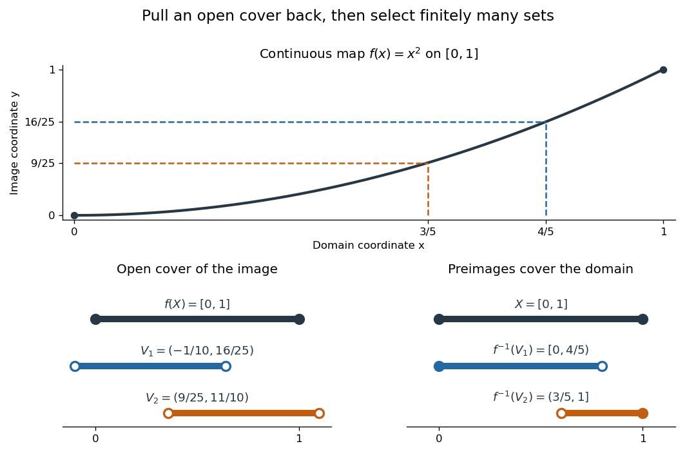

# Continuous image of a compact space

↑ **Parent:** [Compact space](compact-space.md)

Let $X,Y$ be [topological spaces](topological-space.md), let $X$ be [compact](compact-space.md), and let $f:X\to Y$ be a [continuous map](continuous-map.md). Then its [image](image-of-a-function.md) $f(X)$ is [compact](compact-space.md) with the [subspace topology](subspace-topology.md) inherited from $Y$. More generally, a [continuous map](continuous-map.md) sends every [compact subset](compact-space.md) $K\subseteq X$ to a [compact subset](compact-space.md) $f(K)\subseteq Y$, by applying the same statement to its restriction to $K$. Neither $X$ nor $Y$ needs to be [Hausdorff](hausdorff-space.md).[Lemma 3.2.5 and Proposition 3.2.9](point-set-topology-by-romyar-sharifi/chapter-3-connected-and-compact-spaces.md)

For example, the [polynomial function](polynomial-function.md) $f(x)=x^2$ sends the [compact](compact-space.md) [closed interval](closed-real-interval.md) $[0,1]$ onto $[0,1]$. The [open intervals](open-interval.md) $V_1=(-1/10,16/25)$ and $V_2=(9/25,11/10)$ give an [open cover](open-cover.md) of the [image](image-of-a-function.md). Their [inverse images](preimage.md) in the domain are

$$
f^{-1}(V_1)=[0,4/5),\qquad f^{-1}(V_2)=(3/5,1].
$$

Both are [open sets](open-set.md) in the [subspace topology](subspace-topology.md) of $[0,1]$, even though neither is an [open set](open-set.md) in the ambient [real line](real-line.md). They cover the domain, so the corresponding two target [open sets](open-set.md) cover the [image](image-of-a-function.md).

**[Figure 10](#image-an-open-cover-of-the-image-of-a-continuous-map-and-its-inverse-images-on-a-compact-closed-interval). An open cover of the image of a continuous map and its inverse images on a compact closed interval**.

Matching colors identify the target [open sets](open-set.md) and their [inverse images](preimage.md). Filled endpoints are included and hollow endpoints excluded. This particular [open cover](open-cover.md) illustrates the mechanism; [compactness](compact-space.md) requires a [finite subcover](finite-subcover.md) for every [open cover](open-cover.md).

For the general proof, write an arbitrary [open cover](open-cover.md) of $f(X)$ as $\{f(X)\cap V_i:i\in I\}$ with each $V_i$ an [open set](open-set.md) in $Y$. By [continuity](continuous-function.md), the [inverse images](preimage.md) $f^{-1}(V_i)$ form an [open cover](open-cover.md) of $X$. Its [compactness](compact-space.md) provides indices $i_1,\ldots,i_m$ such that

$$
X=\bigcup_{j=1}^{m}f^{-1}(V_{i_j})\quad\Longrightarrow\quad f(X)\subseteq\bigcup_{j=1}^{m}V_{i_j}.
$$

This gives the required [finite subcover](finite-subcover.md) of $f(X)$. The argument uses [inverse images](preimage.md) because [continuous maps](continuous-map.md) need not send [open sets](open-set.md) to [open sets](open-set.md). For the [empty set](empty-set.md), the empty selection suffices.

The [image](image-of-a-function.md) of a [compact Hausdorff space](compact-hausdorff-space.md) under a [continuous map](continuous-map.md) need not itself be [Hausdorff](hausdorff-space.md). Take $D=\{0,1\}$ with the [discrete topology](discrete-space.md) and $S=\{0,1\}$ with the [Sierpiński space](sierpinski-space.md) [topology](topology-split.md) $\{\varnothing,\{1\},S\}$. The [identity map](identity-function.md) $D\to S$ is a [continuous](continuous-function.md) [bijection](bijection.md), since the [inverse image](preimage.md) of every target [open set](open-set.md) is an [open set](open-set.md) in $D$. Its [image](image-of-a-function.md) is [compact](compact-space.md), but the two points of $S$ have no disjoint [open](open-set.md) [neighborhoods](neighbourhood-mathematics.md). If the target $Y$ is [Hausdorff](hausdorff-space.md), its [subspace topology](subspace-topology.md) does make $f(X)$ [Hausdorff](hausdorff-space.md), and the [compact subset of a Hausdorff space](compact-subset-of-a-hausdorff-space.md) theorem also makes $f(X)$ [closed](closed-set.md) in $Y$.

The practical payoff is existence: the [extreme value theorem](extreme-value-theorem.md) uses the [compact](compact-space.md) [image](image-of-a-function.md) of a nonempty [compact space](compact-space.md) under a real-valued [continuous function](continuous-function.md) to obtain an attained [minimum](minimum-of-a-subset-of-a-total-order.md) and [maximum](maximum-of-a-subset-of-a-total-order.md). When $f$ is also a [bijection](bijection.md) onto a [Hausdorff](hausdorff-space.md) target, the [compact-to-Hausdorff continuous bijection theorem](compact-to-hausdorff-continuous-bijection-theorem.md) supplies [continuity](continuous-function.md) of its inverse without a separate formula.

## ↑ Ancestors (6)

1. [Compact space](compact-space.md)
2. [Topology](topology-split.md)
3. [Geometry and topology](geometry-and-topology-split.md)
4. [Area of mathematics](area-of-mathematics.md)
5. [Mathematics](mathematics-split.md)
6. [Codex Wiki](split.md)

## ← Incoming links (8)

- [Compact space](compact-space.md)
- [Compact subset of a Hausdorff space](compact-subset-of-a-hausdorff-space.md)
- [Extreme value theorem](extreme-value-theorem.md)
- [Solution](past-exam-of-the-mathematics-course-of-the-university-of-cambridge/2007/ib/paper-2/4a/i/solution.md)
- [Solution](past-exam-of-the-mathematics-course-of-the-university-of-cambridge/2019/ib/paper-4/13g/b/solution.md)
- [Solution](past-exam-of-the-mathematics-course-of-the-university-of-cambridge/2021/ib/paper-1/10f/b/solution.md)
- [Solution](past-exam-of-the-mathematics-course-of-the-university-of-cambridge/2021/iii/paper-151/1/b/iii/solution.md)
- [Solution](past-exam-of-the-mathematics-course-of-the-university-of-cambridge/2022/ii/paper-3/21g/c/solution.md)
