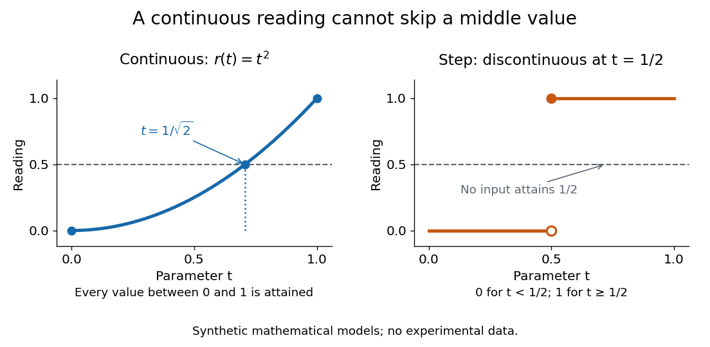

# Continuous image of a connected space

↑ **Parent:** [Connected space](connected-space.md)  
ⓦ [Wiki](https://en.wikipedia.org/wiki/Continuous_image_of_a_connected_space)

If $f:X\to Y$ is a [continuous map](continuous-map.md) and $X$ is a [connected space](connected-space.md), then its [image](image-of-a-function.md) $f(X)$, with the [subspace topology](subspace-topology.md) from $Y$, is a [connected subset](connected-subset.md) of $Y$. The whole [codomain](codomain.md) $Y$ need not be [connected](connected-space.md); the assertion concerns the values actually attained. No [injectivity](injective-function.md) is required.[p. 70: a continuous image is connected](general-topology-by-tom-leinster.md)

For example, the [continuous function](continuous-function.md) $f(x)=x^2$ maps the [connected](connected-space.md) [closed interval](closed-real-interval.md) $[-2,2]$ onto the [connected](connected-space.md) [closed interval](closed-real-interval.md) $[0,4]$, even though opposite inputs have the same output. The same [continuous function](continuous-function.md) maps the disconnected [union](set-union.md) $[-2,-1]\cup[1,2]$ onto $[1,4]$. Thus a [connected](connected-space.md) [image](image-of-a-function.md) does not imply a [connected](connected-space.md) source: a [continuous map](continuous-map.md) can merge different [connected components](connected-component.md).

For a [continuous function](continuous-function.md) $r:[0,1]\to\mathbb R$ representing a continuous reading, $r(0)=0$ and $r(1)=1$ force some input with $r(t)=1/2$. Its [image](image-of-a-function.md) is a [connected subset of the real line](connected-subset-of-the-real-line.md), hence a [real interval](interval-mathematics.md) containing both endpoint readings. For the synthetic model $r(t)=t^2$, the missing-value test is explicit: $r(1/\sqrt2)=1/2$. A step reading equal to $0$ for $t<1/2$ and $1$ for $t\ge1/2$ skips $1/2$, but fails [continuity](continuous-function.md) at $t=1/2$.

**[Figure 9](#continuous-readings-intermediate-values). A continuous function attains intermediate readings; a step that skips them violates continuity**. Synthetic mathematical models, not measured data. The [continuous function](continuous-function.md) $r(t)=t^2$ attains $1/2$ at $t=1/\sqrt2$; the step attains only $0$ and $1$.

Proof outline: a [separation of a topological space](separation-of-a-topological-space.md) of $f(X)$ into nonempty [open subsets](open-set.md) pulls back under $f$ to nonempty [open subsets](open-set.md) of $X$. Their [intersection](set-intersection.md) is empty and their [union](set-union.md) is $X$, contradicting [connectedness](connected-space.md). This also shows why a [continuous map](continuous-map.md) sends each [connected component](connected-component.md) of its source into a single [connected component](connected-component.md) of its target.

## ↑ Ancestors (5)

1. [Connected space](connected-space.md)
2. [Geometry and topology](geometry-and-topology-split.md)
3. [Area of mathematics](area-of-mathematics.md)
4. [Mathematics](mathematics-split.md)
5. [Codex Wiki](split.md)

## ← Incoming links (6)

- [Connected space](connected-space.md)
- [Connected subset of the real line](connected-subset-of-the-real-line.md)
- [Solution](past-exam-of-the-mathematics-course-of-the-university-of-cambridge/2019/ib/paper-2/4g/a/solution.md)
- [Solution](past-exam-of-the-mathematics-course-of-the-university-of-cambridge/2023/ib/paper-2/2g/solution.md)
- [Solution](past-exam-of-the-mathematics-course-of-the-university-of-cambridge/2024/ib/paper-4/2f/solution.md)
- [Path component](path-component.md)
