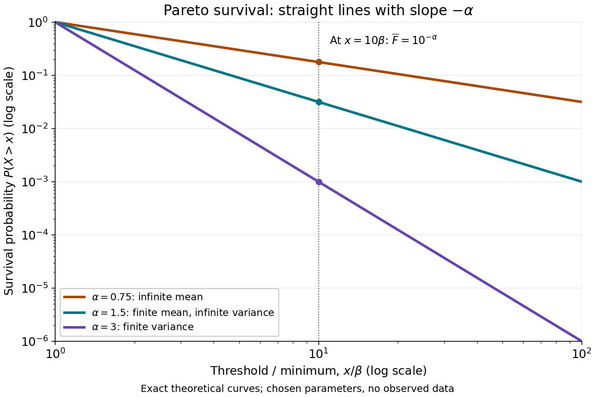
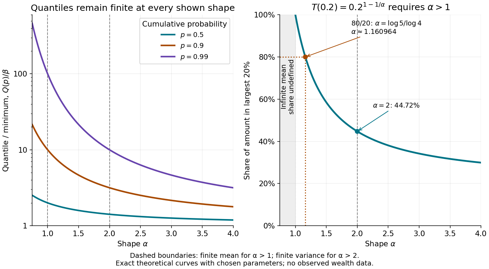
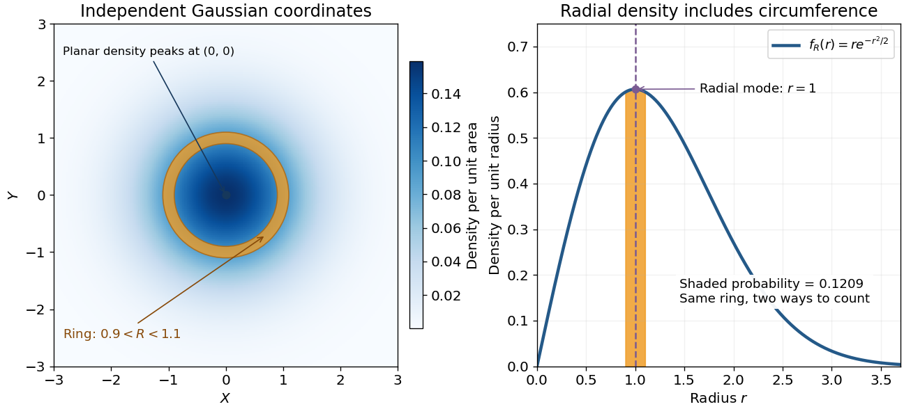
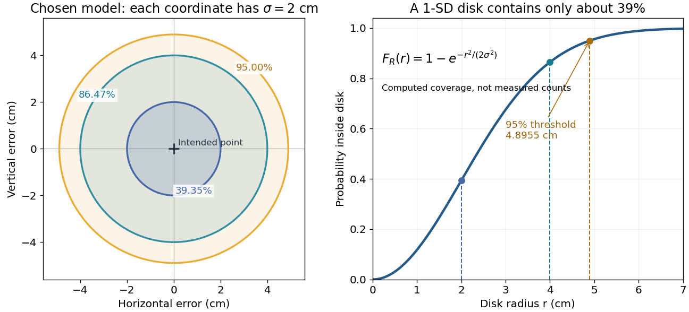
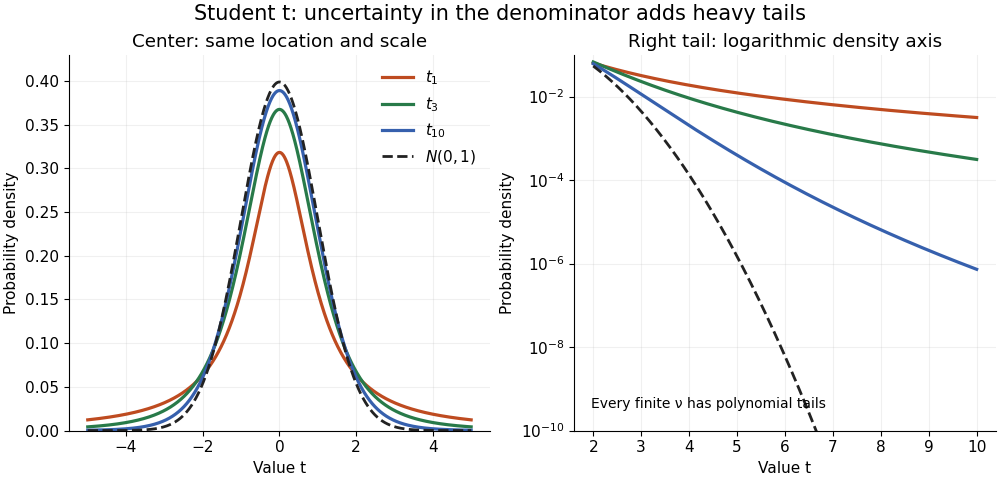
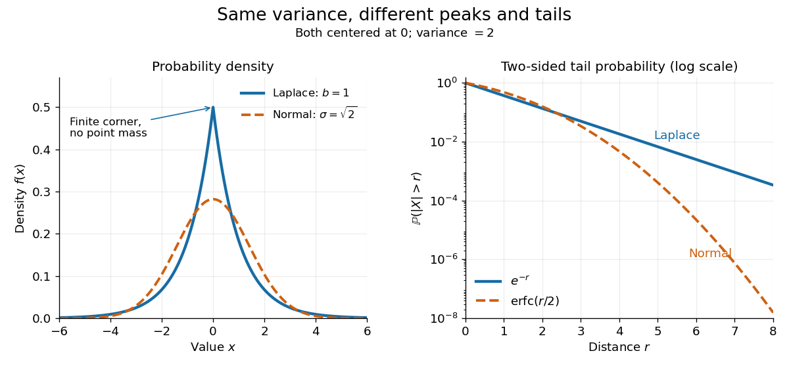
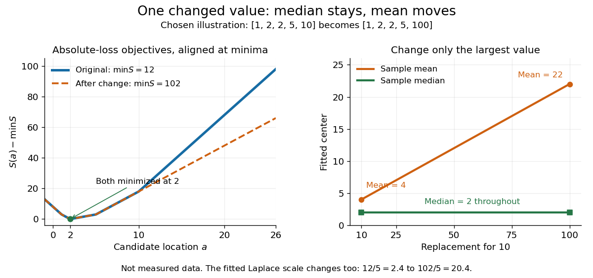

# Continuous probability distribution

↑ **Parent:** [Probability distribution](probability-distribution.md)  
ⓦ [Wiki](https://en.wikipedia.org/wiki/Continuous_probability_distribution)

A real [probability distribution](probability-distribution.md) with a continuous [cumulative distribution function](probability-distribution.md#cumulative-distribution-function) assigns probability zero to each individual value. Here this is the broad meaning of [continuous probability distribution](continuous-probability-distribution.md). Many elementary examples are more specifically [absolutely continuous probability distributions](#absolutely-continuous-probability-distribution), described by a [probability density function](#probability-density-function) with respect to [Lebesgue measure](measure-theory.md#lebesgue-measure). Some texts use "continuous" for that narrower class. The [Cantor distribution](#cantor-distribution) shows why the distinction matters: its [cumulative distribution function](probability-distribution.md#cumulative-distribution-function) is continuous, yet no [probability density function](#probability-density-function) with respect to [Lebesgue measure](measure-theory.md#lebesgue-measure) represents its whole law. [MIT Lecture 4: continuous CDFs and the singular Cantor example](https://ocw.mit.edu/courses/6-436j-fundamentals-of-probability-fall-2018/9797310bed4c7f5b5d40d007783eec8d_MIT6_436JF18_lec04.pdf).

**Table of contents**

- [Cantor distribution](#cantor-distribution)
- [Distance between two uniform points in a three-dimensional ball](#distance-between-two-uniform-points-in-a-three-dimensional-ball)
- [Beta-prime distribution](#beta-prime-distribution)
- [Triangular distribution](#triangular-distribution)
  - [Difference of two independent uniform random variables](#difference-of-two-independent-uniform-random-variables)
- [Arcsine distribution](#arcsine-distribution)
  - [Arcsine distribution from a uniform angle](#arcsine-distribution-from-a-uniform-angle)
  - [Endpoint concentration in the arcsine distribution](#endpoint-concentration-in-the-arcsine-distribution)
  - [Arcsine quantiles and moments](#arcsine-quantiles-and-moments)
  - [Arcsine distribution on a bounded interval](#arcsine-distribution-on-a-bounded-interval)
- [Log-uniform distribution](#log-uniform-distribution)
- [Pareto distribution](#pareto-distribution)
  - [One-big-jump polynomial lower bound](#one-big-jump-polynomial-lower-bound)
  - [Pareto moment threshold](#pareto-moment-threshold)
  - [Pareto tail conditional scaling](#pareto-tail-conditional-scaling)
  - [Pareto top shares and the 80/20 rule](#pareto-top-shares-and-the-80-20-rule)
- [Rayleigh distribution](#rayleigh-distribution)
  - [Rayleigh radius from Gaussian components](#rayleigh-radius-from-gaussian-components)
  - [Rayleigh radial thresholds and quantiles](#rayleigh-radial-thresholds-and-quantiles)
  - [Squared Rayleigh radius](#squared-rayleigh-radius)
  - [Rayleigh moments](#rayleigh-moments)
  - [Random-phase amplitude and the Rayleigh distribution](#random-phase-amplitude-and-the-rayleigh-distribution)
- [Hypoexponential distribution](#hypoexponential-distribution)
  - [Sum of exponential variables with linearly increasing rates](#sum-of-exponential-variables-with-linearly-increasing-rates)
  - [Conditional split of two exponential times](#conditional-split-of-two-exponential-times)
- [Student's t-distribution](#student-s-t-distribution)
  - [Normal scale mixture representation of Student t](#normal-scale-mixture-representation-of-student-t)
  - [Noncentral t-distribution](#noncentral-t-distribution)
  - [Studentized normal sample mean](#studentized-normal-sample-mean)
    - [Small normal sample mean confidence interval](#small-normal-sample-mean-confidence-interval)
  - [History of Student's t-distribution](#history-of-student-s-t-distribution)
- [F-distribution](#f-distribution)
- [Absolutely continuous probability distribution](#absolutely-continuous-probability-distribution)
  - [Probability density function](#probability-density-function)
    - [Change of variables for probability densities](#change-of-variables-for-probability-densities)
    - [Central angle between independent uniform sphere points](#central-angle-between-independent-uniform-sphere-points)
      - [Connectivity of three acute-angle sphere points](#connectivity-of-three-acute-angle-sphere-points)
      - [Pairwise acute central angles of three uniform sphere points](#pairwise-acute-central-angles-of-three-uniform-sphere-points)
    - [Normalizing constant](#normalizing-constant)
    - [Density ratio](#density-ratio)
    - [Log-concave probability density](#log-concave-probability-density)
    - [Lipschitz density height bound](#lipschitz-density-height-bound)
    - [Joint probability density](#joint-probability-density)
    - [Change-of-variables formula for a probability density](#change-of-variables-formula-for-a-probability-density)
- [Gamma distribution](#gamma-distribution)
  - [Wilson-Hilferty transformation](#wilson-hilferty-transformation)
  - [Shifted gamma distribution](#shifted-gamma-distribution)
  - [Beta-gamma independence](#beta-gamma-independence)
  - [Additivity of independent gamma distributions with a common rate](#additivity-of-independent-gamma-distributions-with-a-common-rate)
  - [Gamma exponential dispersion family](#gamma-exponential-dispersion-family)
  - [Cumulant-generating function of a gamma distribution](#cumulant-generating-function-of-a-gamma-distribution)
  - [Inverse-gamma distribution](#inverse-gamma-distribution)
    - [Gamma prior for an inverse-gamma scale](#gamma-prior-for-an-inverse-gamma-scale)
  - [Erlang distribution](#erlang-distribution)
  - [Sampling an integer-shape gamma distribution](#sampling-an-integer-shape-gamma-distribution)
- [Dirichlet distribution](#dirichlet-distribution)
- [Exponential distribution](#exponential-distribution)
  - [Exponential clock](#exponential-clock)
  - [Slow exponential plus an exponential sample mean](#slow-exponential-plus-an-exponential-sample-mean)
  - [Maximum of two exponentials as a scaled sum](#maximum-of-two-exponentials-as-a-scaled-sum)
  - [Integer and fractional parts of an exponential variable](#integer-and-fractional-parts-of-an-exponential-variable)
  - [Laplace transform of an exponential distribution](#laplace-transform-of-an-exponential-distribution)
  - [Memorylessness of the exponential distribution](#memorylessness-of-the-exponential-distribution)
  - [Uniform ratio of independent exponential variables](#uniform-ratio-of-independent-exponential-variables)
  - [Competing exponential clocks](#competing-exponential-clocks)
    - [Positive difference of independent exponential waiting times](#positive-difference-of-independent-exponential-waiting-times)
  - [Geometric sum of exponential variables](#geometric-sum-of-exponential-variables)
- [Continuous uniform distribution](#continuous-uniform-distribution)
  - [Coverage of antipodal points by a randomly oriented sector](#coverage-of-antipodal-points-by-a-randomly-oriented-sector)
  - [Random quadratic with uniform coefficients](#random-quadratic-with-uniform-coefficients)
  - [Uniform random variable](#uniform-random-variable)
  - [Steinhaus random variable](#steinhaus-random-variable)
    - [Steinhaus first-moment lower bound](#steinhaus-first-moment-lower-bound)
  - [Squared uniform distribution](#squared-uniform-distribution)
  - [Sum of two independent uniform variables](#sum-of-two-independent-uniform-variables)
  - [Uniform split of a random total](#uniform-split-of-a-random-total)
    - [Exponential characterization by a uniform random split](#exponential-characterization-by-a-uniform-random-split)
- [Laplace distribution](#laplace-distribution)
  - [Laplace location and scale maximum likelihood](#laplace-location-and-scale-maximum-likelihood)
    - [Laplace median robustness example](#laplace-median-robustness-example)
  - [Laplace prior for sparse images](#laplace-prior-for-sparse-images)
  - [Laplace regression](#laplace-regression)

## Cantor distribution

↑ **Parent:** [Continuous probability distribution](continuous-probability-distribution.md)  
ⓦ [Wiki](https://en.wikipedia.org/wiki/Cantor_distribution)

The [Cantor distribution](#cantor-distribution) is the [law of a random variable](probability-distribution.md)

$$
X=\sum_{n=1}^{\infty}\frac{2B_n}{3^n},
$$

where the $B_n$ are [independent](random-variable.md#independent-random-variables) [Bernoulli random variables](discrete-probability-distribution.md#bernoulli-distribution) taking values zero and one with equal probability. Its values lie in the [Cantor set](geometry-and-topology.md#cantor-set), and its [cumulative distribution function](probability-distribution.md#cumulative-distribution-function) is the [Cantor function](mathematics.md#cantor-function). Every individual value has probability zero, but the [Cantor set](geometry-and-topology.md#cantor-set) has probability one despite having zero [Lebesgue measure](measure-theory.md#lebesgue-measure). A [probability density function](#probability-density-function) on that set would integrate to zero, so it cannot describe this law. The example motivates the distinction between a [continuous probability distribution](continuous-probability-distribution.md) and an [absolutely continuous probability distribution](#absolutely-continuous-probability-distribution).

## Distance between two uniform points in a three-dimensional ball

↑ **Parent:** [Continuous probability distribution](continuous-probability-distribution.md)

For two [independent random variables](random-variable.md#independent-random-variables) taking values in a three-dimensional [ball](topological-analysis.md#ball-mathematics) with constant volume [probability density](wave-function.md#probability-density), the density of their distance is the displayed expression for $0\leq r\leq2R$, and zero otherwise. Both [independence](random-variable.md#independent-random-variables) and the common radius $R>0$ are essential. To derive it, put $u=|\mathbf r_1|$, $v=|\mathbf r_2|$ and integrate the product volume [differential form](differential-form.md) over orientations. The [law of cosines](euclidean-geometry.md#law-of-cosines) gives the angular [Jacobian determinant](multivariable-calculus.md#jacobian-determinant) $v/(ur)$, leaving $f_R(r)=9r\int uv\,du\,dv/(2R^6)$ over $0\leq u,v\leq R$, $|u-v|\leq r\leq u+v$. With $x=u+v$, $y=u-v$, the integrand becomes $(x^2-y^2)\,dx\,dy/8$. Direct integration gives $\int uv\,du\,dv=2R^3r/3-R^2r^2/2+r^4/24$. An independent geometric derivation uses the overlap volume of two radius-$R$ balls displaced by $r$, namely $\pi(4R+r)(2R-r)^2/12$, multiplied by $4\pi r^2$ and divided by the square of $4\pi R^3/3$. The density integrates to one and has mean $36R/35$.

## Beta-prime distribution

↑ **Parent:** [Continuous probability distribution](continuous-probability-distribution.md)

For $a,b>0$, this [probability density function](#probability-density-function) is obtained from a [beta distribution](probability-distribution.md#beta-distribution) variable $U$ by $X=U/(1-U)$. Indeed $u=x/(1+x)$ and $du/dx=(1+x)^{-2}$, and the [change of variables formula](multivariable-calculus.md#change-of-variables-formula) gives the displayed density. In particular, the ratio of two [independent](random-variable.md#independent-random-variables) equal-rate [exponential distributions](#exponential-distribution) has $a=b=1$, density $(1+x)^{-2}$ and [cumulative distribution function](probability-distribution.md#cumulative-distribution-function) $x/(1+x)$.

## Triangular distribution

↑ **Parent:** [Continuous probability distribution](continuous-probability-distribution.md)  
ⓦ [Wiki](https://en.wikipedia.org/wiki/Triangular_distribution)

A triangular [probability density function](#probability-density-function) rises linearly from zero at $a$ to its mode $c$, then falls linearly to zero at $b$. Its peak is $2/(b-a)$. Its [inverse transform sampling](probability-distribution.md#inverse-transform-sampling) rule is $a+\sqrt{u(b-a)(c-a)}$ for $u\le(c-a)/(b-a)$, and $b-\sqrt{(1-u)(b-a)(b-c)}$ otherwise.

### Difference of two independent uniform random variables

↑ **Parent:** [Triangular distribution](#triangular-distribution)

If $U,V$ are [independent random variables](random-variable.md#independent-random-variables), each with the [uniform distribution](#continuous-uniform-distribution) on $[0,a]$ for $a>0$, then $T=U-V$ has the symmetric [triangular distribution](#triangular-distribution)

$$
q(t)=\begin{cases}(a-|t|)/a^2,&|t|<a,\\0,&|t|\geq a.\end{cases}
$$

The [convolution of probability densities](probability-distribution.md#convolution-of-independent-random-variables) gives $q(t)=a^{-2}\int\mathbf1_{[0,a]}(s)\mathbf1_{[0,a]}(s+t)\,ds$. The overlap of these two [intervals](real-analysis.md#interval-mathematics) has length $a-|t|$ for $|t|<a$ and is empty otherwise, proving the formula. By [linearity of expectation](expected-value.md#linearity-of-expectation) and the [variance of a sum](variance.md#variance-of-a-sum),

$$
\mathbb E[T]=0,\qquad\operatorname{Var}(T)=a^2/6.
$$

For $0\leq b\leq a$, its upper-tail [probability](probability-theory.md#probability) is $(a-b)^2/(2a^2)$.

A useful model for elapsed time measured from two independently truncated clock readings uses $a$ as the display resolution and $T$ as the endpoint-offset difference. Independence is essential: uniform marginal [probability distributions](probability-distribution.md) alone do not imply this [triangular distribution](#triangular-distribution). For example $U=V$ gives $T=0$ with certainty. In general, with the same uniform marginals, $\operatorname{Var}(U-V)=a^2/6-2\operatorname{Cov}(U,V)$.

## Arcsine distribution

↑ **Parent:** [Continuous probability distribution](continuous-probability-distribution.md)  
ⓦ [Wiki](https://en.wikipedia.org/wiki/Arcsine_distribution)

The standard [arcsine distribution](#arcsine-distribution) is a [continuous probability distribution](continuous-probability-distribution.md) on $[0,1]$ with [probability density function](#probability-density-function)

$$
f(x)=\frac1{\pi\sqrt{x(1-x)}},\qquad0<x<1.
$$

It is the [beta distribution](probability-distribution.md#beta-distribution) with both parameters equal to $1/2$. The density grows without bound toward both endpoints, yet neither endpoint has any [probability mass](probability-distribution.md#probability-mass). Its name comes from the [inverse sine](geometry-and-topology.md#inverse-sine) in its [cumulative distribution function](probability-distribution.md#cumulative-distribution-function).[Random: Probability, Mathematical Statistics, Stochastic Processes by Kyle Siegrist; The Standard Arcsine Distribution, Distribution Functions and Related Distributions: density, normalization, beta representation and CDF](mathematics-bibliography.md#random-probability-mathematical-statistics-stochastic-processes-by-kyle-siegrist/the-arcsine-distribution)

A useful way to see the shape is to choose a point uniformly around a [circle](topology.md#circle) and project it onto a diameter. Equal angular intervals do not give equal horizontal distances: the projection moves slowly near either end. An ideal [harmonic oscillator](classical-mechanics.md#simple-harmonic-motion) sampled at a uniformly chosen time in one complete period has the same endpoint concentration after rescaling its position. The distribution translates a simple geometric slowdown into a precise [probability](probability-theory.md#probability) calculation.

**[Figure 1](#image-uniform-angles-project-unevenly-onto-a-diameter). Uniform angles project unevenly onto a diameter**. Original calculated geometry. The circle marks an equally spaced angle grid to illustrate the uniform-angle model; these are not experimental observations. Horizontal projection gives $Y=\cos\Phi$ on $[-1,1]$. The right curve is its exact [probability density function](#probability-density-function) $1/(\pi\sqrt{1-y^2})$; the standard variable is $X=(1+Y)/2$.

For an original comparison, take equal-length regions: the middle half $[1/4,3/4]$, and the two outside quarters together. Then

$$
\boxed{\mathbb P(1/4\leq X\leq3/4)=\frac13,\qquad
\mathbb P(X<1/4\text{ or }X>3/4)=\frac23.}
$$

A [uniform distribution](#continuous-uniform-distribution) on $[0,1]$ instead assigns each region [probability](probability-theory.md#probability) $1/2$. Both distributions have [mean](expected-value.md) $1/2$; the [mean](expected-value.md) alone hides their different concentration.

### Arcsine distribution from a uniform angle

↑ **Parent:** [Arcsine distribution](#arcsine-distribution)

Choose $\Theta$ with [uniform distribution](#continuous-uniform-distribution) on $(0,\pi/2)$ and set $X=\sin^2\Theta$. Since the [sine](geometry-and-topology.md#sine) is increasing on this interval,

$$
F(x)=\mathbb P(X\leq x)=\frac2\pi\arcsin\sqrt{x},\qquad0\leq x\leq1.
$$

Differentiation gives $f(x)=1/(\pi\sqrt{x(1-x)})$, and $F(0)=0$, $F(1)=1$ prove normalization. This also evaluates the density's [improper integral](real-analysis.md#improper-integral) without treating its divergent endpoint values as infinite [probability](probability-theory.md#probability).

For the [circle](topology.md#circle) construction, instead choose $\Phi$ with [uniform distribution](#continuous-uniform-distribution) on $[0,2\pi)$ and put $Y=\cos\Phi$. Each $-1<y<1$ has two preimages in one revolution. The [change of variables](multivariable-calculus.md#change-of-variables-formula) formula adds both contributions:

$$
f_Y(y)=\frac1{2\pi}\frac1{\sqrt{1-y^2}}+
\frac1{2\pi}\frac1{\sqrt{1-y^2}}
=\frac1{\pi\sqrt{1-y^2}}.
$$

The affine [change of variables](multivariable-calculus.md#change-of-variables-formula) $X=(1+Y)/2$ gives the standard [arcsine distribution](#arcsine-distribution). A single monotone-branch calculation without the second preimage would give only half the total [probability](probability-theory.md#probability).

The same geometry explains the ideal [harmonic oscillator](classical-mechanics.md#simple-harmonic-motion) $y(t)=A\cos(\omega t+\phi)$, with amplitude $A>0$ and [angular frequency](lagrangian-mechanics.md#angular-frequency) $\omega>0$. Choose $T$ uniformly in any complete period of duration $2\pi/\omega$. Its [oscillation phase](wave.md#phase-waves) modulo $2\pi$ is uniform, and $Y=y(T)$ has density

$$
f_Y(y)=\frac1{\pi\sqrt{A^2-y^2}},\qquad-A<y<A.
$$

Near a [turning point](energy.md#turning-point), $|dy/dt|=\omega\sqrt{A^2-y^2}$ is small, so a fixed position interval takes more time to cross. For the chosen amplitude $A=2\,\mathrm{cm}$, exactly one third of the period is spent in $|y|\leq1\,\mathrm{cm}$, and two thirds outside that central interval. These are calculations for an ideal sinusoid, rather than measured oscillator data.

The sampling assumption matters. Taking one observation every full period returns the same position each time. It does not produce this [probability distribution](probability-distribution.md). Uniformly random observation times and a fixed regularly spaced sampling scheme are different models; [aliasing](fourier-analysis.md#aliasing) can conceal the motion altogether.

[Paul Lévy](mathematics.md#paul-levy) used a related geometric construction in his work on [stochastic processes](stochastic-process.md): project a uniformly chosen point on a [circle](topology.md#circle) onto its diameter to divide a segment. The projection description appears explicitly in §5 of his paper, following its arcsine density calculation.[§5, printed pp. 301–302, Theorem 3 and the projection paragraph on p. 302; Numdam catalogues volume 7 as 1940, while the paper records receipt on 29 March 1939](mathematics-bibliography.md#sur-certains-processus-stochastiques-homogenes-by-paul-levy)

### Endpoint concentration in the arcsine distribution

↑ **Parent:** [Arcsine distribution](#arcsine-distribution)

An unbounded [probability density function](#probability-density-function) does not imply an atom. Here

$$
\mathbb P(X=0)=\mathbb P(X=1)=0,\qquad
\mathbb P(0<X<\varepsilon)=\frac2\pi\arcsin\sqrt\varepsilon
\sim\frac2\pi\sqrt\varepsilon\quad(\varepsilon\downarrow0).
$$

The last equivalence follows from $\arcsin u/u\to1$. The endpoint interval has much more [probability](probability-theory.md#probability) than the same interval under a [uniform distribution](#continuous-uniform-distribution), whose value is $\varepsilon$, but its [probability](probability-theory.md#probability) still tends to zero. This is an [integrable singularity](real-analysis.md#integrable-singularity).

For example, the first 1% of the unit interval contains about $6.377\%$ of the [probability](probability-theory.md#probability); the last 1% contains the same amount because the [arcsine distribution](#arcsine-distribution) is a [symmetric probability distribution](probability-distribution.md#symmetric-probability-distribution). Each exact endpoint still has zero [probability](probability-theory.md#probability). Density and interval [probability](probability-theory.md#probability) answer different questions.

**[Figure 2](#image-endpoint-density-diverges-but-every-finite-bin-has-finite-probability). Endpoint density diverges, but every finite bin has finite probability**. Original exact curves and bin probabilities. Left: the arcsine [cumulative distribution function](probability-distribution.md#cumulative-distribution-function) compared with the uniform one. Right: ten equal-width bins have probabilities $F((j+1)/10)-F(j/10)$, not heights sampled from the divergent density. Their total is one.

A numerical integration routine must respect these endpoint [integrable singularities](real-analysis.md#integrable-singularity). The substitution $x=\sin^2\theta$ gives

$$
f(x)\,dx=\frac2\pi\,d\theta,\qquad0<\theta<\pi/2.
$$

It turns a difficult-looking density integral into a constant measure in angle. Integrating finite bins is also a faithful way to draw the distribution near its endpoints; sampling $f(0)$ to make a bar height is not.

### Arcsine quantiles and moments

↑ **Parent:** [Arcsine distribution](#arcsine-distribution)

Inverting $F(x)=p$ gives the [quantile function](probability-distribution.md#quantile-function)

$$
Q(p)=\sin^2\left(\frac{\pi p}{2}\right),\qquad0\leq p\leq1.
$$

Consequently, [inverse transform sampling](probability-distribution.md#inverse-transform-sampling) uses $X=\sin^2(\pi U/2)$ with $U$ uniform on $(0,1)$. The [quartiles](probability-and-statistics.md#quartile) are $(2-\sqrt2)/4$, $1/2$ and $(2+\sqrt2)/4$.[Random: Probability, Mathematical Statistics, Stochastic Processes by Kyle Siegrist; The Standard Arcsine Distribution, Distribution Functions and Related Distributions: quantiles, quartiles and random quantile construction](mathematics-bibliography.md#random-probability-mathematical-statistics-stochastic-processes-by-kyle-siegrist/the-arcsine-distribution)

The first and third [quartiles](probability-and-statistics.md#quartile) are about $0.1464$ and $0.8536$, so the central half of the [probability](probability-theory.md#probability) spans about $0.7071$ of the unit interval. Under a [uniform distribution](#continuous-uniform-distribution), its width would be $0.5$.

The [symmetric probability distribution](probability-distribution.md#symmetric-probability-distribution) gives $\mathbb E[X]=1/2$. The angle representation gives a short calculation of the second [moment](expected-value.md#moment):

$$
\mathbb E[X^2]=\frac2\pi\int_0^{\pi/2}\sin^4\theta\,d\theta=\frac38,
\qquad \operatorname{Var}(X)=\frac38-\frac14=\frac18.
$$

Use $\sin^4\theta=(3-4\cos2\theta+\cos4\theta)/8$ to evaluate the integral. A [uniform distribution](#continuous-uniform-distribution) on $[0,1]$ has [variance](variance.md) $1/12$; the larger [variance](variance.md) $1/8$ quantifies the greater spread toward the ends.

More generally, for a nonnegative [integer](integer.md) $n$, the [beta function](complex-analysis.md#beta-function) yields

$$
\mathbb E[X^n]=\frac{B(n+1/2,1/2)}{B(1/2,1/2)}
=\frac{\binom{2n}{n}}{4^n}.
$$

For $n=0$ this is one; for $n=1,2$ it reproduces the values above. The [central binomial coefficient](binomial-coefficient.md#central-binomial-coefficient) thus appears in an exact moment calculation for a continuous [probability distribution](probability-distribution.md).

### Arcsine distribution on a bounded interval

↑ **Parent:** [Arcsine distribution](#arcsine-distribution)

Specify whether two parameters mean endpoints or location and width. With endpoints $a<b$, define $Y=a+(b-a)X$ for a standard [arcsine distribution](#arcsine-distribution) variable $X$. Then

$$
f_Y(y)=\frac1{\pi\sqrt{(y-a)(b-y)}},\quad a<y<b,
\qquad F_Y(y)=\frac2\pi\arcsin\sqrt{\frac{y-a}{b-a}}.
$$

This is a [location-scale family](statistical-model.md#location-scale-family) with location $a$ and width $b-a$. Its [mean](expected-value.md) is $(a+b)/2$ and its [variance](variance.md) is $(b-a)^2/8$. A convention using parameters $a,w$ for location and width instead has right endpoint $a+w$, so it must not be read as having endpoints $a,w$.[Random: Probability, Mathematical Statistics, Stochastic Processes by Kyle Siegrist; The General Arcsine Distribution, Definition, Distribution Functions and Moments: location-plus-width convention and alternative endpoint parametrization](mathematics-bibliography.md#random-probability-mathematical-statistics-stochastic-processes-by-kyle-siegrist/the-arcsine-distribution)

For example, a chosen interval $[-2,6]$ gives [mean](expected-value.md) $2$ and [variance](variance.md) $8$, while its density still concentrates toward both endpoints. It is a bounded [probability distribution](probability-distribution.md); its endpoint singularities do not make its support infinite.

## Log-uniform distribution

↑ **Parent:** [Continuous probability distribution](continuous-probability-distribution.md)

For $0<A<B<\infty$, this density makes $\log X$ uniform between $\log A$ and $\log B$. It is a proper finite-interval version of the [scale-invariant prior](bayesian-statistics.md#scale-invariant-prior). The chosen logarithm base changes only the endpoint coordinates.

## Pareto distribution

↑ **Parent:** [Continuous probability distribution](continuous-probability-distribution.md)  
ⓦ [Wiki](https://en.wikipedia.org/wiki/Pareto_distribution)

The [Pareto distribution](#pareto-distribution) describes a positive [random variable](random-variable.md) whose [tail probability](probability-theory.md#tail-probability) falls as a [power law](analysis.md#power-law). In the shape–minimum convention used here, $X\sim\operatorname{Pareto}(\alpha,\beta)$ has [shape parameter](statistical-modelling.md#shape-parameter) $\alpha>0$ and minimum $\beta>0$, with [probability support](probability-distribution.md#support-of-a-probability-distribution) $[\beta,\infty)$. Its [probability density function](#probability-density-function) is

$$
f(x)=\begin{cases}\alpha\beta^\alpha x^{-\alpha-1},&x\geq\beta,\\0,&x<\beta.\end{cases}
$$

The minimum $\beta$ has the same units as $X$; the [shape parameter](statistical-modelling.md#shape-parameter) $\alpha$ is dimensionless. At fixed $\alpha$, changing $\beta$ gives a [scale family](statistical-model.md#scale-family), since $X/\beta\sim\operatorname{Pareto}(\alpha,1)$. This convention is also used in [uniform-Pareto conjugacy](exponential-family.md#uniform-pareto-conjugacy).[NIST Dataplot Reference Manual; Description: standard Pareto density and lower bound; source gamma,a correspond to alpha,beta here](mathematics-bibliography.md#nist-dataplot-reference-manual/pareto-probability-density-function)

The [survival function](survival-analysis.md#survival-function) and [cumulative distribution function](probability-distribution.md#cumulative-distribution-function) are

$$
\overline F(x)=\mathbb P(X>x)=\begin{cases}1,&x<\beta,\\(\beta/x)^\alpha,&x\geq\beta,\end{cases}
\qquad F(x)=1-\overline F(x).
$$

For $0<p<1$, solving $F(x)=p$ gives the [quantile function](probability-distribution.md#quantile-function)

$$
Q(p)=\beta(1-p)^{-1/\alpha}.
$$

Its right-hand limit at $p=0$ is $\beta$; it tends to infinity as $p\uparrow1$.[Random: Probability, Mathematical Statistics, Stochastic Processes by Kyle Siegrist; The General Pareto Distribution, Distribution Functions: density, CDF and quantiles; source a,b correspond to alpha,beta here](mathematics-bibliography.md#random-probability-mathematical-statistics-stochastic-processes-by-kyle-siegrist/the-pareto-distribution) There is no [probability mass](probability-distribution.md#probability-mass) at $\beta$: changing a [probability density function](#probability-density-function)'s value at that single point changes no [probabilities](probability-theory.md#probability).

Choose $\alpha=2$ and $\beta=10$ as an original theoretical example. Then $\mathbb P(X>20)=1/4$, $\mathbb P(X>100)=1/100$, the [median](probability-distribution.md#median) is $10\sqrt2\simeq14.142$, and the 0.99 [quantile](probability-distribution.md#quantile-function) is $Q(0.99)=100$. These chosen values and all figures below describe mathematical [probability distributions](probability-distribution.md), not actual wealth observations.

**[Figure 3](#image-pareto-survival-curves-smaller-alpha-gives-a-slower-power-law-tail). Pareto survival curves: smaller alpha gives a slower power-law tail**.

On this [log-log plot](calculus.md#log-log-plot), write $r=x/\beta$ to obtain $\log\overline F(\beta r)=-\alpha\log r$. The [slope](euclidean-geometry.md#slope) is $-\alpha$, whereas the [probability density function](#probability-density-function) has power exponent $\alpha+1$. Multiplying a threshold by ten divides its [tail probability](probability-theory.md#tail-probability) by $10^\alpha$. A larger $\alpha$ therefore concentrates the [Pareto distribution](#pareto-distribution) nearer $\beta$; a smaller $\alpha$ makes extreme values more plausible. This exact scaling is useful when modelling large positive losses or sizes over several orders of magnitude.

The [Pareto distribution](#pareto-distribution) is a [heavy-tailed distribution](probability-distribution.md#heavy-tailed-distribution): for every $t>0$, the [exponential moment](probability-distribution.md#exponential-moment) $\mathbb E[e^{tX}]$ diverges because $e^{tx}x^{-\alpha-1}$ eventually grows without bound. In contrast, the [Laplace distribution](#laplace-distribution) has exponentially decreasing tails and some finite positive [exponential moments](probability-distribution.md#exponential-moment). The [Student's t-distribution](#student-s-t-distribution) also has power tails, but on both sides of the [real line](real-analysis.md#real-line), with a smooth central region rather than a positive minimum.

### One-big-jump polynomial lower bound

↑ **Parent:** [Pareto distribution](#pareto-distribution)

Let $S_n=\sum_{i=1}^nX_i$, where the summands are [independent and identically distributed](random-variable.md#independent-and-identically-distributed-random-variables) with [Pareto distribution](#pareto-distribution) $\operatorname{Pareto}(\alpha,\beta)$. Their positivity implies $\{X_1\geq na\}\subseteq\{S_n\geq na\}$, so for fixed $a>0$ and $na\geq\beta$,

$$
\mathbb P(S_n\geq na)\geq\left(\frac{\beta}{na}\right)^\alpha,\qquad
\frac{\alpha}{n}\log\frac{\beta}{na}\leq\frac1n\log\mathbb P(S_n\geq na)\leq0.
$$

Both outer expressions tend to zero. A single large summand already prevents a strictly negative exponential rate. No positive [exponential moment](probability-distribution.md#exponential-moment) exists, so the exponential-moment form of the [Cramér theorem](probability-distribution.md#cramer-s-theorem) cannot be applied. The bound proves this logarithmic rate and does not assert an exact tail asymptotic. In particular, it remains true when $a$ lies below a finite [mean](expected-value.md), where the event need not even be rare. The stronger fixed-summand-count asymptotic in a [heavy-tailed subexponential distribution](probability-distribution.md#subexponential-distribution-heavy-tailed) is a separate statement.

### Pareto moment threshold

↑ **Parent:** [Pareto distribution](#pareto-distribution)

A [Pareto distribution](#pareto-distribution) is a proper [probability distribution](probability-distribution.md) for every $\alpha,\beta>0$, even when its [mean](expected-value.md) is infinite. To see both facts, integrate the [probability density function](#probability-density-function) against $x^q$. For real $q\geq0$,

$$
\mathbb E[X^q]=\alpha\beta^\alpha\int_\beta^\infty x^{q-\alpha-1}\,dx
=\begin{cases}\dfrac{\alpha\beta^q}{\alpha-q},&0\leq q<\alpha,\\+\infty,&q\geq\alpha.\end{cases}
$$

The [improper integral](real-analysis.md#improper-integral) converges exactly when $q-\alpha-1<-1$. At $q=\alpha$ it diverges logarithmically; above that it diverges as a positive power of the upper endpoint. Setting $q=0$ gives one, proving normalization regardless of whether higher [moments](expected-value.md#moment) exist.

Taking $q=1,2$ and using $\operatorname{Var}(X)=\mathbb E[X^2]-(\mathbb E[X])^2$ when both terms are finite gives

$$
\mathbb E[X]=\frac{\alpha\beta}{\alpha-1}\quad(\alpha>1),\qquad
\operatorname{Var}(X)=\frac{\alpha\beta^2}{(\alpha-1)^2(\alpha-2)}\quad(\alpha>2).
$$

For $0<\alpha\leq1$, the nonnegative [random variable](random-variable.md) has [expected value](expected-value.md) $+\infty$; a centered [variance](variance.md) about a finite [mean](expected-value.md) is unavailable. For $1<\alpha\leq2$, the [mean](expected-value.md) is finite and the [variance](variance.md) is infinite.[Random: Probability, Mathematical Statistics, Stochastic Processes by Kyle Siegrist; The General Pareto Distribution, Moments: existence threshold, mean and variance](mathematics-bibliography.md#random-probability-mathematical-statistics-stochastic-processes-by-kyle-siegrist/the-pareto-distribution) A finite total [probability](probability-theory.md#probability) and a finite [expected value](expected-value.md) answer different questions.

At the chosen minimum $\beta=10$, $\alpha=3$ gives $\mathbb E[X]=15$, $\mathbb E[X^2]=300$ and [variance](variance.md) $300-15^2=75$, but an infinite third [moment](expected-value.md#moment). At $\alpha=3/2$, the [mean](expected-value.md) is 30 and the [variance](variance.md) is infinite; at $\alpha=3/4$, even the [mean](expected-value.md) is infinite, while the [median](probability-distribution.md#median) remains the finite number $10\,2^{4/3}\simeq25.198$. At the boundary $\alpha=2$, the earlier example has [mean](expected-value.md) 20 but infinite [variance](variance.md). A finite sample contains finite values almost surely; that fact cannot establish that the underlying [mean](expected-value.md) or [variance](variance.md) is finite.

### Pareto tail conditional scaling

↑ **Parent:** [Pareto distribution](#pareto-distribution)

Conditioning a [Pareto distribution](#pareto-distribution) on exceeding a threshold changes its minimum while preserving its [shape parameter](statistical-modelling.md#shape-parameter). For $u\geq\beta$ and $x\geq u$, the definition of [conditional probability](probability-theory.md#conditional-probability) gives

$$
\mathbb P(X>x\mid X\geq u)=\frac{(\beta/x)^\alpha}{(\beta/u)^\alpha}=\left(\frac{u}{x}\right)^\alpha.
$$

Equivalently, for $r\geq1$,

$$
\mathbb P(X/u>r\mid X\geq u)=r^{-\alpha}.
$$

The ratio to the threshold has the same [Pareto distribution](#pareto-distribution) at every admissible threshold.[Random: Probability, Mathematical Statistics, Stochastic Processes by Kyle Siegrist; The General Pareto Distribution, Related Distributions: closure under right-tail conditioning](mathematics-bibliography.md#random-probability-mathematical-statistics-stochastic-processes-by-kyle-siegrist/the-pareto-distribution) For the chosen $\alpha=2$, $\beta=10$, only $1/4$ of outcomes exceed 20, but among those outcomes the [probability](probability-theory.md#probability) of exceeding 40 is again $1/4$. When $\alpha>1$, the same identity gives [conditional expectation](measure-theory.md#conditional-expectation) $\mathbb E[X\mid X\geq u]=\alpha u/(\alpha-1)$.

This multiplicative scaling differs from the additive [memoryless property](#memorylessness-of-the-exponential-distribution) of an [exponential distribution](#exponential-distribution). Indeed $Y=\log(X/\beta)$ has [exponential distribution](#exponential-distribution) of rate $\alpha$, because $\mathbb P(Y>y)=e^{-\alpha y}$ for $y\geq0$. Thus logarithms turn multiplication into addition and explain the scaling property. Conversely, if $U$ has [uniform distribution](#continuous-uniform-distribution) on $(0,1)$, [inverse transform sampling](probability-distribution.md#inverse-transform-sampling) gives $X=\beta(1-U)^{-1/\alpha}$.

The excess $Z=X-u$ conditional on $X\geq u$ has [survival function](survival-analysis.md#survival-function) $(1+z/u)^{-\alpha}$ for $z\geq0$. In the [generalized Pareto distribution](extreme-value-theory.md#generalized-pareto-distribution) convention $\mathbb P(Z>z)=(1+\xi z/\sigma)^{-1/\xi}$, this means $\xi=1/\alpha$ and $\sigma=u/\alpha$. Here the excess starts at zero; the original [Pareto distribution](#pareto-distribution) starts at $\beta>0$.

<h3 id="pareto-top-shares-and-the-80-20-rule">Pareto top shares and the 80/20 rule</h3>

↑ **Parent:** [Pareto distribution](#pareto-distribution)

For a nonnegative [random variable](random-variable.md) with finite positive [mean](expected-value.md), the share of its total amount carried by the largest fraction $q$ of outcomes can be defined by dividing their contribution to the [expected value](expected-value.md) by the whole [expected value](expected-value.md). For a [Pareto distribution](#pareto-distribution), let $0<q\leq1$ and choose $x_q=\beta q^{-1/\alpha}$, so that $\mathbb P(X\geq x_q)=q$. If $\alpha>1$, direct integration gives

$$
T(q)=\frac{\mathbb E[X\mathbf1_{\{X\geq x_q\}}]}{\mathbb E[X]}
=\frac{\alpha\beta^\alpha x_q^{1-\alpha}/(\alpha-1)}{\alpha\beta/(\alpha-1)}
=q^{1-1/\alpha}.
$$

This is a share of amount, distinct from the fraction of outcomes. It depends on $\alpha$, but not on the unit of measurement $\beta$.[Section III.D, pp. 10–11, Eqs. (27)–(28): upper-population share; Newman's density exponent equals alpha+1 in the present tail-exponent convention](mathematics-bibliography.md#power-laws-pareto-distributions-and-zipf-s-law-by-mark-newman)

For the chosen $\alpha=2$, the top 20% starts at $x_{0.2}=10\sqrt5\simeq22.361$ and carries $T(0.2)=\sqrt{0.2}\simeq44.72\%$ of the amount. To make the top 20% carry exactly 80%, solve

$$
(1/5)^{1-1/\alpha}=4/5
\quad\Longrightarrow\quad
\alpha=\frac{\log5}{\log4}\simeq1.160964.
$$

The resulting [Pareto distribution](#pareto-distribution) has a finite [mean](expected-value.md) and infinite [variance](variance.md). The 80/20 rule selects one [shape parameter](statistical-modelling.md#shape-parameter); it is not a universal law, or even a property of every [Pareto distribution](#pareto-distribution). For $\alpha\leq1$, the population-share definition above is unavailable because its denominator is infinite; substituting such an $\alpha$ into the finite-mean formula is invalid.

**[Figure 4](#image-changing-pareto-alpha-changes-quantiles-moment-existence-and-the-top-20-percent-share). Changing Pareto alpha changes quantiles, moment existence and the top 20 percent share**.

The left panel compares three [quantiles](probability-distribution.md#quantile-function) in units of the minimum. The right panel shows $T(0.2)$ only where the [mean](expected-value.md) is finite, and marks the chosen 80/20 value. The thresholds $\alpha=1$ and $\alpha=2$ separate the [moment](expected-value.md#moment) regimes; they do not separate valid and invalid [probability distributions](probability-distribution.md).

A straight-looking empirical [log-log plot](calculus.md#log-log-plot) does not by itself establish a [Pareto distribution](#pareto-distribution) or a reliable tail exponent; estimating an exponent and assessing [goodness of fit](statistical-modelling.md#goodness-of-fit) are separate tasks.[Section II, pp. 4–5, Eqs. (3)–(5) and discussion: survival versus density exponent, biases from fitting plotted slopes, and the lower threshold for power-law behaviour](mathematics-bibliography.md#power-laws-pareto-distributions-and-zipf-s-law-by-mark-newman) If a [Pareto distribution](#pareto-distribution) is used only above a fitted lower threshold, $T(q)$ describes that conditional tail population, not automatically the whole population. A genuine finite upper cutoff gives a [truncated distribution](probability-distribution.md#truncated-distribution) with finite nonnegative [moments](expected-value.md#moment); its [survival function](survival-analysis.md#survival-function), [quantiles](probability-distribution.md#quantile-function) and top shares must be recalculated. Truncation is a modelling change, distinct from merely observing a finite sample. None of the chosen numbers here estimates an actual wealth distribution.

## Rayleigh distribution

↑ **Parent:** [Continuous probability distribution](continuous-probability-distribution.md)  
ⓦ [Wiki](https://en.wikipedia.org/wiki/Rayleigh_distribution)

The [Rayleigh distribution](#rayleigh-distribution) is the [probability distribution](probability-distribution.md) of the [Euclidean norm](normed-vector-space.md#euclidean-norm) of a two-dimensional [random vector](random-variable.md#random-vector) with [independent](random-variable.md#independent-random-variables) zero-[mean](expected-value.md) [normal random variables](probability-distribution.md#gaussian-random-variable) of equal [variance](variance.md) as components. If $X,Y\sim N(0,\sigma^2)$ are [independent](random-variable.md#independent-random-variables), then

$$
R=\sqrt{X^2+Y^2}\sim\operatorname{Rayleigh}(\sigma),\qquad
f_R(r)=\begin{cases}\dfrac r{\sigma^2}e^{-r^2/(2\sigma^2)},&r\geq0,\\0,&r<0.\end{cases}
$$

Here $\sigma$ is the [standard deviation](variance.md#standard-deviation) of each component, not of the [radius](topology.md#radius) $R$. At $\sigma=1$ this gives the unit-scale [probability density function](#probability-density-function) $r e^{-r^2/2}$.[Random: Probability, Mathematical Statistics, Stochastic Processes by Kyle Siegrist; The General Rayleigh Distribution, Definition and Distribution Functions: independent equal-scale centered normal components and radial density](mathematics-bibliography.md#random-probability-mathematical-statistics-stochastic-processes-by-kyle-siegrist/the-rayleigh-distribution)

This geometry turns two signed errors into one nonnegative distance. For example, suppose horizontal and vertical positioning errors are [independent](random-variable.md#independent-random-variables) $N(0,4\,\mathrm{cm}^2)$ [random variables](random-variable.md). Their [means](expected-value.md) both vanish, but the distance from the intended point is usually positive. The [Rayleigh distribution](#rayleigh-distribution) with $\sigma=2\,\mathrm{cm}$ gives the [probability](probability-theory.md#probability) of landing inside any centered [disk](topology.md#disk-mathematics). These are chosen model assumptions, rather than measurements of a particular instrument.

**[Figure 5](#image-the-center-maximizes-planar-density-while-a-positive-radius-maximizes-radial-density). The center maximizes planar density, while a positive radius maximizes radial density**. Original calculated model with $\sigma=1$. Left: [joint probability density](#joint-probability-density) per unit [area](differential-geometry.md#surface-area), with an [annulus](topology.md#annulus-mathematics) from $r=0.9$ to $r=1.1$. Right: [probability density function](#probability-density-function) per unit [radius](topology.md#radius); the shaded area is the probability of that same [annulus](topology.md#annulus-mathematics). A single point and a single [circle](topology.md#circle) both have probability zero.

An apparently paradoxical feature is that the most likely location per unit [area](differential-geometry.md#surface-area) is the origin, while the radial [mode](probability-and-statistics.md#mode-statistics) is $\sigma$. A narrow [annulus](topology.md#annulus-mathematics) farther out has more [area](differential-geometry.md#surface-area). Near zero that growing [circumference](topology.md#circumference) outweighs the falling planar density; farther out the [exponential function](calculus.md#exponential-function) wins. Distinguishing densities measured against different elements of [area](differential-geometry.md#surface-area) or length resolves the paradox.

### Rayleigh radius from Gaussian components

↑ **Parent:** [Rayleigh distribution](#rayleigh-distribution)

The [joint probability density](#joint-probability-density) of $X,Y$ is

$$
p(x,y)=\frac1{2\pi\sigma^2}e^{-(x^2+y^2)/(2\sigma^2)}.
$$

In [polar coordinates](multivariable-calculus.md#polar-coordinates), $x=r\cos\theta$, $y=r\sin\theta$, and the absolute [Jacobian determinant](multivariable-calculus.md#jacobian-determinant) is $r$. Thus the joint density of [radius](topology.md#radius) and angle factors as

$$
p_{R,\Theta}(r,\theta)=\frac r{\sigma^2}e^{-r^2/(2\sigma^2)}\frac1{2\pi},\qquad r>0,\quad0\leq\theta<2\pi.
$$

Integrating over angle gives the [Rayleigh distribution](#rayleigh-distribution). The same factorization shows that the angle has [uniform distribution](#continuous-uniform-distribution) and is [independent](random-variable.md#independent-random-variables) of the [radius](topology.md#radius). This is a short [change of variables](multivariable-calculus.md#change-of-variables-formula) argument: an [annulus](topology.md#annulus-mathematics) of width $dr$ has [area](differential-geometry.md#surface-area) $2\pi r\,dr$ to first order.

The assumptions are substantive. Unequal component [variances](variance.md) give elliptical rather than circular density contours; a nonzero mean displaces the center. Even zero [covariance](variance.md#covariance) and equal [normal distributions](probability-distribution.md#normal-distribution) do not suffice without [independence](random-variable.md#independent-random-variables). For an original counterexample, let $X\sim N(0,\sigma^2)$ and let $S$ be an [independent](random-variable.md#independent-random-variables) [Rademacher random variable](probability-distribution.md#rademacher-distribution). Put $Y=SX$. Then $Y$ has the same [normal distribution](probability-distribution.md#normal-distribution) as $X$, and $\operatorname{Cov}(X,Y)=\mathbb E[SX^2]=0$. Nevertheless, all points lie on $y=x$ or $y=-x$, and $R=\sqrt2|X|$ has density

$$
f_R(r)=\frac1{\sigma\sqrt\pi}e^{-r^2/(4\sigma^2)},\qquad r\geq0,
$$

which is positive at zero, unlike the [Rayleigh distribution](#rayleigh-distribution). This pair is not a [Gaussian random vector](probability-and-statistics.md#gaussian-random-vector).

### Rayleigh radial thresholds and quantiles

↑ **Parent:** [Rayleigh distribution](#rayleigh-distribution)

For $r\geq0$, integration gives the [survival function](survival-analysis.md#survival-function) and [cumulative distribution function](probability-distribution.md#cumulative-distribution-function)

$$
\mathbb P(R>r)=e^{-r^2/(2\sigma^2)},\qquad
F_R(r)=1-e^{-r^2/(2\sigma^2)}.
$$

Solving $F_R(r_p)=p$ gives the [quantile function](probability-distribution.md#quantile-function)

$$
\boxed{r_p=\sigma\sqrt{-2\log(1-p)},\qquad0<p<1.}
$$

[Random: Probability, Mathematical Statistics, Stochastic Processes by Kyle Siegrist; The General Rayleigh Distribution, Distribution Functions: CDF, quantile and survival functions](mathematics-bibliography.md#random-probability-mathematical-statistics-stochastic-processes-by-kyle-siegrist/the-rayleigh-distribution)

For the chosen positioning model $\sigma=2\,\mathrm{cm}$,

$$
\mathbb P(R\leq2\,\mathrm{cm})=1-e^{-1/2}\simeq0.3935,\qquad
\mathbb P(R\leq4\,\mathrm{cm})=1-e^{-2}\simeq0.8647.
$$

The [disk](topology.md#disk-mathematics) of [radius](topology.md#radius) one component [standard deviation](variance.md#standard-deviation) therefore contains about 39.35% of outcomes; the familiar one-dimensional normal interval percentage does not apply to a two-dimensional [disk](topology.md#disk-mathematics). The 95% and 99% radial thresholds are

$$
\boxed{r_{0.95}\simeq4.8955\,\mathrm{cm},\qquad r_{0.99}\simeq6.0697\,\mathrm{cm}.}
$$

A [circle](topology.md#circle) defined by $R=r_p$ itself still has [probability](probability-theory.md#probability) zero; its enclosed [disk](topology.md#disk-mathematics) carries the stated [probability](probability-theory.md#probability).

**[Figure 6](#image-radial-coverage-uses-disks-rather-than-one-dimensional-normal-intervals). Radial coverage uses disks rather than one-dimensional normal intervals**. Original chosen model: each independent centered coordinate has [standard deviation](variance.md#standard-deviation) $2\,\mathrm{cm}$. Concentric [disks](topology.md#disk-mathematics) have radii $2\,\mathrm{cm}$, $4\,\mathrm{cm}$ and the calculated 95% threshold $4.8955\,\mathrm{cm}$. The curve gives exact model coverage, not empirical counts.

The closed-form [quantile function](probability-distribution.md#quantile-function) also gives [inverse transform sampling](probability-distribution.md#inverse-transform-sampling): if $U$ has [uniform distribution](#continuous-uniform-distribution) on $(0,1)$, then $\sigma\sqrt{-2\log U}$ has [Rayleigh distribution](#rayleigh-distribution). Using $1-U$ instead gives the same law. Endpoints are excluded so that the [logarithm](calculus.md#logarithm) stays finite.

### Squared Rayleigh radius

↑ **Parent:** [Rayleigh distribution](#rayleigh-distribution)

Squaring a [Rayleigh distribution](#rayleigh-distribution) variable produces an [exponential distribution](#exponential-distribution). For $w\geq0$,

$$
\mathbb P(R^2>w)=e^{-w/(2\sigma^2)},\qquad
R^2\sim\operatorname{Exp}\left(\frac1{2\sigma^2}\right),
$$

where the [exponential distribution](#exponential-distribution) parameter is a rate. Equivalently, $R^2/\sigma^2$ has [chi-squared distribution](probability-distribution.md#chi-squared-distribution) with two [degrees of freedom (statistics)](statistical-inference.md#statistical-degrees-of-freedom). An amplitude and its square therefore have different [probability density functions](#probability-density-function), even though one determines the other.

This makes the [Rayleigh-normal scale mixture](statistical-modelling.md#rayleigh-normal-scale-mixture) transparent: at unit scale, $R^2$ is exponential, allowing a random normal scale to produce a [Laplace distribution](#laplace-distribution). Another equivalent parametrization uses a [Weibull distribution](probability-distribution.md#weibull-distribution) with shape two and scale $\sqrt2\sigma$. Conventions that call this latter scale the Rayleigh scale differ by a factor of $\sqrt2$; check the [probability density function](#probability-density-function) before comparing numerical parameter values.[NIST Dataplot Reference Manual; Description: chi distribution with two degrees of freedom; Weibull shape two and scale sqrt(2) times sigma; warning about Rayleigh scale conventions](mathematics-bibliography.md#nist-dataplot-reference-manual/rayleigh-probability-density-function)

### Rayleigh moments

↑ **Parent:** [Rayleigh distribution](#rayleigh-distribution)

Using $u=r^2/(2\sigma^2)$ in the defining [expected value](expected-value.md) integral gives

$$
\mathbb E[R^q]
=\int_0^\infty r^q\frac r{\sigma^2}e^{-r^2/(2\sigma^2)}\,dr
=\sigma^q2^{q/2}\int_0^\infty u^{q/2}e^{-u}\,du
=\sigma^q2^{q/2}\Gamma(1+q/2),\qquad q>-2.
$$

The last integral is the [gamma function](complex-analysis.md#gamma-function). Near zero, the integrand before substitution behaves as $r^{q+1}$, explaining the threshold $q>-2$; at infinity the Gaussian tail controls every power. In particular,

$$
\mathbb E[R]=\sigma\sqrt{\frac\pi2},\quad
\mathbb E[R^2]=2\sigma^2,\quad
\operatorname{Var}(R)=\left(2-\frac\pi2\right)\sigma^2.
$$

[Random: Probability, Mathematical Statistics, Stochastic Processes by Kyle Siegrist; The General Rayleigh Distribution, Moments: mean, variance and nonnegative integer moments; extension to real q greater than -2 follows from the displayed integral](mathematics-bibliography.md#random-probability-mathematical-statistics-stochastic-processes-by-kyle-siegrist/the-rayleigh-distribution)

For the chosen $\sigma=2\,\mathrm{cm}$, the [mean](expected-value.md) [radius](topology.md#radius) is about $2.5066\,\mathrm{cm}$, its [median](probability-distribution.md#median) is $2\sqrt{2\log2}\simeq2.3548\,\mathrm{cm}$, and its [mode](probability-and-statistics.md#mode-statistics) is $2\,\mathrm{cm}$. Its [root mean square](analysis.md#root-mean-square) is $2\sqrt2\simeq2.8284\,\mathrm{cm}$. Different summaries answer different questions; the component scale $\sigma$ is neither the radial [mean](expected-value.md) nor the radial [standard deviation](variance.md#standard-deviation).

### Random-phase amplitude and the Rayleigh distribution

↑ **Parent:** [Rayleigh distribution](#rayleigh-distribution)

In an 1880 paper, [John William Strutt](physicist.md#john-william-strutt-3rd-baron-rayleigh), known as [Lord Rayleigh](physicist.md#john-william-strutt-3rd-baron-rayleigh), studied the resultant of many [oscillations](wave.md#oscillation) with a common [frequency](wave.md#frequency) and arbitrary [oscillation phases](wave.md#phase-waves). His large-number calculation distinguished a mean intensity from a definite resultant [amplitude](wave.md#wave-amplitude) and used planar coordinates followed by a polar integral. The resulting [amplitude](wave.md#wave-amplitude) density is the [Rayleigh distribution](#rayleigh-distribution) in a different scale convention. This is a large-number description, not an exact law for every finite collection of [oscillations](wave.md#oscillation).[Philosophical Magazine, Series 5, volume 10 (August 1880), pp. 73–74: expected intensity versus definite resultant; pp. 75–77: planar construction and polar integration; primary-paper transcription inspected on Scribd](physics-bibliography.md#on-the-resultant-of-a-large-number-of-vibrations-of-the-same-pitch-and-of-arbitrary-phase-by-john-william-strutt-3rd-baron-rayleigh)

To see the connection in a chosen model, take [independent](random-variable.md#independent-random-variables) [oscillation phases](wave.md#phase-waves) $\Theta_j$ with [uniform distribution](#continuous-uniform-distribution) on $[0,2\pi)$ and equal component [amplitude](wave.md#wave-amplitude) $a$. The [phasor](wave.md#phasor) sum has coordinates

$$
X_n=a\sum_{j=1}^n\cos\Theta_j,\qquad Y_n=a\sum_{j=1}^n\sin\Theta_j.
$$

Both have [mean](expected-value.md) zero, [variance](variance.md) $na^2/2$ and zero [covariance](variance.md#covariance). The [multivariate central limit theorem](convergence-of-random-variables.md#multivariate-central-limit-theorem) gives an approximately circular [Gaussian random vector](probability-and-statistics.md#gaussian-random-vector) for large $n$, with $\sigma=a\sqrt{n/2}$. Its [amplitude](wave.md#wave-amplitude) $\sqrt{X_n^2+Y_n^2}$ is therefore approximately Rayleigh. For every finite $n$, that [amplitude](wave.md#wave-amplitude) is bounded by $na$, whereas a [Rayleigh distribution](#rayleigh-distribution) has an unbounded tail. At $n=1$ it is exactly $a$. This simple endpoint check prevents the approximation from becoming a false exact identity.

## Hypoexponential distribution

↑ **Parent:** [Continuous probability distribution](continuous-probability-distribution.md)  
ⓦ [Wiki](https://en.wikipedia.org/wiki/Hypoexponential_distribution)

A hypoexponential distribution is the distribution of a sum of [independent](random-variable.md#independent-random-variables) variables with [exponential distributions](#exponential-distribution). For two positive unequal rates $\lambda,\mu$, [convolution of independent random variables](probability-distribution.md#convolution-of-independent-random-variables) gives the [probability density function](#probability-density-function)

$$
f(s)=\frac{\lambda\mu}{\mu-\lambda}(e^{-\lambda s}-e^{-\mu s}),\qquad s\geq0.
$$

It is zero for negative $s$. Its equal-rate limit is the shape-two [gamma distribution](#gamma-distribution) with rate $\lambda$.

### Sum of exponential variables with linearly increasing rates

↑ **Parent:** [Hypoexponential distribution](#hypoexponential-distribution)

If the [independent](random-variable.md#independent-random-variables) [exponential random variables](#exponential-distribution) $T_i$ have rates $i\lambda$, then

$$
\sum_{i=1}^N T_i\ \overset{d}{=}\ \max_{1\leq i\leq N}E_i,\qquad
\mathbb P\!\left(\sum_{i=1}^NT_i\leq t\right)=(1-e^{-\lambda t})^N\quad(t\geq0),
$$

where the $E_i$ are [independent](random-variable.md#independent-random-variables) [exponential random variables](#exponential-distribution) of rate $\lambda$. To see this, the first of $N$ independent exponential clocks rings at rate $N\lambda$; after it rings, the [memoryless property](#memorylessness-of-the-exponential-distribution) leaves $N-1$ independent rate-$\lambda$ clocks. The successive [order statistic](probability-theory.md#order-statistic) gaps are therefore independent with rates $N\lambda,(N-1)\lambda,\ldots,\lambda$. Their sum has the same distribution as $\sum T_i$. In particular, for $x>0$, the tail at $Nx$ has logarithm $-\lambda Nx+o(N)$, since $1-(1-e^{-\lambda Nx})^N\sim N e^{-\lambda Nx}$. The sum divided by $N$ has a [large deviation principle](convergence-of-random-variables.md#large-deviation-principle) with speed $N$ and [rate function](convergence-of-random-variables.md#rate-function) $\lambda x$ on $x\geq0$, infinity otherwise.

### Conditional split of two exponential times

↑ **Parent:** [Hypoexponential distribution](#hypoexponential-distribution)

For [independent](random-variable.md#independent-random-variables) [exponential distributions](#exponential-distribution) with rates $\lambda_1>\lambda_2>0$, let $T=S_1+S_2$. Dividing the joint density of $(S_1,T)$ by the [hypoexponential distribution](#hypoexponential-distribution) density of $T$ gives a [truncated exponential distribution](probability-distribution.md#truncated-exponential-distribution) on $(0,t)$ with rate $\lambda_1-\lambda_2$. Its displayed [conditional expectation](measure-theory.md#conditional-expectation) supplies an E-step when only pair totals are observed. At equal rates the conditional split is uniform, with mean $t/2$.

// Target: probability-and-statistics.bigb

<h2 id="student-s-t-distribution">Student's t-distribution</h2>

↑ **Parent:** [Continuous probability distribution](continuous-probability-distribution.md)  
ⓦ [Wiki](https://en.wikipedia.org/wiki/Student's_t-distribution)

The [Student's t-distribution](#student-s-t-distribution) describes a [standard normal random variable](probability-distribution.md#standard-normal-random-variable) divided by an [independent](random-variable.md#independent-random-variables) estimate of its scale. For any real $\nu>0$, let $Z\sim N(0,1)$ have the [standard normal distribution](probability-distribution.md#standard-normal-distribution) and let $V\sim\chi^2_\nu$ have the [chi-squared distribution](probability-distribution.md#chi-squared-distribution), with $Z$ and $V$ [independent](random-variable.md#independent-random-variables). Then

$$
T=\frac{Z}{\sqrt{V/\nu}}\sim t_\nu.
$$

The parameter $\nu$ is called the number of [statistical degrees of freedom](statistical-inference.md#statistical-degrees-of-freedom). It need not be an integer: the [chi-squared distribution](probability-distribution.md#chi-squared-distribution) is a [gamma distribution](#gamma-distribution) with shape $\nu/2$ and rate $1/2$. The [independence](random-variable.md#independent-random-variables) assumption is essential; specifying only the two [marginal distributions](probability-distribution.md#marginal-distribution) does not determine the [probability distribution](probability-distribution.md) of their ratio.

Its [probability density function](#probability-density-function) on the whole [real line](real-analysis.md#real-line) is

$$
f_\nu(t)=\frac{\Gamma((\nu+1)/2)}{\sqrt{\nu\pi}\,\Gamma(\nu/2)}\left(1+\frac{t^2}{\nu}\right)^{-(\nu+1)/2},\qquad -\infty<t<\infty,
$$

where $\Gamma$ is the [gamma function](complex-analysis.md#gamma-function). Every member is a [symmetric distribution](probability-distribution.md#symmetric-distribution) about zero. At $\nu=1$ it is the [Standard Cauchy distribution](probability-distribution.md#standard-cauchy-distribution); as $\nu\to\infty$ it approaches the [standard normal distribution](probability-distribution.md#standard-normal-distribution). The essential shape change is the tail: at any fixed finite $\nu$, $f_\nu(t)$ decays like a constant times $|t|^{-(\nu+1)}$, much more slowly than the [standard normal density](probability-distribution.md#standard-normal-density)'s exponential decay. Thus it is a [heavy-tailed distribution](probability-distribution.md#heavy-tailed-distribution). [NIST and SEMATECH e-Handbook of Statistical Methods; NIST/SEMATECH e-Handbook, Section 1.3.6.6.4: density, Cauchy special case and normal limit; the ratio derivation here also permits noninteger degrees of freedom](mathematics-bibliography.md#nist-and-sematech-e-handbook-of-statistical-methods/1-3-6-6-4-t-distribution)

**[Figure 7](#image-student-t-densities-with-1-3-and-10-degrees-of-freedom-compared-with-the-standard-normal-density). Student t densities with 1, 3 and 10 degrees of freedom compared with the standard normal density**.

The left panel shows the centers; the right panel uses a [logarithmic scale](calculus.md#logarithmic-scale) to reveal the tails that a linear plot hides. All four curves have location zero and scale one. They do not have the same [variance](variance.md): the $t_1$ curve has no finite [mean](expected-value.md) or [variance](variance.md), whereas $t_3$ has [variance](variance.md) 3 and $t_{10}$ has [variance](variance.md) $10/8$.

More generally, the absolute [moment](expected-value.md#moment) $\mathbb E|T|^p$ for $p>0$ is finite exactly when $p<\nu$, as follows by comparing the tail integrand with $t^{p-\nu-1}$. Consequently

$$
\mathbb E[T]=0\quad(\nu>1),\qquad \operatorname{Var}(T)=\frac{\nu}{\nu-2}\quad(\nu>2).
$$

For $0<\nu\leq1$ there is no finite [mean](expected-value.md); symmetry alone cannot supply one. For $1<\nu\leq2$ the [mean](expected-value.md) exists but the [variance](variance.md) is infinite. For $0<\nu\leq1$ even the centered definition of [variance](variance.md) is unavailable because the [mean](expected-value.md) does not exist.

A shifted and scaled version $Y=m+bT$, $b>0$, has [probability density function](#probability-density-function) $b^{-1}f_\nu((y-m)/b)$. The scale $b$ is not its [standard deviation](variance.md#standard-deviation): for $\nu>2$,

$$
\operatorname{SD}(Y)=b\sqrt{\frac{\nu}{\nu-2}}.
$$

For example, $\nu=3$ and scale $b=2$ give [standard deviation](variance.md#standard-deviation) $2\sqrt3$, rather than 2. The distinction matters when using a [Student's t-distribution](#student-s-t-distribution) to model data with occasional extreme values, as well as when interpreting a [Student t confidence interval](statistical-inference.md#student-t-confidence-interval).

### Normal scale mixture representation of Student t

↑ **Parent:** [Student's t-distribution](#student-s-t-distribution)

For [independent](random-variable.md#independent-random-variables) $Z\sim N(0,1)$ and $\Lambda\sim\chi_\nu^2$, the displayed ratio has the [Student t-distribution](#student-s-t-distribution) with $\nu>0$ [statistical degrees of freedom](statistical-inference.md#statistical-degrees-of-freedom). Equivalently, conditional on $\Lambda=\lambda>0$, $T$ has [normal distribution](probability-distribution.md#normal-distribution) $N(0,\nu/\lambda)$. This is a [normal scale mixture representation of Student t](#normal-scale-mixture-representation-of-student-t): a small latent denominator occasionally produces a much larger spread. The result is a [heavy-tailed distribution](probability-distribution.md#heavy-tailed-distribution) even though every conditional [probability distribution](probability-distribution.md) is a [normal distribution](probability-distribution.md#normal-distribution).

For a short derivation, [independence](random-variable.md#independent-random-variables) lets us multiply the conditional [normal density](probability-distribution.md#normal-density) and the [chi-squared distribution](probability-distribution.md#chi-squared-distribution)'s [probability density function](#probability-density-function), then integrate over the unobserved $\lambda$:

$$
f_\nu(t)=\int_0^\infty \sqrt{\frac{\lambda}{2\pi\nu}}e^{-\lambda t^2/(2\nu)}\frac{\lambda^{\nu/2-1}e^{-\lambda/2}}{2^{\nu/2}\Gamma(\nu/2)}\,d\lambda.
$$

The resulting [gamma function](complex-analysis.md#gamma-function) integral has shape $(\nu+1)/2$ and rate $(1+t^2/\nu)/2$, yielding the normalized [probability density function](#probability-density-function) above. Also, for $\nu>2$, [conditional expectation](measure-theory.md#conditional-expectation) gives $\mathbb E[T^2]=\nu\mathbb E[\Lambda^{-1}]=\nu/(\nu-2)$. Thus unit scale does not mean unit [variance](variance.md). Finally, $\mathbb E[\Lambda/\nu]=1$ and $\operatorname{Var}(\Lambda/\nu)=2/\nu$ imply [convergence in probability](convergence-of-random-variables.md#convergence-in-probability) to 1 by [Chebyshev's inequality](probability-inequality.md#chebyshev-s-inequality); [Slutsky's theorem](statistical-inference.md#slutsky-theorem) then gives the [standard normal distribution](probability-distribution.md#standard-normal-distribution) limit.

### Noncentral t-distribution

↑ **Parent:** [Student's t-distribution](#student-s-t-distribution)  
ⓦ [Wiki](https://en.wikipedia.org/wiki/Noncentral_t-distribution)

If $Z\sim N(0,1)$ and $U\sim\chi^2_\nu$ are [independent](random-variable.md#independent-random-variables), then $(Z+\delta)/\sqrt{U/\nu}$ has the [noncentral t-distribution](#noncentral-t-distribution) with $\nu>0$ [statistical degrees of freedom](statistical-inference.md#statistical-degrees-of-freedom) and noncentrality $\delta$. It describes the [test statistic](statistical-hypothesis-test.md#test-statistic) of a [Student's t-test](statistical-hypothesis-test.md#student-s-t-test) under a shifted [alternative hypothesis](statistical-hypothesis-test.md#alternative-hypothesis). At $\delta=0$ it reduces to the [Student's t-distribution](#student-s-t-distribution). This is different from adding a constant to a central [Student t-distribution](#student-s-t-distribution): here the shift is inside the random denominator. For a [normal distribution](probability-distribution.md#normal-distribution) sample tested against [null hypothesis](statistical-hypothesis-test.md#null-hypothesis) $\mu=\mu_0$, the noncentrality is $\delta=\sqrt n(\mu-\mu_0)/\sigma$.

### Studentized normal sample mean

↑ **Parent:** [Student's t-distribution](#student-s-t-distribution)

Suppose $X_1,\ldots,X_n$, $n\geq2$, are [independent and identically distributed](random-variable.md#independent-and-identically-distributed-random-variables) with [normal distribution](probability-distribution.md#normal-distribution) $N(\mu,\sigma^2)$, where the [mean](expected-value.md) $\mu$ and [standard deviation](variance.md#standard-deviation) $\sigma>0$ are unknown. Define the [sample mean](variance.md#sample-mean) and [sample variance](statistical-inference.md#sample-variance) by

$$
\bar X=\frac1n\sum_{i=1}^nX_i,\qquad S^2=\frac1{n-1}\sum_{i=1}^n(X_i-\bar X)^2.
$$

Under these assumptions,

$$
Z=\frac{\sqrt n(\bar X-\mu)}{\sigma}\sim N(0,1),\qquad V=\frac{(n-1)S^2}{\sigma^2}\sim\chi^2_{n-1},\qquad Z\text{ and }V\text{ are independent}.
$$

Substitution gives the exact ratio

$$
\frac{Z}{\sqrt{V/(n-1)}}=\frac{\bar X-\mu}{S/\sqrt n}\sim t_{n-1}.
$$

The unknown $\sigma$ cancels. The denominator $S/\sqrt n$ estimates the [standard error](statistical-inference.md#standard-error) of the [sample mean](variance.md#sample-mean); its sampling variability is precisely why the [Student's t-distribution](#student-s-t-distribution) has wider tails than the [standard normal distribution](probability-distribution.md#standard-normal-distribution).

The crucial [independence](random-variable.md#independent-random-variables) has a geometric explanation. Apply an [orthogonal transformation](linear-algebra.md#orthogonal-transformation) to the standardized observations $(X_i-\mu)/\sigma$, choosing its first coordinate along $(1,\ldots,1)/\sqrt n$. That coordinate is $Z$; the remaining $n-1$ coordinates are [independent](random-variable.md#independent-random-variables) [standard normal random variables](probability-distribution.md#standard-normal-random-variable) whose squared sum is $V$. Their [joint probability density](#joint-probability-density) factorizes because the transformation preserves the squared length. This also explains the loss of one [statistical degree of freedom](statistical-inference.md#statistical-degrees-of-freedom) when estimating the [mean](expected-value.md). Uncorrelatedness alone would not establish the required [independence](random-variable.md#independent-random-variables) for arbitrary data.

The result is exact for every $n\geq2$ under the stated [normal distribution](probability-distribution.md#normal-distribution) model. A small [sample size](probability-and-statistics.md#sample-size) by itself does not justify it: a sample from an arbitrary [probability distribution](probability-distribution.md) need not have the displayed [chi-squared distribution](probability-distribution.md#chi-squared-distribution) or the necessary [independence](random-variable.md#independent-random-variables).

#### Small normal sample mean confidence interval

↑ **Parent:** [Studentized normal sample mean](#studentized-normal-sample-mean)

Under the [studentized normal sample mean](#studentized-normal-sample-mean) assumptions, let $t_{q,\nu}$ denote the [quantile](probability-distribution.md#quantile-function) at cumulative [probability](probability-theory.md#probability) $q$ of the [Student's t-distribution](#student-s-t-distribution). For $0<\alpha<1$, rearranging the event $|T|\leq t_{1-\alpha/2,n-1}$ gives a [Student t confidence interval](statistical-inference.md#student-t-confidence-interval) for the unknown [mean](expected-value.md) $\mu$ with exact [coverage probability](statistical-inference.md#coverage-probability) $1-\alpha$. [NIST and SEMATECH e-Handbook of Statistical Methods; NIST/SEMATECH e-Handbook, Section 1.3.5.2: confidence limits for the mean, interval formula and repeated-sampling interpretation](mathematics-bibliography.md#nist-and-sematech-e-handbook-of-statistical-methods/1-3-5-2-confidence-limits-for-the-mean)

Choose the list $8,9,10,11,12$ as an original arithmetic example, not as reported measurements or a claim that these five numbers establish a [normal distribution](probability-distribution.md#normal-distribution). If such values were obtained under the assumed [independent and identically distributed](random-variable.md#independent-and-identically-distributed-random-variables) [normal distribution](probability-distribution.md#normal-distribution) model with unknown $\sigma$, then

$$
n=5,\qquad\bar x=10,\qquad\sum_{i=1}^5(x_i-\bar x)^2=10,\qquad s^2=\frac{10}{4}=2.5,\qquad\frac{s}{\sqrt5}=\sqrt{0.5}.
$$

There are four [statistical degrees of freedom](statistical-inference.md#statistical-degrees-of-freedom). For a 95% [confidence interval](statistical-inference.md#confidence-interval), $t_{0.975,4}=2.776445105\ldots$, so

$$
\bar x\pm t_{0.975,4}\frac{s}{\sqrt5}=10\pm1.963243161\ldots=[8.036756839\ldots,\ 11.963243161\ldots].
$$

Using the [standard normal quantile](probability-distribution.md#standard-normal-quantile) $z_{0.975}=1.959963985\ldots$ with the same estimated [standard error](statistical-inference.md#standard-error) would give only $10\pm1.385903824\ldots$. That underestimates the correct margin by about 29.4%. Indeed its actual [coverage probability](statistical-inference.md#coverage-probability) under this [normal distribution](probability-distribution.md#normal-distribution) model is $\mathbb P(|t_4|\leq z_{0.975})\simeq0.8784$, rather than 0.95.

**[Figure 8](#image-chosen-five-value-example-estimating-the-spread-requires-a-wider-t-confidence-interval). Chosen five-value example: estimating the spread requires a wider t confidence interval**.

The observations, the [sample mean](variance.md#sample-mean) and the [confidence interval](statistical-inference.md#confidence-interval) all have different meanings. The bar estimates the population [mean](expected-value.md); it is not an interval intended to contain 95% of individual observations. In repeated [independent](random-variable.md#independent-random-variables) samples of size five from the assumed [normal distribution](probability-distribution.md#normal-distribution), 95% of intervals constructed using the exact $t$ [quantile](probability-distribution.md#quantile-function) cover the same fixed $\mu$. This is not a 95% [posterior probability](bayesian-statistics.md#posterior-probability) that the fixed [statistical parameter](statistical-model.md#statistical-parameter) lies in this particular realized interval. Such a probability requires a separate [Bayesian inference](bayesian-statistics.md) model.

For this four-degree case, the [cumulative distribution function](probability-distribution.md#cumulative-distribution-function) has an especially simple form:

$$
F_4(t)=\frac12+\frac34a-\frac14a^3,\qquad a=\frac{t}{\sqrt{4+t^2}}.
$$

One can check the formula by [differentiation](calculus.md#differentiation): $F_4'(t)=\frac38(1+t^2/4)^{-5/2}=f_4(t)$, with limits zero and one at the two ends of the [real line](real-analysis.md#real-line). Solving the increasing equation $F_4(t)=0.975$ by the [bisection method](numerical-analysis.md#bisection-method) gives the [quantile](probability-distribution.md#quantile-function) used above.

<h3 id="history-of-student-s-t-distribution">History of Student's t-distribution</h3>

↑ **Parent:** [Student's t-distribution](#student-s-t-distribution)

[William Sealy Gosset](probability-and-statistics.md#william-sealy-gosset) worked at Guinness as a chemist and brewer and developed methods of [statistical inference](statistical-inference.md) for small samples. He published under the pseudonym "Student". His employment as a chemist is independently recorded by MacTutor; the Dictionary of Irish Biography identifies him as an applied statistician and brewer and explains the pseudonym policy. [Biography, opening paragraphs and discussion of the name Student](mathematics-bibliography.md#william-sealy-gosset-by-john-joseph-o-connor-and-edmund-frederick-robertson) [Philip J. Boland, Gosset, William Sealy ('Student'), opening paragraphs and pseudonym discussion; published and last revised October 2009](mathematics-bibliography.md#gosset-william-sealy-‘student’-by-philip-j-boland)

The 1908 paper [The Probable Error of a Mean](https://en.wikisource.org/wiki/The_Probable_Error_of_a_Mean) appeared in Biometrika 6(1), pages 1–25, with the byline "Student". Its introduction identifies the uncertainty introduced by estimating a [standard deviation](variance.md#standard-deviation) from few observations and explicitly assumes a [normal distribution](probability-distribution.md#normal-distribution). Sections II and III develop the relation between sample spread and the standardized [sample mean](variance.md#sample-mean). Its notation uses a sample spread with divisor $n$ and calls the ratio $z$; with that convention, the modern $T$ equals $\sqrt{n-1}\,z$. The modern exact [independence](random-variable.md#independent-random-variables) argument is given under [studentized normal sample mean](#studentized-normal-sample-mean). [1908 original text: byline, Introduction, Section I definition of sample spread, and Sections II–III](mathematics-bibliography.md#the-probable-error-of-a-mean-by-william-sealy-gosset)

Section VI describes a physical sampling check: 3,000 cards carrying existing paired measurements were shuffled, then divided into 750 groups of four. He compared observed frequencies of sample spread and standardized [sample mean](variance.md#sample-mean) with theoretical frequencies. This was a check using finite, grouped, approximately [normal distribution](probability-distribution.md#normal-distribution) data; it did not prove exact calibration for arbitrary populations. [Section VI, Practical Test of the foregoing Equations: cards, groups of four and limitations from nonnormality and coarse grouping](mathematics-bibliography.md#the-probable-error-of-a-mean-by-william-sealy-gosset)

## F-distribution

↑ **Parent:** [Continuous probability distribution](continuous-probability-distribution.md)  
ⓦ [Wiki](https://en.wikipedia.org/wiki/F-distribution)

The F-distribution with degrees of freedom $(d_1,d_2)$ is the distribution of $(U_1/d_1)/(U_2/d_2)$ for independent chi-squared random variables $U_1\sim\chi^2_{d_1}$ and $U_2\sim\chi^2_{d_2}$.

## Absolutely continuous probability distribution

↑ **Parent:** [Continuous probability distribution](continuous-probability-distribution.md)

An [absolutely continuous probability distribution](#absolutely-continuous-probability-distribution) on the [real line](real-analysis.md#real-line) has a [probability density function](#probability-density-function) $f$ with respect to [Lebesgue measure](measure-theory.md#lebesgue-measure) $\lambda$: for every [Borel set](measure-theory.md#borel-set) $A$, $\mathbb P(X\in A)=\int_A f(x)\,dx$. Its [cumulative distribution function](probability-distribution.md#cumulative-distribution-function) is an [absolutely continuous function](sobolev-space.md#absolutely-continuous-function), with [derivative](calculus.md#derivative) $f$ [almost everywhere](measure-theory.md#almost-everywhere). The [probability density function](#probability-density-function) and [cumulative distribution function](probability-distribution.md#cumulative-distribution-function) example under [probability distribution](probability-distribution.md) illustrates this class.

### Probability density function

↑ **Parent:** [Absolutely continuous probability distribution](#absolutely-continuous-probability-distribution)  
ⓦ [Wiki](https://en.wikipedia.org/wiki/Probability_density_function)

A [probability density function](#probability-density-function) represents probabilities as areas under a nonnegative [measurable function](measure-theory.md#measurable-function). For a real [random variable](random-variable.md) with an [absolutely continuous probability distribution](#absolutely-continuous-probability-distribution), it satisfies

$$
\mathbb P(X\in A)=\int_A f_X(x)\,dx,\qquad
f_X(x)\geq0,\qquad \int_{\mathbb R}f_X(x)\,dx=1
$$

for every [Borel set](measure-theory.md#borel-set) $A$. Its height is probability per unit of the outcome variable, not the probability of that exact outcome. Thus a [probability density function](#probability-density-function) may exceed one, while the probability of a [singleton](set.md#singleton-mathematics) is zero. NIST describes the interval-probability interpretation through integration. [NIST: probability density functions and interval probabilities](https://itl.nist.gov/div898/handbook/eda/section3/eda362.htm).

For the example $f_Y(y)=2y$ on $[0,1]$, $f_Y(0.8)=1.6$, but $\mathbb P(Y=0.8)=0$ and $\mathbb P(0.7<Y<0.9)=0.9^2-0.7^2=0.32$. The [cumulative distribution function](probability-distribution.md#cumulative-distribution-function) is $F_Y(y)=y^2$ within that [interval](real-analysis.md#interval-mathematics), connecting density height to the local accumulation rate.

Changing the scale changes the density height. If $Z=100Y$, then $f_Z(z)=f_Y(z/100)/100=z/5000$ on $[0,100]$. At the corresponding value $z=80$, its height is $0.016$, while $\mathbb P(70<Z<90)=0.32$ is unchanged. The factor $1/100$ compensates for the wider integration variable. This is a [change of variables](multivariable-calculus.md#change-of-variables-formula), not a change in the underlying probabilities.

A [probability density function](#probability-density-function) is determined only [almost everywhere](measure-theory.md#almost-everywhere): changing its values on a [Lebesgue measure](measure-theory.md#lebesgue-measure) zero set changes no probabilities. The [Cantor distribution](#cantor-distribution) has no such representation, and a [mixed probability distribution](probability-distribution.md#mixed-probability-distribution) can have both a point mass and a density component, so differentiating its [cumulative distribution function](probability-distribution.md#cumulative-distribution-function) does not recover all its mass.

#### Change of variables for probability densities

↑ **Parent:** [Probability density function](#probability-density-function)

For a [random variable](random-variable.md) $X$ with [probability density function](#probability-density-function) $f_X$ on an [interval](real-analysis.md#interval-mathematics), let $Y=h(X)$, where $h$ is a [diffeomorphism](geometry-and-topology.md#diffeomorphism) onto another [interval](real-analysis.md#interval-mathematics). The [change of variables formula](multivariable-calculus.md#change-of-variables-formula) gives

$$
f_Y(y)=f_X(h^{-1}(y))\left|\frac{d h^{-1}(y)}{dy}\right|.
$$

Indeed, integrating the right-hand side over an outcome interval gives the [probability](probability-theory.md#probability) that $X$ lies in its inverse image. The absolute [derivative](calculus.md#derivative) preserves positive probability when $h$ reverses orientation. A [gravity deflection of an atomic beam](physics.md#gravity-deflection-of-an-atomic-beam) is a physical example: its speed-to-height transformation changes the [probability density](wave-function.md#probability-density) and its [mode](probability-and-statistics.md#mode-statistics).

#### Central angle between independent uniform sphere points

↑ **Parent:** [Probability density function](#probability-density-function)

For two independent uniform points on the surface of a [sphere](euclidean-geometry.md#sphere), rotational invariance permits fixing the first at the north pole. The [surface area](differential-geometry.md#surface-area) of a latitude band of angular width $d\theta$ is $2\pi R^2\sin\theta\,d\theta$, yielding the displayed density for their central angle. Equivalently their unit position [vectors](vector-space.md#vector) have a [dot product](inner-product.md#dot-product) uniformly distributed on $[-1,1]$. The law is independent of sphere radius.

##### Connectivity of three acute-angle sphere points

↑ **Parent:** [Central angle between independent uniform sphere points](#central-angle-between-independent-uniform-sphere-points)

Join three independent uniform points on a [sphere](euclidean-geometry.md#sphere) when their central angle is acute. Given angle $\gamma$ between the first pair, the third point's two favorable [hemispheres](euclidean-geometry.md#hemisphere) overlap in a [spherical lune](geometry-and-topology.md#spherical-lune) of area fraction $(\pi-\gamma)/(2\pi)$. If $\gamma<\pi/2$, connection requires membership in their union, of probability $1/2+\gamma/(2\pi)$. If $\gamma>\pi/2$, it requires membership in their intersection, of probability $1/2-\gamma/(2\pi)$. Integrating these against the central-angle density $\sin\gamma/2$ proves the displayed probability. Connectivity is weaker than all three pairwise angles being acute.

##### Pairwise acute central angles of three uniform sphere points

↑ **Parent:** [Central angle between independent uniform sphere points](#central-angle-between-independent-uniform-sphere-points)

For three independent uniform points on a [sphere](euclidean-geometry.md#sphere), condition on the central angle $\theta$ between the first two. The third point makes acute angles with both exactly when it lies in the intersection of their positive [hemispheres](euclidean-geometry.md#hemisphere). That intersection is a [spherical lune](geometry-and-topology.md#spherical-lune) of opening $\pi-\theta$, hence has probability $(\pi-\theta)/(2\pi)$. The first two points also need $\theta<\pi/2$. Integrating against the [central angle between independent uniform sphere points](#central-angle-between-independent-uniform-sphere-points) density gives $(4\pi)^{-1}\int_0^{\pi/2}(\pi-\theta)\sin\theta\,d\theta=(\pi-1)/(4\pi)$.

#### Normalizing constant

↑ **Parent:** [Probability density function](#probability-density-function)

A [normalizing constant](#normalizing-constant) makes a nonnegative integrable [function](function.md) into a [probability density function](#probability-density-function): if $0<Z=\int h<\infty$, then $h/Z$ is a [probability density function](#probability-density-function).

#### Density ratio

↑ **Parent:** [Probability density function](#probability-density-function)

A [density ratio](#density-ratio) compares two [probability density functions](#probability-density-function) relative to the same underlying [measure](measure.md). More generally it is a [Radon-Nikodym derivative](measure-theory.md#radon-nikodym-derivative) when one [probability measure](probability-space.md#probability-measure) has [absolute continuity of measures](measure-theory.md#absolute-continuity-of-measures) with respect to the other.

#### Log-concave probability density

↑ **Parent:** [Probability density function](#probability-density-function)

A probability density is log-concave when its logarithm is a [concave function](real-analysis.md#concave-function) on its support. Tangent lines to a differentiable concave log density lie above its graph, giving exponential envelopes for [rejection sampling](monte-carlo-method.md#rejection-sampling).

#### Lipschitz density height bound

↑ **Parent:** [Probability density function](#probability-density-function)

For a [probability density function](#probability-density-function) $f$ on $\mathbb R$ with [Lipschitz bound](real-analysis.md#lipschitz-bound) $L>0$, the triangular lower envelope $f(x+u)\geq(f(x)-L|u|)_+$ gives $f(x)^2\leq L$. If $f$ is strictly positive everywhere, the inequality is strict. Equality forces the entire [probability density function](#probability-density-function) to coincide with the triangular envelope, which vanishes outside a finite interval.

#### Joint probability density

↑ **Parent:** [Probability density function](#probability-density-function)

A joint probability density $f_{X,Y}$ satisfies

$$
\mathbb P((X,Y)\in A)=\iint_A f_{X,Y}(x,y)\,dx\,dy.
$$

Its coordinate integrals are the [marginal densities](probability-distribution.md#marginal-distribution), and integrating it over a rectangle gives the corresponding [joint distribution function](probability-distribution.md#joint-distribution-function).

#### Change-of-variables formula for a probability density

↑ **Parent:** [Probability density function](#probability-density-function)

If $Y=g(X)$ for a differentiable bijection, then

$$
f_Y(y)=f_X(g^{-1}(y))\left|\det Dg^{-1}(y)\right|.
$$

This is the [change of variables formula](multivariable-calculus.md#change-of-variables-formula) applied to probability density.

## Gamma distribution

↑ **Parent:** [Continuous probability distribution](continuous-probability-distribution.md)  
ⓦ [Wiki](https://en.wikipedia.org/wiki/Gamma_distribution)

The gamma distribution with shape $a>0$ and rate $r>0$ has density

$$
f(x)=\frac{r^a}{\Gamma(a)}x^{a-1}e^{-rx},
\qquad x>0.
$$

### Wilson-Hilferty transformation

↑ **Parent:** [Gamma distribution](#gamma-distribution)

### Shifted gamma distribution

↑ **Parent:** [Gamma distribution](#gamma-distribution)

A [gamma distribution](#gamma-distribution) translated by a real constant $k$. With shape $\alpha>0$ and rate $\nu>0$, its support is $(k,\infty)$ and its first three [cumulants](probability-distribution.md#cumulant) are $k+\alpha/\nu$, $\alpha/\nu^2$, and $2\alpha/\nu^3$. Its [skewness](expected-value.md#skewness) is $2/\sqrt\alpha$. A negative shift permits negative values; introducing a shift does not automatically respect the nonnegative support of an insurance loss.

### Beta-gamma independence

↑ **Parent:** [Gamma distribution](#gamma-distribution)

If $X$ and $Y$ are [independent random variables](random-variable.md#independent-random-variables) with [Gamma distributions](#gamma-distribution) of shapes $a,b>0$ and the same rate $\theta>0$, then $U=X/(X+Y)$ has the [Beta distribution](probability-distribution.md#beta-distribution) with parameters $(a,b)$, and $V=X+Y$ has the [Gamma distribution](#gamma-distribution) of shape $a+b$ and rate $\theta$. Moreover $U$ and $V$ are independent. The inverse [change of variables](multivariable-calculus.md#change-of-variables-formula) $(x,y)=(uv,(1-u)v)$ has absolute [Jacobian determinant](multivariable-calculus.md#jacobian-determinant) $v$, which makes the [joint probability density](#joint-probability-density) factorize on the product domain $0<u<1$, $v>0$. The common rate is essential for this factorization.

### Additivity of independent gamma distributions with a common rate

↑ **Parent:** [Gamma distribution](#gamma-distribution)

If independent random variables $X_i$ have [gamma distributions](#gamma-distribution) with shapes $a_i$ and one common rate $r$, then

$$
\sum_{i=1}^nX_i\sim\operatorname{Gamma}\left(\sum_{i=1}^na_i,r\right).
$$

Their [Laplace transforms of nonnegative random variables](probability-theory.md#laplace-transform-of-a-nonnegative-random-variable) multiply to $(r/(r+s))^{\sum_i a_i}$, which is the transform of the displayed gamma distribution; uniqueness of the Laplace transform proves the claim.

### Gamma exponential dispersion family

↑ **Parent:** [Gamma distribution](#gamma-distribution)

Writing $\phi=1/a$, $\theta=-r/a<0$, and $b(\theta)=-\log(-\theta)$ puts the gamma density into [exponential dispersion family](exponential-family.md#exponential-dispersion-model) form

$$
f(y;\theta,\phi)=a(y,\phi)
\exp\left(\frac{y\theta-b(\theta)}{\phi}\right),
\qquad
a(y,\phi)=\frac{y^{1/\phi-1}}{\Gamma(1/\phi)\phi^{1/\phi}}.
$$

Its mean is $a/r$ and its variance is $a/r^2$.

### Cumulant-generating function of a gamma distribution

↑ **Parent:** [Gamma distribution](#gamma-distribution)

For a gamma random variable of shape $a$ and rate $r$,

$$
K_Y(t)=\log\mathbb E[e^{tY}]
=-a\log\left(1-\frac tr\right),
\qquad t<r.
$$

### Inverse-gamma distribution

↑ **Parent:** [Gamma distribution](#gamma-distribution)  
ⓦ [Wiki](https://en.wikipedia.org/wiki/Inverse-gamma_distribution)

An inverse-gamma random variable is the reciprocal of a [gamma distribution](#gamma-distribution) random variable up to scale. In shape-scale parameters its density is proportional to $x^{-a-1}e^{-b/x}$ on $x>0$.

#### Gamma prior for an inverse-gamma scale

↑ **Parent:** [Inverse-gamma distribution](#inverse-gamma-distribution)

For [inverse-gamma distribution](#inverse-gamma-distribution) observations of known shape $k$ and scale $\Theta$, their [likelihood function](maximum-likelihood-estimation.md#likelihood-function) in $\Theta$ is proportional to $\Theta^{nk}\exp(-\Theta\sum_i x_i^{-1})$. A shape-$\alpha$, rate-$\lambda$ [gamma distribution](#gamma-distribution) [conjugate prior](exponential-family.md#conjugate-prior) therefore gives the displayed [Bayesian posterior](bayesian-statistics.md#bayesian-posterior). The [Bayes estimator under squared error loss](bayesian-statistics.md#bayes-estimator-under-squared-error-loss) of the conditional claim [expected value](expected-value.md) $\Theta/(k-1)$ is $(\alpha+nk)/[(k-1)(\lambda+\sum_i x_i^{-1})]$. It depends on reciprocals, rather than the [sample mean](variance.md#sample-mean) of the claims.

### Erlang distribution

↑ **Parent:** [Gamma distribution](#gamma-distribution)  
ⓦ [Wiki](https://en.wikipedia.org/wiki/Erlang_distribution)

The sum of $n$ independent exponential variables of rate $r$ has the Erlang distribution with density

$$
f_n(x)=\frac{r^nx^{n-1}}{(n-1)!}e^{-rx},
\qquad x>0.
$$

Convolving with one more exponential proves the formula inductively.

### Sampling an integer-shape gamma distribution

↑ **Parent:** [Gamma distribution](#gamma-distribution)

If $m$ is a positive integer and $U_1,\ldots,U_m$ are independent uniform variables, then

$$
-\frac1r\sum_{j=1}^m\log U_j
$$

has the gamma distribution with shape $m$ and rate $r$, because each summand is exponential with rate $r$.

## Dirichlet distribution

↑ **Parent:** [Continuous probability distribution](continuous-probability-distribution.md)  
ⓦ [Wiki](https://en.wikipedia.org/wiki/Dirichlet_distribution)

The Dirichlet distribution is a probability distribution on vectors $(p_1,\ldots,p_K)$ with nonnegative entries summing to one and density proportional to $\prod_kp_k^{\alpha_k-1}$.

## Exponential distribution

↑ **Parent:** [Continuous probability distribution](continuous-probability-distribution.md)  
ⓦ [Wiki](https://en.wikipedia.org/wiki/Exponential_distribution)

The exponential distribution with rate $c>0$ has density

$$
f(x)=ce^{-cx}\mathbf 1_{\{x\geq0\}}.
$$

It is the gamma distribution with shape one.

### Exponential clock

↑ **Parent:** [Exponential distribution](#exponential-distribution)

An exponential clock has an exponentially distributed waiting time. Independent clocks with respective rates $r_i$ have a minimum waiting time with rate $\sum_i r_i$.

### Slow exponential plus an exponential sample mean

↑ **Parent:** [Exponential distribution](#exponential-distribution)

Let $S$ be a fixed sum of [independent](random-variable.md#independent-random-variables) [exponential random variables](#exponential-distribution) with smallest rate $\lambda>0$, and let $Z_N$ be the sum of $N-k$ independent rate-$r$ [exponential random variables](#exponential-distribution), independent of $S$, with fixed $k$ and $r>\lambda$. At [large-deviation speed](convergence-of-random-variables.md#large-deviation-speed) $N$, $S/N$ has [rate function](convergence-of-random-variables.md#rate-function) $\lambda y$ for $y\geq0$; the sample mean has [rate function](convergence-of-random-variables.md#rate-function) $K_r(z)=rz-1-\log(rz)$ for $z>0$. The [product large-deviation principle](convergence-of-random-variables.md#product-large-deviation-principle) and [contraction principle for large deviations](convergence-of-random-variables.md#contraction-principle-for-large-deviations) give

$$
I(x)=\inf_{0<z\leq x}\{\lambda(x-z)+rz-1-\log(rz)\}
=\begin{cases}
rx-1-\log(rx),&0<x\leq(r-\lambda)^{-1},\\
\lambda x+\log((r-\lambda)/r),&x\geq(r-\lambda)^{-1},\\
\infty,&x\leq0.
\end{cases}
$$

Indeed the derivative of the quantity minimized with respect to $z$ is $r-\lambda-1/z$. Its minimizer is $\min(x,(r-\lambda)^{-1})$. Beyond that transition, a single slow [exponential random variable](#exponential-distribution) carries the extra excursion; the [rate function](convergence-of-random-variables.md#rate-function) becomes affine.

### Maximum of two exponentials as a scaled sum

↑ **Parent:** [Exponential distribution](#exponential-distribution)

For independent [exponential random variables](#exponential-distribution) $X,Y$ with the same rate $\lambda>0$, the [convolution](fourier-analysis.md#convolution) density of $X+Y/2$ is $2\lambda(e^{-\lambda v}-e^{-2\lambda v})$ for $v>0$. The [cumulative distribution function](probability-distribution.md#cumulative-distribution-function) of $\max(X,Y)$ is $(1-e^{-\lambda v})^2$, whose derivative is the same density. This is equality of [probability distributions](probability-distribution.md), not an almost-sure equality of the two expressions formed from the same sample.

### Integer and fractional parts of an exponential variable

↑ **Parent:** [Exponential distribution](#exponential-distribution)

For exponential rate $\lambda>0$, the integer part has mass $(1-e^{-\lambda})e^{-\lambda m}$ on nonnegative integers. The fractional part has density $\lambda e^{-\lambda u}/(1-e^{-\lambda})$ for $0\leq u<1$. The mixed joint density factors into those marginals, proving [independence](random-variable.md#independent-random-variables). The integer part is a [geometric distribution](discrete-probability-distribution.md#geometric-distribution) on zero-based support, with [expectation](expected-value.md) $1/(e^\lambda-1)$.

### Laplace transform of an exponential distribution

↑ **Parent:** [Exponential distribution](#exponential-distribution)

If $X\sim\operatorname{Exp}(\lambda)$, then direct integration gives

$$
\mathbb E[e^{-sX}]=\frac{\lambda}{\lambda+s},
\qquad \operatorname{Re}s>-\lambda.
$$

### Memorylessness of the exponential distribution

↑ **Parent:** [Exponential distribution](#exponential-distribution)

If $T\sim\operatorname{Exp}(\mu)$, then

$$
\mathbb P(T>s+t\mid T>s)=\mathbb P(T>t)=e^{-\mu t}.
$$

Thus an exponential remaining lifetime has the same law regardless of the elapsed lifetime.

### Uniform ratio of independent exponential variables

↑ **Parent:** [Exponential distribution](#exponential-distribution)

If $A$ and $B$ are independent exponential variables with the same rate, then $A/(A+B)$ is uniform on $(0,1)$ and is independent of $A+B$.

### Competing exponential clocks

↑ **Parent:** [Exponential distribution](#exponential-distribution)

For independent exponential variables $S_i$ of rates $q_i$ and $Q=\sum_iq_i$, let $T=\min_iS_i$ and let $K$ be the minimizing index. Then

$$
\mathbb P(K=k,T\geq t)=\frac{q_k}{Q}e^{-Qt}.
$$

Consequently $T$ is exponential with rate $Q$, $\mathbb P(K=k)=q_k/Q$, and $K$ and $T$ are independent.

#### Positive difference of independent exponential waiting times

↑ **Parent:** [Competing exponential clocks](#competing-exponential-clocks)

Let $S,T$ be [independent random variables](random-variable.md#independent-random-variables) with [exponential distributions](#exponential-distribution) of respective positive rates $\alpha,\beta$. Condition on $T=t$ and use the [survival function](survival-analysis.md#survival-function) of $S$:

$$
P(S-T>u)=\int_0^\infty\beta e^{-\beta t}e^{-\alpha(t+u)}dt
=\frac{\beta}{\alpha+\beta}e^{-\alpha u},\qquad u\geq0.
$$

At $u=0$ this is $P(S>T)$. Dividing by that [probability](probability-theory.md#probability) proves that the positive difference conditional on $S>T$ again has an [exponential distribution](#exponential-distribution) with rate $\alpha$. The [memorylessness of the exponential distribution](#memorylessness-of-the-exponential-distribution) persists after an independent competing event has already occurred. Replacing the difference by a negative sentinel when $S\leq T$ adds an [atom of a measure](measure.md#atom-measure-theory) of mass $\alpha/(\alpha+\beta)$ at that sentinel without changing the positive tail.

### Geometric sum of exponential variables

↑ **Parent:** [Exponential distribution](#exponential-distribution)

If $N$ is geometric on $\{1,2,\ldots\}$ with parameter $p$, independently of unit-rate exponential variables $S_i$, then

$$
\sum_{i=1}^NS_i
$$

is exponential with rate $p$. Its moment-generating function is $p/(p-\theta)$ for $\theta<p$.

## Continuous uniform distribution

↑ **Parent:** [Continuous probability distribution](continuous-probability-distribution.md)  
ⓦ [Wiki](https://en.wikipedia.org/wiki/Continuous_uniform_distribution)

A continuous uniform distribution has constant density on its interval of support.

### Coverage of antipodal points by a randomly oriented sector

↑ **Parent:** [Continuous uniform distribution](#continuous-uniform-distribution)

For a sector of width $\phi$ and an independent uniformly distributed central bearing, a specified bearing is covered with probability $\phi/(2\pi)$. Two antipodal bearings cannot both be covered when $\phi<\pi$. For $\phi\ge\pi$, the allowable centre arcs overlap in two components of length $\phi-\pi$, proving the displayed [conditional probability](probability-theory.md#conditional-probability). Averaging over the width's [probability density function](#probability-density-function) gives unconditional coverage probabilities.

### Random quadratic with uniform coefficients

↑ **Parent:** [Continuous uniform distribution](#continuous-uniform-distribution)

For independent $U,V$ uniform on $[0,1]$, real roots occur on $U\leq V^2$, a region of [probability](probability-theory.md#probability) $1/3$. On that region both roots are nonpositive. Both lie in $[-1,0]$ exactly when $\max(0,2V-1)\leq U\leq V^2$. Its area is $1/12$, so the conditional [probability](probability-theory.md#probability) of both absolute values being at most one is $1/4$. [Joint probability density](#joint-probability-density) integration turns algebraic [discriminant](polynomial.md#discriminant) and root constraints into simple planar areas.

### Uniform random variable

↑ **Parent:** [Continuous uniform distribution](#continuous-uniform-distribution)

A uniform random variable has a [uniform distribution](#continuous-uniform-distribution). Independent such variables can supply independent [inverse transform sampling](probability-distribution.md#inverse-transform-sampling); reusing a single variable for two transforms generally creates dependence.

### Steinhaus random variable

↑ **Parent:** [Continuous uniform distribution](#continuous-uniform-distribution)

A Steinhaus random variable is uniformly distributed on the complex unit circle. It can be generated as $\epsilon\cos\theta+i\delta\sin\theta$ using independent signs $\epsilon,\delta$ and an independent uniform angle $\theta\in[0,\pi/2]$. This conditional sign representation transfers [Rademacher sum](probability-distribution.md#rademacher-sum) inequalities to random complex phases.

#### Steinhaus first-moment lower bound

↑ **Parent:** [Steinhaus random variable](#steinhaus-random-variable)

For independent [Steinhaus random variables](#steinhaus-random-variable), condition on their acute angles and use the [sharp Rademacher second-moment inequality](fourier-analysis.md#sharp-rademacher-second-moment-inequality) on the $2d$ sign coefficients $a_i\cos\theta_i,ia_i\sin\theta_i$. Their squared moduli sum to $\sum_i|a_i|^2$ independently of the angles, so the conditional first moment is at least the same fixed square-root bound. Averaging proves the assertion.

### Squared uniform distribution

↑ **Parent:** [Continuous uniform distribution](#continuous-uniform-distribution)

The square of a [uniform distribution](#continuous-uniform-distribution) variable on $(0,1)$ has [cumulative distribution function](probability-distribution.md#cumulative-distribution-function) $\sqrt{x}$ and an integrable inverse-square-root [probability density function](#probability-density-function). Reflection replaces $x$ by $1-x$ in that density.

### Sum of two independent uniform variables

↑ **Parent:** [Continuous uniform distribution](#continuous-uniform-distribution)

For independent $U_1,U_2\sim\operatorname{Uniform}(0,1)$, the sum has triangular density

$$
f(s)=
\begin{cases}
s,&0\leq s\leq1,\\
2-s,&1\leq s\leq2,\\
0,&\text{otherwise}.
\end{cases}
$$

Its upper tail for $1\leq c\leq2$ is $(2-c)^2/2$.

### Uniform split of a random total

↑ **Parent:** [Continuous uniform distribution](#continuous-uniform-distribution)

Let $X\geq0$ have density $g$, let $U$ be independent and uniform on $[0,1]$, and set

$$
Y=XU,\qquad Z=X(1-U).
$$

Then

$$
f_{Y,Z}(y,z)=\frac{g(y+z)}{y+z}\mathbf 1_{\{y,z\geq0\}},
\qquad
f_Y(y)=f_Z(y)=\int_y^\infty\frac{g(t)}t\,dt.
$$

#### Exponential characterization by a uniform random split

↑ **Parent:** [Uniform split of a random total](#uniform-split-of-a-random-total)

Write $h(y)=\int_y^\infty g(t)/t\,dt$. The two pieces in a uniform split are independent exactly when

$$
-h'(y+z)=h(y)h(z).
$$

Setting $z=0$ shows that $h(y)=ce^{-cy}$ for some $c>0$. Thus the pieces are independent exactly when they are independent exponential variables of the same rate; equivalently, the total has gamma density $c^2xe^{-cx}$.

## Laplace distribution

↑ **Parent:** [Continuous probability distribution](continuous-probability-distribution.md)  
ⓦ [Wiki](https://en.wikipedia.org/wiki/Laplace_distribution)

The [Laplace distribution](#laplace-distribution), also called the [double exponential distribution](#laplace-distribution), is a [location-scale family](statistical-model.md#location-scale-family) with [probability density function](#probability-density-function)

$$
f(x;\mu,b)=\frac1{2b}\exp\!\left(-\frac{|x-\mu|}{b}\right),\qquad x\in\mathbb R,\quad\mu\in\mathbb R,\quad b>0.
$$

The location $\mu$ is its [mean](expected-value.md), [median](probability-distribution.md#median) and [mode](probability-and-statistics.md#mode-statistics); $b$ controls its spread. In the centred rate convention, the same law has $\mu=0$ and $\theta=1/b>0$, giving $f(x)=\theta e^{-\theta|x|}/2$. Keeping track of whether a parameter is a scale or its reciprocal prevents reversing the effect of increasing it. [NIST and SEMATECH e-Handbook of Statistical Methods; NIST/SEMATECH e-Handbook, Section 1.3.6.6.12, Probability Density Function and Common Statistics; NIST denotes the scale by beta](mathematics-bibliography.md#nist-and-sematech-e-handbook-of-statistical-methods/1-3-6-6-12-double-exponential-distribution)

The two halves of the [probability density function](#probability-density-function) are reflected [exponential decay](analysis.md#exponential-decay) curves, each with total [probability](probability-theory.md#probability) $1/2$. Their meeting point has a sharp corner: the left and right [derivatives](calculus.md#derivative) are $1/(2b^2)$ and $-1/(2b^2)$. This finite peak is not a positive [probability mass](probability-distribution.md#probability-mass) at $\mu$. Indeed

$$
\mathbb P(|X-\mu|\leq\varepsilon)=1-e^{-\varepsilon/b}\longrightarrow0\qquad(\varepsilon\downarrow0),
$$

so $\mathbb P(X=\mu)=0$, just as for any [absolutely continuous probability distribution](#absolutely-continuous-probability-distribution).

**[Figure 9](#image-laplace-and-normal-densities-and-two-sided-tails-with-the-same-mean-and-variance). Laplace and normal densities and two-sided tails with the same mean and variance**.

The figure compares a [Laplace distribution](#laplace-distribution) with $\mu=0$, $b=1$ against a [normal distribution](probability-distribution.md#normal-distribution) with [mean](expected-value.md) zero and [standard deviation](variance.md#standard-deviation) $\sigma=\sqrt2$: both have [variance](variance.md) 2. The right panel uses a [logarithmic scale](calculus.md#logarithmic-scale) for the two-sided tail [probability](probability-theory.md#probability) $\mathbb P(|X|>r)$. Its straight [Laplace distribution](#laplace-distribution) curve comes from $e^{-r}$; the [normal distribution](probability-distribution.md#normal-distribution) tail falls faster. Thus values far from the center can be more plausible under a [Laplace distribution](#laplace-distribution) even after matching the [variance](variance.md). These are theoretical curves, not measured frequencies. The tails still have [exponential decay](analysis.md#exponential-decay); this is not a [heavy-tailed distribution](probability-distribution.md#heavy-tailed-distribution) in the convention requiring every positive [exponential moment](probability-distribution.md#exponential-moment) to diverge.

Integrating either half of the [probability density function](#probability-density-function) gives the [cumulative distribution function](probability-distribution.md#cumulative-distribution-function)

$$
F(x)=\begin{cases}
\tfrac12e^{(x-\mu)/b},&x<\mu,\\
1-\tfrac12e^{-(x-\mu)/b},&x\geq\mu.
\end{cases}
$$

In particular $F(\mu)=1/2$. The basic [moments](expected-value.md#moment) are

$$
\mathbb E[X]=\mu,\qquad \mathbb E|X-\mu|=b,\qquad \operatorname{Var}(X)=2b^2,\qquad \operatorname{SD}(X)=\sqrt2\,b.
$$

Thus the scale is the [expected value](expected-value.md) of the absolute distance from the center, and is not the [standard deviation](variance.md#standard-deviation). [NIST and SEMATECH e-Handbook of Statistical Methods; NIST/SEMATECH e-Handbook, Section 1.3.6.6.12, Cumulative Distribution Function and Common Statistics; rescale the standard form by x=mu+bz](mathematics-bibliography.md#nist-and-sematech-e-handbook-of-statistical-methods/1-3-6-6-12-double-exponential-distribution) A short way to obtain the [moments](expected-value.md#moment) is to note that $R=|X-\mu|$ has an [exponential distribution](#exponential-distribution) with rate $1/b$: $\mathbb P(R>r)=e^{-r/b}$ for $r\geq0$. Integrating gives $\mathbb E R=b$ and $\mathbb E R^2=2b^2$; the [symmetric distribution](probability-distribution.md#symmetric-distribution) gives the centered first [moment](expected-value.md#moment) zero.

### Laplace location and scale maximum likelihood

↑ **Parent:** [Laplace distribution](#laplace-distribution)

Suppose $X_1,\ldots,X_n$, $n\geq1$, are [independent and identically distributed](random-variable.md#independent-and-identically-distributed-random-variables) with [Laplace distribution](#laplace-distribution) $\operatorname{Laplace}(\mu,b)$, where $b>0$. For realized values $x_1,\ldots,x_n$, the [likelihood function](maximum-likelihood-estimation.md#likelihood-function) and [log-likelihood function](maximum-likelihood-estimation.md#log-likelihood) are

$$
L(\mu,b)=(2b)^{-n}e^{-S(\mu)/b},\qquad \ell(\mu,b)=-n\log(2b)-\frac{S(\mu)}b,\qquad S(a)=\sum_{i=1}^n|x_i-a|.
$$

For fixed $b$, [maximum likelihood estimation](maximum-likelihood-estimation.md) of the location therefore minimizes the sum of [absolute losses](statistical-inference.md#absolute-error-loss). This connects the [Laplace distribution](#laplace-distribution) to [robust statistics](robust-statistics.md): each observation contributes a cost growing linearly with its distance, whereas [squared-error loss](statistical-inference.md#squared-error-loss) grows quadratically.

Why does a [sample median](probability-distribution.md#sample-median) minimize $S$? Between successive [order statistics](probability-theory.md#order-statistic), moving $a$ a little to the right increases each distance to a value on the left and decreases each distance to a value on the right. Hence the slope is the number on the left minus the number on the right. It changes from negative to positive at the middle. More precisely, if $x_{(1)}\leq\cdots\leq x_{(n)}$, all minimizing locations are

$$
\arg\min_a S(a)=\begin{cases}
\{x_{(m+1)}\},&n=2m+1,\\
[x_{(m)},x_{(m+1)}],&n=2m.
\end{cases}
$$

For an even [sample size](probability-and-statistics.md#sample-size), the objective is flat throughout the interval between the two central [order statistics](probability-theory.md#order-statistic). The midpoint convention for the [sample median](probability-distribution.md#sample-median) selects one solution; it does not prove uniqueness. [SciPy 1.18.0 documentation; SciPy reference guide, Laplace distribution, ML location estimator and the even-N interval between the two central order statistics](mathematics-bibliography.md#scipy-1-18-0-documentation/laplace-double-exponential-bilateral-exponential-distribution) This is the finite-sample counterpart of [median minimizes expected absolute loss](probability-distribution.md#median-minimizes-expected-absolute-loss).

If $S(\widehat\mu)>0$, maximizing over $b>0$ gives

$$
\frac{\partial\ell}{\partial b}=-\frac nb+\frac{S(\widehat\mu)}{b^2}=0,\qquad \widehat b=\frac{S(\widehat\mu)}n.
$$

The [derivative](calculus.md#derivative) is positive below this value and negative above it. Moreover the maximized [likelihood function](maximum-likelihood-estimation.md#likelihood-function) is proportional to $S(\mu)^{-n}$ wherever $S(\mu)>0$, so the same minimizing locations give the joint [maximum-likelihood estimates](maximum-likelihood-estimation.md#maximum-likelihood-estimator). [NIST and SEMATECH e-Handbook of Statistical Methods; NIST/SEMATECH e-Handbook, Section 1.3.6.6.12, Parameter Estimation; median and average absolute deviation formulas](mathematics-bibliography.md#nist-and-sematech-e-handbook-of-statistical-methods/1-3-6-6-12-double-exponential-distribution) The scale estimate divides by $n$; this formula is not an assertion that it is an [unbiased estimator](statistical-modelling.md#unbiased-estimator).

The boundary case matters: if all observations equal $c$, choose $\mu=c$. Then $S(c)=0$ and $L(c,b)=(2b)^{-n}\to\infty$ as $b\downarrow0$. There is no finite joint [maximum-likelihood estimate](maximum-likelihood-estimation.md#maximum-likelihood-estimator) in the parameter space $b>0$. In particular, this always occurs for $n=1$. Writing $\widehat b=0$ does not produce an admissible [Laplace distribution](#laplace-distribution).

#### Laplace median robustness example

↑ **Parent:** [Laplace location and scale maximum likelihood](#laplace-location-and-scale-maximum-likelihood)

Choose the five numbers $1,2,2,5,10$ as an original illustration. Their [sample median](probability-distribution.md#sample-median) is 2 and their [sample mean](variance.md#sample-mean) is 4. The sum of [absolute losses](statistical-inference.md#absolute-error-loss) at the [sample median](probability-distribution.md#sample-median) is

$$
S(2)=|1-2|+|2-2|+|2-2|+|5-2|+|10-2|=1+0+0+3+8=12.
$$

If these numbers were modeled as an [independent and identically distributed](random-variable.md#independent-and-identically-distributed-random-variables) [Laplace distribution](#laplace-distribution) sample, the joint [maximum-likelihood estimates](maximum-likelihood-estimation.md#maximum-likelihood-estimator) would therefore be $\widehat\mu=2$ and $\widehat b=12/5=2.4$. Using the [sample mean](variance.md#sample-mean) instead gives $S(4)=14$, so it does not maximize this [likelihood function](maximum-likelihood-estimation.md#likelihood-function).

Now replace only 10 by 100. The [sample median](probability-distribution.md#sample-median) stays at 2, while the [sample mean](variance.md#sample-mean) becomes $(1+2+2+5+100)/5=22$. The minimized sum of [absolute losses](statistical-inference.md#absolute-error-loss) rises to $S(2)=102$, and the fitted scale rises to $\widehat b=102/5=20.4$. Stability of the fitted location therefore does not mean stability of every fitted parameter.

**[Figure 10](#image-chosen-five-value-example-moving-the-largest-value-leaves-the-median-fixed-but-moves-the-mean). Chosen five-value example: moving the largest value leaves the median fixed but moves the mean**.

The left panel subtracts each objective's minimum so the two [absolute loss](statistical-inference.md#absolute-error-loss) curves can be compared despite the different totals. The right panel tracks the [sample mean](variance.md#sample-mean) and [sample median](probability-distribution.md#sample-median) as the largest chosen value changes. This is an [outlier](statistical-modelling.md#outlier) sensitivity illustration, not actual observations or a check that a [Laplace distribution](#laplace-distribution) fits any population. In applications, [regression residuals](probability-and-statistics.md#regression-residual) and the data-generating assumptions need separate examination; a stable [sample median](probability-distribution.md#sample-median) alone does not validate a [statistical model](statistical-model.md).

### Laplace prior for sparse images

↑ **Parent:** [Laplace distribution](#laplace-distribution)

Independent centered [Laplace distributions](#laplace-distribution) for pixel intensities give the [prior distribution](bayesian-statistics.md#prior-probability)

$$
\pi_0(u)=(\lambda/2)^d e^{-\lambda\sum_{j=1}^d|u_j|},\qquad\lambda>0.
$$

This prior favors small intensities through its sharp peak at zero, while its tails permit isolated appreciable pixels. Its negative log density is an [L1 norm](normed-vector-space.md#l1-norm) penalty, so with a [Gaussian likelihood](normal-linear-model.md#gaussian-likelihood) a [maximum a posteriori estimate](bayesian-statistics.md#maximum-a-posteriori-estimate) minimizes a sum of squared residuals plus that penalty. A draw from this continuous prior has no exactly zero coordinate with positive probability; sparsity of a maximizing estimate and concentration of prior mass near zero are different statements. The product prior also does not encode spatial contiguity. [Inverse transform sampling](probability-distribution.md#inverse-transform-sampling) produces each coordinate from an independent [uniform distribution](#continuous-uniform-distribution) by $\lambda^{-1}\log(2U)$ for $U\leq1/2$ and $-\lambda^{-1}\log(2(1-U))$ otherwise, ignoring the probability-zero endpoints.

### Laplace regression

↑ **Parent:** [Laplace distribution](#laplace-distribution)

For [linear regression](linear-regression.md) with fixed predictor vectors $X_i$, assume conditionally [independent](random-variable.md#independent-random-variables) responses with a common scale $b>0$:

$$
Y_i\mid X_i\sim\operatorname{Laplace}(X_i^T\beta,b).
$$

Each conditional [median](probability-distribution.md#median) and [mean](expected-value.md) is $X_i^T\beta$. The [log-likelihood function](maximum-likelihood-estimation.md#log-likelihood) is $-n\log(2b)-S(\beta)/b$, so [maximum likelihood estimation](maximum-likelihood-estimation.md) minimizes the sum of absolute [regression residuals](probability-and-statistics.md#regression-residual):

$$
S(\beta)=\sum_i|Y_i-X_i^T\beta|.
$$

This is [least absolute deviations](#laplace-regression). With only an intercept, it reduces to the [Laplace location and scale maximum likelihood](#laplace-location-and-scale-maximum-likelihood) problem, so a [sample median](probability-distribution.md#sample-median) is a fitted intercept. Provided the minimum $S(\widehat\beta)>0$, the scale estimate is $\widehat b=S(\widehat\beta)/n$; the conditional [standard deviation](variance.md#standard-deviation) is $\sqrt2\,b$. If the scale is denoted $\sigma$ instead of $b$, the conditional [standard deviation](variance.md#standard-deviation) is $\sqrt2\,\sigma$.

Minimizing a sum of [absolute losses](statistical-inference.md#absolute-error-loss) does not automatically give a unique coefficient vector. Even an intercept-only fit to an even [sample size](probability-and-statistics.md#sample-size) can have an interval of solutions, and redundant predictor columns can introduce further nonuniqueness. If a fit makes every [regression residual](probability-and-statistics.md#regression-residual) zero, the joint [likelihood function](maximum-likelihood-estimation.md#likelihood-function) is unbounded as $b\downarrow0$, so there is no finite joint [maximum-likelihood estimate](maximum-likelihood-estimation.md#maximum-likelihood-estimator) with positive scale.

The linear growth of [absolute loss](statistical-inference.md#absolute-error-loss) limits sensitivity to an extreme response at fixed predictors compared with [squared-error loss](statistical-inference.md#squared-error-loss). It does not protect against every [outlier](statistical-modelling.md#outlier): an extreme predictor can have large [regression leverage](statistical-modelling.md#regression-leverage). The numerical example above changes a response in an intercept-only problem, and makes no general claim of immunity to such predictor changes.

## ↑ Ancestors (6)

1. [Probability distribution](probability-distribution.md)
2. [Probability theory](probability-theory.md)
3. [Probability and statistics](probability-and-statistics.md)
4. [Area of mathematics](mathematics.md#area-of-mathematics)
5. [Mathematics](mathematics.md)
6. [Codex Wiki](README.md)

## ← Incoming links (18)

- [Arcsine distribution](#arcsine-distribution)
- [Cantor distribution](#cantor-distribution)
- [Continuous probability distribution](continuous-probability-distribution.md)
- [Coupling characterization of total variation distance](probability-and-statistics.md#coupling-characterization-of-total-variation-distance)
- [First ascent in independent continuous observations](probability-theory.md#first-ascent-in-independent-continuous-observations)
- [Mixed probability distribution](probability-distribution.md#mixed-probability-distribution)
- [Mode (statistics)](probability-and-statistics.md#mode-statistics)
- [Order statistic](probability-theory.md#order-statistic)
- [Order-statistic confidence interval for a median](statistical-inference.md#order-statistic-confidence-interval-for-a-median)
- [Order symmetry of independent random variables](probability-theory.md#order-symmetry-of-independent-random-variables)
- [Solution](past-exam-of-the-mathematics-course-of-the-university-of-cambridge/2014/iii/paper-34.md#1/solution)
- [Solution](past-exam-of-the-mathematics-course-of-the-university-of-cambridge/2014/iii/paper-34.md#4/solution)
- [Solution](past-exam-of-the-mathematics-course-of-the-university-of-cambridge/2016/ia/paper-2.md#3f/solution)
- [Solution](past-exam-of-the-mathematics-course-of-the-university-of-cambridge/2017/ib/paper-4.md#19h/b/solution)
- [Solution](past-exam-of-the-mathematics-course-of-the-year-1-of-the-natural-sciences-course-of-the-university-of-cambridge/2013/paper-2.md#11/e/solution)
- [Power iteration failure cases](numerical-linear-algebra.md#power-iteration-failure-cases)
- [Probability mass](probability-distribution.md#probability-mass)
- [Sufficient statistic](probability-and-statistics.md#sufficient-statistic)
