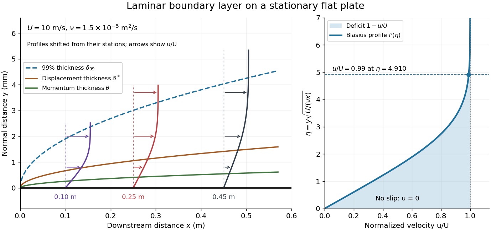
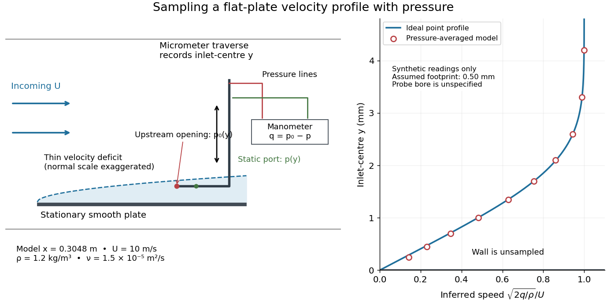

# Continuum mechanics

↑ **Parent:** [Branches of physics](physics.md#branches-of-physics)  
ⓦ [Wiki](https://en.wikipedia.org/wiki/Continuum_mechanics)

**Table of contents**

- [Contact mechanics](#contact-mechanics)
  - [Reduced elastic modulus](#reduced-elastic-modulus)
  - [Hertzian contact](#hertzian-contact)
  - [Tabor parameter](#tabor-parameter)
  - [DMT contact model](#dmt-contact-model)
  - [Adhesion](#adhesion)
    - [Stiction](#stiction)
  - [Pull-off force](#pull-off-force)
  - [Normal contact force](#normal-contact-force)
- [Solid stress](#solid-stress)
- [Continuum approximation](#continuum-approximation)
- [Anisotropy](#anisotropy)
- [Isotropy](#isotropy)
- [Composite material](#composite-material)
  - [Carbon fibre](#carbon-fibre)
  - [Glass fibre](#glass-fibre)
  - [Long-fibre composite](#long-fibre-composite)
    - [Fibre volume fraction](#fibre-volume-fraction)
    - [Hybrid fibre composite](#hybrid-fibre-composite)
    - [Longitudinal rule of mixtures](#longitudinal-rule-of-mixtures)
  - [Carbon-fibre-reinforced polymer](#carbon-fibre-reinforced-polymer)
  - [Elastic laminate](#elastic-laminate)
  - [Effective elastic energy](#effective-elastic-energy)
    - [Phase polarization comparison bound](#phase-polarization-comparison-bound)
    - [Reuss elastic approximation](#reuss-elastic-approximation)
    - [Voigt elastic approximation](#voigt-elastic-approximation)
    - [Hill-Mandel energy identity](#hill-mandel-energy-identity)
  - [Volume fraction](#volume-fraction)
  - [Two-point phase correlation function](#two-point-phase-correlation-function)
  - [Effective conductivity](#effective-conductivity)
    - [Self-consistent conductivity approximation](#self-consistent-conductivity-approximation)
    - [Hashin-Shtrikman conductivity variational principle](#hashin-shtrikman-conductivity-variational-principle)
      - [Two-dimensional isotropic polycrystal conductivity](#two-dimensional-isotropic-polycrystal-conductivity)
      - [Hashin-Shtrikman bounds for conductivity](#hashin-shtrikman-bounds-for-conductivity)
    - [Voigt bound](#voigt-bound)
    - [Laminate conductivity](#laminate-conductivity)
    - [Conductivity homogenization](#conductivity-homogenization)
      - [Polarization field of a conductivity inclusion](#polarization-field-of-a-conductivity-inclusion)
        - [Exciting field of a conductivity inclusion](#exciting-field-of-a-conductivity-inclusion)
        - [Spherical conductivity inclusion](#spherical-conductivity-inclusion)
          - [Dilute spherical-inclusion conductivity](#dilute-spherical-inclusion-conductivity)
            - [Maxwell approximation for conductivity](#maxwell-approximation-for-conductivity)
            - [Dipole interaction correction to effective conductivity](#dipole-interaction-correction-to-effective-conductivity)
      - [Periodic conductivity cell problem](#periodic-conductivity-cell-problem)
        - [Two-scale expansion for periodic conductivity](#two-scale-expansion-for-periodic-conductivity)
          - [Boundary corrector in periodic homogenization](#boundary-corrector-in-periodic-homogenization)
- [Plasticity (physics)](#plasticity-physics)
  - [Necking (engineering)](#necking-engineering)
  - [Cold working](#cold-working)
  - [Work hardening](#work-hardening)
    - [Latent hardening](#latent-hardening)
    - [Forest hardening](#forest-hardening)
  - [Yield point](#yield-point)
    - [Proof stress](#proof-stress)
  - [Von Mises yield criterion](#von-mises-yield-criterion)
  - [Associated flow rule](#associated-flow-rule)
  - [Perfect plasticity](#perfect-plasticity)
    - [Antiplane perfect plasticity](#antiplane-perfect-plasticity)
      - [Centred antiplane plastic fan](#centred-antiplane-plastic-fan)
    - [Slip-line field theory](#slip-line-field-theory)
      - [Hencky stress relations](#hencky-stress-relations)
        - [Centred slip-line fan at a traction-free V-notch](#centred-slip-line-fan-at-a-traction-free-v-notch)
      - [Geiringer velocity relations](#geiringer-velocity-relations)
      - [Stress characteristics for an anisotropic yield curve](#stress-characteristics-for-an-anisotropic-yield-curve)
      - [Slip line](#slip-line)
- [Continuum thermodynamics](#continuum-thermodynamics)
  - [Reference-configuration jump balances](#reference-configuration-jump-balances)
  - [Thermoelasticity](#thermoelasticity)
    - [Thermoelastic Maxwell relation for a stretched band](#thermoelastic-maxwell-relation-for-a-stretched-band)
    - [Thermoelasticity with a temperature-dependent constraint](#thermoelasticity-with-a-temperature-dependent-constraint)
      - [Linear thermoelasticity with prescribed thermal volume](#linear-thermoelasticity-with-prescribed-thermal-volume)
  - [Clausius-Duhem inequality](#clausius-duhem-inequality)
    - [Coleman-Noll procedure](#coleman-noll-procedure)
    - [Lagrangian entropy inequality](#lagrangian-entropy-inequality)
  - [Lagrangian internal energy balance](#lagrangian-internal-energy-balance)
  - [Internal variable](#internal-variable)
    - [Dissipation potential](#dissipation-potential)
      - [Exponential memory from tensor relaxation](#exponential-memory-from-tensor-relaxation)
    - [Thermodynamic force conjugate to an internal variable](#thermodynamic-force-conjugate-to-an-internal-variable)
- [Deformation (mechanics)](#deformation-mechanics)
  - [Finite strain theory](#finite-strain-theory)
    - [Spectral strain measure](#spectral-strain-measure)
      - [Biot strain tensor](#biot-strain-tensor)
    - [Inverse right Cauchy-Green strain](#inverse-right-cauchy-green-strain)
    - [Green-Lagrange strain tensor](#green-lagrange-strain-tensor)
    - [Plane strain](#plane-strain)
    - [Simple shear](#simple-shear)
    - [Stretch tensor](#stretch-tensor)
      - [Principal stretch](#principal-stretch)
      - [Right stretch tensor](#right-stretch-tensor)
      - [Left stretch tensor](#left-stretch-tensor)
    - [Deformation gradient](#deformation-gradient)
      - [Nanson's formula](#nanson-s-formula)
      - [Multiplicative decomposition of the deformation gradient](#multiplicative-decomposition-of-the-deformation-gradient)
      - [Polar decomposition in continuum mechanics](#polar-decomposition-in-continuum-mechanics)
      - [Right Cauchy-Green deformation tensor](#right-cauchy-green-deformation-tensor)
      - [Left Cauchy-Green deformation tensor](#left-cauchy-green-deformation-tensor)
  - [Deformation map](#deformation-map)
    - [Current configuration](#current-configuration)
    - [Reference configuration](#reference-configuration)
- [Constitutive equation](#constitutive-equation)
  - [Material frame indifference](#material-frame-indifference)
    - [Objective second-rank tensor](#objective-second-rank-tensor)
  - [Stress](#stress)
    - [Engineering stress](#engineering-stress)
    - [Work-conjugate stress and strain](#work-conjugate-stress-and-strain)
      - [Symmetric Biot stress](#symmetric-biot-stress)
    - [Mandel stress tensor](#mandel-stress-tensor)
    - [Kirchhoff stress tensor](#kirchhoff-stress-tensor)
    - [Piola-Kirchhoff stress tensors](#piola-kirchhoff-stress-tensors)
      - [Second Piola-Kirchhoff stress tensor](#second-piola-kirchhoff-stress-tensor)
      - [First Piola-Kirchhoff stress tensor](#first-piola-kirchhoff-stress-tensor)
        - [Nominal stress tensor](#nominal-stress-tensor)
    - [Cauchy stress tensor](#cauchy-stress-tensor)
      - [Normal stress](#normal-stress)
      - [Principal stress](#principal-stress)
    - [Deviatoric stress](#deviatoric-stress)
    - [Traction](#traction)
      - [Hydrodynamic torque](#hydrodynamic-torque)
  - [Strain](#strain)
    - [Normal strain](#normal-strain)
    - [Shear strain](#shear-strain)
      - [Shear strain rate](#shear-strain-rate)
      - [Pure shear from opposite principal strains](#pure-shear-from-opposite-principal-strains)
    - [Engineering strain](#engineering-strain)
    - [Infinitesimal strain tensor](#infinitesimal-strain-tensor)
- [Velocity gradient](#velocity-gradient)
  - [Velocity divergence](#velocity-divergence)
- [Mass conservation](#mass-conservation)
  - [Isotopic mass balance](#isotopic-mass-balance)
- [Material derivative](#material-derivative)
  - [Reynolds transport theorem](#reynolds-transport-theorem)
  - [Convective acceleration](#convective-acceleration)
    - [Centripetal acceleration of an azimuthal flow](#centripetal-acceleration-of-an-azimuthal-flow)
  - [Material acceleration](#material-acceleration)
  - [Eulerian coordinate](#eulerian-coordinate)
  - [Lagrangian coordinate](#lagrangian-coordinate)
  - [Eulerian time average](#eulerian-time-average)
  - [Lagrangian trajectory](#lagrangian-trajectory)
    - [Fluid element](#fluid-element)
      - [Material volume element](#material-volume-element)
    - [Stokes drift](#stokes-drift)
      - [Second-order trajectory in a sinusoidal velocity field](#second-order-trajectory-in-a-sinusoidal-velocity-field)
      - [Cross-wave Stokes drift](#cross-wave-stokes-drift)
      - [Initial and mean parcel labels in a surface wave](#initial-and-mean-parcel-labels-in-a-surface-wave)
- [Rayleigh-Taylor instability](#rayleigh-taylor-instability)
  - [Atwood number](#atwood-number)
  - [Finite-aperture stabilization of an inverted liquid surface](#finite-aperture-stabilization-of-an-inverted-liquid-surface)
  - [Orthogonal-field magnetic Rayleigh-Taylor dispersion relation](#orthogonal-field-magnetic-rayleigh-taylor-dispersion-relation)
    - [Localization condition for the fastest orthogonal-field interface mode](#localization-condition-for-the-fastest-orthogonal-field-interface-mode)
  - [Viscous overturn of a dense crust](#viscous-overturn-of-a-dense-crust)
  - [Finite-depth Rayleigh-Taylor dispersion relation](#finite-depth-rayleigh-taylor-dispersion-relation)
    - [Thin-layer Rayleigh-Taylor growth asymptotics](#thin-layer-rayleigh-taylor-growth-asymptotics)
- [Boundary layer](#boundary-layer)
  - [Blasius boundary layer](#blasius-boundary-layer)
    - [Flat-plate boundary-layer traverse experiment](#flat-plate-boundary-layer-traverse-experiment)
  - [Boundary layer thickness](#boundary-layer-thickness)
    - [Displacement thickness](#displacement-thickness)
    - [Momentum thickness](#momentum-thickness)
  - [Wall shear stress](#wall-shear-stress)
    - [Skin friction coefficient](#skin-friction-coefficient)
  - [Laminar plane jet from a line force](#laminar-plane-jet-from-a-line-force)
  - [Laminar skin-friction scaling along a slender swimmer](#laminar-skin-friction-scaling-along-a-slender-swimmer)
  - [Conical sink boundary layer](#conical-sink-boundary-layer)
  - [Similarity profile of an axisymmetric radial viscous free jet](#similarity-profile-of-an-axisymmetric-radial-viscous-free-jet)
  - [Plane laminar jet](#plane-laminar-jet)
    - [Bickley jet](#bickley-jet)
  - [Boundary-layer equation](#boundary-layer-equation)
  - [Turbulent boundary layer](#turbulent-boundary-layer)
    - [Viscous sublayer](#viscous-sublayer)
    - [Monin-Obukhov similarity theory](#monin-obukhov-similarity-theory)
      - [Near-neutral log-linear surface-layer profiles](#near-neutral-log-linear-surface-layer-profiles)
      - [Very stable surface-layer similarity](#very-stable-surface-layer-similarity)
      - [Monin-Obukhov length](#monin-obukhov-length)
    - [Law of the wall](#law-of-the-wall)
      - [Von Kármán constant](#von-karman-constant)
      - [Roughness length](#roughness-length)
  - [Thermal boundary layer](#thermal-boundary-layer)
    - [Boundary-layer renewal model](#boundary-layer-renewal-model)
  - [Boundary-layer scaling](#boundary-layer-scaling)
  - [Two-dimensional boundary-layer equations](#two-dimensional-boundary-layer-equations)
    - [Boundary layer over a linearly stretching sheet](#boundary-layer-over-a-linearly-stretching-sheet)
  - [Flow separation](#flow-separation)
- [Falkner-Skan equation](#falkner-skan-equation)
- [Acoustic energy flux](#acoustic-energy-flux)
  - [Spectral acoustic flux](#spectral-acoustic-flux)
  - [Transmitted velocity potential from a piston through an acoustic interface](#transmitted-velocity-potential-from-a-piston-through-an-acoustic-interface)
- [Burgers vortex](#burgers-vortex)
  - [Burgers vortex sheet](#burgers-vortex-sheet)
  - [Excess dissipation of a Burgers vortex](#excess-dissipation-of-a-burgers-vortex)
  - [Unsteady Burgers-vortex core radius](#unsteady-burgers-vortex-core-radius)
- [Granular material](#granular-material)
  - [Angle of repose](#angle-of-repose)
- [Elasticity (physics)](elasticity-physics.md)
  - [Elastic modulus](elasticity-physics.md#elastic-modulus)
  - [Buckling](elasticity-physics.md#buckling)
    - [Buckling of a synthetic film](elasticity-physics.md#buckling-of-a-synthetic-film)
  - [Eigenstrain](elasticity-physics.md#eigenstrain)
  - [Magnetoelastic coupling](elasticity-physics.md#magnetoelastic-coupling)
  - [Elastic deformation](elasticity-physics.md#elastic-deformation)
  - [Perfectly bonded elastic interface](elasticity-physics.md#perfectly-bonded-elastic-interface)
    - [Torsion and tilt stiffness of a bonded elastic disk](elasticity-physics.md#torsion-and-tilt-stiffness-of-a-bonded-elastic-disk)
  - [Static elastic equilibrium](elasticity-physics.md#static-elastic-equilibrium)
  - [Elastic beam](elasticity-physics.md#elastic-beam)
    - [Euler strut](elasticity-physics.md#euler-strut)
    - [Euler elastica](elasticity-physics.md#euler-elastica)
      - [Tensile elastica loop](elasticity-physics.md#tensile-elastica-loop)
    - [Cantilever](elasticity-physics.md#cantilever)
      - [Self-weight deflection of a square cantilever](elasticity-physics.md#self-weight-deflection-of-a-square-cantilever)
  - [Dead loading](elasticity-physics.md#dead-loading)
  - [Magnetostriction](elasticity-physics.md#magnetostriction)
    - [Strain-mediated magnetoelectric coupling](elasticity-physics.md#strain-mediated-magnetoelectric-coupling)
    - [Magnetostrictive actuator](elasticity-physics.md#magnetostrictive-actuator)
    - [Magnetostrictive strain](elasticity-physics.md#magnetostrictive-strain)
      - [Volume magnetostriction](elasticity-physics.md#volume-magnetostriction)
      - [Saturation magnetostriction](elasticity-physics.md#saturation-magnetostriction)
    - [Isotropic linear magnetostriction vanishes](elasticity-physics.md#isotropic-linear-magnetostriction-vanishes)
    - [Saturated isotropic magnetostrictive strain](elasticity-physics.md#saturated-isotropic-magnetostrictive-strain)
      - [Magnetic reversal and domain averaging](elasticity-physics.md#magnetic-reversal-and-domain-averaging)
    - [Pulsed-field optical magnetostriction experiment](elasticity-physics.md#pulsed-field-optical-magnetostriction-experiment)
    - [Quadratic magnetostriction and frequency doubling](elasticity-physics.md#quadratic-magnetostriction-and-frequency-doubling)
    - [Free strain and blocked magnetostrictive stress](elasticity-physics.md#free-strain-and-blocked-magnetostrictive-stress)
  - [Betti identity for elastodynamic fields](elasticity-physics.md#betti-identity-for-elastodynamic-fields)
  - [Shear modulus](elasticity-physics.md#shear-modulus)
  - [Finite elasticity](elasticity-physics.md#finite-elasticity)
    - [Inflation and extension of an incompressible tube](elasticity-physics.md#inflation-and-extension-of-an-incompressible-tube)
    - [Constrained second-variation stability in elasticity](elasticity-physics.md#constrained-second-variation-stability-in-elasticity)
    - [Torque and axial force of a twisted incompressible cylinder](elasticity-physics.md#torque-and-axial-force-of-a-twisted-incompressible-cylinder)
      - [Nominal end traction of a twisted neo-Hookean cylinder](elasticity-physics.md#nominal-end-traction-of-a-twisted-neo-hookean-cylinder)
    - [Twist and inflation of an incompressible tube](elasticity-physics.md#twist-and-inflation-of-an-incompressible-tube)
      - [Neo-Hookean tube pressure under twist and inflation](elasticity-physics.md#neo-hookean-tube-pressure-under-twist-and-inflation)
    - [Inextensible fibre constraint](elasticity-physics.md#inextensible-fibre-constraint)
      - [Two-family inextensible-fibre pure stretch](elasticity-physics.md#two-family-inextensible-fibre-pure-stretch)
      - [Incompressible inextensible-fibre plane strain](elasticity-physics.md#incompressible-inextensible-fibre-plane-strain)
        - [Triangular equilibrium construction for inextensible-fibre plane strain](elasticity-physics.md#triangular-equilibrium-construction-for-inextensible-fibre-plane-strain)
    - [Hyperelastic material](elasticity-physics.md#hyperelastic-material)
      - [Compatibility condition for pure nonlinear transverse waves](elasticity-physics.md#compatibility-condition-for-pure-nonlinear-transverse-waves)
        - [Compatible nonlinear shear energy](elasticity-physics.md#compatible-nonlinear-shear-energy)
      - [Saint Venant–Kirchhoff hyperelastic energy](elasticity-physics.md#saint-venant-kirchhoff-hyperelastic-energy)
      - [Lamé parameters from hyperelastic energy Hessian](elasticity-physics.md#lame-parameters-from-hyperelastic-energy-hessian)
      - [Inflation pressure of a thin incompressible elastic balloon](elasticity-physics.md#inflation-pressure-of-a-thin-incompressible-elastic-balloon)
      - [Incremental elastic moduli](elasticity-physics.md#incremental-elastic-moduli)
        - [Elastic normal-mode energy identity](elasticity-physics.md#elastic-normal-mode-energy-identity)
        - [Strong ellipticity in elasticity](elasticity-physics.md#strong-ellipticity-in-elasticity)
        - [Acoustic tensor](elasticity-physics.md#acoustic-tensor)
          - [Strong ellipticity](elasticity-physics.md#strong-ellipticity)
      - [Constraint reaction in hyperelastic stress](elasticity-physics.md#constraint-reaction-in-hyperelastic-stress)
        - [Equibiaxial nominal tension of an incompressible sheet](elasticity-physics.md#equibiaxial-nominal-tension-of-an-incompressible-sheet)
      - [Mooney-Rivlin solid](elasticity-physics.md#mooney-rivlin-solid)
      - [Neo-Hookean solid](elasticity-physics.md#neo-hookean-solid)
        - [Homogeneous tensile bifurcation of a neo-Hookean cube](elasticity-physics.md#homogeneous-tensile-bifurcation-of-a-neo-hookean-cube)
      - [Strain energy density](elasticity-physics.md#strain-energy-density)
        - [Nonnegative isotropic elastic strain energy](elasticity-physics.md#nonnegative-isotropic-elastic-strain-energy)
    - [Material isotropy](elasticity-physics.md#material-isotropy)
      - [Coaxiality of isotropic elastic stress](elasticity-physics.md#coaxiality-of-isotropic-elastic-stress)
        - [Equivariance of isotropic principal stresses](elasticity-physics.md#equivariance-of-isotropic-principal-stresses)
        - [Universal simple-shear normal-stress identity](elasticity-physics.md#universal-simple-shear-normal-stress-identity)
  - [Elastic filament](elasticity-physics.md#elastic-filament)
    - [Filament torsional stiffness](elasticity-physics.md#filament-torsional-stiffness)
    - [Intrinsic curvature of an elastic filament](elasticity-physics.md#intrinsic-curvature-of-an-elastic-filament)
      - [Free-end curvature boundary layer](elasticity-physics.md#free-end-curvature-boundary-layer)
      - [Force-extension of an intrinsically curved filament](elasticity-physics.md#force-extension-of-an-intrinsically-curved-filament)
        - [Smooth-curvature high-force extension law](elasticity-physics.md#smooth-curvature-high-force-extension-law)
      - [Quenched intrinsic curvature](elasticity-physics.md#quenched-intrinsic-curvature)
    - [Spatially varying tension in filament bending](elasticity-physics.md#spatially-varying-tension-in-filament-bending)
    - [Thermal covariance of an elastic filament](elasticity-physics.md#thermal-covariance-of-an-elastic-filament)
      - [Rigid-motion-projected thermal covariance of a free filament](elasticity-physics.md#rigid-motion-projected-thermal-covariance-of-a-free-filament)
        - [Curvature-noise representation of a free filament](elasticity-physics.md#curvature-noise-representation-of-a-free-filament)
        - [Free-filament variance with fixed translation and tilt](elasticity-physics.md#free-filament-variance-with-fixed-translation-and-tilt)
      - [Zero-energy filament mode](elasticity-physics.md#zero-energy-filament-mode)
    - [Clamped--clamped bending mode](elasticity-physics.md#clamped-clamped-bending-mode)
    - [Self-adjoint endpoint conditions for filament bending](elasticity-physics.md#self-adjoint-endpoint-conditions-for-filament-bending)
      - [Free-end bending boundary conditions](elasticity-physics.md#free-end-bending-boundary-conditions)
        - [Free-free bending spectrum](elasticity-physics.md#free-free-bending-spectrum)
          - [Stable characteristic equation for free-free bending modes](elasticity-physics.md#stable-characteristic-equation-for-free-free-bending-modes)
    - [Tip-force compliance of a cantilever](elasticity-physics.md#tip-force-compliance-of-a-cantilever)
  - [Elastic energy](elasticity-physics.md#elastic-energy)
    - [Minimum potential energy principle in elasticity](elasticity-physics.md#minimum-potential-energy-principle-in-elasticity)
  - [Linear elasticity](elasticity-physics.md#linear-elasticity)
    - [Elasticity tensor](elasticity-physics.md#elasticity-tensor)
    - [Uniaxial strain modulus](elasticity-physics.md#uniaxial-strain-modulus)
    - [Area expansion under uniaxial compression](elasticity-physics.md#area-expansion-under-uniaxial-compression)
    - [Radial equilibrium of a thick elastic cylinder](elasticity-physics.md#radial-equilibrium-of-a-thick-elastic-cylinder)
      - [Lamé stress distribution in a pressurized cylindrical wall](elasticity-physics.md#lame-stress-distribution-in-a-pressurized-cylindrical-wall)
    - [Plane stress](elasticity-physics.md#plane-stress)
    - [Isotropic elastic modulus relation](elasticity-physics.md#isotropic-elastic-modulus-relation)
    - [Proportional limit](elasticity-physics.md#proportional-limit)
    - [Mean stress and strain boundary identities](elasticity-physics.md#mean-stress-and-strain-boundary-identities)
      - [Equilibrium contraction of a self-gravitating elastic sphere](elasticity-physics.md#equilibrium-contraction-of-a-self-gravitating-elastic-sphere)
    - [Elastic strain Green operator](elasticity-physics.md#elastic-strain-green-operator)
      - [Isotropic elastic strain Green kernel](elasticity-physics.md#isotropic-elastic-strain-green-kernel)
        - [Constant-shear bulk-modulus inclusion](elasticity-physics.md#constant-shear-bulk-modulus-inclusion)
      - [Directional elastic strain Green operator](elasticity-physics.md#directional-elastic-strain-green-operator)
      - [Elastic polarization](elasticity-physics.md#elastic-polarization)
    - [Bulk modulus](elasticity-physics.md#bulk-modulus)
      - [Hydrostatic volume strain from Young's modulus and Poisson's ratio](elasticity-physics.md#hydrostatic-volume-strain-from-young-s-modulus-and-poisson-s-ratio)
      - [Adiabatic bulk modulus](elasticity-physics.md#adiabatic-bulk-modulus)
    - [Antiplane shear](elasticity-physics.md#antiplane-shear)
      - [Steadily moving antiplane shear](elasticity-physics.md#steadily-moving-antiplane-shear)
      - [Complex stress potential for antiplane shear](elasticity-physics.md#complex-stress-potential-for-antiplane-shear)
        - [Hilbert problem for an antiplane crack](elasticity-physics.md#hilbert-problem-for-an-antiplane-crack)
          - [Cauchy solution for a steadily moving semi-infinite antiplane crack](elasticity-physics.md#cauchy-solution-for-a-steadily-moving-semi-infinite-antiplane-crack)
            - [Homogeneous stress-intensity field of a semi-infinite antiplane crack](elasticity-physics.md#homogeneous-stress-intensity-field-of-a-semi-infinite-antiplane-crack)
          - [Antiplane ligament Cauchy solution](elasticity-physics.md#antiplane-ligament-cauchy-solution)
          - [Finite antiplane crack Cauchy solution](elasticity-physics.md#finite-antiplane-crack-cauchy-solution)
    - [Elastic stiffness tensor](elasticity-physics.md#elastic-stiffness-tensor)
      - [Independent elastic stiffness counts](elasticity-physics.md#independent-elastic-stiffness-counts)
        - [Twofold elastic symmetry](elasticity-physics.md#twofold-elastic-symmetry)
    - [Bending moment](elasticity-physics.md#bending-moment)
      - [Neutral axis](elasticity-physics.md#neutral-axis)
    - [Elastic membrane](elasticity-physics.md#elastic-membrane)
      - [Equal-phase two-wave membrane modes](elasticity-physics.md#equal-phase-two-wave-membrane-modes)
        - [Evanescent membrane response below cutoff](elasticity-physics.md#evanescent-membrane-response-below-cutoff)
    - [Euler-Bernoulli beam equation](elasticity-physics.md#euler-bernoulli-beam-equation)
      - [Simply supported beam normal modes](elasticity-physics.md#simply-supported-beam-normal-modes)
        - [Initial curvature incompatibility at a moment-free beam end](elasticity-physics.md#initial-curvature-incompatibility-at-a-moment-free-beam-end)
      - [Clamped-beam Green function](elasticity-physics.md#clamped-beam-green-function)
        - [Reciprocity of the clamped-beam Green function](elasticity-physics.md#reciprocity-of-the-clamped-beam-green-function)
      - [Euler's critical load](elasticity-physics.md#euler-s-critical-load)
        - [Initially curved compressed beam](elasticity-physics.md#initially-curved-compressed-beam)
          - [Sinusoidal imperfection amplification of a column](elasticity-physics.md#sinusoidal-imperfection-amplification-of-a-column)
      - [Compressed Euler-Bernoulli beam and its endpoint-dependent buckling threshold](elasticity-physics.md#compressed-euler-bernoulli-beam-and-its-endpoint-dependent-buckling-threshold)
      - [Schrodinger factorization of the elastic beam equation](elasticity-physics.md#schrodinger-factorization-of-the-elastic-beam-equation)
    - [Second moment of area](elasticity-physics.md#second-moment-of-area)
      - [Polar second moment of area](elasticity-physics.md#polar-second-moment-of-area)
      - [Rectangular section second moment of area](elasticity-physics.md#rectangular-section-second-moment-of-area)
    - [Poisson's ratio](elasticity-physics.md#poisson-s-ratio)
    - [Young's modulus](elasticity-physics.md#young-s-modulus)
      - [Centrifugal strain of a thin elastic hoop](elasticity-physics.md#centrifugal-strain-of-a-thin-elastic-hoop)
      - [Tensile modulus experiment](elasticity-physics.md#tensile-modulus-experiment)
        - [Machine compliance](elasticity-physics.md#machine-compliance)
          - [Two-length machine compliance separation](elasticity-physics.md#two-length-machine-compliance-separation)
            - [Worked two-length tensile compliance example](elasticity-physics.md#worked-two-length-tensile-compliance-example)
        - [Linear reversibility and yield in tensile tests](elasticity-physics.md#linear-reversibility-and-yield-in-tensile-tests)
    - [Fracture toughness](elasticity-physics.md#fracture-toughness)
      - [Griffith fracture criterion](elasticity-physics.md#griffith-fracture-criterion)
      - [Energy release rate](elasticity-physics.md#energy-release-rate)
        - [Critical energy release rate](elasticity-physics.md#critical-energy-release-rate)
      - [Leak-before-break criterion](elasticity-physics.md#leak-before-break-criterion)
        - [Yield-limited leak-before-break thickness](elasticity-physics.md#yield-limited-leak-before-break-thickness)
      - [Strain energy release rate](elasticity-physics.md#strain-energy-release-rate)
      - [Crack-tip plastic zone](elasticity-physics.md#crack-tip-plastic-zone)
      - [Stress intensity factor](elasticity-physics.md#stress-intensity-factor)
      - [Intergranular fracture](elasticity-physics.md#intergranular-fracture)
      - [Cleavage fracture](elasticity-physics.md#cleavage-fracture)
      - [Ductile-to-brittle transition](elasticity-physics.md#ductile-to-brittle-transition)
    - [Hooke's law](elasticity-physics.md#hooke-s-law)
      - [Transverse stiffness of a stretched spring](elasticity-physics.md#transverse-stiffness-of-a-stretched-spring)
      - [Zero-natural-length spring](elasticity-physics.md#zero-natural-length-spring)
      - [Spring](elasticity-physics.md#spring)
        - [Zero-rest-length spring](elasticity-physics.md#zero-rest-length-spring)
        - [Series and parallel spring stiffness](elasticity-physics.md#series-and-parallel-spring-stiffness)
        - [Central spring stiffness matrix](elasticity-physics.md#central-spring-stiffness-matrix)
        - [Torsion spring](elasticity-physics.md#torsion-spring)
          - [Torsion of a solid circular shaft](elasticity-physics.md#torsion-of-a-solid-circular-shaft)
        - [Spring constant](elasticity-physics.md#spring-constant)
    - [Elastic plate](elasticity-physics.md#elastic-plate)
      - [Line-forced fluid-loaded bending plate](elasticity-physics.md#line-forced-fluid-loaded-bending-plate)
      - [Flexural wave](elasticity-physics.md#flexural-wave)
        - [Flexural-gravity wave](elasticity-physics.md#flexural-gravity-wave)
          - [Elastic-cover frequency ratio for water waves](elasticity-physics.md#elastic-cover-frequency-ratio-for-water-waves)
          - [Minimum phase speed of a flexural-gravity wave](elasticity-physics.md#minimum-phase-speed-of-a-flexural-gravity-wave)
          - [Dispersion relation of a floating elastic plate](elasticity-physics.md#dispersion-relation-of-a-floating-elastic-plate)
          - [Group-velocity minimum of a flexural-gravity wave](elasticity-physics.md#group-velocity-minimum-of-a-flexural-gravity-wave)
      - [Viscous peeling of an elastic plate](elasticity-physics.md#viscous-peeling-of-an-elastic-plate)
      - [Axisymmetric clamped-plate deflection](elasticity-physics.md#axisymmetric-clamped-plate-deflection)
      - [Bending stiffness](elasticity-physics.md#bending-stiffness)
    - [Nondegenerate one-dimensional elastic material](elasticity-physics.md#nondegenerate-one-dimensional-elastic-material)
    - [Displacement field (mechanics)](elasticity-physics.md#displacement-field-mechanics)
      - [Lagrangian fluid displacement](elasticity-physics.md#lagrangian-fluid-displacement)
      - [Displacement gradient tensor](elasticity-physics.md#displacement-gradient-tensor)
    - [Lamé parameter](elasticity-physics.md#lame-parameter)
      - [Poisson solid](elasticity-physics.md#poisson-solid)
    - [Isotropic linear-elastic energy density](elasticity-physics.md#isotropic-linear-elastic-energy-density)
    - [Navier-Cauchy equation](elasticity-physics.md#navier-cauchy-equation)
      - [Uniform extension of a one-dimensional elastic body](elasticity-physics.md#uniform-extension-of-a-one-dimensional-elastic-body)
    - [Elastic wave in an isotropic solid](elasticity-physics.md#elastic-wave-in-an-isotropic-solid)
      - [Shear-horizontal wave](elasticity-physics.md#shear-horizontal-wave)
        - [SH input impedance](elasticity-physics.md#sh-input-impedance)
          - [SH impedance Riccati equation](elasticity-physics.md#sh-impedance-riccati-equation)
            - [Uniform-layer SH impedance update](elasticity-physics.md#uniform-layer-sh-impedance-update)
              - [Reflection from a layered SH impedance](elasticity-physics.md#reflection-from-a-layered-sh-impedance)
            - [Complex-frequency SH flux monotonicity](elasticity-physics.md#complex-frequency-sh-flux-monotonicity)
        - [Causal vertical wavenumber branch](elasticity-physics.md#causal-vertical-wavenumber-branch)
        - [Guided shear-horizontal mode](elasticity-physics.md#guided-shear-horizontal-mode)
      - [Mode conversion at a planar elastic interface](elasticity-physics.md#mode-conversion-at-a-planar-elastic-interface)
        - [Solid-fluid P-wave transmission coefficient](elasticity-physics.md#solid-fluid-p-wave-transmission-coefficient)
        - [Snell law for elastic and acoustic waves](elasticity-physics.md#snell-law-for-elastic-and-acoustic-waves)
      - [Acoustic impedance](elasticity-physics.md#acoustic-impedance)
        - [Normal acoustic impedance](elasticity-physics.md#normal-acoustic-impedance)
          - [Surface acoustic impedance](elasticity-physics.md#surface-acoustic-impedance)
            - [Passive acoustic impedance](elasticity-physics.md#passive-acoustic-impedance)
        - [Acoustic transmission through a uniform layer](elasticity-physics.md#acoustic-transmission-through-a-uniform-layer)
          - [Coherent acoustic layer above a rough reflector](elasticity-physics.md#coherent-acoustic-layer-above-a-rough-reflector)
        - [Displacement reflection from an interface between two inviscid elastic liquids](elasticity-physics.md#displacement-reflection-from-an-interface-between-two-inviscid-elastic-liquids)
  - [Elastic-wave energy flux](elasticity-physics.md#elastic-wave-energy-flux)
    - [P-SV directional impedance matrix](elasticity-physics.md#p-sv-directional-impedance-matrix)
      - [P-SV characteristic reconstruction](elasticity-physics.md#p-sv-characteristic-reconstruction)
    - [Reflection of an SV-wave from a rigid plane](elasticity-physics.md#reflection-of-an-sv-wave-from-a-rigid-plane)
      - [Evanescent reflected P-wave at a rigid plane](elasticity-physics.md#evanescent-reflected-p-wave-at-a-rigid-plane)
        - [Unit-modulus SV reflection with evanescent P conversion](elasticity-physics.md#unit-modulus-sv-reflection-with-evanescent-p-conversion)
      - [Rigid boundary condition for an elastic wave](elasticity-physics.md#rigid-boundary-condition-for-an-elastic-wave)
    - [Wavevector](elasticity-physics.md#wavevector)
      - [Hamiltonian ray-tracing equations](elasticity-physics.md#hamiltonian-ray-tracing-equations)
        - [WKB method](elasticity-physics.md#wkb-method)
          - [Eikonal equation](elasticity-physics.md#eikonal-equation)
        - [Total derivative along a ray](elasticity-physics.md#total-derivative-along-a-ray)
    - [Evanescent wave](elasticity-physics.md#evanescent-wave)
- [Cauchy momentum equation](#cauchy-momentum-equation)
  - [Momentum balance for a material fluid element](#momentum-balance-for-a-material-fluid-element)
- [Falkner-Skan boundary layer](#falkner-skan-boundary-layer)
- [Sound intensity](#sound-intensity)

## Contact mechanics

↑ **Parent:** [Continuum mechanics](continuum-mechanics.md)

The mechanics of deformation and force transmission where bodies touch.

### Reduced elastic modulus

↑ **Parent:** [Contact mechanics](#contact-mechanics)

The combined elastic response of two contacting isotropic bodies: $1/E^*=(1-\nu_1^2)/E_1+(1-\nu_2^2)/E_2$. It includes compliance of both bodies.

### Hertzian contact

↑ **Parent:** [Contact mechanics](#contact-mechanics)

The elastic contact of smooth nonadhesive bodies with locally quadratic surfaces. For a sphere on a flat surface, the load is proportional to the [reduced elastic modulus](#reduced-elastic-modulus), square root of sphere radius and indentation to the three-halves power.

### Tabor parameter

↑ **Parent:** [Contact mechanics](#contact-mechanics)

A dimensionless measure comparing adhesive interaction range with elastic deformation in sphere contact. Small values favour the DMT contact approximation, while large values favour the JKR limit.

### DMT contact model

↑ **Parent:** [Contact mechanics](#contact-mechanics)

An adhesive sphere-on-flat contact approximation combining [Hertzian contact](#hertzian-contact) deformation with an attractive [force](force.md) outside the contact area. It is most appropriate for sufficiently stiff, small-radius contacts with a small [Tabor parameter](#tabor-parameter); a fitted reduced modulus is not automatically the sample [Young's modulus](elasticity-physics.md#young-s-modulus).

### Adhesion

↑ **Parent:** [Contact mechanics](#contact-mechanics)  
ⓦ [Wiki](https://en.wikipedia.org/wiki/Adhesion)

Attraction between different contacting surfaces. [Adhesion](#adhesion) can be described by interfacial work per area, while a measured [pull-off force](#pull-off-force) additionally depends on geometry and the elastic response.

#### Stiction

↑ **Parent:** [Adhesion](#adhesion)

Unwanted sticking that prevents intended relative motion. In [surface micromachining](engineering.md#surface-micromachining), a receding [liquid](thermodynamics.md#liquid) meniscus can pull a compliant released beam onto the substrate; [adhesion](#adhesion) can then keep it there. Avoiding a liquid-vapor drying interface addresses one route to [stiction](#stiction), but does not remove contact [adhesion](#adhesion) during use.

### Pull-off force

↑ **Parent:** [Contact mechanics](#contact-mechanics)

The tensile [force](force.md) magnitude needed to detach contacting surfaces during retraction. A force-probe measurement reads it from the [force](force.md) minimum relative to the noncontact baseline; roughness, capillary [forces](force.md) and contact geometry affect its interpretation.

### Normal contact force

↑ **Parent:** [Contact mechanics](#contact-mechanics)

The component of a contact force perpendicular to the local contact plane.

## Solid stress

↑ **Parent:** [Continuum mechanics](continuum-mechanics.md)

[solid stress](#solid-stress) is stress carried by solid constituents of a tissue or material. Compressive solid stress, interstitial fluid pressure and elastic stiffness are distinct quantities that can coexist in a tumour.

## Continuum approximation

↑ **Parent:** [Continuum mechanics](continuum-mechanics.md)

The continuum approximation describes a material using fields such as [mass density](fluid-mechanics.md#density), [velocity field](fluid-mechanics.md#velocity-field) and [stress](#stress), rather than following its individual [molecules](molecule.md). Its averaging volumes must contain enough microscopic constituents to define bulk properties while remaining small relative to the distances over which those properties change appreciably. It supplies the model underlying much of [fluid mechanics](fluid-mechanics.md) and [elasticity](elasticity-physics.md).

## Anisotropy

↑ **Parent:** [Continuum mechanics](continuum-mechanics.md)  
ⓦ [Wiki](https://en.wikipedia.org/wiki/Anisotropy)

Anisotropy is directional dependence of a material response. A [thermal conductivity tensor](heat.md#thermal-conductivity-tensor) with unequal principal conductivities is an example. Layered arrangements can produce [anisotropic](#anisotropy) [effective conductivity](#effective-conductivity) even from [isotropic](#isotropy) phases.

## Isotropy

↑ **Parent:** [Continuum mechanics](continuum-mechanics.md)  
ⓦ [Wiki](https://en.wikipedia.org/wiki/Isotropy)

Isotropy is invariance under rotations, so no spatial direction is preferred. For a three-dimensional second-rank conductivity [tensor](multilinear-algebra.md#tensor), invariance under every rotation forces $a=a_sI$. Isotropy of each constituent does not imply isotropy of an arranged composite microstructure. [Statistical isotropy](probability-and-statistics.md#statistical-isotropy) concerns the rotational invariance of its probability law.

## Composite material

↑ **Parent:** [Continuum mechanics](continuum-mechanics.md)  
ⓦ [Wiki](https://en.wikipedia.org/wiki/Composite_material)

A composite material contains distinct constituent phases arranged in a microstructure. Its macroscopic response depends on both phase properties and geometry, not just volume fractions. Anisotropic effective conductivity can arise even when every constituent has isotropic thermal conductivity.

### Carbon fibre

↑ **Parent:** [Composite material](#composite-material)

A carbon-based fibre reinforcement with strongly direction-dependent stiffness and strength.

### Glass fibre

↑ **Parent:** [Composite material](#composite-material)

A slender [glass](chemical-substance.md#glass) reinforcement. Its mechanical role depends on orientation, aspect ratio and bonding to the matrix.

### Long-fibre composite

↑ **Parent:** [Composite material](#composite-material)

A composite containing fibres long enough to transfer load effectively through the matrix. Continuous aligned fibres under axial loading approximately share [strain](#strain) with a well-bonded matrix.

#### Fibre volume fraction

↑ **Parent:** [Long-fibre composite](#long-fibre-composite)

The fraction of composite [volume](geometry-and-topology.md#volume) occupied by reinforcing fibres; physically achievable values depend on fibre geometry, packing, matrix infiltration and voids.

#### Hybrid fibre composite

↑ **Parent:** [Long-fibre composite](#long-fibre-composite)

A composite containing two or more reinforcing fibre types. In the ideal longitudinal model its axial modulus is the volume-fraction-weighted sum of constituent moduli.

#### Longitudinal rule of mixtures

↑ **Parent:** [Long-fibre composite](#long-fibre-composite)

For continuous, parallel, perfectly bonded fibres and uniform axial [strain](#strain), $E_L=V_fE_f+(1-V_f)E_m$. This idealization is the axial [Voigt elastic approximation](#voigt-elastic-approximation); voids, fibre waviness and poor load transfer reduce stiffness.

### Carbon-fibre-reinforced polymer

↑ **Parent:** [Composite material](#composite-material)

### Elastic laminate

↑ **Parent:** [Composite material](#composite-material)

An [elastic laminate](#elastic-laminate) has planar perfectly bonded layers with a common normal. Its piecewise constant [strains](#strain) differ by $\operatorname{sym}(a\otimes n)$, while its normal [traction](#traction) is common to every layer. For positive [elastic stiffness tensors](elasticity-physics.md#elastic-stiffness-tensor), these conditions and the mean [strain](#strain) uniquely determine the layer [strains](#strain): the difference of two solutions has zero mean and zero total elastic work, and positivity forces it to vanish.

### Effective elastic energy

↑ **Parent:** [Composite material](#composite-material)

The [effective elastic energy](#effective-elastic-energy) is the minimum averaged [strain energy density](elasticity-physics.md#strain-energy-density) under prescribed affine boundary [displacement](classical-mechanics.md#displacement). For differentiable stable elastic response without [body force](fluid-mechanics.md#body-force), varying the prescribed mean [strain](#strain) gives $DW^{\mathrm{eff}}(E)=\langle\sigma\rangle$. The result follows by [integration by parts](calculus.md#integration-by-parts), because the interior variation with zero boundary data does no work against an equilibrated [stress tensor](#cauchy-stress-tensor).

#### Phase polarization comparison bound

↑ **Parent:** [Effective elastic energy](#effective-elastic-energy)

Take a positive comparison [elastic stiffness tensor](elasticity-physics.md#elastic-stiffness-tensor) $C^0$, excess energies $F_r(e)=W_r(e)-e:C^0e/2$, and a phasewise constant [elastic polarization](elasticity-physics.md#elastic-polarization). The [lower conjugate](convex-optimization.md#lower-conjugate) inequality majorizes the local energy by a quadratic-plus-linear function. Minimizing that function over compatible [strains](#strain) gives the displayed bound, where $A_{rs}=\int\int(\chi_r-c_r)\Gamma(\chi_s-c_s)$. Stationarity in $\tau^r$ gives $c_re^r+\sum_sA_{rs}\tau^s=c_rE$, with $e^r=DF_{r*}(\tau^r)$. Without this stationarity, dual [strains](#strain) must not be identified with the comparison solution's phase means.

#### Reuss elastic approximation

↑ **Parent:** [Effective elastic energy](#effective-elastic-energy)

The [Reuss elastic approximation](#reuss-elastic-approximation) assumes uniform [stress](#stress). The local [strain](#strain) is the derivative of the [convex conjugate](convex-optimization.md#convex-conjugate) $W^*(S,x)$; its mean is $D\langle W^*\rangle(S)$. Under invertible differentiable duality, this mean determines $S=DW_R(E)$. For positive [linear elasticity](elasticity-physics.md#linear-elasticity), $C_R=\langle C^{-1}\rangle^{-1}$. Uniform [stress](#stress) is generally not accompanied by a compatible local [displacement field](elasticity-physics.md#displacement-field-mechanics), so this approximation is distinguished from an exact heterogeneous solution.

#### Voigt elastic approximation

↑ **Parent:** [Effective elastic energy](#effective-elastic-energy)

The [Voigt elastic approximation](#voigt-elastic-approximation) assumes uniform [strain](#strain). Differentiating its averaged [strain energy density](elasticity-physics.md#strain-energy-density) gives the averaged local [stress](#stress). For [linear elasticity](elasticity-physics.md#linear-elasticity) the predicted [elastic stiffness tensor](elasticity-physics.md#elastic-stiffness-tensor) is $C_V=\langle C\rangle$. The uniform [strain](#strain) is an admissible affine [displacement](classical-mechanics.md#displacement) trial field, so this gives an upper [elastic energy](elasticity-physics.md#elastic-energy) bound for convex local energy.

#### Hill-Mandel energy identity

↑ **Parent:** [Effective elastic energy](#effective-elastic-energy)

For symmetric [stress](#stress) in [static elastic equilibrium](elasticity-physics.md#static-elastic-equilibrium) without [body force](fluid-mechanics.md#body-force), write $E=\langle\varepsilon\rangle$ and $S=\langle\sigma\rangle$. The difference between microscopic and macroscopic work is $|\Omega|^{-1}\int_{\partial\Omega}(\sigma-S)n\cdot(u-Ex)$. It vanishes for affine boundary [displacement](classical-mechanics.md#displacement), uniform boundary [traction](#traction), or matching periodic [displacement](classical-mechanics.md#displacement) fluctuations and opposite [tractions](#traction) on paired faces.

### Volume fraction

↑ **Parent:** [Composite material](#composite-material)

The [volume fraction](#volume-fraction) of a constituent is its occupied volume divided by total sample volume. Fractions sum to one for a partition into phases. In a statistically homogeneous medium the phase fraction also equals the probability that a typical point lies in that phase, under the appropriate spatial or ensemble averaging assumptions.

### Two-point phase correlation function

↑ **Parent:** [Composite material](#composite-material)

The indicator correlation gives the probability of specified phases at two points. Statistical homogeneity makes it depend on separation; isotropy makes it depend only on its length. In particular $p_{11}(0)=p_1$, so the connected correlation at zero separation is $p_1-p_1^2=p_1p_2$.

### Effective conductivity

↑ **Parent:** [Composite material](#composite-material)

Effective conductivity describes the averaged response of a microscopic conductivity field to a macroscopic temperature or electric-potential gradient. Here the positive conductivity flux is $a\nabla u$; physical heat flux has the opposite sign. For periodic media it is computed by cell correctors, and can be a tensor even for isotropic constituents.

#### Self-consistent conductivity approximation

↑ **Parent:** [Effective conductivity](#effective-conductivity)

A [self-consistent conductivity approximation](#self-consistent-conductivity-approximation) sets the homogeneous comparison [effective conductivity](#effective-conductivity) equal to the predicted response. For a uniformly oriented two-dimensional polycrystal with principal conductivities $a,b>0$, the comparison formula gives $C_{\mathrm{SC}}^2=ab$, so its positive solution is $\sqrt{ab}$. This is an approximation defined by a fixed-point closure; exactness requires additional geometric or statistical hypotheses.

#### Hashin-Shtrikman conductivity variational principle

↑ **Parent:** [Effective conductivity](#effective-conductivity)

For a scalar reference $b$, choose a trial polarization $q$ and solve $b\Delta v+\nabla\cdot q=0$ with zero Dirichlet data. The trial functional is

$$
\mathcal F_b(q)=b|\Omega||\lambda|^2+2\lambda\cdot\int_\Omega q+\int_\Omega q\cdot\nabla v-\int_\Omega q\cdot(a-bI)^{-1}q.
$$

A reference above all phase conductivities gives $J(u)\le\mathcal F_b(q)$; one below all of them gives $J(u)\ge\mathcal F_b(q)$. If the reference equals a phase conductivity, admissible polarization vanishes in that phase and the inverse is taken only on the contrast subspace.

##### Two-dimensional isotropic polycrystal conductivity

↑ **Parent:** [Hashin-Shtrikman conductivity variational principle](#hashin-shtrikman-conductivity-variational-principle)

For uniformly distributed rotations of a two-dimensional conductivity [tensor](multilinear-algebra.md#tensor) with positive principal values $a\le b$, the [Hashin-Shtrikman conductivity variational principle](#hashin-shtrikman-conductivity-variational-principle) with isotropic comparison $cI$ yields $H(c)I$. Averaging a rotated diagonal [tensor](multilinear-algebra.md#tensor) replaces it by half its trace times the identity. Since $H'(c)=(a-b)^2/(a+b+2c)^2$, the admissible comparison endpoints give $a(a+3b)/(3a+b)\le C_{\mathrm{eff}}\le b(3a+b)/(a+3b)$ within the statistically isotropic polycrystal model.

##### Hashin-Shtrikman bounds for conductivity

↑ **Parent:** [Hashin-Shtrikman conductivity variational principle](#hashin-shtrikman-conductivity-variational-principle)

These are the optimal volume-fraction bounds for three-dimensional statistically isotropic two-phase conductivity with $0<a_1<a_2$. Constant phase polarization trial fields reduce the variational principle to a scalar quadratic optimization. The upper trial functional is minimized; the lower one is maximized.

#### Voigt bound

↑ **Parent:** [Effective conductivity](#effective-conductivity)

An affine trial temperature in the minimum-energy principle gives the upper tensor bound by the volume-averaged local conductivity. For an isotropic two-phase composite, $a^*\le p_1a_1+p_2a_2$. The same uniform-field variational idea supplies the familiar corresponding elastic upper bound.

#### Laminate conductivity

↑ **Parent:** [Effective conductivity](#effective-conductivity)

For isotropic phases with planar interfaces normal to $n$, normal conductivity is the weighted harmonic mean $a_H=(\sum p_i/a_i)^{-1}$ and tangential conductivity is the weighted arithmetic mean $a_A=\sum p_i a_i$. Continuity of normal flux and tangential temperature gradient gives the two averages directly.

#### Conductivity homogenization

↑ **Parent:** [Effective conductivity](#effective-conductivity)

Conductivity homogenization replaces rapidly varying positive coefficients in a divergence-form elliptic equation by a macroscopic effective conductivity. Periodic media admit cell problems; statistically homogeneous media can instead be described by ensemble averages. The small-scale assumptions and boundary regime must be specified.

##### Polarization field of a conductivity inclusion

↑ **Parent:** [Conductivity homogenization](#conductivity-homogenization)

Relative to a uniform reference conductivity $a_0$, this polarization is the excess positive conductivity flux. The equation becomes $a_0\Delta u+\nabla\cdot P=0$. For a prescribed mean gradient $E$, averaging gives $a^*E=a_0E+\langle P\rangle$. This sign convention differs from the physical heat-flux sign.

###### Exciting field of a conductivity inclusion

↑ **Parent:** [Polarization field of a conductivity inclusion](#polarization-field-of-a-conductivity-inclusion)

The exciting field excludes an inclusion's own singular dipole field. Other inclusions and periodic images supply the regular correction at its centre $y$. The angular mean of a self-dipole gradient on a concentric sphere vanishes, while the mean-value property recovers the regular field at the centre. Consequently a spherical average can recover the exciting field, even though the total pointwise field is not constant on that sphere.

###### Spherical conductivity inclusion

↑ **Parent:** [Polarization field of a conductivity inclusion](#polarization-field-of-a-conductivity-inclusion)

A sphere of conductivity $a_1$ in a host $a_0$ under a uniform incident gradient $E$ has interior gradient $3a_0E/(a_1+2a_0)$. Outside a sphere of radius $R$, its potential correction is $-R^3(a_1-a_0)(E\cdot x)/[(a_1+2a_0)|x|^3]$. Its polarization is $\beta E$ inside and zero outside. Temperature and normal-flux continuity determine these coefficients.

###### Dilute spherical-inclusion conductivity

↑ **Parent:** [Spherical conductivity inclusion](#spherical-conductivity-inclusion)

Well-separated shrinking spheres respond independently at leading order, so their polarization contributions add according to volume fraction. Clusters kept at fixed relative internal separation can have a different leading response; the dilute limit alone does not guarantee independent-sphere polarizability.

###### Maxwell approximation for conductivity

↑ **Parent:** [Dilute spherical-inclusion conductivity](#dilute-spherical-inclusion-conductivity)

Matching the far dipole of a spherical composite with the sum of isolated spherical-inclusion dipoles gives this approximation. Its dilute expansion is $a_0+p\beta+p^2\beta^2/(3a_0)+O(p^3)$. The rational expression is a useful closure, not the exact conductivity of every spherical-inclusion microstructure.

###### Dipole interaction correction to effective conductivity

↑ **Parent:** [Dilute spherical-inclusion conductivity](#dilute-spherical-inclusion-conductivity)

If the first exciting-field correction at inclusion $i$ is $-\beta\Lambda_iE/p_i$, its revised polarization is $\beta\chi_i(E-\beta\Lambda_iE/p_i)$. Averaging weights it by $p_i$ and gives the displayed second-reflection approximation. Further dipole reflections and finite-size multipoles are neglected.

##### Periodic conductivity cell problem

↑ **Parent:** [Conductivity homogenization](#conductivity-homogenization)

The periodic zero-mean corrector $w_j$ adjusts a unit imposed gradient so microscopic flux is divergence-free. For bounded uniformly elliptic coefficients, the weak problem has a unique solution modulo constants. The averaged flux is $a^*e_j=\langle a(e_j+\nabla w_j)\rangle$. For symmetric coefficients this also gives a symmetric positive-definite effective tensor.

###### Two-scale expansion for periodic conductivity

↑ **Parent:** [Periodic conductivity cell problem](#periodic-conductivity-cell-problem)

A periodic expansion with $y=x/\epsilon$ separates the macroscopic variable from the cell variable. Its leading cell equation forces $u_0$ to be independent of $y$, the next equation gives $u_1=w_j(y)\partial_{x_j}u_0$, and averaging the order-one flux equation yields the homogenized divergence equation. Bulk correctors generally require boundary-layer adjustments at a physical Dirichlet boundary.

###### Boundary corrector in periodic homogenization

↑ **Parent:** [Two-scale expansion for periodic conductivity](#two-scale-expansion-for-periodic-conductivity)

A bulk cell expansion generally leaves an oscillatory Dirichlet mismatch. A boundary corrector can solve the homogeneous oscillatory conductivity equation with boundary data cancelling that mismatch. It restores the prescribed physical boundary trace while leaving the leading bulk cell formula unchanged. Estimates depend on boundary regularity and on the coefficient assumptions.

## Plasticity (physics)

↑ **Parent:** [Continuum mechanics](continuum-mechanics.md)  
ⓦ [Wiki](https://en.wikipedia.org/wiki/Plasticity_(physics))

### Necking (engineering)

↑ **Parent:** [Plasticity (physics)](#plasticity-physics)  
ⓦ [Wiki](https://en.wikipedia.org/wiki/Necking_(engineering))

Localization of tensile deformation into a narrowing region of a specimen. The onset depends on the competition between declining cross-sectional area and [work hardening](#work-hardening).

### Cold working

↑ **Parent:** [Plasticity (physics)](#plasticity-physics)

Plastic deformation below the temperature range for substantial concurrent recrystallization. It changes dislocation structure and texture; irradiation and later heating can modify the resulting microstructure.

### Work hardening

↑ **Parent:** [Plasticity (physics)](#plasticity-physics)

An increase in resistance to further plastic deformation after deformation has changed the microstructure. Increasing dislocation density and interactions can impede subsequent [dislocation glide](physical-chemistry.md#dislocation-glide).

#### Latent hardening

↑ **Parent:** [Work hardening](#work-hardening)

Increase in the resistance of one [slip system](physical-chemistry.md#slip-system) caused by plastic shear on another. It can shift the onset of secondary slip away from a purely geometric equal-Schmid-factor prediction.

#### Forest hardening

↑ **Parent:** [Work hardening](#work-hardening)

Resistance to [dislocation glide](physical-chemistry.md#dislocation-glide) produced by intersections with other dislocations. Multiple active [slip systems](physical-chemistry.md#slip-system) can form junctions and increase the density of obstacles. This is one mechanism of [work hardening](#work-hardening).

### Yield point

↑ **Parent:** [Plasticity (physics)](#plasticity-physics)

A [yield point](#yield-point) marks onset of permanent deformation under the stated experimental criterion. A specified offset [proof stress](#proof-stress) is an operational measure when a sharp yield transition is absent.

#### Proof stress

↑ **Parent:** [Yield point](#yield-point)

An offset [proof stress](#proof-stress) is defined by the intersection of a loading curve with a line parallel to its initial [linear elasticity](elasticity-physics.md#linear-elasticity) response but shifted by a specified [engineering strain](#engineering-strain). A 0.2 percent convention uses the line $\sigma=E(\varepsilon-0.002)$, with [Young's modulus](elasticity-physics.md#young-s-modulus) $E$.

### Von Mises yield criterion

↑ **Parent:** [Plasticity (physics)](#plasticity-physics)  
ⓦ [Wiki](https://en.wikipedia.org/wiki/Von_Mises_yield_criterion)

The [Von Mises yield criterion](#von-mises-yield-criterion) depends only on the second invariant of [deviatoric stress](#deviatoric-stress). With shear yield stress $k$, its surface is $\sigma':\sigma'=2k^2$; the uniaxial yield stress is $\sqrt3k$. An [associated flow rule](#associated-flow-rule) gives plastic strain rate proportional to $\sigma'$, up to a positive normalization of the plastic multiplier.

### Associated flow rule

↑ **Parent:** [Plasticity (physics)](#plasticity-physics)

Plastic strain rate is normal to the [yield surface](rheology.md#yield-surface) in the work-conjugate stress variables. With symmetric [stress](#stress) variations, the pairing is $D:\delta\sigma$; in two dimensions its off-diagonal contribution is $2D_{12}\delta\sigma_{12}$. This factor is essential when changing to reduced stress coordinates.

### Perfect plasticity

↑ **Parent:** [Plasticity (physics)](#plasticity-physics)

A perfectly plastic material has a [yield surface](rheology.md#yield-surface) that does not change with accumulated plastic deformation. This removes hardening while retaining the distinction between elastic and plastic loading.

#### Antiplane perfect plasticity

↑ **Parent:** [Perfect plasticity](#perfect-plasticity)

In [antiplane perfect plasticity](#antiplane-perfect-plasticity), [velocity](classical-mechanics.md#velocity) $w=v_3$ and shear [stresses](#stress) $a=\sigma_{13},b=\sigma_{23}$ depend only on $x_1,x_2$. [Force balance](force.md#force-balance) is $a_{,1}+b_{,2}=0$, the fixed [yield surface](rheology.md#yield-surface) is $f(a,b)=k$, and the [associated flow rule](#associated-flow-rule) is $\nabla w=2\dot\lambda(f_a,f_b)$ with $\dot\lambda\geq0$. Differentiating the yield equation in each coordinate and combining it with equilibrium shows that $a,b,w$ are constant along [characteristic curves](transport-equation.md#characteristic-curve) tangent to $(-f_b,f_a)$. For example $-f_ba_{,1}+f_aa_{,2}=f_bb_{,2}+f_aa_{,2}=0$. Nonzero regular yield gradient is needed for a characteristic direction.

##### Centred antiplane plastic fan

↑ **Parent:** [Antiplane perfect plasticity](#antiplane-perfect-plasticity)

A centred fan consists of straight [characteristic curves](transport-equation.md#characteristic-curve) emanating from one point. [Stress](#stress) and antiplane [velocity](classical-mechanics.md#velocity) are constant on each ray and depend on the polar angle $\phi$. The radial tangent condition is $(\cos\phi,\sin\phi)\parallel(-f_b,f_a)$, so $f_a\cos\phi+f_b\sin\phi=0$. A boundary ray carrying a traction-free crack-face [stress](#stress) $b=0$ has slope $\tan\phi_b=-f_a/f_b$, interpreted as vertical when $f_b=0$. For the elliptic yield condition $a^2/A^2+b^2/B^2=1$, a forward fan has $a=-A^2\sin\phi/H$, $b=B^2\cos\phi/H$, $H=(A^2\sin^2\phi+B^2\cos^2\phi)^{1/2}$. The boundary rays are vertical; the adjacent rear regions have constant [stresses](#stress) $(\mp A,0)$. [Velocity](classical-mechanics.md#velocity) is a function of angle whose magnitude requires further loading data.

#### Slip-line field theory

↑ **Parent:** [Perfect plasticity](#perfect-plasticity)

##### Hencky stress relations

↑ **Parent:** [Slip-line field theory](#slip-line-field-theory)

In [plane strain](#plane-strain) [perfect plasticity](#perfect-plasticity) with $\sigma_{11}=-p+k\sin2\phi$, $\sigma_{22}=-p-k\sin2\phi$ and $\sigma_{12}=-k\cos2\phi$, equilibrium gives

$$
\nabla p=2k\begin{pmatrix}\cos2\phi&\sin2\phi\\\sin2\phi&-\cos2\phi\end{pmatrix}\nabla\phi.
$$

The [slip line](#slip-line) tangent directions $(\cos\phi,\sin\phi)$ and $(-\sin\phi,\cos\phi)$ are eigenvectors with eigenvalues $+1,-1$. Taking directional derivatives proves the two [Hencky stress relations](#hencky-stress-relations). These sign choices must be changed consistently if the shear-stress convention changes.

###### Centred slip-line fan at a traction-free V-notch

↑ **Parent:** [Hencky stress relations](#hencky-stress-relations)

For a symmetric reentrant notch opening towards negative $x_1$, let its semi-angle be $0\leq\gamma\leq\pi/2$. On the upper free face, tensile tangential stress selects $p=-k$, $\phi=\pi/4-\gamma$. The adjacent centred fan has radial $\beta$ lines and circular $\alpha$ lines: $\phi=\vartheta-\pi/2$, $p=-k+2k[\vartheta-(3\pi/4-\gamma)]$, for $\pi/4\leq\vartheta\leq3\pi/4-\gamma$. It joins a constant stress region containing the forward axis, where $\phi=-\pi/4$ and $p=-k(1+\pi-2\gamma)$. Therefore $\sigma_{22}=k(2+\pi-2\gamma)$ in that fully plastic notch-tip region. This is a local stress field, not a claim that an arbitrary specimen is plastically yielded everywhere.

##### Geiringer velocity relations

↑ **Parent:** [Slip-line field theory](#slip-line-field-theory)

For an [associated flow rule](#associated-flow-rule) in the reduced plane-strain yield coordinates, the [rate-of-strain tensor](viscous-fluid-flow.md#strain-rate-tensor) has zero extension along both [slip line](#slip-line) directions. Write velocity as $u e_\alpha+v e_\beta$, with the local orthonormal axes turning through angle $\phi$. Differentiating along an $\alpha$ curve gives longitudinal extension $du-v\,d\phi$; along a $\beta$ curve it gives $dv+u\,d\phi$. Setting these extensions to zero proves the relations for the corresponding anisotropic [yield surface](rheology.md#yield-surface) parameterization.

##### Stress characteristics for an anisotropic yield curve

↑ **Parent:** [Slip-line field theory](#slip-line-field-theory)

Parameterize a fixed [yield surface](rheology.md#yield-surface) by stress-space [arc length](riemannian-geometry.md#arc-length) $l$ with $\xi_{,l}=-\cos2\phi$ and $\tau_{,l}=-\sin2\phi$. For mean normal stress $\sigma$, [force balance](force.md#force-balance) gives $\nabla\sigma=M\nabla l$, where $M=\begin{pmatrix}\cos2\phi&\sin2\phi\\\sin2\phi&-\cos2\phi\end{pmatrix}$. Its eigenvectors along angles $\phi$ and $\phi+\pi/2$ have [eigenvalues](linear-operator-theory.md#eigenvalue) $+1$ and $-1$, proving the displayed [slip line](#slip-line) invariants.

##### Slip line

↑ **Parent:** [Slip-line field theory](#slip-line-field-theory)

A slip line is a characteristic curve of a yielded plane-strain plastic equilibrium system. The two orthogonal families carry stress and velocity compatibility relations. Their directions need not agree with principal stress directions.

## Continuum thermodynamics

↑ **Parent:** [Continuum mechanics](continuum-mechanics.md)

### Reference-configuration jump balances

↑ **Parent:** [Continuum thermodynamics](#continuum-thermodynamics)

Let an interface move at signed speed $c$ in a reference unit normal direction $n$, and set $[a]=a^+-a^-$ with $n$ pointing from minus to plus. For continuous reference density and no surface sources, distributional [momentum conservation](momentum.md#momentum-conservation), [conservation of energy](mathematical-physics.md#conservation-of-energy) and the [Lagrangian entropy inequality](#lagrangian-entropy-inequality) give

$$
\rho_0 c[v_i]+n_I[P_{Ii}]=0,\qquad
\rho_0 c[u+|v|^2/2]+n_I[P_{Ii}v_i-q_I^0]=0,
$$

$$
-\rho_0 c[\eta]+n_I[q_I^0/\theta]\geq0.
$$

For a level-set interface $\phi=0$, $\phi_t=-c|\nabla\phi|$, the singular part of $\partial_t a$ is $-c[a]\delta_S$ and that of $\operatorname{Div}b$ is $n\cdot[b]\delta_S$, proving these formulas. Using $V=-c$ reverses the speed terms. Density jumps require jumps of the complete conserved densities.

### Thermoelasticity

↑ **Parent:** [Continuum thermodynamics](#continuum-thermodynamics)  
ⓦ [Wiki](https://en.wikipedia.org/wiki/Thermoelasticity)

[Thermoelasticity](#thermoelasticity) couples [elasticity](elasticity-physics.md) and [temperature](temperature.md) through a specific [Helmholtz free energy](thermodynamic-potential.md#helmholtz-free-energy) $\psi(F,\theta)$. Without constraints its reversible laws are $P_{Ii}=\rho_0\psi_{,F_{iI}}$ and $\eta=-\psi_{,\theta}$. Mixed derivatives give the same coupling tensor in the thermal stress response and the strain dependence of [specific entropy](entropy.md#specific-entropy), with opposite signs.

#### Thermoelastic Maxwell relation for a stretched band

↑ **Parent:** [Thermoelasticity](#thermoelasticity)

Let $f\,dx$ be reversible work supplied to stretch a band. Its [Helmholtz free energy](thermodynamic-potential.md#helmholtz-free-energy) obeys $dF=-S\,dT+f\,dx$. Equality of mixed [derivatives](calculus.md#derivative) gives the displayed relation. An [entropy](entropy.md) decrease on stretching therefore corresponds to increasing tensile [force](force.md) on heating at fixed extension. The sign follows the [force](force.md)/work convention; a restoring [force](force.md) exerted by the band has the opposite sign.

#### Thermoelasticity with a temperature-dependent constraint

↑ **Parent:** [Thermoelasticity](#thermoelasticity)

The admissible rates obey $\phi_{,F}:\dot F=h'(\theta)\dot\theta$. A reaction multiplier $q$ in the reversible [nominal stress tensor](#nominal-stress-tensor) therefore has an accompanying [specific entropy](entropy.md#specific-entropy) contribution:

$$
P_{Ii}=\rho_0\psi_{,F_{iI}}+q\phi_{,F_{iI}},\qquad\eta=-\psi_{,\theta}+\frac{q}{\rho_0}h'(\theta).
$$

Their reaction contributions cancel in the [Clausius-Duhem inequality](#clausius-duhem-inequality) on admissible rates. Omitting the entropy term would generally violate the constraint's power balance.

##### Linear thermoelasticity with prescribed thermal volume

↑ **Parent:** [Thermoelasticity with a temperature-dependent constraint](#thermoelasticity-with-a-temperature-dependent-constraint)

Linearize $\det F=h(\theta)$ at $F=I$, $\theta=\theta_0$, $h(\theta_0)=1$, and zero reaction. With displacement gradient $H$ and temperature increment $\vartheta$, one has $\operatorname{tr}H=h'(\theta_0)\vartheta$ and

$$
\sigma_{ji}=C_{jilk}H_{kl}+\beta_{ji}\vartheta+q\delta_{ji},\qquad\rho_0(\eta-\eta_0)=C_e\vartheta-\beta_{ji}H_{ij}+qh'(\theta_0),
$$

where $C_{jilk}=\rho_0\psi_{,F_{ij}F_{kl}}$, $\beta_{ji}=\rho_0\psi_{,F_{ij}\theta}$ and $C_e=-\rho_0\psi_{,\theta\theta}$ at the reference state. The temperature factor converts this entropy coefficient to a volumetric [heat capacity](heat.md#heat-capacity): $\theta_0C_e$. Strictly constant volume is the case $h'=0$.

### Clausius-Duhem inequality

↑ **Parent:** [Continuum thermodynamics](#continuum-thermodynamics)  
ⓦ [Wiki](https://en.wikipedia.org/wiki/Clausius–Duhem_inequality)

#### Coleman-Noll procedure

↑ **Parent:** [Clausius-Duhem inequality](#clausius-duhem-inequality)

Requiring the [Clausius-Duhem inequality](#clausius-duhem-inequality) for independent reversible mechanical and thermal variations constrains a [constitutive equation](#constitutive-equation). For $U(F,\eta,\xi)$ it gives $P_{Ii}=\rho_0U_{,F_{iI}}$ and $\theta=U_{,\eta}$. Combining the [Lagrangian internal energy balance](#lagrangian-internal-energy-balance) with the [Lagrangian entropy inequality](#lagrangian-entropy-inequality) leaves $f_r\dot\xi_r-q_I\theta_{,I}/\theta\ge0$. The independence assumptions are part of the constitutive argument.

#### Lagrangian entropy inequality

↑ **Parent:** [Clausius-Duhem inequality](#clausius-duhem-inequality)

The local [entropy](entropy.md) balance has nonnegative production, with heat supply $\rho_0r/\theta$ and [thermodynamic entropy flux](stochastic-thermodynamics.md#thermodynamic-entropy-flux) $q/\theta$ at positive [temperature](temperature.md) $\theta$. Its integral version holds on every material reference subvolume.

### Lagrangian internal energy balance

↑ **Parent:** [Continuum thermodynamics](#continuum-thermodynamics)

For the material-first [nominal stress tensor](#nominal-stress-tensor), the displayed local [conservation of energy](mathematical-physics.md#conservation-of-energy) law balances mechanical work, heat supply and outgoing [heat flux](heat.md#heat-flux-density). Integrating over a fixed reference material volume and using the [divergence theorem](multivariable-calculus.md#divergence-theorem) gives its integral form. The full total-energy balance includes [kinetic energy](energy.md#kinetic-energy) and external mechanical work; [momentum conservation](momentum.md#momentum-conservation) reduces it to this internal-energy balance.

### Internal variable

↑ **Parent:** [Continuum thermodynamics](#continuum-thermodynamics)

An internal variable records a material state beyond its instantaneous [deformation gradient](#deformation-gradient) and [temperature](temperature.md), such as a relaxing microstructural state. A [constitutive equation](#constitutive-equation) specifies its evolution and its contribution to the [free energy](thermodynamic-potential.md#thermodynamic-free-energy).

#### Dissipation potential

↑ **Parent:** [Internal variable](#internal-variable)

A force-dependent potential specifies internal-variable rates by differentiation. Convexity with a minimum at zero force can ensure nonnegative force-rate dissipation. The name alone does not ensure the [Clausius-Duhem inequality](#clausius-duhem-inequality) for an arbitrary potential.

##### Exponential memory from tensor relaxation

↑ **Parent:** [Dissipation potential](#dissipation-potential)

The [dissipation potential](#dissipation-potential) $\Omega=\alpha\|Q\|^{n+1}/(n+1)-\operatorname{tr}(AQ)/\tau$, with the [Frobenius norm](compact-operator.md#frobenius-norm), gives $\dot A+A/\tau=\alpha\|Q\|^{n-1}Q^T$. An [integrating factor](linear-ordinary-differential-equation.md#integrating-factor) proves the displayed memory formula. For $n>0$, its nonlinear driving term is defined continuously as zero at $Q=0$. Mechanical dissipation is $\operatorname{tr}(Q\dot A)=\alpha\|Q\|^{n+1}-\operatorname{tr}(AQ)/\tau$, which must be nonnegative on thermodynamically admissible histories.

#### Thermodynamic force conjugate to an internal variable

↑ **Parent:** [Internal variable](#internal-variable)

The derivative of [internal energy](internal-energy.md) at fixed [deformation gradient](#deformation-gradient) and [entropy](entropy.md), or of specific [Helmholtz free energy](thermodynamic-potential.md#helmholtz-free-energy) at fixed [temperature](temperature.md), defines this force. Its product with the internal-variable rate contributes mechanical dissipation to the [Clausius-Duhem inequality](#clausius-duhem-inequality).

## Deformation (mechanics)

↑ **Parent:** [Continuum mechanics](continuum-mechanics.md)  
ⓦ [Wiki](https://en.wikipedia.org/wiki/Deformation_(mechanics))

Deformation changes a body's shape or size. [Strain](#strain) quantifies relative changes in lengths and angles, whereas a rigid translation or rotation alone produces no [strain](#strain). The [continuum approximation](#continuum-approximation) describes these changes using [displacement fields](elasticity-physics.md#displacement-field-mechanics) and their spatial variation.

### Finite strain theory

↑ **Parent:** [Deformation (mechanics)](#deformation-mechanics)  
ⓦ [Wiki](https://en.wikipedia.org/wiki/Finite_strain_theory)

#### Spectral strain measure

↑ **Parent:** [Finite strain theory](#finite-strain-theory)

For a [right stretch tensor](#right-stretch-tensor) $U=\sum_a\lambda_a n_a\otimes n_a$, define $E^f=f(U)=\sum_a f(\lambda_a)n_a\otimes n_a$. A standard normalized choice has $f\in C^1(0,\infty)$, $f(1)=0$, $f'(1)=1$ and $f$ strictly increasing; requiring $f'>0$ gives a nonsingular stretch-to-strain parameterization. This [strain](#strain) vanishes exactly for a rigid rotation, is independent of superposed spatial rotations, and agrees to first order with the infinitesimal symmetric displacement gradient. Indeed $F=I+H$ gives $U=I+(H+H^T)/2+O(\|H\|^2)$, and Taylor expansion of $f$ proves the last statement.

##### Biot strain tensor

↑ **Parent:** [Spectral strain measure](#spectral-strain-measure)

The [Biot strain tensor](#biot-strain-tensor) uses $f(\lambda)=\lambda-1$, so $E^{(1)}=U-I$. Its principal values are extension ratios minus one. It is a [spectral strain measure](#spectral-strain-measure), since $f(1)=0$, $f'(1)=1$ and $f'>0$. Its reference-volume work conjugate is the [symmetric Biot stress](#symmetric-biot-stress).

#### Inverse right Cauchy-Green strain

↑ **Parent:** [Finite strain theory](#finite-strain-theory)

For $C=F^TF$, differentiation of $C^{-1}$ gives $\dot E^{(-2)}=F^{-1}DF^{-T}$. Its reference-power conjugate is $T^{(-2)}=F^T\tau F$. In a convected coordinate basis $g_I=Fe_I$, these are the covariant components of the [Kirchhoff stress tensor](#kirchhoff-stress-tensor). The [second Piola-Kirchhoff stress tensor](#second-piola-kirchhoff-stress-tensor) instead gives its contravariant components, since $\tau=T^{(2)}_{IJ}g_I\otimes g_J$.

#### Green-Lagrange strain tensor

↑ **Parent:** [Finite strain theory](#finite-strain-theory)

With the [right Cauchy-Green deformation tensor](#right-cauchy-green-deformation-tensor) $C=F^TF$, the [Green-Lagrange strain tensor](#green-lagrange-strain-tensor) measures the change in the material metric. Since $\dot E^{(2)}=F^TDF$, its [work-conjugate stress and strain](#work-conjugate-stress-and-strain) partner is the [second Piola-Kirchhoff stress tensor](#second-piola-kirchhoff-stress-tensor) $F^{-1}\tau F^{-T}$. The formula follows by cycling factors in $T:\dot E^{(2)}$, not by identifying nominal and symmetric material stress.

#### Plane strain

↑ **Parent:** [Finite strain theory](#finite-strain-theory)

In plane strain, the [deformation map](#deformation-map) has $x_1=x_1(X_1,X_2)$, $x_2=x_2(X_1,X_2)$ and $x_3=X_3$. The out-of-plane stretch is one and out-of-plane shear vanishes. This kinematic condition need not make the out-of-plane [stress](#stress) vanish.

#### Simple shear

↑ **Parent:** [Finite strain theory](#finite-strain-theory)  
ⓦ [Wiki](https://en.wikipedia.org/wiki/Simple_shear)

Simple shear displaces one coordinate direction in proportion to a transverse coordinate while preserving volume. Its [deformation gradient](#deformation-gradient) has a single off-diagonal component $\gamma$. [Simple shear flow](viscous-fluid-flow.md#simple-shear-flow) describes the corresponding velocity field rather than the finite deformation.

#### Stretch tensor

↑ **Parent:** [Finite strain theory](#finite-strain-theory)

##### Principal stretch

↑ **Parent:** [Stretch tensor](#stretch-tensor)

The principal stretches are the [eigenvalues](linear-operator-theory.md#eigenvalue) of a [stretch tensor](#stretch-tensor), or equivalently the [singular values](linear-algebra.md#singular-value) of the [deformation gradient](#deformation-gradient). They measure local length ratios along the principal reference directions.

##### Right stretch tensor

↑ **Parent:** [Stretch tensor](#stretch-tensor)

##### Left stretch tensor

↑ **Parent:** [Stretch tensor](#stretch-tensor)

#### Deformation gradient

↑ **Parent:** [Finite strain theory](#finite-strain-theory)

The [Jacobian matrix](multivariable-calculus.md#jacobian-matrix) of a [deformation map](#deformation-map) carries an infinitesimal reference line element to its current image. Its [determinant](multilinear-algebra.md#determinant) $J=\det F$ is the local volume ratio. An orientation-preserving deformation has $J>0$, and [incompressibility](fluid-mechanics.md#incompressible-flow) imposes $J=1$.

<h5 id="nanson-s-formula">Nanson's formula</h5>

↑ **Parent:** [Deformation gradient](#deformation-gradient)

For an orientation-preserving [deformation gradient](#deformation-gradient) $F$, oriented area transforms by its cofactor matrix: $(Fa)\times(Fb)=(\det F)F^{-T}(a\times b)$. Taking the [dot product](inner-product.md#dot-product) with $Fc$ proves this from the determinant identity for the scalar triple product. Applying it to tangent vectors of a surface proves [Nanson's formula](#nanson-s-formula). Equating current and reference [tractions](#traction) then gives the material-first [nominal stress tensor](#nominal-stress-tensor) $P=JF^{-1}\sigma$ for symmetric [Cauchy stress tensor](#cauchy-stress-tensor) $\sigma$.

##### Multiplicative decomposition of the deformation gradient

↑ **Parent:** [Deformation gradient](#deformation-gradient)

The factor $A$ can encode an internal relaxed configuration, while $F_*=FA^{-1}$ determines the instantaneous elastic energy. Differentiating $F_*$ at fixed $F$ or fixed $A$ produces the corresponding [nominal stress tensor](#nominal-stress-tensor) and [thermodynamic force conjugate to an internal variable](#thermodynamic-force-conjugate-to-an-internal-variable). This is a kinematic decomposition, not an assertion that each factor separately derives from a global [deformation map](#deformation-map).

##### Polar decomposition in continuum mechanics

↑ **Parent:** [Deformation gradient](#deformation-gradient)

For an orientation-preserving invertible [deformation gradient](#deformation-gradient), the [polar decomposition of an invertible real matrix](quadratic-form.md#polar-decomposition-of-an-invertible-real-matrix) separates a rotation $R$ from the [right stretch tensor](#right-stretch-tensor) $U$ or the [left stretch tensor](#left-stretch-tensor) $V$. The rotation is shared by the two factorizations, with $V=RUR^T$.

##### Right Cauchy-Green deformation tensor

↑ **Parent:** [Deformation gradient](#deformation-gradient)

The right Cauchy-Green tensor measures stretch on the [reference configuration](#reference-configuration). Its [eigenvalues](linear-operator-theory.md#eigenvalue) are the same squared [principal stretches](#principal-stretch) as those of the [left Cauchy-Green deformation tensor](#left-cauchy-green-deformation-tensor), but its [eigenvectors](linear-operator-theory.md#eigenvector) are reference directions.

##### Left Cauchy-Green deformation tensor

↑ **Parent:** [Deformation gradient](#deformation-gradient)

The left Cauchy-Green tensor measures stretch on the [current configuration](#current-configuration). It is a [positive-definite symmetric matrix](linear-algebra.md#symmetric-positive-definite-matrix) for an invertible [deformation gradient](#deformation-gradient), with [eigenvalues](linear-operator-theory.md#eigenvalue) equal to the squares of the [principal stretches](#principal-stretch).

### Deformation map

↑ **Parent:** [Deformation (mechanics)](#deformation-mechanics)

A deformation map sends each particle's [reference configuration](#reference-configuration) position to its [current configuration](#current-configuration) position. Its spatial derivative with respect to the [Lagrangian coordinates](#lagrangian-coordinate) is the [deformation gradient](#deformation-gradient).

#### Current configuration

↑ **Parent:** [Deformation map](#deformation-map)

#### Reference configuration

↑ **Parent:** [Deformation map](#deformation-map)

## Constitutive equation

↑ **Parent:** [Continuum mechanics](continuum-mechanics.md)  
ⓦ [Wiki](https://en.wikipedia.org/wiki/Constitutive_equation)

A constitutive equation relates continuum fields such as [stress](#stress), [strain](#strain), and the [rate-of-strain tensor](viscous-fluid-flow.md#strain-rate-tensor) to characterize a material beyond universal balance laws.

### Material frame indifference

↑ **Parent:** [Constitutive equation](#constitutive-equation)

A [constitutive equation](#constitutive-equation) is frame indifferent when a superposed rigid spatial rotation changes its outputs by their tensor transformation rules. For an elastic [Cauchy stress tensor](#cauchy-stress-tensor), this requires $\sigma(QF)=Q\sigma(F)Q^T$. It differs from [material isotropy](elasticity-physics.md#material-isotropy), which rotates reference material directions.

#### Objective second-rank tensor

↑ **Parent:** [Material frame indifference](#material-frame-indifference)

An objective spatial second-rank [tensor](multilinear-algebra.md#tensor) transforms by the displayed rule under every rigid observer change $x^*=c(t)+Q(t)x$. This permits time-dependent rotations, not merely constant rotations. [Cauchy stress tensor](#cauchy-stress-tensor) is objective because contact traction and surface normal both rotate by Q. The symmetric [rate-of-strain tensor](viscous-fluid-flow.md#strain-rate-tensor) is objective because the additional observer spin in the [velocity gradient](#velocity-gradient) is antisymmetric.

### Stress

↑ **Parent:** [Constitutive equation](#constitutive-equation)  
ⓦ [Wiki](https://en.wikipedia.org/wiki/Stress)

Stress is force transmitted per unit area inside a continuum. The Cauchy stress tensor maps a surface normal to the traction acting across that surface.

#### Engineering stress

↑ **Parent:** [Stress](#stress)

[Engineering stress](#engineering-stress) is axial [force](force.md) divided by the initial cross-sectional [area](differential-geometry.md#surface-area). The initial area remains the denominator throughout a [tensile modulus experiment](elasticity-physics.md#tensile-modulus-experiment), even if the specimen later changes shape.

#### Work-conjugate stress and strain

↑ **Parent:** [Stress](#stress)

A [stress](#stress) measure $T$ is work-conjugate to a [strain](#strain) measure $E$ when their contraction gives the mechanical power per specified volume for every admissible deformation rate. The reference-volume power is $P_{Ii}\dot F_{iI}=\tau:D$, with [Kirchhoff stress tensor](#kirchhoff-stress-tensor) $\tau$ and [rate-of-strain tensor](viscous-fluid-flow.md#strain-rate-tensor) $D$. A strain constraint can leave the conjugate stress undetermined by a reaction component that does no admissible work; uniqueness should therefore not be assumed on a restricted set of rates.

##### Symmetric Biot stress

↑ **Parent:** [Work-conjugate stress and strain](#work-conjugate-stress-and-strain)

Use the material-first [nominal stress](#nominal-stress-tensor) $P_{Ii}$ and $F=RU$. The [symmetric Biot stress](#symmetric-biot-stress) conjugate to the [Biot strain tensor](#biot-strain-tensor) is $T^{(1)}=\operatorname{sym}(PR)$. To prove it, set $M=P^T$ and differentiate $F=RU$. Conservation of [angular momentum](momentum.md#angular-momentum) makes $MF^T$ symmetric, so the contraction of $R^TM$ with $R^T\dot R\,U$ is zero: it is a contraction of a symmetric [tensor](multilinear-algebra.md#tensor) with a skew [tensor](multilinear-algebra.md#tensor) after cyclically moving $U$. Thus $M:\dot F=\operatorname{sym}(R^TM):\dot U=T^{(1)}:\dot E^{(1)}$. No assumption that $PR$ itself is symmetric is needed.

#### Mandel stress tensor

↑ **Parent:** [Stress](#stress)

With the [right Cauchy-Green deformation tensor](#right-cauchy-green-deformation-tensor) $C=F^TF$ and the [second Piola-Kirchhoff stress tensor](#second-piola-kirchhoff-stress-tensor) $S$, this mixed material stress is generally nonsymmetric. In the material-first [nominal stress tensor](#nominal-stress-tensor) convention, $PF=SC=M^T$. Thus replacing $PF^{-T}$ by $PF$ changes the stress measure. The relation follows from $\mathcal P=FS$, without any assumption of [material isotropy](elasticity-physics.md#material-isotropy).

#### Kirchhoff stress tensor

↑ **Parent:** [Stress](#stress)

The Kirchhoff tensor is the [Cauchy stress tensor](#cauchy-stress-tensor) multiplied by the local volume ratio. Its [stress](#stress) power is per reference volume. Pushing forward the [second Piola-Kirchhoff stress tensor](#second-piola-kirchhoff-stress-tensor) gives the displayed formula.

#### Piola-Kirchhoff stress tensors

↑ **Parent:** [Stress](#stress)  
ⓦ [Wiki](https://en.wikipedia.org/wiki/Piola–Kirchhoff_stress_tensors)

These [stress](#stress) measures refer force or area to the [reference configuration](#reference-configuration). Different index-order conventions distinguish a [first Piola-Kirchhoff stress tensor](#first-piola-kirchhoff-stress-tensor) from its transposed [nominal stress tensor](#nominal-stress-tensor). The [second Piola-Kirchhoff stress tensor](#second-piola-kirchhoff-stress-tensor) has two material indices.

##### Second Piola-Kirchhoff stress tensor

↑ **Parent:** [Piola-Kirchhoff stress tensors](#piola-kirchhoff-stress-tensors)

The second tensor has two material indices and is symmetric when the [Cauchy stress tensor](#cauchy-stress-tensor) is symmetric. The displayed relation uses the material-first [nominal stress tensor](#nominal-stress-tensor) convention. In particular, $PF$ is generally not this tensor. These conventions agree with [A. F. Bower's definitions of stress measures](https://solidmechanics.org/Text/Chapter2_3/Chapter2_3.htm).

##### First Piola-Kirchhoff stress tensor

↑ **Parent:** [Piola-Kirchhoff stress tensors](#piola-kirchhoff-stress-tensors)

###### Nominal stress tensor

↑ **Parent:** [First Piola-Kirchhoff stress tensor](#first-piola-kirchhoff-stress-tensor)

Here the convention places the material index first: $P_{Ii}$. Its [stress](#stress) power per reference volume is $P_{Ii}\dot F_{iI}$. It is the transpose of the [first Piola-Kirchhoff stress tensor](#first-piola-kirchhoff-stress-tensor); some texts instead call that first tensor itself nominal stress.

#### Cauchy stress tensor

↑ **Parent:** [Stress](#stress)

The stress tensor maps a surface normal to the [traction](#traction) exerted across that surface. Its divergence is the force density in local momentum balance. For an incompressible Newtonian fluid it combines pressure with twice the viscosity times the symmetric strain-rate tensor.

##### Normal stress

↑ **Parent:** [Cauchy stress tensor](#cauchy-stress-tensor)

The component of traction normal to a surface with unit normal $n$. For an incompressible [Newtonian fluid](viscous-fluid-flow.md#newtonian-fluid), $\sigma=-pI+2\mu e$, so $\sigma_{nn}=-p+2\mu n\cdot e n$. A free-interface normal-stress jump includes the curvature force from [surface tension](surface-tension.md).

##### Principal stress

↑ **Parent:** [Cauchy stress tensor](#cauchy-stress-tensor)

The principal stresses are the [eigenvalues](linear-operator-theory.md#eigenvalue) of the symmetric [Cauchy stress tensor](#cauchy-stress-tensor). In their [orthonormal eigenbasis](linear-operator-theory.md#orthonormal-eigenbasis), each [traction](#traction) is normal to its corresponding principal plane.

#### Deviatoric stress

↑ **Parent:** [Stress](#stress)

The deviatoric part of a three-dimensional [stress](#stress) [tensor](multilinear-algebra.md#tensor) is $\boldsymbol\sigma_{\rm dev}=\boldsymbol\sigma-\operatorname{tr}(\boldsymbol\sigma)\mathbf I/3$. It is traceless. Adding an isotropic pressure does not change a [normal-stress difference](rheology.md#normal-stress-difference).

#### Traction

↑ **Parent:** [Stress](#stress)

Traction is the [force](force.md) per unit area transmitted across an oriented surface. For unit [normal vector](differential-geometry.md#normal-vector) $\mathbf n$, the [stress](#stress) [tensor](multilinear-algebra.md#tensor) gives $\mathbf t=\boldsymbol\sigma\mathbf n$. Its normal component is normal stress, and its tangential component is [shear stress](viscous-fluid-flow.md#shear-stress).

##### Hydrodynamic torque

↑ **Parent:** [Traction](#traction)

The hydrodynamic torque on a body about a reference point is $T=\int_S r\times(\sigma\cdot n)dS$, with $r$ measured from that point and $n$ pointing from the body into the fluid. The [stress](#stress) includes pressure and viscous contributions, and $\sigma\cdot n$ is the fluid [traction](#traction) on the body. Changing the reference point by $d$ changes the [torque](momentum.md#torque) by $-d\times F$, where $F=\int_S\sigma\cdot n dS$ is the fluid force. A [torque-free](stokes-flow.md#torque-free) body has zero resultant torque, including any external torque.

### Strain

↑ **Parent:** [Constitutive equation](#constitutive-equation)  
ⓦ [Wiki](https://en.wikipedia.org/wiki/Strain)

Strain measures local deformation relative to a reference configuration. In small-deformation theory it is the symmetric part of the displacement gradient.

#### Normal strain

↑ **Parent:** [Strain](#strain)

The fractional change in the length of a material line in a specified direction. For infinitesimal deformation with unit direction $\mathbf n$, it is $\mathbf n\cdot\boldsymbol\varepsilon\mathbf n$, where $\boldsymbol\varepsilon$ is the small [strain](#strain) tensor.

#### Shear strain

↑ **Parent:** [Strain](#strain)

Engineering [shear strain](#shear-strain) is the first-order change of the right [angle](geometry-and-topology.md#angle) between material lines initially directed along two perpendicular axes. For a displacement $\mathbf u$, $\gamma_{xy}=\partial_yu_x+\partial_xu_y=2\varepsilon_{xy}$, where $\varepsilon_{xy}$ is the tensor [strain](#strain) component. Slender [Euler-Bernoulli beam equation](elasticity-physics.md#euler-bernoulli-beam-equation) models neglect the transverse [shear strain](#shear-strain) contribution to deflection.

##### Shear strain rate

↑ **Parent:** [Shear strain](#shear-strain)

The time derivative of engineering [shear strain](#shear-strain). A Newtonian simple-shear [stress](#stress) is $\eta\dot\gamma$. This scalar is twice the off-diagonal symmetric rate-of-strain-tensor component.

##### Pure shear from opposite principal strains

↑ **Parent:** [Shear strain](#shear-strain)

The infinitesimal strain tensor $\operatorname{diag}(-e,e)$ compresses one principal direction and stretches the perpendicular one by the same amount. Rotating the coordinate axes through $45^\circ$ turns it into a tensor with zero normal strains and off-diagonal entries of magnitude $e$. The engineering [shear strain](#shear-strain) is twice the tensor shear component, so its shear angle has magnitude $\gamma=2e$. Likewise principal stresses $(-S,S)$ give zero normal stress and shear stress of magnitude $S$ on those rotated faces. The [shear modulus](elasticity-physics.md#shear-modulus) law $S=G\gamma$ therefore gives $S=2Ge$.

#### Engineering strain

↑ **Parent:** [Strain](#strain)

[Engineering strain](#engineering-strain) is the change in length divided by that segment's initial length. For an [extensometer](engineering.md#extensometer), use its own initial [gauge length](engineering.md#gauge-length) and extension.

#### Infinitesimal strain tensor

↑ **Parent:** [Strain](#strain)

The [infinitesimal strain tensor](#infinitesimal-strain-tensor) is the symmetric part of a [displacement gradient tensor](elasticity-physics.md#displacement-gradient-tensor). It is the linear approximation to a finite [strain](#strain) measure for small displacement gradients. An infinitesimal rigid rotation contributes no [strain](#strain), so the [elastic energy](elasticity-physics.md#elastic-energy) depends on the symmetric part rather than the entire gradient.

## Velocity gradient

↑ **Parent:** [Continuum mechanics](continuum-mechanics.md)  
ⓦ [Wiki](https://en.wikipedia.org/wiki/Velocity_gradient)

The velocity gradient has components $(\nabla\mathbf u)_{ij}=\partial_j u_i$. Its symmetric part is the deformation-rate tensor and its antisymmetric part is the local spin.

### Velocity divergence

↑ **Parent:** [Velocity gradient](#velocity-gradient)

The velocity divergence is the trace of the [velocity gradient](#velocity-gradient). It is the local fractional rate of volume expansion of a moving material element.

## Mass conservation

↑ **Parent:** [Continuum mechanics](continuum-mechanics.md)

Mass conservation states that matter is neither created nor destroyed. For mass density $\rho$ and velocity $\mathbf v$, its local form is $\partial_t\rho+\nabla\mathbin\cdot(\rho\mathbf v)=0$.

### Isotopic mass balance

↑ **Parent:** [Mass conservation](#mass-conservation)

Conservation of total material and [isotope](chemical-substance.md#isotope) mass. For feed, product and [enrichment tails](engineering.md#enrichment-tails) on one mass basis, $F=P+W$ and $Fx_f=Px_p+Wx_w$.

## Material derivative

↑ **Parent:** [Continuum mechanics](continuum-mechanics.md)  
ⓦ [Wiki](https://en.wikipedia.org/wiki/Material_derivative)

The material derivative follows a moving continuum parcel:

$$
\frac D{Dt}=\frac{\partial}{\partial t}+\mathbf u\cdot\nabla.
$$

### Reynolds transport theorem

↑ **Parent:** [Material derivative](#material-derivative)  
ⓦ [Wiki](https://en.wikipedia.org/wiki/Reynolds_transport_theorem)

For a smoothly moving volume whose boundary has normal velocity $v_b\cdot n$, the derivative of an integral equals the local time-change integral plus the boundary-transport flux. The boundary term comes from the thin layer swept by the moving surface during a short time interval. Taking $f=1$ gives $d|V|/dt=\int v_b\cdot n\,dS$. If the boundary moves with the fluid, this combines with the [divergence theorem](multivariable-calculus.md#divergence-theorem) to give the integral of the [material derivative](#material-derivative) plus $f$ times the velocity divergence.

### Convective acceleration

↑ **Parent:** [Material derivative](#material-derivative)

Convective acceleration is the spatial part $(\mathbf u\cdot\nabla)\mathbf u$ of the [material derivative](#material-derivative) of fluid velocity. It can remain nonzero in [steady flow](fluid-mechanics.md#steady-flow), because a moving particle passes through positions with different velocities. The identity $(\mathbf u\cdot\nabla)\mathbf u=\nabla(|\mathbf u|^2/2)-\mathbf u\times(\nabla\times\mathbf u)$ relates it to [vorticity](vorticity.md).

#### Centripetal acceleration of an azimuthal flow

↑ **Parent:** [Convective acceleration](#convective-acceleration)

For a [velocity field](fluid-mechanics.md#velocity-field) $\mathbf u=U(r)e_\phi$ in [spherical coordinates](multivariable-calculus.md#spherical-coordinate-system), the [convective acceleration](#convective-acceleration) is $(\mathbf u\cdot\nabla)\mathbf u=-U(r)^2(e_r+\cot\theta\,e_\theta)/r$, away from the polar axis. Each streamline is a [circle](topology.md#circle) of cylindrical radius $r\sin\theta$, so this is [centripetal acceleration](classical-mechanics.md#centripetal-acceleration) of magnitude $U^2/(r\sin\theta)$ directed toward the polar axis. The terms containing $U'(r)$ cancel because a particle on such a streamline stays at fixed $r$ and $\theta$.

### Material acceleration

↑ **Parent:** [Material derivative](#material-derivative)

The material acceleration is the rate of change of velocity following a continuum parcel:

$$
\frac{D\mathbf u}{Dt}
=\frac{\partial\mathbf u}{\partial t}
+(\mathbf u\mathbin\cdot\nabla)\mathbf u.
$$

### Eulerian coordinate

↑ **Parent:** [Material derivative](#material-derivative)

An Eulerian coordinate labels a fixed position in space at which continuum fields are observed.

### Lagrangian coordinate

↑ **Parent:** [Material derivative](#material-derivative)

A Lagrangian coordinate labels a material particle and remains attached to it as the continuum moves.

### Eulerian time average

↑ **Parent:** [Material derivative](#material-derivative)

An Eulerian time average holds spatial position fixed while averaging a time-dependent field:

$$
\langle u\rangle(x)=\frac1T\int_0^Tu(x,t)\,dt.
$$

### Lagrangian trajectory

↑ **Parent:** [Material derivative](#material-derivative)

A Lagrangian trajectory follows one marked fluid particle and solves

$$
\dot X(t)=u(X(t),t).
$$

#### Fluid element

↑ **Parent:** [Lagrangian trajectory](#lagrangian-trajectory)

A fluid element is an infinitesimal material parcel followed along a [Lagrangian trajectory](#lagrangian-trajectory).

##### Material volume element

↑ **Parent:** [Fluid element](#fluid-element)

A [material volume element](#material-volume-element) contains the same fluid particles as it moves and deforms. If its edges transform with the local [velocity gradient](#velocity-gradient), its volume changes at a rate equal to the trace of that gradient, giving $D(\delta V)/Dt=(\nabla\cdot\mathbf u)\delta V$. [Mass conservation](#mass-conservation) states $D(\rho\delta V)/Dt=0$, not that its volume is always fixed. These two identities give the material form of the [continuity equation](mathematical-physics.md#continuity-equation), $D\rho/Dt=-\rho\nabla\cdot\mathbf u$.

#### Stokes drift

↑ **Parent:** [Lagrangian trajectory](#lagrangian-trajectory)  
ⓦ [Wiki](https://en.wikipedia.org/wiki/Stokes_drift)

Stokes drift is the difference between the mean velocity of fluid particles and the Eulerian mean velocity at fixed positions. It appears at second order because particles sample the oscillatory velocity at displaced positions.

##### Second-order trajectory in a sinusoidal velocity field

↑ **Parent:** [Stokes drift](#stokes-drift)

For prescribed one-dimensional [velocity](classical-mechanics.md#velocity) $u=u_0\sin(kx-\omega t)$, let $\alpha=kX_0$, $\theta=\alpha-\omega t$ and expand the [Lagrangian trajectory](#lagrangian-trajectory) as $x=X_0+u_0a+u_0^2b$. The [Taylor expansion](calculus.md#taylor-expansion) of $\dot x=u(x,t)$ gives $\dot a=\sin\theta$ and $\dot b=ka\cos\theta$. Initial position $X_0$ requires $a=(\cos\theta-\cos\alpha)/\omega$ and

$$
b=\frac k\omega\left[\frac t2+\frac{\sin2\alpha-\sin2\theta}{4\omega}-\frac{\cos\alpha(\sin\alpha-\sin\theta)}\omega\right].
$$

The secular [velocity](classical-mechanics.md#velocity) $ku_0^2/(2\omega)$ is [Stokes drift](#stokes-drift), even though the [Eulerian time average](#eulerian-time-average) vanishes. This fixed-time expansion requires $|ku_0/\omega|\ll1$ and is not uniform once the secular displacement changes the phase by order unity.

##### Cross-wave Stokes drift

↑ **Parent:** [Stokes drift](#stokes-drift)

Two [plane internal gravity waves](gravity-wave.md#plane-internal-gravity-wave) can each have zero [Stokes drift](#stokes-drift) but give a nonzero drift through interference. The displacement of one wave need not be perpendicular to the other wave's [wave vector](elasticity-physics.md#wavevector). For upward waves with wave vectors $(\kappa,-\kappa)$ and $(-\kappa,-\kappa)$ and vertical amplitudes $W$, the cross-wave drift is $(0,-2\kappa W^2\cos(2\kappa x)/\omega)$ with $\omega=N/\sqrt2$. It has zero spatially averaged vertical flux. It cannot on its own satisfy an impermeable oscillating boundary: the second-order [Eulerian mean velocity](geophysical-fluid-dynamics.md#eulerian-mean-flow) supplies the necessary normal correction there.

##### Initial and mean parcel labels in a surface wave

↑ **Parent:** [Stokes drift](#stokes-drift)

A [fluid displacement](fluid-mechanics.md#lagrangian-displacement-fluid-mechanics) measured from an initial position must vanish at the initial time. Integrating a harmonic [velocity](classical-mechanics.md#velocity) therefore introduces phase-dependent constants. Mean-orbit labels absorb those constants and leave purely oscillatory displacements. The instantaneous displacement correction to velocity can differ under the two reference conventions, but its period mean gives the same leading [Stokes drift](#stokes-drift).

## Rayleigh-Taylor instability

↑ **Parent:** [Continuum mechanics](continuum-mechanics.md)  
ⓦ [Wiki](https://en.wikipedia.org/wiki/Rayleigh-Taylor_instability)

The Rayleigh-Taylor instability occurs when a denser fluid lies above a lighter fluid in a gravitational field, causing interface perturbations to grow.

### Atwood number

↑ **Parent:** [Rayleigh-Taylor instability](#rayleigh-taylor-instability)

The dimensionless density contrast $(\rho_h-\rho_l)/(\rho_h+\rho_l)$, conventionally using heavy and light densities. In the inviscid, zero-surface-tension heavy-over-light [Rayleigh-Taylor instability](#rayleigh-taylor-instability), the [growth rate](dispersion-relation.md#growth-rate) is $s=\sqrt{\mathcal A gk}$. State the signed ordering if labels are not heavy/light.

### Finite-aperture stabilization of an inverted liquid surface

↑ **Parent:** [Rayleigh-Taylor instability](#rayleigh-taylor-instability)

For a deep inviscid liquid above a gas of negligible inertia, an inverted [free surface](fluid-mechanics.md#free-surface) has [dispersion relation](dispersion-relation.md) $\omega^2=q(\sigma q^2/\rho-g)$, $q=|k|$. The [Rayleigh-Taylor instability](#rayleigh-taylor-instability) affects $0<q<k_c=\sqrt{\rho g/\sigma}$. A bounded aperture can suppress it if its smallest allowed [wavenumber](wave-equation.md#wavenumber) is at least $k_c$. The [capillary length](surface-tension.md#capillary-length) is $\ell_c=k_c^{-1}$ and the marginal [wavelength](wave-equation.md#wavelength) is $2\pi\ell_c$. A pinned one-dimensional span of width $L$ with a half-sine lowest mode instead has $k_{min}=\pi/L$, giving $L\le\pi\ell_c$. A numerical maximum container size therefore also requires aperture geometry and contact-line [boundary conditions](differential-equation.md#boundary-condition); the marginal wavelength alone is not a universal diameter.

### Orthogonal-field magnetic Rayleigh-Taylor dispersion relation

↑ **Parent:** [Rayleigh-Taylor instability](#rayleigh-taylor-instability)

Consider uniform fields $B_-\hat{\mathbf y}$ below and $B_+\hat{\mathbf x}$ above an interface, with local constant densities $\rho_-,\rho_+$. For ideal [magnetohydrodynamics](magnetohydrodynamics.md) and local incompressible [potential flow](fluid-mechanics.md#potential-flow), the interface displacement $h e^{st+ikx+imy}$ has displacement potentials $\chi_-=h e^{Kz}/K$ and $\chi_+=-h e^{-Kz}/K$, $K=\sqrt{k^2+m^2}$. [Magnetic flux freezing](ideal-magnetohydrodynamics.md#magnetic-flux-freezing) gives $\mathbf b_i=(\mathbf B_i\cdot\nabla)\nabla\chi_i$. The linear [magnetohydrodynamic total pressure](magnetohydrodynamics.md#magnetohydrodynamic-total-pressure) is $-[\rho_i s^2+(\mathbf k_h\cdot\mathbf B_i)^2/\mu_0]\chi_i$. Matching Lagrangian total pressure gives the displayed [dispersion relation](dispersion-relation.md). For $\rho_+>\rho_-$ the most unstable orientation has its wavevector along the weaker field.

// Target: continuum-mechanics.bigb

#### Localization condition for the fastest orthogonal-field interface mode

↑ **Parent:** [Orthogonal-field magnetic Rayleigh-Taylor dispersion relation](#orthogonal-field-magnetic-rayleigh-taylor-dispersion-relation)

For the density jump of a [magnetic pressure discontinuity in an isothermal atmosphere](magnetohydrodynamics.md#magnetic-pressure-discontinuity-in-an-isothermal-atmosphere), with $0<|B_+|<|B_-|$, the fastest [Rayleigh-Taylor instability](#rayleigh-taylor-instability) has $m=0$ and $|k|=K_*=(B_-^2-B_+^2)/(4B_+^2H)$. Its vertical decay length is $K_*^{-1}$. Hence localization relative to both common [scale heights](statistical-physics.md#scale-height) requires $4B_+^2\ll B_-^2-B_+^2$. This also makes its growth speed small compared with the isothermal sound speed. If $B_+=0$, the ideal sharp-interface [dispersion relation](dispersion-relation.md) instead has unbounded growth as $|k|\to\infty$: there is no finite maximizing mode.

### Viscous overturn of a dense crust

↑ **Parent:** [Rayleigh-Taylor instability](#rayleigh-taylor-instability)

A dense viscous crust of thickness $a$ above lighter liquid can overturn on a [Rayleigh-Taylor instability](#rayleigh-taylor-instability) time $\mu_s/(\Delta\rho ga)$. If diffusive growth gives $a=A\sqrt{\kappa t}$, matching its age to that time gives $\tau_s\sim[\mu_s/(\Delta\rho gA\sqrt\kappa)]^{2/3}$. A renewed crust then supplies average solid-volume flux $J_s\sim(\Delta\rho g/\mu_s)^{1/3}(A^2\kappa)^{2/3}$. This scale assumes that heat supplied by the interior does not arrest the crust before instability.

### Finite-depth Rayleigh-Taylor dispersion relation

↑ **Parent:** [Rayleigh-Taylor instability](#rayleigh-taylor-instability)

For two resting incompressible inviscid layers between impermeable horizontal walls, the upper layer has density $\rho_1$ and depth $L_1$, and the lower layer has $\rho_2<\rho_1$ and depth $L_2$. Solving the [Laplace equation](partial-differential-equation.md#laplace-equation) for the [velocity potential](fluid-mechanics.md#velocity-potential) and imposing the linearized kinematic and capillary pressure conditions gives the displayed [dispersion relation](dispersion-relation.md). With positive [surface tension](surface-tension.md) $\gamma$, exponential [Rayleigh-Taylor instability](#rayleigh-taylor-instability) occurs for $0<k<k_c$, where $k_c=\sqrt{g(\rho_1-\rho_2)/\gamma}$. The depths change the growth rate, but not this cutoff.

#### Thin-layer Rayleigh-Taylor growth asymptotics

↑ **Parent:** [Finite-depth Rayleigh-Taylor dispersion relation](#finite-depth-rayleigh-taylor-dispersion-relation)

For an infinitely deep lower layer and $k_cL_1\ll1$, write $A=g(\rho_1-\rho_2)$. Uniformly over the unstable band, the [finite-depth Rayleigh-Taylor dispersion relation](#finite-depth-rayleigh-taylor-dispersion-relation) gives $\sigma^2\sim(L_1/\rho_1)(Ak^2-\gamma k^4)$. Its maximum occurs at $k_m\sim k_c/\sqrt2$, with the displayed growth rate. In two deep layers the maximum instead occurs at $k_c/\sqrt3$ and obeys $\sigma_m^2=2Ak_c/[3\sqrt3(\rho_1+\rho_2)]$. Thus confinement strongly reduces growth while leaving the cutoff unchanged. These thin-layer expressions are leading asymptotics, not exact finite-depth identities.

## Boundary layer

↑ **Parent:** [Continuum mechanics](continuum-mechanics.md)  
ⓦ [Wiki](https://en.wikipedia.org/wiki/Boundary_layer)

A [boundary layer](#boundary-layer) is a thin region next to a surface in which [viscosity](dynamic-viscosity.md) remains significant even when [inertia](classical-mechanics.md#inertia) dominates the outer [fluid flow](fluid-mechanics.md#fluid-flow). Its simplest example is [laminar flow](fluid-mechanics.md#laminar-flow) along a stationary flat plate: the [no-slip boundary condition](viscous-fluid-flow.md#no-slip-boundary-condition) imposes zero [velocity](classical-mechanics.md#velocity) at the plate, while the outer [velocity](classical-mechanics.md#velocity) is $U$. The resulting thin [velocity profile](viscous-fluid-flow.md#velocity-profile) contains a large normal [velocity](classical-mechanics.md#velocity) [gradient](multivariable-calculus.md#gradient), so small [dynamic viscosity](dynamic-viscosity.md) can still produce appreciable [wall shear stress](#wall-shear-stress). The [Blasius boundary layer](#blasius-boundary-layer) makes this competition quantitative and explains how a plate aligned with the incoming [fluid flow](fluid-mechanics.md#fluid-flow) acquires [drag](fluid-mechanics.md#drag-physics).

The same balance appears in a [singular perturbation](singular-perturbation.md) of a [differential equation](differential-equation.md): large [derivatives](calculus.md#derivative) in a thin region can keep a term with a small coefficient significant. For $\epsilon y''+y'=0$ on $[0,1]$ with $y(0)=0$ and $y(1)=1$, the [inner variable](singular-perturbation.md#inner-variable) $X=x/\epsilon$ resolves a left [boundary layer](#boundary-layer) of width $O(\epsilon)$.

### Blasius boundary layer

↑ **Parent:** [Boundary layer](#boundary-layer)  
ⓦ [Wiki](https://en.wikipedia.org/wiki/Blasius_boundary_layer)

A [Blasius boundary layer](#blasius-boundary-layer) is the [steady flow](fluid-mechanics.md#steady-flow), two-dimensional [laminar flow](fluid-mechanics.md#laminar-flow) along a smooth stationary flat plate with uniform outer [velocity](classical-mechanics.md#velocity) $U>0$. Let $x>0$ measure distance from its leading edge and $y\geq0$ distance normal to its upper face. For a [Newtonian fluid](viscous-fluid-flow.md#newtonian-fluid) with constant [mass density](fluid-mechanics.md#density) $\rho$ and [dynamic viscosity](dynamic-viscosity.md) $\mu$, write [kinematic viscosity](dynamic-viscosity.md#kinematic-viscosity) $\nu=\mu/\rho$. The [no-slip boundary condition](viscous-fluid-flow.md#no-slip-boundary-condition) and [impermeability condition](viscous-fluid-flow.md#no-penetration-boundary-condition) give $u(x,0)=v(x,0)=0$; the streamwise [velocity](classical-mechanics.md#velocity) approaches $U$ outside the [boundary layer](#boundary-layer).

**[Figure 1](#image-computed-laminar-velocity-profiles-and-thickness-measures-along-a-flat-plate). Computed laminar velocity profiles and thickness measures along a flat plate**. The [Blasius equation](viscous-fluid-flow.md#blasius-equation) supplies all curves. Normal distances are in millimetres and are magnified relative to downstream distances. The dashed [boundary layer thickness](#boundary-layer-thickness) curve marks $u/U=0.99$, rather than a material interface. The shaded normalized [velocity profile](viscous-fluid-flow.md#velocity-profile) shows the [displacement thickness](#displacement-thickness) integrand. Parameters and distances are illustrative model inputs, not experimental measurements.

For example, choose $U=10\,\mathrm{m\,s^{-1}}$ and $\nu=1.5\times10^{-5}\,\mathrm{m^2\,s^{-1}}$. At $x=0.30\,\mathrm m$, the local [Reynolds number](dynamic-viscosity.md#reynolds-number) is $\mathrm{Re}_x=Ux/\nu=2.0\times10^5$ and the [boundary layer thickness](#boundary-layer-thickness) is about $3.29\,\mathrm{mm}$. These illustrative inputs predict a thin [boundary layer](#boundary-layer); they do not by themselves establish [laminar flow](fluid-mechanics.md#laminar-flow) in an actual [wind tunnel](fluid-mechanics.md#wind-tunnel).

The [boundary-layer scaling](#boundary-layer-scaling) follows by comparing [advection](fluid-mechanics.md#advection), of size $U^2/x$, with normal viscous transport, of size $\nu U/\delta^2$:

$$
\delta\sim\sqrt{\frac{\nu x}{U}},\qquad \frac{\delta}{x}\sim\mathrm{Re}_x^{-1/2},\qquad \mathrm{Re}_x=\frac{Ux}{\nu}.
$$

Equivalently, the available travel time $x/U$ equals the [viscous diffusion time](viscous-fluid-flow.md#viscous-diffusion-time) $\delta^2/\nu$ in order of magnitude. Increasing $x$ thickens the [velocity](classical-mechanics.md#velocity) deficit; increasing $U$ reduces its thickness at a fixed station. This [boundary-layer scaling](#boundary-layer-scaling) requires $\mathrm{Re}_x\gg1$. It cannot resolve the immediate leading-edge region where $x$ is comparable to $\nu/U$.[Boundary Layer Governing Equations](physics-bibliography.md#modules-on-high-reynolds-number-flows/boundary-layer-governing-equations)

The [boundary-layer equation](#boundary-layer-equation) assumes a thin, attached [laminar flow](fluid-mechanics.md#laminar-flow) with streamwise changes over distances much larger than $\delta$, negligible spanwise changes, [incompressible flow](fluid-mechanics.md#incompressible-flow), and constant material properties. For this [Blasius boundary layer](#blasius-boundary-layer), the outer [pressure gradient](fluid-mechanics.md#pressure-gradient) is zero and wall suction is absent. [Mass conservation](#mass-conservation) gives $v/U=O(\delta/x)$, but $v u_y$ is still of order $U^2/x$, just like $u u_x$. Thus the [Prandtl boundary-layer equation](viscous-fluid-flow.md#prandtl-boundary-layer-equation) retains both [advection](fluid-mechanics.md#advection) terms:

$$
u_x+v_y=0,\qquad uu_x+vu_y=\nu u_{yy},\qquad p_y\simeq0.
$$

The discarded streamwise viscous term $\nu u_{xx}$ is smaller than $\nu u_{yy}$ by $O((\delta/x)^2)$. The outer [Euler equations for an inviscid fluid](euler-equations-for-an-inviscid-fluid.md) supply the [pressure](pressure.md); nearly uniform [pressure](pressure.md) across the [boundary layer](#boundary-layer) does not mean uniform [velocity](classical-mechanics.md#velocity). [Flow separation](#flow-separation), substantial wall curvature, [turbulence](turbulence.md), or strong changes in outer conditions require reconsidering these hypotheses.

Introduce the [stream function](fluid-mechanics.md#stream-function) and a dimensionless normal coordinate:

$$
\eta=y\sqrt{\frac{U}{\nu x}},\qquad \psi=\sqrt{\nu Ux}\,f(\eta),\qquad u=\psi_y=Uf'(\eta),\qquad v=-\psi_x=\frac12\sqrt{\frac{\nu U}{x}}\,[\eta f'(\eta)-f(\eta)].
$$

Substitution gives the [Blasius equation](viscous-fluid-flow.md#blasius-equation) $f'''+ff''/2=0$, with $f(0)=f'(0)=0$ and $f'(\infty)=1$. Its numerical [boundary value problem](boundary-value-problem.md) gives $f''(0)\simeq0.332057$. All streamwise [velocity profiles](viscous-fluid-flow.md#velocity-profile) therefore collapse onto the same $f'(\eta)$ after rescaling $y$ by $\sqrt{\nu x/U}$. The outer normal [velocity](classical-mechanics.md#velocity) need not vanish: it accounts for the outward displacement accompanying the growing streamwise [velocity](classical-mechanics.md#velocity) deficit. The MIT [Similarity Solution](physics-bibliography.md#modules-on-high-reynolds-number-flows/similarity-solution) uses the alternative coordinate $\eta_{\mathrm{MIT}}=\eta/\sqrt2$ and obtains $f_{\mathrm{MIT}}''(0)\simeq0.46960$; its factor of $\sqrt2$ must be converted before comparing [wall shear stress](#wall-shear-stress).

The historical [Motion of fluids with very little viscosity by L. Prandtl](physics-bibliography.md#motion-of-fluids-with-very-little-viscosity-by-l-prandtl) already describes a thin transition region that reconciles wall adhesion with the outer [velocity](classical-mechanics.md#velocity), and a [pressure](pressure.md) distribution imposed by the outer [fluid flow](fluid-mechanics.md#fluid-flow). Its water-channel experiment, described on printed page 8 and in Figure 10, used a paddle wheel, deflectors, and four screens to condition incoming [fluid flow](fluid-mechanics.md#fluid-flow); suspended reflective flakes revealed motion around obstacles. That visual readout supports the importance of near-wall [fluid flow](fluid-mechanics.md#fluid-flow) and [flow separation](#flow-separation), but it is not a calibrated flat-plate [velocity profile](viscous-fluid-flow.md#velocity-profile) measurement. A quantitative traverse is described under [flat-plate boundary-layer traverse experiment](#flat-plate-boundary-layer-traverse-experiment).

#### Flat-plate boundary-layer traverse experiment

↑ **Parent:** [Blasius boundary layer](#blasius-boundary-layer)

The Louisiana Tech [LAB 8 - Velocity Profile above a Flat Plate](physics-bibliography.md#me-354-thermofluids-laboratory/lab-8-velocity-profile-above-a-flat-plate) describes a 14-inch plate in a [wind tunnel](fluid-mechanics.md#wind-tunnel). A [Pitot-static tube](fluid-mechanics.md#pitot-static-tube) of 0.10-inch outside diameter traverses normally about 12 inches downstream; its screw scale has 0.001-inch increments. A water-column [manometer](fluid-mechanics.md#manometer) reads the difference between [stagnation pressure](fluid-mechanics.md#stagnation-pressure) and [static pressure](fluid-mechanics.md#static-pressure). The procedure establishes a wall position, zeros the tunnel indicator, sets fan speed, and records at least ten positions inside the [boundary layer](#boundary-layer), together with room [temperature](temperature.md) and barometric [pressure](pressure.md). The instrument list includes a flow-stream [thermometer](temperature.md#thermometer) implemented with a temperature-sensitive resistor. The manual requests comparison of outer [velocity](classical-mechanics.md#velocity) with the tunnel indicator and of the recovered [velocity profile](viscous-fluid-flow.md#velocity-profile) with laminar or turbulent predictions; it provides no observed dataset. These are apparatus specifications and instructions, not a reported confirmation of [laminar flow](fluid-mechanics.md#laminar-flow).

**[Figure 2](#image-pressure-based-sampling-model-for-a-flat-plate-velocity-traverse). Pressure-based sampling model for a flat-plate velocity traverse**. An original [wind tunnel](fluid-mechanics.md#wind-tunnel) apparatus schematic and synthetic [Blasius boundary layer](#blasius-boundary-layer) readout. Hollow points are idealized averages of [dynamic pressure](lift-force.md#dynamic-pressure) over a hypothetical $0.50\,\mathrm{mm}$ normal sampling footprint, not laboratory observations or the quoted probe bore. No sample centre reaches the wall. The schematic exaggerates normal distances and tubing spacing.

Under [incompressible flow](fluid-mechanics.md#incompressible-flow) conditions, an ideal aligned [Pitot tube](fluid-mechanics.md#pitot-tube) gives $q(y)=p_0(y)-p(y)=\rho u(y)^2/2$. Convert the [manometer](fluid-mechanics.md#manometer) head $h$ to $q=(\rho_{\mathrm{water}}-\rho)gh$, then infer $u=\sqrt{2q/\rho}$. Here $g$ is [gravitational acceleration](newton-s-law-of-universal-gravitation.md#gravitational-acceleration); [mass density](fluid-mechanics.md#density) $\rho$ can be estimated from [temperature](temperature.md) and absolute [pressure](pressure.md) using the [ideal gas law](ideal-gas.md#ideal-gas-law). A normalized [velocity profile](viscous-fluid-flow.md#velocity-profile) rises from the unresolved near-wall region to a plateau, whose value defines $U$; downstream profiles should broaden and collapse when plotted against $\eta$ if the [Blasius boundary layer](#blasius-boundary-layer) assumptions hold. Integrating a recovered [velocity profile](viscous-fluid-flow.md#velocity-profile) gives [displacement thickness](#displacement-thickness) and [momentum thickness](#momentum-thickness).

Additional controls for interpreting this experiment follow from the measurement model: check [differential-pressure calibration](fluid-mechanics.md#differential-pressure-calibration) with equal port [pressures](pressure.md) and known liquid heads; leak-check tubing; align the [Pitot tube](fluid-mechanics.md#pitot-tube) with the incoming [velocity](classical-mechanics.md#velocity); convert wall contact to the inlet-centre coordinate rather than treating outside contact as $y=0$; repeat traverses and outer [velocity](classical-mechanics.md#velocity) readings to detect drift. Keep the plate smooth and aligned, and check outer [static pressure](fluid-mechanics.md#static-pressure) at multiple downstream stations before assuming zero [pressure gradient](fluid-mechanics.md#pressure-gradient). Repeating at another station or outer [velocity](classical-mechanics.md#velocity) tests the predicted [boundary-layer scaling](#boundary-layer-scaling) more directly than fitting one curve. These controls are proposed checks, not actions documented as completed in the manual.

Finite probe size, wall interference, flow fluctuations, and weak near-wall [dynamic pressure](lift-force.md#dynamic-pressure) limit inference. Even the manual's probe-based [Reynolds number](dynamic-viscosity.md#reynolds-number) criterion, $\mathrm{Re}_d=ud/\nu>1000$ for its ideal [Bernoulli equation](euler-equations-for-an-inviscid-fluid.md#bernoulli-equation) conversion, must be checked with local $u$, not just $U$. In the illustrative model at $x=0.3048\,\mathrm m$, $\delta_{99}\simeq3.32\,\mathrm{mm}$; the quoted outside diameter is $2.54\,\mathrm{mm}$, a substantial fraction of that thickness. A real inlet's sensing footprint and correction cannot be deduced from outside diameter alone. For an ideal footprint that averages [dynamic pressure](lift-force.md#dynamic-pressure), the inferred [velocity](classical-mechanics.md#velocity) is $\sqrt{\langle u^2\rangle}$ rather than $\langle u\rangle$. Differentiating such sparse readings to obtain [wall shear stress](#wall-shear-stress) magnifies [measurement error](probability-and-statistics.md#measurement-error); the [momentum thickness](#momentum-thickness) route is less sensitive to this differentiation but still needs the unresolved near-wall contribution. The [no-slip boundary condition](viscous-fluid-flow.md#no-slip-boundary-condition) is a model constraint here, not a direct reading from a probe centred on the wall.

### Boundary layer thickness

↑ **Parent:** [Boundary layer](#boundary-layer)  
ⓦ [Wiki](https://en.wikipedia.org/wiki/Boundary_layer_thickness)

The conventional [boundary layer thickness](#boundary-layer-thickness) $\delta_{99}$ is the normal distance at which the streamwise [velocity](classical-mechanics.md#velocity) first reaches $0.99U$ in a monotone [velocity profile](viscous-fluid-flow.md#velocity-profile). A [Blasius boundary layer](#blasius-boundary-layer) approaches $U$ smoothly, so its apparent edge depends on the chosen percentage; there is no discontinuity. Solving $f'(\eta_{99})=0.99$ in the [Blasius equation](viscous-fluid-flow.md#blasius-equation) gives $\eta_{99}\simeq4.910$, hence

$$
\delta_{99}\simeq4.910\sqrt{\frac{\nu x}{U}}.
$$

The factor $4.910$ belongs to this definition, whereas the [boundary-layer scaling](#boundary-layer-scaling) specifies only order of magnitude. Near this edge the [velocity](classical-mechanics.md#velocity) changes slowly, making a threshold position sensitive to [measurement error](probability-and-statistics.md#measurement-error); [displacement thickness](#displacement-thickness) and [momentum thickness](#momentum-thickness) summarize the whole [velocity profile](viscous-fluid-flow.md#velocity-profile).[Boundary-layer Thickness, Skin friction, and Energy dissipation](physics-bibliography.md#modules-on-high-reynolds-number-flows/boundary-layer-thickness-skin-friction-and-energy-dissipation)

#### Displacement thickness

↑ **Parent:** [Boundary layer thickness](#boundary-layer-thickness)

For constant-[mass density](fluid-mechanics.md#density) [incompressible flow](fluid-mechanics.md#incompressible-flow), the [displacement thickness](#displacement-thickness) measures the lost [volume flux](fluid-mechanics.md#volumetric-flow-rate) per unit span divided by the outer [velocity](classical-mechanics.md#velocity):

$$
\delta^*=\int_0^\infty\left(1-\frac{u}{U}\right)\,dy,\qquad U\delta^*=\int_0^\infty(U-u)\,dy.
$$

An outer [inviscid flow](fluid-mechanics.md#inviscid-flow) encountering the same [volume flux](fluid-mechanics.md#volumetric-flow-rate) deficit behaves, at leading order, as though the wall were displaced outward by $\delta^*$. In a [Blasius boundary layer](#blasius-boundary-layer), numerical [integration](integral.md) gives $\delta^*\simeq1.720788\sqrt{\nu x/U}$. This equivalent displacement is smaller than the [boundary layer thickness](#boundary-layer-thickness) and is not the position of a physical surface.[Boundary-layer Thickness, Skin friction, and Energy dissipation](physics-bibliography.md#modules-on-high-reynolds-number-flows/boundary-layer-thickness-skin-friction-and-energy-dissipation)

#### Momentum thickness

↑ **Parent:** [Boundary layer thickness](#boundary-layer-thickness)

The [momentum thickness](#momentum-thickness) weights the streamwise [velocity](classical-mechanics.md#velocity) deficit by the local [velocity](classical-mechanics.md#velocity) carrying it:

$$
\theta=\int_0^\infty\frac{u}{U}\left(1-\frac{u}{U}\right)\,dy,\qquad \rho U^2\theta=\rho\int_0^\infty u(U-u)\,dy.
$$

Thus $\rho U^2\theta$ measures a [momentum flux](mathematical-physics.md#momentum-flux) deficit per unit span relative to transporting the same local [mass flow rate](fluid-mechanics.md#mass-flow-rate) at $U$. It is not $\rho\int(U^2-u^2)\,dy$, which compares a different reference flux. A [Blasius boundary layer](#blasius-boundary-layer) has $\theta\simeq0.664115\sqrt{\nu x/U}$; the ratio of [displacement thickness](#displacement-thickness) to [momentum thickness](#momentum-thickness) is about $2.591$.[Boundary-layer Thickness, Skin friction, and Energy dissipation](physics-bibliography.md#modules-on-high-reynolds-number-flows/boundary-layer-thickness-skin-friction-and-energy-dissipation)

For the [steady flow](fluid-mechanics.md#steady-flow) over an impermeable flat plate at constant $U$, integrating the [boundary-layer equation](#boundary-layer-equation) and using [mass conservation](#mass-conservation) gives

$$
\frac{d\theta}{dx}=\frac{\tau_w}{\rho U^2}.
$$

This connects growth of the [momentum thickness](#momentum-thickness) to local [wall shear stress](#wall-shear-stress). Consequently the [drag](fluid-mechanics.md#drag-physics) per unit span on one face up to $x=L$ is $D'=\rho U^2\theta(L)$ in the ideal [Blasius boundary layer](#blasius-boundary-layer) with $\theta(0)=0$. Measured [velocity profiles](viscous-fluid-flow.md#velocity-profile) can therefore estimate integrated [drag](fluid-mechanics.md#drag-physics) without differentiating noisy near-wall readings. The identity assumes no wall suction and zero outer [pressure gradient](fluid-mechanics.md#pressure-gradient).[Momentum Integral](physics-bibliography.md#modules-on-high-reynolds-number-flows/momentum-integral)

### Wall shear stress

↑ **Parent:** [Boundary layer](#boundary-layer)

For a stationary flat plate in a [Newtonian fluid](viscous-fluid-flow.md#newtonian-fluid), the streamwise [shear stress](viscous-fluid-flow.md#shear-stress) exerted by the [fluid](fluid-mechanics.md#fluid) on its upper face is

$$
\tau_w=\mu\left.\frac{\partial u}{\partial y}\right|_{y=0}.
$$

The sign here is positive when the [fluid](fluid-mechanics.md#fluid) pulls the plate downstream; the plate exerts the opposite tangential [traction](#traction) on the [fluid](fluid-mechanics.md#fluid). In a [Blasius boundary layer](#blasius-boundary-layer), $\tau_w\simeq0.332057\rho U^2/\sqrt{\mathrm{Re}_x}$. A growing [boundary layer thickness](#boundary-layer-thickness) therefore accompanies decreasing local [wall shear stress](#wall-shear-stress), because its near-wall [velocity](classical-mechanics.md#velocity) [gradient](multivariable-calculus.md#gradient) becomes gentler. The formal divergence as $x\to0$ is integrable, but that leading-edge limit lies outside the thin-layer hypothesis.[Boundary-layer Thickness, Skin friction, and Energy dissipation](physics-bibliography.md#modules-on-high-reynolds-number-flows/boundary-layer-thickness-skin-friction-and-energy-dissipation)

#### Skin friction coefficient

↑ **Parent:** [Wall shear stress](#wall-shear-stress)

The local [skin friction coefficient](#skin-friction-coefficient) normalizes [wall shear stress](#wall-shear-stress) by the outer [dynamic pressure](lift-force.md#dynamic-pressure):

$$
c_f(x)=\frac{\tau_w(x)}{\tfrac12\rho U^2}\simeq\frac{0.664115}{\sqrt{\mathrm{Re}_x}}.
$$

For the ideal [Blasius boundary layer](#blasius-boundary-layer) on one face of length $L$, averaging the local [skin friction coefficient](#skin-friction-coefficient) gives $\overline c_f\simeq1.328230/\sqrt{\mathrm{Re}_L}$. The factor of two follows from integrating $x^{-1/2}$, not from counting both plate faces. [Drag](fluid-mechanics.md#drag-physics) on two equally exposed faces doubles when the reference area remains that of one face.

### Laminar plane jet from a line force

↑ **Parent:** [Boundary layer](#boundary-layer)

A steady two-dimensional laminar jet driven by force $F$ per span has conserved momentum flux $\rho\int u^2dy=F$. The boundary-layer pressure gradient is zero. Balancing inertia and viscosity with this flux gives width proportional to $x^{2/3}$ and centre velocity proportional to $x^{-1/3}$. The streamfunction $(F\nu x/\rho)^{1/3}f(\eta)$, $\eta=y[F/(\rho\nu^2x^2)]^{1/3}$, obeys $3f'''+(f')^2+ff''=0$. The displayed profile has $\int(f')^2d\eta=2A^3/9$, so momentum equality fixes $A$. Merely requiring independence of $x$ does not fix the amplitude. Entrainment makes volume flux $2A(F\nu x/\rho)^{1/3}$ grow downstream.

### Laminar skin-friction scaling along a slender swimmer

↑ **Parent:** [Boundary layer](#boundary-layer)

A steady attached laminar [boundary layer](#boundary-layer) with slip speed $u_t$ and downstream distance $s$ has thickness $\delta\sim\sqrt{\nu s/u_t}$. The wall shear is $\tau_w\sim\mu u_t/\delta$, giving the displayed scaling, where $\mu=\rho\nu$ is [dynamic viscosity](dynamic-viscosity.md). Multiplying by a nearly constant wetted perimeter gives local drag per unit length proportional to $u_t^{3/2}s^{-1/2}$, and integration gives drag proportional to $u_t^{3/2}\sqrt L$. A force density weighted by $s^{1/2}$ instead produces $L^{3/2}$; it can be a separately prescribed phenomenological model but is not this local laminar shear law. Strong curvature, unsteadiness, separation or turbulent transition can invalidate the estimate.

### Conical sink boundary layer

↑ **Parent:** [Boundary layer](#boundary-layer)

An axisymmetric sink inside a cone has outer speed $U=-A/x^2$. With local distance $x$ along the wall and normal distance $y$, leading continuity is $u_x+u/x+v_y=0$ because the circumference is proportional to $x$. Balancing convection with normal viscous diffusion gives the displayed thickness. With streamfunction $\Psi=-\sqrt{A\nu}x^{1/2}F(y/\delta)$, $xu=\Psi_y$ and $xv=-\Psi_x$, the similarity equation is $F'''-FF''/2+2(1-F'^2)=0$, with $F(0)=F'(0)=0$ and $F'(\infty)=1$. The displacement-flux correction scales as $\sqrt{A\nu}\,R^{1/2}$, and the corresponding outer velocity correction as $\sqrt{A\nu}\,R^{-3/2}$.

### Similarity profile of an axisymmetric radial viscous free jet

↑ **Parent:** [Boundary layer](#boundary-layer)

In a symmetric thin radial free jet, $F=\int r u_r^2\,dz$ is conserved by the conservative momentum equation. Balancing advection and viscosity gives thickness $\delta=Cr$, with $C=(\nu^2/F)^{1/3}$. The normalized similarity streamfunction uses $A=(F^2/\nu)^{1/3}$ and $f=2k\tanh(k\eta)$, $k=(3/16)^{1/3}$, so $\int f'^2d\eta=1$. The displayed velocity follows, and the thin-layer requirement is $F\gg\nu^2$.

### Plane laminar jet

↑ **Parent:** [Boundary layer](#boundary-layer)

#### Bickley jet

↑ **Parent:** [Plane laminar jet](#plane-laminar-jet)

A steady planar viscous jet whose conserved momentum flux and convection-diffusion balance give the displayed scaling. Choosing $U\delta^2=\nu x$ and $U$ as centre-line speed gives streamfunction profile $f''' +(ff''+(f')^2)/3=0$, with $f(0)=f''(0)=0$, $f'(0)=1$ and $f'(\pm\infty)=0$. Integration yields $f=\sqrt6\tanh(\eta/\sqrt6)$ and velocity profile $f'=\operatorname{sech}^2(\eta/\sqrt6)$. Its momentum integral is $4\sqrt6/3$, fixing the dimensional prefactors. Transverse entrainment does not require $f(\infty)=0$.

### Boundary-layer equation

↑ **Parent:** [Boundary layer](#boundary-layer)

The leading momentum and mass equations in a thin laminar shear region with flow predominantly along a surface or jet axis. Longitudinal viscous derivatives are smaller than transverse ones, and pressure is supplied by the outer flow. The transverse velocity remains necessary for mass conservation and entrainment even when it is small compared with the axial velocity.

### Turbulent boundary layer

↑ **Parent:** [Boundary layer](#boundary-layer)

A [boundary layer](#boundary-layer) in which turbulent velocity fluctuations transport momentum and scalars. A near-wall constant-stress region supports the [law of the wall](#law-of-the-wall); buoyancy modifies it through [Monin-Obukhov similarity theory](#monin-obukhov-similarity-theory). A viscous or roughness sublayer and an outer-layer scale bound the range of either approximation.

#### Viscous sublayer

↑ **Parent:** [Turbulent boundary layer](#turbulent-boundary-layer)  
ⓦ [Wiki](https://en.wikipedia.org/wiki/Viscous_sublayer)

The near-wall region where molecular momentum diffusion dominates turbulent transport. Using the [shear velocity](viscous-fluid-flow.md#shear-velocity) $u_*=\sqrt{\tau_d/\rho}$ gives the viscous wall length $\nu/u_*$. The precise extent depends on the chosen crossover criterion and wall condition. In this region constant stress and no slip give $U\simeq u_*^2z/\nu$; the logarithmic [law of the wall](#law-of-the-wall) applies outside it.

#### Monin-Obukhov similarity theory

↑ **Parent:** [Turbulent boundary layer](#turbulent-boundary-layer)  
ⓦ [Wiki](https://en.wikipedia.org/wiki/Monin–Obukhov_similarity_theory)

A local similarity description for approximately stationary homogeneous surface-layer turbulence with nearly constant momentum and buoyancy fluxes. Besides height and [friction velocity](viscous-fluid-flow.md#shear-velocity), the [Obukhov length](#monin-obukhov-length) enters as a stability parameter. The hypothesis fixes the dimensional shear prefactor and function argument, while empirical or dynamical closures determine the functions themselves.

##### Near-neutral log-linear surface-layer profiles

↑ **Parent:** [Monin-Obukhov similarity theory](#monin-obukhov-similarity-theory)

If the similarity functions of a [turbulent boundary layer](#turbulent-boundary-layer) are differentiable at zero and have finite positive neutral values, expanding $f=a+d z/\ell+O((z/\ell)^2)$ gives a shear proportional to $1/z-d/(a\ell)$. Integration yields a logarithmic term plus a linear correction. Dimensional reasoning alone does not fix the coefficients or guarantee this regular neutral limit. The [gradient Richardson number](gravity-wave.md#gradient-richardson-number) is of order $z/\ell$, so $|z/\ell|\ll1$ is a shear-dominated, nearly neutral regime on either side of stability.

##### Very stable surface-layer similarity

↑ **Parent:** [Monin-Obukhov similarity theory](#monin-obukhov-similarity-theory)

In local continuously turbulent scaling at $z/\ell_O\gg1$, dependence on the distance to the wall disappears at leading order. The velocity profile is linear and the buoyancy frequency is constant. Local energy balance gives $\epsilon=(c_m-1)|B_0|$ and $\mathrm{Ri}_f=1/c_m$, with positive dissipation requiring $c_m>1$. The coefficients depend on a closure, and this regime should not be imposed on fully collapsed turbulence.

##### Monin-Obukhov length

↑ **Parent:** [Monin-Obukhov similarity theory](#monin-obukhov-similarity-theory)  
ⓦ [Wiki](https://en.wikipedia.org/wiki/Monin–Obukhov_length)

The signed wall-turbulence length formed from stress velocity and the [vertical turbulent buoyancy flux](turbulence.md#vertical-turbulent-buoyancy-flux). With upward buoyancy transport positive, stable cooling has $B_0<0$ and $\ell_O>0$; heating from below gives $\ell_O<0$. The magnitude marks the transition between shear-dominated and buoyancy-dominated scaling.

#### Law of the wall

↑ **Parent:** [Turbulent boundary layer](#turbulent-boundary-layer)  
ⓦ [Wiki](https://en.wikipedia.org/wiki/Law_of_the_wall)

In a neutral turbulent constant-stress region, the stress velocity and wall distance give mean shear $U_z=u_*/(\kappa z)$. Its logarithmic integral uses the [roughness length](#roughness-length). The law applies outside the inner sublayer and below the outer boundary-layer scale, not all the way to a smooth wall.

<h5 id="von-karman-constant">Von Kármán constant</h5>

↑ **Parent:** [Law of the wall](#law-of-the-wall)  
ⓦ [Wiki](https://en.wikipedia.org/wiki/Von_Kármán_constant)

The dimensionless coefficient in the logarithmic wall law and its mixing-length form $\ell=\kappa z$. Its numerical value is determined from the turbulence closure and measurements, rather than from dimensional analysis alone.

##### Roughness length

↑ **Parent:** [Law of the wall](#law-of-the-wall)  
ⓦ [Wiki](https://en.wikipedia.org/wiki/Roughness_length)

The extrapolation height at which a logarithmic wall profile vanishes. For a fully rough wall it is set mainly by the geometry; for a smooth wall it scales with $\nu/u_*$. It is not the thickness of the molecular viscous sublayer or the literal location of a no-slip surface.

### Thermal boundary layer

↑ **Parent:** [Boundary layer](#boundary-layer)  
ⓦ [Wiki](https://en.wikipedia.org/wiki/Thermal_boundary_layer)

A thermal boundary layer is a thin region in which [temperature](temperature.md) changes rapidly and [thermal conduction](heat.md#thermal-conduction) remains important. Its thickness can be estimated by balancing thermal diffusion against advection or by requiring a local [Rayleigh number](geophysics.md#rayleigh-number) to be near its critical value.

#### Boundary-layer renewal model

↑ **Parent:** [Thermal boundary layer](#thermal-boundary-layer)

In a renewal model, a diffusive [thermal boundary layer](#thermal-boundary-layer) grows until a convective instability overturns it, after which growth restarts. A layer reaching thickness $\delta\sim\sqrt{\kappa\tau}$ has mean [heat flux](heat.md#heat-flux-density) of order $k\Delta T/\delta$. A diffusive $t^{-1/2}$ flux averaged over one cycle differs only by an order-one coefficient. Distinct thermal and material layers need not share a renewal time.

### Boundary-layer scaling

↑ **Parent:** [Boundary layer](#boundary-layer)

Balancing $U^2/x$ with $\nu U/\delta^2$ gives $\delta\sim\sqrt{\nu x/U}$.

### Two-dimensional boundary-layer equations

↑ **Parent:** [Boundary layer](#boundary-layer)

For steady incompressible flow with imposed outer pressure gradient,

$$
u_x+v_y=0,
\qquad
uu_x+vu_y=-\frac1\rho p_x+\nu u_{yy}.
$$

The normal momentum equation makes pressure approximately uniform across the layer.

#### Boundary layer over a linearly stretching sheet

↑ **Parent:** [Two-dimensional boundary-layer equations](#two-dimensional-boundary-layer-equations)

For a sheet moving with $u(x,0)=\alpha x$ through otherwise stationary fluid, the layer thickness is $\delta=\sqrt{\nu/\alpha}$. With

$$
\eta=y/\delta,\qquad
\psi=\alpha x\delta f(\eta),
$$

the boundary-layer equations reduce to

$$
f'''+ff''-(f')^2=0,
\qquad
f(0)=0,\quad f'(0)=1,\quad f'(\infty)=0.
$$

The exact solution is $f=1-e^{-\eta}$.

### Flow separation

↑ **Parent:** [Boundary layer](#boundary-layer)  
ⓦ [Wiki](https://en.wikipedia.org/wiki/Flow_separation)

Boundary-layer separation occurs where near-wall flow detaches from a surface, commonly after an adverse pressure gradient drives the wall shear to zero and then reverses it.

## Falkner-Skan equation

↑ **Parent:** [Continuum mechanics](continuum-mechanics.md)

For $U=Ax^m$, $\psi=\sqrt{\nu xU}f(\eta)$ gives

$$
f'''+\frac{m+1}{2}ff''+m(1-f'^2)=0,
$$

with $f(0)=f'(0)=0$ and $f'(\infty)=1$.

This equation and its boundary conditions determine the [Falkner-Skan boundary layer](#falkner-skan-boundary-layer).

## Acoustic energy flux

↑ **Parent:** [Continuum mechanics](continuum-mechanics.md)

For harmonic acoustic amplitudes, $\langle\mathbf I\rangle=\frac12\operatorname{Re}(p\mathbf u^*)$.

The instantaneous acoustic energy flux is $p\mathbf u$ for linear acoustics. Its time average is the [sound intensity](#sound-intensity).

### Spectral acoustic flux

↑ **Parent:** [Acoustic energy flux](#acoustic-energy-flux)

With the time convention $e^{-i\omega t}$, pressure amplitude $p$ and background density $\rho_0$, the [acoustic energy flux](#acoustic-energy-flux) is $I_x=(2\rho_0\omega)^{-1}\operatorname{Im}(\overline p\,\partial_xp)$. A transverse [plane wave](wave-function.md#plane-wave) mode with positive axial [wavenumber](wave-equation.md#wavenumber) $\kappa$ carries flux $\kappa|p|^2/(2\rho_0\omega)$. For the reduced pressure $p=e^{ikx}E$, the [parabolic wave equation](partial-differential-equation.md#parabolic-wave-equation) gives $\kappa=k-\nu^2/(2k)$, approximated by $k$ at leading paraxial order. Stationary illumination uses the [infinite-aperture spectral normalization](time-series.md#infinite-aperture-spectral-normalization): replace $|p|^2$ by the corresponding spectral power per unit transverse length. Other acoustic amplitude conventions change the dimensional prefactor.

### Transmitted velocity potential from a piston through an acoustic interface

↑ **Parent:** [Acoustic energy flux](#acoustic-energy-flux)

For a finite duct segment of phase length $\lambda$ joined to a semi-infinite medium, continuity of pressure and velocity gives the outgoing potential amplitude

$$
T=\epsilon c_-
\frac{i(\rho_+/\rho_-)\sin\lambda-(c_-/c_+)\cos\lambda}
{(\rho_+/\rho_-)^2\sin^2\lambda+(c_-/c_+)^2\cos^2\lambda}.
$$

At half-integer $\lambda/\pi$, a large impedance mismatch can strongly enhance transmitted flux for a prescribed piston displacement.

## Burgers vortex

↑ **Parent:** [Continuum mechanics](continuum-mechanics.md)  
ⓦ [Wiki](https://en.wikipedia.org/wiki/Burgers_vortex)

A Burgers vortex balances axial vortex stretching against radial viscous diffusion, producing a Gaussian vorticity profile.

### Burgers vortex sheet

↑ **Parent:** [Burgers vortex](#burgers-vortex)

A planar strained [shear layer](fluid-mechanics.md#shear-layer) is a [Burgers vortex sheet](#burgers-vortex-sheet). For strain $u_x=-\alpha x$, $u_z=\alpha z$ and transverse velocity $u_y=U\operatorname{erf}(x/\delta_s)$, viscous balance gives $\delta_s^2=2\nu/\alpha$. At fixed velocity jump its excess [viscous dissipation](stokes-flow.md#viscous-dissipation) per sheet area scales as $U^2\sqrt{\nu\alpha}$, which vanishes as [kinematic viscosity](dynamic-viscosity.md#kinematic-viscosity) tends to zero.

### Excess dissipation of a Burgers vortex

↑ **Parent:** [Burgers vortex](#burgers-vortex)

The swirl [viscous dissipation](stokes-flow.md#viscous-dissipation) of a steady [Burgers vortex](#burgers-vortex), integrated per unit length and per unit density, is $\nu\int\omega_z^2\,dA=\alpha\Gamma^2/(8\pi)$. It remains finite as [kinematic viscosity](dynamic-viscosity.md#kinematic-viscosity) tends to zero at fixed strain and [circulation](vorticity.md#circulation-physics). This is excess over the background strain: the uniform strain itself has infinite total [viscous dissipation](stokes-flow.md#viscous-dissipation) over an infinite cross-section.

### Unsteady Burgers-vortex core radius

↑ **Parent:** [Burgers vortex](#burgers-vortex)

An axisymmetric Gaussian [Burgers vortex](#burgers-vortex) with constant [circulation](vorticity.md#circulation-physics) in axial strain $\alpha$ has core area parameter $s=\delta^2$ satisfying $\dot s+\alpha s=4\nu$. Thus $s=4\nu/\alpha+(s_0-4\nu/\alpha)e^{-\alpha t}$, an attracting balance of transverse compression and viscous diffusion for every positive finite initial radius.

## Granular material

↑ **Parent:** [Continuum mechanics](continuum-mechanics.md)  
ⓦ [Wiki](https://en.wikipedia.org/wiki/Granular_material)

A granular material is an assembly of macroscopic solid particles whose collective mechanics is governed by contact, friction, rearrangement, and gravity.

### Angle of repose

↑ **Parent:** [Granular material](#granular-material)  
ⓦ [Wiki](https://en.wikipedia.org/wiki/Angle_of_repose)

The angle of repose is the steepest free-surface angle at which a loose granular material remains static. A released dry granular pile therefore tends toward a conical surface with slope $\tan\theta_r$.

## Elasticity (physics)

↑ **Parent:** [Continuum mechanics](continuum-mechanics.md)

[This section is present in another page, follow this link to view it.](elasticity-physics.md)

## Cauchy momentum equation

↑ **Parent:** [Continuum mechanics](continuum-mechanics.md)

The Cauchy momentum equation balances material acceleration against stress divergence and body force:

$$
\rho\frac{D\mathbf u}{Dt}=\nabla\mathbin\cdot\boldsymbol\sigma+\rho\mathbf b.
$$

For an inertialess flow, the left-hand side is neglected.

### Momentum balance for a material fluid element

↑ **Parent:** [Cauchy momentum equation](#cauchy-momentum-equation)

For an inviscid [material volume element](#material-volume-element), neglecting body forces, [Newton's second law](force.md#newton-s-second-law) gives $D(\rho\mathbf u\delta V)/Dt=-\nabla p\,\delta V$. Since [mass conservation](#mass-conservation) keeps $\rho\delta V$ constant, the result is $\rho D\mathbf u/Dt=-\nabla p$. Cancelling $\delta V$ before differentiating would incorrectly omit its changing volume. A fixed control volume instead requires the advected [momentum flux](mathematical-physics.md#momentum-flux), yielding $\partial_t(\rho\mathbf u)+\nabla\cdot(\rho\mathbf u\otimes\mathbf u)=-\nabla p$.

## Falkner-Skan boundary layer

↑ **Parent:** [Continuum mechanics](continuum-mechanics.md)  
ⓦ [Wiki](https://en.wikipedia.org/wiki/Falkner–Skan_boundary_layer)

A Falkner-Skan boundary layer is a similarity boundary-layer flow driven by an outer velocity proportional to a power of distance along the wall. Its streamfunction reduction gives the [Falkner-Skan equation](#falkner-skan-equation), with no-slip wall and outer-velocity matching conditions. It generalizes the Blasius flat-plate boundary layer.

## Sound intensity

↑ **Parent:** [Continuum mechanics](continuum-mechanics.md)  
ⓦ [Wiki](https://en.wikipedia.org/wiki/Sound_intensity)

Sound intensity is acoustic power per unit area, represented by the time-averaged energy-flux vector $\mathbf I=\langle p\mathbf u\rangle$. Its direction gives the net direction of acoustic energy transport.

## ↑ Ancestors (3)

1. [Branches of physics](physics.md#branches-of-physics)
2. [Physics](physics.md)
3. [Codex Wiki](README.md)

## ← Incoming links (2)

- [Fluid mechanics](fluid-mechanics.md)
- [Stokes's law](stokes-flow.md#stokes-s-law)
