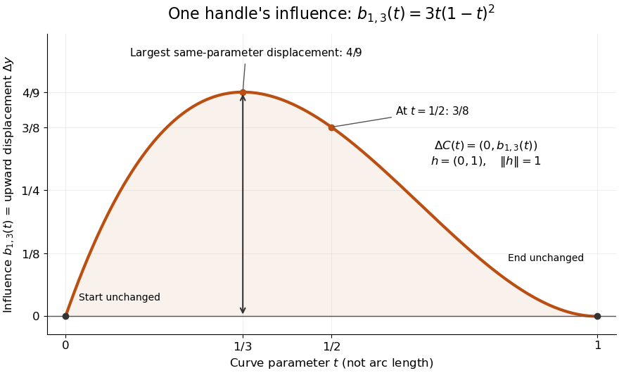

# Control-point influence on a curve

↑ **Parent:** [Control point](control-point.md)

For a [parametric curve](parametric-curve.md) represented by fixed scalar [functions](function-split.md) $b_j$ and [control points](control-point.md) $P_j$ in [Euclidean space](euclidean-norm.md), write

$$
C(t)=\sum_j b_j(t)P_j,\qquad \widetilde P_i=P_i+h,\qquad \widetilde P_j=P_j\quad(j\ne i).
$$

The influence function of this handle is $b_i$: the resulting displacement [vector](vector.md) is $\Delta C(t)=\widetilde C(t)-C(t)=b_i(t)h$, and its [norm](norm.md) is $|b_i(t)|\,\|h\|$. These are exact finite changes, not only a first-order estimate. Where $b_i$ is negative the displacement points opposite to $h$. Where $b_i(t)=0$, the [curve](curve.md) is unchanged at that parameter.

**[Figure 2](#image-the-influence-coefficient-3t-1-t-2-equals-the-vertical-displacement-for-a-unit-upward-move-of-p1-reaches-4-9-at-t-1-3-and-vanishes-at-both-endpoints). The influence coefficient 3t(1-t)^2 equals the vertical displacement for a unit upward move of P1, reaches 4/9 at t=1/3, and vanishes at both endpoints**.

For the cubic [Bézier curve](bezier-curve.md) above, the [Bernstein basis](bernstein-basis.md) influence function is $b_{1,3}(t)=3t(1-t)^2$. Its [derivative](derivative.md) is

$$
b_{1,3}'(t)=3(1-t)(1-3t).
$$

It increases up to $t=1/3$ and decreases thereafter on $[0,1]$. Consequently the largest displacement at corresponding parameters is

$$
\max_{0\leq t\leq1}\|\widetilde C(t)-C(t)\|=\frac49\|h\|,\qquad C(1/3)=\left(\frac{34}{27},\frac43\right),\qquad \widetilde C(1/3)=\left(\frac{34}{27},\frac{16}{9}\right).
$$

For $h=(0,1)$ it is $4/9$. This is a comparison at the same parameter. A geometric closest-distance comparison, as in a [closest-point search on a subdivision curve](closest-point-search-on-a-subdivision-curve.md), instead minimizes over another parameter:

$$
d\bigl(C(t),\widetilde C([0,1])\bigr)=\min_{0\leq s\leq1}\|\widetilde C(s)-C(t)\|\leq\|\widetilde C(t)-C(t)\|.
$$

The closest parameter $s$ can differ from $t$, so $4/9$ is not automatically a maximum closest-distance separation of the two [curves](curve.md). Neither parameter is assumed to be [arc length](arc-length.md).

The [support of a function](support.md) $b_i$ is the closure of the parameter values where $b_i\ne0$. It bounds where a nonzero handle move can act, but may include boundary [points](point-geometry.md) where the actual displacement is zero. Here the [support of a function](support.md) $b_{1,3}$ is all of $[0,1]$ relative to the parameter domain, while the endpoints are unaffected. In contrast, a [B-spline](b-spline.md) of order $k$ has [support](support.md) within $[t_i,t_{i+k}]$ in its [spline knot](spline-knot.md) sequence, so its handle affects only that parameter range; the [support and Gram bandwidth of B-splines](support-and-gram-bandwidth-of-b-splines.md) describes the same locality in another application. Changing the [spline knots](spline-knot.md) or the [basis](basis.md) along with the handle requires a different comparison.

When the [basis](basis.md) functions form a [partition of unity](partition-of-unity.md), $\sum_j b_j(t)=1$, each evaluation is an [affine combination](affine-combination.md) of the [control points](control-point.md). Applying an [affine map](affine-map.md) $T(x)=Ax+a$ to all handles gives

$$
\sum_j b_j(t)T(P_j)=A C(t)+a=T(C(t)).
$$

This is [affine equivariance of a geometric basis](affine-equivariance-of-a-geometric-basis.md), also called affine covariance: [affine maps preserve affine combinations](affine-maps-preserve-affine-combinations.md). In particular, translating every handle by $h$ translates the whole [curve](curve.md) by $h$, whereas moving just one handle produces $b_i(t)h$. The [Bernstein basis](bernstein-basis.md) has this [partition of unity](partition-of-unity.md) property.[§4.3, pp. 132–133: Bernstein weights sum to one](curves-and-surfaces-in-geometric-modeling-theory-and-algorithms-by-jean-gallier.md) Nonnegative weights further make evaluations [convex combinations](convex-combination.md), giving the [convex hull](convex-hull.md) bound illustrated by the [control polygon](control-polygon.md); nonnegativity is not needed for affine covariance.

For a proof outline of the influence formula, subtract the two [basis](basis.md) representations: every unchanged [coefficient](coefficient.md) cancels, leaving $b_i(t)(P_i+h)-b_i(t)P_i=b_i(t)h$. The same subtraction with several moved handles gives $\Delta C(t)=\sum_i b_i(t)h_i$. No claim about [interpolation](interpolation-split.md), [closest-point search on a subdivision curve](closest-point-search-on-a-subdivision-curve.md) or endpoint motion follows until the actual [basis](basis.md) values are examined.

## ↑ Ancestors (7)

1. [Control point](control-point.md)
2. [Computer aided geometric design](computer-aided-geometric-design-split.md)
3. [Numerical analysis](numerical-analysis-split.md)
4. [Analysis](analysis-split.md)
5. [Area of mathematics](area-of-mathematics.md)
6. [Mathematics](mathematics-split.md)
7. [Codex Wiki](split.md)

## ← Incoming links (1)

- [Control point](control-point.md)
