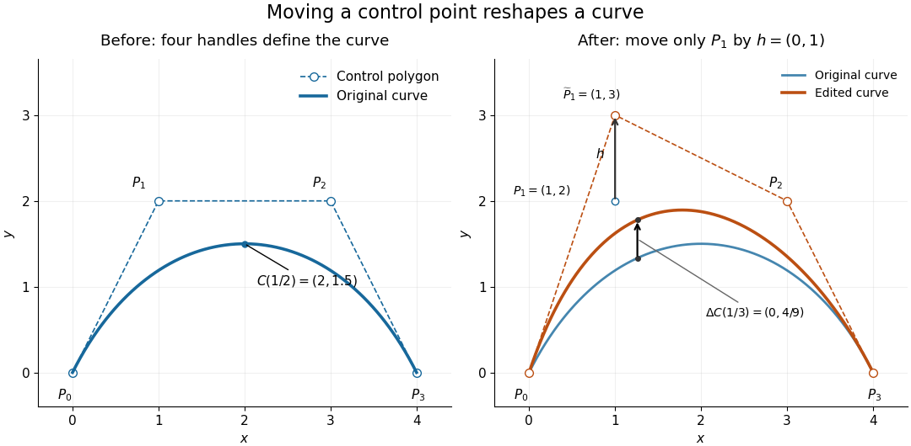

# Control point

↑ **Parent:** [Computer aided geometric design](computer-aided-geometric-design-split.md)

A [control point](control-point.md) is an editable geometric handle used to specify a [curve](curve.md) or [surface](topological-surface-split.md) through a [basis](basis.md) or refinement rule. The handle is part of the representation; it need not be a [point](point-geometry.md) on the resulting [curve](curve.md). In a [Bézier curve](bezier-curve.md), the [control points](control-point.md) are the geometric [coefficients](coefficient.md) of the [Bernstein basis](bernstein-basis.md). Joining them in order gives a [control polygon](control-polygon.md), which makes the handles easy to manipulate without drawing the [curve](curve.md) as a chain of [line segments](line-segment.md).[§4.3, pp. 132–133: control points and Bernstein representation; §5.1, p. 148: control polygon](curves-and-surfaces-in-geometric-modeling-theory-and-algorithms-by-jean-gallier.md)

For example, use the cubic [Bézier curve](bezier-curve.md) with [control points](control-point.md)

$$
P_0=(0,0),\qquad P_1=(1,2),\qquad P_2=(3,2),\qquad P_3=(4,0).
$$

Its [Bernstein basis](bernstein-basis.md) representation gives

$$
C(t)=\bigl(3t+3t^2-2t^3,\;6t(1-t)\bigr),\qquad 0\leq t\leq1,\qquad C(1/2)=(2,1.5).
$$

The greatest height is $1.5$, so neither interior [control point](control-point.md), both at height $2$, lies on this [curve](curve.md). The endpoint [control points](control-point.md) do lie on it: $C(0)=P_0$ and $C(1)=P_3$. This separates [interpolation](interpolation-split.md), which requires passage through prescribed data, from an approximating representation, which uses handles to shape a [curve](curve.md) without requiring passage through every handle. If measured [points](point-geometry.md) must be interpolated, choose [control points](control-point.md) to satisfy those constraints; simply using the measured [points](point-geometry.md) as the handles of a [Bézier curve](bezier-curve.md) does not enforce [interpolation](interpolation-split.md).

**[Figure 1](#image-original-cubic-and-the-curve-after-moving-only-the-interior-control-point-p1-upward-by-one-unit-with-fixed-endpoints-and-a-smaller-displacement-at-the-same-parameter). Original cubic and the curve after moving only the interior control point P1 upward by one unit, with fixed endpoints and a smaller displacement at the same parameter**.

Now move only $P_1$ by the [vector](vector.md) $h=(0,1)$, giving $\widetilde P_1=(1,3)$. With the [Bernstein basis](bernstein-basis.md) and parameter $t$ unchanged, the new [curve](curve.md) is

$$
\widetilde C(t)=C(t)+3t(1-t)^2h.
$$

At $t=1/2$ this gives $\widetilde C(1/2)=(2,15/8)$, a displacement $(0,3/8)$ despite moving the handle by a full unit. Both endpoints stay fixed because the [coefficient](coefficient.md) $3t(1-t)^2$ vanishes there. Thus dragging a [control point](control-point.md) shapes a whole range of the [curve](curve.md); it does not generally drag an arbitrary selected [point](point-geometry.md) on the [curve](curve.md) by the same [vector](vector.md). The [control-point influence on a curve](control-point-influence-on-a-curve.md) tells us exactly how much each parameter value moves.

**Table of contents**

- [Control-point influence on a curve](control-point-influence-on-a-curve.md)
- [Control net](control-net.md)
- [Control polygon](control-polygon.md)

## ↑ Ancestors (6)

1. [Computer aided geometric design](computer-aided-geometric-design-split.md)
2. [Numerical analysis](numerical-analysis-split.md)
3. [Analysis](analysis-split.md)
4. [Area of mathematics](area-of-mathematics.md)
5. [Mathematics](mathematics-split.md)
6. [Codex Wiki](split.md)

## ← Incoming links (33)

- [Affine equivariance of a geometric basis](affine-equivariance-of-a-geometric-basis.md)
- [Bézier curve](bezier-curve.md)
- [Bézier derivative control polygon](bezier-derivative-control-polygon.md)
- [Binary linear interpolatory subdivision](binary-linear-interpolatory-subdivision.md)
- [Bounding volume](bounding-volume.md)
- [Chaikin subdivision](chaikin-subdivision.md)
- [Control net](control-net.md)
- [Control point](control-point.md)
- [Control-point influence on a curve](control-point-influence-on-a-curve.md)
- [Control polygon](control-polygon.md)
- [De Casteljau's algorithm](de-casteljau-s-algorithm.md)
- [Non-uniform rational B-spline](non-uniform-rational-b-spline.md)
- [Solution](past-exam-of-the-mathematics-course-of-the-university-of-cambridge/2002/iii/paper-59/1/solution.md)
- [Solution](past-exam-of-the-mathematics-course-of-the-university-of-cambridge/2002/iii/paper-59/2/solution.md)
- [Solution](past-exam-of-the-mathematics-course-of-the-university-of-cambridge/2002/iii/paper-59/5/solution.md)
- [Solution](past-exam-of-the-mathematics-course-of-the-university-of-cambridge/2002/iii/paper-59/6/solution.md)
- [Solution](past-exam-of-the-mathematics-course-of-the-university-of-cambridge/2003/iii/paper-68/2/solution.md)
- [Solution](past-exam-of-the-mathematics-course-of-the-university-of-cambridge/2003/iii/paper-68/4/solution.md)
- [Solution](past-exam-of-the-mathematics-course-of-the-university-of-cambridge/2004/iii/paper-70/2/i/solution.md)
- [Solution](past-exam-of-the-mathematics-course-of-the-university-of-cambridge/2004/iii/paper-70/2/ii/solution.md)
- [Solution](past-exam-of-the-mathematics-course-of-the-university-of-cambridge/2004/iii/paper-70/4/i/solution.md)
- [Solution](past-exam-of-the-mathematics-course-of-the-university-of-cambridge/2004/iii/paper-70/4/ii/solution.md)
- [Solution](past-exam-of-the-mathematics-course-of-the-university-of-cambridge/2005/iii/paper-66/1/i/solution.md)
- [Solution](past-exam-of-the-mathematics-course-of-the-university-of-cambridge/2005/iii/paper-66/1/iii/solution.md)
- [Solution](past-exam-of-the-mathematics-course-of-the-university-of-cambridge/2005/iii/paper-66/1/iv/solution.md)
- [Solution](past-exam-of-the-mathematics-course-of-the-university-of-cambridge/2005/iii/paper-66/4/i/solution.md)
- [Solution](past-exam-of-the-mathematics-course-of-the-university-of-cambridge/2005/iii/paper-66/4/ii/solution.md)
- [Solution](past-exam-of-the-mathematics-course-of-the-university-of-cambridge/2006/iii/paper-66/5/c/solution.md)
- [Quartic treble-knot representation of a quadratic B-spline](quartic-treble-knot-representation-of-a-quadratic-b-spline.md)
- [Subdivision curve](subdivision-curve.md)
- [Subdivision mask width](subdivision-mask-width.md)
- [Subdivision matrix](subdivision-matrix.md)
- [Vector graphics](vector-graphics.md)
