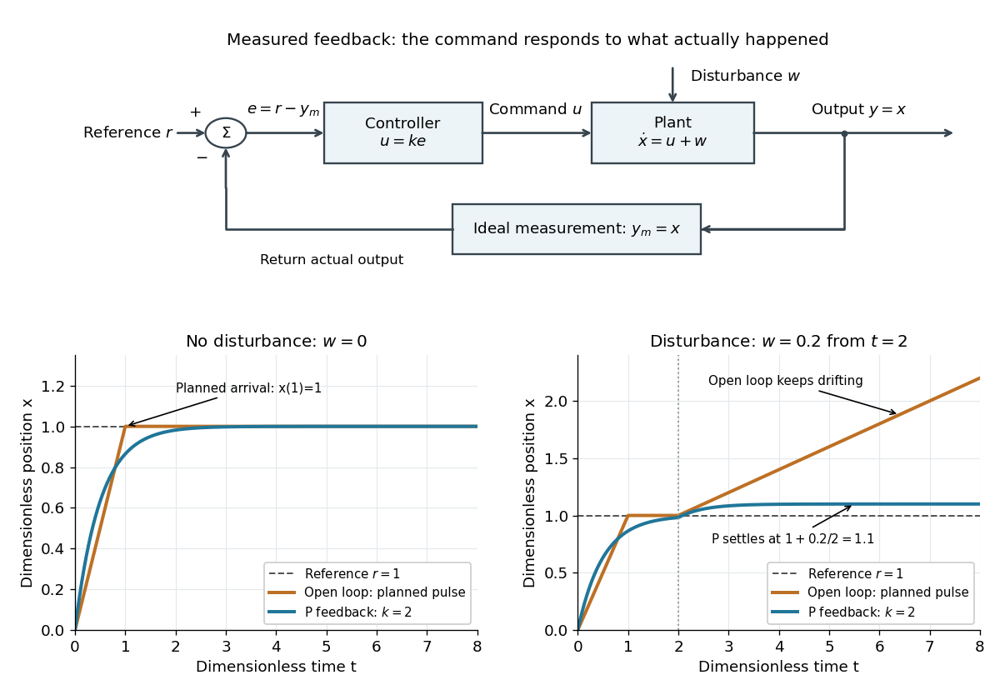

# Control theory

↑ **Parent:** [Area of mathematics](area-of-mathematics.md)  
ⓦ [Wiki](https://en.wikipedia.org/wiki/Control_theory)

[Control theory](control-theory-split.md) studies how to choose [control inputs](control-input.md) for a [dynamical system](dynamical-system.md) so that its [plant output](output-control-theory.md) follows a [reference signal](reference-signal.md), despite [control disturbances](control-disturbance.md) and imperfect knowledge of the [controlled plant](plant-control-theory.md). A [controller](controller-control-theory.md) turns the available information into a [control signal](control-input.md). The design must consider both the resulting response and [stability theory](stability-theory.md): a rule that corrects a small mismatch can still produce growing deviations if the interconnection is badly chosen. [Åström and Murray, Feedback Systems, Chapter 1: Introduction](https://www.fbswiki.org/wiki/index.php/Introduction)

The central distinction is informational. [Open-loop control](open-loop-control.md) executes planned commands; [feedback control](closed-loop-control.md) uses the [measured output](measured-output.md) of the actual [controlled plant](plant-control-theory.md) to update those commands. A [reference signal](reference-signal.md) can describe a destination, while [control disturbances](control-disturbance.md) describe influences that the [controller](controller-control-theory.md) did not command. A model can predict where the [controlled plant](plant-control-theory.md) should be; measurement tells the [controller](controller-control-theory.md) what actually happened. The authors provide a free full-book PDF through [Feedback Systems, second edition: authors' book and download page](https://www.fbswiki.org/wiki/index.php/Feedback_Systems:_An_Introduction_for_Scientists_and_Engineers).

For a concrete comparison, all examples below use the same ideal [scalar](scalar.md) [controlled plant](plant-control-theory.md):

$$
\dot x(t)=u(t)+w(t),\qquad y(t)=y_m(t)=x(t),\qquad r(t)=1,\qquad x(0)=0.
$$

Here $x$ is an illustrative [position](position.md), $u$ the [control input](control-input.md), $w$ a [control disturbance](control-disturbance.md), and $y_m$ the [measured output](measured-output.md). Both $x$ and $t$ are [dimensionless quantities](dimensionless-quantity.md); the numbers are chosen to expose the mechanism, with no empirical interpretation. The [ordinary differential equation](ordinary-differential-equation.md) says that the present [control input](control-input.md) and [control disturbance](control-disturbance.md) accumulate into $x$. The [measured output](measured-output.md) equals the entire state only in this ideal example; a general [plant output](output-control-theory.md) need not reveal the entire state.

**[Figure 1](#image-planned-commands-and-feedback-control-for-an-ideal-controlled-plant). Planned commands and feedback control for an ideal controlled plant**. Top: the [reference signal](reference-signal.md) and [measured output](measured-output.md) form the [tracking error](tracking-error.md), which the [controller](controller-control-theory.md) converts into a [control signal](control-input.md). Bottom left: with no [control disturbance](control-disturbance.md), the planned pulse reaches $x=1$ at $t=1$, while [proportional control](proportional-control.md) with [feedback gain](feedback-gain.md) $k=2$ approaches it smoothly. Bottom right: a [control disturbance](control-disturbance.md) $w=0.2$ starts at $t=2$; [open-loop control](open-loop-control.md) drifts, while [proportional control](proportional-control.md) approaches $1.1$. All coordinates are [dimensionless quantities](dimensionless-quantity.md).

**Table of contents**

- [Plant (control theory)](plant-control-theory.md)
  - [Input (control theory)](input-control-theory.md)
  - [Output (control theory)](output-control-theory.md)
    - [Measured output](measured-output.md)
      - [Sensor bias](sensor-bias.md)
  - [Control disturbance](control-disturbance.md)
- [Controller (control theory)](controller-control-theory.md)
  - [Feedback gain](feedback-gain.md)
  - [Actuator saturation](actuator-saturation.md)
  - [PID controller](pid-controller.md)
- [Controllability](controllability.md)
  - [Controllability matrix](controllability-matrix.md)
  - [Kalman rank criterion](kalman-rank-criterion.md)
  - [Controllability Gramian](controllability-gramian.md)
  - [Quantum controllability](quantum-controllability.md)
    - [Bilinear Hamiltonian control system](bilinear-hamiltonian-control-system.md)
    - [Dynamical Lie algebra](dynamical-lie-algebra.md)
      - [Connected nondegenerate transition chain generates special unitary control](connected-nondegenerate-transition-chain-generates-special-unitary-control.md)
      - [Strongly regular quantum Hamiltonian](strongly-regular-quantum-hamiltonian.md)
      - [Codimension-one quantum dynamical algebra is special unitary](codimension-one-quantum-dynamical-algebra-is-special-unitary.md)
      - [Symplectic dynamical symmetry in quantum control](symplectic-dynamical-symmetry-in-quantum-control.md)
        - [Symplectic invariant of a density operator](symplectic-invariant-of-a-density-operator.md)
      - [Two adjacent transitions generate the qutrit unitary Lie algebra](two-adjacent-transitions-generate-the-qutrit-unitary-lie-algebra.md)
      - [Orthogonal dynamical symmetry in quantum control](orthogonal-dynamical-symmetry-in-quantum-control.md)
      - [Identity augmentation in quantum controllability](identity-augmentation-in-quantum-controllability.md)
    - [Pure-state controllability](pure-state-controllability.md)
    - [Density operator controllability](density-operator-controllability.md)
    - [Unitary operator controllability](unitary-operator-controllability.md)
- [Reachability in control theory](reachability-in-control-theory.md)
  - [Reachable set](reachable-set.md)
  - [Double integrator](double-integrator.md)
- [Open-loop control](open-loop-control.md)
- [Quantum control](quantum-control.md)
  - [Geometric quantum state synthesis by adjacent rotations](geometric-quantum-state-synthesis-by-adjacent-rotations.md)
  - [Ising coupling of two qubits](ising-coupling-of-two-qubits.md)
    - [Ising spin echo](ising-spin-echo.md)
  - [Coherent quantum feedback](coherent-quantum-feedback.md)
    - [Cavity-reservoir interaction](cavity-reservoir-interaction.md)
    - [Quantum noise increment](quantum-noise-increment.md)
      - [Gaussian quantum noise Ito table](gaussian-quantum-noise-ito-table.md)
    - [Passive cavity input-output transfer function](passive-cavity-input-output-transfer-function.md)
      - [Instantaneous coherent cavity feedback through a beam splitter](instantaneous-coherent-cavity-feedback-through-a-beam-splitter.md)
  - [Markovian reservoir engineering](markovian-reservoir-engineering.md)
  - [Hamiltonian engineering](hamiltonian-engineering.md)
    - [Dark state of a driven Hamiltonian](dark-state-of-a-driven-hamiltonian.md)
    - [Average Hamiltonian engineering](average-hamiltonian-engineering.md)
    - [Adiabatic quantum control](adiabatic-quantum-control.md)
      - [Stimulated Raman adiabatic passage](stimulated-raman-adiabatic-passage.md)
    - [Resonant quantum control](resonant-quantum-control.md)
      - [Quantum pulse area](quantum-pulse-area.md)
        - [Embedded two-level quantum rotation](embedded-two-level-quantum-rotation.md)
  - [Lyapunov quantum control](lyapunov-quantum-control.md)
    - [Hilbert-Schmidt Lyapunov feedback identity](hilbert-schmidt-lyapunov-feedback-identity.md)
      - [Feedback based on state overlap need not be stabilizing](feedback-based-on-state-overlap-need-not-be-stabilizing.md)
- [Closed-loop control](closed-loop-control.md)
  - [Reference signal](reference-signal.md)
    - [Ramp reference signal](ramp-reference-signal.md)
  - [Tracking error](tracking-error.md)
    - [Steady-state tracking error](steady-state-tracking-error.md)
  - [Proportional control](proportional-control.md)
  - [Integral action](integral-action.md)
    - [Proportional-integral control](proportional-integral-control.md)
  - [Feedback delay](feedback-delay.md)
    - [Initial history of delayed feedback](initial-history-of-delayed-feedback.md)
    - [Delay stability of proportional integrator control](delay-stability-of-proportional-integrator-control.md)
    - [Delayed cursor feedback experiment](delayed-cursor-feedback-experiment.md)
  - [Measurement-based quantum feedback](measurement-based-quantum-feedback.md)
    - [Qubit stabilization by measurement feedback](qubit-stabilization-by-measurement-feedback.md)
- [Control input](control-input.md)
- [Optimal control](optimal-control.md)
  - [Logarithmic spending with a terminal multiplier](logarithmic-spending-with-a-terminal-multiplier.md)
  - [Scalar delayed-observation LQG regulator](scalar-delayed-observation-lqg-regulator.md)
  - [Quantum optimal control](quantum-optimal-control.md)
    - [Liouville-space costate equations for quantum optimal control](liouville-space-costate-equations-for-quantum-optimal-control.md)
    - [Variational costate gradient for Hamiltonian quantum control](variational-costate-gradient-for-hamiltonian-quantum-control.md)
    - [Phase-insensitive unitary gate error](phase-insensitive-unitary-gate-error.md)
    - [Adaptive experimental quantum control](adaptive-experimental-quantum-control.md)
    - [Gradient ascent pulse engineering](gradient-ascent-pulse-engineering.md)
  - [Work-then-consume optimum for a nonconcave consumption-leisure utility](work-then-consume-optimum-for-a-nonconcave-consumption-leisure-utility.md)
  - [Stochastic control](stochastic-control.md)
    - [Controlled Markov process](controlled-markov-process.md)
      - [Markov decision process](markov-decision-process.md)
    - [Singular stochastic control](singular-stochastic-control.md)
  - [Direct-adjoint looping](direct-adjoint-looping.md)
    - [Fixed-energy initial-condition optimality](fixed-energy-initial-condition-optimality.md)
  - [Bang-bang control](bang-bang-control.md)
  - [Costate](costate.md)
  - [Hamiltonian of an optimal-control problem](hamiltonian-of-an-optimal-control-problem.md)
  - [Pontryagin maximum principle](pontryagin-maximum-principle.md)
    - [Area-constrained quadratic control cost](area-constrained-quadratic-control-cost.md)
    - [Threshold energy scheduling with a completion reward](threshold-energy-scheduling-with-a-completion-reward.md)
    - [Free-terminal-time transversality condition](free-terminal-time-transversality-condition.md)
- [State estimation](state-estimation.md)
  - [Causal state filtering](causal-state-filtering.md)
  - [State prediction](state-prediction.md)
  - [Process noise](process-noise.md)
  - [Best affine state estimate](best-affine-state-estimate.md)
  - [Kalman filter](kalman-filter.md)
    - [Kalman prediction step](kalman-prediction-step.md)
    - [Innovation covariance](innovation-covariance.md)
    - [Kalman gain](kalman-gain.md)
    - [Kalman measurement update](kalman-measurement-update.md)
    - [Gaussian filtering with exact observations](gaussian-filtering-with-exact-observations.md)
    - [Scalar Gaussian Kalman recursion](scalar-gaussian-kalman-recursion.md)
      - [Steady-state local-level Kalman gain](steady-state-local-level-kalman-gain.md)
    - [Scalar static-state Kalman update](scalar-static-state-kalman-update.md)
    - [Kalman filtering of a moving scalar state](kalman-filtering-of-a-moving-scalar-state.md)
- [Linear-quadratic-Gaussian control](linear-quadratic-gaussian-control.md)
  - [Terminal-position reduction of double-integrator control](terminal-position-reduction-of-double-integrator-control.md)
  - [Separation principle](separation-principle.md)
- [Continuous Lyapunov equation](continuous-lyapunov-equation.md)
- [Transfer function](transfer-function.md)
  - [First-order low-pass filter](first-order-low-pass-filter.md)
  - [Continuous-time frequency response](continuous-time-frequency-response.md)
    - [Bode plot](bode-plot.md)
  - [Proper rational transfer function](proper-rational-transfer-function.md)
  - [Bounded-input bounded-output stability](bounded-input-bounded-output-stability.md)
  - [Nyquist stability criterion](nyquist-stability-criterion.md)

## ↑ Ancestors (3)

1. [Area of mathematics](area-of-mathematics.md)
2. [Mathematics](mathematics-split.md)
3. [Codex Wiki](split.md)

## ← Incoming links (5)

- [Control theory](control-theory-split.md)
- [Measurement noise](measurement-noise.md)
- [Physiological integrator](physiological-integrator.md)
- [Plant (control theory)](plant-control-theory.md)
- [Transfer function](transfer-function.md)
