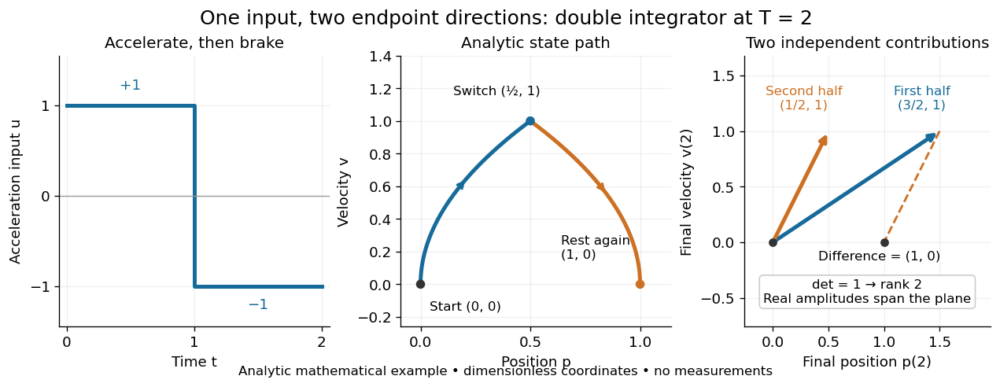
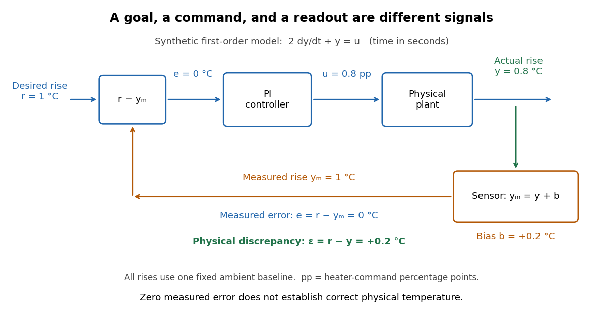
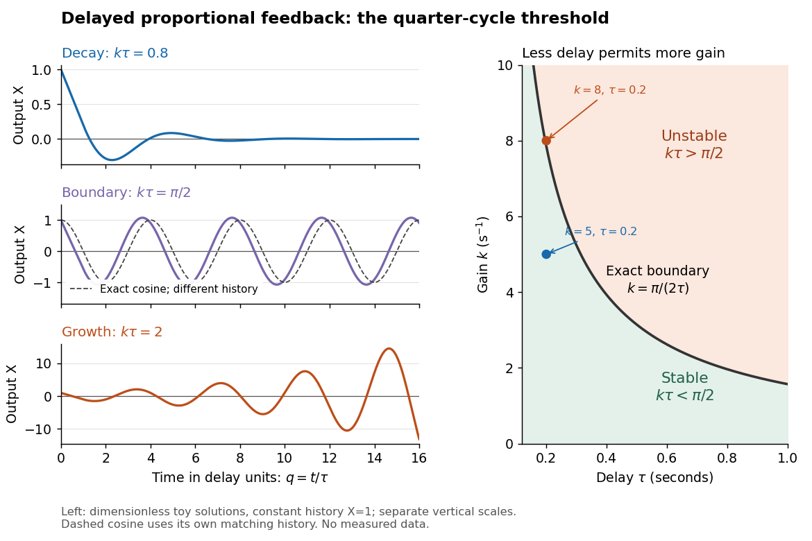
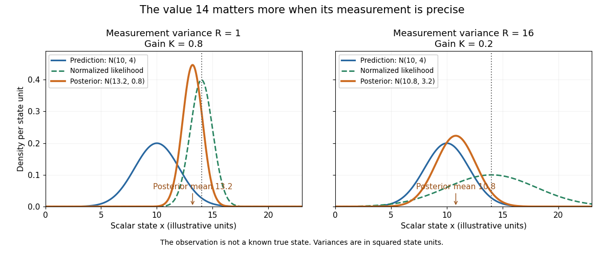
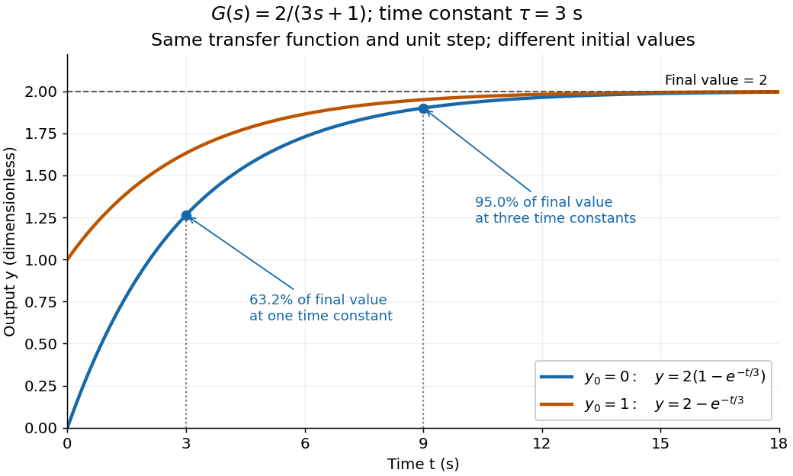
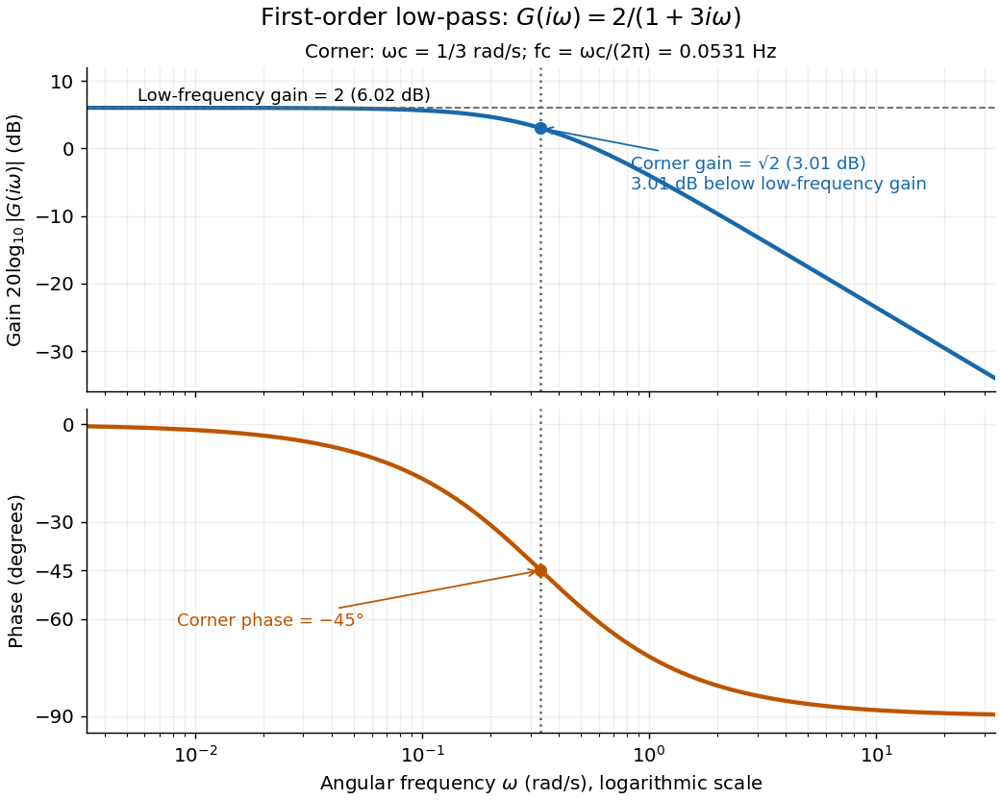

# Control theory

↑ **Parent:** [Area of mathematics](mathematics.md#area-of-mathematics)  
ⓦ [Wiki](https://en.wikipedia.org/wiki/Control_theory)

[Control theory](control-theory.md) studies how to choose [control inputs](#control-input) for a [dynamical system](dynamical-systems.md#dynamical-system) so that its [plant output](#output-control-theory) follows a [reference signal](#reference-signal), despite [control disturbances](#control-disturbance) and imperfect knowledge of the [controlled plant](#plant-control-theory). A [controller](#controller-control-theory) turns the available information into a [control signal](#control-input). The design must consider both the resulting response and [stability theory](dynamical-systems.md#stability-theory): a rule that corrects a small mismatch can still produce growing deviations if the interconnection is badly chosen. [Åström and Murray, Feedback Systems, Chapter 1: Introduction](https://www.fbswiki.org/wiki/index.php/Introduction)

The central distinction is informational. [Open-loop control](#open-loop-control) executes planned commands; [feedback control](#closed-loop-control) uses the [measured output](#measured-output) of the actual [controlled plant](#plant-control-theory) to update those commands. A [reference signal](#reference-signal) can describe a destination, while [control disturbances](#control-disturbance) describe influences that the [controller](#controller-control-theory) did not command. A model can predict where the [controlled plant](#plant-control-theory) should be; measurement tells the [controller](#controller-control-theory) what actually happened. The authors provide a free full-book PDF through [Feedback Systems, second edition: authors' book and download page](https://www.fbswiki.org/wiki/index.php/Feedback_Systems:_An_Introduction_for_Scientists_and_Engineers).

For a concrete comparison, all examples below use the same ideal [scalar](vector-space.md#scalar) [controlled plant](#plant-control-theory):

$$
\dot x(t)=u(t)+w(t),\qquad y(t)=y_m(t)=x(t),\qquad r(t)=1,\qquad x(0)=0.
$$

Here $x$ is an illustrative [position](classical-mechanics.md#position), $u$ the [control input](#control-input), $w$ a [control disturbance](#control-disturbance), and $y_m$ the [measured output](#measured-output). Both $x$ and $t$ are [dimensionless quantities](physics.md#dimensionless-quantity); the numbers are chosen to expose the mechanism, with no empirical interpretation. The [ordinary differential equation](differential-equation.md#ordinary-differential-equation) says that the present [control input](#control-input) and [control disturbance](#control-disturbance) accumulate into $x$. The [measured output](#measured-output) equals the entire state only in this ideal example; a general [plant output](#output-control-theory) need not reveal the entire state.

**[Figure 1](#image-planned-commands-and-feedback-control-for-an-ideal-controlled-plant). Planned commands and feedback control for an ideal controlled plant**. Top: the [reference signal](#reference-signal) and [measured output](#measured-output) form the [tracking error](#tracking-error), which the [controller](#controller-control-theory) converts into a [control signal](#control-input). Bottom left: with no [control disturbance](#control-disturbance), the planned pulse reaches $x=1$ at $t=1$, while [proportional control](#proportional-control) with [feedback gain](#feedback-gain) $k=2$ approaches it smoothly. Bottom right: a [control disturbance](#control-disturbance) $w=0.2$ starts at $t=2$; [open-loop control](#open-loop-control) drifts, while [proportional control](#proportional-control) approaches $1.1$. All coordinates are [dimensionless quantities](physics.md#dimensionless-quantity).

**Table of contents**

- [Plant (control theory)](#plant-control-theory)
  - [Input (control theory)](#input-control-theory)
  - [Output (control theory)](#output-control-theory)
    - [Measured output](#measured-output)
      - [Sensor bias](#sensor-bias)
  - [Control disturbance](#control-disturbance)
- [Controller (control theory)](#controller-control-theory)
  - [Feedback gain](#feedback-gain)
  - [Actuator saturation](#actuator-saturation)
  - [PID controller](#pid-controller)
- [Controllability](#controllability)
  - [Controllability matrix](#controllability-matrix)
  - [Kalman rank criterion](#kalman-rank-criterion)
  - [Controllability Gramian](#controllability-gramian)
  - [Quantum controllability](#quantum-controllability)
    - [Bilinear Hamiltonian control system](#bilinear-hamiltonian-control-system)
    - [Dynamical Lie algebra](#dynamical-lie-algebra)
      - [Connected nondegenerate transition chain generates special unitary control](#connected-nondegenerate-transition-chain-generates-special-unitary-control)
      - [Strongly regular quantum Hamiltonian](#strongly-regular-quantum-hamiltonian)
      - [Codimension-one quantum dynamical algebra is special unitary](#codimension-one-quantum-dynamical-algebra-is-special-unitary)
      - [Symplectic dynamical symmetry in quantum control](#symplectic-dynamical-symmetry-in-quantum-control)
        - [Symplectic invariant of a density operator](#symplectic-invariant-of-a-density-operator)
      - [Two adjacent transitions generate the qutrit unitary Lie algebra](#two-adjacent-transitions-generate-the-qutrit-unitary-lie-algebra)
      - [Orthogonal dynamical symmetry in quantum control](#orthogonal-dynamical-symmetry-in-quantum-control)
      - [Identity augmentation in quantum controllability](#identity-augmentation-in-quantum-controllability)
    - [Pure-state controllability](#pure-state-controllability)
    - [Density operator controllability](#density-operator-controllability)
    - [Unitary operator controllability](#unitary-operator-controllability)
- [Reachability in control theory](#reachability-in-control-theory)
  - [Reachable set](#reachable-set)
  - [Double integrator](#double-integrator)
- [Open-loop control](#open-loop-control)
- [Quantum control](#quantum-control)
  - [Geometric quantum state synthesis by adjacent rotations](#geometric-quantum-state-synthesis-by-adjacent-rotations)
  - [Ising coupling of two qubits](#ising-coupling-of-two-qubits)
    - [Ising spin echo](#ising-spin-echo)
  - [Coherent quantum feedback](#coherent-quantum-feedback)
    - [Cavity-reservoir interaction](#cavity-reservoir-interaction)
    - [Quantum noise increment](#quantum-noise-increment)
      - [Gaussian quantum noise Ito table](#gaussian-quantum-noise-ito-table)
    - [Passive cavity input-output transfer function](#passive-cavity-input-output-transfer-function)
      - [Instantaneous coherent cavity feedback through a beam splitter](#instantaneous-coherent-cavity-feedback-through-a-beam-splitter)
  - [Markovian reservoir engineering](#markovian-reservoir-engineering)
  - [Hamiltonian engineering](#hamiltonian-engineering)
    - [Dark state of a driven Hamiltonian](#dark-state-of-a-driven-hamiltonian)
    - [Average Hamiltonian engineering](#average-hamiltonian-engineering)
    - [Adiabatic quantum control](#adiabatic-quantum-control)
      - [Stimulated Raman adiabatic passage](#stimulated-raman-adiabatic-passage)
    - [Resonant quantum control](#resonant-quantum-control)
      - [Quantum pulse area](#quantum-pulse-area)
        - [Embedded two-level quantum rotation](#embedded-two-level-quantum-rotation)
  - [Lyapunov quantum control](#lyapunov-quantum-control)
    - [Hilbert-Schmidt Lyapunov feedback identity](#hilbert-schmidt-lyapunov-feedback-identity)
      - [Feedback based on state overlap need not be stabilizing](#feedback-based-on-state-overlap-need-not-be-stabilizing)
- [Closed-loop control](#closed-loop-control)
  - [Reference signal](#reference-signal)
    - [Ramp reference signal](#ramp-reference-signal)
  - [Tracking error](#tracking-error)
    - [Steady-state tracking error](#steady-state-tracking-error)
  - [Proportional control](#proportional-control)
  - [Integral action](#integral-action)
    - [Proportional-integral control](#proportional-integral-control)
  - [Feedback delay](#feedback-delay)
    - [Initial history of delayed feedback](#initial-history-of-delayed-feedback)
    - [Delay stability of proportional integrator control](#delay-stability-of-proportional-integrator-control)
    - [Delayed cursor feedback experiment](#delayed-cursor-feedback-experiment)
  - [Measurement-based quantum feedback](#measurement-based-quantum-feedback)
    - [Qubit stabilization by measurement feedback](#qubit-stabilization-by-measurement-feedback)
- [Control input](#control-input)
- [Optimal control](#optimal-control)
  - [Logarithmic spending with a terminal multiplier](#logarithmic-spending-with-a-terminal-multiplier)
  - [Scalar delayed-observation LQG regulator](#scalar-delayed-observation-lqg-regulator)
  - [Quantum optimal control](#quantum-optimal-control)
    - [Liouville-space costate equations for quantum optimal control](#liouville-space-costate-equations-for-quantum-optimal-control)
    - [Variational costate gradient for Hamiltonian quantum control](#variational-costate-gradient-for-hamiltonian-quantum-control)
    - [Phase-insensitive unitary gate error](#phase-insensitive-unitary-gate-error)
    - [Adaptive experimental quantum control](#adaptive-experimental-quantum-control)
    - [Gradient ascent pulse engineering](#gradient-ascent-pulse-engineering)
  - [Work-then-consume optimum for a nonconcave consumption-leisure utility](#work-then-consume-optimum-for-a-nonconcave-consumption-leisure-utility)
  - [Stochastic control](#stochastic-control)
    - [Controlled Markov process](#controlled-markov-process)
      - [Markov decision process](#markov-decision-process)
        - [Policy iteration](#policy-iteration)
    - [Singular stochastic control](#singular-stochastic-control)
  - [Direct-adjoint looping](#direct-adjoint-looping)
    - [Fixed-energy initial-condition optimality](#fixed-energy-initial-condition-optimality)
  - [Bang-bang control](#bang-bang-control)
  - [Costate](#costate)
  - [Hamiltonian of an optimal-control problem](#hamiltonian-of-an-optimal-control-problem)
  - [Pontryagin maximum principle](#pontryagin-maximum-principle)
    - [Area-constrained quadratic control cost](#area-constrained-quadratic-control-cost)
    - [Threshold energy scheduling with a completion reward](#threshold-energy-scheduling-with-a-completion-reward)
    - [Free-terminal-time transversality condition](#free-terminal-time-transversality-condition)
- [State estimation](#state-estimation)
  - [Causal state filtering](#causal-state-filtering)
  - [State prediction](#state-prediction)
  - [Process noise](#process-noise)
  - [Best affine state estimate](#best-affine-state-estimate)
  - [Kalman filter](#kalman-filter)
    - [Kalman prediction step](#kalman-prediction-step)
    - [Innovation covariance](#innovation-covariance)
    - [Kalman gain](#kalman-gain)
    - [Kalman measurement update](#kalman-measurement-update)
    - [Gaussian filtering with exact observations](#gaussian-filtering-with-exact-observations)
    - [Scalar Gaussian Kalman recursion](#scalar-gaussian-kalman-recursion)
      - [Steady-state local-level Kalman gain](#steady-state-local-level-kalman-gain)
    - [Scalar static-state Kalman update](#scalar-static-state-kalman-update)
    - [Kalman filtering of a moving scalar state](#kalman-filtering-of-a-moving-scalar-state)
- [Linear-quadratic-Gaussian control](#linear-quadratic-gaussian-control)
  - [Terminal-position reduction of double-integrator control](#terminal-position-reduction-of-double-integrator-control)
  - [Separation principle](#separation-principle)
- [Continuous Lyapunov equation](#continuous-lyapunov-equation)
- [Transfer function](#transfer-function)
  - [Formal sinusoidal response of an unstable linear system](#formal-sinusoidal-response-of-an-unstable-linear-system)
  - [First-order low-pass filter](#first-order-low-pass-filter)
  - [Continuous-time frequency response](#continuous-time-frequency-response)
    - [Bode plot](#bode-plot)
  - [Proper rational transfer function](#proper-rational-transfer-function)
  - [Bounded-input bounded-output stability](#bounded-input-bounded-output-stability)
  - [Nyquist stability criterion](#nyquist-stability-criterion)
  - [Step response](#step-response)
    - [Settling time](#settling-time)

## Plant (control theory)

↑ **Parent:** [Control theory](control-theory.md)  
ⓦ [Wiki](https://en.wikipedia.org/wiki/Plant_(control_theory))

The [controlled plant](#plant-control-theory) is the part of a [control theory](control-theory.md) model that receives the [control input](#control-input) and produces the [plant output](#output-control-theory), including the mechanism that applies the command. The [controller](#controller-control-theory) is specified separately. In the illustrative [ordinary differential equation](differential-equation.md#ordinary-differential-equation) $\dot x=u+w$, the [controlled plant](#plant-control-theory) accumulates the [control input](#control-input) and [control disturbance](#control-disturbance); it does not itself choose $u$.

### Input (control theory)

↑ **Parent:** [Plant (control theory)](#plant-control-theory)

A [plant input](#input-control-theory) is a [signal](electrical-engineering.md#signal) supplied to the [controlled plant](#plant-control-theory). The chosen [plant input](#input-control-theory) is its [control input](#control-input); other influences can enter as [control disturbances](#control-disturbance). This use concerns a [dynamical system](dynamical-systems.md#dynamical-system), rather than the [input](theoretical-computer-science.md#input-computer-science) of a computation.

### Output (control theory)

↑ **Parent:** [Plant (control theory)](#plant-control-theory)

A [plant output](#output-control-theory) is a quantity exposed by the [controlled plant](#plant-control-theory), often modeled as $y=h(x,u,t)$. In the illustrative model it is $y=x$. An [output](theoretical-computer-science.md#output-computing) of a computation has a different meaning.

#### Measured output

↑ **Parent:** [Output (control theory)](#output-control-theory)

The [measured output](#measured-output) is the information about the [plant output](#output-control-theory) available to the [controller](#controller-control-theory). It may differ from the actual [plant output](#output-control-theory) because of [measurement noise](probability-and-statistics.md#measurement-noise) or [feedback delay](#feedback-delay). In the ideal examples $y_m=y=x$, so the [controller](#controller-control-theory) observes the actual current state exactly.

##### Sensor bias

↑ **Parent:** [Measured output](#measured-output)

A [sensor bias](#sensor-bias) is a systematic offset between the [measured output](#measured-output) and the physical [plant output](#output-control-theory), modeled here as $y_m=y+b$ with constant $b$. Unlike zero-mean [measurement noise](probability-and-statistics.md#measurement-noise), a [sensor bias](#sensor-bias) persists when repeated readouts are averaged. A [sensor bias](#sensor-bias) affects the physical meaning of a zero [tracking error](#tracking-error); for a [temperature](temperature.md) readout, independent [thermometer calibration](temperature.md#thermometer-calibration) can detect it.

### Control disturbance

↑ **Parent:** [Plant (control theory)](#plant-control-theory)

A [control disturbance](#control-disturbance) is an influence on the [controlled plant](#plant-control-theory) that is not the chosen [control input](#control-input). In $\dot x=u+w$, a constant $w=0.2$ increases $x$ by $0.2$ per unit $t$ whenever $u=0$.

## Controller (control theory)

↑ **Parent:** [Control theory](control-theory.md)

A [controller](#controller-control-theory) is the rule or mechanism that chooses a [control signal](#control-input). An [open-loop control](#open-loop-control) can depend on a precomputed schedule; a [feedback control](#closed-loop-control) also uses a [measured output](#measured-output) and can have its own memory, as in [integral action](#integral-action).

### Feedback gain

↑ **Parent:** [Controller (control theory)](#controller-control-theory)

A [feedback gain](#feedback-gain) sets the strength of a [controller](#controller-control-theory)'s response to its observations. For [proportional control](#proportional-control), $u=ke$ means that a [tracking error](#tracking-error) $e=0.1$ produces a [control input](#control-input) $u=0.2$ when $k=2$.

### Actuator saturation

↑ **Parent:** [Controller (control theory)](#controller-control-theory)

[Actuator saturation](#actuator-saturation) means the applied [control input](#control-input) reaches a device limit even if the [controller](#controller-control-theory) requests a larger or smaller command. In the heater interpretation, the applied command is bounded between $0$ and $100\%$. If [integral action](#integral-action) continues accumulating a persistent [tracking error](#tracking-error) beyond that limit, its stored [integral](integral.md) can grow without producing the requested physical correction, delaying recovery when the goal changes. The unconstrained [steady-state tracking error](#steady-state-tracking-error) formulas require that the necessary command can actually be applied. [Åström and Murray, PID Control: saturation and integral windup](https://www.fbswiki.org/wiki/index.php/PID_Control)

### PID controller

↑ **Parent:** [Controller (control theory)](#controller-control-theory)  
ⓦ [Wiki](https://en.wikipedia.org/wiki/PID_controller)

An ideal [PID controller](#pid-controller) combines [proportional control](#proportional-control), [integral action](#integral-action), and a term proportional to the [derivative](calculus.md#derivative) of the [tracking error](#tracking-error). With $k_d=0$, it gives [proportional-integral control](#proportional-integral-control). The [integral](integral.md) stores past error, while the [derivative](calculus.md#derivative) responds to its current rate of change. Practical implementations must account for [measurement noise](probability-and-statistics.md#measurement-noise), which an ideal differentiator can amplify. [Åström and Murray, PID Control](https://www.fbswiki.org/wiki/index.php/PID_Control).

## Controllability

↑ **Parent:** [Control theory](control-theory.md)  
ⓦ [Wiki](https://en.wikipedia.org/wiki/Controllability)

[Controllability](#controllability) asks whether the available [control inputs](#control-input) can move a [dynamical system](dynamical-systems.md#dynamical-system) between every pair of states in its declared [state space](dynamical-systems.md#state-space). Fixing a duration $T>0$ gives the precise condition $\mathcal R_T(x_0)=X$ for every $x_0\in X$, where $X$ is the [state space](dynamical-systems.md#state-space) and $\mathcal R_T(x_0)$ its [reachable set](#reachable-set). With freely chosen duration, every pair must instead be connectable in some permitted finite time, which may depend on the pair. Always specify admissible [control inputs](#control-input), deadlines and any constraints along the path. [Åström and Murray, Feedback Systems: State Feedback, reachability definitions](https://fbswiki.org/wiki/index.php/State_Feedback)

The surprising part is that one [control input](#control-input) can control several state variables by acting at different times. For the [double integrator](#double-integrator), [acceleration](classical-mechanics.md#acceleration) changes [velocity](classical-mechanics.md#velocity) directly, while the accumulated [velocity](classical-mechanics.md#velocity) changes [position](classical-mechanics.md#position). Starting from rest, accelerate during the first half of the journey and brake during the second: the final [velocity](classical-mechanics.md#velocity) can vanish although the final [position](classical-mechanics.md#position) has changed. The figure is an analytic mathematical example in [dimensionless quantities](physics.md#dimensionless-quantity), with no experimental measurements.

**[Figure 2](#image-timing-one-control-input-controls-both-position-and-velocity). Timing one control input controls both position and velocity**. The [double integrator](#double-integrator) starts at $(p,v)=(0,0)$ and runs to $T=2$. Left: $u=1$ for one time unit, then $u=-1$ for one time unit. Middle: the analytic state path ends at $(1,0)$, after reaching $(1/2,1)$ when braking begins. Right: unit inputs on the first and second halves separately contribute $(3/2,1)$ and $(1/2,1)$ to the endpoint. Their [linear combinations](vector-space.md#linear-combination) fill the plane when input amplitudes are unrestricted [real numbers](arithmetic.md#real-number); subtracting the second contribution from the first gives $(1,0)$.

[Controllability](#controllability) is useful before trying to design a [controller](#controller-control-theory): a requested endpoint outside the [reachable set](#reachable-set) cannot be attained by clever choice of [feedback control](#closed-loop-control). The [Kalman rank criterion](#kalman-rank-criterion) makes this an exact [linear algebra](linear-algebra.md) calculation for the stated [linear time-invariant system](electrical-engineering.md#linear-time-invariant-system) model. It concerns whole states, so attaining one [plant output](#output-control-theory) is not enough to establish [controllability](#controllability). In [quantum control](#quantum-control), the declared [state space](dynamical-systems.md#state-space) may be an orbit constrained by conservation laws; see [quantum controllability](#quantum-controllability) and [unitary orbit of a density operator](density-matrix.md#unitary-orbit-of-a-density-operator).

### Controllability matrix

↑ **Parent:** [Controllability](#controllability)

For the [linear time-invariant system](electrical-engineering.md#linear-time-invariant-system) $\dot x=Ax+Bu$, with $A\in\mathbb R^{n\times n}$ and $B\in\mathbb R^{n\times m}$, the [controllability matrix](#controllability-matrix) has $n$ rows and $nm$ columns. The columns of $B$ are directions influenced directly by the [control inputs](#control-input); $AB,A^2B,\ldots$ account for how the dynamics carry their influence into further directions. The [column space](vector-space.md#column-space) of the [controllability matrix](#controllability-matrix) is the zero-state [reachable set](#reachable-set) for any $T>0$ when inputs are unrestricted. [Russ Tedrake, Underactuated Robotics: Controllability of linear systems](https://underactuated.csail.mit.edu/acrobot.html#controllability)

### Kalman rank criterion

↑ **Parent:** [Controllability](#controllability)

For a finite-dimensional continuous-time [linear time-invariant system](electrical-engineering.md#linear-time-invariant-system) $\dot x=Ax+Bu$ on $\mathbb R^n$, with constant [matrices](vector-space.md#matrix) $A,B$ over the [real numbers](arithmetic.md#real-number), no state constraints, and every [piecewise continuous function](analysis.md#piecewise-continuous-function) $u:[0,T]\to\mathbb R^m$ allowed as a [control input](#control-input) without an amplitude bound, [controllability](#controllability) in any fixed $T>0$ is equivalent to the [controllability matrix](#controllability-matrix) having [rank of a matrix](vector-space.md#matrix-rank) $n$. The same equivalence holds with all [square-integrable functions](measure-theory.md#square-integrable-function) as inputs. A stronger useful statement is

$$
\mathcal R_T(x_0)=e^{AT}x_0+\operatorname{im}\mathcal C,\qquad T>0,
$$

where $e^{AT}$ is a [matrix exponential](linear-operator-theory.md#matrix-exponential) and $\operatorname{im}\mathcal C$ is the [column space](vector-space.md#column-space). Thus a [rank of a matrix](vector-space.md#matrix-rank) $r<n$ leaves only an $r$-dimensional [affine subspace](vector-space.md#affine-subspace) reachable at that time. [MIT 16.30/31, Feedback Control Systems: Controllability, pages 10–1 to 10–2](https://ocw.mit.edu/courses/16-30-feedback-control-systems-fall-2010/4bebd71d575bdde1384713e9efb400cc_MIT16_30F10_lec10.pdf)

The [Kalman rank criterion](#kalman-rank-criterion) allows arbitrarily large commands as $T$ shrinks. It does not assert [controllability](#controllability) with bounded [control inputs](#control-input), nor test a general nonlinear [dynamical system](dynamical-systems.md#dynamical-system) just by counting its inputs. For the [double integrator](#double-integrator), $B=(0,1)^T$ and $AB=(1,0)^T$ give two independent directions, despite there being only one [control input](#control-input).

### Controllability Gramian

↑ **Parent:** [Controllability](#controllability)  
ⓦ [Wiki](https://en.wikipedia.org/wiki/Controllability_Gramian)

For $T>0$ and the constant [matrices](vector-space.md#matrix) over the [real numbers](arithmetic.md#real-number) in the [Kalman rank criterion](#kalman-rank-criterion), the finite-time [Controllability Gramian](#controllability-gramian) accumulates the influence of all command times. Its [column space](vector-space.md#column-space) equals that of the [controllability matrix](#controllability-matrix), and $W_T$ is a [symmetric positive-definite matrix](linear-algebra.md#symmetric-positive-definite-matrix) exactly when the [controllability matrix](#controllability-matrix) has [rank of a matrix](vector-space.md#matrix-rank) $n$. If so, put $\delta=x_1-e^{AT}x_0$. Among [square-integrable functions](measure-theory.md#square-integrable-function) steering $x_0$ to $x_1$ at $T$, the command

$$
u_*(t)=B^Te^{A^T(T-t)}W_T^{-1}\delta
$$

minimizes $\int_0^T\|u(t)\|^2\,dt$, with value $\delta^TW_T^{-1}\delta$. Here $T$ in a matrix superscript denotes [transpose](vector-space.md#transpose). This cost is a squared input [norm](normed-vector-space.md#norm), not necessarily physical [energy](energy.md), and the optimizing command need not satisfy an amplitude bound. [Stephen Boyd, EE263: Controllability and state transfer, slides 18–29 to 18–30](https://ee263.stanford.edu/archive/contr.pdf)

For the [double integrator](#double-integrator), $e^{As}B=(s,1)^T$, so direct [integration](integral.md) gives

$$
W_T=\begin{pmatrix}T^3/3&T^2/2\\T^2/2&T\end{pmatrix},\qquad
\det W_T=\frac{T^4}{12}>0.
$$

For a rest-to-rest distance $d$, $u_*(t)=6d/T^2-12dt/T^3$ and the minimum squared input [norm](normed-vector-space.md#norm) is $12d^2/T^3$. Compare the two constant commands in the [double integrator](#double-integrator) example, whose cost is $16d^2/T^3$: both attain the target, but the smooth command costs less. At $T=2$, $d=1$, however, $u_*$ peaks at $3/2$, so it violates $|u|\le1$ while the two constant commands remain admissible. [Controllability](#controllability), [optimal control](#optimal-control), and constrained [reachability in control theory](#reachability-in-control-theory) answer different questions.

### Quantum controllability

↑ **Parent:** [Controllability](#controllability)

[Quantum controllability](#quantum-controllability) concerns the transformations reachable under specified quantum [control inputs](#control-input). [Unitary operator controllability](#unitary-operator-controllability) concerns entire propagators; [density operator controllability](#density-operator-controllability) concerns conjugation on every spectral orbit; [pure-state controllability](#pure-state-controllability) concerns normalized state vectors or their physical rays. These notions need not coincide.

#### Bilinear Hamiltonian control system

↑ **Parent:** [Quantum controllability](#quantum-controllability)

A finite-dimensional closed [quantum control](#quantum-control) system with fixed drift and control [Hermitian matrices](hilbert-space.md#hermitian-operator), real [control inputs](#control-input), and dynamics linear in the state at fixed controls and affine in the controls at fixed state. Its [Dynamical Lie algebra](#dynamical-lie-algebra) is generated over the reals by $iH_0,iH_1,\ldots$. Reachability depends on the admissible controls, allowed duration and phase convention.

#### Dynamical Lie algebra

↑ **Parent:** [Quantum controllability](#quantum-controllability)

The dynamical Lie algebra of a finite-dimensional Hamiltonian control system is the real span of its skew-Hermitian drift and control generators and all their nested [commutators](lie-algebra.md#commutator). The sign choice $iH$ or $-iH$ gives the same algebra. Its connected group determines reachable propagators under the usual freely timed, real-control assumptions. An operator commuting with every generator also commutes with this algebra, imposing invariant sectors.

##### Connected nondegenerate transition chain generates special unitary control

↑ **Parent:** [Dynamical Lie algebra](#dynamical-lie-algebra)

Let $H_0$ be diagonal and $H_1=\sum_{j=1}^{N-1}d_j(E_{j,j+1}+E_{j+1,j})$, with every $d_j\ne0$ and the adjacent absolute energy gaps distinct and nonzero. The squared drift adjoint action has distinct eigenvalues on these coupling components, so [Lagrange interpolation](interpolation.md#lagrange-polynomial) isolates every adjacent symmetric coupling. One more [commutator](lie-algebra.md#commutator) gives its antisymmetric partner. Their mutual brackets produce adjacent traceless diagonals, while brackets along the connected chain give all longer-range matrix units. Thus the [special unitary Lie algebra](lie-algebra.md#special-unitary-lie-algebra) is generated. Any nonzero-trace generator also supplies the central direction, giving all of $\mathfrak u(N)$. This is a sufficient condition in the finite-dimensional freely timed real-control model; connectivity alone does not remove frequency degeneracies.

##### Strongly regular quantum Hamiltonian

↑ **Parent:** [Dynamical Lie algebra](#dynamical-lie-algebra)

A drift [Quantum Hamiltonian](quantum-system.md#hamiltonian-quantum-mechanics) is strongly regular when its energy levels are nondegenerate and distinct unordered transitions have distinct absolute nonzero Bohr frequencies. Sometimes regularity is required only on the graph of allowed control transitions. This lets polynomials in the squared drift adjoint action separate different coupling quadratures and permits frequency-selective [resonant quantum control](#resonant-quantum-control). This notion is unrelated to a [strongly regular graph](graph-theory.md#strongly-regular-graph).

##### Codimension-one quantum dynamical algebra is special unitary

↑ **Parent:** [Dynamical Lie algebra](#dynamical-lie-algebra)

For $N\ge2$, let $\mathfrak g$ be a [Lie subalgebra](lie-algebra.md#lie-subalgebra) of $\mathfrak u(N)$ with codimension one. With inner product $-\operatorname{Tr}(XY)$ on skew-Hermitian matrices, its orthogonal complement is a line $\mathbb R Z$. Invariance of the inner product shows that $[X,Z]$ lies in that line for every $X\in\mathfrak g$; skew-adjointness of the adjoint action makes $[X,Z]$ orthogonal to $Z$, hence zero. A nonscalar skew-Hermitian $Z$ has a centralizer of dimension at most $(N-1)^2+1<N^2-1$, by its orthogonal eigenspace decomposition, and cannot centralize all of $\mathfrak g$. Thus $Z$ is scalar and $\mathfrak g=\mathfrak{su}(N)$. This gives [density operator controllability](#density-operator-controllability) and all determinant-one gates, but not the central phase direction needed for [unitary operator controllability](#unitary-operator-controllability).

##### Symplectic dynamical symmetry in quantum control

↑ **Parent:** [Dynamical Lie algebra](#dynamical-lie-algebra)

For a nonsingular skew-symmetric unitary $J$, if each skew-Hermitian control generator obeys $X^TJ+JX=0$, then so do their real linear combinations and [commutators](lie-algebra.md#commutator). Differentiating $U^TJU$ shows that it stays equal to $J$. The reachable group is therefore contained in a unitary conjugate of the [compact symplectic group](topological-group.md#compact-symplectic-group). This is preservation of an alternating bilinear form, not commutation with $J$.

###### Symplectic invariant of a density operator

↑ **Parent:** [Symplectic dynamical symmetry in quantum control](#symplectic-dynamical-symmetry-in-quantum-control)

For $U^TJU=J$ with real orthogonal skew-symmetric $J$, the dual $\widetilde\rho=J\rho^TJ^\dagger$ transforms as $\widetilde{U\rho U^\dagger}=U\widetilde\rho U^\dagger$. Hence $I_J(\rho)$ is constant on the reachable [unitary orbit of a density operator](density-matrix.md#unitary-orbit-of-a-density-operator). Different values can obstruct [density operator controllability](#density-operator-controllability) even when the ordinary spectra agree. For a four-dimensional $J$ pairing indices $1,4$ and $2,3$, the two diagonal arrangements $(a,a,b,b)$ and $(a,b,b,a)$ have invariants $4ab$ and $2(a^2+b^2)$.

##### Two adjacent transitions generate the qutrit unitary Lie algebra

↑ **Parent:** [Dynamical Lie algebra](#dynamical-lie-algebra)

Let $H_0=\operatorname{diag}(-\omega_1,0,-\omega_2)$ and $H_1=d_1(E_{12}+E_{21})+d_2(E_{23}+E_{32})$, with nonzero $d_j$, distinct positive $\omega_j$. The squared adjoint action of $-iH_0$ has different [eigenvalues](linear-operator-theory.md#eigenvalue) $-\omega_1^2,-\omega_2^2$ on the two adjacent skew-Hermitian couplings. Linear combinations of $-iH_1$ and its double [commutator](lie-algebra.md#commutator) with $-iH_0$ isolate both couplings. Further [commutators](lie-algebra.md#commutator) give their real antisymmetric partners, two traceless diagonal generators, and both $1$–$3$ generators, hence the [special unitary Lie algebra](lie-algebra.md#special-unitary-lie-algebra) $\mathfrak{su}(3)$. The drift has nonzero [trace](linear-algebra.md#matrix-trace); subtracting its traceless part supplies $iI$, giving the [Lie algebra of the unitary group](lie-algebra.md#unitary-lie-algebra) $\mathfrak u(3)$ and [unitary operator controllability](#unitary-operator-controllability) under the usual freely timed real-control assumptions.

##### Orthogonal dynamical symmetry in quantum control

↑ **Parent:** [Dynamical Lie algebra](#dynamical-lie-algebra)

Let $J$ be a symmetric unitary matrix and every skew-Hermitian control generator obey $x^TJ+Jx=0$. The condition is closed under real linear combinations and [commutators](lie-algebra.md#commutator), and evolution preserves $U^TJU=J$. In a unitary basis where $J$ becomes the identity, the generators are real antisymmetric, so the [Dynamical Lie algebra](#dynamical-lie-algebra) is contained in $\mathfrak{so}(N)$. The state quantity $|\psi^TJ\psi|$ is invariant under the reachable evolution and insensitive to global phase, obstructing unrestricted [pure-state controllability](#pure-state-controllability). This is a bilinear-form symmetry; it does not assert that $J$ commutes with the Hamiltonians.

##### Identity augmentation in quantum controllability

↑ **Parent:** [Dynamical Lie algebra](#dynamical-lie-algebra)

For $N\ge2$, suppose a skew-Hermitian [Lie algebra](lie-algebra.md) becomes all of $\mathfrak u(N)$ after adding the scalar identity direction. Scalar matrices commute, so $[\mathfrak g,\mathfrak g]=[\mathfrak u(N),\mathfrak u(N)]=\mathfrak{su}(N)$ is contained in $\mathfrak g$. If $\mathfrak g$ contains any nonzero-trace generator, subtracting its traceless part supplies $iI$, and $\mathfrak g$ was already all of $\mathfrak u(N)$. This permits using identity-augmented commutator calculations without assuming an additional physical identity control.

#### Pure-state controllability

↑ **Parent:** [Quantum controllability](#quantum-controllability)

For freely chosen control duration in a finite-dimensional closed system, pure-state controllability means the reachable group acts transitively on normalized states or their rays. Up to unitary conjugation, the possible [Dynamical Lie algebras](#dynamical-lie-algebra) are $\mathfrak u(N)$, $\mathfrak{su}(N)$, and for even $N=2n$ the standard [compact symplectic Lie algebra](semisimple-lie-algebra.md#compact-symplectic-lie-algebra) $\mathfrak{sp}(n)$, with or without $\mathbb R iI$. For $N\ge4$, the symplectic possibilities are pure-state controllable but generally lack [density operator controllability](#density-operator-controllability).

#### Density operator controllability

↑ **Parent:** [Quantum controllability](#quantum-controllability)

A closed system has density operator controllability when every pair of [density operators](density-matrix.md) with the same spectrum can be connected by its controls. Under the standard finite-dimensional Hamiltonian assumptions, this holds exactly for [Dynamical Lie algebra](#dynamical-lie-algebra) $\mathfrak u(N)$ or $\mathfrak{su}(N)$. This definition ranges over every spectral orbit; a particular degenerate spectrum can be controllable under a smaller group.

#### Unitary operator controllability

↑ **Parent:** [Quantum controllability](#quantum-controllability)

A finite-dimensional closed-system control model is unitarily operator controllable when its reachable propagators include every [unitary operator](vector-space.md#unitary-operator). For the usual real Hamiltonian controls and freely chosen duration, this requires the [Dynamical Lie algebra](#dynamical-lie-algebra) to be $\mathfrak u(N)$. If global phase is ignored, $\mathfrak{su}(N)$ also suffices; exact access to all of $U(N)$ still requires the central phase direction.

## Reachability in control theory

↑ **Parent:** [Control theory](control-theory.md)

[Reachability in control theory](#reachability-in-control-theory) asks about a particular initial state $x_0$ and target $x_1$: does some admissible [control input](#control-input) make $x(T)=x_1$ at the declared time $T$, or at some allowed duration? [Controllability](#controllability) requires this for every pair in the declared [state space](dynamical-systems.md#state-space). This is a property of state evolution, distinct from graph [reachability](graph.md#reachability-in-a-graph).

For a [linear time-invariant system](electrical-engineering.md#linear-time-invariant-system), solving the [ordinary differential equation](differential-equation.md#ordinary-differential-equation) by a [matrix exponential](linear-operator-theory.md#matrix-exponential) gives

$$
x(T)=e^{AT}x_0+\int_0^T e^{A(T-t)}B u(t)\,dt.
$$

The first term is the unforced endpoint. [Reachability in control theory](#reachability-in-control-theory) asks whether the [control input](#control-input) can supply exactly the displacement $x_1-e^{AT}x_0$. The timing matters because the same command is carried by different amounts of subsequent dynamics. [Stephen Boyd, EE263: Controllability and state transfer, slide 18–3](https://ee263.stanford.edu/archive/contr.pdf)

Here is a contrasting mathematical example with one shared [control input](#control-input):

$$
\dot z_1=u,\qquad\dot z_2=u,\qquad
A=\begin{pmatrix}0&0\\0&0\end{pmatrix},\qquad
B=\begin{pmatrix}1\\1\end{pmatrix},\qquad
\mathcal C=\begin{pmatrix}1&0\\1&0\end{pmatrix}.
$$

The [controllability matrix](#controllability-matrix) has [rank of a matrix](vector-space.md#matrix-rank) one. Since $\frac{d}{dt}(z_1-z_2)=0$, the difference is invariant under every allowed [control input](#control-input). From $(0,0)$ the [reachable set](#reachable-set) is the diagonal $z_1=z_2$ when input amplitudes are unrestricted: $(1,1)$ is reachable at $T=2$ using $u=1/2$, while $(1,0)$ is impossible at every duration. Having a [control input](#control-input) appear in both state equations did not give independent control of both states. This [reachable set](#reachable-set) is pictured alongside the bounded [double integrator](#double-integrator) below.

### Reachable set

↑ **Parent:** [Reachability in control theory](#reachability-in-control-theory)

The [reachable set](#reachable-set) $\mathcal R_T(x_0)$ collects all endpoints attainable from $x_0$ at exactly $T$ by admissible [control inputs](#control-input). If arrival any time up to $T$ is allowed, use $\mathcal R_{\le T}(x_0)=\bigcup_{0\le t\le T}\mathcal R_t(x_0)$, with $\mathcal R_0(x_0)=\{x_0\}$. These definitions differ: a general [dynamical system](dynamical-systems.md#dynamical-system) may drift away after early arrival, so waiting need not preserve the target. The [reachable set](#reachable-set) is always relative to a declared input class and any constraints on the entire path.

For the [double integrator](#double-integrator) starting from $(0,0)$, now require [measurable functions](measure-theory.md#measurable-function) as [control inputs](#control-input) with $|u(t)|\le1$ [almost everywhere](measure-theory.md#almost-everywhere). Write $(p,v)$ for its endpoint at $T>0$. Two [integrals](integral.md) determine the endpoint:

$$
v=\int_0^T u(t)\,dt,\qquad p=\int_0^T(T-t)u(t)\,dt.
$$

Our mathematical example has the exact [reachable set](#reachable-set)

$$
\mathcal R_T(0)=\left\{(p,v): |v|\le T,\quad
-\frac{T^2}{4}+\frac{Tv}{2}+\frac{v^2}{4}\le p\le
\frac{T^2}{4}+\frac{Tv}{2}-\frac{v^2}{4}\right\}.
$$

To see the upper boundary, fix $v$: put $u=1$ first and $u=-1$ last, switching at $s=(T+v)/2$. This maximizes the weighted [integral](integral.md) for [position](classical-mechanics.md#position) because early commands have the largest weight $T-t$; the required net [velocity](classical-mechanics.md#velocity) fixes $s$. Formally, $(T-t)-(T-s)=s-t$ has the same sign as this maximizing command, so changing to any other admissible command with the same [integral](integral.md) cannot increase $p$. Reversing the order gives the lower boundary. Pointwise [convex combinations](convex-set.md#convex-combination) of these two commands preserve $v$ and attain every intermediate $p$, so the formula describes the whole region, not merely a bound. The extreme commands are [bang-bang control](#bang-bang-control).

**[Figure 3](#image-an-amplitude-bound-limits-endpoints-a-shared-input-can-remove-a-state-direction-entirely). An amplitude bound limits endpoints; a shared input can remove a state direction entirely**. Analytic mathematical examples, not measured data. Left: the exact [double integrator](#double-integrator) [reachable set](#reachable-set) from rest at $T=2$ with $|u|\le1$. Each curved boundary comes from one switch between $+1$ and $-1$. At final [velocity](classical-mechanics.md#velocity) $v=0$, the available [position](classical-mechanics.md#position) interval is $[-1,1]$, excluding $(3/2,0)$. Right: $\dot z_1=\dot z_2=u$ only reaches the diagonal from zero. Unrestricted inputs fill the entire line; the same bound $|u|\le1$ at $T=2$ leaves only its segment from $(-2,-2)$ to $(2,2)$.

In particular, the bounded [double integrator](#double-integrator) can move from rest to [position](classical-mechanics.md#position) $d$ and rest again exactly when $|d|\le T^2/4$. Its minimum duration is therefore $2\sqrt{|d|}$ in these normalized units. With freely chosen time every rest-to-rest distance is attainable; with a fixed deadline many are excluded. Changing the amplitude bound to $|u|\le a$ with $a>0$ scales this condition to $|d|\le aT^2/4$. This shows why specifying the controls matters even when the [Kalman rank criterion](#kalman-rank-criterion) gives full [rank of a matrix](vector-space.md#matrix-rank).

In closed [quantum control](#quantum-control), a [density operator](density-matrix.md) [reachable set](#reachable-set) lies inside its [unitary orbit of a density operator](density-matrix.md#unitary-orbit-of-a-density-operator), since coherent evolution preserves the [spectrum](linear-operator-theory.md#spectrum-functional-analysis). That orbit need not be fully reachable under the available [control inputs](#control-input).

### Double integrator

↑ **Parent:** [Reachability in control theory](#reachability-in-control-theory)  
ⓦ [Wiki](https://en.wikipedia.org/wiki/Double_integrator)

The [double integrator](#double-integrator) is the [linear time-invariant system](electrical-engineering.md#linear-time-invariant-system) in which one [control input](#control-input) is integrated into [velocity](classical-mechanics.md#velocity), and [velocity](classical-mechanics.md#velocity) into [position](classical-mechanics.md#position). It is a mathematical idealization of one-dimensional motion under commanded [acceleration](classical-mechanics.md#acceleration); for a constant [mass](classical-mechanics.md#mass) $m$ and net [force](force.md) $F$, [Newton's second law](force.md#newton-s-second-law) gives $u=F/m$. The worked examples here use normalized [dimensionless quantities](physics.md#dimensionless-quantity) and assume no [control disturbances](#control-disturbance), rather than describing a laboratory record. [Venkatesh G. Rao and Dennis S. Bernstein, Naive Control of the Double Integrator, pages 87–88](https://www-personal.umich.edu/~dsbaero/others/25-DoubleIntegrator.pdf)

Writing $x=(p,v)^T$ gives

$$
A=\begin{pmatrix}0&1\\0&0\end{pmatrix},\qquad
B=\begin{pmatrix}0\\1\end{pmatrix},\qquad
\mathcal C=\begin{pmatrix}0&1\\1&0\end{pmatrix},\qquad
\det\mathcal C=-1.
$$

The [Kalman rank criterion](#kalman-rank-criterion) therefore gives [controllability](#controllability) in every $T>0$ for unrestricted real [control inputs](#control-input). More concretely, choose constants $a,b$ on the first and second halves. Starting at $x_0=(p_0,v_0)^T$, direct [integration](integral.md) gives

$$
\begin{pmatrix}p(T)-p_0-Tv_0\\v(T)-v_0\end{pmatrix}
=\begin{pmatrix}3T^2/8&T^2/8\\T/2&T/2\end{pmatrix}
\begin{pmatrix}a\\b\end{pmatrix}.
$$

The endpoint map has [determinant](multilinear-algebra.md#determinant) $T^3/8\ne0$, so these two amplitudes can supply any desired endpoint displacement. For a rest-to-rest move of distance $d$, take $a=4d/T^2$, $b=-4d/T^2$. At $T=2$ and $d=1$ these are the two commands in the first figure. No impulse is needed; shorter deadlines require larger finite commands.

## Open-loop control

↑ **Parent:** [Control theory](control-theory.md)

An [open-loop control](#open-loop-control) is prescribed as a function of time, possibly after calculation from an initial state and a dynamical model. It is executed without using observations of the actual current state to change the input. A simulated [feedback control](#closed-loop-control) law can generate an open-loop waveform, but the resulting laboratory control does not automatically correct errors in the actual state or model.

For the ideal [controlled plant](#plant-control-theory) with $w=0$, plan the [control input](#control-input)

$$
u(t)=\begin{cases}1,&0\le t<1,\\0,&t\ge1.\end{cases}
$$

[Integration](integral.md) gives $x(t)=\min(t,1)$, so the planned command reaches the [reference signal](#reference-signal) $r=1$ at $t=1$. If an unplanned constant [control disturbance](#control-disturbance) $w=0.2$ begins at $t=2$, the same [open-loop control](#open-loop-control) gives $x(t)=1+0.2(t-2)$ for $t\ge2$: $x(4)=1.4$ and $x(8)=2.2$. Knowing the nominal response did not provide a way to correct the actual [plant output](#output-control-theory).

## Quantum control

↑ **Parent:** [Control theory](control-theory.md)  
ⓦ [Wiki](https://en.wikipedia.org/wiki/Quantum_control)

[Quantum control](#quantum-control) chooses externally adjustable interactions to steer a [quantum state](quantum-system.md#quantum-state) or implement a desired [unitary operator](vector-space.md#unitary-operator). Its achievable transformations depend on the [Hamiltonian](hamiltonian-mechanics.md#hamiltonian) or [Lindblad equation](quantum-information-theory.md#lindblad-equation), the available [control inputs](#control-input), and physical constraints such as bandwidth and amplitude. [Quantum optimal control](#quantum-optimal-control) optimizes performance within those constraints.

### Geometric quantum state synthesis by adjacent rotations

↑ **Parent:** [Quantum control](#quantum-control)

On a connected transition chain, independently selected resonant pulses realize embedded two-level rotations with tunable angle and phase. Eliminate target amplitudes from one end of the chain using complex [Givens rotations](numerical-analysis.md#givens-rotation), and invert those rotations to prepare the target from a basis state. The pulse angles come from amplitude ratios and the phases from relative complex arguments. Spectator components are unchanged by each embedded rotation. Work in the [interaction picture](quantum-system.md#interaction-picture) and compensate the known drift phases at the chosen final time when the target is specified in the laboratory frame.

### Ising coupling of two qubits

↑ **Parent:** [Quantum control](#quantum-control)

An [Ising coupling](#ising-coupling-of-two-qubits) generates $e^{-i\phi Z\otimes Z}$ with $\phi=\int J(t)dt$ in units $\hbar=1$. It is entangling precisely when $\phi$ is not an integer multiple of $\pi/2$. A $\pi$ rotation on one qubit reverses its sign, permitting an ideal echo to cancel an always-on coupling.

#### Ising spin echo

↑ **Parent:** [Ising coupling of two qubits](#ising-coupling-of-two-qubits)

A $\pi$ [rotation about the x-axis](quantum-circuit.md#rotation-about-the-x-axis) on one qubit conjugates $Z\otimes Z$ to its negative. With ideal instantaneous pulses, two equal free-evolution intervals separated by this pulse and its inverse cancel an [Ising coupling](#ising-coupling-of-two-qubits) exactly. Finite-duration pulses require accounting for the coupling during the pulses; the error is small only when $|J|$ times the pulse duration is small, or when the control is explicitly designed to compensate it.

### Coherent quantum feedback

↑ **Parent:** [Quantum control](#quantum-control)

In [coherent quantum feedback](#coherent-quantum-feedback), a quantum controller interacts with the controlled system without first converting the control signal into a classical measurement record. Optical feedback through a [beam splitter](optical-instrument.md#beam-splitter) is one example. The input-output interconnection must preserve the physical quantum dynamics, including noise and commutation relations; a classical state-feedback formula does not automatically define a valid quantum controller.

#### Cavity-reservoir interaction

↑ **Parent:** [Coherent quantum feedback](#coherent-quantum-feedback)

The [rotating-wave approximation](quantum-mechanics.md#rotating-wave-approximation) to a weak quadrature coupling of a cavity mode to a broadband field retains photon-exchange terms and removes counter-rotating pair creation and annihilation. Flat coupling around resonance produces the displayed interaction in units $\hbar=1$. Its short-time propagator is generated by $\sqrt\gamma(a\,dB^\dagger-a^\dagger dB)$; the [Gaussian quantum noise Ito table](#gaussian-quantum-noise-ito-table) supplies the quadratic drift correction. The resulting passive cavity has the [passive cavity input-output transfer function](#passive-cavity-input-output-transfer-function).

#### Quantum noise increment

↑ **Parent:** [Coherent quantum feedback](#coherent-quantum-feedback)

For a broadband bosonic input with $[b(t),b^\dagger(s)]=\delta(t-s)$, disjoint field increments commute and $[dB_t,dB_t^\dagger]=dt$. An adapted system operator commutes with the next incoming increment. Noise increments scale as $\sqrt{dt}$, so quadratic products contribute to first-order stochastic evolution.

##### Gaussian quantum noise Ito table

↑ **Parent:** [Quantum noise increment](#quantum-noise-increment)

For a zero-mean Gaussian bosonic input, $dB^\dagger dB^\dagger=M^*dt$ completes the displayed table, with $N\geq0$ and $|M|^2\leq N(N+1)$. The vacuum has $N=M=0$; an unsqueezed thermal input has $M=0$. Products with $dt$ and higher differentials vanish in the first-order Ito equation. The difference between the first two products preserves the bosonic commutator.

#### Passive cavity input-output transfer function

↑ **Parent:** [Coherent quantum feedback](#coherent-quantum-feedback)

For $\dot a=-\gamma a/2-\sqrt\gamma\,b_0$ and $b_1=\sqrt\gamma\,a+b_0$, zero-initial-data [Laplace transforms](integral-transform.md#laplace-transform) give the displayed [transfer function](#transfer-function). For $\gamma>0$ its pole is in the open left half-plane, while $|G(i\omega)|=1$ and its zero lies in the right half-plane. Passing through $-1$ in this plant's frequency plot is not evidence of an unstable open cavity: a [Nyquist stability criterion](#nyquist-stability-criterion) needs an explicitly specified feedback return ratio.

##### Instantaneous coherent cavity feedback through a beam splitter

↑ **Parent:** [Passive cavity input-output transfer function](#passive-cavity-input-output-transfer-function)

With $b_0=\beta b_{\rm in}-\alpha b_1$ and $b_2=\alpha b_{\rm in}+\beta b_1$, real $\alpha^2+\beta^2=1$ and $|\alpha|<1$, eliminate the internal fields to obtain $\dot a=-\gamma_{\rm eff}a/2-cb_{\rm in}$, where $c=\beta\sqrt\gamma/(1+\alpha)$ and $c^2=\gamma_{\rm eff}$. The internal output transfer is $b_1/b_{\rm in}=\beta G/(1+\alpha G)$; the external output transfer is $b_2/b_{\rm in}=(\alpha+G)/(1+\alpha G)=(s-\gamma_{\rm eff}/2)/(s+\gamma_{\rm eff}/2)$. The loop is asymptotically stable in this nondegenerate range. At $\alpha=1$ the cavity mode is undamped and decoupled; at $\alpha=-1$ the instantaneous algebraic feedback connection is singular.

### Markovian reservoir engineering

↑ **Parent:** [Quantum control](#quantum-control)

Design [Lindblad operators](quantum-information-theory.md#lindblad-operator) and a [Quantum Hamiltonian](quantum-system.md#hamiltonian-quantum-mechanics) so that desired [density operators](density-matrix.md) are stationary and unwanted perturbations decay. A dissipative interaction can change the [spectrum](linear-operator-theory.md#spectrum-functional-analysis) and [purity of a density operator](density-matrix.md#purity-of-a-density-operator), reaching targets unavailable to purely coherent [Hamiltonian engineering](#hamiltonian-engineering). The engineered stationary state must be physical, and uniqueness alone must be distinguished from an explicit proof of asymptotic convergence.

### Hamiltonian engineering

↑ **Parent:** [Quantum control](#quantum-control)

[Hamiltonian engineering](#hamiltonian-engineering) designs accessible interactions or their effective time average to implement desired [quantum states](quantum-system.md#quantum-state) or [unitary operators](vector-space.md#unitary-operator). The available [control inputs](#control-input), [Quantum Hamiltonian](quantum-system.md#hamiltonian-quantum-mechanics) generators and laboratory constraints determine which transformations can actually be achieved. Model-based [open-loop control](#open-loop-control) computes a waveform before running it; adaptive experiments instead evaluate its performance on the physical system.

#### Dark state of a driven Hamiltonian

↑ **Parent:** [Hamiltonian engineering](#hamiltonian-engineering)

Such a [quantum state](quantum-system.md#quantum-state) remains an [eigenstate](energy-eigenvalue.md#eigenstate) of $H_0+f(t)H_1$ for every [control input](#control-input). Its projector commutes with all available generators, so its population is conserved. This obstructs full-space [pure-state controllability](#pure-state-controllability) even when the orthogonal bright subspace can be controlled. An instantaneous dark state of a slowly varying [Quantum Hamiltonian](quantum-system.md#hamiltonian-quantum-mechanics) instead supports [adiabatic quantum control](#adiabatic-quantum-control) if a [spectral gap](linear-operator-theory.md#spectral-gap) and slowness condition are maintained.

#### Average Hamiltonian engineering

↑ **Parent:** [Hamiltonian engineering](#hamiltonian-engineering)

Fast prescribed pulses change the frame in which the system evolves during successive intervals. To leading order over a short control cycle, the effective [Quantum Hamiltonian](quantum-system.md#hamiltonian-quantum-mechanics) is the duration-weighted mean of these conjugated generators. The [Baker--Campbell--Hausdorff formula](linear-operator-theory.md#baker-campbell-hausdorff-formula) supplies [commutator](lie-algebra.md#commutator) corrections. Symmetrizing the cycle can cancel unwanted interactions or retain a desired one. The approximation requires control cycles short compared with the relevant dynamical timescales and a suitable account of finite pulse duration.

#### Adiabatic quantum control

↑ **Parent:** [Hamiltonian engineering](#hamiltonian-engineering)

Design a slowly varying [Quantum Hamiltonian](quantum-system.md#hamiltonian-quantum-mechanics) path whose relevant initial eigenstate connects to a desired final eigenstate. Under the gap and slowness hypotheses of the [quantum adiabatic theorem](quantum-theory.md#adiabatic-theorem), the state follows that instantaneous eigenstate up to phase. The path, spectral gap and duration all matter; a level crossing or excessive speed can spoil the intended state transfer.

##### Stimulated Raman adiabatic passage

↑ **Parent:** [Adiabatic quantum control](#adiabatic-quantum-control)  
ⓦ [Wiki](https://en.wikipedia.org/wiki/Stimulated_Raman_adiabatic_passage)

For a resonant three-level chain with couplings $\Omega_1,\Omega_2$, the zero-energy [dark state of a driven Hamiltonian](#dark-state-of-a-driven-hamiltonian) is $|D\rangle=(\Omega_2|1\rangle-\Omega_1|3\rangle)/\sqrt{\Omega_1^2+\Omega_2^2}$. Turning on the target-to-intermediate coupling first and sweeping $\Omega_1/\Omega_2$ from zero to infinity rotates this state from $|1\rangle$ to $-|3\rangle$. The other [eigenvalues](linear-operator-theory.md#eigenvalue) are $\pm\sqrt{\Omega_1^2+\Omega_2^2}$, so $\hbar|\dot\theta|\ll\sqrt{\Omega_1^2+\Omega_2^2}$ controls nonadiabatic leakage. Ideally the intermediate state remains unoccupied, suppressing spontaneous-emission loss. The gap must not close while the dark state is rotating.

#### Resonant quantum control

↑ **Parent:** [Hamiltonian engineering](#hamiltonian-engineering)

A near-resonant drive selects a transition and, in an appropriate rotating frame and [rotating-wave approximation](quantum-mechanics.md#rotating-wave-approximation), controls a two-level effective [Quantum Hamiltonian](quantum-system.md#hamiltonian-quantum-mechanics). If $H_{\mathrm{eff}}=\Omega(t)\sigma_x/2$ with fixed axis, then $U(T)=\exp[-i\sigma_x\int_0^T\Omega(t)dt/2]$. Pulse area fixes the rotation angle; drive phase chooses a transverse axis. Selectivity and neglect of rapidly oscillating terms require the appropriate detuning and drive-strength regime.

##### Quantum pulse area

↑ **Parent:** [Resonant quantum control](#resonant-quantum-control)

For a fixed dimensionless [Hermitian operator](hilbert-space.md#hermitian-operator) $A$ driven by $H(t)=\Omega(t)A$, all instantaneous generators commute. The exact [unitary operator](vector-space.md#unitary-operator) is $U(T)=\exp(-i\theta A)$, so the area, rather than the detailed envelope, fixes the rotation. For $A^2=I$, it is $\cos\theta\,I-i\sin\theta\,A$. This convention uses the [Quantum Hamiltonian](quantum-system.md#hamiltonian-quantum-mechanics) coefficient directly; a convention with $\hbar\Omega_R A/2$ instead has $\theta=\tfrac12\int\Omega_Rdt$.

###### Embedded two-level quantum rotation

↑ **Parent:** [Quantum pulse area](#quantum-pulse-area)

For a [Hermitian operator](hilbert-space.md#hermitian-operator) satisfying $A^3=A$, its squared operator $P=A^2$ is the projector onto the active eigenvalue-$\pm1$ subspace. All remaining states have [eigenvalue](linear-operator-theory.md#eigenvalue) zero. Separate even and odd powers in the [matrix exponential](linear-operator-theory.md#matrix-exponential) to obtain the displayed rotation on the active subspace and the identity on its spectator subspace. Thus an embedded two-level coupling need not square to the full Hilbert-space identity.

### Lyapunov quantum control

↑ **Parent:** [Quantum control](#quantum-control)

For $\dot\rho=-i[H_0+fH_1,\rho]$ and $\dot\rho_d=-i[H_0,\rho_d]$, the [Hilbert-Schmidt distance](compact-operator.md#hilbert-schmidt-distance) gives $V=\|\rho-\rho_d\|^2/2$. The choice $f=\operatorname{Tr}(\rho_d[-iH_1,\rho])$ yields $\dot V=-f^2$. Decrease alone does not prove convergence: orthogonal pure eigenstates of a diagonal $H_0$ give zero input for a transverse Pauli control even though their distance remains nonzero. Such a law can be simulated to produce an [open-loop control](#open-loop-control).

#### Hilbert-Schmidt Lyapunov feedback identity

↑ **Parent:** [Lyapunov quantum control](#lyapunov-quantum-control)

For $V=\|\rho-\rho_d\|_{\rm HS}^2$, with both states evolving under the same drift and only $\rho$ receiving $fH_1$, cyclicity of the [trace](linear-algebra.md#matrix-trace) cancels the drift terms and gives the displayed identity. The scalar $C$ is real because $-i[H_1,\rho]$ is Hermitian. Choosing $f=kC$, $k>0$, makes $\dot V=-2kC^2\leq0$. This is nonincrease, not by itself convergence to the target: additional invariant-set and reachability conditions are needed.

##### Feedback based on state overlap need not be stabilizing

↑ **Parent:** [Hilbert-Schmidt Lyapunov feedback identity](#hilbert-schmidt-lyapunov-feedback-identity)

Take $H_0=0$, $H_1=\sigma_y/2$, $\rho_d=(I+\sigma_z)/2$ and $\rho=(I+\sigma_x)/2$. The overlap is $f=1/2$, but $C=\operatorname{Tr}(\rho_d[-iH_1,\rho])=-1/2$, so the [Hilbert-Schmidt Lyapunov feedback identity](#hilbert-schmidt-lyapunov-feedback-identity) gives $\dot V=1/2>0$. A target overlap and the [derivative](calculus.md#derivative) of that overlap along the control direction are different quantities.

## Closed-loop control

↑ **Parent:** [Control theory](control-theory.md)

[Feedback control](#closed-loop-control) selects a [control input](#control-input) using observations of the actual [controlled plant](#plant-control-theory). In a tracking loop, compare the [reference signal](#reference-signal) $r$ with the [measured output](#measured-output) $y_m$ to form the [tracking error](#tracking-error) $e=r-y_m$, then let the [controller](#controller-control-theory) change $u$. The [control input](#control-input) changes the [plant output](#output-control-theory), which is measured again: that return path closes the loop. A [controller](#controller-control-theory) can use earlier observations as well as the latest one. [Åström and Murray, Feedback Systems, Chapter 2: Feedback Principles](https://www.fbswiki.org/wiki/index.php/Feedback_Principles)

For the ideal [controlled plant](#plant-control-theory), [proportional control](#proportional-control) $u=2(1-x)$ initially commands $u(0)=2$. As $x$ approaches $1$, the command shrinks. When a positive [control disturbance](#control-disturbance) pushes $x$ above $1$, the [tracking error](#tracking-error) becomes negative and the [control input](#control-input) pushes back. The result is a bounded offset rather than the continuing drift of [open-loop control](#open-loop-control). [Integral action](#integral-action) can remove that offset by remembering past [tracking errors](#tracking-error).

A control selected from the observed current state, rather than specified only as a function of the initial state and time. For $x_{t+1}=x_t+u_t$ and stage cost $x_t^2+2x_tu_t+7u_t^2$, the infinite-horizon feedback $u_t=-x_t/3$ gives $x_t=(2/3)^tx_0$ and total cost $2x_0^2$. The finite-horizon Bellman coefficients satisfy $\Pi_0=0$, $\Pi_s=6(1+\Pi_{s-1})/(7+\Pi_{s-1})$ and increase to two, proving optimality.

### Reference signal

↑ **Parent:** [Closed-loop control](#closed-loop-control)

A [reference signal](#reference-signal) $r(t)$ specifies the desired physical [plant output](#output-control-theory) as a function of [time](classical-mechanics.md#time-in-physics). A fixed [reference signal](#reference-signal) is often called a setpoint; a changing [reference signal](#reference-signal) describes a trajectory to follow. A [reference signal](#reference-signal) is a goal, whereas the [control input](#control-input) $u(t)$ is the command chosen to achieve that goal. [Jeffrey Kantor, Practical Proportional and Proportional-Integral Control, nomenclature and sign conventions](https://jckantor.github.io/cbe30338-book/notebooks/03.06-Proportional-Integral-Control.html)

Asking for a [temperature](temperature.md) of $40\,{}^\circ\mathrm C$ does not specify a heater command of $40\%$: [dimensional analysis](mathematical-physics.md#dimensional-analysis) distinguishes the units of these quantities. The [reference signal](#reference-signal) and the [measured output](#measured-output) must describe the same quantity in the same coordinates before their difference can define a [tracking error](#tracking-error). An unconverted sensor readout cannot be subtracted directly from a desired [temperature](temperature.md).

For example, let $y=T-T_0$ be [temperature](temperature.md) rise above a fixed ambient baseline $T_0$, and write the desired [temperature](temperature.md) as $T_d=T_0+r$. A [Heaviside step function](integral-transform.md#heaviside-step-function) gives $r(t)=R$ for $t\ge0$, with $r(t)=0$ before the change: the target rise becomes $R$ at once, although a physical [controlled plant](#plant-control-theory) generally cannot jump at once. A [ramp reference signal](#ramp-reference-signal) $r(t)=vt$ instead asks the [temperature](temperature.md) rise to increase at a fixed rate $v$. If $R=1\,{}^\circ\mathrm C$ and $v=0.2\,{}^\circ\mathrm C\,\mathrm s^{-1}$, the first [reference signal](#reference-signal) asks for a lasting one-degree rise; the second asks for a one-degree rise at $t=5\,\mathrm s$ and a two-degree rise at $t=10\,\mathrm s$. Here [degree Celsius](temperature.md#degree-celsius) differences are also [kelvin](temperature.md#kelvin) differences. A target that grows forever is useful for analytical tests but eventually exceeds a real heater's range.

To make the distinction between a goal and a command concrete, the examples in [steady-state tracking error](#steady-state-tracking-error) use the [first-order low-pass filter](#first-order-low-pass-filter) as a new [controlled plant](#plant-control-theory), rather than the accumulating [controlled plant](#plant-control-theory) $\dot x=u+w$ used in the earlier feedback demonstration:

$$
\tau\dot y+y=Ku+d,\qquad \tau>0,\quad K>0.
$$

The [time constant](analysis.md#time-constant) $\tau$ has units of [time](classical-mechanics.md#time-in-physics), $K$ has units of [plant output](#output-control-theory) per [control input](#control-input), and the additive [control disturbance](#control-disturbance) $d$ has the units of $y$. This $d$ is an equivalent output offset, not the rate-like $w$ in $\dot x=u+w$. A heater interpretation uses $y$ in [degree Celsius](temperature.md#degree-celsius) differences and $u$ in percentage points of heater command, with $K$ in degrees per percentage point; the [control input](#control-input) is a command, not a direct measurement of delivered power. With exact measurement, holding $y=R$ requires $u=(R-d)/K$. Thus even a constant [reference signal](#reference-signal) can require a persistent nonzero [control input](#control-input). The numerical model below is deliberately synthetic and has no fitted laboratory parameters.

#### Ramp reference signal

↑ **Parent:** [Reference signal](#reference-signal)

A [ramp reference signal](#ramp-reference-signal) changes at a constant rate $v$ from $t=0$ onward. Its [derivative](calculus.md#derivative) is $v$ for $t>0$. A [ramp reference signal](#ramp-reference-signal) tests whether a [controller](#controller-control-theory) can keep following a moving goal, rather than merely reaching a fixed one; a finite [steady-state tracking error](#steady-state-tracking-error) can coexist with an unbounded [reference signal](#reference-signal).

### Tracking error

↑ **Parent:** [Closed-loop control](#closed-loop-control)

The [tracking error](#tracking-error) used by the [controller](#controller-control-theory) is the signed difference

$$
e(t)=r(t)-y_m(t),
$$

between the [reference signal](#reference-signal) and the [measured output](#measured-output). A positive [tracking error](#tracking-error) means the readout is below the desired value; a negative [tracking error](#tracking-error) means it is above. With exact measurement $y_m=y$, $r=1$ and $y=1.1$ give $e=-0.1$. For a positive-response [controlled plant](#plant-control-theory), positive [feedback gain](#feedback-gain) in [proportional control](#proportional-control) $u=k_p e$ then reduces the [plant output](#output-control-theory). The sign of the [controller](#controller-control-theory) must also account for the sign of the [controlled plant](#plant-control-theory)'s response: a positive command that reduces the [plant output](#output-control-theory) requires a different sign choice. Kantor uses the opposite [tracking error](#tracking-error) convention, $PV-SP$, together with a minus sign in his [controller](#controller-control-theory); translating both signs gives the convention here. [Jeffrey Kantor, negative feedback and proportional-control equations](https://jckantor.github.io/cbe30338-book/notebooks/03.06-Proportional-Integral-Control.html)

Distinguish the [controller](#controller-control-theory)'s [tracking error](#tracking-error) from the physical [plant output](#output-control-theory) discrepancy $\varepsilon=r-y$. If the readout has constant [sensor bias](#sensor-bias) $b$, then

$$
y_m=y+b,\qquad e=\varepsilon-b,\qquad \varepsilon=e+b.
$$

All four quantities $r,y,y_m,e$ have the same units under [dimensional analysis](mathematical-physics.md#dimensional-analysis); a [sensor bias](#sensor-bias) is expressed in those units too. A readout that is too high by $0.2\,{}^\circ\mathrm C$ can make $e=0$ when the physical [temperature](temperature.md) is $0.2\,{}^\circ\mathrm C$ below the goal. [Integral action](#integral-action) integrates the [tracking error](#tracking-error) it receives; it cannot infer this missing calibration information from that [tracking error](#tracking-error) alone. [Thermometer calibration](temperature.md#thermometer-calibration) against an independent reference addresses a different problem from tuning a [feedback gain](#feedback-gain).

**[Figure 4](#image-reference-signal-tracking-error-and-a-biased-measured-output). Reference signal, tracking error, and a biased measured output**. Original signal diagram with a synthetic [equilibrium point](dynamical-systems.md#equilibrium-point-of-a-dynamical-system) for [proportional-integral control](#proportional-integral-control). All output coordinates are [temperature](temperature.md) rises above one fixed baseline; the [control input](#control-input) is in heater-command percentage points. With $r=1$ and [sensor bias](#sensor-bias) $b=0.2$, zero measured [tracking error](#tracking-error) means $y_m=1$, while the physical [plant output](#output-control-theory) is $y=0.8$ and its discrepancy is $\varepsilon=0.2$. No plotted laboratory measurements are implied.

A motivating apparatus/model comparison is Park, Martin, Kelly and Hedengren's temperature-control laboratory: two TIP31C heaters with attached TMP36GZ sensors and heat sinks, an Arduino, a power supply, and a USB-connected computer. The readout converts sensor [voltage](random-walk.md#voltage) to [temperature](temperature.md); software records that [measured output](#measured-output) while specifying heater commands from $0$ to $100\%$. For the single-heater test, one command changes in steps and the other heater stays off. Parameters are fitted to one run, then a different command sequence tests predictions without feeding measured [temperatures](temperature.md) into the simulation. The authors observe that their richer thermal model predicts the response better than the approximation with a single [time constant](analysis.md#time-constant) and a delayed [control input](#control-input), especially after command changes. The real sensor has its own thermal lag. They also repeat the same command profile at different ambient [temperatures](temperature.md) and find changes in the response, motivating ambient-condition reporting. This experiment measures a command-to-readout response, not independently the exact heater [temperature](temperature.md) or delivered power. [Park, Martin, Kelly and Hedengren, Benchmark Temperature Microcontroller for Process Dynamics and Control, sections 2 and 3, Figures 3, 6 and 7: author-uploaded full text](https://www.researchgate.net/publication/338614896_Benchmark_Temperature_Microcontroller_for_Process_Dynamics_and_Control)

The lesson for [tracking error](#tracking-error) is to record three traces during a tracking test: the [reference signal](#reference-signal), the [measured output](#measured-output), and the applied [control input](#control-input). Their first difference is the [tracking error](#tracking-error); a model prediction minus a readout is instead a model discrepancy. In a proposed comparison of [proportional control](#proportional-control) and [proportional-integral control](#proportional-integral-control), keep the initial [temperature](temperature.md), ambient conditions, heater limits, and target changes fixed; run the second heater separately as a known [control disturbance](#control-disturbance). Independent [thermometer calibration](temperature.md#thermometer-calibration) is needed to assess physical accuracy. These are suggested controls, not additional experiments claimed for the paper. A sensor's lag, [measurement noise](probability-and-statistics.md#measurement-noise), [actuator saturation](#actuator-saturation), and changed ambient conditions can all invalidate conclusions drawn from the ideal first-order model.

#### Steady-state tracking error

↑ **Parent:** [Tracking error](#tracking-error)

The [steady-state tracking error](#steady-state-tracking-error) is

$$
e_{\mathrm{ss}}=\lim_{t\to\infty}e(t),
$$

when this finite [limit](calculus.md#limit-of-a-function) exists. A finite [steady-state tracking error](#steady-state-tracking-error) does not require the [reference signal](#reference-signal), the [plant output](#output-control-theory), or the [control input](#control-input) to become constant: all can grow while their difference settles. If the [tracking error](#tracking-error) grows without bound or keeps oscillating, report that behavior rather than assigning a finite [steady-state tracking error](#steady-state-tracking-error). Eventual accuracy and [asymptotic stability](dynamical-systems.md#asymptotic-stability) are different questions.

For the [first-order low-pass filter](#first-order-low-pass-filter) $\tau\dot y+y=Ku+d$ introduced in [reference signal](#reference-signal), assume exact measurement, constant [control disturbance](#control-disturbance) $d$, and no [actuator saturation](#actuator-saturation) or [feedback delay](#feedback-delay). Under [proportional control](#proportional-control) $u=k_p(r-y)$ with $k_p>0$, a constant [reference signal](#reference-signal) $r=R$ gives

$$
\tau\dot y+(1+Kk_p)y=Kk_pR+d,\qquad e_{\mathrm{ss}}=\frac{R-d}{1+Kk_p}.
$$

The decaying homogeneous solution has rate $(1+Kk_p)/\tau>0$, so this [equilibrium point](dynamical-systems.md#equilibrium-point-of-a-dynamical-system) is approached from any finite [initial condition](differential-equation.md#initial-condition). A nonzero [tracking error](#tracking-error) is needed to maintain the [control input](#control-input) that balances the model's tendency to relax toward $y=d$. This differs from the accumulating [controlled plant](#plant-control-theory) $\dot x=u+w$, for which [proportional control](#proportional-control) already tracks a constant [reference signal](#reference-signal) exactly when $w=0$. The presence or absence of a step offset depends on both the [controlled plant](#plant-control-theory) and the [controller](#controller-control-theory).

For a [ramp reference signal](#ramp-reference-signal) $r=vt$, the same [proportional control](#proportional-control) gives

$$
\tau\dot e+(1+Kk_p)e=\tau v+vt-d.
$$

Its long-time particular solution grows with slope $v/(1+Kk_p)$ when $v\ne0$. Thus the [controlled plant](#plant-control-theory) and homogeneous closed-loop response are stable, but the [tracking error](#tracking-error) has no finite [steady-state tracking error](#steady-state-tracking-error). A changing goal requires a different performance test from a fixed destination.

Now use [proportional-integral control](#proportional-integral-control) $u=k_pe+k_i z$, $\dot z=e$, with $k_i>0$. For the same [controlled plant](#plant-control-theory), differentiate the error equation on intervals where the inputs are smooth:

$$
\tau\ddot e+(1+Kk_p)\dot e+Kk_i e=\tau\ddot r+\dot r-\dot d.
$$

The [characteristic polynomial](linear-operator-theory.md#characteristic-polynomial) $\tau\lambda^2+(1+Kk_p)\lambda+Kk_i$ has both [roots of a polynomial](polynomial.md#root-of-a-polynomial) in the open left half-plane: real roots have negative sum and positive product, and a nonreal [complex conjugate](complex-analysis.md#complex-conjugate) pair has negative real part. This proves decay of the homogeneous error for this model. It does not prove stability of an arbitrary [controlled plant](#plant-control-theory) controlled by positive gains. At a reference jump, use the original [ordinary differential equations](differential-equation.md#ordinary-differential-equation) to set the new [initial conditions](differential-equation.md#initial-condition), rather than treating the reference as smooth at that jump.

With a constant [reference signal](#reference-signal) and constant [control disturbance](#control-disturbance), [proportional-integral control](#proportional-integral-control) therefore gives $e_{\mathrm{ss}}=0$. At its [equilibrium point](dynamical-systems.md#equilibrium-point-of-a-dynamical-system), $y_*=R$, $u_*=(R-d)/K$, and $z_*=(R-d)/(Kk_i)$. The stored [integral](integral.md) maintains the required command while the current [tracking error](#tracking-error) vanishes. For a [ramp reference signal](#ramp-reference-signal), however, the forcing above is $v$, and

$$
e_{\mathrm{ss}}=\frac{v}{Kk_i}.
$$

The [tracking error](#tracking-error) settles even though the accumulated [integral](integral.md) and the required [control input](#control-input) grow. This finite offset is the error needed to keep increasing that command. For $r=at^2/2$ with $a\ne0$, the forcing is $\tau a+at$ and even this [proportional-integral control](#proportional-integral-control) leaves a [tracking error](#tracking-error) growing with slope $a/(Kk_i)$. [Integral action](#integral-action) is therefore a precise mechanism for selected input classes, not a promise of perfect tracking for every [reference signal](#reference-signal). [Åström and Murray, Feedback Systems, Chapter 11: integral action and actuator limits](https://www.fbswiki.org/wiki/index.php/PID_Control)

Here are completely explicit synthetic examples with $y(0)=z(0)=0$, $d=0$, and no [sensor bias](#sensor-bias). Choose $\tau=2\,\mathrm s$, $K=1\,{}^\circ\mathrm C$ per percentage point, $k_p=1$ percentage point per degree, and $k_i=0.5$ percentage points per degree-second. Thus $Kk_p=1$ is [dimensionless](physics.md#dimensionless-quantity), and $Kk_i=0.5\,\mathrm s^{-1}$. In the following formulas, $t$ denotes the numerical time in seconds and $y,e,r$ denote numerical [temperature](temperature.md) rises in degrees. For the unit-step [reference signal](#reference-signal) $r=1$, [proportional control](#proportional-control) and [proportional-integral control](#proportional-integral-control) respectively give

$$
y_P(t)=\tfrac12(1-e^{-t}),\quad e_P(t)=\tfrac12(1+e^{-t}),\quad u_P(t)=e_P(t);
$$

$$
y_{PI}(t)=1-e^{-t/2},\quad e_{PI}(t)=e^{-t/2},\quad u_{PI}(t)=1.
$$

For the [ramp reference signal](#ramp-reference-signal) $r=0.2t$, the corresponding solutions are

$$
y_P(t)=0.1(t-1+e^{-t}),\quad e_P(t)=0.1(t+1-e^{-t}),\quad u_P(t)=e_P(t);
$$

$$
y_{PI}(t)=0.2(t-2+2e^{-t/2}),\quad e_{PI}(t)=0.4(1-e^{-t/2}),\quad u_{PI}(t)=0.2t.
$$

The [control inputs](#control-input) here are numerical heater-command percentage points. Substitution into $2\dot y+y=u$ and into the [controller](#controller-control-theory) equations checks these solutions without invoking an unverified limiting rule. The [proportional control](#proportional-control) step offset is $0.5$ degrees; the [proportional-integral control](#proportional-integral-control) step offset is zero. The [proportional control](#proportional-control) ramp error grows; the [proportional-integral control](#proportional-integral-control) ramp offset is $0.4$ degrees, exactly $v/(Kk_i)$.

**[Figure 5](#image-synthetic-step-and-ramp-tracking-of-one-stable-first-order-low-pass-filter). Synthetic step and ramp tracking of one stable first-order low-pass filter**. Original analytical model curves, not measurements or fits to the temperature laboratory. Columns compare [plant output](#output-control-theory) with [reference signal](#reference-signal), signed [tracking error](#tracking-error), and [control input](#control-input); rows use a unit step and a ramp of $0.2$ degrees per second. Both designs have decaying homogeneous responses. [Proportional-integral control](#proportional-integral-control) removes the step offset but leaves the ramp offset $0.4$ degrees; [proportional control](#proportional-control) has an increasing ramp error. Heater-command percentage points and output degrees use separate axes.

The conclusions have specific limits. With constant [sensor bias](#sensor-bias) $b$, stable [proportional-integral control](#proportional-integral-control) for a feasible constant [reference signal](#reference-signal) drives the measured [tracking error](#tracking-error) to zero but leaves the physical discrepancy $\varepsilon_{\mathrm{ss}}=b$. Under [proportional control](#proportional-control), the measured offset instead becomes $(R-b-d)/(1+Kk_p)$. If [actuator saturation](#actuator-saturation) prevents the required [control input](#control-input), zero step offset is not achievable by these formulas. A changing [control disturbance](#control-disturbance) contributes $-\dot d$ to the error equation, while [feedback delay](#feedback-delay) can change stability; neither is covered by the constant-disturbance result. These restrictions are what make [steady-state tracking error](#steady-state-tracking-error) useful: it identifies the input, measurement convention, and model for which an accuracy claim is actually justified.

### Proportional control

↑ **Parent:** [Closed-loop control](#closed-loop-control)  
ⓦ [Wiki](https://en.wikipedia.org/wiki/Proportional_control)

[Proportional control](#proportional-control) chooses a [control input](#control-input) proportional to the current [tracking error](#tracking-error). For the ideal [controlled plant](#plant-control-theory) and constant [reference signal](#reference-signal) $r$, its [ordinary differential equation](differential-equation.md#ordinary-differential-equation) is $\dot x=k(r-x)+w$. With $w=0$ and [initial condition](differential-equation.md#initial-condition) $x(0)=x_0$, the exact response is

$$
x(t)=r+(x_0-r)e^{-kt}.
$$

For $r=1$, $x_0=0$ and $k=2$, this gives $x(1)=1-e^{-2}\simeq0.864665$ and $x(2)=1-e^{-4}\simeq0.981684$. To verify the formula, substitute it into the [ordinary differential equation](differential-equation.md#ordinary-differential-equation) and check the [initial condition](differential-equation.md#initial-condition); its decaying [exponential function](calculus.md#exponential-function) explains the approach to the goal.

With a constant [control disturbance](#control-disturbance), setting $\dot x=0$ gives the [equilibrium point](dynamical-systems.md#equilibrium-point-of-a-dynamical-system) $x_*=r+w/k$ and [steady-state tracking error](#steady-state-tracking-error) $e_*=-w/k$. For $w=0.2$, doubling the [feedback gain](#feedback-gain) from $k=2$ to $k=4$ reduces the offset from $0.1$ to $0.05$. This improvement is a statement about the ideal model: it neglects [feedback delay](#feedback-delay) and [measurement noise](probability-and-statistics.md#measurement-noise), so it does not establish that arbitrarily large [feedback gains](#feedback-gain) are safe. [Åström and Murray, Chapter 1: feedback benefits and drawbacks](https://www.fbswiki.org/wiki/index.php/Introduction)

In the first diagram's switched [control disturbance](#control-disturbance) experiment, $k=2$ and $w=0.2$ from $t=2$ give, for $t\ge2$,

$$
x(t)=1.1+(1-e^{-4}-1.1)e^{-2(t-2)}.
$$

Thus $x(4)\simeq1.097833$ and $x(8)\simeq1.099999$. At the [equilibrium point](dynamical-systems.md#equilibrium-point-of-a-dynamical-system), the [controller](#controller-control-theory) supplies $u=-0.2$ to cancel the [control disturbance](#control-disturbance). [Proportional control](#proportional-control) needs a nonzero [tracking error](#tracking-error) to produce that persistent correction.

### Integral action

↑ **Parent:** [Closed-loop control](#closed-loop-control)

[Integral action](#integral-action) adds memory of the [tracking error](#tracking-error) to a [controller](#controller-control-theory): $z(t)=z(0)+\int_0^t e(s)\,ds$. A persistent [tracking error](#tracking-error) keeps changing $z$, so an [equilibrium point](dynamical-systems.md#equilibrium-point-of-a-dynamical-system) with constant $z$ must have $e=0$. The accumulated value can remain nonzero after the [tracking error](#tracking-error) has vanished, maintaining the [control input](#control-input) needed to cancel a constant [control disturbance](#control-disturbance). Convergence still requires a stable [feedback control](#closed-loop-control) design. [Åström and Murray, Chapter 1: integral action](https://www.fbswiki.org/wiki/index.php/Introduction)

#### Proportional-integral control

↑ **Parent:** [Integral action](#integral-action)

[Proportional-integral control](#proportional-integral-control) is the proportional and integral part of a [PID controller](#pid-controller), with the derivative term omitted. [Proportional-integral control](#proportional-integral-control) combines [proportional control](#proportional-control) with [integral action](#integral-action). For the ideal [controlled plant](#plant-control-theory), a constant [reference signal](#reference-signal), exact measurement and a constant [control disturbance](#control-disturbance), the [ordinary differential equations](differential-equation.md#ordinary-differential-equation) give

$$
\dot e=-k_p e-k_i z-w,\qquad\dot z=e,\qquad
\ddot e+k_p\dot e+k_i e=0.
$$

The [characteristic polynomial](linear-operator-theory.md#characteristic-polynomial) is $\lambda^2+k_p\lambda+k_i$. Positive $k_p$ and $k_i$ imply [asymptotic stability](dynamical-systems.md#asymptotic-stability) of the [equilibrium point](dynamical-systems.md#equilibrium-point-of-a-dynamical-system): real [roots of a polynomial](polynomial.md#root-of-a-polynomial) have negative sum and positive product, hence are both negative; a nonreal [complex conjugate](complex-analysis.md#complex-conjugate) pair has real part $-k_p/2<0$. This is a short stability check for this ideal [controlled plant](#plant-control-theory), rather than a rule for every [dynamical system](dynamical-systems.md#dynamical-system).

At the [equilibrium point](dynamical-systems.md#equilibrium-point-of-a-dynamical-system), $e_*=0$, $x_*=r$, and $z_*=-w/k_i$. For $w=0.2$ and $k_i=1$, the stored value $z_*=-0.2$ supplies $u_*=-0.2$ even though the [tracking error](#tracking-error) is zero. This separates the eventual accuracy from the transient response: [integral action](#integral-action) cancels the lasting offset but can make the [plant output](#output-control-theory) pass beyond the goal. The authors discuss practical limits on [integral action](#integral-action) in [Åström and Murray, Feedback Systems, Chapter 11](https://www.fbswiki.org/wiki/index.php/PID_Control).

For $k_p=2$, $k_i=1$, $x(0)=z(0)=0$ and $w=0$, the [characteristic polynomial](linear-operator-theory.md#characteristic-polynomial) is $(\lambda+1)^2$. The [initial conditions](differential-equation.md#initial-condition) are $e(0)=1$ and $\dot e(0)=-2$, giving

$$
e(t)=(1-t)e^{-t},\qquad x(t)=1-(1-t)e^{-t},\qquad z(t)=te^{-t}.
$$

The [tracking error](#tracking-error) changes sign at $t=1$. Since $\dot x=(2-t)e^{-t}$, the largest [plant output](#output-control-theory) occurs at $t=2$ and is $1+e^{-2}\simeq1.135335$, about $13.53\%$ above the [reference signal](#reference-signal).

For a separate comparison, start the [control disturbance](#control-disturbance) $w=0.2$ at $t=4$. For $t\ge4$, write $s=t-4$. The exact responses are

$$
x_P(t)=1-e^{-2t}+0.1(1-e^{-2s}),\qquad
x_{PI}(t)=1-(1-t)e^{-t}+0.2s e^{-s}.
$$

The [proportional control](#proportional-control) response tends to $1.1$, while the [proportional-integral control](#proportional-integral-control) response returns to $1$. At $t=8$, the values are approximately $1.099966$ and $1.017001$. The added term in the [proportional-integral control](#proportional-integral-control) response eventually vanishes, exposing how memory removes a constant [control disturbance](#control-disturbance)'s lasting effect.

**[Figure 6](#image-proportional-control-and-integral-action-arrival-and-disturbance-rejection). Proportional control and integral action: arrival and disturbance rejection**. Left: the ideal [controlled plant](#plant-control-theory) has [reference signal](#reference-signal) $r=1$ and no [control disturbance](#control-disturbance); [proportional-integral control](#proportional-integral-control) reaches a peak $1.135335$ at $t=2$. Right: a [control disturbance](#control-disturbance) $w=0.2$ begins at $t=4$; [proportional control](#proportional-control) settles at $1.1$, while [proportional-integral control](#proportional-integral-control) returns to $1$. The generator uses the [classical fourth-order Runge-Kutta method](runge-kutta-method.md#classical-fourth-order-runge-kutta-method) with step $0.002$, splits the computation at $t=4$, and checks both full responses and the stored memory against their exact formulas. All coordinates are [dimensionless quantities](physics.md#dimensionless-quantity).

### Feedback delay

↑ **Parent:** [Closed-loop control](#closed-loop-control)

A [feedback delay](#feedback-delay) means a [controller](#controller-control-theory) reacts to an earlier [plant output](#output-control-theory). An accurate measurement can still be stale: when the [plant output](#output-control-theory) has already crossed the [reference signal](#reference-signal), a [controller](#controller-control-theory) using the earlier value may continue pushing it away from the target. In a pure constant-delay model, $y_m(t)=y(t-\tau)$ with $\tau\ge0$. This isolates timing from [measurement noise](probability-and-statistics.md#measurement-noise); it does not describe every sampling or communication mechanism. [Steven A. Frank, Control Theory Tutorial, section 13.4: delayed feedback of an integrator](https://stevefrank.org/control/controlBook.pdf#page=99)

For the ideal [scalar](vector-space.md#scalar) [controlled plant](#plant-control-theory) $\dot x=u$, a zero [reference signal](#reference-signal), no [control disturbance](#control-disturbance), and [proportional control](#proportional-control) with constant [feedback gain](#feedback-gain) $k>0$, the equations are

$$
y(t)=x(t),\qquad y_m(t)=x(t-\tau),\qquad u(t)=-k y_m(t),\qquad x'(t)=-k x(t-\tau).
$$

With $\tau=0$, this is an [ordinary differential equation](differential-equation.md#ordinary-differential-equation) with [exponential decay](analysis.md#exponential-decay) $x(t)=x(0)e^{-kt}$. With $\tau>0$, it is a [delay differential equation](differential-equation.md#delay-differential-equation), requiring an [initial history of delayed feedback](#initial-history-of-delayed-feedback). The [delay stability of proportional integrator control](#delay-stability-of-proportional-integrator-control) depends on the product $k\tau$: even this simple [controlled plant](#plant-control-theory) loses [asymptotic stability](dynamical-systems.md#asymptotic-stability) at $k\tau=\pi/2$.

**[Figure 7](#image-a-stale-measured-output-can-command-motion-away-from-the-target). A stale measured output can command motion away from the target**. Original schematic and exact toy trajectory for $k=1$, $\tau=1.2$, and [initial history of delayed feedback](#initial-history-of-delayed-feedback) $x(t)=1$ on $[-1.2,0]$. At $t=1.4$, the [plant output](#output-control-theory) is $x=-0.38$, but the [measured output](#measured-output) is $x(0.2)=0.8$, so $u=-0.8$ drives $x$ farther below zero. The shaded interval has actual and measured values of opposite signs. All plotted coordinates are [dimensionless quantities](physics.md#dimensionless-quantity); these are model predictions, not measured data.

#### Initial history of delayed feedback

↑ **Parent:** [Feedback delay](#feedback-delay)

For positive [feedback delay](#feedback-delay) $\tau$, an [initial condition](differential-equation.md#initial-condition) at a single instant is insufficient. Prescribe a [continuous function](calculus.md#continuous-function) $\phi$ throughout $[-\tau,0]$: for $0\le t\le\tau$, the [derivative](calculus.md#derivative) depends on $x(t-\tau)=\phi(t-\tau)$. A right [derivative](calculus.md#derivative) at $t=0$ is understood; the earlier history need not itself obey the subsequent control law. Once this first interval is computed, it supplies the delayed values for the next interval. This successive integration is the method of steps for a [delay differential equation](differential-equation.md#delay-differential-equation). [John W. Cain and Angela M. Reynolds, Ordinary and Partial Differential Equations, sections 6.1 and 6.2: history and the method of steps](https://math1um.github.io/Teaching/cain-reynolds-odes.pdf#page=174)

For the constant [initial history of delayed feedback](#initial-history-of-delayed-feedback) $\phi(t)=1$, direct [integration](integral.md) gives

$$
x(t)=1-kt\quad(0\le t\le\tau),\qquad
x(t)=1-kt+\frac{k^2}{2}(t-\tau)^2\quad(\tau\le t\le2\tau).
$$

For $k=1$, $\tau=1.2$, the [plant output](#output-control-theory) crosses zero at $t=1$, while its [measured output](#measured-output) remains positive until $t=2.2$. At $t=1.4$, the delayed command therefore increases the magnitude of the actual deviation. This short exact calculation explains the first diagram without relying on a numerical approximation.

#### Delay stability of proportional integrator control

↑ **Parent:** [Feedback delay](#feedback-delay)

For the constant-coefficient model $x'(t)=-kx(t-\tau)$ with $k>0$ and $\tau\ge0$, the zero [equilibrium point](dynamical-systems.md#equilibrium-point-of-a-dynamical-system) is [asymptotically stable](dynamical-systems.md#asymptotic-stability) if and only if $k\tau<\pi/2$. For positive $\tau$, perturbations are measured by the [supremum norm](normed-vector-space.md#supremum-norm) of the [initial history of delayed feedback](#initial-history-of-delayed-feedback); in the stable regime, every continuous history produces a solution tending to zero. At equality, nondecaying [sinusoids](geometry-and-topology.md#sinusoid) prevent [asymptotic stability](dynamical-systems.md#asymptotic-stability). For $k\tau>\pi/2$, growing oscillatory solutions exist. These statements concern this ideal [linear time-invariant system](electrical-engineering.md#linear-time-invariant-system), rather than an arbitrary [controlled plant](#plant-control-theory). The corresponding linear equation and its threshold are developed in [Cain and Reynolds, section 6.4, pages 174–177](https://math1um.github.io/Teaching/cain-reynolds-odes.pdf#page=179).

Substitute the [exponential function](calculus.md#exponential-function) $x(t)=e^{st}$, allowing a [complex number](complex-analysis.md#complex-number) $s$. The [characteristic equation](linear-ordinary-differential-equation.md#characteristic-equation-of-a-constant-coefficient-differential-equation) is

$$
s+k e^{-s\tau}=0.
$$

For positive [feedback delay](#feedback-delay) this is not a [characteristic polynomial](linear-operator-theory.md#characteristic-polynomial): it has infinitely many roots. A root's [real part](complex-analysis.md#real-part) determines growth or decay of its exponential mode, and its [imaginary part](complex-analysis.md#imaginary-part) determines the [angular frequency](lagrangian-mechanics.md#angular-frequency). To find the first boundary, set $s=i\omega$ with $\omega>0$ and use [Euler's formula](complex-analysis.md#euler-s-formula):

$$
k\cos(\omega\tau)=0,\qquad \omega-k\sin(\omega\tau)=0.
$$

The smallest positive crossing is $\omega=k$ and $\omega\tau=\pi/2$. Thus at $\tau_c=\pi/(2k)$ the [complex conjugate](complex-analysis.md#complex-conjugate) roots are $s=\pm ik$. In fact, with the matching [initial history of delayed feedback](#initial-history-of-delayed-feedback),

$$
x(t)=A\cos(kt)+B\sin(kt)
$$

solves the [delay differential equation](differential-equation.md#delay-differential-equation) exactly: a quarter-cycle [feedback delay](#feedback-delay) turns the past displacement into precisely the current [derivative](calculus.md#derivative). Its cycle lasts $2\pi/k=4\tau_c$. The amplitude is arbitrary; this linear model does not select a finite-amplitude oscillation.

The roots cross toward growth as [feedback delay](#feedback-delay) increases. Differentiating the [characteristic equation](linear-ordinary-differential-equation.md#characteristic-equation-of-a-constant-coefficient-differential-equation) at fixed $k$ gives

$$
\frac{ds}{d\tau}=-\frac{s^2}{1+s\tau},\qquad
\operatorname{Re}\left(\frac{ds}{d\tau}\right)_{s=ik,\,\tau=\tau_c}
=\frac{k^2}{1+(\pi/2)^2}>0.
$$

This calculation identifies the direction of the first destabilization. The full threshold also requires ruling out earlier unstable roots: if $s=\alpha+i\beta$ with $\alpha\ge0$ and $\beta>0$, the [characteristic equation](linear-ordinary-differential-equation.md#characteristic-equation-of-a-constant-coefficient-differential-equation) implies $\cos(\beta\tau)\le0$ and $0<\beta\le k$, hence $k\tau\ge\beta\tau\ge\pi/2$. A real nonnegative root is impossible because $s+k e^{-s\tau}>0$ there. This supplies the geometric reason the threshold is a quarter-cycle rather than an arbitrary fitting constant.

**[Figure 8](#image-feedback-delay-separates-decay-persistent-oscillation-and-growth). Feedback delay separates decay, persistent oscillation, and growth**. Left: numerical solutions with the same constant [initial history of delayed feedback](#initial-history-of-delayed-feedback) $x=1$ on $[-\tau,0]$, plotted against $q=t/\tau$ for $k\tau=0.8$, $\pi/2$, and $2$. The middle trajectory includes a transient because this history is not a pure [sinusoid](geometry-and-topology.md#sinusoid); the dashed curve is a separate exact solution with history $\cos(\pi q/2)$. Each row has its own vertical scale. Right: the exact boundary $k=\pi/(2\tau)$ for positive [feedback gain](#feedback-gain) and [feedback delay](#feedback-delay). Toy responses are not measured data. The generator uses the [classical fourth-order Runge-Kutta method](runge-kutta-method.md#classical-fourth-order-runge-kutta-method) with [linear interpolation](function.md#linear-interpolation) of delayed values and $\Delta q=1/2000$, checked against a separately evaluated exact finite sum and two coarser steps.

The tradeoff is concrete. Without [feedback delay](#feedback-delay), increasing $k$ shortens the [exponential decay](analysis.md#exponential-decay) [time constant](analysis.md#time-constant) $1/k$. With known $\tau>0$, the same [proportional control](#proportional-control) must satisfy $k<\pi/(2\tau)$. For $\tau=0.2\,\mathrm{s}$, the threshold is $k\approx7.854\,\mathrm{s}^{-1}$: $k=5\,\mathrm{s}^{-1}$ is stable and $k=8\,\mathrm{s}^{-1}$ is unstable. A design close to the boundary leaves little room for additional [feedback delay](#feedback-delay); reducing $k$ or reducing measurement latency increases that room. The zero-delay [time constant](analysis.md#time-constant) is only a comparison scale, not the decay time of the delayed response. Frank discusses the gain–delay compromise in [Control Theory Tutorial, section 13.4 and figure 13.3](https://stevefrank.org/control/controlBook.pdf#page=101).

#### Delayed cursor feedback experiment

↑ **Parent:** [Feedback delay](#feedback-delay)

Can [feedback delay](#feedback-delay) change correction timing even when the physical task stays the same? Susilaradeya and colleagues tested this in a human tracking experiment. Participants pressed with both index fingers against fixed [force](force.md) sensors; the two forces controlled a screen cursor along two diagonal axes. A target moved in slow [circular motion](classical-mechanics.md#circular-motion), usually at $0.2$ rotations per second. The researchers sampled the forces at $50$ samples per second and inserted an additional delay of $0$, $100$, $200$, $300$, or $400$ milliseconds before displaying the cursor. Each trial lasted $20$ seconds; the $70$ trials included $14$ per delay, in pseudorandom order. [Susilaradeya et al., Extrinsic and intrinsic dynamics in movement intermittency (2019), figure 1 and human task methods](https://pmc.ncbi.nlm.nih.gov/articles/PMC6453565/)

The readout was fluctuation in cursor [angular velocity](rigid-body-dynamics.md#angular-velocity), analyzed by [Fourier transforms](fourier-transform.md) over approximately $10$ seconds from the middle of each trial. The principal peak was around $2$ hertz without added delay, around $1.4$ hertz with $100$ milliseconds, and around $1$ hertz with $200$ milliseconds. Thus changing observation timing changed the timing of corrective motion. [Susilaradeya et al., results: submovement frequencies are affected by feedback delays](https://pmc.ncbi.nlm.nih.gov/articles/PMC6453565/) This is an empirical motivation for taking stale observations seriously. Human [feedback control](#closed-loop-control) includes prediction and other dynamics; these observations do not measure $k$ in the ideal integrator model or test its $k\tau=\pi/2$ boundary.

### Measurement-based quantum feedback

↑ **Parent:** [Closed-loop control](#closed-loop-control)

[Measurement-based quantum feedback](#measurement-based-quantum-feedback) adapts a [control input](#control-input) from a measurement record or conditional [quantum state](quantum-system.md#quantum-state) estimate. A measurement contributes backaction and generally stochastic dynamics. Exact instantaneous expectation values cannot be read from a single system without these effects. A feedback law derived for deterministic closed-system evolution therefore needs a new conditional dynamical analysis before being applied as measurement feedback.

#### Qubit stabilization by measurement feedback

↑ **Parent:** [Measurement-based quantum feedback](#measurement-based-quantum-feedback)

An observed dissipative channel combined with direct feedback can create a modified [Lindblad operator](quantum-information-theory.md#lindblad-operator) and a compensating [Quantum Hamiltonian](quantum-system.md#hamiltonian-quantum-mechanics). Choosing those parameters can make a prescribed [pure state](quantum-theory.md#pure-state) stationary and globally attractive. At exceptional parameter values, the dissipator can instead leave an entire family of states stationary, so algebraic target stationarity does not establish stabilization. Checking the [Affine Bloch equation](density-matrix.md#affine-bloch-equation) and its transverse [eigenvalues](linear-operator-theory.md#eigenvalue) distinguishes these possibilities.

## Control input

↑ **Parent:** [Control theory](control-theory.md)

A chosen input to a dynamical system, commonly written $u(t)$ in the state equation $\dot x=f(t,x,u)$. An [optimal control](#optimal-control) problem specifies both the admissible input set and any information or regularity constraints on the choice.

## Optimal control

↑ **Parent:** [Control theory](control-theory.md)

Choice of a [control input](#control-input) to minimize an objective subject to [differential equations](differential-equation.md) for a state and constraints on the control, state or terminal time. Necessary conditions such as the [Pontryagin maximum principle](#pontryagin-maximum-principle) require regularity hypotheses and do not by themselves prove global optimality.

### Logarithmic spending with a terminal multiplier

↑ **Parent:** [Optimal control](#optimal-control)

For bank dynamics $\dot x=A+rx-u$ and utility $\int_0^T e^{-\beta t}\log u\,dt+\mu e^{-\beta T}x(T)$, substituting the terminal balance separates the concave optimization pointwise and gives the displayed control for $\mu>0$. Put $W=e^{rT}x(0)+A(e^{rT}-1)/r$ and $B=\int_0^T e^{\beta s}ds$. Its terminal balance is $W-B/\mu$, so the unique positive multiplier achieving zero terminal wealth is $B/W$. The same control solves the problem with no terminal reward and constraint $x(T)\ge0$, by the supporting-line inequality for logarithms.

### Scalar delayed-observation LQG regulator

↑ **Parent:** [Optimal control](#optimal-control)

For $X_{n+1}=X_n+U_n+\varepsilon_{n+1}$ and $Y_{n+1}=X_n+\eta_{n+1}$ with independent unit-variance normal noises, the equilibrium prediction-error variance is $P=(1+\sqrt5)/2$. Orthogonality to the next innovation gives the filtering gain $H=P/(1+P)$. Minimizing the quadratic average cost gives a control Riccati coefficient $R$ satisfying $R^2=R+1$, so $R=P$ and $K=R/(1+R)=H$. Completing the control square yields minimal cost $R+(1+R)K^2P=1+\sqrt5$. The one-step observation delay is essential to the value of $P$.

### Quantum optimal control

↑ **Parent:** [Optimal control](#optimal-control)

[Quantum optimal control](#quantum-optimal-control) minimizes a state-transfer, observable, or gate error together with resource costs, subject to a controlled [Schrödinger equation](mathematical-physics.md#schrodinger-equation) or [Lindblad equation](quantum-information-theory.md#lindblad-equation). Forward propagation of the state and backward propagation of a [costate](#costate) compute the [gradient](multivariable-calculus.md#gradient) efficiently. The optimum depends on the admissible time-dependent fields and laboratory constraints.

#### Liouville-space costate equations for quantum optimal control

↑ **Parent:** [Quantum optimal control](#quantum-optimal-control)

For a real [quantum optimal control](#quantum-optimal-control) objective $J=\langle\!\langle A|\rho_v(T)\rangle\!\rangle-\operatorname{Re}\int\langle\!\langle A_v|\dot\rho_v-K[f]\rho_v\rangle\!\rangle dt-\sum_m c_m\int f_m^2dt/2$, first variation gives the state equation, the adjoint equation, $A_v(T)=A$, and $c_m f_m=\operatorname{Re}\langle\!\langle A_v|\partial_{f_m}K|\rho_v\rangle\!\rangle$. The adjoint is taken for the [Hilbert-Schmidt inner product](compact-operator.md#hilbert-schmidt-inner-product). With dissipation it is essential to use $K^\dagger$, not silently the same generator as the forward state. These are necessary stationarity equations; they do not establish global optimality.

#### Variational costate gradient for Hamiltonian quantum control

↑ **Parent:** [Quantum optimal control](#quantum-optimal-control)

For $J=\langle\psi(T)|A|\psi(T)\rangle-(\lambda/2)\int_0^Tf^2dt$ and $i\hbar\dot\psi=(H_0+fH_1)\psi$, enforce the state equation with $-2\operatorname{Re}\int\langle\chi|\dot\psi+iH\psi/\hbar\rangle dt$. Variation gives the same [Schrödinger equation](mathematical-physics.md#schrodinger-equation) for the [costate](#costate), propagated backward from $\chi(T)=A\psi(T)$. Control variation gives the displayed real [gradient](multivariable-calculus.md#gradient). Forward state propagation, backward [costate](#costate) propagation, and a constrained [gradient](multivariable-calculus.md#gradient) update form [direct-adjoint looping](#direct-adjoint-looping). These are necessary stationarity equations, not a guarantee of a global optimum.

#### Phase-insensitive unitary gate error

↑ **Parent:** [Quantum optimal control](#quantum-optimal-control)

The [Cauchy-Schwarz inequality](probability-and-statistics.md#cauchy-schwarz-inequality) for the [Hilbert-Schmidt inner product](compact-operator.md#hilbert-schmidt-inner-product) gives $0\leq J\leq1$ for $n$-dimensional [unitary operators](vector-space.md#unitary-operator). Equality $J=0$ holds exactly when $U=e^{i\phi}U_T$. When absolute gate phase matters, use the phase-sensitive [Hilbert-Schmidt distance](compact-operator.md#hilbert-schmidt-distance) $\|U-U_T\|^2/(2n)=1-\operatorname{Re}\operatorname{Tr}(U_T^\dagger U)/n$ instead.

#### Adaptive experimental quantum control

↑ **Parent:** [Quantum optimal control](#quantum-optimal-control)

Parametrize a reproducible pulse by a finite vector $a$ and evaluate its objective experimentally on freshly prepared systems. Repeatedly update the pulse from measured objective values or finite-difference derivatives, including penalties for resources. This is [closed-loop control](#closed-loop-control) across experimental runs, even when each pulse is [open-loop control](#open-loop-control) within a run. It reduces reliance on an inaccurate dynamical model but still requires preparation reproducibility, sufficient measurement statistics and stability of the experimental conditions.

#### Gradient ascent pulse engineering

↑ **Parent:** [Quantum optimal control](#quantum-optimal-control)

[Gradient ascent pulse engineering](#gradient-ascent-pulse-engineering) parametrizes each control by time-slice amplitudes and optimizes a differentiable quantum-control objective. Forward products of slice [unitary operators](vector-space.md#unitary-operator) and backward adjoint propagation give derivatives with respect to every amplitude. For $U_j=e^{-iH_j\Delta t}$, the exact derivative is $\partial_{f_m}U_j=-i\int_0^{\Delta t}e^{-iH_j(\Delta t-\tau)}H_m e^{-iH_j\tau}\,d\tau$. Updating all slice amplitudes along these derivatives is gradient ascent for a fidelity, or gradient descent for its negative.

### Work-then-consume optimum for a nonconcave consumption-leisure utility

↑ **Parent:** [Optimal control](#optimal-control)

For wealth dynamics $\dot x=rx+\ell-c$ and utility $c^\alpha(1-\ell)^\beta$, with $0<\alpha,\beta<1$ and $\alpha+\beta>1$, the unconstrained interior control equations do not give the maximum. Put $s=1-\ell$. At positive shadow price $p$, maximization over $c$ leaves a function of $s$ proportional to $s^{\beta/(1-\alpha)}-ps$, up to constants. It is convex and hence maximal at $s=0$ or $s=1$. The optimal controls work with zero consumption first, then cease work and consume at $c(t)=Ce^{rt/(1-\alpha)}$. The switch occurs where this consumption reaches $\alpha/(1-\alpha)$; the full discounted budget fixes $C$ and the switch time. The decreasing-consumption interior stationary candidate violates the Hamiltonian maximization condition.

### Stochastic control

↑ **Parent:** [Optimal control](#optimal-control)

A [stochastic control](#stochastic-control) problem chooses an admissible [control input](#control-input) using information available in a [filtration](stochastic-process.md#filtration-probability-theory) to optimize an expected objective for a random dynamical system. [Dynamic programming](mathematical-optimization.md#dynamic-programming) often characterizes its [value function](mathematical-optimization.md#value-function) through a [Hamilton-Jacobi-Bellman equation](mathematical-optimization.md#hamilton-jacobi-bellman-equation).

#### Controlled Markov process

↑ **Parent:** [Stochastic control](#stochastic-control)

A controlled Markov process has transition probabilities or rates depending on its current state and the chosen control action. A [Markov policy](mathematical-optimization.md#markov-policy) selects an action from the current state and possibly the time. Once such a policy is fixed, the induced state evolution is a [Markov process](markov-process.md). For general history-dependent controls, the state alone need not remain Markov. A [dynamic programming operator](mathematical-optimization.md#dynamic-programming-operator) optimizes over the available actions at each state.

##### Markov decision process

↑ **Parent:** [Controlled Markov process](#controlled-markov-process)  
ⓦ [Wiki](https://en.wikipedia.org/wiki/Markov_decision_process)

A Markov decision process specifies states, admissible actions, action-dependent [transition probabilities](markov-chain.md#transition-probability) and rewards. A policy chooses actions from observed information; a time-homogeneous problem uses transition and reward rules independent of the date. A [Bellman equation](mathematical-optimization.md#bellman-equation) optimizes current reward plus the conditional value of subsequent decisions. For nonnegative rewards, finite-horizon values increase as the horizon grows, while identification of their limit with the infinite-horizon value requires an approximation argument for admissible policies.

###### Policy iteration

↑ **Parent:** [Markov decision process](#markov-decision-process)

Policy iteration alternates evaluation of a fixed decision policy with improvement of its actions using the resulting [value function](mathematical-optimization.md#value-function). A stable policy satisfies the [Bellman equation](mathematical-optimization.md#bellman-equation) when each chosen action attains the required optimum.

#### Singular stochastic control

↑ **Parent:** [Stochastic control](#stochastic-control)

In singular [stochastic control](#stochastic-control), a control is a [finite-variation process](stochastic-calculus.md#finite-variation-process) rather than only a rate integrated against time. Its increments can have atoms or a part singular with respect to time. The [Hamilton-Jacobi-Bellman equation](mathematical-optimization.md#hamilton-jacobi-bellman-equation) becomes a variational inequality with a constraint on directional derivatives of the [value function](mathematical-optimization.md#value-function).

### Direct-adjoint looping

↑ **Parent:** [Optimal control](#optimal-control)

[Direct-adjoint looping](#direct-adjoint-looping) repeatedly integrates a constrained state equation forward, integrates its [costate](#costate) or [formal adjoint](hilbert-space.md#formal-adjoint) backward using terminal data, extracts the control [gradient](multivariable-calculus.md#gradient), and updates the [control input](#control-input) within its constraints. It gives a practical route to local optimization but does not by itself prove a global minimum.

#### Fixed-energy initial-condition optimality

↑ **Parent:** [Direct-adjoint looping](#direct-adjoint-looping)

For a differentiable objective on an admissible real [Hilbert space](hilbert-space.md) $H$, with $\|\mathbf u_0\|^2/2=E_0>0$, stationarity on the [sphere in a normed vector space](normed-vector-space.md#sphere-in-a-normed-vector-space) of fixed [kinetic energy](energy.md#kinetic-energy) means that the projected [gradient](multivariable-calculus.md#gradient) is normal to the [sphere in a normed vector space](normed-vector-space.md#sphere-in-a-normed-vector-space). Thus $P_H\nabla J=\lambda\mathbf u_0$ for a real [Lagrange multiplier](mathematical-optimization.md#lagrange-multiplier). It follows by testing all tangent variations [orthogonal](inner-product.md#orthogonal-vectors) to $\mathbf u_0$. The multiplier need not be positive; second-order conditions are still needed for a local minimum.

### Bang-bang control

↑ **Parent:** [Optimal control](#optimal-control)

A [control input](#control-input) taking only extreme admissible values except possibly on a switching or singular set. If the [Hamiltonian of an optimal-control problem](#hamiltonian-of-an-optimal-control-problem) is affine in a scalar control $u\in[0,1]$, a nonzero coefficient selects $u=0$ or $u=1$; a zero coefficient does not determine the control.

### Costate

↑ **Parent:** [Optimal control](#optimal-control)

An adjoint variable enforcing the state dynamics in [optimal control](#optimal-control). In the normal minimization convention it satisfies $\dot p=-H_x$ for the [Hamiltonian of an optimal-control problem](#hamiltonian-of-an-optimal-control-problem), with terminal conditions determined by the endpoint constraints.

### Hamiltonian of an optimal-control problem

↑ **Parent:** [Optimal control](#optimal-control)

In a normal minimization convention for [optimal control](#optimal-control), the running cost $L$ and dynamics $\dot x=f$ define $H=L+p\cdot f$. The multiplier $p$ is a [costate](#costate); this Hamiltonian is a device for variational necessary conditions rather than necessarily a physical energy.

### Pontryagin maximum principle

↑ **Parent:** [Optimal control](#optimal-control)

For a regular finite-horizon [optimal control](#optimal-control) problem, an optimal trajectory admits nontrivial multipliers and a [costate](#costate) obeying adjoint equations, together with pointwise optimization of the [Hamiltonian of an optimal-control problem](#hamiltonian-of-an-optimal-control-problem). In the normal minimization convention $H=L+p\cdot f$, the conditions are $\dot x=H_p$, $\dot p=-H_x$ and minimization of $H$ over admissible controls; endpoint and state constraints change the terminal conditions. Abnormal extremals use a zero cost multiplier and must not be silently excluded.

#### Area-constrained quadratic control cost

↑ **Parent:** [Pontryagin maximum principle](#pontryagin-maximum-principle)

For a closed planar path with $\dot x=u$, $\dot y=v$ and $\dot z=uy-vx$, the signed area satisfies $z(1)=-2$ times the usual oriented area. Periodic Wirtinger and Cauchy-Schwarz inequalities give $|z(1)|\le\frac1{2\pi}\int_0^1(u^2+v^2)dt$. Thus terminal $z(1)=1$ requires cost at least $\pi$. A clockwise circular path traversed once at constant speed attains equality, proving the global minimum rather than merely a stationary Pontryagin extremal.

#### Threshold energy scheduling with a completion reward

↑ **Parent:** [Pontryagin maximum principle](#pontryagin-maximum-principle)

For energy remaining $x$, $\dot x=-u$, $0\leq u\leq1$, running cost $up(t)$ and terminal cost $-R(\tau)$, the normal maximizing Hamiltonian is $u(p_*-p(t))$, where the constant costate defines $p_*$. Hence full power is chosen below the threshold and zero power above it. Free completion time on an active terminal arc gives $p_*+R'(\tau)=p(\tau)$. Global optimality still requires a comparison of feasible completion times; the maximum principle is only a necessary condition.

#### Free-terminal-time transversality condition

↑ **Parent:** [Pontryagin maximum principle](#pontryagin-maximum-principle)

For a smooth normal [optimal control](#optimal-control) problem with freely variable terminal time, fixed terminal state independent of that time and terminal cost $\Phi$, the optimized [Hamiltonian of an optimal-control problem](#hamiltonian-of-an-optimal-control-problem) at completion satisfies $H(T)+\Phi_T=0$. It follows by varying the terminal time in the augmented objective; restrictions on terminal time or a moving endpoint introduce additional terms or inequalities.

## State estimation

↑ **Parent:** [Control theory](control-theory.md)  
ⓦ [Wiki](https://en.wikipedia.org/wiki/State_estimation)

[State estimation](#state-estimation) infers an unobserved state of a [dynamical system](dynamical-systems.md#dynamical-system) from its observations and a model of its evolution. An observed [position](classical-mechanics.md#position) can help estimate an unobserved [velocity](classical-mechanics.md#velocity); repeated noisy observations can help distinguish changes in the state from [measurement noise](probability-and-statistics.md#measurement-noise). The result should describe both an estimate and its uncertainty. A [Kalman filter](#kalman-filter) does this exactly for a linear [Gaussian](probability-distribution.md#normal-distribution) [state-space model](time-series.md#state-space-model-time-series), maintaining a [conditional expectation](measure-theory.md#conditional-expectation) and [conditional covariance](variance.md#conditional-covariance).

The time at which information is available matters. [Causal state filtering](#causal-state-filtering) estimates the present state from observations available now. [State prediction](#state-prediction) estimates a future state from those same observations. Later observations can improve an estimate of a past state, but that is a different information set from the one a live [controller](#controller-control-theory) had. Kalman explicitly distinguishes these estimation tasks in [A New Approach to Linear Filtering and Prediction Problems (1960), section Optimal Estimates](https://www.cs.cmu.edu/~motionplanning/papers/sbp_papers/k/Kalman1960.pdf).

### Causal state filtering

↑ **Parent:** [State estimation](#state-estimation)

[Causal state filtering](#causal-state-filtering) estimates the current state of a [dynamical system](dynamical-systems.md#dynamical-system) from observations up to the current time. Under [quadratic loss](statistical-inference.md#squared-error-loss), the [conditional expectation](measure-theory.md#conditional-expectation) is an optimal estimate. A [Kalman filter](#kalman-filter) obtains this estimate recursively for a linear [Gaussian](probability-distribution.md#normal-distribution) [state-space model](time-series.md#state-space-model-time-series), without using future observations.

### State prediction

↑ **Parent:** [State estimation](#state-estimation)

[State prediction](#state-prediction) estimates a future state of a [dynamical system](dynamical-systems.md#dynamical-system) using observations already available. A [state-space model](time-series.md#state-space-model-time-series) supplies the transition law. Unlike [causal state filtering](#causal-state-filtering) at the next time, the prediction has not yet incorporated that next observation; a [Kalman prediction step](#kalman-prediction-step) therefore includes uncertainty from new [process noise](#process-noise).

### Process noise

↑ **Parent:** [State estimation](#state-estimation)

[Process noise](#process-noise) is the random contribution to a state transition in a [state-space model](time-series.md#state-space-model-time-series). It represents uncertainty in how the state evolves. [Measurement noise](probability-and-statistics.md#measurement-noise) instead affects the observed value of the state. In the [local-level state-space model](time-series.md#local-level-state-space-model) $x_t=x_{t-1}+w_t$, $y_t=x_t+v_t$, the first disturbance changes the state itself; the second changes its measurement.

### Best affine state estimate

↑ **Parent:** [State estimation](#state-estimation)

A [best affine state estimate](#best-affine-state-estimate) minimizes [mean squared error](statistical-modelling.md#mean-squared-error) among estimates $a+Cy$ formed from the available observation [vector](vector-space.md#vector) $y$. With finite second moments and invertible observation [covariance matrix](variance.md#covariance-matrix), it is

$$
\widehat x=\mathbb E[x]+\operatorname{Cov}(x,y)\operatorname{Cov}(y)^{-1}(y-\mathbb E[y]).
$$

This follows from the [orthogonal projection](hilbert-space.md#orthogonal-projection) of centered state components onto the [linear span](vector-space.md#linear-span) of centered observation components. For [Jointly Gaussian](probability-and-statistics.md#multivariate-normal-distribution) state and observation it equals the [conditional expectation](measure-theory.md#conditional-expectation); for general laws a nonlinear estimate can have lower [mean squared error](statistical-modelling.md#mean-squared-error).

### Kalman filter

↑ **Parent:** [State estimation](#state-estimation)  
ⓦ [Wiki](https://en.wikipedia.org/wiki/Kalman_filter)

The [Kalman filter](#kalman-filter) alternates a [Kalman prediction step](#kalman-prediction-step) with a [Kalman measurement update](#kalman-measurement-update). It carries a state estimate forward using a [state-space model](time-series.md#state-space-model-time-series), then adjusts it by the part of the new observation that was not predicted: the [innovation](time-series.md#innovation-process). The [Kalman gain](#kalman-gain) determines the adjustment from the uncertainty of the prediction and the [measurement noise](probability-and-statistics.md#measurement-noise). A noisy measurement should have less influence than an equally surprising precise one.

For a precise discrete-time statement, let the state and observation be [vectors](vector-space.md#vector) in [real vector spaces](vector-space.md#real-vector-space) obeying the linear [state-space model](time-series.md#state-space-model-time-series)

$$
x_t=A_tx_{t-1}+B_tu_{t-1}+w_t,\qquad
y_t=H_tx_t+v_t.
$$

The [matrices](vector-space.md#matrix) and [control inputs](#control-input) are known. Assume a [Gaussian random vector](probability-and-statistics.md#gaussian-random-vector) $x_0$ with mean $m_0$ and [covariance matrix](variance.md#covariance-matrix) $P_0$, and mutually [independent](random-variable.md#independent-random-variables) centered [Gaussian](probability-distribution.md#normal-distribution) noises $w_t,v_t$, independent of $x_0$, with [covariance matrices](variance.md#covariance-matrix) $Q_t,R_t$. Suppose $R_t$ is [positive-definite](bilinear-form.md#positive-definite-bilinear-form), so the observation [innovation covariance](#innovation-covariance) is invertible. Then the recursions below give the exact [posterior mean](bayesian-statistics.md#posterior-mean) $m_t=\mathbb E[x_t\mid y_1,\ldots,y_t]$ and [posterior covariance matrix](bayesian-statistics.md#posterior-covariance-matrix) $P_t$, hence the full [conditional multivariate normal distribution](probability-and-statistics.md#conditional-multivariate-normal-distribution). They also minimize [mean squared error](statistical-modelling.md#mean-squared-error). Without the [Gaussian](probability-distribution.md#normal-distribution) assumptions, suitable second-order assumptions still give [best affine state estimates](#best-affine-state-estimate), but do not generally give an exact [posterior distribution](bayesian-statistics.md#bayesian-posterior). [Welch and Bishop, An Introduction to the Kalman Filter, section 1, UNC technical report TR 95-041, 2004 revision](https://www.cs.utexas.edu/~pstone/Courses/393Rfall15/readings/Welch%2BBishop-TR-95.pdf).

For an exact scalar example, suppose the predicted state has [normal distribution](probability-distribution.md#normal-distribution) $N(10,4)$ and a measurement reports $y=14$ in the same units. With [measurement noise](probability-and-statistics.md#measurement-noise) [variance](variance.md) $R=1$, the [Kalman gain](#kalman-gain) is $4/(4+1)=4/5$ and the [posterior distribution](bayesian-statistics.md#bayesian-posterior) is

$$
x\mid y=14\sim N(13.2,0.8).
$$

With the same prediction and observed value but [measurement noise](probability-and-statistics.md#measurement-noise) [variance](variance.md) $R=16$, the [Kalman gain](#kalman-gain) becomes $1/5$ and the [posterior distribution](bayesian-statistics.md#bayesian-posterior) is instead $N(10.8,3.2)$. Both updates move toward the observation; the more precise measurement moves the estimate further and reduces uncertainty more.

**[Figure 9](#image-the-same-observed-value-produces-different-kalman-measurement-updates-when-its-uncertainty-changes). The same observed value produces different Kalman measurement updates when its uncertainty changes**. Both panels start from $N(10,4)$ and observe $14$. The green curve is the [likelihood function](maximum-likelihood-estimation.md#likelihood-function) normalized over the scalar state for this unit-coefficient observation model. The orange curve is the [posterior density](bayesian-statistics.md#posterior-density); its narrower width reflects reduced [variance](variance.md). The vertical dotted line marks the observed value, rather than a known true state.

The useful compression is exact under the stated model: the two objects $m_t,P_t$ contain everything from the past observations needed for the next update. Their size depends on the state dimension, not on the length of the observation history. This makes [causal state filtering](#causal-state-filtering) practical when observations arrive continually. It also gives [Linear-quadratic-Gaussian control](#linear-quadratic-gaussian-control) an estimate of the state on which to act.

Rudolf E. Kalman's 1960 paper organized linear filtering around state transitions, error [covariance](variance.md#covariance) and recursive computation, connecting estimation with optimal regulation. Its introduction acknowledges earlier work by Wiener, Bode, Shannon and others; the useful historical claim is this particular formulation, rather than that estimation began in 1960. [Kalman, A New Approach to Linear Filtering and Prediction Problems, Journal of Basic Engineering 82 (1960), pp. 35–45](https://www.cs.cmu.edu/~motionplanning/papers/sbp_papers/k/Kalman1960.pdf).

#### Kalman prediction step

↑ **Parent:** [Kalman filter](#kalman-filter)

The [Kalman prediction step](#kalman-prediction-step) advances the previous [posterior mean](bayesian-statistics.md#posterior-mean) and [posterior covariance matrix](bayesian-statistics.md#posterior-covariance-matrix) through the state transition:

$$
m_t^-=A_tm_{t-1}+B_tu_{t-1},\qquad
P_t^-=A_tP_{t-1}A_t^\top+Q_t.
$$

The minus superscript marks information before observing $y_t$. The [transpose](vector-space.md#transpose) and [matrix multiplication](vector-space.md#matrix-multiplication) propagate the old uncertainty; $Q_t$ adds the uncertainty of the new [process noise](#process-noise). A known [control input](#control-input) changes the mean but contributes no additional [variance](variance.md). If the [control input](#control-input) itself is uncertain, that uncertainty needs its own model.

#### Innovation covariance

↑ **Parent:** [Kalman filter](#kalman-filter)

For the [Kalman filter](#kalman-filter) model, the [innovation](time-series.md#innovation-process) is $e_t=y_t-H_tm_t^-$. Its conditional [covariance matrix](variance.md#covariance-matrix) before the measurement is

$$
S_t=H_tP_t^-H_t^\top+R_t.
$$

This includes uncertainty in both the predicted state and the [measurement noise](probability-and-statistics.md#measurement-noise). It is a [covariance](variance.md#covariance) in observation coordinates; $P_t^-$ is a [covariance](variance.md#covariance) in state coordinates, and need not even have the same dimensions.

#### Kalman gain

↑ **Parent:** [Kalman filter](#kalman-filter)

The [Kalman gain](#kalman-gain) maps an observation [innovation](time-series.md#innovation-process) into a state correction:

$$
K_t=P_t^-H_t^\top S_t^{-1}.
$$

For a scalar state observed directly, it reduces to $K=P^-/(P^-+R)$. With positive [variances](variance.md), $0<K<1$, and the [Kalman measurement update](#kalman-measurement-update) is the [weighted mean](arithmetic.md#weighted-arithmetic-mean) $(1-K)m^-+Ky$. That interpretation belongs to the scalar unit-coefficient case; a general [Kalman gain](#kalman-gain) is a rectangular [matrix](vector-space.md#matrix), not a collection of weights necessarily between zero and one.

#### Kalman measurement update

↑ **Parent:** [Kalman filter](#kalman-filter)

The [Kalman measurement update](#kalman-measurement-update) incorporates the new observation by [Gaussian conditional expectation](statistical-modelling.md#gaussian-conditional-expectation):

$$
m_t=m_t^-+K_t(y_t-H_tm_t^-),\qquad
P_t=P_t^--K_tS_tK_t^\top.
$$

The [posterior covariance matrix](bayesian-statistics.md#posterior-covariance-matrix) subtracts a [positive semidefinite matrix](quadratic-form.md#positive-semidefinite-matrix), reflecting the information supplied by the measurement. Even if the [innovation](time-series.md#innovation-process) is zero and the mean does not move, the uncertainty can decrease. In this linear [Gaussian](probability-distribution.md#normal-distribution) model the [posterior covariance matrix](bayesian-statistics.md#posterior-covariance-matrix) depends on the observation geometry and its uncertainty, rather than on the numerical observed value.

The derivation is one application of [Gaussian conditional expectation](statistical-modelling.md#gaussian-conditional-expectation) per measurement. Before observing $y_t$, the state and observation have joint [covariance matrix](variance.md#covariance-matrix)

$$
\operatorname{Cov}\begin{pmatrix}x_t\\y_t\end{pmatrix}
=
\begin{pmatrix}
P_t^-&P_t^-H_t^\top\\
H_tP_t^-&S_t
\end{pmatrix}.
$$

Conditioning the upper block on the lower block gives exactly the two update equations. The upper-right block explains the [Kalman gain](#kalman-gain): a measured component corrects a state component only to the extent that their prediction errors have [covariance](variance.md#covariance). The measurement can therefore improve an unobserved [velocity](classical-mechanics.md#velocity) when a [state-space model](time-series.md#state-space-model-time-series) correlates its error with an observed [position](classical-mechanics.md#position).

#### Gaussian filtering with exact observations

↑ **Parent:** [Kalman filter](#kalman-filter)

In a linear [Gaussian](probability-distribution.md#normal-distribution) [state-space model](time-series.md#state-space-model-time-series) with [process noise](#process-noise) [covariance](variance.md#covariance) $Q$ and exact scalar observation $X_t=FS_t$, the predictive state [covariance](variance.md#covariance) includes $Q$ even though there is no separate [measurement noise](probability-and-statistics.md#measurement-noise). Here $R_t=GP_{t-1}G^\top+Q$ denotes predicted state [covariance](variance.md#covariance); it differs from the measurement-noise notation in the general [Kalman filter](#kalman-filter) equations. The observation [innovation](time-series.md#innovation-process) [variance](variance.md) is $V_t=FGP_{t-1}G^\top F^\top+FQF^\top$. Omitting the second term incorrectly removes the current [process noise](#process-noise). If $V_t>0$, [Gaussian conditional expectation](statistical-modelling.md#gaussian-conditional-expectation) gives the [posterior covariance matrix](bayesian-statistics.md#posterior-covariance-matrix) $P_t=R_t-R_tF^\top FR_t/V_t$. This can be a [singular matrix](linear-algebra.md#singular-matrix) because the observed [linear combination](vector-space.md#linear-combination) is then known exactly.

For a concrete example with two state components that are [dimensionless quantities](physics.md#dimensionless-quantity), take predicted mean $(10,0)^\top$, predicted [covariance matrix](variance.md#covariance-matrix)

$$
R=\begin{pmatrix}4&2\\2&9\end{pmatrix},
$$

and exact observation of the first component, $F=(1,0)$, $X=12$. The [innovation](time-series.md#innovation-process) is $2$, its [variance](variance.md) is $4$, and the [Kalman gain](#kalman-gain) is $(1,1/2)^\top$. The [posterior mean](bayesian-statistics.md#posterior-mean) and [posterior covariance matrix](bayesian-statistics.md#posterior-covariance-matrix) are therefore

$$
m=\begin{pmatrix}12\\1\end{pmatrix},\qquad
P=R-\frac14\begin{pmatrix}4\\2\end{pmatrix}\begin{pmatrix}4&2\end{pmatrix}
=\begin{pmatrix}0&0\\0&8\end{pmatrix}.
$$

The observed component now has zero [variance](variance.md). The second component remains uncertain, but its [posterior mean](bayesian-statistics.md#posterior-mean) changes and its [variance](variance.md) falls from $9$ to $8$ because its prediction error had nonzero [correlation](variance.md#pearson-correlation-coefficient) with that of the first. This is the mechanism by which measurements of one component can inform another.

#### Scalar Gaussian Kalman recursion

↑ **Parent:** [Kalman filter](#kalman-filter)

For the [state-space model](time-series.md#state-space-model-time-series) $S_t=GS_{t-1}+w_t$, $X_t=FS_t+v_t$, assume [independent](random-variable.md#independent-random-variables) [Gaussian](probability-distribution.md#normal-distribution) [process noise](#process-noise) and [measurement noise](probability-and-statistics.md#measurement-noise) of [variances](variance.md) $W,V$, independent of the prior state and previous observations. A [normal distribution](probability-distribution.md#normal-distribution) for the filtered state, with mean $m$ and [variance](variance.md) $P$, predicts mean $Gm$ and [variance](variance.md) $R=G^2P+W$. Here $R$ denotes predicted state [variance](variance.md), rather than the observation-noise [covariance](variance.md#covariance) notation used in the vector equations above. [Gaussian conditional expectation](statistical-modelling.md#gaussian-conditional-expectation) then gives [posterior mean](bayesian-statistics.md#posterior-mean) $Gm+K(X-FGm)$ and [posterior variance](bayesian-statistics.md#posterior-variance) $RV/(F^2R+V)$, where the [Kalman gain](#kalman-gain) is $K=FR/(F^2R+V)$.

Mere [weak white noise](time-series.md#weak-white-noise) assumptions do not imply [normal](probability-distribution.md#normal-distribution) [posterior distributions](bayesian-statistics.md#bayesian-posterior): [independent](random-variable.md#independent-random-variables) [process noise](#process-noise) with a [Rademacher distribution](probability-distribution.md#rademacher-distribution) makes the next state a [mixture](mixture.md) of two shifted [normal distributions](probability-distribution.md#normal-distribution). The [Kalman filter](#kalman-filter) can still describe a [best affine state estimate](#best-affine-state-estimate) under appropriate second-order assumptions, but that is distinct from an exact [Gaussian](probability-distribution.md#normal-distribution) conditional law.

##### Steady-state local-level Kalman gain

↑ **Parent:** [Scalar Gaussian Kalman recursion](#scalar-gaussian-kalman-recursion)

For the [state-space model](time-series.md#state-space-model-time-series) with both scalar coefficients equal to one, $\alpha_t=(P_{t-1}+W)/(P_{t-1}+W+V)$ and $P_t=\alpha_tV$. If the variance converges and $c=W/V$, its limiting gain satisfies $\alpha^2+c\alpha-c=0$. The nonnegative root lies below one for finite $c>0$; it tends to zero with $c$ and to one as $c$ grows. Thus noisier state evolution assigns more weight to the latest observation.

#### Scalar static-state Kalman update

↑ **Parent:** [Kalman filter](#kalman-filter)

Suppose the predicted state has [normal distribution](probability-distribution.md#normal-distribution) $x\mid\mathcal F\sim N(\widehat x,V)$ and the new observation is $y=x+\eta$, where the [measurement noise](probability-and-statistics.md#measurement-noise) $\eta\sim N(0,R)$ is [independent](random-variable.md#independent-random-variables) of the state and previous observations. [Gaussian conditional expectation](statistical-modelling.md#gaussian-conditional-expectation) gives

$$
\mathbb E[x\mid\mathcal F,y]
=\widehat x+\frac{V}{V+R}(y-\widehat x),
\qquad
\operatorname{Var}(x\mid\mathcal F,y)
=\frac{VR}{V+R}.
$$

The coefficient $V/(V+R)$ is the scalar [Kalman gain](#kalman-gain). The [posterior mean](bayesian-statistics.md#posterior-mean) is a [weighted mean](arithmetic.md#weighted-arithmetic-mean) of the predicted state and the new observation, with the more precise quantity receiving more weight. For $V,R>0$, the same equations can be expressed in [precision parameters](statistical-modelling.md#precision-parameter)

$$
\frac1{P_{\mathrm{post}}}=\frac1V+\frac1R,\qquad
m_{\mathrm{post}}=P_{\mathrm{post}}\left(\frac{\widehat x}{V}+\frac{y}{R}\right).
$$

The two [precision parameters](statistical-modelling.md#precision-parameter) add because the [measurement noise](probability-and-statistics.md#measurement-noise) is [independent](random-variable.md#independent-random-variables) of the state and past observations. [Completing the square](polynomial.md#completing-the-square) in the product of the [prior density](bayesian-statistics.md#prior-density) and the [likelihood function](maximum-likelihood-estimation.md#likelihood-function) gives this form directly. This is a [Gaussian conditional expectation](statistical-modelling.md#gaussian-conditional-expectation) for a fixed unknown state; a moving state additionally requires a [Kalman prediction step](#kalman-prediction-step).

#### Kalman filtering of a moving scalar state

↑ **Parent:** [Kalman filter](#kalman-filter)

Consider a [local-level state-space model](time-series.md#local-level-state-space-model) $x_t=x_{t-1}+w_t$, $y_t=x_t+v_t$, with mutually [independent](random-variable.md#independent-random-variables) centered [Gaussian](probability-distribution.md#normal-distribution) noises of [variances](variance.md) $Q=1/4$ and $R=1$. Start with $x_0\sim N(10,4)$, independently of these noises. Before the first observation, the [Kalman prediction step](#kalman-prediction-step) gives $m_1^-=10$, $P_1^-=17/4$. If $y_1=14$, the [Kalman gain](#kalman-gain) is $17/21$, and the [posterior mean](bayesian-statistics.md#posterior-mean) and [posterior variance](bayesian-statistics.md#posterior-variance) become

$$
m_1=10+\frac{17}{21}(14-10)=\frac{278}{21},\qquad P_1=\frac{17}{21}.
$$

The next [Kalman prediction step](#kalman-prediction-step) keeps the mean $m_2^-=278/21$ but adds fresh [process noise](#process-noise) [variance](variance.md), giving $P_2^-=89/84$. If $y_2=12$, then

$$
K_2=\frac{89}{173},\qquad
m_2=\frac{278}{21}+\frac{89}{173}\left(12-\frac{278}{21}\right)=\frac{2180}{173},\qquad
P_2=\frac{89}{173}.
$$

Thus new uncertainty is introduced at each transition and reduced by each measurement. It does not shrink to zero merely because many measurements have arrived: the state continues to change.

**[Figure 10](#image-a-kalman-filter-follows-a-changing-scalar-state-and-retains-uncertainty-about-each-new-transition). A Kalman filter follows a changing scalar state and retains uncertainty about each new transition**. Top: one seeded synthetic [random walk](random-walk.md), its noisy observations and the filtered [posterior mean](bayesian-statistics.md#posterior-mean), starting from $N(10,4)$ with $Q=1/4$, $R=1$. The shaded region is the mean plus or minus two posterior [standard deviations](variance.md#standard-deviation), a pointwise conditional band under the stated model. Bottom: the [Kalman gain](#kalman-gain) approaches its positive steady value. Setting $Q=0$ instead asserts a constant state and eventually stops adapting appreciably. This single generated record illustrates the mechanism; it is not an empirical accuracy study.

The [steady-state local-level Kalman gain](#steady-state-local-level-kalman-gain) here is

$$
K_\infty=\frac{\sqrt{17}-1}{8}\approx0.390388.
$$

With $R=1$, the limiting [posterior variance](bayesian-statistics.md#posterior-variance) has the same numerical value. By contrast, the static-state model $Q=0$ with $P_0=4$ gives $P_t=1/(t+1/4)$ and $K_t=1/(t+1/4)$. That decreasing gain is appropriate for a state that truly remains constant. Applied to the changing [random walk](random-walk.md), it builds confidence in the wrong model. The choice of [process noise](#process-noise) is therefore a statement about state evolution, rather than just an instruction to make a plot look smoother.

## Linear-quadratic-Gaussian control

↑ **Parent:** [Control theory](control-theory.md)  
ⓦ [Wiki](https://en.wikipedia.org/wiki/Linear-quadratic-Gaussian_control)

Linear-quadratic-Gaussian control combines a linear system, Gaussian uncertainty, a quadratic cost, and feedback based on a [Kalman filter](#kalman-filter) state estimate.

### Terminal-position reduction of double-integrator control

↑ **Parent:** [Linear-quadratic-Gaussian control](#linear-quadratic-gaussian-control)

For $dx=y\,dt$, $dy=u\,dt+dW$ and terminal cost $x(T)^2$ plus running cost $u^2$, the displayed change of state gives $dz=(T-t)u\,dt+(T-t)dW$. A quadratic value function has coefficient $P(t)=[1+(T-t)^3/3]^{-1}$ and additive noise cost $\log[1+(T-t)^3/3]$. Minimizing its [Hamilton-Jacobi-Bellman equation](mathematical-optimization.md#hamilton-jacobi-bellman-equation) gives the displayed control. The gain is unchanged if the additive noise is removed, illustrating certainty equivalence.

### Separation principle

↑ **Parent:** [Linear-quadratic-Gaussian control](#linear-quadratic-gaussian-control)  
ⓦ [Wiki](https://en.wikipedia.org/wiki/Separation_principle)

In a linear-quadratic-Gaussian control problem, the optimal control applies the full-information linear-quadratic feedback law to the conditional state estimate. The control gain is independent of the state-estimation error covariance.

## Continuous Lyapunov equation

↑ **Parent:** [Control theory](control-theory.md)

The continuous Lyapunov equation is $AX+XA^T+Q=0$. If every eigenvalue of $A$ has negative real part, it has a unique solution for each $Q$, and a positive-definite $Q$ gives a positive-definite $X$.

## Transfer function

↑ **Parent:** [Control theory](control-theory.md)  
ⓦ [Wiki](https://en.wikipedia.org/wiki/Transfer_function)

A [transfer function](#transfer-function) packages the response of a [linear time-invariant system](electrical-engineering.md#linear-time-invariant-system) into a rule for turning a [plant input](#input-control-theory) into a [plant output](#output-control-theory). Instead of solving a [differential equation](differential-equation.md) separately for every [signal](electrical-engineering.md#signal), take a [Laplace transform](integral-transform.md#laplace-transform), multiply by $G(s)$, then transform back. This also makes it possible to compare slow and fast oscillations through the [continuous-time frequency response](#continuous-time-frequency-response).

Here consider a continuous-time, causal, finite-dimensional [linear time-invariant system](electrical-engineering.md#linear-time-invariant-system) with one [plant input](#input-control-theory) $u(t)$ and one [plant output](#output-control-theory) $y(t)$. With every initial state set to zero, its [transfer function](#transfer-function) is defined by

$$
U(s)=\mathcal L\{u\}(s),\qquad Y(s)=\mathcal L\{y\}(s),\qquad Y(s)=G(s)U(s).
$$

The ratio $G(s)=Y(s)/U(s)$ is used where $U(s)\ne0$ in a common [Laplace convergence region](integral-transform.md#region-of-absolute-convergence-of-a-laplace-transform); $G$ describes the system, independently of that particular [plant input](#input-control-theory). Zero initial state matters: stored motion or another nonzero [initial condition](differential-equation.md#initial-condition) can contribute to the [plant output](#output-control-theory) even when the [plant input](#input-control-theory) vanishes. [MIT 18.03SC, The Transfer Function: rest initial conditions and transformed input/output](https://ocw.mit.edu/courses/18-03sc-differential-equations-fall-2011/941349ccabc51e8c116a86db62ba6566_MIT18_03SCF11_s30_1text.pdf)

The [first-order low-pass filter](#first-order-low-pass-filter) below shows the same [transfer function](#transfer-function) predicting both a step and a sustained [sinusoid](geometry-and-topology.md#sinusoid). Its [pole](isolated-singularity.md#pole) gives a decay rate, its value at zero gives the eventual gain, and its values along the imaginary axis give the [continuous-time frequency response](#continuous-time-frequency-response). These descriptions make a useful bridge between a physical relaxation model and [control theory](control-theory.md) calculations.

### Formal sinusoidal response of an unstable linear system

↑ **Parent:** [Transfer function](#transfer-function)

Substitution $s=i\omega$ into an algebraic [transfer function](#transfer-function) can produce finite amplitude and [phase](wave.md#phase-waves) even when the causal system has unstable [poles](isolated-singularity.md#pole). It then describes a sinusoidal particular solution whose growing homogeneous response is not generically absent. A physically settled [frequency](wave.md#frequency) response requires transient [asymptotic stability](dynamical-systems.md#asymptotic-stability); for an unstable causal [transfer function](#transfer-function), its Laplace region of convergence need not include the imaginary axis.

### First-order low-pass filter

↑ **Parent:** [Transfer function](#transfer-function)

A [first-order low-pass filter](#first-order-low-pass-filter) with positive constant gain $K$ and [time constant](analysis.md#time-constant) $\tau>0$ obeys the [ordinary differential equation](differential-equation.md#ordinary-differential-equation)

$$
\tau y'(t)+y(t)=Ku(t).
$$

The [derivative](calculus.md#derivative) term limits how quickly the [plant output](#output-control-theory) follows a changing [plant input](#input-control-theory). A larger [time constant](analysis.md#time-constant) means slower adjustment. This standard form, with $K=1$, is developed in [Derek Rowell, MIT 2.004, lecture 20, section 1.1: first-order systems](https://www.ocw.mit.edu/courses/2-004-dynamics-and-control-ii-spring-2008/2cd1d6082fe3ba8a6a37fae62b10051f_lecture_20.pdf); the following calculation keeps the gain $K$ explicit.

Write $y_0=y(0)$. The [Laplace transform](integral-transform.md#laplace-transform) of the [derivative](calculus.md#derivative) is $sY(s)-y_0$, so

$$
\tau\bigl(sY(s)-y_0\bigr)+Y(s)=KU(s),\qquad
Y(s)=\frac{K}{\tau s+1}U(s)+\frac{\tau y_0}{\tau s+1}.
$$

Setting the [initial condition](differential-equation.md#initial-condition) $y_0=0$ gives the [transfer function](#transfer-function) $G(s)=K/(\tau s+1)$. Its single [simple pole](isolated-singularity.md#simple-pole) is $s=-1/\tau$, which has negative [real part](complex-analysis.md#real-part). The unforced response decays, and the input/output map has [BIBO stability](#bounded-input-bounded-output-stability). The eventual gain for a constant [plant input](#input-control-theory) is $G(0)=K$.

For a unit step, represented by the [Heaviside step function](integral-transform.md#heaviside-step-function) $u(t)=H(t)$, the [Laplace transform](integral-transform.md#laplace-transform) is $U(s)=1/s$. From zero [initial condition](differential-equation.md#initial-condition),

$$
Y(s)=\frac{K}{s(\tau s+1)}
=\frac Ks-\frac K{s+1/\tau},\qquad
y(t)=K\bigl(1-e^{-t/\tau}\bigr)\quad(t\ge0).
$$

Take $K=2$ and $\tau=3\,\mathrm{s}$, with dimensionless [plant input](#input-control-theory) and [plant output](#output-control-theory). Then $y(t)=2(1-e^{-t/(3\,\mathrm{s})})$ rises toward $2$. After one [time constant](analysis.md#time-constant), at $t=3\,\mathrm{s}$, it reaches $2(1-e^{-1})\approx1.2642$, or $63.2\%$ of its final value. At $t=9\,\mathrm{s}=3\tau$, it reaches $2(1-e^{-3})\approx1.9004$, or $95.0\%$. These percentages describe the rise from zero, rather than an instantaneous jump to the target.

With a nonzero [initial condition](differential-equation.md#initial-condition), the same step instead gives

$$
y(t)=K\bigl(1-e^{-t/\tau}\bigr)+y_0e^{-t/\tau}.
$$

For $K=2$ and $\tau=3\,\mathrm{s}$, compare $y_0=0$ with $y_0=1$. Their [plant outputs](#output-control-theory) differ by $e^{-t/(3\,\mathrm{s})}$ despite having the same [transfer function](#transfer-function) and the same [plant input](#input-control-theory). The extra [exponential decay](analysis.md#exponential-decay) term must be supplied from the [initial condition](differential-equation.md#initial-condition); $G$ and $u$ alone cannot determine it.

**[Figure 11](#image-one-transfer-function-one-unit-step-two-initial-conditions). One transfer function, one unit step, two initial conditions**. The [first-order low-pass filter](#first-order-low-pass-filter) has $K=2$ and [time constant](analysis.md#time-constant) $\tau=3\,\mathrm{s}$. The blue curve starts at $y_0=0$ and the orange curve at $y_0=1$. The marked $63.2\%$ and $95.0\%$ levels refer to the blue curve's final value $2$; the two curves' difference is the decaying initial-state contribution.

### Continuous-time frequency response

↑ **Parent:** [Transfer function](#transfer-function)

The [continuous-time frequency response](#continuous-time-frequency-response) is the [frequency response](electrical-engineering.md#frequency-response) of a continuous-time [linear time-invariant system](electrical-engineering.md#linear-time-invariant-system). From zero initial state, a [BIBO stable](#bounded-input-bounded-output-stability) system driven by a sustained [sinusoid](geometry-and-topology.md#sinusoid) $u(t)=A\cos(\omega t)$ approaches the steady response

$$
y_{\mathrm{ss}}(t)=A|G(i\omega)|\cos\bigl(\omega t+\arg G(i\omega)\bigr).
$$

Any decaying initial or switching transient is separate. The [modulus](complex-analysis.md#modulus) $|G(i\omega)|$ is the amplitude gain; the [complex argument](complex-analysis.md#argument-complex-analysis) is the shift in [oscillation phase](wave.md#phase-waves). Thus evaluating a [transfer function](#transfer-function) at $s=i\omega$ measures both how much of an oscillation passes through and how far it lags.

For the [first-order low-pass filter](#first-order-low-pass-filter), with $K>0$, direct [complex number](complex-analysis.md#complex-number) arithmetic gives

$$
G(i\omega)=\frac{K}{1+i\omega\tau},\qquad
|G(i\omega)|=\frac{K}{\sqrt{1+(\omega\tau)^2}},\qquad
\arg G(i\omega)=-\arctan(\omega\tau).
$$

The phase uses the [inverse tangent](geometry-and-topology.md#inverse-tangent) branch between $-\pi/2$ and $\pi/2$. Low [angular frequencies](lagrangian-mechanics.md#angular-frequency) have gain close to $K$ and little lag. High [angular frequencies](lagrangian-mechanics.md#angular-frequency) have gain approximately $K/(\omega\tau)$ and lag approaching $\pi/2$. This is why the model is a [first-order low-pass filter](#first-order-low-pass-filter): it suppresses fast variation compared with slow variation. Rowell relates [frequency response](electrical-engineering.md#frequency-response) gain and phase to [poles](isolated-singularity.md#pole) and then introduces [Bode plots](#bode-plot) in [MIT 2.004, lecture 32, sections 1 and 2](https://www.ocw.mit.edu/courses/2-004-dynamics-and-control-ii-spring-2008/2a0a97261561177bf1a91b07202bb09a_lecture_32.pdf).

At the corner [angular frequency](lagrangian-mechanics.md#angular-frequency),

$$
\omega_c=\frac1\tau,\qquad |G(i\omega_c)|=\frac K{\sqrt2},\qquad
\arg G(i\omega_c)=-\frac\pi4.
$$

For $K=2$ and $\tau=3\,\mathrm{s}$, $\omega_c=1/3\,\mathrm{rad}\,\mathrm{s}^{-1}$, the gain is $\sqrt2\approx1.4142$, and the lag is $45$ degrees. The [angular frequency](lagrangian-mechanics.md#angular-frequency) $\omega$ is measured in [radians](geometry-and-topology.md#radian) per second; ordinary [frequency](wave.md#frequency) $f$ is measured in hertz (cycles per second), with $\omega=2\pi f$. Consequently the same corner is $f_c=1/(2\pi\tau)\approx0.0531\,\mathrm{Hz}$, not $1/3\,\mathrm{Hz}$.

**[Figure 12](#image-bode-plot-of-the-first-order-low-pass-filter-with-k-2-and-tau-3-mathrm-s). Bode plot of the first-order low-pass filter with $K=2$ and $\tau=3\,\mathrm{s}$**. Gain and [oscillation phase](wave.md#phase-waves) are plotted against [angular frequency](lagrangian-mechanics.md#angular-frequency) on a logarithmic horizontal axis. The vertical line marks $\omega_c=1/3\,\mathrm{rad}\,\mathrm{s}^{-1}$, where the gain is $\sqrt2$ and the phase is $-45$ degrees. The gain panel shows $20\log_{10}|G(i\omega)|$; its corner is $3.01$ decibels below the low-frequency gain.

#### Bode plot

↑ **Parent:** [Continuous-time frequency response](#continuous-time-frequency-response)

A [Bode plot](#bode-plot) displays the gain and [oscillation phase](wave.md#phase-waves) of a [frequency response](electrical-engineering.md#frequency-response) against a logarithmic [frequency](wave.md#frequency) axis. Gain is often shown as $20\log_{10}|G(i\omega)|$ in decibels; phase can use degrees or [radians](geometry-and-topology.md#radian). The [first-order low-pass filter](#first-order-low-pass-filter) loses approximately $20$ decibels per factor of ten in [angular frequency](lagrangian-mechanics.md#angular-frequency) well above its corner. [Rowell, lecture 32, section 2: logarithmic plots](https://www.ocw.mit.edu/courses/2-004-dynamics-and-control-ii-spring-2008/2a0a97261561177bf1a91b07202bb09a_lecture_32.pdf)

### Proper rational transfer function

↑ **Parent:** [Transfer function](#transfer-function)

A [proper rational transfer function](#proper-rational-transfer-function) is a [rational function](isolated-singularity.md#rational-function) whose numerator [polynomial](polynomial.md) has [polynomial degree](polynomial.md#degree-of-a-polynomial) no greater than its denominator [polynomial](polynomial.md), after common factors are canceled. Every finite-dimensional continuous-time [linear time-invariant system](electrical-engineering.md#linear-time-invariant-system) of the form $\dot x=Ax+Bu$, $y=Cx+Du$ has such a [transfer function](#transfer-function) $G(s)=C(sI-A)^{-1}B+D$. [Dahleh, Dahleh and Verghese, Lectures on Dynamic Systems and Control, section 15.3.1](https://ocw.mit.edu/courses/6-241j-dynamic-systems-and-control-spring-2011/996025f6db0d90b00f11c44fc49b85f9_MIT6_241JS11_textbook.pdf)

### Bounded-input bounded-output stability

↑ **Parent:** [Transfer function](#transfer-function)

[Bounded-input bounded-output stability](#bounded-input-bounded-output-stability) means that every bounded [plant input](#input-control-theory) produces a bounded [plant output](#output-control-theory) from zero initial state. For a causal continuous-time [linear time-invariant system](electrical-engineering.md#linear-time-invariant-system) with a [proper rational transfer function](#proper-rational-transfer-function), [BIBO stability](#bounded-input-bounded-output-stability) is equivalent to every [pole](isolated-singularity.md#pole) of the reduced [transfer function](#transfer-function) having strictly negative [real part](complex-analysis.md#real-part). Cancel common factors first: an apparent denominator root may be absent from the reduced [transfer function](#transfer-function). For $K/(\tau s+1)$ with $\tau>0$, the only [pole](isolated-singularity.md#pole) is $-1/\tau$, so the [first-order low-pass filter](#first-order-low-pass-filter) is [BIBO stable](#bounded-input-bounded-output-stability). [Dahleh, Dahleh and Verghese, section 15.3.1 and example 15.5: input/output versus internal stability](https://ocw.mit.edu/courses/6-241j-dynamic-systems-and-control-spring-2011/996025f6db0d90b00f11c44fc49b85f9_MIT6_241JS11_textbook.pdf)

Internal [asymptotic stability](dynamical-systems.md#asymptotic-stability) also requires every unforced internal state to decay. A canceled factor can hide a growing internal state. For example, consider the [linear system of ordinary differential equations](linear-ordinary-differential-equation.md#linear-system-of-differential-equations)

$$
\dot x_1=-x_1+u,\qquad \dot x_2=x_2+u,\qquad y=x_1.
$$

Its zero-state [transfer function](#transfer-function) can be written $(s-1)/((s+1)(s-1))=1/(s+1)$ and has [BIBO stability](#bounded-input-bounded-output-stability). Yet from zero [initial conditions](differential-equation.md#initial-condition) and a unit-step [plant input](#input-control-theory), $x_2(t)=e^t-1$ grows without bound while the [plant output](#output-control-theory) remains bounded. The reduced [transfer function](#transfer-function) conceals that second state. Even a [transfer function](#transfer-function) with no visible cancellations can be implemented with additional hidden states; its [poles](isolated-singularity.md#pole) alone do not establish internal [asymptotic stability](dynamical-systems.md#asymptotic-stability) of an arbitrary implementation.

### Nyquist stability criterion

↑ **Parent:** [Transfer function](#transfer-function)  
ⓦ [Wiki](https://en.wikipedia.org/wiki/Nyquist_stability_criterion)

Let $L$ be the open-loop transfer function. The winding of its Nyquist plot around $-1$, together with the number of unstable open-loop poles, determines the number of unstable zeros of $1+L$, which are the closed-loop poles.

### Step response

↑ **Parent:** [Transfer function](#transfer-function)  
ⓦ [Wiki](https://en.wikipedia.org/wiki/Step_response)

The [output](theoretical-computer-science.md#output-computing) caused by a persistent step change in the [input](theoretical-computer-science.md#input-computer-science), with an explicitly specified [initial condition](differential-equation.md#initial-condition).

#### Settling time

↑ **Parent:** [Step response](#step-response)  
ⓦ [Wiki](https://en.wikipedia.org/wiki/Settling_time)

The time after which a response remains within a specified tolerance of its final value. State both the tolerance and its reference scale.

## ↑ Ancestors (3)

1. [Area of mathematics](mathematics.md#area-of-mathematics)
2. [Mathematics](mathematics.md)
3. [Codex Wiki](README.md)

## ← Incoming links (6)

- [Control theory](control-theory.md)
- [Measurement noise](probability-and-statistics.md#measurement-noise)
- [Pablo A. Parrilo](electrical-engineering.md#pablo-a-parrilo)
- [Physiological integrator](physiology.md#physiological-integrator)
- [Plant (control theory)](#plant-control-theory)
- [Transfer function](#transfer-function)
