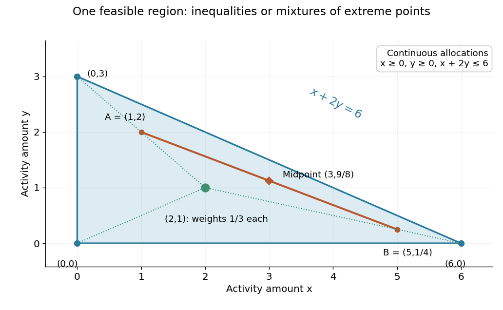

# Convex feasible region for a resource budget

↑ **Parent:** [Convex set](convex-set.md)

Consider a stipulated continuous-allocation problem. Amounts $x,y$ of two activities use $x+2y$ units of a common resource, with budget six. The [feasible region](feasible-region.md)

$$
C=\{(x,y)\in\mathbb R^2:x\geq0,\ y\geq0,\ x+2y\leq6\}
$$

is a [triangle](triangle.md) with [extreme points](extreme-point.md) $(0,0)$, $(6,0)$ and $(0,3)$. It is the [intersection](set-intersection.md) of three [closed half-spaces](closed-half-space.md), hence a [closed convex set](closed-convex-set.md). The general [intersection](set-intersection.md) argument is short: a [line segment](line-segment.md) between two points in every constraint set belongs to every constraint set, so it belongs to their [intersection](set-intersection.md).[§2.2.1, p. 27: half-spaces; §2.3.1, p. 36: intersections preserve convexity](convex-optimization-by-stephen-boyd-and-lieven-vandenberghe.md)

For an original numerical check, take $A=(1,2)$ and $B=(5,1/4)$. Their resource totals are $5$ and $11/2$. Every [convex combination](convex-combination.md) $Z(t)=(1-t)A+tB$ is nonnegative and has resource total

$$
Z_x(t)+2Z_y(t)=5+\frac t2\leq\frac{11}{2}<6\qquad(0\leq t\leq1).
$$

In particular the [midpoint](midpoint.md) is **$(3,9/8)$**, using $21/4$ units. This verifies the full [line segment](line-segment.md), rather than just a plotted sample of it.

**[Figure 7](#image-feasible-averages-and-convex-weights-in-a-continuous-resource-budget). Feasible averages and convex weights in a continuous resource budget**. Original continuous-allocation model $x\geq0$, $y\geq0$, $x+2y\leq6$. The orange [line segment](line-segment.md) joins two feasible allocations; the green point $(2,1)$ is the equal-weight [convex combination](convex-combination.md) of the three [extreme points](extreme-point.md). The shaded region is their [convex hull](convex-hull.md), not just the three generating points.

This is useful whenever divisible quantities share linear limits: the feasible choices remain compatible under averaging. A new [linear equation](linear-equation.md) also preserves this property, because averaging two identical constraint values gives the same value. The [affine subspace](affine-subspace.md) and [closed half-space](closed-half-space.md) viewpoints explain this without requiring a separate argument for every budget.

**Table of contents**

- [Integer restrictions on a convex feasible region](integer-restrictions-on-a-convex-feasible-region.md)

## ↑ Ancestors (5)

1. [Convex set](convex-set.md)
2. [Mathematical optimization](mathematical-optimization-split.md)
3. [Area of mathematics](area-of-mathematics.md)
4. [Mathematics](mathematics-split.md)
5. [Codex Wiki](split.md)

## ← Incoming links (1)

- [Convex combinations in a triangle](convex-combinations-in-a-triangle.md)
