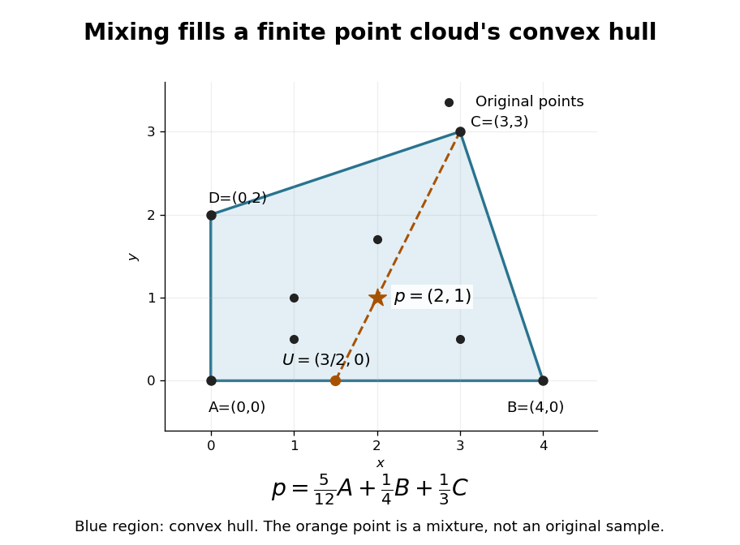

# Convex hull

↑ **Parent:** [Convex set](convex-set-split.md)  
ⓦ [Wiki](https://en.wikipedia.org/wiki/Convex_hull)

The [convex hull](convex-hull.md) of a [set](set-split.md) consists of every finite [convex combination](convex-combination.md) of its points. It collects all choices obtainable by mixing the original choices with nonnegative weights summing to one. For $S$ in a real [vector space](vector-space-split.md),

$$
\operatorname{conv}(S)=\left\{\sum_{i=1}^m\lambda_i s_i:s_i\in S,\ m\geq1,\ \lambda_i\geq0,\ \sum_{i=1}^m\lambda_i=1\right\}.
$$

Equivalently this is the smallest [convex set](convex-set-split.md) containing $S$. Mixing two already mixed points produces another finite [convex combination](convex-combination.md), so the displayed [set](set-split.md) is convex; every [convex set](convex-set-split.md) containing $S$ must contain all these mixtures.[§2.1.4, printed p. 24: convex hull and smallest containing convex set](convex-optimization-by-stephen-boyd-and-lieven-vandenberghe.md)

In an original planar example, take four points $A=(0,0)$, $B=(4,0)$, $C=(3,3)$, $D=(0,2)$ and four additional samples $(1,1)$, $(2,1.7)$, $(3,0.5)$, $(1,0.5)$. Their [convex hull](convex-hull.md) is the filled [convex polygon](convex-polygon.md) $ABCD$, including its [boundary](boundary-of-a-set.md). None of the samples is $p=(2,1)$, but

$$
p=\frac5{12}A+\frac14B+\frac13C.
$$

The [coefficients](coefficient.md) are nonnegative and sum to one, providing an explicit membership certificate. Geometrically, first form $U=(3/2,0)=\tfrac58A+\tfrac38B$ on the [line segment](line-segment.md) $AB$, then mix $p=\tfrac23U+\tfrac13C$. The additional interior samples do not enlarge the [convex hull](convex-hull.md).

**[Figure 5](#image-a-finite-set-gains-new-points-through-convex-combinations). A finite set gains new points through convex combinations**. Original eight-point planar example. The blue [convex polygon](convex-polygon.md) is the [convex hull](convex-hull.md); the orange star $p=(2,1)$ is absent from the original samples. Mixing on $AB$ produces $U$, and mixing $U$ with $C$ produces $p$ using exactly three original points.

For a finite nonempty $S\subset\mathbb R^d$, the [convex hull](convex-hull.md) is the image of a [probability simplex](probability-simplex.md) of weights under the [linear map](linear-map.md) $\lambda\mapsto\sum_i\lambda_i s_i$. The [probability simplex](probability-simplex.md) is a [compact set](compact-space.md), and the map is [continuous](continuous-function.md), so this [convex hull](convex-hull.md) is compact and closed. A one-point input stays one point; a collinear input stays in a [line segment](line-segment.md). Filling the [convex hull](convex-hull.md) does not necessarily produce a full-dimensional region.

The construction is useful whenever mixtures preserve the intended meaning of a choice. Mixing resource-allocation [vectors](vector.md), for example, interpolates their coordinate requirements. The [convex hull](convex-hull.md) describes the resulting [feasible region](feasible-region.md). A coordinate-wise box can admit combinations that no mixture produces, as the outside-point certificate in [linear optimization on a convex hull](linear-optimization-on-a-convex-hull.md) shows.

**Table of contents**

- [Lower convex hull](lower-convex-hull.md)
- [Linear optimization on a convex hull](linear-optimization-on-a-convex-hull.md)
- [Closed convex hull](closed-convex-hull.md)
- [Carathéodory's theorem (convex hull)](caratheodory-s-theorem-convex-hull.md)
  - [Conic Carathéodory theorem](conic-caratheodory-theorem.md)

## ↑ Ancestors (5)

1. [Convex set](convex-set-split.md)
2. [Mathematical optimization](mathematical-optimization-split.md)
3. [Area of mathematics](area-of-mathematics.md)
4. [Mathematics](mathematics-split.md)
5. [Codex Wiki](split.md)

## ← Incoming links (82)

- [Affine combination](affine-combination.md)
- [Affine equivariance of a geometric basis](affine-equivariance-of-a-geometric-basis.md)
- [Atomless support of a Pareto allocation](atomless-support-of-a-pareto-allocation.md)
- [Axis-aligned bounding box](axis-aligned-bounding-box.md)
- [Barycenter of a measure on a Banach space](barycenter-of-a-measure-on-a-banach-space.md)
- [Bézier curve](bezier-curve.md)
- [Bounding volume](bounding-volume.md)
- [Capped simplex](capped-simplex.md)
- [Carathéodory's theorem (convex hull)](caratheodory-s-theorem-convex-hull.md)
- [Chaikin subdivision](chaikin-subdivision.md)
- [Closed convex hull](closed-convex-hull.md)
- [Conic Carathéodory theorem](conic-caratheodory-theorem.md)
- [Control net](control-net.md)
- [Control-point influence on a curve](control-point-influence-on-a-curve.md)
- [Control polygon](control-polygon.md)
- [Convex combinations in a triangle](convex-combinations-in-a-triangle.md)
- [Convex feasible region for a resource budget](convex-feasible-region-for-a-resource-budget.md)
- [Convex geometry](convex-geometry.md)
- [Convex hull](convex-hull.md)
- [Convex Optimization by Stephen Boyd and Lieven Vandenberghe](convex-optimization-by-stephen-boyd-and-lieven-vandenberghe.md)
- [Convex polygon](convex-polygon.md)
- [Convex support of an exponential family](convex-support-of-an-exponential-family.md)
- [Cross-polytope](cross-polytope.md)
- [De Casteljau's algorithm](de-casteljau-s-algorithm.md)
- [Extreme point that is not an exposed point](extreme-point-that-is-not-an-exposed-point.md)
- [Fantope](fantope.md)
- [Full-dimensional linear polyhedron](full-dimensional-linear-polyhedron.md)
- [Interior moment matching in a finite exponential family](interior-moment-matching-in-a-finite-exponential-family.md)
- [Linear optimization on a convex hull](linear-optimization-on-a-convex-hull.md)
- [Lottery over joint action profiles](lottery-over-joint-action-profiles.md)
- [Lower convex hull](lower-convex-hull.md)
- [Mid-edge subdivision](mid-edge-subdivision.md)
- [Milman's converse to the Krein-Milman theorem](milman-s-converse-to-the-krein-milman-theorem.md)
- [Solution](past-exam-of-the-mathematics-course-of-the-university-of-cambridge/2001/iii/paper-11/4/solution.md)
- [Solution](past-exam-of-the-mathematics-course-of-the-university-of-cambridge/2001/iii/paper-31/1/solution.md)
- [Solution](past-exam-of-the-mathematics-course-of-the-university-of-cambridge/2001/iii/paper-31/5/solution.md)
- [Solution](past-exam-of-the-mathematics-course-of-the-university-of-cambridge/2002/ia/paper-3/8b/b/solution.md)
- [Solution](past-exam-of-the-mathematics-course-of-the-university-of-cambridge/2002/iii/paper-59/2/solution.md)
- [Solution](past-exam-of-the-mathematics-course-of-the-university-of-cambridge/2002/iii/paper-59/5/solution.md)
- [Solution](past-exam-of-the-mathematics-course-of-the-university-of-cambridge/2002/iii/paper-59/6/solution.md)
- [Solution](past-exam-of-the-mathematics-course-of-the-university-of-cambridge/2003/ib/paper-3/14f/solution.md)
- [Solution](past-exam-of-the-mathematics-course-of-the-university-of-cambridge/2003/iii/paper-10/3/solution.md)
- [Solution](past-exam-of-the-mathematics-course-of-the-university-of-cambridge/2003/iii/paper-37/4/solution.md)
- [Solution](past-exam-of-the-mathematics-course-of-the-university-of-cambridge/2003/iii/paper-68/2/solution.md)
- [Solution](past-exam-of-the-mathematics-course-of-the-university-of-cambridge/2003/iii/paper-68/4/solution.md)
- [Solution](past-exam-of-the-mathematics-course-of-the-university-of-cambridge/2003/iii/paper-68/6/solution.md)
- [Solution](past-exam-of-the-mathematics-course-of-the-university-of-cambridge/2004/iii/paper-11/5/solution.md)
- [Solution](past-exam-of-the-mathematics-course-of-the-university-of-cambridge/2004/iii/paper-36/2/c/solution.md)
- [Solution](past-exam-of-the-mathematics-course-of-the-university-of-cambridge/2004/iii/paper-6/4/iii/solution.md)
- [Solution](past-exam-of-the-mathematics-course-of-the-university-of-cambridge/2004/iii/paper-70/2/i/solution.md)
- [Solution](past-exam-of-the-mathematics-course-of-the-university-of-cambridge/2004/iii/paper-70/2/ii/solution.md)
- [Solution](past-exam-of-the-mathematics-course-of-the-university-of-cambridge/2004/iii/paper-70/4/ii/solution.md)
- [Solution](past-exam-of-the-mathematics-course-of-the-university-of-cambridge/2004/iii/paper-70/6/i/solution.md)
- [Solution](past-exam-of-the-mathematics-course-of-the-university-of-cambridge/2005/iii/paper-66/4/i/solution.md)
- [Solution](past-exam-of-the-mathematics-course-of-the-university-of-cambridge/2005/iii/paper-66/6/i/solution.md)
- [Solution](past-exam-of-the-mathematics-course-of-the-university-of-cambridge/2006/iii/paper-42/4/iv/solution.md)
- [Solution](past-exam-of-the-mathematics-course-of-the-university-of-cambridge/2006/iii/paper-66/2/solution.md)
- [Solution](past-exam-of-the-mathematics-course-of-the-university-of-cambridge/2006/iii/paper-66/4/a/solution.md)
- [Solution](past-exam-of-the-mathematics-course-of-the-university-of-cambridge/2006/iii/paper-66/4/b/solution.md)
- [Solution](past-exam-of-the-mathematics-course-of-the-university-of-cambridge/2006/iii/paper-66/5/f/solution.md)
- [Solution](past-exam-of-the-mathematics-course-of-the-university-of-cambridge/2008/iii/paper-77/1/i/solution.md)
- [Solution](past-exam-of-the-mathematics-course-of-the-university-of-cambridge/2008/iii/paper-77/3/ii/solution.md)
- [Solution](past-exam-of-the-mathematics-course-of-the-university-of-cambridge/2009/iii/paper-8/4/a/solution.md)
- [Solution](past-exam-of-the-mathematics-course-of-the-university-of-cambridge/2013/iii/paper-38/6/b/solution.md)
- [Solution](past-exam-of-the-mathematics-course-of-the-university-of-cambridge/2014/iii/paper-6/3/solution.md)
- [Solution](past-exam-of-the-mathematics-course-of-the-university-of-cambridge/2015/iii/paper-6/2/solution.md)
- [Solution](past-exam-of-the-mathematics-course-of-the-university-of-cambridge/2016/iii/paper-106/2/solution.md)
- [Solution](past-exam-of-the-mathematics-course-of-the-university-of-cambridge/2016/iii/paper-112/3/i/solution.md)
- [Solution](past-exam-of-the-mathematics-course-of-the-university-of-cambridge/2016/iii/paper-123/3/a/solution.md)
- [Solution](past-exam-of-the-mathematics-course-of-the-university-of-cambridge/2016/iii/paper-213/3/solution.md)
- [Solution](past-exam-of-the-mathematics-course-of-the-university-of-cambridge/2017/iii/paper-106/2/a/solution.md)
- [Solution](past-exam-of-the-mathematics-course-of-the-university-of-cambridge/2017/iii/paper-302/3/solution.md)
- [Solution](past-exam-of-the-mathematics-course-of-the-university-of-cambridge/2017/iii/paper-327/1/solution.md)
- [Solution](past-exam-of-the-mathematics-course-of-the-university-of-cambridge/2018/iii/paper-106/4/solution.md)
- [Solution](past-exam-of-the-mathematics-course-of-the-university-of-cambridge/2022/ii/paper-4/30j/b/solution.md)
- [Solution](past-exam-of-the-mathematics-course-of-the-university-of-cambridge/2023/ii/paper-4/22f/b/solution.md)
- [Solution](past-exam-of-the-mathematics-course-of-the-university-of-cambridge/2024/iii/paper-339/1/d/solution.md)
- [Probability simplex](probability-simplex.md)
- [Subdivision curve interrogation](subdivision-curve-interrogation.md)
- [Talagrand convex distance](talagrand-convex-distance.md)
- [Throughput region of an interference graph](throughput-region-of-an-interference-graph.md)
- [Triangle](triangle.md)
