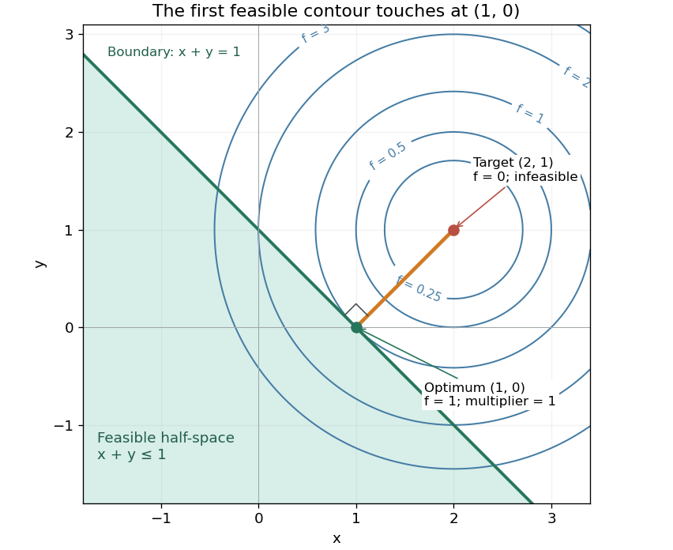
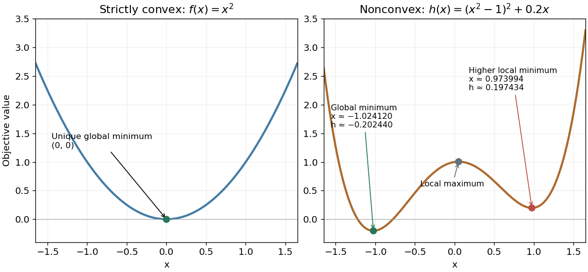

# Convex optimization

↑ **Parent:** [Mathematical optimization](mathematical-optimization-split.md)  
ⓦ [Wiki](https://en.wikipedia.org/wiki/Convex_optimization)

Convex optimization is a [minimization problem](minimization-problem.md) with a [convex function](convex-function.md) as its [objective function](objective-function.md) and a [convex set](convex-set-split.md) of [feasible points](feasible-point.md). For a finite-valued $f:C\to\mathbb R$, the problem is to find $z_*\in C$ with $f(z_*)\leq f(z)$ for every $z\in C$. The displayed [infimum](infimum.md) describes its value even when no minimizing point exists. The two convexity requirements concern different objects: the allowed decisions and the scores assigned to them.

A [convex set](convex-set-split.md) contains the whole [line segment](line-segment.md) between any two of its points:

$$
u,v\in C,\quad 0\leq t\leq1\quad\Longrightarrow\quad (1-t)u+tv\in C.
$$

A [convex function](convex-function.md) lies below the interpolation of its endpoint values:

$$
f((1-t)u+tv)\leq(1-t)f(u)+tf(v).
$$

Thus mixing two allowed decisions preserves feasibility, and the mixed score is no worse than the same mixture of endpoint scores. The [objective function](objective-function.md) may have flat regions or corners. For a [strictly convex function](strictly-convex-function.md), the second inequality is strict when $u\ne v$ and $0<t<1$.

A useful constraint representation is

$$
\inf_z f(z)\qquad\text{subject to}\qquad g_i(z)\leq0\ (i=1,\ldots,m),\quad Az=b,
$$

where $f,g_i$ are [convex functions](convex-function.md) on a common [convex set](convex-set-split.md) $D$, and the equalities are [affine functions](affine-function.md). Each inequality defines a [convex](convex-function.md) [sublevel set](sublevel-set.md); their [intersection](set-intersection.md) with $D$ and the equality set is a [convex set](convex-set-split.md). An equality involving a general [convex function](convex-function.md) need not preserve this geometry: $x^2=1$ allows $-1$ and $1$ but excludes their midpoint $0$. See [Boyd and Vandenberghe, Convex Optimization (2004), §4.2.1](https://web.stanford.edu/~boyd/cvxbook/bv_cvxbook.pdf#page=150) for the standard problem form.

**Why local information can certify a global answer.** Every [local minimum](local-minimum.md) of a [convex optimization](convex-optimization-split.md) problem is a [global minimum](global-minimum.md), including minima on the boundary. If a [feasible point](feasible-point.md) $v$ had $f(v)<f(u)$, points $u+t(v-u)$ would remain feasible and have value strictly below $f(u)$ for every $0<t<1$. Taking $t$ arbitrarily small contradicts a [local minimum](local-minimum.md) at $u$. This argument explains the special power of [convexity](convex-function.md): a better distant decision would reveal an improving direction immediately nearby.

If a minimizer exists and the [objective function](objective-function.md) is [strictly convex](strictly-convex-function.md) on $C$, it is unique. Two distinct minimizers of value $p_*$ would have a feasible midpoint with value strictly below $p_*$. Existence is a separate question: the [exponential function](exponential-function.md) $e^x$ is [strictly convex](strictly-convex-function.md) on $\mathbb R$, but its [infimum](infimum.md) $0$ is approached only as $x\to-\infty$. Even a bounded [convex set](convex-set-split.md) need not suffice: $x^2$ on $0<x<1$ also has unattained [infimum](infimum.md) $0$. A [continuous function](continuous-function.md) on a nonempty [compact set](compact-space.md) attains its minimum by the [extreme value theorem](extreme-value-theorem.md).

Nor does [strict convexity](strictly-convex-function.md) imply [differentiability](differentiability.md). For $f(x)=x^2+|x|$, the squared term gives the strict inequality while the [triangle inequality](triangle-inequality.md) gives the weak inequality for the [absolute value](absolute-value.md). At zero the left and right [derivatives](derivative.md) are $-1$ and $1$, so no [derivative](derivative.md) exists there, although zero is the unique minimizer. Such objectives require [subgradients](subgradient.md) or [proximal operators](proximal-operator.md) rather than an ordinary [gradient](gradient.md) at every point.

For a [differentiable](differentiable-function.md) [convex function](convex-function.md) on an open [convex set](convex-set-split.md) containing $C$, the constrained [first-order condition](first-order-optimality-condition.md) is

$$
\nabla f(z_*)^T(z-z_*)\geq0\qquad\text{for every }z\in C.
$$

Indeed, the [subgradient inequality](subgradient-inequality.md) $f(z)\geq f(z_*)+\nabla f(z_*)^T(z-z_*)$ makes this sufficient; taking the one-sided [derivative](derivative.md) along feasible [line segments](line-segment.md) makes it necessary. At an interior minimizer, both directions are feasible and the [gradient](gradient.md) must vanish. At a boundary minimizer it can be nonzero: it only needs to make every feasible direction nondecreasing. See [Boyd and Vandenberghe, §§3.1.3 and 4.2.3](https://web.stanford.edu/~boyd/cvxbook/bv_cvxbook.pdf#page=153).

**A fully computed nearest-point problem.** Project $a=(2,1)$ onto the [half-space](half-space.md) $C=\{(x,y):x+y\leq1\}$ by minimizing half the squared [Euclidean distance](euclidean-distance.md):

$$
f(x,y)=\tfrac12((x-2)^2+(y-1)^2),\qquad g(x,y)=x+y-1\leq0.
$$

The [Hessian matrix](hessian-matrix.md) is the [identity matrix](identity-matrix.md), so the [objective function](objective-function.md) is [strictly convex](strictly-convex-function.md). The unconstrained minimizer $(2,1)$ violates the inequality. With the convention $g\leq0$, the [optimization Lagrangian](optimization-lagrangian.md) is $L=f+\lambda g$, where the [Lagrange multiplier](lagrange-multiplier.md) satisfies $\lambda\geq0$. Its [Karush-Kuhn-Tucker conditions](karush-kuhn-tucker-conditions.md) are

$$
x+y-1\leq0,\quad\lambda\geq0,\quad\lambda(x+y-1)=0,\quad x-2+\lambda=0,\quad y-1+\lambda=0.
$$

The last two equations give $x=2-\lambda$, $y=1-\lambda$. The choice $\lambda=0$ is infeasible, so [complementary slackness](complementary-slackness.md) forces $x+y=1$. Consequently $3-2\lambda=1$, giving $\lambda=1$, $(x_*,y_*)=(1,0)$ and $f(x_*,y_*)=1$. The [Euclidean distance](euclidean-distance.md) is $\sqrt2$, rather than the [objective function](objective-function.md) value $1$. The [gradient](gradient.md) $(-1,-1)$ at the answer balances $\lambda\nabla g=(1,1)$; the displacement from $(1,0)$ to $(2,1)$ is a [normal vector](normal-vector.md) to the boundary.

**[Figure 1](#image-the-nearest-feasible-point-is-where-an-objective-contour-first-touches-the-half-space-boundary). The nearest feasible point is where an objective contour first touches the half-space boundary**.

There is an exact certificate independent of numerical search. Completing squares gives

$$
L(x,y,1)=1+\tfrac12((x-1)^2+y^2)\geq1.
$$

For every [feasible point](feasible-point.md), $g\leq0$ implies $L(x,y,1)\leq f(x,y)$. Thus every feasible objective is at least $1$, and $(1,0)$ attains this bound. More generally the [Lagrangian dual problem](lagrangian-dual-problem.md) has objective $q(\lambda)=\inf_{x,y}L(x,y,\lambda)=2\lambda-\lambda^2=1-(\lambda-1)^2$ for $\lambda\geq0$. Its maximum is also $1$, illustrating [strong duality](strong-duality.md) through matching computed bounds. This makes the example a model for [Euclidean projection onto a convex set](euclidean-projection-onto-a-convex-set.md) and the projection step in [projected gradient descent](projected-gradient-descent.md).

**What the multiplier conditions require.** For [differentiable](differentiable-function.md) [convex functions](convex-function.md) $f,g_i$ on an open [convex set](convex-set-split.md) $D$ and equalities $Az=b$ defined by [affine functions](affine-function.md), the [KKT conditions](karush-kuhn-tucker-conditions.md) combine feasibility, $\lambda_i\geq0$, [complementary slackness](complementary-slackness.md) $\lambda_i g_i(z_*)=0$, and stationarity

$$
\nabla f(z_*)+\sum_i\lambda_i\nabla g_i(z_*)+A^T\nu=0,
$$

with unrestricted equality [Lagrange multipliers](lagrange-multiplier.md) $\nu$. They suffice to certify a [global minimum](global-minimum.md) without an additional regularity assumption: the [optimization Lagrangian](optimization-lagrangian.md) is [convex](convex-function.md), stationarity minimizes it, and feasibility with [complementary slackness](complementary-slackness.md) gives the same certificate as above. To guarantee their necessity at an attained finite optimum, a regularity hypothesis suffices: [Slater's condition](slater-s-condition.md) requires some $\bar z\in D$ with $g_i(\bar z)<0$ and $A\bar z=b$. The projection example has the strictly feasible point $(0,0)$. See [Boyd and Vandenberghe, §§5.2.3 and 5.5.3](https://web.stanford.edu/~boyd/cvxbook/bv_cvxbook.pdf#page=240). This hypothesis guarantees suitable multipliers, not existence of a primal minimizer.

Without regularity, necessity can fail even for [convex functions](convex-function.md): minimize $f(x)=x$ subject to $g(x)=x^2\leq0$. The sole [feasible point](feasible-point.md) $x=0$ is optimal, but stationarity would require $1+\lambda\cdot0=0$. No [Lagrange multiplier](lagrange-multiplier.md) works. There is no strictly feasible point, and the [gradient](gradient.md) of the constraint vanishes at the answer.

**The nonconvex contrast.** The [polynomial](polynomial-split.md) $h(x)=(x^2-1)^2+0.2x$ has [derivative](derivative.md) $h'(x)=4x^3-4x+0.2$ and [second derivative](second-derivative.md) $h''(x)=12x^2-4$. Numerically solving the cubic gives [stationary points](stationary-point.md) $-1.024120300$, $0.050125947$, and $0.973994353$. Their objective values are respectively $-0.202440434$, $1.005006281$, and $0.197434153$, with second derivatives $8.585869$, $-3.969849$, and $7.383980$. Hence both outer points are [local minima](local-minimum.md), and the middle point is a [local maximum](local-maximum.md). Since $h(x)\to+\infty$ at both ends, its [global minimum](global-minimum.md) exists and must be one of the stationary minima: it is the left one. A method stopping at the right [local minimum](local-minimum.md) misses a better value by approximately $0.399874587$.

**[Figure 2](#image-a-strictly-convex-quadratic-has-one-minimum-a-tilted-quartic-has-two-local-minima-with-different-values). A strictly convex quadratic has one minimum; a tilted quartic has two local minima with different values**.

The practical appeal of [convex optimization](convex-optimization-split.md) is the ability to check an answer globally using geometry and matching [Lagrangian duality](lagrangian-duality.md) bounds. The projection certificate certifies every feasible alternative at once; the tilted quartic shows why a zero [gradient](gradient.md) alone cannot do that for general [nonlinear optimization](nonlinear-programming.md).

Historically, an early landmark is Kuhn and Tucker's [Nonlinear Programming, Second Berkeley Symposium (1951), pp. 481–492](https://digicoll.lib.berkeley.edu/record/112776/files/math_s2_article-35.pdf). Its §3 explicitly states a regularity hypothesis for inequality-constrained [Lagrange multipliers](lagrange-multiplier.md); its discussion of [saddle points](saddle-point.md) explains how [concave functions](concave-function.md) support global conclusions for maximization. This documents an early formulation of the multiplier approach; it does not establish sole discovery of today's [KKT conditions](karush-kuhn-tucker-conditions.md) or of [convex optimization](convex-optimization-split.md) as a whole.

**Table of contents**

- [Pari-mutuel expected-return allocation](pari-mutuel-expected-return-allocation.md)
- [Separation oracle](separation-oracle.md)
  - [Path-constraint separation by shortest paths](path-constraint-separation-by-shortest-paths.md)
- [Chambolle–Pock algorithm](chambolle-pock-algorithm.md)
  - [Convergence of primal-dual hybrid gradient](convergence-of-primal-dual-hybrid-gradient.md)
- [Convex positively one-homogeneous functional](convex-positively-one-homogeneous-functional.md)
  - [Generalized eigenfunction in the forward-operator metric](generalized-eigenfunction-in-the-forward-operator-metric.md)
- [Conic optimization](conic-optimization.md)
  - [Farkas' lemma](farkas-lemma.md)
    - [Robust infeasibility under uniform constraint relaxation](robust-infeasibility-under-uniform-constraint-relaxation.md)
    - [Farkas certificate for linear inequalities](farkas-certificate-for-linear-inequalities.md)
      - [Normalized integer Farkas infeasibility gap](normalized-integer-farkas-infeasibility-gap.md)
  - [Interior-point method](interior-point-method.md)
    - [Homogeneous self-dual embedding of a linear program](homogeneous-self-dual-embedding-of-a-linear-program.md)
    - [Conic phase-I problem](conic-phase-i-problem.md)
    - [Self-concordant barrier](self-concordant-barrier.md)
      - [Logarithmically homogeneous barrier](logarithmically-homogeneous-barrier.md)
        - [Legendre dual cone barrier](legendre-dual-cone-barrier.md)
      - [Dikin ellipsoid](dikin-ellipsoid.md)
      - [Central path](central-path.md)
        - [Central-path Newton system](central-path-newton-system.md)
  - [Conic dual problem](conic-dual-problem.md)
    - [Nonnegative-orthant optimality certificate](nonnegative-orthant-optimality-certificate.md)
    - [Second-order-cone optimality certificate](second-order-cone-optimality-certificate.md)
    - [Conic primal-dual gap](conic-primal-dual-gap.md)
    - [Strict feasibility for conic duality](strict-feasibility-for-conic-duality.md)
  - [Completely positive optimization](completely-positive-optimization.md)
  - [Copositive optimization](copositive-optimization.md)
    - [Copositive reformulation of an orthant Rayleigh minimum](copositive-reformulation-of-an-orthant-rayleigh-minimum.md)
- [Robust optimization](robust-optimization.md)
  - [Robust linear optimization over the probability simplex](robust-linear-optimization-over-the-probability-simplex.md)
  - [Polyhedral uncertainty set](polyhedral-uncertainty-set.md)
- [Convex analysis](convex-analysis.md)
  - [Infimal convolution](infimal-convolution.md)
    - [Finite-valued infimal convolution](finite-valued-infimal-convolution.md)
      - [Infimal-convolution dual subgradients](infimal-convolution-dual-subgradients.md)
    - [Conjugate of an infimal convolution](conjugate-of-an-infimal-convolution.md)
- [Proportional fairness](proportional-fairness.md)
  - [Inactive routes in proportional fairness](inactive-routes-in-proportional-fairness.md)
  - [Proportionally fair allocation on a four-cycle](proportionally-fair-allocation-on-a-four-cycle.md)
    - [Opposite-route reduction for a proportionally fair four-cycle](opposite-route-reduction-for-a-proportionally-fair-four-cycle.md)
  - [Weighted logarithmic utility](weighted-logarithmic-utility.md)
- [Semidefinite programming](semidefinite-programming.md)
  - [Semidefinite relaxation of binary quadratic optimization](semidefinite-relaxation-of-binary-quadratic-optimization.md)
  - [Semidefinite relaxation of slab-constrained quadratic maximization](semidefinite-relaxation-of-slab-constrained-quadratic-maximization.md)
    - [Rademacher rounding for a semidefinite relaxation](rademacher-rounding-for-a-semidefinite-relaxation.md)
      - [Logarithmic approximation bound for slab-constrained quadratic maximization](logarithmic-approximation-bound-for-slab-constrained-quadratic-maximization.md)
- [Water-filling algorithm](water-filling-algorithm.md)
  - [Logarithmic water filling](logarithmic-water-filling.md)
- [Coordinate descent](coordinate-descent.md)
- [Convex conjugate](convex-conjugate.md)
  - [Utility conjugate](utility-conjugate.md)
    - [Dual differentiability with nonvanishing utility curvature](dual-differentiability-with-nonvanishing-utility-curvature.md)
  - [Convex conjugate of x log x](convex-conjugate-of-x-log-x.md)
  - [Biconjugate](biconjugate.md)
  - [Affine covariance of the convex conjugate](affine-covariance-of-the-convex-conjugate.md)
  - [Concave Legendre dual](concave-legendre-dual.md)
    - [Lower conjugate](lower-conjugate.md)
      - [Concave biconjugate](concave-biconjugate.md)
    - [Inverse-flux quadratic bounds](inverse-flux-quadratic-bounds.md)
  - [Convex conjugate of a constrained quadratic](convex-conjugate-of-a-constrained-quadratic.md)
  - [Fenchel-Moreau theorem](fenchel-moreau-theorem.md)
    - [Biconjugation as closed convexification](biconjugation-as-closed-convexification.md)
  - [Fenchel–Young inequality](fenchel-young-inequality.md)
    - [Fenchel–Young gap](fenchel-young-gap.md)
- [Subdifferential](subdifferential.md)
  - [Fermat rule for convex minimization](fermat-rule-for-convex-minimization.md)
  - [Monotonicity of a convex subdifferential](monotonicity-of-a-convex-subdifferential.md)
  - [Forward subgradient step](forward-subgradient-step.md)
  - [Partial subdifferential](partial-subdifferential.md)
  - [Subgradient inversion under convex conjugacy](subgradient-inversion-under-convex-conjugacy.md)
  - [Subdifferential under scalar affine composition](subdifferential-under-scalar-affine-composition.md)
  - [Subdifferential of the L1 norm](subdifferential-of-the-l1-norm.md)
  - [Subdifferential sum rule](subdifferential-sum-rule.md)
- [Absolutely one-homogeneous functional](absolutely-one-homogeneous-functional.md)
  - [Generalized singular vector](generalized-singular-vector.md)
  - [Euler identity for a convex one-homogeneous functional](euler-identity-for-a-convex-one-homogeneous-functional.md)
  - [Eigenfunction of an absolutely one-homogeneous functional](eigenfunction-of-an-absolutely-one-homogeneous-functional.md)
- [Stiemke theorem](stiemke-theorem.md)
- [Projected gradient descent](projected-gradient-descent.md)
  - [Projected subgradient method](projected-subgradient-method.md)
  - [Averaged projected-gradient bound](averaged-projected-gradient-bound.md)
- [Step size](step-size.md)
- [Proximal operator](proximal-operator.md)
  - [Radial soft thresholding](radial-soft-thresholding.md)
  - [Banach-space proximal minimization](banach-space-proximal-minimization.md)
  - [Proximal operator under affine rescaling](proximal-operator-under-affine-rescaling.md)
  - [Moreau envelope](moreau-envelope.md)
    - [Moreau envelope of the Euclidean norm](moreau-envelope-of-the-euclidean-norm.md)
    - [Gradient of a Moreau envelope](gradient-of-a-moreau-envelope.md)
    - [Moreau smoothing of a negative log-density](moreau-smoothing-of-a-negative-log-density.md)
    - [Squared distance to a convex set](squared-distance-to-a-convex-set.md)
      - [Conjugate of the squared distance to a convex set](conjugate-of-the-squared-distance-to-a-convex-set.md)
  - [Moreau decomposition](moreau-decomposition.md)
    - [Proximal operator of a support function](proximal-operator-of-a-support-function.md)
  - [Proximal gradient method](proximal-gradient-method.md)
    - [Alternating proximal-gradient operator](alternating-proximal-gradient-operator.md)
      - [Implicit nonsmooth block in alternating proximal-gradient iteration](implicit-nonsmooth-block-in-alternating-proximal-gradient-iteration.md)
      - [Mixed-point norm identity for alternating updates](mixed-point-norm-identity-for-alternating-updates.md)
    - [Iterative soft-thresholding algorithm](iterative-soft-thresholding-algorithm.md)
- [Subgradient method](subgradient-method.md)
- [Log-sum-exp function](log-sum-exp-function.md)
  - [Smooth maximum](smooth-maximum.md)
- [Nesterov accelerated gradient method](nesterov-accelerated-gradient-method.md)
- [Monotone operator](monotone-operator.md)
  - [Cocoercivity](cocoercivity.md)
    - [Baillon–Haddad theorem](baillon-haddad-theorem.md)
  - [Resolvent of a monotone operator](resolvent-of-a-monotone-operator.md)
  - [Maximal monotone operator](maximal-monotone-operator.md)
  - [Nonexpansive mapping](nonexpansive-mapping.md)
    - [Averaged operator](averaged-operator.md)
      - [Browder convergence theorem for averaged operators](browder-convergence-theorem-for-averaged-operators.md)
      - [Averaged-operator inequality](averaged-operator-inequality.md)
  - [Firmly nonexpansive mapping](firmly-nonexpansive-mapping.md)
  - [Proximal point algorithm](proximal-point-algorithm.md)
    - [Douglas–Rachford method](douglas-rachford-method.md)
      - [Product-space reformulation of convex feasibility](product-space-reformulation-of-convex-feasibility.md)
    - [Preconditioned proximal point algorithm](preconditioned-proximal-point-algorithm.md)
- [Primal-dual optimal point](primal-dual-optimal-point.md)
- [Equality-constrained convex optimization](equality-constrained-convex-optimization.md)
- [Proximal gradient methods for learning](proximal-gradient-methods-for-learning.md)

## ↑ Ancestors (4)

1. [Mathematical optimization](mathematical-optimization-split.md)
2. [Area of mathematics](area-of-mathematics.md)
3. [Mathematics](mathematics-split.md)
4. [Codex Wiki](split.md)

## ← Incoming links (23)

- [Beckmann potential](beckmann-potential.md)
- [Box-constrained TV-L1 denoising](box-constrained-tv-l1-denoising.md)
- [Constraint qualification](constraint-qualification.md)
- [Convex function](convex-function.md)
- [Convex KKT optimality certificate](convex-kkt-optimality-certificate.md)
- [Convex optimization](convex-optimization-split.md)
- [Convex set](convex-set-split.md)
- [KKT regularity at a local minimum](kkt-regularity-at-a-local-minimum.md)
- [Lagrangian duality](lagrangian-duality.md)
- [Solution](past-exam-of-the-mathematics-course-of-the-university-of-cambridge/2006/iii/paper-66/1/solution.md)
- [Solution](past-exam-of-the-mathematics-course-of-the-university-of-cambridge/2007/iii/paper-35/2/a/solution.md)
- [Solution](past-exam-of-the-mathematics-course-of-the-university-of-cambridge/2009/iii/paper-30/3/solution.md)
- [Solution](past-exam-of-the-mathematics-course-of-the-university-of-cambridge/2013/iii/paper-38/1/a/solution.md)
- [Solution](past-exam-of-the-mathematics-course-of-the-university-of-cambridge/2016/ib/paper-3/21h/a/solution.md)
- [Solution](past-exam-of-the-mathematics-course-of-the-university-of-cambridge/2016/iii/paper-205/4/solution.md)
- [Solution](past-exam-of-the-mathematics-course-of-the-university-of-cambridge/2016/iii/paper-325/1/iv/solution.md)
- [Solution](past-exam-of-the-mathematics-course-of-the-university-of-cambridge/2018/iii/paper-213/2/solution.md)
- [Solution](past-exam-of-the-mathematics-course-of-the-university-of-cambridge/2018/iii/paper-218/2/d/solution.md)
- [Solution](past-exam-of-the-mathematics-course-of-the-university-of-cambridge/2019/iii/paper-348/3/b/solution.md)
- [Solution](past-exam-of-the-mathematics-course-of-the-university-of-cambridge/2021/iii/paper-205/6/a/solution.md)
- [Proximity time of translating line segments](proximity-time-of-translating-line-segments.md)
- [Strict feasibility for conic duality](strict-feasibility-for-conic-duality.md)
- [Strong duality](strong-duality.md)
