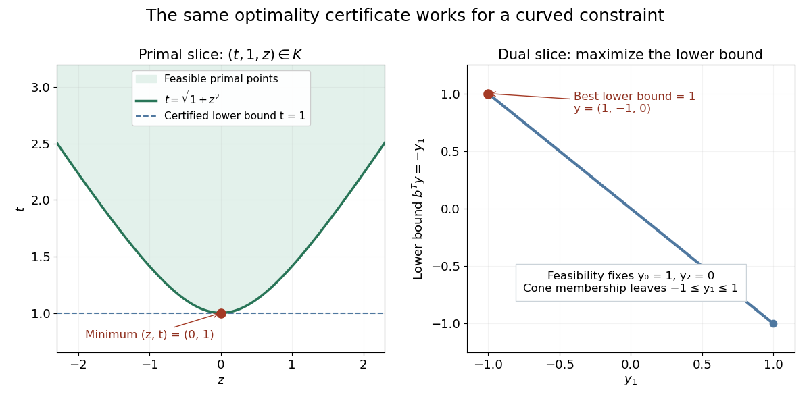
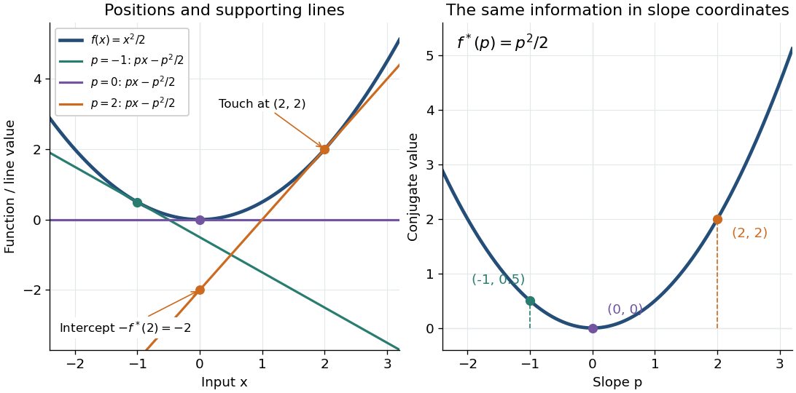

# Convex optimization

↑ **Parent:** [Mathematical optimization](mathematical-optimization.md)  
ⓦ [Wiki](https://en.wikipedia.org/wiki/Convex_optimization)

Convex optimization is a [minimization problem](mathematical-optimization.md#minimization-problem) with a [convex function](real-analysis.md#convex-function) as its [objective function](mathematical-optimization.md#objective-function) and a [convex set](convex-set.md) of [feasible points](mathematical-optimization.md#feasible-point). For a finite-valued $f:C\to\mathbb R$, the problem is to find $z_*\in C$ with $f(z_*)\leq f(z)$ for every $z\in C$. The displayed [infimum](real-analysis.md#infimum) describes its value even when no minimizing point exists. The two convexity requirements concern different objects: the allowed decisions and the scores assigned to them.

A [convex set](convex-set.md) contains the whole [line segment](convex-set.md#line-segment) between any two of its points:

$$
u,v\in C,\quad 0\leq t\leq1\quad\Longrightarrow\quad (1-t)u+tv\in C.
$$

A [convex function](real-analysis.md#convex-function) lies below the interpolation of its endpoint values:

$$
f((1-t)u+tv)\leq(1-t)f(u)+tf(v).
$$

Thus mixing two allowed decisions preserves feasibility, and the mixed score is no worse than the same mixture of endpoint scores. The [objective function](mathematical-optimization.md#objective-function) may have flat regions or corners. For a [strictly convex function](real-analysis.md#strictly-convex-function), the second inequality is strict when $u\ne v$ and $0<t<1$.

A useful constraint representation is

$$
\inf_z f(z)\qquad\text{subject to}\qquad g_i(z)\leq0\ (i=1,\ldots,m),\quad Az=b,
$$

where $f,g_i$ are [convex functions](real-analysis.md#convex-function) on a common [convex set](convex-set.md) $D$, and the equalities are [affine functions](vector-space.md#affine-function). Each inequality defines a [convex](real-analysis.md#convex-function) [sublevel set](calculus.md#sublevel-set); their [intersection](set.md#set-intersection) with $D$ and the equality set is a [convex set](convex-set.md). An equality involving a general [convex function](real-analysis.md#convex-function) need not preserve this geometry: $x^2=1$ allows $-1$ and $1$ but excludes their midpoint $0$. See [Boyd and Vandenberghe, Convex Optimization (2004), §4.2.1](https://web.stanford.edu/~boyd/cvxbook/bv_cvxbook.pdf#page=150) for the standard problem form.

**Why local information can certify a global answer.** Every [local minimum](analysis.md#local-minimum) of a [convex optimization](convex-optimization.md) problem is a [global minimum](analysis.md#global-minimum), including minima on the boundary. If a [feasible point](mathematical-optimization.md#feasible-point) $v$ had $f(v)<f(u)$, points $u+t(v-u)$ would remain feasible and have value strictly below $f(u)$ for every $0<t<1$. Taking $t$ arbitrarily small contradicts a [local minimum](analysis.md#local-minimum) at $u$. This argument explains the special power of [convexity](real-analysis.md#convex-function): a better distant decision would reveal an improving direction immediately nearby.

If a minimizer exists and the [objective function](mathematical-optimization.md#objective-function) is [strictly convex](real-analysis.md#strictly-convex-function) on $C$, it is unique. Two distinct minimizers of value $p_*$ would have a feasible midpoint with value strictly below $p_*$. Existence is a separate question: the [exponential function](calculus.md#exponential-function) $e^x$ is [strictly convex](real-analysis.md#strictly-convex-function) on $\mathbb R$, but its [infimum](real-analysis.md#infimum) $0$ is approached only as $x\to-\infty$. Even a bounded [convex set](convex-set.md) need not suffice: $x^2$ on $0<x<1$ also has unattained [infimum](real-analysis.md#infimum) $0$. A [continuous function](calculus.md#continuous-function) on a nonempty [compact set](topology.md#compact-space) attains its minimum by the [extreme value theorem](real-analysis.md#extreme-value-theorem).

Nor does [strict convexity](real-analysis.md#strictly-convex-function) imply [differentiability](analysis.md#differentiability). For $f(x)=x^2+|x|$, the squared term gives the strict inequality while the [triangle inequality](topological-analysis.md#triangle-inequality) gives the weak inequality for the [absolute value](real-analysis.md#absolute-value). At zero the left and right [derivatives](calculus.md#derivative) are $-1$ and $1$, so no [derivative](calculus.md#derivative) exists there, although zero is the unique minimizer. Such objectives require [subgradients](real-analysis.md#subgradient) or [proximal operators](#proximal-operator) rather than an ordinary [gradient](multivariable-calculus.md#gradient) at every point.

For a [differentiable](analysis.md#differentiable-function) [convex function](real-analysis.md#convex-function) on an open [convex set](convex-set.md) containing $C$, the constrained [first-order condition](mathematical-optimization.md#first-order-optimality-condition) is

$$
\nabla f(z_*)^T(z-z_*)\geq0\qquad\text{for every }z\in C.
$$

Indeed, the [subgradient inequality](real-analysis.md#subgradient-inequality) $f(z)\geq f(z_*)+\nabla f(z_*)^T(z-z_*)$ makes this sufficient; taking the one-sided [derivative](calculus.md#derivative) along feasible [line segments](convex-set.md#line-segment) makes it necessary. At an interior minimizer, both directions are feasible and the [gradient](multivariable-calculus.md#gradient) must vanish. At a boundary minimizer it can be nonzero: it only needs to make every feasible direction nondecreasing. See [Boyd and Vandenberghe, §§3.1.3 and 4.2.3](https://web.stanford.edu/~boyd/cvxbook/bv_cvxbook.pdf#page=153).

**A fully computed nearest-point problem.** Project $a=(2,1)$ onto the [half-space](geometry-and-topology.md#half-space) $C=\{(x,y):x+y\leq1\}$ by minimizing half the squared [Euclidean distance](topological-analysis.md#euclidean-distance):

$$
f(x,y)=\tfrac12((x-2)^2+(y-1)^2),\qquad g(x,y)=x+y-1\leq0.
$$

The [Hessian matrix](multivariable-calculus.md#hessian-matrix) is the [identity matrix](vector-space.md#identity-matrix), so the [objective function](mathematical-optimization.md#objective-function) is [strictly convex](real-analysis.md#strictly-convex-function). The unconstrained minimizer $(2,1)$ violates the inequality. With the convention $g\leq0$, the [optimization Lagrangian](mathematical-optimization.md#optimization-lagrangian) is $L=f+\lambda g$, where the [Lagrange multiplier](mathematical-optimization.md#lagrange-multiplier) satisfies $\lambda\geq0$. Its [Karush-Kuhn-Tucker conditions](mathematical-optimization.md#karush-kuhn-tucker-conditions) are

$$
x+y-1\leq0,\quad\lambda\geq0,\quad\lambda(x+y-1)=0,\quad x-2+\lambda=0,\quad y-1+\lambda=0.
$$

The last two equations give $x=2-\lambda$, $y=1-\lambda$. The choice $\lambda=0$ is infeasible, so [complementary slackness](linear-programming.md#complementary-slackness) forces $x+y=1$. Consequently $3-2\lambda=1$, giving $\lambda=1$, $(x_*,y_*)=(1,0)$ and $f(x_*,y_*)=1$. The [Euclidean distance](topological-analysis.md#euclidean-distance) is $\sqrt2$, rather than the [objective function](mathematical-optimization.md#objective-function) value $1$. The [gradient](multivariable-calculus.md#gradient) $(-1,-1)$ at the answer balances $\lambda\nabla g=(1,1)$; the displacement from $(1,0)$ to $(2,1)$ is a [normal vector](differential-geometry.md#normal-vector) to the boundary.

**[Figure 1](#image-the-nearest-feasible-point-is-where-an-objective-contour-first-touches-the-half-space-boundary). The nearest feasible point is where an objective contour first touches the half-space boundary**.

There is an exact certificate independent of numerical search. Completing squares gives

$$
L(x,y,1)=1+\tfrac12((x-1)^2+y^2)\geq1.
$$

For every [feasible point](mathematical-optimization.md#feasible-point), $g\leq0$ implies $L(x,y,1)\leq f(x,y)$. Thus every feasible objective is at least $1$, and $(1,0)$ attains this bound. More generally the [Lagrangian dual problem](linear-programming.md#lagrangian-dual-problem) has objective $q(\lambda)=\inf_{x,y}L(x,y,\lambda)=2\lambda-\lambda^2=1-(\lambda-1)^2$ for $\lambda\geq0$. Its maximum is also $1$, illustrating [strong duality](linear-programming.md#strong-duality) through matching computed bounds. This makes the example a model for [Euclidean projection onto a convex set](convex-set.md#euclidean-projection-onto-a-convex-set) and the projection step in [projected gradient descent](#projected-gradient-descent).

**What the multiplier conditions require.** For [differentiable](analysis.md#differentiable-function) [convex functions](real-analysis.md#convex-function) $f,g_i$ on an open [convex set](convex-set.md) $D$ and equalities $Az=b$ defined by [affine functions](vector-space.md#affine-function), the [KKT conditions](mathematical-optimization.md#karush-kuhn-tucker-conditions) combine feasibility, $\lambda_i\geq0$, [complementary slackness](linear-programming.md#complementary-slackness) $\lambda_i g_i(z_*)=0$, and stationarity

$$
\nabla f(z_*)+\sum_i\lambda_i\nabla g_i(z_*)+A^T\nu=0,
$$

with unrestricted equality [Lagrange multipliers](mathematical-optimization.md#lagrange-multiplier) $\nu$. They suffice to certify a [global minimum](analysis.md#global-minimum) without an additional regularity assumption: the [optimization Lagrangian](mathematical-optimization.md#optimization-lagrangian) is [convex](real-analysis.md#convex-function), stationarity minimizes it, and feasibility with [complementary slackness](linear-programming.md#complementary-slackness) gives the same certificate as above. To guarantee their necessity at an attained finite optimum, a regularity hypothesis suffices: [Slater's condition](linear-programming.md#slater-s-condition) requires some $\bar z\in D$ with $g_i(\bar z)<0$ and $A\bar z=b$. The projection example has the strictly feasible point $(0,0)$. See [Boyd and Vandenberghe, §§5.2.3 and 5.5.3](https://web.stanford.edu/~boyd/cvxbook/bv_cvxbook.pdf#page=240). This hypothesis guarantees suitable multipliers, not existence of a primal minimizer.

Without regularity, necessity can fail even for [convex functions](real-analysis.md#convex-function): minimize $f(x)=x$ subject to $g(x)=x^2\leq0$. The sole [feasible point](mathematical-optimization.md#feasible-point) $x=0$ is optimal, but stationarity would require $1+\lambda\cdot0=0$. No [Lagrange multiplier](mathematical-optimization.md#lagrange-multiplier) works. There is no strictly feasible point, and the [gradient](multivariable-calculus.md#gradient) of the constraint vanishes at the answer.

**The nonconvex contrast.** The [polynomial](polynomial.md) $h(x)=(x^2-1)^2+0.2x$ has [derivative](calculus.md#derivative) $h'(x)=4x^3-4x+0.2$ and [second derivative](calculus.md#second-derivative) $h''(x)=12x^2-4$. Numerically solving the cubic gives [stationary points](calculus-of-variations.md#stationary-point) $-1.024120300$, $0.050125947$, and $0.973994353$. Their objective values are respectively $-0.202440434$, $1.005006281$, and $0.197434153$, with second derivatives $8.585869$, $-3.969849$, and $7.383980$. Hence both outer points are [local minima](analysis.md#local-minimum), and the middle point is a [local maximum](analysis.md#local-maximum). Since $h(x)\to+\infty$ at both ends, its [global minimum](analysis.md#global-minimum) exists and must be one of the stationary minima: it is the left one. A method stopping at the right [local minimum](analysis.md#local-minimum) misses a better value by approximately $0.399874587$.

**[Figure 2](#image-a-strictly-convex-quadratic-has-one-minimum-a-tilted-quartic-has-two-local-minima-with-different-values). A strictly convex quadratic has one minimum; a tilted quartic has two local minima with different values**.

The practical appeal of [convex optimization](convex-optimization.md) is the ability to check an answer globally using geometry and matching [Lagrangian duality](mathematical-optimization.md#lagrangian-duality) bounds. The projection certificate certifies every feasible alternative at once; the tilted quartic shows why a zero [gradient](multivariable-calculus.md#gradient) alone cannot do that for general [nonlinear optimization](mathematical-optimization.md#nonlinear-programming).

Historically, an early landmark is Kuhn and Tucker's [Nonlinear Programming, Second Berkeley Symposium (1951), pp. 481–492](https://digicoll.lib.berkeley.edu/record/112776/files/math_s2_article-35.pdf). Its §3 explicitly states a regularity hypothesis for inequality-constrained [Lagrange multipliers](mathematical-optimization.md#lagrange-multiplier); its discussion of [saddle points](analysis.md#saddle-point) explains how [concave functions](real-analysis.md#concave-function) support global conclusions for maximization. This documents an early formulation of the multiplier approach; it does not establish sole discovery of today's [KKT conditions](mathematical-optimization.md#karush-kuhn-tucker-conditions) or of [convex optimization](convex-optimization.md) as a whole.

**Table of contents**

- [Pari-mutuel expected-return allocation](#pari-mutuel-expected-return-allocation)
- [Separation oracle](#separation-oracle)
  - [Path-constraint separation by shortest paths](#path-constraint-separation-by-shortest-paths)
- [Chambolle–Pock algorithm](#chambolle-pock-algorithm)
  - [Convergence of primal-dual hybrid gradient](#convergence-of-primal-dual-hybrid-gradient)
- [Convex positively one-homogeneous functional](#convex-positively-one-homogeneous-functional)
  - [Generalized eigenfunction in the forward-operator metric](#generalized-eigenfunction-in-the-forward-operator-metric)
- [Conic optimization](#conic-optimization)
  - [Farkas' lemma](#farkas-lemma)
    - [Robust infeasibility under uniform constraint relaxation](#robust-infeasibility-under-uniform-constraint-relaxation)
    - [Farkas certificate for linear inequalities](#farkas-certificate-for-linear-inequalities)
      - [Normalized integer Farkas infeasibility gap](#normalized-integer-farkas-infeasibility-gap)
  - [Interior-point method](#interior-point-method)
    - [Homogeneous self-dual embedding of a linear program](#homogeneous-self-dual-embedding-of-a-linear-program)
    - [Conic phase-I problem](#conic-phase-i-problem)
    - [Self-concordant barrier](#self-concordant-barrier)
      - [Logarithmically homogeneous barrier](#logarithmically-homogeneous-barrier)
        - [Legendre dual cone barrier](#legendre-dual-cone-barrier)
      - [Dikin ellipsoid](#dikin-ellipsoid)
      - [Central path](#central-path)
        - [Central-path Newton system](#central-path-newton-system)
  - [Conic dual problem](#conic-dual-problem)
    - [Nonnegative-orthant optimality certificate](#nonnegative-orthant-optimality-certificate)
    - [Second-order-cone optimality certificate](#second-order-cone-optimality-certificate)
    - [Conic primal-dual gap](#conic-primal-dual-gap)
    - [Strict feasibility for conic duality](#strict-feasibility-for-conic-duality)
  - [Completely positive optimization](#completely-positive-optimization)
  - [Copositive optimization](#copositive-optimization)
    - [Copositive reformulation of an orthant Rayleigh minimum](#copositive-reformulation-of-an-orthant-rayleigh-minimum)
- [Robust optimization](#robust-optimization)
  - [Robust linear optimization over the probability simplex](#robust-linear-optimization-over-the-probability-simplex)
  - [Polyhedral uncertainty set](#polyhedral-uncertainty-set)
- [Convex analysis](#convex-analysis)
  - [Infimal convolution](#infimal-convolution)
    - [Finite-valued infimal convolution](#finite-valued-infimal-convolution)
      - [Infimal-convolution dual subgradients](#infimal-convolution-dual-subgradients)
    - [Conjugate of an infimal convolution](#conjugate-of-an-infimal-convolution)
- [Proportional fairness](#proportional-fairness)
  - [Inactive routes in proportional fairness](#inactive-routes-in-proportional-fairness)
  - [Proportionally fair allocation on a four-cycle](#proportionally-fair-allocation-on-a-four-cycle)
    - [Opposite-route reduction for a proportionally fair four-cycle](#opposite-route-reduction-for-a-proportionally-fair-four-cycle)
  - [Weighted logarithmic utility](#weighted-logarithmic-utility)
- [Semidefinite programming](#semidefinite-programming)
  - [Semidefinite relaxation of binary quadratic optimization](#semidefinite-relaxation-of-binary-quadratic-optimization)
  - [Semidefinite relaxation of slab-constrained quadratic maximization](#semidefinite-relaxation-of-slab-constrained-quadratic-maximization)
    - [Rademacher rounding for a semidefinite relaxation](#rademacher-rounding-for-a-semidefinite-relaxation)
      - [Logarithmic approximation bound for slab-constrained quadratic maximization](#logarithmic-approximation-bound-for-slab-constrained-quadratic-maximization)
- [Water-filling algorithm](#water-filling-algorithm)
  - [Logarithmic water filling](#logarithmic-water-filling)
- [Coordinate descent](#coordinate-descent)
- [Convex conjugate](#convex-conjugate)
  - [Utility conjugate](#utility-conjugate)
    - [Dual differentiability with nonvanishing utility curvature](#dual-differentiability-with-nonvanishing-utility-curvature)
  - [Convex conjugate of x log x](#convex-conjugate-of-x-log-x)
  - [Biconjugate](#biconjugate)
  - [Affine covariance of the convex conjugate](#affine-covariance-of-the-convex-conjugate)
  - [Concave Legendre dual](#concave-legendre-dual)
    - [Lower conjugate](#lower-conjugate)
      - [Concave biconjugate](#concave-biconjugate)
    - [Inverse-flux quadratic bounds](#inverse-flux-quadratic-bounds)
  - [Convex conjugate of a constrained quadratic](#convex-conjugate-of-a-constrained-quadratic)
  - [Fenchel-Moreau theorem](#fenchel-moreau-theorem)
    - [Biconjugation as closed convexification](#biconjugation-as-closed-convexification)
  - [Fenchel–Young inequality](#fenchel-young-inequality)
    - [Fenchel–Young gap](#fenchel-young-gap)
- [Subdifferential](#subdifferential)
  - [Fermat rule for convex minimization](#fermat-rule-for-convex-minimization)
  - [Monotonicity of a convex subdifferential](#monotonicity-of-a-convex-subdifferential)
  - [Forward subgradient step](#forward-subgradient-step)
  - [Partial subdifferential](#partial-subdifferential)
  - [Subgradient inversion under convex conjugacy](#subgradient-inversion-under-convex-conjugacy)
  - [Subdifferential under scalar affine composition](#subdifferential-under-scalar-affine-composition)
  - [Subdifferential of the L1 norm](#subdifferential-of-the-l1-norm)
  - [Subdifferential sum rule](#subdifferential-sum-rule)
- [Absolutely one-homogeneous functional](#absolutely-one-homogeneous-functional)
  - [Generalized singular vector](#generalized-singular-vector)
  - [Euler identity for a convex one-homogeneous functional](#euler-identity-for-a-convex-one-homogeneous-functional)
  - [Eigenfunction of an absolutely one-homogeneous functional](#eigenfunction-of-an-absolutely-one-homogeneous-functional)
- [Stiemke theorem](#stiemke-theorem)
- [Projected gradient descent](#projected-gradient-descent)
  - [Projected subgradient method](#projected-subgradient-method)
  - [Averaged projected-gradient bound](#averaged-projected-gradient-bound)
- [Step size](#step-size)
- [Proximal operator](#proximal-operator)
  - [Radial soft thresholding](#radial-soft-thresholding)
  - [Banach-space proximal minimization](#banach-space-proximal-minimization)
  - [Proximal operator under affine rescaling](#proximal-operator-under-affine-rescaling)
  - [Moreau envelope](#moreau-envelope)
    - [Moreau envelope of the Euclidean norm](#moreau-envelope-of-the-euclidean-norm)
    - [Gradient of a Moreau envelope](#gradient-of-a-moreau-envelope)
    - [Moreau smoothing of a negative log-density](#moreau-smoothing-of-a-negative-log-density)
    - [Squared distance to a convex set](#squared-distance-to-a-convex-set)
      - [Conjugate of the squared distance to a convex set](#conjugate-of-the-squared-distance-to-a-convex-set)
  - [Moreau decomposition](#moreau-decomposition)
    - [Proximal operator of a support function](#proximal-operator-of-a-support-function)
  - [Proximal gradient method](#proximal-gradient-method)
    - [Alternating proximal-gradient operator](#alternating-proximal-gradient-operator)
      - [Implicit nonsmooth block in alternating proximal-gradient iteration](#implicit-nonsmooth-block-in-alternating-proximal-gradient-iteration)
      - [Mixed-point norm identity for alternating updates](#mixed-point-norm-identity-for-alternating-updates)
    - [Iterative soft-thresholding algorithm](#iterative-soft-thresholding-algorithm)
- [Subgradient method](#subgradient-method)
- [Log-sum-exp function](#log-sum-exp-function)
  - [Smooth maximum](#smooth-maximum)
- [Nesterov accelerated gradient method](#nesterov-accelerated-gradient-method)
- [Monotone operator](#monotone-operator)
  - [Cocoercivity](#cocoercivity)
    - [Baillon–Haddad theorem](#baillon-haddad-theorem)
  - [Resolvent of a monotone operator](#resolvent-of-a-monotone-operator)
  - [Maximal monotone operator](#maximal-monotone-operator)
  - [Nonexpansive mapping](#nonexpansive-mapping)
    - [Averaged operator](#averaged-operator)
      - [Browder convergence theorem for averaged operators](#browder-convergence-theorem-for-averaged-operators)
      - [Averaged-operator inequality](#averaged-operator-inequality)
  - [Firmly nonexpansive mapping](#firmly-nonexpansive-mapping)
  - [Proximal point algorithm](#proximal-point-algorithm)
    - [Douglas–Rachford method](#douglas-rachford-method)
      - [Product-space reformulation of convex feasibility](#product-space-reformulation-of-convex-feasibility)
    - [Preconditioned proximal point algorithm](#preconditioned-proximal-point-algorithm)
- [Primal-dual optimal point](#primal-dual-optimal-point)
- [Equality-constrained convex optimization](#equality-constrained-convex-optimization)
- [Proximal gradient methods for learning](#proximal-gradient-methods-for-learning)

## Pari-mutuel expected-return allocation

↑ **Parent:** [Convex optimization](convex-optimization.md)

For positive existing stakes $s_i$ and budget $b$, maximizing $\sum_i p_ix_i/(s_i+x_i)$ is equivalent to minimizing $\sum_i p_is_i/(s_i+x_i)$. A positive multiplier $\tau$ chosen so that $\sum_i x_i=b$ gives the displayed allocation. Each coordinate minimizes $p_is_i/(s_i+x)+\tau x$ on $x\ge0$, which proves global optimality by [Lagrangian sufficiency theorem](mathematical-optimization.md#lagrange-sufficiency-theorem). Its active set is ordered by $p_i/s_i$. Zero existing stakes require a separate payoff convention and can cause nonattainment; the positive-stake formula should not be extended through undefined ratios.

## Separation oracle

↑ **Parent:** [Convex optimization](convex-optimization.md)

A [separation oracle](#separation-oracle) either certifies that a supplied point belongs to a convex feasible set or returns a violated linear inequality whose half-space contains the whole feasible set. Its running time can be small even when the set has exponentially many defining inequalities. Together with rational encoding bounds and an outer bound, this permits [polynomial time](theoretical-computer-science.md#polynomial-time) [ellipsoid method](linear-programming.md#ellipsoid-method) feasibility and optimization.

### Path-constraint separation by shortest paths

↑ **Parent:** [Separation oracle](#separation-oracle)

After testing nonnegative edge coordinates and any explicit box or budget inequalities, treat those coordinates as lengths. A shortest path of length below one supplies a violated path inequality; a minimum length at least one certifies all path inequalities. If no source-to-target path exists, all those inequalities are vacuous. Thus a [polynomial time](theoretical-computer-science.md#polynomial-time) [shortest path problem](shortest-path-problem.md) calculation separates an exponentially constrained [linear program](linear-programming.md).

<h2 id="chambolle-pock-algorithm">Chambolle–Pock algorithm</h2>

↑ **Parent:** [Convex optimization](convex-optimization.md)  
ⓦ [Wiki](https://en.wikipedia.org/wiki/Chambolle–Pock_algorithm)

For a [saddle point](analysis.md#saddle-point) problem $\min_u\max_v\{F(u)+\langle Du,v\rangle-G(v)\}$, one update ordering is

$$
u^{k+1}=\operatorname{prox}_{\tau F}(u^k-\tau D^*v^k),\qquad v^{k+1}=\operatorname{prox}_{\sigma G}(v^k+\sigma D(2u^{k+1}-u^k)).
$$

The [proximal operators](#proximal-operator) treat both nonsmooth convex terms, while the extrapolation $2u^{k+1}-u^k$ couples the primal and dual variables. The primal objective is $F(u)+G^*(Du)$, with $G^*$ the [convex conjugate](#convex-conjugate). A dual-first ordering is obtained by exchanging roles; consistent indexing is needed when comparing the formulas.

### Convergence of primal-dual hybrid gradient

↑ **Parent:** [Chambolle–Pock algorithm](#chambolle-pock-algorithm)

For proper [lower semicontinuous](calculus.md#lower-semicontinuity) [convex functions](real-analysis.md#convex-function) on finite-dimensional [Hilbert spaces](hilbert-space.md), a nonempty [saddle point](analysis.md#saddle-point) set, and constant positive steps satisfying the displayed inequality, the [primal-dual hybrid gradient method](#chambolle-pock-algorithm) with extrapolation parameter one converges to a saddle point. The strict condition controls the bilinear coupling by the [operator norm](continuous-dual-space.md#operator-norm). It does not remove the need for existence of a saddle point. The fixed-step theorem and assumptions are recalled in [Malitsky and Pock, A first-order primal-dual algorithm with linesearch, Section 1](https://arxiv.org/pdf/1608.08883).

## Convex positively one-homogeneous functional

↑ **Parent:** [Convex optimization](convex-optimization.md)

This is a [proper convex function](real-analysis.md#proper-convex-function) that has degree-one [positive homogeneity](real-analysis.md#positively-homogeneous-function-degree-one), with $J(0)=0$. It need not be even or nonnegative; linear functionals are examples. Its [subdifferential](#subdifferential) satisfies

$$
p\in\partial J(u)\iff \langle p,u\rangle=J(u)\ \text{and}\ \langle p,z\rangle\leq J(z)\ \text{for every }z.
$$

The two tests $z=0$ and $z=2u$ prove equality; the [subgradient inequality](real-analysis.md#subgradient-inequality) then gives the global upper bound. Conversely that bound and equality prove the subgradient condition. Hence a [subgradient](real-analysis.md#subgradient) at $u$ also supports every nonnegative multiple of $u$. Requiring $J(-u)=J(u)$ gives an [absolutely one-homogeneous functional](#absolutely-one-homogeneous-functional).

### Generalized eigenfunction in the forward-operator metric

↑ **Parent:** [Convex positively one-homogeneous functional](#convex-positively-one-homogeneous-functional)

A nonzero $u$ satisfying this relation, with $Ku\ne0$, generalizes the [eigenfunction of an absolutely one-homogeneous functional](#eigenfunction-of-an-absolutely-one-homogeneous-functional) to the quadratic geometry induced by the forward map. Pairing with $u$ yields $\lambda=J(u)/\|Ku\|^2$. With unit data norm it is a [generalized singular vector](#generalized-singular-vector). If $\lambda>0$, $0\leq\alpha\lambda\leq1$ and the exact data are $Ku$, the vector $(1-\alpha\lambda)u$ minimizes the quadratic [variational regularization](inverse-problem.md#variational-regularization) objective. Substitute its raywise [subgradient](real-analysis.md#subgradient) into the [subgradient optimality condition](real-analysis.md#subgradient-optimality-condition). Every minimizing branch has the same predicted data, and injectivity of $K$ gives equality of vectors. The [Bregman distance](inverse-problem.md#bregman-divergence) along this ray is zero even though the reconstruction is shrunk. For nonnegative $J$ the branch continues as $(1-\alpha\lambda)_+u$; nonnegativity supplies $0\in\partial J(0)$ for the threshold argument.

Background on these generalized singular vectors: [Benning and Burger, Ground States and Singular Vectors of Convex Variational Regularization Methods](https://arxiv.org/abs/1211.2057).

## Conic optimization

↑ **Parent:** [Convex optimization](convex-optimization.md)

Optimization of a [linear function](vector-space.md#linear-function) subject to affine constraints and membership in a [closed convex cone](convex-set.md#closed-convex-cone). Choosing the [positive semidefinite cone](convex-set.md#positive-semidefinite-cone) gives [semidefinite programming](#semidefinite-programming); other choices include [copositive optimization](#copositive-optimization) and [completely positive optimization](#completely-positive-optimization). [Dual cones](toric-geometry.md#dual-cone) produce scalar-product bounds on feasible objectives.

### Farkas' lemma

↑ **Parent:** [Conic optimization](#conic-optimization)  
ⓦ [Wiki](https://en.wikipedia.org/wiki/Farkas'_lemma)

For a real [matrix](vector-space.md#matrix) $A\in\mathbb R^{m\times n}$ and a [vector](vector-space.md#vector) $b\in\mathbb R^m$, exactly one of the following systems has a solution:

$$
\begin{aligned}
&Az=b,\qquad z\in\mathbb R^n,\quad z\geq0;\\
&A^Ty\geq0,\qquad y\in\mathbb R^m,\quad b^Ty<0.
\end{aligned}
$$

The [linear inequalities](arithmetic.md#linear-inequality) here are componentwise. In the first system $z$ is nonnegative; in the second system $y$ is unrestricted in sign. The second system is a certificate that the first has no [feasible point](mathematical-optimization.md#feasible-point). This nonnegative-equations alternative is developed in [Boyd and Vandenberghe, Convex Optimization slides, §5.34](https://web.stanford.edu/~boyd/cvxbook/bv_cvxslides.pdf#page=188).

**Build the target, or separate it.** Write the columns of $A$ as $a_1,\ldots,a_n$. Then $Az=\sum_jz_ja_j$ is a [conic combination](convex-set.md#conic-combination): its [coefficients](vector-space.md#coefficient) must be nonnegative, but need not sum to one. The obtainable targets form the [finitely generated cone](convex-set.md#finitely-generated-cone)

$$
K=\{Az:z\geq0\}=\operatorname{cone}\{a_1,\ldots,a_n\}.
$$

A solution $z$ explains how to build $b$ from those columns. A certificate $y$ instead defines a [linear functional](dual-space.md#linear-functional) $v\mapsto y^Tv$. The condition $A^Ty\geq0$ says that its [dot product](inner-product.md#dot-product) with every generating column is nonnegative, and hence with every point of $K$. But $y^Tb<0$ places the target strictly on the other side of the [hyperplane](vector-space.md#hyperplane) $y^Tv=0$. Thus $y$ belongs to the [dual cone](toric-geometry.md#dual-cone) of $K$ and rules out every allowed [conic combination](convex-set.md#conic-combination) at once.

**A certificate that can be checked by eye.** Take the [identity matrix](vector-space.md#identity-matrix)

$$
A=I_2=\begin{pmatrix}1&0\\0&1\end{pmatrix},\qquad
b=\begin{pmatrix}-1\\1\end{pmatrix}.
$$

Here $K$ is the [nonnegative orthant](convex-set.md#nonnegative-orthant). The equation $Az=b$ forces $z=(-1,1)^T$, violating $z\geq0$. The certificate $y=(1,0)^T$ gives

$$
A^Ty=\begin{pmatrix}1\\0\end{pmatrix}\geq0,\qquad b^Ty=-1<0.
$$

The [linear functional](dual-space.md#linear-functional) simply reads the first coordinate: all allowed column combinations have a nonnegative first coordinate, while $b$ has first coordinate $-1$. For comparison, the target $(1,1)^T$ is obtained with $z=(1,1)^T$.

**[Figure 3](#image-nonnegative-column-combinations-lie-in-a-cone-while-a-farkas-certificate-separates-the-target). Nonnegative column combinations lie in a cone, while a Farkas certificate separates the target**. For $A=I_2$, the shaded [nonnegative orthant](convex-set.md#nonnegative-orthant) is the [conic hull](convex-set.md#conic-hull) of the two columns. The [hyperplane](vector-space.md#hyperplane) $y^Tv=0$ for $y=(1,0)^T$ is the vertical axis; $b=(-1,1)^T$ lies strictly on its negative side. The obtainable target $(1,1)^T$ illustrates the other alternative.

**Why this is useful and striking.** A successful search can exhibit one [feasible point](mathematical-optimization.md#feasible-point); an unsuccessful search alone cannot explain why every candidate fails. [Farkas' lemma](#farkas-lemma) guarantees an equally concrete witness of impossibility for this finite linear problem. Once $y$ is supplied, verification needs only [matrix multiplication](vector-space.md#matrix-multiplication), sign tests and one [dot product](inner-product.md#dot-product). The same idea gives a [Farkas certificate for linear inequalities](#farkas-certificate-for-linear-inequalities) and underlies [linear programming duality](linear-programming.md#linear-programming-duality).

**Brief geometric proof.** The two systems cannot both hold, because they would imply

$$
0>b^Ty=(Az)^Ty=z^T(A^Ty)\geq0.
$$

For existence of a certificate when $b\notin K$, [closedness of finitely generated cones](convex-set.md#closedness-of-finitely-generated-cones) makes $K$ a [closed convex cone](convex-set.md#closed-convex-cone), so [separation from a closed convex cone](convex-set.md#separation-from-a-closed-convex-cone) supplies $y^Tb<0$ and $y^Tv\geq0$ for every $v\in K$. Testing each column gives $A^Ty\geq0$. Concretely, let $p$ be the [Euclidean projection onto a convex set](convex-set.md#euclidean-projection-onto-a-convex-set) of $b$ onto $K$ and set $y=p-b$. The projection inequality gives $y^T(v-p)\geq0$ for $v\in K$. Testing $v=0$ and $v=2p$ gives $y^Tp=0$, whence $y^Tb=-\|p-b\|_2^2<0$. In the example, $p=(0,1)^T$ and $y=(1,0)^T$. Alternatively, the [Fenchel-Moreau theorem](#fenchel-moreau-theorem) applied to the cone's [indicator functional](inverse-problem.md#indicator-functional-of-a-constraint-set) proves the same separation through its polar cone.

An original historical source is Julius Farkas's [Theorie der einfachen Ungleichungen, Journal für die reine und angewandte Mathematik 124 (1902), pp. 1–27](https://geodesic.mathdoc.fr/item/JRAM_1902__124_149129/). The linked archival record verifies the author, title and publication details.

#### Robust infeasibility under uniform constraint relaxation

↑ **Parent:** [Farkas' lemma](#farkas-lemma)

Suppose a [linear program](linear-programming.md) has a [Farkas' lemma](#farkas-lemma) certificate $\lambda\geq0$, $A^T\lambda\geq0$, $b^T\lambda=-1$. A purported [feasible point](mathematical-optimization.md#feasible-point) of $Ax\leq b+\varepsilon\mathbf1$, $x\geq0$ would imply $0\leq\lambda^TAx\leq-1+\varepsilon\sum_i\lambda_i$. Hence every relaxation below the displayed positive threshold remains infeasible. For rational inputs, bounds on the encoding length of a certificate supply the precision gap used by the [ellipsoid method](linear-programming.md#ellipsoid-method).

#### Farkas certificate for linear inequalities

↑ **Parent:** [Farkas' lemma](#farkas-lemma)

Let $C\in\mathbb R^{m\times n}$ and $d\in\mathbb R^m$. For unrestricted $x\in\mathbb R^n$, the [system of linear inequalities](arithmetic.md#system-of-linear-inequalities) $Cx\leq d$ has no [feasible point](mathematical-optimization.md#feasible-point) if and only if there is a [vector](vector-space.md#vector) $y\in\mathbb R^m$ with

$$
y\geq0,\qquad C^Ty=0,\qquad d^Ty<0.
$$

The entries $y_i$ are nonnegative [Lagrange multipliers](mathematical-optimization.md#lagrange-multiplier) for the rows. Multiplying inequalities by them preserves their direction; the condition $C^Ty=0$ cancels every variable, leaving the contradiction

$$
0=(C^Ty)^Tx=y^TCx\leq y^Td<0.
$$

This is a [Farkas' lemma](#farkas-lemma) alternative for non-strict inequalities; no strict-feasibility assumption is needed. See [Boyd and Vandenberghe, Convex Optimization (2004), §5.8.3, pp. 261–262](https://www.seas.ucla.edu/~vandenbe/cvxbook/bv_cvxbook.pdf#page=275).

**Three individually possible requirements, jointly impossible.** Suppose two unrestricted real coordinates $x_1,x_2$, drawn as $x,y$ in the diagram, must satisfy

$$
x_1\geq1,\qquad x_2\geq1,\qquad x_1+x_2\leq1.
$$

Write every row in the same $\leq$ direction:

$$
C=\begin{pmatrix}-1&0\\0&-1\\1&1\end{pmatrix},\qquad
d=\begin{pmatrix}-1\\-1\\1\end{pmatrix},\qquad
y=\begin{pmatrix}1\\1\\1\end{pmatrix}.
$$

Then $C^Ty=(0,0)^T$ and $d^Ty=-1$. The nonnegative weighted sum, with [Lagrange multipliers](mathematical-optimization.md#lagrange-multiplier) $(1,1,1)$, is visibly

$$
\underbrace{-x_1}_{\leq-1}+\underbrace{-x_2}_{\leq-1}
+\underbrace{(x_1+x_2)}_{\leq1}\quad\Longrightarrow\quad 0\leq-1.
$$

Each individual requirement defines a [half-space](geometry-and-topology.md#half-space) in the plane. Even every pair has a [feasible point](mathematical-optimization.md#feasible-point): $(1,1)$ satisfies the first two, $(1,0)$ the first and third, and $(0,1)$ the second and third. Their common [intersection](set.md#set-intersection) is empty, because the first two force $x_1+x_2\geq2$, while the third demands at most $1$.

**[Figure 4](#image-each-half-plane-is-nonempty-but-their-three-constraints-add-to-the-contradiction-0-leq-1). Each half-plane is nonempty, but their three constraints add to the contradiction $0\leq-1$**. The first three panels shade each [half-space](geometry-and-topology.md#half-space) separately. The final panel compares the simultaneous requirements $x\geq1,y\geq1$ with $x+y\leq1$; the two regions are disjoint. The points $(1,1)$, $(1,0)$ and $(0,1)$ satisfy only pairs of constraints.

**Why cancellation is necessary for unrestricted variables.** A nonzero [linear functional](dual-space.md#linear-functional) $(C^Ty)^Tx$ can be made arbitrarily positive or negative by varying unrestricted $x$, so $C^Ty\geq0$ alone would not yield a contradiction. Equality is essential here. If $x\geq0$ is also imposed, the sufficient certificate becomes $y\geq0$, $C^Ty\geq0$, $d^Ty<0$, because then $y^TCx\geq0$. This is the sign convention used in [robust infeasibility under uniform constraint relaxation](#robust-infeasibility-under-uniform-constraint-relaxation). One can instead append the rows $-x_j\leq0$ and use the equality certificate on the enlarged system. Reversing all constraints to $Cx\geq d$ reverses the scalar sign to $d^Ty>0$, as in the [normalized integer Farkas infeasibility gap](#normalized-integer-farkas-infeasibility-gap).

**Checking a solver's infeasibility claim.** A returned [Farkas certificate for linear inequalities](#farkas-certificate-for-linear-inequalities) gives a short verification procedure: compute $C^Ty$ and $d^Ty$, and check the three displayed conditions against the original constraints. Any positive multiple is another certificate; division by $-d^Ty$ normalizes $d^Ty$ to $-1$. With [rational numbers](number-theory.md#rational-number) as data and certificate, the tests can be exact. With [floating-point arithmetic](floating-point-arithmetic.md), a small residual $C^Ty$ is a diagnostic rather than an exact cancellation: unrestricted $x$ can amplify a nonzero residual without bound. A rigorous certificate therefore needs exact cancellation or justified error bounds and additional bounds on the variables. The strict negative scalar is the margin of contradiction.

**The same weighted sums give dual bounds.** For the [linear program](linear-programming.md) maximizing $c^Tx$ over unrestricted $x$ with $Cx\leq d$, any $y\geq0$ satisfying $C^Ty=c$ gives

$$
c^Tx=y^TCx\leq y^Td
$$

for every [feasible point](mathematical-optimization.md#feasible-point). Minimizing $d^Ty$ over these multipliers is the [dual linear program](linear-programming.md#dual-linear-program); the bound itself is [weak duality](linear-programming.md#weak-duality). For example, maximize $x_1+x_2$ subject to $-x_1\leq0$, $-x_2\leq0$, $x_1+x_2\leq1$. The multipliers $(0,0,1)$ give the upper bound $1$, attained at $(1,0)$. The infeasibility example above uses the same row directions, but lower bounds of $1$ on both coordinates. Its multipliers cancel the [objective function](mathematical-optimization.md#objective-function) as well as the variables: $c=0$ with $d^Ty=-1$ would bound zero by a negative number. Thus impossibility and [linear programming optimality certificates](linear-programming.md#linear-programming-optimality-certificate) use the same arithmetic. See [Boyd and Vandenberghe, Convex Optimization slides, §§5.32–5.35](https://web.stanford.edu/~boyd/cvxbook/bv_cvxslides.pdf#page=187) for infeasibility as a dual alternative.

**Why every inconsistent system has such a certificate.** Introduce a [slack variable](linear-programming.md#slack-variable) vector $s\geq0$ and write $Cx+s=d$. Split the unrestricted vector as $x=u-v$ with $u,v\geq0$. Applying [Farkas' lemma](#farkas-lemma) to the column [matrix](vector-space.md#matrix) $[C\ -C\ I_m]$ gives $C^Ty\geq0$, $-C^Ty\geq0$, $y\geq0$ and $d^Ty<0$. The first two conditions together are exactly $C^Ty=0$. This reduction explains both the equality and the nonnegative row multipliers.

##### Normalized integer Farkas infeasibility gap

↑ **Parent:** [Farkas certificate for linear inequalities](#farkas-certificate-for-linear-inequalities)

Suppose $A,b$ have integer entries of absolute value at most $U\geq1$, $A$ has $n$ columns, and $Ax\geq b$ is infeasible. A [Farkas certificate for linear inequalities](#farkas-certificate-for-linear-inequalities) can be chosen with $\lambda\geq0$, $A^T\lambda=0$, $\mathbf1^T\lambda=1$ and the displayed lower bound. Normalize an infeasibility certificate to obtain the last equality, then maximize $b^T\lambda$ over the resulting compact [linear polyhedron](linear-programming.md#linear-polyhedron). A maximizing [extreme point](convex-set.md#extreme-point) has at most $n+1$ positive entries: otherwise the augmented columns $(A_i^T,1)$ on its support would be dependent, allowing feasible perturbations in both directions. For its $k\leq n+1$ independent supported columns, select $k$ independent equations. [Cramer's rule](multilinear-algebra.md#cramer-s-rule) expresses the supported entries with a common nonzero integer determinant denominator. That determinant has absolute value at most $k!U^k\leq[(n+1)U]^{n+1}$. The positive value $b^T\lambda$ therefore has a positive integer numerator over a denominator of at most this size, proving the bound.

### Interior-point method

↑ **Parent:** [Conic optimization](#conic-optimization)  
ⓦ [Wiki](https://en.wikipedia.org/wiki/Interior-point_method)

An interior-point method solves constrained [mathematical optimization](mathematical-optimization.md) problems by maintaining variables in the interiors of their feasible cones or inequality domains. Barrier derivatives are defined there, and damped [Newton methods](mathematical-optimization.md#newton-s-method-in-optimization) keep subsequent iterates in their domains. A [central path](#central-path) gives a family of barrier-regularized optima whose duality gap approaches zero; a [conic phase-I problem](#conic-phase-i-problem) can supply a strict feasible starting point.

#### Homogeneous self-dual embedding of a linear program

↑ **Parent:** [Interior-point method](#interior-point-method)

For a [linear program](linear-programming.md) $\min\{c^Tx:Ax=b,\ x\ge0\}$ and its [dual linear program](linear-programming.md#dual-linear-program), write $e=\mathbf1$, $\bar b=b-Ae$, $\bar c=c-e$, and $\bar z=c^Te+1$. Introduce $x,s\ge0$, $\tau,\kappa,\theta,\rho\ge0$, and a free multiplier $\lambda$ satisfying

$$
Ax-b\tau+\bar b\theta=0,\quad
-A^T\lambda+c\tau-s-\bar c\theta=0,\quad
b^T\lambda-c^Tx-\kappa+\bar z\theta=0,\quad
-\bar b^T\lambda+\bar c^Tx-\bar z\tau+(n+1)\rho=0.
$$

The point $x=s=e$, $\tau=\kappa=\theta=\rho=1$, $\lambda=0$ is strictly positive in all constrained coordinates. Multiplying the first three equations by $\lambda^T,x^T,\tau$ respectively and adding gives the displayed identity. Minimizing $\theta$ has value zero: primal-dual optimal solutions or certificates from [Farkas' lemma](#farkas-lemma) give zero-$\theta$ solutions after selecting positive $\rho$ and scaling. At $\theta=0$, $\tau>0$ gives an optimal primal-dual pair by division by $\tau$, while $\kappa>0$ gives a primal infeasibility or dual infeasibility certificate. A point with $\tau=\kappa=0$ is not decisive; choosing a [relative interior](convex-set.md#relative-interior) point of the [optimal face of a linear program](linear-programming.md#optimal-face-of-a-linear-program) avoids that degeneracy because the face contains a point with $\tau+\kappa>0$.

#### Conic phase-I problem

↑ **Parent:** [Interior-point method](#interior-point-method)

An auxiliary conic optimization problem searches for strict feasibility before following a [central path](#central-path). Given $e\in\operatorname{int}K$, minimizing $t$ subject to $Ax-b+te\in K$ and $t\geq-1$ has a strict feasible start for sufficiently large $t$. Any feasible solution with $t<0$ certifies $Ax-b\in\operatorname{int}K$. If the original problem is strictly feasible, a small negative $t$ is feasible. Equality constraints and dual feasibility require their corresponding auxiliary procedures.

#### Self-concordant barrier

↑ **Parent:** [Interior-point method](#interior-point-method)

A convex three-times differentiable barrier $F$ is self-concordant when

$$
|D^3F(x)[h,h,h]|\leq2\bigl(D^2F(x)[h,h]\bigr)^{3/2}.
$$

A barrier of parameter $\nu$ additionally satisfies $|DF(x)[h]|\leq\sqrt{\nu D^2F(x)[h,h]}$ and diverges at the domain boundary. Logarithmically homogeneous cone barriers satisfy $F(tx)=F(x)-\nu\log t$. The orthant barrier $-\sum_i\log x_i$ has parameter equal to the dimension, while the Lorentz-cone barrier $-\log(t^2-\|z\|^2)$ on $t>\|z\|$ has parameter two. Their Hessians define [Dikin ellipsoids](#dikin-ellipsoid) and control interior Newton steps.

##### Logarithmically homogeneous barrier

↑ **Parent:** [Self-concordant barrier](#self-concordant-barrier)

A cone barrier with this scaling law satisfies $\langle\nabla F(s),s\rangle=-\nu$ and $\nabla F(ts)=t^{-1}\nabla F(s)$. Therefore a [central path](#central-path) with $y=-\mu\nabla F(s)$ has primal-dual gap $\nu\mu$. A product of orthant and [Lorentz cone](convex-set.md#second-order-cone) canonical barriers adds their parameters.

###### Legendre dual cone barrier

↑ **Parent:** [Logarithmically homogeneous barrier](#logarithmically-homogeneous-barrier)

For a [logarithmically homogeneous barrier](#logarithmically-homogeneous-barrier) on a [proper cone](convex-set.md#proper-cone), the [convex conjugate](#convex-conjugate) with reversed argument defines a barrier on the interior [dual cone](toric-geometry.md#dual-cone). The inverse gradient relation makes $y=-\mu\nabla F(s)$ equivalent to $s=-\mu\nabla F_\dagger(y)$. This gives a joint primal-dual [central path](#central-path) without assuming the barrier is identical on a self-dual cone.

##### Dikin ellipsoid

↑ **Parent:** [Self-concordant barrier](#self-concordant-barrier)

For a nondegenerate [self-concordant barrier](#self-concordant-barrier), the open local Hessian ball

$$
\{x+h:h^\top\nabla^2F(x)h<1\}
$$

is contained in its barrier domain. This is the Dikin ellipsoid. It supplies a quantitative way to ensure that a damped [Newton method](mathematical-optimization.md#newton-s-method-in-optimization) stays interior, without relying on Euclidean distance to a possibly curved boundary.

##### Central path

↑ **Parent:** [Self-concordant barrier](#self-concordant-barrier)

For a strictly feasible primal-dual [conic optimization](#conic-optimization) problem and a logarithmically homogeneous barrier, the central path consists of solutions

$$
s=Ax-b\in\operatorname{int}K,\quad A^\top y=c,\quad y\in\operatorname{int}K^*,\quad y=-\mu\nabla F(s),\quad\mu>0.
$$

The primal-dual gap is $\langle s,y\rangle=\nu\mu$. Existence requires appropriate feasibility and boundedness hypotheses, rather than merely a full-rank constraint matrix. Linearizing these equations gives a [central-path Newton system](#central-path-newton-system).

###### Central-path Newton system

↑ **Parent:** [Central path](#central-path)

At a target barrier parameter $\mu$, let $r_p=Ax-b-s$, $r_d=A^\top y-c$, $r_c=y+\mu\nabla F(s)$. The Newton direction solves

$$
A\Delta x-\Delta s=-r_p,\quad A^\top\Delta y=-r_d,\quad\Delta y+\mu\nabla^2F(s)\Delta s=-r_c.
$$

Full column rank of $A$ and a positive-definite barrier Hessian give a positive-definite reduced matrix. Backtracking must keep both cone variables interior; solving the linear equations alone does not guarantee that a full step stays inside the cones.

### Conic dual problem

↑ **Parent:** [Conic optimization](#conic-optimization)

A [conic dual problem](#conic-dual-problem) searches for a lower bound on a [conic optimization](#conic-optimization) problem. A [feasible point](mathematical-optimization.md#feasible-point) exhibits an attainable cost; a feasible [dual variable](linear-programming.md#dual-variable) explains why every allowed decision costs at least a specified amount. If the two costs agree, the pair certifies a [global minimum](analysis.md#global-minimum) without relying on how the points were found.

Fix a real [matrix](vector-space.md#matrix) $A\in\mathbb R^{m\times n}$, [vectors](vector-space.md#vector) $b\in\mathbb R^m$, $c\in\mathbb R^n$, and a [closed convex cone](convex-set.md#closed-convex-cone) $K\subseteq\mathbb R^m$. With unrestricted $x\in\mathbb R^n$, use the convention

$$
p_* = \inf\{c^Tx:Ax-b\in K\},\qquad
d_* = \sup\{b^Ty:A^Ty=c,\ y\in K^*\},
$$

where the [dual cone](toric-geometry.md#dual-cone) is $K^*=\{y:y^Ts\geq0\text{ for every }s\in K\}$. The [conic dual problem](#conic-dual-problem) uses $K^*$ because it must turn every allowed [slack variable](linear-programming.md#slack-variable) $s=Ax-b$ into a nonnegative [dot product](inner-product.md#dot-product). Taking $K=\mathbb R_+^m$ gives componentwise [linear inequalities](arithmetic.md#linear-inequality); taking a [second-order cone](convex-set.md#second-order-cone) gives a [Euclidean norm](normed-vector-space.md#euclidean-norm) constraint. A [self-dual cone](convex-set.md#self-dual-cone) has $K^*=K$, but this equality does not guarantee a [feasible point](mathematical-optimization.md#feasible-point) or [strong duality](linear-programming.md#strong-duality).

The [Lagrangian](calculus-of-variations.md#lagrangian) supplies a short derivation. For $y\in K^*$,

$$
L(x,y)=c^Tx-y^T(Ax-b)=(c-A^Ty)^Tx+b^Ty.
$$

Its [infimum](real-analysis.md#infimum) over unrestricted $x$ is $b^Ty$ when $A^Ty=c$, and $-\infty$ otherwise. Maximizing the resulting [Lagrange dual function](linear-programming.md#lagrange-dual-function) gives the stated [conic dual problem](#conic-dual-problem). The minus sign matches the convention $Ax-b\in K$.

#### Nonnegative-orthant optimality certificate

↑ **Parent:** [Conic dual problem](#conic-dual-problem)

Consider the original [linear program](linear-programming.md)

$$
\min_{u,v}(u+2v)\qquad\text{subject to}\qquad u\geq0,\quad v\geq0,\quad u+v\geq3.
$$

One unit of $v$ costs twice as much as one unit of $u$, so $(u,v)=(3,0)$ is a plausible answer. To certify it, multiply the three [linear inequalities](arithmetic.md#linear-inequality) by $0,1,1$, respectively, and add:

$$
0u+v+(u+v)\geq0+0+3,\qquad\boxed{u+2v\geq3}.
$$

The proposed [feasible point](mathematical-optimization.md#feasible-point) attains $3$, so its cost is the [global minimum](analysis.md#global-minimum).

In the [conic dual problem](#conic-dual-problem) convention, the data and certificate are

$$
A=\begin{pmatrix}1&0\\0&1\\1&1\end{pmatrix},\quad
b=\begin{pmatrix}0\\0\\3\end{pmatrix},\quad
c=\begin{pmatrix}1\\2\end{pmatrix},\quad
K=\mathbb R_+^3,\quad
y=\begin{pmatrix}0\\1\\1\end{pmatrix}.
$$

Direct [matrix multiplication](vector-space.md#matrix-multiplication) gives $A^Ty=c$ and $b^Ty=3$. At $x=(3,0)^T$, the [slack variable](linear-programming.md#slack-variable) is $s=(3,0,0)^T$, so $s^Ty=0$. The first [linear inequality](arithmetic.md#linear-inequality) has positive slack and zero multiplier; the two positively weighted [linear inequalities](arithmetic.md#linear-inequality) are tight. This is [complementary slackness](linear-programming.md#complementary-slackness).

**[Figure 5](#image-a-feasible-decision-and-a-weighted-inequality-certificate-meet-at-the-same-cost). A feasible decision and a weighted-inequality certificate meet at the same cost**. The shaded [feasible set](mathematical-optimization.md#feasible-region) lies above $u+v=3$ in the [nonnegative orthant](convex-set.md#nonnegative-orthant). Dashed lines show costs $u+2v=3,4,5,6$. The lowest attainable line touches $(3,0)$. The right panel verifies the [dual variable](linear-programming.md#dual-variable) $y=(0,1,1)^T$: its weighted constraint coefficients reproduce the [objective function](mathematical-optimization.md#objective-function), and its weighted right-hand sides give the lower bound $3$.

The entire dual [feasible set](mathematical-optimization.md#feasible-region) can also be read off: write $y=(1-r,2-r,r)^T$ with $0\leq r\leq1$. Then $A^Ty=c$ and $b^Ty=3r$. Maximizing this lower bound gives $r=1$. A point such as $r=1/2$ is still a valid certificate of the weaker bound $u+2v\geq3/2$.

#### Second-order-cone optimality certificate

↑ **Parent:** [Conic dual problem](#conic-dual-problem)

A curved [feasible set](mathematical-optimization.md#feasible-region) can have the same certificate structure. Consider

$$
\min_{t,z}t\qquad\text{subject to}\qquad \sqrt{1+z^2}\leq t.
$$

Write $x=(t,z)^T$ and use the [second-order cone](convex-set.md#second-order-cone) $K=\{(s_0,s_1,s_2):s_0\geq\sqrt{s_1^2+s_2^2}\}$. In this coordinate ordering,

$$
A=\begin{pmatrix}1&0\\0&0\\0&1\end{pmatrix},\quad
b=\begin{pmatrix}0\\-1\\0\end{pmatrix},\quad
c=\begin{pmatrix}1\\0\end{pmatrix},\quad
Ax-b=(t,1,z)^T.
$$

[Self-duality of a second-order cone](convex-set.md#self-duality-of-a-second-order-cone) makes $K^*=K$. The equality $A^Ty=c$ forces $y_0=1$ and $y_2=0$, leaving $-1\leq y_1\leq1$. Its dual [objective function](mathematical-optimization.md#objective-function) is $b^Ty=-y_1$, maximized at $y=(1,-1,0)^T$. Thus every [feasible point](mathematical-optimization.md#feasible-point) satisfies $t\geq1$, and $(t,z)=(1,0)$ attains that bound: $\boxed{p_*=d_*=1}$.

**[Figure 6](#image-a-curved-primal-constraint-and-an-interval-of-dual-certificates). A curved primal constraint and an interval of dual certificates**. The left panel is the slice $s_1=1$ of the [second-order cone](convex-set.md#second-order-cone), so its boundary is $t=\sqrt{1+z^2}$. The right panel is the dual slice $y_0=1$, $y_2=0$: admissible $y_1$ form $[-1,1]$, and $-y_1$ reaches $1$ at $y_1=-1$. The optimal [slack variable](linear-programming.md#slack-variable) and [dual variable](linear-programming.md#dual-variable) lie on different cone boundary rays with zero [dot product](inner-product.md#dot-product).

The zero [dot product](inner-product.md#dot-product) is $(1,1,0)\cdot(1,-1,0)=0$. Individual coordinate products need not be nonnegative here: the cancellation $1-1=0$ occurs across coordinates. The valid [complementary slackness](linear-programming.md#complementary-slackness) condition is cone-level [orthogonality](inner-product.md#orthogonal-vectors), rather than the coordinatewise interpretation of the [nonnegative orthant](convex-set.md#nonnegative-orthant).

#### Conic primal-dual gap

↑ **Parent:** [Conic dual problem](#conic-dual-problem)

For a [feasible point](mathematical-optimization.md#feasible-point) $x$ and a feasible [dual variable](linear-programming.md#dual-variable) $y$, [weak duality](linear-programming.md#weak-duality) follows from one identity:

$$
g=c^Tx-b^Ty=(Ax-b)^Ty\geq0.
$$

The inequality is the defining property of the [dual cone](toric-geometry.md#dual-cone). Every feasible pair therefore encloses the optimal [objective function](mathematical-optimization.md#objective-function) value:

$$
b^Ty\leq d_*\leq p_*\leq c^Tx.
$$

Both optima are finite when such a pair exists. Consequently,

$$
0\leq c^Tx-p_*\leq g,\qquad 0\leq d_*-b^Ty\leq g.
$$

These are absolute cost bounds, rather than bounds on distance to an optimizing [vector](vector-space.md#vector). Zero gap certifies both optima immediately. A small positive gap bounds the remaining improvement even if no [strong duality](linear-programming.md#strong-duality) theorem has been invoked.

For the [nonnegative-orthant optimality certificate](#nonnegative-orthant-optimality-certificate) example, $x=(2.9,0.2)^T$ is feasible and costs $3.3$. Pairing it with $y=(0,1,1)^T$ gives $g=0.3$, so its cost exceeds the optimum by at most $0.3$. Here the optimum is known to be $3$, and the bound is exact. Pairing the same $x$ with the weaker $r=1/2$ certificate gives $g=1.8$: a valid but less informative guarantee.

The identity assumes exact primal and dual feasibility. With a dual [linear-system residual](gradient-descent.md#linear-system-residual) $r_d=c-A^Ty$, it becomes

$$
c^Tx-b^Ty=(Ax-b)^Ty+x^Tr_d.
$$

The second term has no guaranteed sign. Checking only a small [linear-system residual](gradient-descent.md#linear-system-residual) and the cone [dot product](inner-product.md#dot-product) is insufficient when $\|x\|_2$ is large; a separate bound $|x^Tr_d|\leq\|x\|_2\|r_d\|_2$ follows from the [Cauchy-Schwarz inequality](probability-and-statistics.md#cauchy-schwarz-inequality). Approximate cone membership likewise needs a quantified correction before claiming a certificate.

For an exact arithmetic example, minimize $x$ subject to $x\geq10^9$. The point $x=10^9$ is optimal. A proposed multiplier $y=1+10^{-9}$ is nonnegative and gives zero cone [dot product](inner-product.md#dot-product) because the slack is zero, but violates $A^Ty=c$ by $10^{-9}$. Its purported lower bound is $10^9+1$, exceeding the optimum. The missing term $x^Tr_d=-1$ explains the failure.

#### Strict feasibility for conic duality

↑ **Parent:** [Conic dual problem](#conic-dual-problem)

For a [proper cone](convex-set.md#proper-cone) $K$, suppose a point satisfies $Ax-b\in\operatorname{int}K$ and $p_*$ is finite. This generalized [Slater condition](linear-programming.md#slater-s-condition) gives [strong duality](linear-programming.md#strong-duality) and attainment of the [conic dual problem](#conic-dual-problem)'s optimum. It does not by itself assert primal attainment.[§5.9.1, printed p. 265: generalized Slater condition, strong duality and dual attainment](mathematics-bibliography.md#convex-optimization-by-stephen-boyd-and-lieven-vandenberghe)

The two worked examples have strict primal points: $(u,v)=(2,2)$ has slack $(2,2,1)$ in the interior of the [nonnegative orthant](convex-set.md#nonnegative-orthant), and $(t,z)=(2,0)$ has slack $(2,1,0)$ in the interior of the [second-order cone](convex-set.md#second-order-cone). Both optima were already certified by explicit feasible pairs. [Slater's condition](linear-programming.md#slater-s-condition) explains why a matching optimal [dual variable](linear-programming.md#dual-variable) can be expected under these hypotheses; checking a supplied zero-gap pair needs only [weak duality](linear-programming.md#weak-duality).

Changing cone geometry preserves the bound mechanism. For a [positive semidefinite cone](convex-set.md#positive-semidefinite-cone), the [dual cone](toric-geometry.md#dual-cone) pairing is the [Frobenius inner product](inner-product.md#frobenius-inner-product) of two [matrices](vector-space.md#matrix). This connects the same certificate idea to [semidefinite programming](#semidefinite-programming), while the [central path](#central-path) uses strictly interior primal and dual points to approach vanishing gap.

In 1995, [Lieven Vandenberghe](mathematics-author.md#lieven-vandenberghe) and [Stephen Boyd](mathematics-author.md#stephen-boyd) presented a primal-dual [interior-point method](#interior-point-method) for [convex optimization](convex-optimization.md) with [matrix](vector-space.md#matrix) inequalities. Their algorithmic study included exploiting problem structure and allowing incomplete [Conjugate gradient method](gradient-descent.md#conjugate-gradient-method) solves within an iteration. This illustrates how the primal-dual viewpoint guides computation as well as checking a final answer.[Publication record and authored abstract: A Primal-Dual Potential Reduction Method for Problems Involving Matrix Inequalities, Mathematical Programming, Series B, 69(1), 205–236 (1995)](mathematics-bibliography.md#a-primal-dual-potential-reduction-method-for-problems-involving-matrix-inequalities-by-lieven-vandenberghe-and-stephen-boyd)

### Completely positive optimization

↑ **Parent:** [Conic optimization](#conic-optimization)

[Conic optimization](#conic-optimization) using the [completely positive cone](convex-set.md#completely-positive-cone). For a real [symmetric matrix](linear-algebra.md#symmetric-matrix) $Q$, the trace-normalized program $\min\{\langle Q,X\rangle_F:X\in\operatorname{CP}_n,\ \operatorname{tr}X=1\}$ minimizes a weighted average of nonnegative-unit-vector [Rayleigh quotients](linear-operator-theory.md#rayleigh-quotient). The weights are the squared norms of the factors in $X=\sum_jx_jx_j^T$. Hence a minimizing rank-one factor attains the same value as the original orthant minimum.

### Copositive optimization

↑ **Parent:** [Conic optimization](#conic-optimization)

[Conic optimization](#conic-optimization) using the [copositive cone](convex-set.md#copositive-cone). The constraint $Q-\lambda I\in\operatorname{COP}_n$ supplies an exact reformulation of a [Rayleigh quotient](linear-operator-theory.md#rayleigh-quotient) minimum on the [nonnegative orthant](convex-set.md#nonnegative-orthant). Exact conic formulation does not itself provide an efficient membership algorithm.

#### Copositive reformulation of an orthant Rayleigh minimum

↑ **Parent:** [Copositive optimization](#copositive-optimization)

Let $\alpha=\min\{x^TQx:x\geq0,\ \|x\|_2=1\}$ for a real [symmetric matrix](linear-algebra.md#symmetric-matrix) $Q$. Compactness gives attainment. Homogeneity shows $Q-\lambda I$ is a [copositive matrix](linear-algebra.md#copositive-matrix) exactly when $\lambda\leq\alpha$, proving

$$
\alpha=\max\{\lambda:Q-\lambda I\in\operatorname{COP}_n\}.
$$

Its [conic program](#conic-optimization) dual is the trace-normalized [completely positive optimization](#completely-positive-optimization) problem. A minimizing [vector](vector-space.md#vector) gives $X=xx^T$, which certifies equality and dual attainment directly. In general $\alpha$ differs from the unrestricted smallest [eigenvalue](linear-operator-theory.md#eigenvalue).

## Robust optimization

↑ **Parent:** [Convex optimization](convex-optimization.md)

Robust optimization chooses a decision while accounting for every parameter in a prescribed uncertainty set. A worst-case maximization takes the form $\sup_x\inf_{r\in\mathcal U}F(x,r)$ with the decision chosen before the uncertain parameter. With affine dependence on the uncertainty, the [support function](convex-set.md#support-function) and [linear programming duality](linear-programming.md#linear-programming-duality) often replace the inner optimization by explicit constraints.

### Robust linear optimization over the probability simplex

↑ **Parent:** [Robust optimization](#robust-optimization)

Worst-case linear revenue over a [polyhedral uncertainty set](#polyhedral-uncertainty-set) is optimized by the linear program

$$
\max_{x,\alpha,\beta}\ r_0^Tx-\mathbf1^T(\alpha+\beta),\qquad x\in\Delta_n,\quad\alpha,\beta\ge0,\quad P^T(\alpha-\beta)=x.
$$

Here $\Delta_n$ is the [probability simplex](algebraic-topology.md#probability-simplex). Finite decisions are exactly its intersection with $\operatorname{range}P^T$. If this intersection is empty, all decisions have worst-case value $-\infty$ and the displayed linear program is infeasible; its supremum over the empty feasible set is also $-\infty$. Full column rank of $P$ suffices to make all simplex decisions finite.

### Polyhedral uncertainty set

↑ **Parent:** [Robust optimization](#robust-optimization)

A polyhedral uncertainty set is specified by finitely many linear inequalities. The displayed centered example is the inverse image of a box under a linear map. It is nonempty because it contains $r_0$, and contains every line $r_0+td$ with $d\in\ker P$. Consequently it need not be bounded when $P$ is rank deficient. Its [supremum norm](normed-vector-space.md#supremum-norm) constraint is equivalent to $-\mathbf1\le P(r-r_0)\le\mathbf1$.

## Convex analysis

↑ **Parent:** [Convex optimization](convex-optimization.md)  
ⓦ [Wiki](https://en.wikipedia.org/wiki/Convex_analysis)

[Convex analysis](#convex-analysis) studies [convex sets](convex-set.md) and [convex functions](real-analysis.md#convex-function), including [epigraphs](calculus-of-variations.md#epigraph), [convex conjugates](#convex-conjugate) and [subdifferentials](#subdifferential).

### Infimal convolution

↑ **Parent:** [Convex analysis](#convex-analysis)

An [infimal convolution](#infimal-convolution) is the cheapest way to split a prescribed total between two costs. Suppose two activities contribute $u$ and $v$ to a required total $x$, costing $f(u)$ and $g(v)$. Their combined cost is optimized over all splits $u+v=x$, rather than charging both activities for the entire total.

For [proper extended-real functions](real-analysis.md#proper-extended-real-function) $f,g:X\to\mathbb R\cup\{+\infty\}$ on a [real vector space](vector-space.md#real-vector-space) $X$, define

$$
h(x)=(f\mathbin\square g)(x)=\inf_{u\in X}\{f(u)+g(x-u)\}=\inf_{u+v=x}\{f(u)+g(v)\}.
$$

The definition does not require [convexity](real-analysis.md#convex-function). An infinite cost forbids that contribution, as with an [indicator functional of a constraint set](inverse-problem.md#indicator-functional-of-a-constraint-set). If no split has two finite costs, set $h(x)=+\infty$; if the costs of admissible splits are unbounded below, $h(x)=-\infty$. Thus proper inputs need not produce a [proper extended-real function](real-analysis.md#proper-extended-real-function). The notation $E\mathbin\square F$ denotes the same operation. See [Parikh and Boyd, Proximal Algorithms, §3.1](https://web.stanford.edu/~boyd/papers/pdf/prox_algs.pdf#page=17) for the standard [convex analysis](#convex-analysis) definition and its connection to the [Moreau envelope](#moreau-envelope).

An [infimum](real-analysis.md#infimum) is a best lower bound, whereas a [minimum](set.md#minimum-of-a-subset-of-a-total-order) is a value realized by some split. Writing $\min$ in place of $\inf$ requires an attaining pair $(u_*,v_*)$. For [convex functions](real-analysis.md#convex-function), mixing two nearly optimal splits and applying [convexity](real-analysis.md#convex-function) to each cost proves that their [infimal convolution](#infimal-convolution) is [convex](real-analysis.md#convex-function) whenever it is proper; one must use nearly optimal splits because exact minimizers need not exist. Its [convex conjugate](#convex-conjugate) is $f^*+g^*$ whenever the [extended real number](arithmetic.md#extended-real-number-line) arithmetic is well defined; see [conjugate of an infimal convolution](#conjugate-of-an-infimal-convolution) for the precise identity. This turns the optimization over splits into addition in the conjugate variables.

**Two quadratic costs: share the load according to its price.** Let $X=\mathbb R$ and let the [convex quadratic functions](real-analysis.md#convex-quadratic-function) be

$$
f(u)=\frac a2u^2,\qquad g(v)=\frac b2v^2,\qquad a,b>0.
$$

For fixed $x$, eliminate $v=x-u$. The [derivative](calculus.md#derivative) of the total cost is $au-b(x-u)$, so equal marginal costs give

$$
u_* =\frac b{a+b}x,\qquad v_* =\frac a{a+b}x,\qquad au_*=bv_*.
$$

The cheaper activity receives more of a positive total: when $a<b$ and $x>0$, $u_*>v_*$. Completing the square gives an exact certificate for every competing split:

$$
\frac a2u^2+\frac b2(x-u)^2
=\frac{ab}{2(a+b)}x^2+\frac{a+b}{2}\left(u-\frac b{a+b}x\right)^2.
$$

Consequently the [infimum](real-analysis.md#infimum) is a unique [minimum](set.md#minimum-of-a-subset-of-a-total-order), and

$$
(f\mathbin\square g)(x)=\frac12\frac{ab}{a+b}x^2.
$$

The effective quadratic coefficient is $c=ab/(a+b)$, with $1/c=1/a+1/b$. It is smaller than either $a$ or $b$: allowing both activities reduces the cost compared with assigning everything to either one. If $a=b$, each receives half the total and $c=a/2$. This is a simple [quadratic optimization](mathematical-optimization.md#quadratic-optimization) problem whose answer preserves the form of the original costs.

**[Figure 7](#image-optimizing-the-split-of-two-quadratic-costs-gives-a-cheaper-quadratic-total-cost). Optimizing the split of two quadratic costs gives a cheaper quadratic total cost**. An exact illustrative calculation, not measured data: $a=1$, $b=3$ and $x=3$ give $(u_*,v_*)=(2.25,0.75)$ and cost $3.375$, compared with cost $4.5$ for an equal split. The right panel compares the optimized cost $3x^2/8$ with assigning the whole total to either activity.

**Smoothing a corner by splitting its cost.** Take the [absolute value function](real-analysis.md#absolute-value) $f(u)=|u|$ and the [convex quadratic function](real-analysis.md#convex-quadratic-function) $g(v)=v^2/(2t)$, with $t>0$. This [infimal convolution](#infimal-convolution) is the [Moreau envelope](#moreau-envelope) of the [absolute value function](real-analysis.md#absolute-value):

$$
u_*=\operatorname{sgn}(x)\max(|x|-t,0),\qquad v_*=x-u_*,\qquad
(f\mathbin\square g)(x)=\begin{cases}x^2/(2t),&|x|\leq t,\\|x|-t/2,&|x|>t.\end{cases}
$$

Here $\operatorname{sgn}$ is the [sign function](foundations-of-mathematics.md#sign-function), with $\operatorname{sgn}(0)=0$. The optimal $u_*$ is [soft thresholding](lasso.md#soft-thresholding). In the central region, the [quadratic function](polynomial.md#quadratic-function) carries the whole total; outside it, $v_*$ stays at $t\operatorname{sgn}(x)$ and the [absolute value function](real-analysis.md#absolute-value) carries the excess. At $t=1$ the result is the [Huber loss](robust-statistics.md#huber-loss) in the normalization $x^2/2$ near zero and $|x|-1/2$ outside. Its [derivative](calculus.md#derivative) is $x$ for $|x|\leq1$ and $\operatorname{sgn}(x)$ outside, so the corner becomes a continuous change of slope. Parikh and Boyd's [§3.1 discussion of Moreau smoothing](https://web.stanford.edu/~boyd/papers/pdf/prox_algs.pdf#page=18) uses twice this normalization for the [Huber loss](robust-statistics.md#huber-loss); the explicit formula here fixes the convention. This is also the one-dimensional case of the existing [Moreau envelope of the Euclidean norm](#moreau-envelope-of-the-euclidean-norm).

**[Figure 8](#image-splitting-absolute-value-and-quadratic-costs-produces-a-smooth-huber-loss). Splitting absolute-value and quadratic costs produces a smooth Huber loss**. Exact illustrative curves with $t=1$, not measured data. The left panel compares $|x|$ with its [Moreau envelope](#moreau-envelope); the right shows the optimal contributions $u_*$ and $v_*$, whose sum is $x$. Beyond the cutoffs $x=\pm1$, the quadratic contribution remains clipped while the absolute-value contribution grows.

#### Finite-valued infimal convolution

↑ **Parent:** [Infimal convolution](#infimal-convolution)

If two nonnegative finite-valued [convex functions](real-analysis.md#convex-function) are defined on all of a finite-dimensional space, their [infimal convolution](#infimal-convolution) is finite, [convex](real-analysis.md#convex-function) and continuous everywhere. [Convex perturbation duality](linear-programming.md#convex-perturbation-duality) then gives [strong duality](linear-programming.md#strong-duality) and dual attainment at every argument. It does not require or imply attainment of the primal decomposition infimum.

More precisely, let $f,g:\mathbb R^n\to[0,\infty)$ be finite everywhere and write $h=f\mathbin\square g$. Nonnegativity supplies a lower bound, while the two trial splits $(x,0)$ and $(0,x)$ give

$$
0\leq h(x)\leq\min\{f(x)+g(0),\ f(0)+g(x)\}<\infty.
$$

Mixing nearly optimal splits proves [convexity](real-analysis.md#convex-function), and [continuity of a convex function](real-analysis.md#continuity-of-a-convex-function) applies because the [effective domain](real-analysis.md#effective-domain) is the entire [finite-dimensional vector space](vector-space.md#finite-dimensional-vector-space). These statements concern the optimized value, rather than existence of an optimal split. For the continuity theorem and dual attainment under the equality constraint $u+v=x$, see [Bertsekas, Convex Optimization Theory: A Summary, Propositions 1.3.11 and 5.3.3(a)](https://ocw.mit.edu/courses/6-253-convex-analysis-and-optimization-spring-2012/db7bde2cd43e8dbaba11f6911311b87c_MIT6_253S12_summary.pdf#page=40). The equality has a feasible point in the whole space for every $x$, and the displayed bound makes its optimal value finite.

**A finite value without any optimal split.** On $\mathbb R$, take the [convex functions](real-analysis.md#convex-function) $f(u)=e^u$ and $g(v)=0$. Both are nonnegative and finite everywhere, but

$$
(f\mathbin\square g)(x)=\inf_{u\in\mathbb R}e^u=0
$$

for every $x$. The splits $(u,v)=(-k,x+k)$ have costs $e^{-k}\to0$, yet the [exponential function](calculus.md#exponential-function) is strictly positive at every finite $u$. No split attains the [infimum](real-analysis.md#infimum). The value function is even constant and [differentiable](analysis.md#differentiable-function); regularity of the value function does not prevent optimizing splits from escaping to infinity. For example, $k=1,3,6$ gives costs approximately $0.367879$, $0.049787$ and $0.002479$.

A sufficient extra condition for attainment at a fixed $x$ is that $u\mapsto f(u)+g(x-u)$ be a [coercive function](real-analysis.md#coercive-function), meaning it tends to $+\infty$ as $\|u\|\to\infty$. Under the finite-valued assumptions it is a [continuous function](calculus.md#continuous-function), so a sufficiently large closed ball contains a [global minimum](analysis.md#global-minimum) by the [extreme value theorem](real-analysis.md#extreme-value-theorem). If this cost is also a [strictly convex function](real-analysis.md#strictly-convex-function), the optimal split is unique. The quadratic example above satisfies both conditions; the [exponential function](calculus.md#exponential-function) example does not satisfy [coercivity](real-analysis.md#coercive-function).

Nonnegativity is sufficient, not necessary: finite lower bounds $f\geq A$, $g\geq B$ would give $h\geq A+B$ by the same argument. Removing all lower-bound control can lose finiteness even for finite [convex functions](real-analysis.md#convex-function): $f(u)=u$ and $g(v)=-v$ give $f(u)+g(x-u)=2u-x$, hence $h(x)=-\infty$. Nor does finiteness alone guarantee [differentiability](analysis.md#differentiability): choosing $f=g=|\cdot|$ gives $h(x)=|x|$ by the [triangle inequality](topological-analysis.md#triangle-inequality) and the split $(x,0)$.

##### Infimal-convolution dual subgradients

↑ **Parent:** [Finite-valued infimal convolution](#finite-valued-infimal-convolution)

Under the finite-valued assumptions, [subgradients](real-analysis.md#subgradient) of an [infimal convolution](#infimal-convolution) are obtained as its attained dual optimizers. Equivalently $z\in\partial(h^*+k^*)(p)$. Splitting the latter [subdifferential](#subdifferential) into two separate ones needs a [subdifferential sum rule](#subdifferential-sum-rule) qualification; solving the aggregate dual objective avoids that extra assumption.

#### Conjugate of an infimal convolution

↑ **Parent:** [Infimal convolution](#infimal-convolution)

For proper [convex functions](real-analysis.md#convex-function) whose [infimal convolution](#infimal-convolution) is well defined, $(f\mathbin\square g)^*=f^*+g^*$. The proof separates a supremum over independent variables after writing $x=u+y$. No attainment of the infimum is needed.

## Proportional fairness

↑ **Parent:** [Convex optimization](convex-optimization.md)  
ⓦ [Wiki](https://en.wikipedia.org/wiki/Proportional_fairness)

A rate allocation is proportionally fair when the sum of proportional changes toward any feasible competitor is nonpositive. If route $r$ has $n_r$ identical active flows, this condition is $\sum_rn_r(\widetilde x_r-x_r)/x_r\leq0$ and is equivalent to maximizing [weighted logarithmic utility](#weighted-logarithmic-utility) subject to capacity constraints.

### Inactive routes in proportional fairness

↑ **Parent:** [Proportional fairness](#proportional-fairness)

When a route has zero active flows, its term is absent from [weighted logarithmic utility](#weighted-logarithmic-utility). Its aggregate allocation is taken to be zero; a per-flow rate on it has no operational meaning and need not be uniquely determined. One must not divide by its zero population. Empty-network and empty-group cases can therefore be treated separately while preserving uniqueness of active-flow rates.

### Proportionally fair allocation on a four-cycle

↑ **Parent:** [Proportional fairness](#proportional-fairness)

For the four routes consisting of adjacent pairs of a unit-capacity four-cycle, put $P=n_1+n_3$, $Q=n_2+n_4$, and $N=P+Q$. Every active route in the first group has total service $P/N$, and every active route in the second has total service $Q/N$. Its per-flow rate is this total divided by its active flow count.

#### Opposite-route reduction for a proportionally fair four-cycle

↑ **Parent:** [Proportionally fair allocation on a four-cycle](#proportionally-fair-allocation-on-a-four-cycle)

Write $z_r=n_rx_r$ for aggregate route service. The four resource constraints are all sums of one odd and one even route service, so they are equivalent to the displayed maximum constraint. For fixed maxima, increasing each active service to its group's maximum improves [weighted logarithmic utility](#weighted-logarithmic-utility). Maximizing $P\log p+Q\log q$ with $p+q\leq1$ gives $p=P/(P+Q)$ and $q=Q/(P+Q)$, where $P=n_1+n_3$, $Q=n_2+n_4$. Inactive routes are omitted; the same formula covers states where one group is empty.

### Weighted logarithmic utility

↑ **Parent:** [Proportional fairness](#proportional-fairness)

The utility $\sum_rn_r\log x_r$ sums logarithmic utilities over individual flows. Its first-order condition gives [proportional fairness](#proportional-fairness). Its negative is a [strictly convex function](real-analysis.md#strictly-convex-function) on active flow rates, giving uniqueness of those rates on a [convex set](convex-set.md) of feasible allocations.

## Semidefinite programming

↑ **Parent:** [Convex optimization](convex-optimization.md)  
ⓦ [Wiki](https://en.wikipedia.org/wiki/Semidefinite_programming)

A semidefinite program optimizes a [linear function](vector-space.md#linear-function) subject to equalities between [affine functions](vector-space.md#affine-function) and [positive semidefinite matrix](quadratic-form.md#positive-semidefinite-matrix) inequalities. It generalizes [linear programming](linear-programming.md): a diagonal [matrix](vector-space.md#matrix) is a [positive semidefinite matrix](quadratic-form.md#positive-semidefinite-matrix) exactly when its diagonal entries are nonnegative. [Matrix trace](linear-algebra.md#matrix-trace) expresses the objective as $\langle C,X\rangle=\operatorname{tr}(CX)$ for real [symmetric matrices](linear-algebra.md#symmetric-matrix).

### Semidefinite relaxation of binary quadratic optimization

↑ **Parent:** [Semidefinite programming](#semidefinite-programming)

For real symmetric $A$, replace sign-vector lifts $xx^T$ by all [matrices](vector-space.md#matrix) in the [elliptope](convex-set.md#elliptope):

$$
\max_{X\succeq0,\ X_{ii}=1}\operatorname{tr}(AX).
$$

Every sign [vector](vector-space.md#vector) gives a feasible rank-one [matrix](vector-space.md#matrix) with the same objective, so the relaxed maximum is an upper bound. The omitted rank-one condition is substantive: an arbitrary feasible [Gram matrix](inner-product.md#gram-matrix) need not come from signs.

### Semidefinite relaxation of slab-constrained quadratic maximization

↑ **Parent:** [Semidefinite programming](#semidefinite-programming)

Replacing $xx^T$ by a general [positive semidefinite matrix](quadratic-form.md#positive-semidefinite-matrix) relaxes maximization of $\|x\|_2^2$ subject to $|a_i^Tx|\le1$. The relaxed value is an upper bound because $xx^T$ has trace $\|x\|_2^2$ and satisfies the same quadratic constraints. Both problems are unbounded if the $a_i$ fail to span the ambient space. If they span it, $H=\sum_i a_ia_i^T$ is positive definite and $\lambda_{\min}(H)\operatorname{tr}X\le\operatorname{tr}(HX)\le m$, proving boundedness and attainment of the relaxation.

#### Rademacher rounding for a semidefinite relaxation

↑ **Parent:** [Semidefinite relaxation of slab-constrained quadratic maximization](#semidefinite-relaxation-of-slab-constrained-quadratic-maximization)

Use an orthogonal [eigendecomposition](linear-operator-theory.md#spectral-decomposition) $X=V\Lambda V^T$ and a vector $\xi$ of independent [Rademacher random variables](probability-distribution.md#rademacher-distribution). Because $\Lambda$ is diagonal and $\xi_j^2=1$, every sign vector gives $\|\widehat x\|_2^2=\operatorname{tr}X$, without taking an expectation. If the scaling denominator $M$ is positive, then $x$ satisfies every slab constraint and $\|x\|_2^2=\operatorname{tr}X/M^2$. Under spanning constraints and positive trace, $M>0$ automatically. A nonzero $\widehat x$ with $M=0$ instead certifies an unbounded direction.

##### Logarithmic approximation bound for slab-constrained quadratic maximization

↑ **Parent:** [Rademacher rounding for a semidefinite relaxation](#rademacher-rounding-for-a-semidefinite-relaxation)

For spanning slab normals, apply the [maximum of finitely many Rademacher linear forms](probability-distribution.md#maximum-of-finitely-many-rademacher-linear-forms) bound to $u_i=(V\Lambda^{1/2})^Ta_i$, whose squared norms are $a_i^TXa_i\le1$. Some sign vector has scaling denominator squared at most $2\log(2m)$. [Rademacher rounding for a semidefinite relaxation](#rademacher-rounding-for-a-semidefinite-relaxation) then produces a feasible vector of squared norm at least the displayed fraction of the SDP optimum. This is an existence guarantee from the [probabilistic method](probabilistic-combinatorics.md#probabilistic-method).

## Water-filling algorithm

↑ **Parent:** [Convex optimization](convex-optimization.md)  
ⓦ [Wiki](https://en.wikipedia.org/wiki/Water-filling_algorithm)

A water-filling algorithm allocates a fixed resource among concave-return channels by choosing one Lagrange multiplier and setting each allocation to a thresholded expression. The multiplier is adjusted until the allocations sum to the resource budget.

### Logarithmic water filling

↑ **Parent:** [Water-filling algorithm](#water-filling-algorithm)

To maximize $\sum_i\log(\alpha_i+x_i)$ for positive baselines, nonnegative allocations and a positive budget $B$, the [KKT conditions](mathematical-optimization.md#karush-kuhn-tucker-conditions) equalize the shifted values on allocated coordinates. The unique water level solves $\sum_i(\tau-\alpha_i)_+=B$. Inactive coordinates have baselines at least the water level. [Strict convexity](real-analysis.md#strictly-convex-function) of the negative objective ensures uniqueness, and sorting the baselines gives an efficient [water-filling algorithm](#water-filling-algorithm).

## Coordinate descent

↑ **Parent:** [Convex optimization](convex-optimization.md)  
ⓦ [Wiki](https://en.wikipedia.org/wiki/Coordinate_descent)

Coordinate descent minimizes an objective by repeatedly optimizing one coordinate, or one block of coordinates, while holding all others fixed. Exact coordinate minimization is especially simple for separable penalties and quadratic objectives.

## Convex conjugate

↑ **Parent:** [Convex optimization](convex-optimization.md)  
ⓦ [Wiki](https://en.wikipedia.org/wiki/Convex_conjugate)

The [convex conjugate](#convex-conjugate) records a [function](function.md) using slopes rather than input positions. Let $f:\mathbb R^n\to\mathbb R\cup\{+\infty\}$ be a [proper extended-real function](real-analysis.md#proper-extended-real-function): it is finite somewhere and never takes $-\infty$. Its [convex conjugate](#convex-conjugate) is

$$
f^*(p)=\sup_{x\in\mathbb R^n}\{p\cdot x-f(x)\}=\sup_{x\in\operatorname{dom}f}\{p\cdot x-f(x)\},\qquad p\in\mathbb R^n,
$$

where $p\cdot x$ is the [dot product](inner-product.md#dot-product) and $\operatorname{dom}f=\{x:f(x)<+\infty\}$ is the [effective domain](real-analysis.md#effective-domain). An infinite value of $f$ excludes that input from the [supremum](real-analysis.md#supremum). The value $f^*(p)$ can be $+\infty$, but cannot be $-\infty$ because an input with finite $f(x)$ supplies a finite lower bound.

The [convex conjugate](#convex-conjugate) is automatically a [convex function](real-analysis.md#convex-function), even when $f$ is not [convex](real-analysis.md#convex-function): each fixed input gives an [affine function](vector-space.md#affine-function) $p\mapsto p\cdot x-f(x)$, and their [supremum](real-analysis.md#supremum) is [convex](real-analysis.md#convex-function). It is also [lower semicontinuous](calculus.md#lower-semicontinuity). It need not be proper: for $f(x)=-x^2$ on $\mathbb R$, $px-f(x)=px+x^2$ is unbounded above for every $p$. The definition and the automatic [convexity](real-analysis.md#convex-function) are discussed in [Boyd and Vandenberghe, Convex Optimization (2004), §3.3.1](https://stanford.edu/~boyd/cvxbook/bv_cvxbook.pdf#page=105).

**The best lower bound with a prescribed slope.** Whenever $f^*(p)$ is finite, the [affine function](vector-space.md#affine-function)

$$
\ell_p(x)=p\cdot x-f^*(p)
$$

is an [affine minorant](real-analysis.md#affine-minorant) of $f$. Indeed, an [affine function](vector-space.md#affine-function) $p\cdot x+b$ lies below $f$ everywhere exactly when $b\leq\inf_x(f(x)-p\cdot x)=-f^*(p)$. Thus $-f^*(p)$ is the largest possible intercept at slope $p$. The [convex conjugate](#convex-conjugate) trades positions for slopes: $x$ specifies where to inspect $f$, whereas $p$ specifies which global [affine minorant](real-analysis.md#affine-minorant) to use. Taking the [supremum](real-analysis.md#supremum) over all these [affine minorants](real-analysis.md#affine-minorant) produces the [biconjugate](#biconjugate); the [Fenchel-Moreau theorem](#fenchel-moreau-theorem) says this recovers a [proper convex function](real-analysis.md#proper-convex-function) when it is [lower semicontinuous](calculus.md#lower-semicontinuity).

**A quadratic, computed by completing the square.** For the [convex quadratic function](real-analysis.md#convex-quadratic-function) $f(x)=x^2/2$,

$$
px-\frac{x^2}{2}=\frac{p^2}{2}-\frac{(x-p)^2}{2}.
$$

Consequently $f^*(p)=p^2/2$, and the unique maximizing input is $x=p$. The [affine minorant](real-analysis.md#affine-minorant) $\ell_p(x)=px-p^2/2$ is the [tangent line](calculus.md#tangent-line) at $(p,p^2/2)$: its slope is $p$ and its intercept is $-f^*(p)=-p^2/2$. For example, $p=2$ gives $f^*(2)=2$ and the [tangent line](calculus.md#tangent-line) $2x-2$, touching at $(2,2)$. This is the same curve described either by its point values or by the intercepts of its [tangent lines](calculus.md#tangent-line).

**[Figure 9](#image-the-convex-conjugate-determines-the-intercept-of-each-tangent-line-of-a-convex-quadratic-function). The convex conjugate determines the intercept of each tangent line of a convex quadratic function**. For the [convex quadratic function](real-analysis.md#convex-quadratic-function) $f(x)=x^2/2$, the colored [tangent lines](calculus.md#tangent-line) have slopes $p=-1,0,2$ and touch at $x=p$. The right panel plots the [convex conjugate](#convex-conjugate) $f^*(p)=p^2/2$ and marks the matching slope-value pairs. The highlighted [tangent line](calculus.md#tangent-line) $2x-2$ has intercept $-f^*(2)=-2$.

**A corner turns into a constraint on slopes.** For the [absolute value](real-analysis.md#absolute-value) $f(x)=|x|$, if $|p|\leq1$ then $px-|x|\leq0$, with value zero at $x=0$. If $p>1$, taking $x\to+\infty$ makes $(p-1)x\to+\infty$; if $p<-1$, taking $x\to-\infty$ does the same. Therefore its [convex conjugate](#convex-conjugate) is zero on $[-1,1]$ and $+\infty$ outside: it is the [indicator functional of a constraint set](inverse-problem.md#indicator-functional-of-a-constraint-set) for this interval. For $|p|<1$ the unique maximizing input is zero; for $p=1$ every $x\geq0$ maximizes, and for $p=-1$ every $x\leq0$ maximizes. The corner's many supporting slopes are exactly the [subdifferential](#subdifferential) $\partial f(0)=[-1,1]$.

**A supremum need not be attained.** For a [differentiable](analysis.md#differentiable-function) [convex function](real-analysis.md#convex-function) finite on all of $\mathbb R^n$, an input maximizes $p\cdot x-f(x)$ exactly when $p=\nabla f(x)$. If $f$ is [strictly convex](real-analysis.md#strictly-convex-function), there is at most one such input; existence is a separate issue. For the [exponential function](calculus.md#exponential-function) $f(x)=e^x$, the [derivative](calculus.md#derivative) is positive. At $p>0$, solving $p=e^x$ gives $x=\log p$ and $f^*(p)=p\log p-p$. At $p=0$, the [supremum](real-analysis.md#supremum) of $-e^x$ is zero as $x\to-\infty$, with no maximizing input. At $p<0$, $px-e^x\to+\infty$ as $x\to-\infty$. Thus a [strictly convex](real-analysis.md#strictly-convex-function) [differentiable](analysis.md#differentiable-function) [function](function.md) can have both unattained finite conjugate values and infinite conjugate values.

### Utility conjugate

↑ **Parent:** [Convex conjugate](#convex-conjugate)

For an increasing concave utility on positive wealth, its [utility conjugate](#utility-conjugate) uses the indicated supremum and is a [convex function](real-analysis.md#convex-function) of the positive price variable. If $F(x)=-U(x)$ on positive $x$, extended by infinity elsewhere, then $\widehat U(y)=F^*(-y)$. Under the [Inada conditions](utility-function.md#inada-conditions) its optimizer is the [inverse marginal utility](utility-function.md#inverse-marginal-utility), and its [derivative](calculus.md#derivative) is the negative of that optimizer. The sign convention is part of the definition.

#### Dual differentiability with nonvanishing utility curvature

↑ **Parent:** [Utility conjugate](#utility-conjugate)

For an increasing [strictly concave](real-analysis.md#strictly-concave-function) differentiable utility satisfying [Inada conditions](utility-function.md#inada-conditions), its utility conjugate has a unique optimizer $I(y)=(U')^{-1}(y)$ and [derivative](calculus.md#derivative) $-I(y)$. The dual is strictly decreasing and [strictly convex](real-analysis.md#strictly-convex-function). Twice [differentiability](analysis.md#differentiability) of the dual additionally follows when $U''$ exists and is strictly negative everywhere. [Strict concavity](real-analysis.md#strict-concavity) alone allows $U''$ to vanish and does not imply this additional assertion.

### Convex conjugate of x log x

↑ **Parent:** [Convex conjugate](#convex-conjugate)

For $f(x)=x\log x$ on $x>0$, strict convexity and the stationary condition $p=1+\log x$ give the displayed [convex conjugate](#convex-conjugate) for every real $p$. Biconjugation recovers $f$ on its original positive domain. Its closed extended-real extension has value zero at zero and infinity on negative arguments.

### Biconjugate

↑ **Parent:** [Convex conjugate](#convex-conjugate)

The [biconjugate](#biconjugate) of $f$ is the [convex conjugate](#convex-conjugate) of its [convex conjugate](#convex-conjugate):

$$
f^{**}(x)=\sup_p\{\langle p,x\rangle-f^*(p)\}.
$$

It is the supremum of all [affine minorants](real-analysis.md#affine-minorant). For a proper function with an affine minorant, the [Fenchel-Moreau theorem](#fenchel-moreau-theorem) identifies it with the closed convex envelope; a proper [lower semicontinuous](calculus.md#lower-semicontinuity) [convex function](real-analysis.md#convex-function) equals its biconjugate.

### Affine covariance of the convex conjugate

↑ **Parent:** [Convex conjugate](#convex-conjugate)

If $g(x)=\lambda f(x-x_0)-\mu$ with $\lambda>0$, substitution into the supremum defining the [convex conjugate](#convex-conjugate) gives

$$
g^*(p)=\lambda f^*(p/\lambda)+p^Tx_0+\mu.
$$

The positivity of $\lambda$ allows it to pass through the supremum without reversing it. Negative scaling need not obey this rule for the convex conjugate, even when a formal stationary-value transform does.

### Concave Legendre dual

↑ **Parent:** [Convex conjugate](#convex-conjugate)

For a differentiable strictly [concave function](real-analysis.md#concave-function) $f$ whose derivative is a bijection of $\mathbb R$, define

$$
g(z)=\inf_{s\in\mathbb R}\{zs-f(s)\}=zh(z)-f(h(z)),\qquad h=(f')^{-1}.
$$

The unique minimizing point is $h(z)$, and $g'=h$ follows by comparing minimizers at adjacent arguments, even when $h$ is not differentiable. This dual is concave and equals $-(-f)^*(-z)$ in terms of the [convex conjugate](#convex-conjugate). If $f''<0$, then $g''=1/f''(h)$. For $f(s)=cs-s^2/2$, $g(z)=-(z-c)^2/2$.

#### Lower conjugate

↑ **Parent:** [Concave Legendre dual](#concave-legendre-dual)

The [lower conjugate](#lower-conjugate) uses an infimum, unlike the supremum defining a [convex conjugate](#convex-conjugate). For any $F$, $F_*(\tau)=-(-F)^*(-\tau)$ and $F(e)\le\tau:e-F_*(\tau)$. The inequality is informative only when the [lower conjugate](#lower-conjugate) is finite. If the infimum is attained uniquely and the dual is differentiable, $DF_*(\tau)$ is its minimizing argument. This sign convention is useful for upper comparison-energy bounds.

##### Concave biconjugate

↑ **Parent:** [Lower conjugate](#lower-conjugate)

The [concave biconjugate](#concave-biconjugate) is an upper envelope of $F$, and equals $F$ for a proper closed [concave function](real-analysis.md#concave-function) under the usual duality hypotheses. It equals $-(-F)^{**}$ in terms of the ordinary [biconjugate](#biconjugate). If $e=DF_*(\tau)$, differentiability and concavity of $F_*$ imply $F_*(\tau)+F_{**}(e)=\tau:e$. For a finite differentiable dual the equality follows because $\tau$ minimizes $s:e-F_*(s)$.

#### Inverse-flux quadratic bounds

↑ **Parent:** [Concave Legendre dual](#concave-legendre-dual)

Suppose $f(0)=0$, $f'(0)=c$, $h=(f')^{-1}$ is differentiable, and $k_-<h'/2<k_+<0$. Then $h(c)=g(c)=0$ for the [concave Legendre dual](#concave-legendre-dual) $g$, and

$$
k_-\le\frac{h(z)}{2(z-c)}\le k_+\quad(z\ne c),\qquad k_-(z-c)^2\le g(z)\le k_+(z-c)^2.
$$

Integrate the derivative bounds from $c$ to $z$, then integrate $g'=h$. Multiplying the first inequality by a negative $z-c$ reverses both comparisons. A bound valid without cases is $|h(z)|\le-2k_-|z-c|$.

### Convex conjugate of a constrained quadratic

↑ **Parent:** [Convex conjugate](#convex-conjugate)

Maximize $px-x^2/2$ over $|x|\leq1$. The maximizer is $x=\max(-1,\min(p,1))$, giving the displayed [Huber loss](robust-statistics.md#huber-loss). The [indicator functional of a constraint set](inverse-problem.md#indicator-functional-of-a-constraint-set) is zero on the interval and infinity outside; it is not the zero-one indicator used in [measure theory](measure-theory.md).

### Fenchel-Moreau theorem

↑ **Parent:** [Convex conjugate](#convex-conjugate)

A proper lower-semicontinuous convex functional on a real [Banach space](banach-space.md) equals its biconjugate, with the canonical embedding in the bidual understood. One inequality follows from the [Fenchel–Young inequality](#fenchel-young-inequality); separation of a point below the closed convex epigraph gives the opposite inequality. This is the closed-convex analogue of recovering a function from all its affine supporting functions.

#### Biconjugation as closed convexification

↑ **Parent:** [Fenchel-Moreau theorem](#fenchel-moreau-theorem)

For a proper extended-real [function](function.md) with an [affine minorant](real-analysis.md#affine-minorant), [biconjugate](#biconjugate) gives its greatest lower-semicontinuous [convex](real-analysis.md#convex-function) minorant. Geometric separation of its [epigraph](calculus-of-variations.md#epigraph) turns containing [closed half-spaces](convex-set.md#closed-half-space) into affine lower bounds. Vertical half-spaces are recovered by adding multiples of a domain-separating inequality to one fixed affine minorant.

<h3 id="fenchel-young-inequality">Fenchel–Young inequality</h3>

↑ **Parent:** [Convex conjugate](#convex-conjugate)

The [Fenchel–Young inequality](#fenchel-young-inequality) says that every input and every slope obey

$$
f(x)+f^*(p)\geq p\cdot x,\qquad x,p\in\mathbb R^n,
$$

where $f$ is any [proper extended-real function](real-analysis.md#proper-extended-real-function) and $f^*$ is its [convex conjugate](#convex-conjugate). No [convexity](real-analysis.md#convex-function) assumption on $f$ is needed for this inequality: the defining [supremum](real-analysis.md#supremum) is at least the particular value $p\cdot x-f(x)$. If either term on the left is $+\infty$, the inequality still holds, but cannot be an equality because the [dot product](inner-product.md#dot-product) on the right is finite.

For a [proper convex function](real-analysis.md#proper-convex-function), equality is equivalent to the [subgradient](real-analysis.md#subgradient) condition

$$
f(x)+f^*(p)=p\cdot x\quad\Longleftrightarrow\quad p\in\partial f(x).
$$

To see this, with $f(x)$ finite, equality says that $x$ attains the [supremum](real-analysis.md#supremum) defining $f^*(p)$, so $p\cdot z-f(z)\leq p\cdot x-f(x)$ for every $z$. Rearranging gives the [subgradient inequality](real-analysis.md#subgradient-inequality) $f(z)\geq f(x)+p\cdot(z-x)$. Geometrically, the [affine minorant](real-analysis.md#affine-minorant) $\ell_p(z)=p\cdot z-f^*(p)$ touches $f$ at $x$.

If the [proper convex function](real-analysis.md#proper-convex-function) is also closed, meaning its [epigraph](calculus-of-variations.md#epigraph) is a [closed set](topology.md#closed-set), or equivalently it is [lower semicontinuous](calculus.md#lower-semicontinuity), then

$$
p\in\partial f(x)\quad\Longleftrightarrow\quad x\in\partial f^*(p).
$$

The forward implication holds without closedness; the reverse one requires the additional hypothesis in general. Applying the equality criterion to $f^*$ relates $x\in\partial f^*(p)$ to $f^{**}(x)+f^*(p)=p\cdot x$, and the [Fenchel-Moreau theorem](#fenchel-moreau-theorem) supplies $f^{**}=f$ when $f$ is closed. See [Bertsekas, Convex Optimization Theory: A Summary, §5.4.1, Proposition 5.4.3](https://ocw.mit.edu/courses/6-253-convex-analysis-and-optimization-spring-2012/db7bde2cd43e8dbaba11f6911311b87c_MIT6_253S12_summary.pdf#page=46) for precisely this distinction.

A concrete failure of the reverse implication occurs for the [indicator functional of a constraint set](inverse-problem.md#indicator-functional-of-a-constraint-set) $f$ of the open interval $(-1,1)$. Its [convex conjugate](#convex-conjugate) is $f^*(p)=|p|$: the endpoint gives the [supremum](real-analysis.md#supremum), even though it is excluded from the interval. At $(x,p)=(1,1)$, $x\in\partial f^*(p)=\{1\}$, but $f(1)=+\infty$, so equality fails and $\partial f(1)$ is empty. Closing the interval changes the endpoint value and restores equality there.

For the [convex quadratic function](real-analysis.md#convex-quadratic-function) $f(x)=x^2/2$, the [Fenchel–Young inequality](#fenchel-young-inequality) is $x^2/2+p^2/2\geq px$, and equality holds exactly when $x=p$. For the [absolute value](real-analysis.md#absolute-value) $f(x)=|x|$, finite equality requires $p=\operatorname{sgn}(x)$ at $x\ne0$, where $\operatorname{sgn}$ is the [sign function](foundations-of-mathematics.md#sign-function); at $x=0$ every $p\in[-1,1]$ gives equality. These are exactly the [subgradients](real-analysis.md#subgradient) of the [absolute value](real-analysis.md#absolute-value), including its entire interval of slopes at the corner.

<h4 id="fenchel-young-gap">Fenchel–Young gap</h4>

↑ **Parent:** [Fenchel–Young inequality](#fenchel-young-inequality)

The [Fenchel–Young gap](#fenchel-young-gap) is the nonnegative discrepancy

$$
G_f(x,p)=f(x)+f^*(p)-p\cdot x\geq0
$$

for a [proper convex function](real-analysis.md#proper-convex-function) and its [convex conjugate](#convex-conjugate). It can be $+\infty$. When $f^*(p)$ is finite, it is the vertical distance between $f(x)$ and its [affine minorant](real-analysis.md#affine-minorant) $\ell_p(x)=p\cdot x-f^*(p)$. The [Fenchel–Young gap](#fenchel-young-gap) vanishes exactly when $p\in\partial f(x)$, so it measures whether an input and a slope satisfy the [subgradient](real-analysis.md#subgradient) relation.

For the [convex quadratic function](real-analysis.md#convex-quadratic-function) $f(x)=x^2/2$, completing the square gives

$$
G_f(x,p)=\frac{x^2}{2}+\frac{p^2}{2}-px=\frac{(x-p)^2}{2}.
$$

At $x=-1$ and $p=2$, the function value is $1/2$ and the [tangent line](calculus.md#tangent-line) $2x-2$ has value $-4$, giving a [Fenchel–Young gap](#fenchel-young-gap) of $9/2$. In $\mathbb R^n$, the same calculation for $f(x)=\|x\|_2^2/2$ gives $f^*(p)=\|p\|_2^2/2$ and $G_f(x,p)=\|x-p\|_2^2/2$, half the squared [Euclidean norm](normed-vector-space.md#euclidean-norm) of the mismatch.

**[Figure 10](#image-the-fenchel-young-gap-for-a-convex-quadratic-function-is-the-vertical-distance-above-a-tangent-line). The Fenchel–Young gap for a convex quadratic function is the vertical distance above a tangent line**. The left panel fixes $p=2$ and marks the distance $G_f(-1,2)=9/2$ between the [convex quadratic function](real-analysis.md#convex-quadratic-function) $x^2/2$ and its [tangent line](calculus.md#tangent-line) $2x-2$. The right panel plots the [Fenchel–Young gap](#fenchel-young-gap) $(x-2)^2/2$, which vanishes at the matching input $x=p=2$.

**An exact optimization error certificate.** Fix a slope $p$ with $f^*(p)<+\infty$ and minimize the linearly tilted [objective function](mathematical-optimization.md#objective-function) $h_p(z)=f(z)-p\cdot z$. By the definition of the [convex conjugate](#convex-conjugate), $\inf_z h_p(z)=-f^*(p)$, so

$$
h_p(x)-\inf_z h_p(z)=G_f(x,p).
$$

This identity holds even when the [infimum](real-analysis.md#infimum) is not attained. Thus a computed finite [Fenchel–Young gap](#fenchel-young-gap) is exactly the error in objective value for this [minimization problem](mathematical-optimization.md#minimization-problem). For the [convex quadratic function](real-analysis.md#convex-quadratic-function), $G_f(x,p)\leq\varepsilon$ implies $|x-p|\leq\sqrt{2\varepsilon}$. A general [proper convex function](real-analysis.md#proper-convex-function) need not convert a small gap into a small distance: the [absolute value](real-analysis.md#absolute-value) has zero gap at $p=1$ for every $x\geq0$.

The [Fenchel–Young gap](#fenchel-young-gap) also connects [convex analysis](#convex-analysis) to [optimal transport](mathematical-optimization.md#optimal-transport). For a [proper convex function](real-analysis.md#proper-convex-function) $\Phi$, define [Kantorovich potentials](mathematical-optimization.md#kantorovich-potential) $u(x)=\|x\|_2^2/2-\Phi(x)$ and $v(y)=\|y\|_2^2/2-\Phi^*(y)$. The half-squared [Euclidean distance](topological-analysis.md#euclidean-distance) cost satisfies $\|x-y\|_2^2/2-u(x)-v(y)=G_\Phi(x,y)$. For a [transport plan](mathematical-optimization.md#transport-plan) with finite integrated cost and integrable [Kantorovich potentials](mathematical-optimization.md#kantorovich-potential), integrating this identity gives the difference between transport cost and the potentials' bound. This is the same local [subgradient](real-analysis.md#subgradient) mismatch summed over transported pairs.

## Subdifferential

↑ **Parent:** [Convex optimization](convex-optimization.md)  
ⓦ [Wiki](https://en.wikipedia.org/wiki/Subdifferential)

For a convex function $f$, the subdifferential at $x$ is

$$
\partial f(x)=\{g:f(y)\geq f(x)+g^T(y-x)\text{ for every }y\}.
$$

The point $x$ minimizes $f$ exactly when $0\in\partial f(x)$.

### Fermat rule for convex minimization

↑ **Parent:** [Subdifferential](#subdifferential)

For a proper [convex function](real-analysis.md#convex-function) finite at $x$, global minimality is equivalent to $0\in\partial f(x)$. This follows immediately from the defining [subgradient inequality](real-analysis.md#subgradient-inequality). Combined with a [subdifferential sum rule](#subdifferential-sum-rule), it converts a convex minimization problem into an inclusion, for example the equation defining a [proximal operator](#proximal-operator).

### Monotonicity of a convex subdifferential

↑ **Parent:** [Subdifferential](#subdifferential)

Adding the two [subgradient inequalities](real-analysis.md#subgradient-inequality) for $p\in\partial f(x)$ and $q\in\partial f(y)$ gives

$$
\langle p-q,x-y\rangle\geq0.
$$

Thus the [subdifferential](#subdifferential) is a [monotone operator](#monotone-operator). This inequality proves uniqueness of its resolvent: two solutions of $z\in x+\tau\partial f(x)$ must coincide when $\tau>0$.

### Forward subgradient step

↑ **Parent:** [Subdifferential](#subdifferential)

For a [convex function](real-analysis.md#convex-function) and $\tau>0$, the forward step is the set-valued explicit update $F_{\tau f}(x)=\{x-\tau p:p\in\partial f(x)\}$. It reduces to the usual gradient step when differentiable. In contrast, a backward step uses a [subgradient](real-analysis.md#subgradient) at the new point and is the [proximal operator](#proximal-operator) for a proper closed convex function.

### Partial subdifferential

↑ **Parent:** [Subdifferential](#subdifferential)

For a convex scalar function $f(x,y)$, the partial subdifferential $\partial_y f(x,y)$ means the [subdifferential](#subdifferential) of $v\mapsto f(x,v)$ at $v=y$. It is not differentiation of a set-valued subdifferential. If this section is differentiable, the partial subdifferential is the singleton containing $\nabla_yf(x,y)$.

### Subgradient inversion under convex conjugacy

↑ **Parent:** [Subdifferential](#subdifferential)

For a proper lower-semicontinuous convex functional on a real [Hilbert space](hilbert-space.md), $p\in\partial J(u)$ means $\langle v,p\rangle-J(v)\leq\langle u,p\rangle-J(u)$ for all $v$. Taking the supremum gives equality in the [Fenchel–Young inequality](#fenchel-young-inequality): $J(u)+J^*(p)=\langle u,p\rangle$. Apply the same argument to $J^*$ and use the [Fenchel-Moreau theorem](#fenchel-moreau-theorem) $J^{**}=J$ to obtain the reciprocal [subgradient](real-analysis.md#subgradient) condition.

### Subdifferential under scalar affine composition

↑ **Parent:** [Subdifferential](#subdifferential)

For a finite [convex function](real-analysis.md#convex-function) $h:\mathbb R\to\mathbb R$, the [function](function.md) $f(x)=h(c^Tx+b)$ is [convex](real-analysis.md#convex-function). The [subgradient inequality](real-analysis.md#subgradient-inequality) gives $c\partial h(u)\subseteq\partial f(x)$, where $u=c^Tx+b$. Conversely, every [subgradient](real-analysis.md#subgradient) $g$ of $f$ annihilates $\ker c^T$, because $f$ is constant on lines in those directions. For $c\ne0$, write $g=cv$ and test the subgradient inequality at $y=x+(t-u)c/\|c\|_2^2$; this proves $v\in\partial h(u)$. For $c=0$, $f$ is constant and both sides are $\{0\}$ since a finite [convex](real-analysis.md#convex-function) [function](function.md) on the real line has a nonempty [subdifferential](#subdifferential) everywhere.

### Subdifferential of the L1 norm

↑ **Parent:** [Subdifferential](#subdifferential)

The [subdifferential](#subdifferential) of the [L1 norm](normed-vector-space.md#l1-norm) consists of vectors $z$ with $z_j=\operatorname{sgn}(\beta_j)$ when $\beta_j\ne0$ and $z_j\in[-1,1]$ when $\beta_j=0$. These coordinate conditions give the [Karush-Kuhn-Tucker conditions](mathematical-optimization.md#karush-kuhn-tucker-conditions) for [Lasso](lasso.md) and [Square-root Lasso](lasso.md#square-root-lasso).

### Subdifferential sum rule

↑ **Parent:** [Subdifferential](#subdifferential)

For proper convex functions under a standard relative-interior qualification,

$$
\partial(f+g)(x)=\partial f(x)+\partial g(x).
$$

In particular, if $f$ is differentiable at $x$, then $\partial(f+g)(x)=\nabla f(x)+\partial g(x)$.

## Absolutely one-homogeneous functional

↑ **Parent:** [Convex optimization](convex-optimization.md)

A functional $J$ is absolutely one-homogeneous when $J(cu)=|c|J(u)$ for every scalar $c$. For a convex such functional,

$$
p\in\partial J(u)
\quad\Longleftrightarrow\quad
\langle p,u\rangle=J(u)
\text{ and }
\langle p,v\rangle\leq J(v)\text{ for every }v.
$$

### Generalized singular vector

↑ **Parent:** [Absolutely one-homogeneous functional](#absolutely-one-homogeneous-functional)

Let $K:U\to V$ be a [bounded linear operator](topological-vector-space.md#continuous-linear-operator) from a real [Banach space](banach-space.md) to a real [Hilbert space](hilbert-space.md), and let $J$ be a proper lower-semicontinuous convex [absolutely one-homogeneous functional](#absolutely-one-homogeneous-functional) on $U$. The normalization and source relation imply $\lambda=J(u_\lambda)$ by the [Euler identity for a convex one-homogeneous functional](#euler-identity-for-a-convex-one-homogeneous-functional). For the [norm](normed-vector-space.md#norm) penalty $J(u)=\|u\|$ on a [Hilbert space](hilbert-space.md), its nonzero-point [subgradient](real-analysis.md#subgradient) is $u/\|u\|$. Hence $K^*Ku_\lambda=u_\lambda/\|u_\lambda\|^2$: $v=u_\lambda/\|u_\lambda\|$ is a [right singular vector](linear-algebra.md#right-singular-vector) with [singular value](linear-algebra.md#singular-value) $\sigma=1/\|u_\lambda\|$, and $Ku_\lambda$ is the corresponding [left singular vector](linear-algebra.md#left-singular-vector). Thus the definition recovers the ordinary operator singular-vector relation using the one-homogeneous norm penalty. Uniqueness of the vector from its data requires extra hypotheses on $K$ and $J$.

### Euler identity for a convex one-homogeneous functional

↑ **Parent:** [Absolutely one-homogeneous functional](#absolutely-one-homogeneous-functional)

For an [absolutely one-homogeneous functional](#absolutely-one-homogeneous-functional) $J$ that is convex and $p\in\partial J(u)$,

$$
J(u)=\langle p,u\rangle.
$$

The [subgradient inequality](real-analysis.md#subgradient-inequality) at zero gives $\langle p,u\rangle\geq J(u)$, and at $2u$ gives the reverse inequality. This is an Euler identity that needs no differentiability.

### Eigenfunction of an absolutely one-homogeneous functional

↑ **Parent:** [Absolutely one-homogeneous functional](#absolutely-one-homogeneous-functional)

A nonzero vector $f$ is an eigenfunction of an absolutely one-homogeneous convex functional $J$ with eigenvalue $\lambda$ when $\lambda f\in\partial J(f)$. This nonlinear analogue of an [eigenvector](linear-operator-theory.md#eigenvector) underlies exact shrinkage formulas for several variational flows and proximal maps.

## Stiemke theorem

↑ **Parent:** [Convex optimization](convex-optimization.md)

For a real matrix $P$, exactly one of the following holds: there is $\phi$ with $P\phi\geq0$ and $P\phi\ne0$, or there is $q>0$ with $P^Tq=0$. Separating $\operatorname{Im}P$ from the standard simplex proves the result; $q$ may then be normalized to sum to one.

This is an alternative related to [Farkas' lemma](#farkas-lemma). It is not the strict-primal Gordan alternative: for the column matrix $(1,0)^T$, a nonnegative nonzero primal vector exists, while a componentwise strictly positive one does not.

## Projected gradient descent

↑ **Parent:** [Convex optimization](convex-optimization.md)

For a convex set $C$ and a differentiable convex objective $F$, projected gradient descent uses

$$
x_{i+1}=\Pi_C(x_i-\eta\nabla F(x_i)).
$$

This is the [proximal gradient method](#proximal-gradient-method) when the nonsmooth term is the indicator of the feasible convex set, whose proximal operator is the metric projection.

### Projected subgradient method

↑ **Parent:** [Projected gradient descent](#projected-gradient-descent)

The projected subgradient method minimizes a possibly nonsmooth [convex function](real-analysis.md#convex-function) over a closed [convex set](convex-set.md) $C$ by iterating $x_{i+1}=\Pi_C(x_i-t_i g_i)$ with $g_i\in\partial f(x_i)$. Nonexpansiveness of [Euclidean projection onto a convex set](convex-set.md#euclidean-projection-onto-a-convex-set) and the [subgradient inequality](real-analysis.md#subgradient-inequality) give its basic convergence bound.

### Averaged projected-gradient bound

↑ **Parent:** [Projected gradient descent](#projected-gradient-descent)

If $\|\nabla F(x_i)\|\leq G$ and $\|x_1-x_*\|\leq D$, then

$$
F\left(\frac1k\sum_{i=1}^kx_i\right)-F(x_*)
\leq\frac{D^2}{2\eta k}+\frac{\eta G^2}{2}.
$$

It follows by expanding the squared distance after each projected step, using nonexpansiveness of projection, summing the resulting inequalities, and applying convexity.

## Step size

↑ **Parent:** [Convex optimization](convex-optimization.md)

The step size of an iterative optimization algorithm controls the distance moved in one update. Convergence conditions balance sufficient progress against instability from steps that are too large.

## Proximal operator

↑ **Parent:** [Convex optimization](convex-optimization.md)  
ⓦ [Wiki](https://en.wikipedia.org/wiki/Proximal_operator)

For a proper lower-semicontinuous convex function $f$, the proximal operator is $\operatorname{prox}_f(y)=\arg\min_x\{f(x)+\lVert x-y\rVert^2/2\}$. Its optimality condition is $y-x\in\partial f(x)$.

### Radial soft thresholding

↑ **Parent:** [Proximal operator](#proximal-operator)

The [proximal map](#proximal-operator) of $\tau\|\cdot\|_2$ sends $x$ to $(1-\tau/\|x\|_2)_+x$, with zero assigned at $x=0$. This removes vectors inside the radius-$\tau$ ball and shortens all larger vectors by a fixed radial distance. It is useful for groupwise sparsity.

### Banach-space proximal minimization

↑ **Parent:** [Proximal operator](#proximal-operator)

On a [Banach space](banach-space.md) one can define the set of minimizers of $E(x)+\|x-q\|^2/2$, but existence and uniqueness need additional geometry or coercivity hypotheses. The optimality condition is $0\in\partial E(x)+\mathcal J(x-q)$, with the [duality mapping](banach-space.md#duality-mapping) $\mathcal J=\partial(\|\cdot\|^2/2)$. The Hilbert completion-of-square shift by a dual vector does not generalize unchanged. On $(\mathbb R^2,\|\cdot\|_1)$ with $E(x)=x_1+x_2$ and $q=0$, every $x_1,x_2\leq0$ with $x_1+x_2=-1$ is a minimizer; the vector $(-1,-1)$ is not one.

### Proximal operator under affine rescaling

↑ **Parent:** [Proximal operator](#proximal-operator)

For a real [Hilbert space](hilbert-space.md), $E(x)=\alpha J(cx-y)+\langle x,z\rangle$, $\alpha>0$ and $c\ne0$, identify $z$ with its vector by the [Riesz representation theorem](hilbert-space.md#riesz-representation-theorem). Completing the square in $\|x-q\|^2/2+\langle x,z\rangle$ shifts the input to $q-z$. Substitute $v=cx-y$ and multiply by $c^2$ to obtain the displayed formula, valid also for negative $c$. If $c=0$ and $J(-y)<\infty$, the answer is $q-z$; if $J(-y)=\infty$, the objective is identically infinite and no proper proximal problem remains.

### Moreau envelope

↑ **Parent:** [Proximal operator](#proximal-operator)  
ⓦ [Wiki](https://en.wikipedia.org/wiki/Moreau_envelope)

The Moreau envelope of a proper closed convex function is

$$
M_tf(x)=\min_u\left\{f(u)+\frac1{2t}\|u-x\|^2\right\}.
$$

It is differentiable even when $f$ is not, with $\nabla M_tf(x)=[x-\operatorname{prox}_{tf}(x)]/t$ and $1/t$-Lipschitz gradient.

#### Moreau envelope of the Euclidean norm

↑ **Parent:** [Moreau envelope](#moreau-envelope)

For $r=\|x\|_2$, the [Moreau envelope](#moreau-envelope) of the [Euclidean norm](normed-vector-space.md#euclidean-norm) is $r^2/(2\tau)$ when $r\leq\tau$ and $r-\tau/2$ otherwise. Its gradient is $x/\tau$ in the core and $x/r$ outside. The approximation error is between zero and $\tau/2$.

#### Gradient of a Moreau envelope

↑ **Parent:** [Moreau envelope](#moreau-envelope)

For proper [lower semicontinuous](calculus.md#lower-semicontinuity) [convex functions](real-analysis.md#convex-function), the [Moreau envelope](#moreau-envelope) has gradient $\nabla f_\tau=(I-\operatorname{prox}_{\tau f})/\tau$. This follows by [subgradient inversion under convex conjugacy](#subgradient-inversion-under-convex-conjugacy) and the quadratic conjugate. Firm nonexpansiveness of the proximal residual makes the gradient $1/\tau$-Lipschitz continuous.

#### Moreau smoothing of a negative log-density

↑ **Parent:** [Moreau envelope](#moreau-envelope)

For a [proper convex function](real-analysis.md#proper-convex-function) with [sequential lower semicontinuity](calculus.md#sequential-lower-semicontinuity) $U=-\log\mu$, form $U_\lambda(x)=\inf_y\{U(y)+\lambda\|x-y\|^2\}$ with $\lambda>0$. The [Moreau envelope](#moreau-envelope) theorem gives $\nabla U_\lambda(x)=2\lambda(x-\operatorname{prox}_{U/(2\lambda)}(x))$. If $e^{-U_\lambda}$ is integrable, it defines a smooth surrogate [probability density function](continuous-probability-distribution.md#probability-density-function). Infimizing the [logarithm](calculus.md#logarithm) of a [probability density function](continuous-probability-distribution.md#probability-density-function) with a positive quadratic penalty has the opposite sign and does not generally smooth it. For the [Laplace distribution](continuous-probability-distribution.md#laplace-distribution), that incorrect operation leaves $-\log2-|x|-1/(4\lambda)$, which is not differentiable at zero.

#### Squared distance to a convex set

↑ **Parent:** [Moreau envelope](#moreau-envelope)

For a nonempty closed convex set $C$, the squared-distance function is the [Moreau envelope](#moreau-envelope) of its [indicator functional of a constraint set](inverse-problem.md#indicator-functional-of-a-constraint-set). It is convex and differentiable with

$$
\nabla d_C(x)=x-P_Cx,
$$

and this gradient is one-Lipschitz.

##### Conjugate of the squared distance to a convex set

↑ **Parent:** [Squared distance to a convex set](#squared-distance-to-a-convex-set)

The [squared distance to a convex set](#squared-distance-to-a-convex-set) is the [infimal convolution](#infimal-convolution) of the set's [indicator functional of a constraint set](inverse-problem.md#indicator-functional-of-a-constraint-set) and the half-squared [Hilbert space](hilbert-space.md) [norm](normed-vector-space.md#norm). Its [convex conjugate](#convex-conjugate) is the sum of the half-squared [norm](normed-vector-space.md#norm) and the [support function](convex-set.md#support-function) of the set.

### Moreau decomposition

↑ **Parent:** [Proximal operator](#proximal-operator)  
ⓦ [Wiki](https://en.wikipedia.org/wiki/Moreau_decomposition)

For $t>0$, the generalized Moreau decomposition is $\operatorname{prox}_{tf}(y)=y-t\operatorname{prox}_{t^{-1}f^*}(y/t)$, where $f^*$ is the [convex conjugate](#convex-conjugate).

#### Proximal operator of a support function

↑ **Parent:** [Moreau decomposition](#moreau-decomposition)

For a nonempty closed convex set $C$, the [Moreau decomposition](#moreau-decomposition) and $\sigma_C^*=\iota_C$ give $\operatorname{prox}_{t\sigma_C}(y)=y-t\Pi_C(y/t)$.

### Proximal gradient method

↑ **Parent:** [Proximal operator](#proximal-operator)

The proximal gradient method minimizes $g+h$, where $g$ has an $L$-Lipschitz gradient and $h$ is convex with a tractable [proximal operator](#proximal-operator), by $x_{r+1}=\operatorname{prox}_{\alpha h}(x_r-\alpha\nabla g(x_r))$. A standard choice $0<\alpha\leq1/L$ gives objective error $O(1/r)$ in the general convex case.

This basic forward-backward update is one of the [proximal gradient methods for learning](#proximal-gradient-methods-for-learning).

#### Alternating proximal-gradient operator

↑ **Parent:** [Proximal gradient method](#proximal-gradient-method)

For a jointly smooth [convex function](real-analysis.md#convex-function) $f(x,y)$, update $y$ implicitly by its proximal minimization at fixed $x$, then update $x$ explicitly with the gradient at the mixed point $(x,y^+)$. The combined map is $(\tau L/2)$-averaged for $0<\tau L<2$, as follows by applying [cocoercivity](#cocoercivity) at two mixed points. Its fixed points are precisely the minimizers. If a minimizer exists, averaged iteration proves convergence.

##### Implicit nonsmooth block in alternating proximal-gradient iteration

↑ **Parent:** [Alternating proximal-gradient operator](#alternating-proximal-gradient-operator)

For $f(x,y)=h(x,y)+\phi(y)$, where $h$ is convex with an $L_h$-[Lipschitz gradient](gradient-descent.md#lipschitz-gradient) and $\phi$ is convex, use a proximal $y$-step for the full section and an explicit $x$-step for $h$. Monotonicity of the two selected [subgradients](real-analysis.md#subgradient) of $\phi$ combines with [cocoercivity](#cocoercivity) of $\nabla h$ to make the full update firmly nonexpansive for $0<\tau L_h\leq1$. Existence of a minimizer then gives convergence, even though the full objective is not smooth.

##### Mixed-point norm identity for alternating updates

↑ **Parent:** [Alternating proximal-gradient operator](#alternating-proximal-gradient-operator)

For two mixed points with difference $(p,q)$ and gradient difference $(a,b)$, the input difference is $(p,q+\tau b)$ and the output difference is $(p-\tau a,q)$. Their squared-norm difference is $-2\tau(\langle p,a\rangle+\langle q,b\rangle)+\tau^2(\|a\|^2-\|b\|^2)$. This exact identity is a reusable way to prove averagedness without assuming the two block maps are individually nonexpansive.

#### Iterative soft-thresholding algorithm

↑ **Parent:** [Proximal gradient method](#proximal-gradient-method)

The iterative soft-thresholding algorithm applies the [proximal gradient method](#proximal-gradient-method) to $\|x\|_1+\tfrac12\|Ax-y\|_2^2$:

$$
x^{k+1}=S_\tau(x^k-\tau A^T(Ax^k-y)),\qquad0<\tau\le\|A\|_{2\to2}^{-2}.
$$

Here $S_\tau$ is coordinatewise [soft thresholding](lasso.md#soft-thresholding). The objective is [convex](real-analysis.md#convex-function) and coercive, so iterates converge to a minimizer in finite dimensions; uniqueness requires additional hypotheses.

## Subgradient method

↑ **Parent:** [Convex optimization](convex-optimization.md)  
ⓦ [Wiki](https://en.wikipedia.org/wiki/Subgradient_method)

The subgradient method minimizes a possibly nonsmooth [convex function](real-analysis.md#convex-function) by choosing $g_k\in\partial f(x_k)$ and iterating

$$
x_{k+1}=x_k-t_kg_k.
$$

If the [subgradients](real-analysis.md#subgradient) are bounded by $G$ and a minimizer is within distance $R$ of $x_0$, a suitable constant or diminishing [step size](#step-size) finds objective error at most $\epsilon$ in $O(R^2G^2/\epsilon^2)$ iterations.

## Log-sum-exp function

↑ **Parent:** [Convex optimization](convex-optimization.md)  
ⓦ [Wiki](https://en.wikipedia.org/wiki/Log-sum-exp_function)

For $z\in\mathbb R^m$ and $\beta>0$, the scaled log-sum-exp function is

$$
\operatorname{LSE}_\beta(z)
=\frac1\beta\log\sum_{i=1}^m e^{\beta z_i}.
$$

It is a smooth [convex function](real-analysis.md#convex-function) satisfying

$$
\max_i z_i\leq\operatorname{LSE}_\beta(z)
\leq\max_i z_i+\frac{\log m}{\beta}.
$$

### Smooth maximum

↑ **Parent:** [Log-sum-exp function](#log-sum-exp-function)

Composing the [log-sum-exp function](#log-sum-exp-function) with finitely many [affine functions](vector-space.md#affine-function) gives a differentiable approximation to their pointwise maximum. Increasing the inverse-temperature parameter $\beta$ reduces the uniform approximation error while increasing the [Lipschitz gradient](gradient-descent.md#lipschitz-gradient) constant.

## Nesterov accelerated gradient method

↑ **Parent:** [Convex optimization](convex-optimization.md)

For a convex objective with an $L$-Lipschitz [gradient](multivariable-calculus.md#gradient), Nesterov's accelerated gradient method reaches objective error $\delta$ in $O(\sqrt{LR^2/\delta})$ iterations when a minimizer lies within distance $R$ of the initial point.

This is an accelerated variant of [gradient descent](gradient-descent.md); it should not be identified with every first-order or proximal gradient method.

## Monotone operator

↑ **Parent:** [Convex optimization](convex-optimization.md)  
ⓦ [Wiki](https://en.wikipedia.org/wiki/Monotone_operator)

An operator $F$ on an [inner product space](inner-product.md#inner-product-space) is monotone when

$$
\langle F(v)-F(w),v-w\rangle\geq0
$$

for every $v,w$. The [gradient](multivariable-calculus.md#gradient) of every differentiable [convex function](real-analysis.md#convex-function) is monotone.

### Cocoercivity

↑ **Parent:** [Monotone operator](#monotone-operator)

An operator $G$ is $\beta$-cocoercive when $\langle Gz-Gw,z-w\rangle\geq\beta\|Gz-Gw\|^2$ with $\beta>0$. This strengthens monotonicity and implies a Lipschitz constant $1/\beta$ by the [Cauchy-Schwarz inequality](probability-and-statistics.md#cauchy-schwarz-inequality). Gradient maps of smooth [convex functions](real-analysis.md#convex-function) provide an important converse through the [Baillon–Haddad theorem](#baillon-haddad-theorem).

<h4 id="baillon-haddad-theorem">Baillon–Haddad theorem</h4>

↑ **Parent:** [Cocoercivity](#cocoercivity)

On the whole Euclidean space, an $L$-[Lipschitz gradient](gradient-descent.md#lipschitz-gradient) of a [convex function](real-analysis.md#convex-function) is $1/L$-cocoercive. Subtract the supporting affine function at one point, apply the [descent lemma](gradient-descent.md#descent-lemma) to a gradient step at the other point, then interchange the points and add. The conclusion needs convexity but no second derivative.

### Resolvent of a monotone operator

↑ **Parent:** [Monotone operator](#monotone-operator)

For an operator $A$, its resolvent with step $\tau>0$ is $J_{\tau A}=(I+\tau A)^{-1}$. A [maximal monotone operator](#maximal-monotone-operator) has an everywhere-defined single-valued [firmly nonexpansive mapping](#firmly-nonexpansive-mapping) as its resolvent. For $A=\partial f$, the resolvent is the [proximal map](#proximal-operator) of $\tau f$. This monotone-operator resolvent uses a different convention from the spectral resolvent of a linear operator.

### Maximal monotone operator

↑ **Parent:** [Monotone operator](#monotone-operator)

A [monotone operator](#monotone-operator) is maximal when its graph has no proper enlargement that is still monotone. In Euclidean or Hilbert space, its [resolvent of a monotone operator](#resolvent-of-a-monotone-operator) is single-valued and everywhere defined for every positive step. Subdifferentials of proper [lower semicontinuous](calculus.md#lower-semicontinuity) [convex functions](real-analysis.md#convex-function) are fundamental examples.

### Nonexpansive mapping

↑ **Parent:** [Monotone operator](#monotone-operator)  
ⓦ [Wiki](https://en.wikipedia.org/wiki/Nonexpansive_mapping)

A mapping $T$ on a [normed vector space](normed-vector-space.md) is nonexpansive when $\|T(v)-T(w)\|\leq\|v-w\|$ for every $v,w$.

#### Averaged operator

↑ **Parent:** [Nonexpansive mapping](#nonexpansive-mapping)

An operator is $\alpha$-averaged for $0<\alpha<1$ when $T=(1-\alpha)I+\alpha R$ for a [nonexpansive mapping](#nonexpansive-mapping) $R$. Averaging controls the update residual and enables fixed-point iteration. A [firmly nonexpansive mapping](#firmly-nonexpansive-mapping) is exactly a $1/2$-averaged operator.

##### Browder convergence theorem for averaged operators

↑ **Parent:** [Averaged operator](#averaged-operator)

In finite-dimensional Euclidean space, iterating an [averaged operator](#averaged-operator) with a nonempty fixed-point set converges in norm to a fixed point from every start. The [averaged-operator inequality](#averaged-operator-inequality) proves boundedness and a vanishing residual; compactness produces a fixed cluster point and [Fejér monotonicity](sequence-and-series.md#fejer-monotonicity) turns subsequential convergence into convergence of the full sequence. A fixed point must exist.

##### Averaged-operator inequality

↑ **Parent:** [Averaged operator](#averaged-operator)

The defining averaging representation is equivalent to $\|Tz-Tw\|^2\leq\|z-w\|^2-(1-\alpha)\|(I-T)z-(I-T)w\|^2/\alpha$. Expanding the norm of the convex combination proves both directions. Substituting a fixed point for $w$ gives [Fejér monotonicity](sequence-and-series.md#fejer-monotonicity) and summability of squared residuals.

### Firmly nonexpansive mapping

↑ **Parent:** [Monotone operator](#monotone-operator)

A mapping $T$ on an [inner product space](inner-product.md#inner-product-space) is firmly nonexpansive when

$$
\|T(v)-T(w)\|^2
\leq\langle T(v)-T(w),v-w\rangle.
$$

Every firmly nonexpansive mapping is [nonexpansive](#nonexpansive-mapping), and the resolvent of a maximal [monotone operator](#monotone-operator) is firmly nonexpansive.

### Proximal point algorithm

↑ **Parent:** [Monotone operator](#monotone-operator)  
ⓦ [Wiki](https://en.wikipedia.org/wiki/Proximal_point_algorithm)

The proximal point algorithm seeks a zero of a [monotone operator](#monotone-operator) $F$ by repeatedly applying its resolvent:

$$
w_{k+1}=(I+\lambda F)^{-1}w_k.
$$

For $F=\partial f$, this is iteration of a [proximal operator](#proximal-operator).

<h4 id="douglas-rachford-method">Douglas–Rachford method</h4>

↑ **Parent:** [Proximal point algorithm](#proximal-point-algorithm)  
ⓦ [Wiki](https://en.wikipedia.org/wiki/Douglas–Rachford_method)

For two proximal maps $P_f,P_h$, define reflected maps $R_f=2P_f-I$ and $R_h=2P_h-I$. The Douglas--Rachford fixed-point map is

$$
T=\frac12(I+R_fR_h)=I-P_h+P_f(2P_h-I).
$$

Because reflected proximal maps are nonexpansive, $T$ is firmly nonexpansive.

##### Product-space reformulation of convex feasibility

↑ **Parent:** [Douglas–Rachford method](#douglas-rachford-method)

Finding a point in $\bigcap_{j=1}^\ell C_j$ is equivalent to intersecting the product $C_1\times\cdots\times C_\ell$ with the diagonal subspace in $(\mathbb R^n)^\ell$. Projection onto the product is componentwise, while projection onto the diagonal replaces every component by their average.

#### Preconditioned proximal point algorithm

↑ **Parent:** [Proximal point algorithm](#proximal-point-algorithm)

Given a [positive-definite matrix](quadratic-form.md#positive-definite-matrix) $M$, the preconditioned proximal point map is

$$
T=(M+F)^{-1}M.
$$

It is firmly nonexpansive in the weighted [inner product](inner-product.md) $\langle v,w\rangle_M=\langle v,Mw\rangle$ whenever $F$ is [monotone](#monotone-operator).

## Primal-dual optimal point

↑ **Parent:** [Convex optimization](convex-optimization.md)

A primal-dual optimal point consists of a feasible solution of an optimization problem and a feasible solution of its [Lagrangian dual problem](linear-programming.md#lagrangian-dual-problem) whose objective values agree. Under differentiability and suitable convexity, such points satisfy the [Karush-Kuhn-Tucker conditions](mathematical-optimization.md#karush-kuhn-tucker-conditions).

## Equality-constrained convex optimization

↑ **Parent:** [Convex optimization](convex-optimization.md)

An equality-constrained convex optimization problem has the form

$$
\min_x f(x)\quad\text{subject to }Ax=b,
$$

where $f$ is [convex](real-analysis.md#convex-function) and the constraint is [affine](vector-space.md#affine-function). Its stationarity and feasibility equations can be combined into a monotone primal-dual operator.

## Proximal gradient methods for learning

↑ **Parent:** [Convex optimization](convex-optimization.md)  
ⓦ [Wiki](https://en.wikipedia.org/wiki/Proximal_gradient_methods_for_learning)

These methods optimize a smooth loss plus a term with a tractable proximal operator, such as a sparsity regularizer or a convex-set indicator. The basic [proximal gradient method](#proximal-gradient-method) combines a gradient step with a proximal step; projected gradient and accelerated variants are related members of the family.

## ↑ Ancestors (4)

1. [Mathematical optimization](mathematical-optimization.md)
2. [Area of mathematics](mathematics.md#area-of-mathematics)
3. [Mathematics](mathematics.md)
4. [Codex Wiki](README.md)

## ← Incoming links (23)

- [Beckmann potential](queueing-theory.md#beckmann-potential)
- [Box-constrained TV-L1 denoising](inverse-problem.md#box-constrained-tv-l1-denoising)
- [Constraint qualification](mathematical-optimization.md#constraint-qualification)
- [Convex function](real-analysis.md#convex-function)
- [Convex KKT optimality certificate](mathematical-optimization.md#convex-kkt-optimality-certificate)
- [Convex optimization](convex-optimization.md)
- [Convex set](convex-set.md)
- [KKT regularity at a local minimum](mathematical-optimization.md#kkt-regularity-at-a-local-minimum)
- [Lagrangian duality](mathematical-optimization.md#lagrangian-duality)
- [Solution](past-exam-of-the-mathematics-course-of-the-university-of-cambridge/2006/iii/paper-66.md#1/solution)
- [Solution](past-exam-of-the-mathematics-course-of-the-university-of-cambridge/2007/iii/paper-35.md#2/a/solution)
- [Solution](past-exam-of-the-mathematics-course-of-the-university-of-cambridge/2009/iii/paper-30.md#3/solution)
- [Solution](past-exam-of-the-mathematics-course-of-the-university-of-cambridge/2013/iii/paper-38.md#1/a/solution)
- [Solution](past-exam-of-the-mathematics-course-of-the-university-of-cambridge/2016/ib/paper-3.md#21h/a/solution)
- [Solution](past-exam-of-the-mathematics-course-of-the-university-of-cambridge/2016/iii/paper-205.md#4/solution)
- [Solution](past-exam-of-the-mathematics-course-of-the-university-of-cambridge/2016/iii/paper-325.md#1/iv/solution)
- [Solution](past-exam-of-the-mathematics-course-of-the-university-of-cambridge/2018/iii/paper-213.md#2/solution)
- [Solution](past-exam-of-the-mathematics-course-of-the-university-of-cambridge/2018/iii/paper-218.md#2/d/solution)
- [Solution](past-exam-of-the-mathematics-course-of-the-university-of-cambridge/2019/iii/paper-348.md#3/b/solution)
- [Solution](past-exam-of-the-mathematics-course-of-the-university-of-cambridge/2021/iii/paper-205.md#6/a/solution)
- [Proximity time of translating line segments](convex-set.md#proximity-time-of-translating-line-segments)
- [Strict feasibility for conic duality](#strict-feasibility-for-conic-duality)
- [Strong duality](linear-programming.md#strong-duality)
