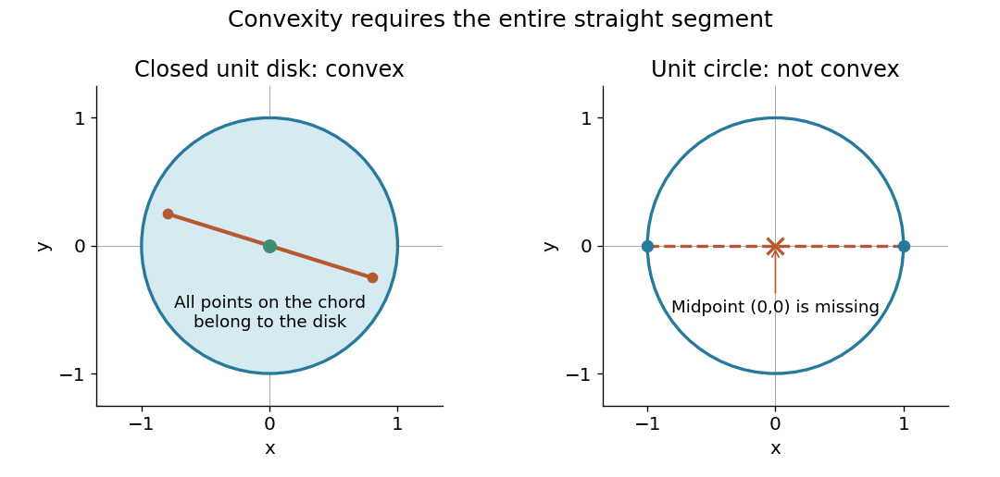

# Convex set

↑ **Parent:** [Mathematical optimization](mathematical-optimization-split.md)  
ⓦ [Wiki](https://en.wikipedia.org/wiki/Convex_set)

A convex set permits every intermediate mixture of two of its points. If two choices meet its constraints, continuously averaging them also meets those constraints. This geometric property makes many [feasible regions](feasible-region.md) easier to explore: there is no forbidden gap along a straight move between feasible choices.

Formally, a [subset](subset.md) $C$ of a real [vector space](vector-space-split.md) is convex when

$$
x,y\in C,\quad 0\leq t\leq1\quad\Longrightarrow\quad(1-t)x+ty\in C.
$$

The parameter $t$ traverses the entire [line segment](line-segment.md), including both endpoints. The definition does not require a [closed subset](closed-set.md), a [bounded set](bounded-set.md), or a nonempty [interior](interior-topology.md). The [empty set](empty-set.md), the whole [vector space](vector-space-split.md), and every [affine subspace](affine-subspace.md) are convex; an open [unit disk](unit-disk.md) and a closed [unit disk](unit-disk.md) are both convex.[§2.1.4, pp. 23–25: convex sets and finite convex combinations](convex-optimization-by-stephen-boyd-and-lieven-vandenberghe.md)

The [triangle inequality](triangle-inequality.md) verifies the disk example directly: if $\|x\|,\|y\|\leq1$, then $\|(1-t)x+ty\|\leq(1-t)\|x\|+t\|y\|\leq1$. For the open disk, the last inequality is strict. The [unit circle](complex-unit-circle.md) fails the same test: $(1,0)$ and $(-1,0)$ belong to it, but their [midpoint](midpoint.md) $(0,0)$ does not. A curved route along the [unit circle](complex-unit-circle.md) connects the endpoints, so being [path-connected](path-connected-space.md) is weaker than being a convex set.

**[Figure 1](#image-a-disk-contains-every-chord-while-a-circle-omits-its-chords). A disk contains every chord, while a circle omits its chords**. Original comparison of the closed [unit disk](unit-disk.md) and the [unit circle](complex-unit-circle.md). The circle's [midpoint](midpoint.md) counterexample is explicit; the shaded disk panel illustrates one [line segment](line-segment.md), with the general statement established by the [triangle inequality](triangle-inequality.md).

The distinction between a convex set and a [convex function](convex-function.md) matters. The former concerns where one may choose a point; the latter concerns how a value changes along [line segments](line-segment.md). [Convex optimization](convex-optimization-split.md) combines both: averaging preserves feasibility, and a [convex function](convex-function.md) obeys an upper bound by the corresponding average of endpoint values. A convex set alone does not make an arbitrary objective a [convex function](convex-function.md) or eliminate its inferior [local minima](local-minimum.md).

**Table of contents**

- [Convex feasible region for a resource budget](convex-feasible-region-for-a-resource-budget.md)
  - [Integer restrictions on a convex feasible region](integer-restrictions-on-a-convex-feasible-region.md)
- [Midpoint test for a closed set](midpoint-test-for-a-closed-set.md)
- [Closed convex set](closed-convex-set.md)
- [Hyperplane separation theorem](hyperplane-separation-theorem.md)
- [Supporting hyperplane theorem](supporting-hyperplane-theorem.md)
- [Relative interior](relative-interior.md)
- [Radially open convex set](radially-open-convex-set.md)
- [Half-space representation of a closed convex set](half-space-representation-of-a-closed-convex-set.md)
- [Recession cone](recession-cone.md)
- [Face of a convex set](face-of-a-convex-set.md)
- [Compact convex set](compact-convex-set.md)
- [Nonnegative orthant](nonnegative-orthant.md)
- [Convex combination](convex-combination.md)
  - [Convex combinations in a triangle](convex-combinations-in-a-triangle.md)
  - [Cyclic symmetry averaging](cyclic-symmetry-averaging.md)
- [Closed half-space](closed-half-space.md)
- [Line segment](line-segment.md)
  - [Midpoint](midpoint.md)
  - [Closest points on two line segments](closest-points-on-two-line-segments.md)
    - [Contact time of translating line segments](contact-time-of-translating-line-segments.md)
      - [Proximity time of translating line segments](proximity-time-of-translating-line-segments.md)
- [Convex polytope](convex-polytope.md)
  - [Zonotope](zonotope.md)
  - [Lattice polytope](lattice-polytope.md)
    - [Ehrhart polynomial](ehrhart-polynomial.md)
      - [Ehrhart reciprocity](ehrhart-reciprocity.md)
      - [Ehrhart's theorem](ehrhart-s-theorem.md)
  - [Convex polygon](convex-polygon.md)
    - [Strictly convex polygon](strictly-convex-polygon.md)
    - [Convex hole](convex-hole.md)
    - [Triangulation of a convex polygon](triangulation-of-a-convex-polygon.md)
    - [Convex chain](convex-chain.md)
      - [Convex-chain probability in a triangle](convex-chain-probability-in-a-triangle.md)
      - [Longest convex chain](longest-convex-chain.md)
        - [Convex-chain median concentration](convex-chain-median-concentration.md)
  - [Vertex of a polytope](vertex-of-a-polytope.md)
  - [Facet](facet.md)
    - [Facet lower bound for ball approximations](facet-lower-bound-for-ball-approximations.md)
  - [Cross-polytope](cross-polytope.md)
- [Extreme point](extreme-point.md)
  - [Exposed point](exposed-point.md)
  - [Extreme point that is not an exposed point](extreme-point-that-is-not-an-exposed-point.md)
  - [Extreme points of real sequence-space unit balls](extreme-points-of-real-sequence-space-unit-balls.md)
  - [Extreme points of a real continuous-function unit ball](extreme-points-of-a-real-continuous-function-unit-ball.md)
    - [Clopen sign approximation in the real Cantor unit ball](clopen-sign-approximation-in-the-real-cantor-unit-ball.md)
  - [Extreme-point criterion for the L-infinity unit ball](extreme-point-criterion-for-the-l-infinity-unit-ball.md)
- [Projections onto convex sets](projections-onto-convex-sets.md)
- [Euclidean projection onto a convex set](euclidean-projection-onto-a-convex-set.md)
  - [Variational characterization of convex projection](variational-characterization-of-convex-projection.md)
  - [Nonexpansiveness of metric projection](nonexpansiveness-of-metric-projection.md)
  - [Projection onto a box-constrained hyperplane](projection-onto-a-box-constrained-hyperplane.md)
- [Support function](support-function.md)
  - [Support-function subgradients as exposed faces](support-function-subgradients-as-exposed-faces.md)
  - [Support function of an inverse image of an infinity-norm ball](support-function-of-an-inverse-image-of-an-infinity-norm-ball.md)
  - [Sum of the largest components](sum-of-the-largest-components.md)
    - [Threshold formula for the sum of the largest components](threshold-formula-for-the-sum-of-the-largest-components.md)
  - [Sum of the largest eigenvalues](sum-of-the-largest-eigenvalues.md)
    - [Ky Fan maximum principle](ky-fan-maximum-principle.md)
      - [Hermitian effect variational principle](hermitian-effect-variational-principle.md)
    - [Threshold semidefinite program for the largest eigenvalues](threshold-semidefinite-program-for-the-largest-eigenvalues.md)
- [Capped simplex](capped-simplex.md)
- [Second-order cone](second-order-cone.md)
  - [Self-duality of a second-order cone](self-duality-of-a-second-order-cone.md)
  - [Second-order cone programming](second-order-cone-programming.md)
    - [Second-order cone reformulation of one-sided quadratic denoising](second-order-cone-reformulation-of-one-sided-quadratic-denoising.md)
  - [Projection onto the second-order cone](projection-onto-the-second-order-cone.md)
- [Convex hull](convex-hull.md)
  - [Lower convex hull](lower-convex-hull.md)
  - [Linear optimization on a convex hull](linear-optimization-on-a-convex-hull.md)
  - [Closed convex hull](closed-convex-hull.md)
  - [Carathéodory's theorem (convex hull)](caratheodory-s-theorem-convex-hull.md)
    - [Conic Carathéodory theorem](conic-caratheodory-theorem.md)
- [Convex cone](convex-cone.md)
  - [Orthant](orthant.md)
  - [Strictly positive barycentre cone lemma](strictly-positive-barycentre-cone-lemma.md)
    - [Positive-weight expectation cone](positive-weight-expectation-cone.md)
  - [Support-minimal rays of a nonnegative kernel](support-minimal-rays-of-a-nonnegative-kernel.md)
  - [Lineality space](lineality-space.md)
  - [Self-dual cone](self-dual-cone.md)
  - [Proper cone](proper-cone.md)
  - [Completely positive cone](completely-positive-cone.md)
    - [Closedness of the completely positive cone](closedness-of-the-completely-positive-cone.md)
  - [Pointed cone](pointed-cone.md)
  - [Closed convex cone](closed-convex-cone.md)
    - [Separation from a closed convex cone](separation-from-a-closed-convex-cone.md)
  - [Conic hull](conic-hull.md)
    - [Finitely generated cone](finitely-generated-cone.md)
      - [Closedness of finitely generated cones](closedness-of-finitely-generated-cones.md)
    - [Conic combination](conic-combination.md)
  - [Copositive cone](copositive-cone.md)
    - [Duality of copositive and completely positive cones](duality-of-copositive-and-completely-positive-cones.md)
    - [Interior of the copositive cone](interior-of-the-copositive-cone.md)
    - [Positive-semidefinite-plus-nonnegative cone](positive-semidefinite-plus-nonnegative-cone.md)
  - [Positive semidefinite cone](positive-semidefinite-cone.md)
    - [Elliptope](elliptope.md)
    - [Fantope](fantope.md)
    - [Trace constraint](trace-constraint.md)
      - [Positive semidefinite trace ball](positive-semidefinite-trace-ball.md)
        - [Projection onto a positive semidefinite trace ball](projection-onto-a-positive-semidefinite-trace-ball.md)
- [Supporting hyperplane](supporting-hyperplane.md)
  - [Supporting line](supporting-line.md)

## ↑ Ancestors (4)

1. [Mathematical optimization](mathematical-optimization-split.md)
2. [Area of mathematics](area-of-mathematics.md)
3. [Mathematics](mathematics-split.md)
4. [Codex Wiki](split.md)

## ← Incoming links (118)

- [Bézier curve](bezier-curve.md)
- [Boundary sampling can miss winding](boundary-sampling-can-miss-winding.md)
- [Brouwer fixed-point theorem](brouwer-fixed-point-theorem.md)
- [Closed convex hull](closed-convex-hull.md)
- [Closed convex set](closed-convex-set.md)
- [Closed half-space](closed-half-space.md)
- [Closest point theorem for a closed convex subset of Lp](closest-point-theorem-for-a-closed-convex-subset-of-lp.md)
- [Compact convex set](compact-convex-set.md)
- [Continuous supporting functional for a locally bounded convex function](continuous-supporting-functional-for-a-locally-bounded-convex-function.md)
- [Convex analysis](convex-analysis.md)
- [Convex body](convex-body.md)
- [Convex combination](convex-combination.md)
- [Convex function](convex-function.md)
- [Convex geometry](convex-geometry.md)
- [Convex hull](convex-hull.md)
- [Convex KKT optimality certificate](convex-kkt-optimality-certificate.md)
- [Convex optimization](convex-optimization-split.md)
- [Core (game theory)](core-game-theory.md)
- [Derivative of a power of the Lp norm](derivative-of-a-power-of-the-lp-norm.md)
- [Descent lemma](descent-lemma.md)
- [Duality of block mixed norms](duality-of-block-mixed-norms.md)
- [Epigraph](epigraph.md)
- [Exposed point](exposed-point.md)
- [Extreme point](extreme-point.md)
- [Face of a convex set](face-of-a-convex-set.md)
- [Failure of Minkowski inequality below exponent one](failure-of-minkowski-inequality-below-exponent-one.md)
- [Feasible point](feasible-point.md)
- [Feasible triangle with a squared-distance objective](feasible-triangle-with-a-squared-distance-objective.md)
- [Full-dimensional linear polyhedron](full-dimensional-linear-polyhedron.md)
- [Fundamental group](fundamental-group.md)
- [Geodesic convexity](geodesic-convexity.md)
- [Half-space](half-space.md)
- [Half-space representation of a closed convex set](half-space-representation-of-a-closed-convex-set.md)
- [Hit-and-run sampler](hit-and-run-sampler.md)
- [Hyperplane separation theorem](hyperplane-separation-theorem.md)
- [Information projection](information-projection.md)
- [Jensen's inequality](jensen-s-inequality.md)
- [Lipschitz gradient](lipschitz-gradient.md)
- [Locally convex space](locally-convex-space.md)
- [Logarithm and square-root continuation along different paths](logarithm-and-square-root-continuation-along-different-paths.md)
- [Milman's converse to the Krein-Milman theorem](milman-s-converse-to-the-krein-milman-theorem.md)
- [Minkowski addition](minkowski-addition.md)
- [Minkowski inequality](minkowski-inequality.md)
- [Parallelogram](parallelogram.md)
- [Solution](past-exam-of-the-mathematics-course-of-the-university-of-cambridge/2001/iii/paper-31/1/solution.md)
- [Solution](past-exam-of-the-mathematics-course-of-the-university-of-cambridge/2001/iii/paper-53/3/b/solution.md)
- [Solution](past-exam-of-the-mathematics-course-of-the-university-of-cambridge/2002/iii/paper-6/4/ii/solution.md)
- [Solution](past-exam-of-the-mathematics-course-of-the-university-of-cambridge/2003/iii/paper-37/2/solution.md)
- [Solution](past-exam-of-the-mathematics-course-of-the-university-of-cambridge/2003/iii/paper-37/4/solution.md)
- [Solution](past-exam-of-the-mathematics-course-of-the-university-of-cambridge/2003/iii/paper-6/2/solution.md)
- [Solution](past-exam-of-the-mathematics-course-of-the-university-of-cambridge/2004/iii/paper-6/4/i/solution.md)
- [Solution](past-exam-of-the-mathematics-course-of-the-university-of-cambridge/2004/iii/paper-6/4/ii/solution.md)
- [Solution](past-exam-of-the-mathematics-course-of-the-university-of-cambridge/2005/ib/paper-2/13b/ii/solution.md)
- [Solution](past-exam-of-the-mathematics-course-of-the-university-of-cambridge/2005/iii/paper-40/3/solution.md)
- [Solution](past-exam-of-the-mathematics-course-of-the-university-of-cambridge/2006/iii/paper-6/2/solution.md)
- [Solution](past-exam-of-the-mathematics-course-of-the-university-of-cambridge/2007/iii/paper-35/1/solution.md)
- [Solution](past-exam-of-the-mathematics-course-of-the-university-of-cambridge/2007/iii/paper-8/2/ii/solution.md)
- [Solution](past-exam-of-the-mathematics-course-of-the-university-of-cambridge/2008/iii/paper-1/4/solution.md)
- [Solution](past-exam-of-the-mathematics-course-of-the-university-of-cambridge/2008/iii/paper-1/7/c/solution.md)
- [Solution](past-exam-of-the-mathematics-course-of-the-university-of-cambridge/2008/iii/paper-38/6/solution.md)
- [Solution](past-exam-of-the-mathematics-course-of-the-university-of-cambridge/2008/iii/paper-77/1/i/solution.md)
- [Solution](past-exam-of-the-mathematics-course-of-the-university-of-cambridge/2009/iii/paper-30/3/solution.md)
- [Solution](past-exam-of-the-mathematics-course-of-the-university-of-cambridge/2009/iii/paper-52/1/e/solution.md)
- [Solution](past-exam-of-the-mathematics-course-of-the-university-of-cambridge/2009/iii/paper-9/1/a/solution.md)
- [Solution](past-exam-of-the-mathematics-course-of-the-university-of-cambridge/2010/iii/paper-35/1/b/solution.md)
- [Solution](past-exam-of-the-mathematics-course-of-the-university-of-cambridge/2011/ii/paper-3/2f/i/solution.md)
- [Solution](past-exam-of-the-mathematics-course-of-the-university-of-cambridge/2012/iii/paper-42/1/b/solution.md)
- [Solution](past-exam-of-the-mathematics-course-of-the-university-of-cambridge/2012/iii/paper-44/1/c/solution.md)
- [Solution](past-exam-of-the-mathematics-course-of-the-university-of-cambridge/2013/iii/paper-37/5/solution.md)
- [Solution](past-exam-of-the-mathematics-course-of-the-university-of-cambridge/2014/iii/paper-37/5/d/solution.md)
- [Solution](past-exam-of-the-mathematics-course-of-the-university-of-cambridge/2014/iii/paper-5/1/e/solution.md)
- [Solution](past-exam-of-the-mathematics-course-of-the-university-of-cambridge/2014/iii/paper-6/3/solution.md)
- [Solution](past-exam-of-the-mathematics-course-of-the-university-of-cambridge/2014/iii/paper-65/1/a/solution.md)
- [Solution](past-exam-of-the-mathematics-course-of-the-university-of-cambridge/2014/iii/paper-68/2/solution.md)
- [Solution](past-exam-of-the-mathematics-course-of-the-university-of-cambridge/2015/iii/paper-39/3/solution.md)
- [Solution](past-exam-of-the-mathematics-course-of-the-university-of-cambridge/2015/iii/paper-6/2/solution.md)
- [Solution](past-exam-of-the-mathematics-course-of-the-university-of-cambridge/2015/iii/paper-6/3/solution.md)
- [Solution](past-exam-of-the-mathematics-course-of-the-university-of-cambridge/2016/ib/paper-4/20h/b/solution.md)
- [Solution](past-exam-of-the-mathematics-course-of-the-university-of-cambridge/2016/iii/paper-106/2/solution.md)
- [Solution](past-exam-of-the-mathematics-course-of-the-university-of-cambridge/2016/iii/paper-106/5/ii/solution.md)
- [Solution](past-exam-of-the-mathematics-course-of-the-university-of-cambridge/2016/iii/paper-213/5/solution.md)
- [Solution](past-exam-of-the-mathematics-course-of-the-university-of-cambridge/2016/iii/paper-325/1/i/solution.md)
- [Solution](past-exam-of-the-mathematics-course-of-the-university-of-cambridge/2017/iii/paper-340/5/a/solution.md)
- [Solution](past-exam-of-the-mathematics-course-of-the-university-of-cambridge/2017/iii/paper-340/5/b/solution.md)
- [Solution](past-exam-of-the-mathematics-course-of-the-university-of-cambridge/2017/iii/paper-340/5/c/solution.md)
- [Solution](past-exam-of-the-mathematics-course-of-the-university-of-cambridge/2018/ii/paper-2/2f/b/solution.md)
- [Solution](past-exam-of-the-mathematics-course-of-the-university-of-cambridge/2018/iii/paper-105/1/a/solution.md)
- [Solution](past-exam-of-the-mathematics-course-of-the-university-of-cambridge/2018/iii/paper-106/3/a/solution.md)
- [Solution](past-exam-of-the-mathematics-course-of-the-university-of-cambridge/2018/iii/paper-106/4/solution.md)
- [Solution](past-exam-of-the-mathematics-course-of-the-university-of-cambridge/2018/iii/paper-213/2/solution.md)
- [Solution](past-exam-of-the-mathematics-course-of-the-university-of-cambridge/2018/iii/paper-216/2/a/solution.md)
- [Solution](past-exam-of-the-mathematics-course-of-the-university-of-cambridge/2018/iii/paper-326/1/1/b/solution.md)
- [Solution](past-exam-of-the-mathematics-course-of-the-university-of-cambridge/2021/ii/paper-1/2h/solution.md)
- [Solution](past-exam-of-the-mathematics-course-of-the-university-of-cambridge/2022/ii/paper-4/30j/b/solution.md)
- [Solution](past-exam-of-the-mathematics-course-of-the-university-of-cambridge/2023/ib/paper-3/19h/a/solution.md)
- [Solution](past-exam-of-the-mathematics-course-of-the-university-of-cambridge/2023/ib/paper-3/19h/b/solution.md)
- [Solution](past-exam-of-the-mathematics-course-of-the-university-of-cambridge/2023/ib/paper-3/4c/solution.md)
- [Solution](past-exam-of-the-mathematics-course-of-the-university-of-cambridge/2023/ii/paper-1/31j/b/solution.md)
- [Solution](past-exam-of-the-mathematics-course-of-the-university-of-cambridge/2023/ii/paper-1/31j/c/solution.md)
- [Solution](past-exam-of-the-mathematics-course-of-the-university-of-cambridge/2023/ii/paper-4/20h/a/solution.md)
- [Solution](past-exam-of-the-mathematics-course-of-the-university-of-cambridge/2023/ii/paper-4/22f/c/solution.md)
- [Solution](past-exam-of-the-mathematics-course-of-the-university-of-cambridge/2024/iii/paper-339/2/c/solution.md)
- [Solution](past-exam-of-the-mathematics-course-of-the-university-of-cambridge/2025/ib/paper-2/7h/a/solution.md)
- [Solution](past-exam-of-the-mathematics-course-of-the-university-of-cambridge/2026/iii/paper-224/2/c/solution.md)
- [Polynomial approximation of an exterior pole on a convex compact set](polynomial-approximation-of-an-exterior-pole-on-a-convex-compact-set.md)
- [Positive affine uniqueness of affine preference representations](positive-affine-uniqueness-of-affine-preference-representations.md)
- [Projected subgradient method](projected-subgradient-method.md)
- [Pythagorean inequality for information projection](pythagorean-inequality-for-information-projection.md)
- [Recession cone](recession-cone.md)
- [Separation from an absorbing convex set](separation-from-an-absorbing-convex-set.md)
- [Shapley value belongs to the core of a convex game](shapley-value-belongs-to-the-core-of-a-convex-game.md)
- [Strict concavity](strict-concavity.md)
- [Strictly convex function](strictly-convex-function.md)
- [Support-function subgradients as exposed faces](support-function-subgradients-as-exposed-faces.md)
- [Supporting hyperplane](supporting-hyperplane.md)
- [Supporting hyperplane theorem](supporting-hyperplane-theorem.md)
- [Upper half-plane (complex analysis)](upper-half-plane-complex-analysis.md)
- [Weighted logarithmic utility](weighted-logarithmic-utility.md)
