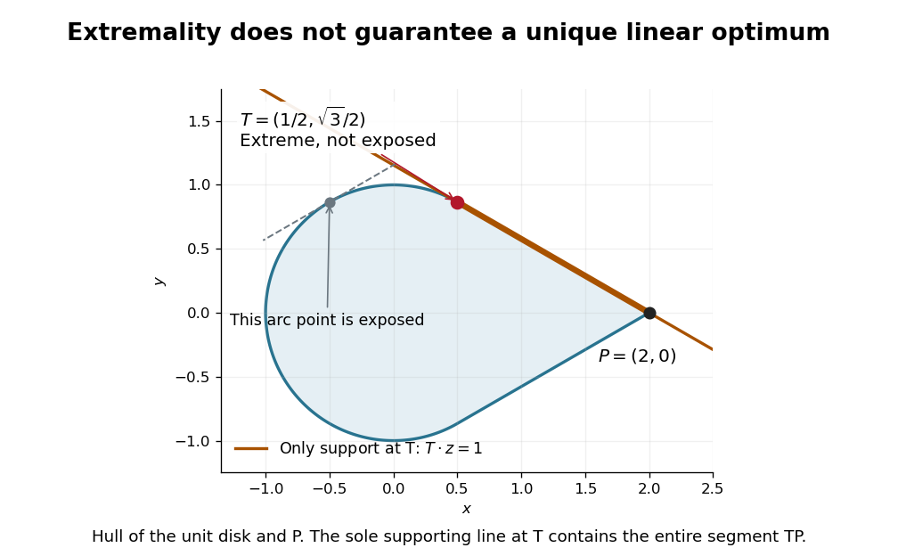

# Convex set

↑ **Parent:** [Mathematical optimization](mathematical-optimization.md)  
ⓦ [Wiki](https://en.wikipedia.org/wiki/Convex_set)

A convex set permits every intermediate mixture of two of its points. If two choices meet its constraints, continuously averaging them also meets those constraints. This geometric property makes many [feasible regions](mathematical-optimization.md#feasible-region) easier to explore: there is no forbidden gap along a straight move between feasible choices.

Formally, a [subset](set.md#subset) $C$ of a real [vector space](vector-space.md) is convex when

$$
x,y\in C,\quad 0\leq t\leq1\quad\Longrightarrow\quad(1-t)x+ty\in C.
$$

The parameter $t$ traverses the entire [line segment](#line-segment), including both endpoints. The definition does not require a [closed subset](topology.md#closed-set), a [bounded set](topological-analysis.md#bounded-set), or a nonempty [interior](topology.md#interior-topology). The [empty set](set.md#empty-set), the whole [vector space](vector-space.md), and every [affine subspace](vector-space.md#affine-subspace) are convex; an open [unit disk](euclidean-geometry.md#unit-disk) and a closed [unit disk](euclidean-geometry.md#unit-disk) are both convex.[§2.1.4, pp. 23–25: convex sets and finite convex combinations](mathematics-bibliography.md#convex-optimization-by-stephen-boyd-and-lieven-vandenberghe)

The [triangle inequality](topological-analysis.md#triangle-inequality) verifies the disk example directly: if $\|x\|,\|y\|\leq1$, then $\|(1-t)x+ty\|\leq(1-t)\|x\|+t\|y\|\leq1$. For the open disk, the last inequality is strict. The [unit circle](complex-analysis.md#complex-unit-circle) fails the same test: $(1,0)$ and $(-1,0)$ belong to it, but their [midpoint](#midpoint) $(0,0)$ does not. A curved route along the [unit circle](complex-analysis.md#complex-unit-circle) connects the endpoints, so being [path-connected](geometry-and-topology.md#path-connected-space) is weaker than being a convex set.

**[Figure 1](#image-a-disk-contains-every-chord-while-a-circle-omits-its-chords). A disk contains every chord, while a circle omits its chords**. Original comparison of the closed [unit disk](euclidean-geometry.md#unit-disk) and the [unit circle](complex-analysis.md#complex-unit-circle). The circle's [midpoint](#midpoint) counterexample is explicit; the shaded disk panel illustrates one [line segment](#line-segment), with the general statement established by the [triangle inequality](topological-analysis.md#triangle-inequality).

The distinction between a convex set and a [convex function](real-analysis.md#convex-function) matters. The former concerns where one may choose a point; the latter concerns how a value changes along [line segments](#line-segment). [Convex optimization](convex-optimization.md) combines both: averaging preserves feasibility, and a [convex function](real-analysis.md#convex-function) obeys an upper bound by the corresponding average of endpoint values. A convex set alone does not make an arbitrary objective a [convex function](real-analysis.md#convex-function) or eliminate its inferior [local minima](analysis.md#local-minimum).

**Table of contents**

- [Convex feasible region for a resource budget](#convex-feasible-region-for-a-resource-budget)
  - [Integer restrictions on a convex feasible region](#integer-restrictions-on-a-convex-feasible-region)
- [Midpoint test for a closed set](#midpoint-test-for-a-closed-set)
- [Closed convex set](#closed-convex-set)
- [Hyperplane separation theorem](#hyperplane-separation-theorem)
- [Supporting hyperplane theorem](#supporting-hyperplane-theorem)
- [Relative interior](#relative-interior)
- [Radially open convex set](#radially-open-convex-set)
- [Half-space representation of a closed convex set](#half-space-representation-of-a-closed-convex-set)
- [Recession cone](#recession-cone)
- [Face of a convex set](#face-of-a-convex-set)
- [Compact convex set](#compact-convex-set)
- [Nonnegative orthant](#nonnegative-orthant)
- [Convex combination](#convex-combination)
  - [Convex combinations in a triangle](#convex-combinations-in-a-triangle)
  - [Cyclic symmetry averaging](#cyclic-symmetry-averaging)
- [Closed half-space](#closed-half-space)
- [Line segment](#line-segment)
  - [Midpoint](#midpoint)
  - [Closest points on two line segments](#closest-points-on-two-line-segments)
    - [Contact time of translating line segments](#contact-time-of-translating-line-segments)
      - [Proximity time of translating line segments](#proximity-time-of-translating-line-segments)
- [Convex polytope](#convex-polytope)
  - [Zonotope](#zonotope)
  - [Lattice polytope](#lattice-polytope)
    - [Ehrhart polynomial](#ehrhart-polynomial)
      - [Ehrhart reciprocity](#ehrhart-reciprocity)
      - [Ehrhart's theorem](#ehrhart-s-theorem)
  - [Convex polygon](#convex-polygon)
    - [Strictly convex polygon](#strictly-convex-polygon)
    - [Convex hole](#convex-hole)
    - [Triangulation of a convex polygon](#triangulation-of-a-convex-polygon)
    - [Convex chain](#convex-chain)
      - [Convex-chain probability in a triangle](#convex-chain-probability-in-a-triangle)
      - [Longest convex chain](#longest-convex-chain)
        - [Convex-chain median concentration](#convex-chain-median-concentration)
  - [Vertex of a polytope](#vertex-of-a-polytope)
  - [Facet](#facet)
    - [Facet lower bound for ball approximations](#facet-lower-bound-for-ball-approximations)
  - [Cross-polytope](#cross-polytope)
- [Extreme point](#extreme-point)
  - [Exposed point](#exposed-point)
  - [Extreme point that is not an exposed point](#extreme-point-that-is-not-an-exposed-point)
  - [Extreme points of real sequence-space unit balls](#extreme-points-of-real-sequence-space-unit-balls)
  - [Extreme points of a real continuous-function unit ball](#extreme-points-of-a-real-continuous-function-unit-ball)
    - [Clopen sign approximation in the real Cantor unit ball](#clopen-sign-approximation-in-the-real-cantor-unit-ball)
  - [Extreme-point criterion for the L-infinity unit ball](#extreme-point-criterion-for-the-l-infinity-unit-ball)
- [Projections onto convex sets](#projections-onto-convex-sets)
- [Euclidean projection onto a convex set](#euclidean-projection-onto-a-convex-set)
  - [Variational characterization of convex projection](#variational-characterization-of-convex-projection)
  - [Nonexpansiveness of metric projection](#nonexpansiveness-of-metric-projection)
  - [Projection onto a box-constrained hyperplane](#projection-onto-a-box-constrained-hyperplane)
- [Support function](#support-function)
  - [Support-function subgradients as exposed faces](#support-function-subgradients-as-exposed-faces)
  - [Support function of an inverse image of an infinity-norm ball](#support-function-of-an-inverse-image-of-an-infinity-norm-ball)
  - [Sum of the largest components](#sum-of-the-largest-components)
    - [Threshold formula for the sum of the largest components](#threshold-formula-for-the-sum-of-the-largest-components)
  - [Sum of the largest eigenvalues](#sum-of-the-largest-eigenvalues)
    - [Ky Fan maximum principle](#ky-fan-maximum-principle)
      - [Hermitian effect variational principle](#hermitian-effect-variational-principle)
    - [Threshold semidefinite program for the largest eigenvalues](#threshold-semidefinite-program-for-the-largest-eigenvalues)
- [Capped simplex](#capped-simplex)
- [Second-order cone](#second-order-cone)
  - [Self-duality of a second-order cone](#self-duality-of-a-second-order-cone)
  - [Second-order cone programming](#second-order-cone-programming)
    - [Second-order cone reformulation of one-sided quadratic denoising](#second-order-cone-reformulation-of-one-sided-quadratic-denoising)
  - [Projection onto the second-order cone](#projection-onto-the-second-order-cone)
- [Convex hull](#convex-hull)
  - [Lower convex hull](#lower-convex-hull)
  - [Linear optimization on a convex hull](#linear-optimization-on-a-convex-hull)
  - [Closed convex hull](#closed-convex-hull)
  - [Carathéodory's theorem (convex hull)](#caratheodory-s-theorem-convex-hull)
    - [Conic Carathéodory theorem](#conic-caratheodory-theorem)
- [Convex cone](#convex-cone)
  - [Orthant](#orthant)
  - [Strictly positive barycentre cone lemma](#strictly-positive-barycentre-cone-lemma)
    - [Positive-weight expectation cone](#positive-weight-expectation-cone)
  - [Support-minimal rays of a nonnegative kernel](#support-minimal-rays-of-a-nonnegative-kernel)
  - [Lineality space](#lineality-space)
  - [Self-dual cone](#self-dual-cone)
  - [Proper cone](#proper-cone)
  - [Completely positive cone](#completely-positive-cone)
    - [Closedness of the completely positive cone](#closedness-of-the-completely-positive-cone)
  - [Pointed cone](#pointed-cone)
  - [Closed convex cone](#closed-convex-cone)
    - [Separation from a closed convex cone](#separation-from-a-closed-convex-cone)
  - [Conic hull](#conic-hull)
    - [Finitely generated cone](#finitely-generated-cone)
      - [Closedness of finitely generated cones](#closedness-of-finitely-generated-cones)
    - [Conic combination](#conic-combination)
  - [Copositive cone](#copositive-cone)
    - [Duality of copositive and completely positive cones](#duality-of-copositive-and-completely-positive-cones)
    - [Interior of the copositive cone](#interior-of-the-copositive-cone)
    - [Positive-semidefinite-plus-nonnegative cone](#positive-semidefinite-plus-nonnegative-cone)
  - [Positive semidefinite cone](#positive-semidefinite-cone)
    - [Elliptope](#elliptope)
    - [Fantope](#fantope)
    - [Trace constraint](#trace-constraint)
      - [Positive semidefinite trace ball](#positive-semidefinite-trace-ball)
        - [Projection onto a positive semidefinite trace ball](#projection-onto-a-positive-semidefinite-trace-ball)
- [Supporting hyperplane](#supporting-hyperplane)
  - [Supporting line](#supporting-line)

## Convex feasible region for a resource budget

↑ **Parent:** [Convex set](convex-set.md)

Consider a stipulated continuous-allocation problem. Amounts $x,y$ of two activities use $x+2y$ units of a common resource, with budget six. The [feasible region](mathematical-optimization.md#feasible-region)

$$
C=\{(x,y)\in\mathbb R^2:x\geq0,\ y\geq0,\ x+2y\leq6\}
$$

is a [triangle](euclidean-geometry.md#triangle) with [extreme points](#extreme-point) $(0,0)$, $(6,0)$ and $(0,3)$. It is the [intersection](set.md#set-intersection) of three [closed half-spaces](#closed-half-space), hence a [closed convex set](#closed-convex-set). The general [intersection](set.md#set-intersection) argument is short: a [line segment](#line-segment) between two points in every constraint set belongs to every constraint set, so it belongs to their [intersection](set.md#set-intersection).[§2.2.1, p. 27: half-spaces; §2.3.1, p. 36: intersections preserve convexity](mathematics-bibliography.md#convex-optimization-by-stephen-boyd-and-lieven-vandenberghe)

For an original numerical check, take $A=(1,2)$ and $B=(5,1/4)$. Their resource totals are $5$ and $11/2$. Every [convex combination](#convex-combination) $Z(t)=(1-t)A+tB$ is nonnegative and has resource total

$$
Z_x(t)+2Z_y(t)=5+\frac t2\leq\frac{11}{2}<6\qquad(0\leq t\leq1).
$$

In particular the [midpoint](#midpoint) is **$(3,9/8)$**, using $21/4$ units. This verifies the full [line segment](#line-segment), rather than just a plotted sample of it.

**[Figure 2](#image-feasible-averages-and-convex-weights-in-a-continuous-resource-budget). Feasible averages and convex weights in a continuous resource budget**. Original continuous-allocation model $x\geq0$, $y\geq0$, $x+2y\leq6$. The orange [line segment](#line-segment) joins two feasible allocations; the green point $(2,1)$ is the equal-weight [convex combination](#convex-combination) of the three [extreme points](#extreme-point). The shaded region is their [convex hull](#convex-hull), not just the three generating points.

This is useful whenever divisible quantities share linear limits: the feasible choices remain compatible under averaging. A new [linear equation](linear-algebra.md#linear-equation) also preserves this property, because averaging two identical constraint values gives the same value. The [affine subspace](vector-space.md#affine-subspace) and [closed half-space](#closed-half-space) viewpoints explain this without requiring a separate argument for every budget.

### Integer restrictions on a convex feasible region

↑ **Parent:** [Convex feasible region for a resource budget](#convex-feasible-region-for-a-resource-budget)

If the amounts in the budget example must be [integers](integer.md), the actual [feasible region](mathematical-optimization.md#feasible-region) is $C\cap\mathbb Z^2$. Both $(0,0)$ and $(1,0)$ are feasible, but their [midpoint](#midpoint) $(1/2,0)$ is not. Thus the continuous [feasible region](mathematical-optimization.md#feasible-region) is a convex set while the integer-restricted choices are not. Averaging two manufacturing plans may specify half an indivisible item. [Integer programming](mathematical-optimization.md#integer-programming) must respect that restriction; using the surrounding convex set is a relaxation, not a proof that its averages are admissible integer plans.

## Midpoint test for a closed set

↑ **Parent:** [Convex set](convex-set.md)

Checking only [midpoints](#midpoint) is not enough for an arbitrary [subset](set.md#subset) of a real [vector space](vector-space.md). The [rational numbers](number-theory.md#rational-number) contain the [midpoint](#midpoint) of every pair of [rational numbers](number-theory.md#rational-number), but the [line segment](#line-segment) from $0$ to $1$ also contains [irrational numbers](algebra.md#irrational-number). For instance $\sqrt2/2$ lies on that [line segment](#line-segment) and is not rational. This shows why the definition quantifies over every real $t\in[0,1]$.

There is a useful additional hypothesis: a [closed subset](topology.md#closed-set) $C\subseteq\mathbb R^d$ containing the [midpoint](#midpoint) of every pair of its points is a convex set. Repeated bisection includes all points $(1-t)x+ty$ with [dyadic rational](arithmetic.md#dyadic-rational) $t\in[0,1]$. These coefficients approach every real $t\in[0,1]$; being a [closed subset](topology.md#closed-set) then includes each [limit](calculus.md#limit-of-a-function). This is a short proof outline, and the [rational numbers](number-theory.md#rational-number) example identifies precisely why a [closed subset](topology.md#closed-set) was required.

## Closed convex set

↑ **Parent:** [Convex set](convex-set.md)

A [convex set](convex-set.md) that is also a [closed subset](topology.md#closed-set) in the specified topology. In a [Hilbert space](hilbert-space.md) with its [norm topology](normed-vector-space.md#norm-topology), every nonempty closed convex set has a unique nearest point to every ambient [vector](vector-space.md#vector), by the [Hilbert projection theorem](hilbert-space.md#hilbert-projection-theorem).

## Hyperplane separation theorem

↑ **Parent:** [Convex set](convex-set.md)  
ⓦ [Wiki](https://en.wikipedia.org/wiki/Hyperplane_separation_theorem)

Two nonempty disjoint [convex sets](convex-set.md) in a finite-dimensional real [vector space](vector-space.md) admit a separating nonzero [linear functional](dual-space.md#linear-functional): for an appropriate $h\ne0$ and $a$, $h\cdot x\leq a\leq h\cdot y$ on the respective sets. Strict separation requires additional assumptions, such as one set being compact and the other closed. For an open [convex cone](#convex-cone) $C$ excluding zero, separation from $\{0\}$ gives $h\cdot c\geq0$ for all $c\in C$; scaling cone elements forces the separating level to be zero. This finite-dimensional result is related to the [supporting hyperplane theorem](#supporting-hyperplane-theorem).

## Supporting hyperplane theorem

↑ **Parent:** [Convex set](convex-set.md)  
ⓦ [Wiki](https://en.wikipedia.org/wiki/Supporting_hyperplane_theorem)

A [convex set](convex-set.md) in a finite-dimensional space has a nonzero supporting linear functional at each boundary point. If zero lies outside a nonempty [convex set](convex-set.md) $C$, weak separation gives $p\ne0$ with $p\cdot c\geq0$ for all $c\in C$, even when zero belongs to its closure. Strict separation needs stronger hypotheses.

## Relative interior

↑ **Parent:** [Convex set](convex-set.md)  
ⓦ [Wiki](https://en.wikipedia.org/wiki/Relative_interior)

The relative interior of a convex set is its interior in its affine span. A polyhedral cone has nonempty relative interior in its linear span, even when its ordinary interior in the ambient vector space is empty.

// Target: geometry-and-topology.bigb

## Radially open convex set

↑ **Parent:** [Convex set](convex-set.md)

A subset $C$ of a real [vector space](vector-space.md) is radially open when, for each $x\in C$ and each vector $v$, the points $x+tv$ remain in $C$ for all sufficiently small real $t$. No ambient topology is required. If $C$ is also convex and contains zero, it is absorbing and its [Minkowski functional](topological-vector-space.md#minkowski-functional) $p_C(x)=\inf\{s>0:x\in sC\}$ is finite and sublinear, with $C=\{p_C<1\}$. Convexity gives subadditivity; radial openness permits a slight dilation of any point of $C$, giving the strict inequality.

## Half-space representation of a closed convex set

↑ **Parent:** [Convex set](convex-set.md)

A closed [convex set](convex-set.md) in a finite-dimensional Euclidean space is the intersection of all containing [closed half-spaces](#closed-half-space). For a point outside a nonempty set, its [Euclidean projection onto a convex set](#euclidean-projection-onto-a-convex-set) gives a separating normal. Applied to an [epigraph](calculus-of-variations.md#epigraph), this turns geometric separation into affine lower bounds and is a key step in the [Fenchel-Moreau theorem](convex-optimization.md#fenchel-moreau-theorem).

## Recession cone

↑ **Parent:** [Convex set](convex-set.md)

The recession cone of a nonempty [convex set](convex-set.md) $C$ consists of directions $d$ for which $x+td\in C$ for every $x\in C$ and $t\ge0$. For a [linear polyhedron](linear-programming.md#linear-polyhedron) $P=\{x:Ax\le b\}$ it is exactly $\{d:Ad\le0\}$. A nonzero recession direction gives an unbounded ray, so a bounded nonempty polyhedron has recession cone $\{0\}$. This excludes spurious zero-scale feasible points in the [Charnes-Cooper transformation](linear-programming.md#charnes-cooper-transformation).

## Face of a convex set

↑ **Parent:** [Convex set](convex-set.md)

A [convex set](convex-set.md) $F\subseteq C$ is a face of $C$ if $ty+(1-t)z\in F$, with $y,z\in C$ and $0<t<1$, implies $y,z\in F$. A singleton face is an [extreme point](#extreme-point). A face of a face is a face of the original [convex set](convex-set.md).

## Compact convex set

↑ **Parent:** [Convex set](convex-set.md)

A [compact convex set](#compact-convex-set) $K\subseteq\mathbb R^n$ is a [compact set](topology.md#compact-space) that is also a [convex set](convex-set.md). If $K$ is nonempty, its [support function](#support-function) $H_K(\eta)=\max_{x\in K}x\cdot\eta$ is finite in every direction. For such a nonempty $K$, every exterior point $x_0$ admits a strictly [separating hyperplane](statistical-learning.md#separating-hyperplane): minimize $|x_0-y|$ over $y\in K$, and put $\omega=x_0-y$. Convexity and differentiation along the segment from $y$ to any $z\in K$ give $\omega\cdot(z-y)\leq0$, while $\omega\cdot(x_0-y)=|\omega|^2>0$. This is the separation used to recover spatial support from Fourier growth.

## Nonnegative orthant

↑ **Parent:** [Convex set](convex-set.md)

The nonnegative orthant consists of vectors whose coordinates are all nonnegative. Its interior is the positive orthant, where every coordinate is positive.

It is the closed [orthant](#orthant) obtained by choosing the nonnegative sign for every coordinate.

## Convex combination

↑ **Parent:** [Convex set](convex-set.md)  
ⓦ [Wiki](https://en.wikipedia.org/wiki/Convex_combination)

A convex combination is a finite weighted average of points in a real [vector space](vector-space.md). For $n\geq1$, it has the form

$$
\sum_{i=1}^n\lambda_i x_i,
\qquad \lambda_i\geq0,
\qquad \sum_{i=1}^n\lambda_i=1.
$$

The nonnegative [coefficients](vector-space.md#coefficient) forbid subtracting a component, and their unit sum keeps the result on the same affine scale as the inputs. With two points it parametrizes their [line segment](#line-segment); equal [coefficients](vector-space.md#coefficient) give their [centroid](euclidean-geometry.md#centroid). A [convex set](convex-set.md) contains every finite convex combination of its points. Conversely, the two-point case already gives the defining property of a [convex set](convex-set.md).[§2.1.4, p. 24: finite combinations, weighted-average interpretation and convex hull](mathematics-bibliography.md#convex-optimization-by-stephen-boyd-and-lieven-vandenberghe)

The distinction from a [linear combination](vector-space.md#linear-combination) is concrete. Combining $(0,0)$ and $(2,0)$ with [coefficients](vector-space.md#coefficient) $-1$ and $2$ gives $(4,0)$, outside their [line segment](#line-segment), despite the unit coefficient sum. Using two [coefficients](vector-space.md#coefficient) both equal to one gives $(2,0)$ here, but their sum is two, so it is not a convex combination with those [coefficients](vector-space.md#coefficient). A numerical output may happen to coincide with a point admitting a different convex representation; the definition applies to the specified [coefficients](vector-space.md#coefficient).

### Convex combinations in a triangle

↑ **Parent:** [Convex combination](#convex-combination)

Every allocation $(x,y)$ in the [convex feasible region for a resource budget](#convex-feasible-region-for-a-resource-budget) is a convex combination of its three [extreme points](#extreme-point):

$$
(x,y)=\lambda_1(0,0)+\lambda_2(6,0)+\lambda_3(0,3),\qquad
\lambda_2=\frac x6,\quad\lambda_3=\frac y3,\quad\lambda_1=1-\frac x6-\frac y3.
$$

The condition $x+2y\leq6$ is exactly $\lambda_1\geq0$; nonnegative $x,y$ give the other two nonnegative [coefficients](vector-space.md#coefficient). Thus the [half-space](geometry-and-topology.md#half-space) description and the [convex hull](#convex-hull) description encode the same [triangle](euclidean-geometry.md#triangle). At $(2,1)$ all three [coefficients](vector-space.md#coefficient) are $1/3$, and at $(3,9/8)$ they are $1/8$, $1/2$, $3/8$. The green and orange points in the budget diagram therefore have two complementary interpretations: direct resource constraints and mixtures of extreme choices.

The three [extreme points](#extreme-point) alone are not a convex set, because their [midpoints](#midpoint) are absent. Their [convex hull](#convex-hull) fills the whole [triangle](euclidean-geometry.md#triangle). More generally, [Caratheodory theorem](#caratheodory-s-theorem-convex-hull) bounds how many generating points are needed for one convex combination in a finite-dimensional real [vector space](vector-space.md); its geometric content is that a complicated collection can describe each attainable average with a short representation.

### Cyclic symmetry averaging

↑ **Parent:** [Convex combination](#convex-combination)

If a convex subset of $\mathbb R^n$ is invariant under cyclic coordinate permutation, averaging the $n$ cyclic images of $x$ shows that

$$
\left(\frac1n\sum_jx_j,\ldots,\frac1n\sum_jx_j\right)
$$

also belongs to the set.

## Closed half-space

↑ **Parent:** [Convex set](convex-set.md)

A closed half-space is a set of the form $\{x:a^Tx\leq b\}$ for a nonzero vector $a$; it is a [convex set](convex-set.md) and is closed.

This is the non-strict version of a [half-space](geometry-and-topology.md#half-space); replacing the inequality by a strict one gives the open version.

## Line segment

↑ **Parent:** [Convex set](convex-set.md)  
ⓦ [Wiki](https://en.wikipedia.org/wiki/Line_segment)

The line segment joining vectors $x$ and $y$ is

$$
\{(1-t)x+ty:0\leq t\leq1\}.
$$

### Midpoint

↑ **Parent:** [Line segment](#line-segment)  
ⓦ [Wiki](https://en.wikipedia.org/wiki/Midpoint)

The midpoint of the [line segment](#line-segment) joining two points with position vectors $a,b$ is the point $m=(a+b)/2$. Its displacements from the endpoints are $(b-a)/2$ and $(a-b)/2$, so it lies on the segment and is equidistant from its endpoints. It is also the [centroid](euclidean-geometry.md#centroid) of the two endpoints.

### Closest points on two line segments

↑ **Parent:** [Line segment](#line-segment)

For [line segments](#line-segment) $P+sd$ and $Q+te$, $0\leq s,t\leq1$, the squared [Euclidean distance](topological-analysis.md#euclidean-distance) is a [convex quadratic function](real-analysis.md#convex-quadratic-function) on a square. Its minimum is either an admissible stationary point or a minimum on one of the four edges. Each edge minimum is a point-to-segment [orthogonal projection](hilbert-space.md#orthogonal-projection), restricted to the interval. Testing these five candidates gives a complete algorithm; when the directions are parallel, the edge candidates suffice. Independently restricting both coordinates of the unconstrained stationary point is generally incorrect because the variables are coupled by $d\cdot e$.

#### Contact time of translating line segments

↑ **Parent:** [Closest points on two line segments](#closest-points-on-two-line-segments)

For segments with initial direction vectors $U,T$, initial endpoint displacement $D$, and translation velocities $V,W$, contact is feasibility of the displayed [linear equation](linear-algebra.md#linear-equation) with $s,r\in[0,1]$ and $t\ge0$. Minimizing $t$ is a small [linear programming](linear-programming.md) problem. A nonsingular three-column coefficient [matrix](vector-space.md#matrix) gives at most one candidate; singular, parallel and degenerate cases require the constrained feasibility problem rather than division by a vanishing [determinant](multilinear-algebra.md#determinant).

##### Proximity time of translating line segments

↑ **Parent:** [Contact time of translating line segments](#contact-time-of-translating-line-segments)

The earliest approach within distance $d$ is a [convex optimization](convex-optimization.md) problem with a norm constraint and the same segment and time bounds as contact. An elementary alternative enumerates whether each segment parameter is free or at an endpoint. In each nonsingular active case the free closest-point parameters are [affine functions](vector-space.md#affine-function) of time, leaving a quadratic distance inequality on a valid time interval. Rank-deficient cases need their null-space constraints retained. Unlike contact, the two segment parameters and time are no longer determined by a vector equality.

## Convex polytope

↑ **Parent:** [Convex set](convex-set.md)  
ⓦ [Wiki](https://en.wikipedia.org/wiki/Convex_polytope)

A convex polytope is a bounded intersection of finitely many closed half-spaces, equivalently the convex hull of finitely many points.

### Zonotope

↑ **Parent:** [Convex polytope](#convex-polytope)  
ⓦ [Wiki](https://en.wikipedia.org/wiki/Zonotope)

A [zonotope](#zonotope) is a [Minkowski sum](geometry-and-topology.md#minkowski-addition) of finitely many [line segments](#line-segment), equivalently an [affine map](geometry-and-topology.md#affine-map) image of a cube. For vectors $\xi_j$, the set $\sum_j[0,1]\xi_j$ is the support of the associated [box spline](uniform-approximation.md#box-spline). A centred version uses $[-1/2,1/2]\xi_j$ instead. In two dimensions, sums of differently directed segments give centrally symmetric polygons; repeated directions lengthen their corresponding edges without adding new edge directions.

### Lattice polytope

↑ **Parent:** [Convex polytope](#convex-polytope)

A lattice polytope is the convex hull of finitely many points of a [Euclidean lattice](fourier-analysis.md#euclidean-lattice). It need not contain the origin. Integral translation changes its associated homogeneous semigroup ring by a grading-preserving isomorphism.

// Target: geometry-and-topology.bigb

#### Ehrhart polynomial

↑ **Parent:** [Lattice polytope](#lattice-polytope)

##### Ehrhart reciprocity

↑ **Parent:** [Ehrhart polynomial](#ehrhart-polynomial)

<h5 id="ehrhart-s-theorem">Ehrhart's theorem</h5>

↑ **Parent:** [Ehrhart polynomial](#ehrhart-polynomial)

### Convex polygon

↑ **Parent:** [Convex polytope](#convex-polytope)

A convex polygon is a two-dimensional [convex polytope](#convex-polytope), equivalently the [convex hull](#convex-hull) of a finite planar set with nonempty interior. Its vertices are the extreme points of that hull. Saying that given points form a convex polygon means every specified point is a vertex; points inside the hull or in the interior of a straight boundary segment do not count as vertices.

#### Strictly convex polygon

↑ **Parent:** [Convex polygon](#convex-polygon)

A strictly convex polygon is a [convex polygon](#convex-polygon) whose interior angles are all strictly less than $180$ degrees.

#### Convex hole

↑ **Parent:** [Convex polygon](#convex-polygon)

For a finite point set in the plane, a [convex polygon](#convex-polygon) whose [vertices of a polygon](euclidean-geometry.md#vertex-of-a-polygon) belong to the set and whose interior contains no point of the set. The convention must specify whether additional points on the boundary are allowed. A fan triangulation reduces emptiness to tests on constituent [triangles](euclidean-geometry.md#triangle), together with checks that internal diagonals contain no forbidden points.

#### Triangulation of a convex polygon

↑ **Parent:** [Convex polygon](#convex-polygon)

A [triangulation of a convex polygon](#triangulation-of-a-convex-polygon) divides a [convex polygon](#convex-polygon) into [triangles](euclidean-geometry.md#triangle) using diagonals between its existing [vertices of a polytope](#vertex-of-a-polytope), with no diagonal crossings in the interior. For $m\geq3$ vertices it uses $m-3$ diagonals and produces $m-2$ [triangles](euclidean-geometry.md#triangle). Fixing one boundary edge, its adjacent [triangle](euclidean-geometry.md#triangle) separates two smaller polygon regions; summing over the possible third [vertices of a polytope](#vertex-of-a-polytope) gives the [Catalan recurrence](combinatorics.md#catalan-recurrence). Thus the number of [triangulations of a convex polygon](#triangulation-of-a-convex-polygon) is $C_{m-2}$, with $C_n$ the [Catalan number](combinatorics.md#catalan-number). A quadrilateral has two choices and a pentagon has five.

#### Convex chain

↑ **Parent:** [Convex polygon](#convex-polygon)

A convex chain between two fixed points inside a [triangle](euclidean-geometry.md#triangle) is a finite point set whose union with the endpoints forms the vertices of a [convex polygon](#convex-polygon), with the endpoint segment as one boundary edge. In the triangle $0\leq y\leq x\leq1$, with endpoints $(0,0)$ and $(1,1)$, its ordered lower boundary has strictly increasing segment slopes. Every subset of its intermediate vertices remains a convex chain. This hereditary property lets selected point coordinates certify the existence of a long chain.

##### Convex-chain probability in a triangle

↑ **Parent:** [Convex chain](#convex-chain)

For independent uniform points in $0\leq y\leq x\leq1$ with the two diagonal endpoints, the displayed formula is exact. Order the $k$ intermediate points so that both coordinates increase, and write the $k+1$ positive coordinate spacings as $(u_i)$ and $(v_i)$, with each sum equal to one. The two spacing vectors have uniform simplex measure, independently, and the full ordered-coordinate region has volume $1/(k!)^2$. Simultaneous permutation of the spacing pairs preserves that measure, so all $(k+1)!$ orders of the ratios $v_i/u_i$ have equal volume. Strictly increasing ratios characterize a convex chain and automatically place the intermediate points below the diagonal. Thus its ordered volume is $1/((k!)^2(k+1)!)$. There are $k!$ ways to assign labels, and uniform triangle density is $2^k$, giving the formula. Consequently the [first moment method](probability-inequality.md#first-moment-method) bounds the probability of any length-$k$ chain among $n$ points by $\binom nk2^k/(k!(k+1)!)$.

##### Longest convex chain

↑ **Parent:** [Convex chain](#convex-chain)

For $n$ points in a [triangle](euclidean-geometry.md#triangle) and two fixed endpoint vertices, the longest convex chain length is the largest number of sampled points in a [convex chain](#convex-chain) joining those endpoints. It is a [certifiable function](probability-inequality.md#certifiable-function): a chain of length $a$ supplies a certificate of exactly $a$ point coordinates. Changing one point changes the maximum by at most one, since deleting that point from any optimal chain loses at most one vertex. For independent uniform points, its [median](probability-distribution.md#median) is $O(n^{1/3})$ and its fluctuation scale about the median is at most $n^{1/6}$, as proved by [convex-chain probability in a triangle](#convex-chain-probability-in-a-triangle) and [convex-chain median concentration](#convex-chain-median-concentration).

###### Convex-chain median concentration

↑ **Parent:** [Longest convex chain](#longest-convex-chain)

Let $m$ be an integer [median](probability-distribution.md#median) for the [longest convex chain](#longest-convex-chain) length of independent uniform points in a [triangle](euclidean-geometry.md#triangle). If $L_n(x)\geq a$, fix a certificate of $a$ coordinates. Every configuration with $L_n\leq b$ must disagree with at least $a-b$ of those coordinates; equal weights $1/\sqrt a$ prove [Talagrand convex distance](probability-inequality.md#talagrand-convex-distance) separation at least $(a-b)/\sqrt a$. [Talagrand's convex distance inequality](probability-inequality.md#talagrand-s-convex-distance-inequality) then gives $\mathbb P(L_n\geq a)\mathbb P(L_n\leq b)\leq e^{-(a-b)^2/(4a)}$. Set $b=m$, then $a=m$, in the two respective applications to obtain the displayed tails for positive integer $t$. The exact chain-counting bound gives $m\leq Cn^{1/3}$. Hence any interval centred at $m$ with length $\omega(n)n^{1/6}$, where $\omega(n)\to\infty$, contains $L_n$ [with high probability](probabilistic-combinatorics.md#with-high-probability). No upper restriction on the growth of $\omega$ is required.

### Vertex of a polytope

↑ **Parent:** [Convex polytope](#convex-polytope)

A vertex of a [convex polytope](#convex-polytope) is an [extreme point](#extreme-point): it cannot be expressed as a nontrivial convex combination of two distinct points in that polytope. In a full-dimensional simple polytope of dimension $n$, a vertex lies on exactly $n$ incident [facets](#facet).

### Facet

↑ **Parent:** [Convex polytope](#convex-polytope)  
ⓦ [Wiki](https://en.wikipedia.org/wiki/Facet_(geometry))

A facet of a full-dimensional [convex polytope](#convex-polytope) in $\mathbb R^n$ is a face of dimension $n-1$. Each irredundant supporting [closed half-space](#closed-half-space) defines one facet.

#### Facet lower bound for ball approximations

↑ **Parent:** [Facet](#facet)

If $r\geq\sqrt2$ and a [convex polytope](#convex-polytope) satisfies $r^{-1}B^n\subseteq P\subseteq B^n$, then it has at least $(1-r^{-2})^{-n/2}\geq e^{n/(2r^2)}$ [facets](#facet). Its outward facet normals define [spherical caps](euclidean-geometry.md#spherical-cap) covering the [unit sphere](topology.md#unit-sphere); the [spherical cap area upper bound](euclidean-geometry.md#spherical-cap-area-upper-bound) supplies the estimate.

### Cross-polytope

↑ **Parent:** [Convex polytope](#convex-polytope)  
ⓦ [Wiki](https://en.wikipedia.org/wiki/Cross-polytope)

The [convex hull](#convex-hull) of the positive and negative coordinate [unit vectors](vector-space.md#unit-vector). Its boundary triangulates a [sphere](euclidean-geometry.md#sphere), and each face contains at most one member of each antipodal pair of coordinate [unit vectors](vector-space.md#unit-vector). This makes its [barycentric subdivision](homology.md#barycentric-subdivision) useful for triangulating [Real projective space](algebraic-topology.md#real-projective-space).

## Extreme point

↑ **Parent:** [Convex set](convex-set.md)  
ⓦ [Wiki](https://en.wikipedia.org/wiki/Extreme_point)

An [extreme point](#extreme-point) of a [convex set](convex-set.md) is a [point](geometry-and-topology.md#point-geometry) that cannot be made by genuinely mixing two different [points](geometry-and-topology.md#point-geometry) of the [set](set.md). For a [convex set](convex-set.md) $C$ in a real [vector space](vector-space.md), the condition on $p\in C$ is

$$
p=(1-t)y+tz,\qquad y,z\in C,\quad0<t<1
\quad\Longrightarrow\quad y=z=p.
$$

Thus $p$ lies on no open [line segment](#line-segment) between two distinct [points](geometry-and-topology.md#point-geometry) of $C$. It is enough to exclude [midpoint](#midpoint) representations: if $p$ lies inside a [line segment](#line-segment), two nearby [points](geometry-and-topology.md#point-geometry) on opposite sides have [midpoint](#midpoint) $p$.[§6, Definition 6.6, printed p. 37: extremal points of closed convex sets](mathematics-bibliography.md#convex-geometry-bme-course-bmete94am22)

The [square](euclidean-geometry.md#square) $[-1,1]^2$ has just four [extreme points](#extreme-point), at $(\pm1,\pm1)$. In a [convex combination](#convex-combination) giving a corner, each [coordinate](vector-space.md#coordinate-linear-algebra) is already at its largest or smallest allowed value, forcing both input [points](geometry-and-topology.md#point-geometry) to agree with that corner. In contrast, the boundary [point](geometry-and-topology.md#point-geometry) $(1,0)$ is not extreme:

$$
(1,0)=\frac12(1,-1)+\frac12(1,1).
$$

It is the [midpoint](#midpoint) of two other [points](geometry-and-topology.md#point-geometry) on the same edge. An interior [point](geometry-and-topology.md#point-geometry) also admits a small [line segment](#line-segment) through it.

The [unit disk](euclidean-geometry.md#unit-disk) $D=\{z\in\mathbb R^2:\|z\|_2\leq1\}$ has a different shape: every [point](geometry-and-topology.md#point-geometry) on its [unit circle](complex-analysis.md#complex-unit-circle) is extreme. For a [unit vector](vector-space.md#unit-vector) $p$, the [Cauchy-Schwarz inequality](probability-and-statistics.md#cauchy-schwarz-inequality) gives

$$
p\cdot z\leq\|p\|_2\|z\|_2\leq1\qquad(z\in D),
$$

and equality is possible only at $z=p$. If a [convex combination](#convex-combination) equals $p$, applying this [linear functional](dual-space.md#linear-functional) forces both ingredients to attain that equality. Both must therefore be $p$. Extremality need not look like a sharp corner.

**[Figure 3](#image-the-square-and-unit-disk-distinguish-boundary-from-extreme-points). The square and unit disk distinguish boundary from extreme points**. Original planar examples. The red marks are [extreme points](#extreme-point): four corners for the [square](euclidean-geometry.md#square), the whole [unit circle](complex-analysis.md#complex-unit-circle) for the [unit disk](euclidean-geometry.md#unit-disk). Every [point](geometry-and-topology.md#point-geometry) on the square's orange edge maximizes $x$, including its nonextreme [midpoint](#midpoint). For the disk, the orange [supporting line](#supporting-line) for $p\cdot z$ touches only $p$.

These [points](geometry-and-topology.md#point-geometry) help describe all allowable mixtures. Every $(x,y)\in[-1,1]^2$ is a [convex combination](#convex-combination) of its four corners, with the weight on $(a,b)\in\{-1,1\}^2$ equal to $(1+ax)(1+by)/4$. For the [unit disk](euclidean-geometry.md#unit-disk), write $z=rp$, with $0\leq r\leq1$ and $p$ a [unit vector](vector-space.md#unit-vector); at zero choose any $p$. Then

$$
z=\frac{1+r}{2}p+\frac{1-r}{2}(-p).
$$

Two [extreme points](#extreme-point) suffice for that mixture. The [Krein-Milman theorem](functional-analysis.md#krein-milman-theorem) gives a much broader reconstruction: a nonempty [compact convex set](#compact-convex-set) in a [locally convex space](topological-vector-space.md#locally-convex-space) whose [topology](topology.md) is [Hausdorff](topology.md#hausdorff-space) is the [closed convex hull](#closed-convex-hull) of its [extreme points](#extreme-point).

[Mark Krein](mathematics.md#mark-krein) and [David Milman](mathematics.md#david-milman) published their reconstruction theorem in 1940. Milman's colleagues describe that result and its subsequent use as a method of representing [convex sets](convex-set.md) through their [extreme points](#extreme-point).[David Milman (1912–1982), printed p. 4: 1940 collaboration with M. G. Krein, the reconstruction theorem and subsequent method; citation 3 refers to their original paper](mathematics-bibliography.md#david-milman-1912-1982-by-israel-gohberg-and-others)

### Exposed point

↑ **Parent:** [Extreme point](#extreme-point)  
ⓦ [Wiki](https://en.wikipedia.org/wiki/Exposed_point)

An [exposed point](#exposed-point) is a [point](geometry-and-topology.md#point-geometry) uniquely selected by maximizing a [linear functional](dual-space.md#linear-functional). In $\mathbb R^d$, a [point](geometry-and-topology.md#point-geometry) $p$ of a [convex set](convex-set.md) $C$ is exposed if some [vector](vector-space.md#vector) $c$ satisfies

$$
c^{\mathsf T}p>c^{\mathsf T}z\qquad(z\in C,\ z\ne p).
$$

Geometrically, a [supporting hyperplane](#supporting-hyperplane) touches the [convex set](convex-set.md) only at $p$. Every [exposed point](#exposed-point) is an [extreme point](#extreme-point): a [convex combination](#convex-combination) that attains the maximum can put positive weight only on maximizers, and there is only one.[§6, Definition 6.2 and Proposition 6.7, printed pp. 36–37: exposed points and their inclusion among extremal points](mathematics-bibliography.md#convex-geometry-bme-course-bmete94am22)

The [unit disk](euclidean-geometry.md#unit-disk) calculation in [extreme point](#extreme-point) exposes every [point](geometry-and-topology.md#point-geometry) of the [unit circle](complex-analysis.md#complex-unit-circle). For a corner $(a,b)$ of the [square](euclidean-geometry.md#square), $c=(a,b)$ exposes it: $ax+by$ attains two only at $(a,b)$. However, maximizing $x$ exposes no single [point](geometry-and-topology.md#point-geometry) on the right edge, since all of them have the same objective value. A [linear functional](dual-space.md#linear-functional) may have several optimal [points](geometry-and-topology.md#point-geometry), even when some of them are extreme.

### Extreme point that is not an exposed point

↑ **Parent:** [Extreme point](#extreme-point)

The distinction appears at a smooth join between a straight segment and a curved boundary. Consider the [convex hull](#convex-hull)

$$
C=\operatorname{conv}(D\cup\{P\}),\qquad D=\{z:\|z\|_2\leq1\},\qquad P=(2,0).
$$

The upper tangent from $P$ meets the [unit circle](complex-analysis.md#complex-unit-circle) at $T=(1/2,\sqrt3/2)$. The [supporting line](#supporting-line) is

$$
T\cdot z=1,\qquad T\cdot P=T\cdot T=1.
$$

Every [point](geometry-and-topology.md#point-geometry) of the [unit disk](euclidean-geometry.md#unit-disk) has $T\cdot z\leq1$, with equality only at $T$. Hence the [convex face](#face-of-a-convex-set) of $C$ where equality holds is exactly the [line segment](#line-segment) $TP$.

**[Figure 4](#image-an-extreme-point-can-fail-to-be-an-exposed-point). An extreme point can fail to be an exposed point**. Original analytic [convex hull](#convex-hull) of the [unit disk](euclidean-geometry.md#unit-disk) and $P=(2,0)$. The tangent contact $T=(1/2,\sqrt3/2)$ is extreme, but its only [supporting line](#supporting-line) contains the entire [line segment](#line-segment) $TP$. A different marked [point](geometry-and-topology.md#point-geometry) on the curved arc is exposed by its own tangent [line](euclidean-geometry.md#straight-line).

The [point](geometry-and-topology.md#point-geometry) $T$ is extreme. If a nontrivial [convex combination](#convex-combination) of two [points](geometry-and-topology.md#point-geometry) of $C$ equals $T$, both must belong to the [convex face](#face-of-a-convex-set) $TP$. Since $T$ is an endpoint of that [line segment](#line-segment), both must equal $T$.

Yet $T$ is not exposed. A nonzero [linear functional](dual-space.md#linear-functional) maximizing at $T$ on $C$ must also maximize there on the included [unit disk](euclidean-geometry.md#unit-disk). Its [vector](vector-space.md#vector) must be a positive multiple of $T$, by the equality condition in the [Cauchy-Schwarz inequality](probability-and-statistics.md#cauchy-schwarz-inequality). It then gives $P$ the same value as $T$. No [linear functional](dual-space.md#linear-functional) can select $T$ alone. Being an [extreme point](#extreme-point) is a property of possible mixtures; being an [exposed point](#exposed-point) adds the ability to distinguish it by one linear objective.

### Extreme points of real sequence-space unit balls

↑ **Parent:** [Extreme point](#extreme-point)

For the real [l-infinity sequence space](banach-space.md#l-infinity-sequence-space), every coordinate of an [extreme point](#extreme-point) must be an endpoint of $[-1,1]$; any slack coordinate permits opposite perturbations. For the real [absolutely summable sequence space](banach-space.md#absolutely-summable-sequence-space), a unit vector with two nonzero coordinates permits a transfer of mass between them, so only signed coordinate vectors are extreme. For the real [l2 sequence space](banach-space.md#l2-sequence-space), the [parallelogram law](quadratic-form.md#parallelogram-law) makes every unit vector extreme. In all three cases interior points of the unit ball are nonextreme.

### Extreme points of a real continuous-function unit ball

↑ **Parent:** [Extreme point](#extreme-point)

For compact Hausdorff $K$, the extreme points of the real unit ball in the [space of continuous functions on a compact space](functional-analysis.md#space-of-continuous-functions-on-a-compact-space) are precisely its continuous sign-valued functions. A point with $|f|<1$ permits a nonzero continuous bump perturbation supported where there is uniform slack, while pointwise equality at an endpoint of $[-1,1]$ forces both functions in a midpoint decomposition to agree. For the [Cantor set](geometry-and-topology.md#cantor-set), [clopen](topology.md#clopen-set) indicators give the perturbations directly.

#### Clopen sign approximation in the real Cantor unit ball

↑ **Parent:** [Extreme points of a real continuous-function unit ball](#extreme-points-of-a-real-continuous-function-unit-ball)

Every real continuous function of supremum norm at most one on the [Cantor set](geometry-and-topology.md#cantor-set) is a uniform limit of convex combinations of continuous sign functions. Approximate on a finite [Cantor cylinder](geometry-and-topology.md#cantor-cylinder) partition by values $a_j\in[-1,1]$. The sign vector $s$ has weight $\prod_j(1+s_ja_j)/2$, whose coordinate means are $a_j$. This proves a [closed convex hull](#closed-convex-hull) identity without weak compactness.

### Extreme-point criterion for the L-infinity unit ball

↑ **Parent:** [Extreme point](#extreme-point)

For real scalars the extremes are the almost-everywhere sign-valued [functions](function.md). A positive-[measure](measure.md) region uniformly inside $[-1,1]$ permits opposite nontrivial bounded perturbations, proving necessity. Equality at either endpoint forces both members of a convex decomposition to agree, proving sufficiency. For complex scalars the same criterion uses unit-modulus [functions](function.md) and the strict convexity of the complex unit disk.

## Projections onto convex sets

↑ **Parent:** [Convex set](convex-set.md)  
ⓦ [Wiki](https://en.wikipedia.org/wiki/Projections_onto_convex_sets)

[Projections onto convex sets](#projections-onto-convex-sets) is an iterative feasibility method that successively applies a [Euclidean projection onto a convex set](#euclidean-projection-onto-a-convex-set) to each closed convex constraint set. With two sets it uses $x_{n+1}=P_D(P_C(x_n))$. It seeks a point in the intersection; a single projection onto one set is a different operation, and the method does not generally compute the closest intersection point to the initial iterate.

## Euclidean projection onto a convex set

↑ **Parent:** [Convex set](convex-set.md)

For a nonempty closed convex subset $C$ of a finite-dimensional inner-product space, $\Pi_C(x)$ is the unique point of $C$ minimizing $\|x-z\|$.

This closest-point map is the [metric projection onto a closed convex set](#euclidean-projection-onto-a-convex-set). Repeated projections onto several sets form the separate [projections onto convex sets](#projections-onto-convex-sets) method.

### Variational characterization of convex projection

↑ **Parent:** [Euclidean projection onto a convex set](#euclidean-projection-onto-a-convex-set)

For $p\in C$,

$$
p=\Pi_C(x)
\quad\Longleftrightarrow\quad
\langle x-p,z-p\rangle\leq0
\quad\text{for every }z\in C.
$$

### Nonexpansiveness of metric projection

↑ **Parent:** [Euclidean projection onto a convex set](#euclidean-projection-onto-a-convex-set)

The metric projection onto a nonempty closed convex set in a Hilbert space is nonexpansive:

$$
\lVert\Pi_C(x)-\Pi_C(y)\rVert\leq\lVert x-y\rVert.
$$

### Projection onto a box-constrained hyperplane

↑ **Parent:** [Euclidean projection onto a convex set](#euclidean-projection-onto-a-convex-set)

For $C=\{x:0\leq x\leq1,\ a^Tx=b\}$, the projection of $y$ has coordinates $x_i=\min(1,\max(0,y_i-\nu a_i))$, where the scalar multiplier $\nu$ is chosen so that $a^Tx=b$. Thus the projection reduces to a continuous one-dimensional root-finding problem.

## Support function

↑ **Parent:** [Convex set](convex-set.md)  
ⓦ [Wiki](https://en.wikipedia.org/wiki/Support_function)

The support function of a nonempty set $C$ is $\sigma_C(x)=\sup_{v\in C}\langle x,v\rangle$. It is convex and positively homogeneous, and for a closed convex set its [convex conjugate](convex-optimization.md#convex-conjugate) is the [indicator function](measure-theory.md#indicator-function) of $C$.

### Support-function subgradients as exposed faces

↑ **Parent:** [Support function](#support-function)

For a nonempty closed [convex set](convex-set.md) $C$, the finite-valued [support function](#support-function) has [subgradients](real-analysis.md#subgradient) exactly at the maximizing points of $C$. This follows from [Fenchel–Young inequality](convex-optimization.md#fenchel-young-inequality) and the conjugacy between the [support function](#support-function) and the [indicator functional of a constraint set](inverse-problem.md#indicator-functional-of-a-constraint-set). For compact $C$, the exposed maximizing set is nonempty.

### Support function of an inverse image of an infinity-norm ball

↑ **Parent:** [Support function](#support-function)

If $x\notin\operatorname{range}P^T=(\ker P)^\perp$, the [support function](#support-function) is infinite along a kernel line. Otherwise [linear programming duality](linear-programming.md#linear-programming-duality) gives the displayed minimum, attained because the corresponding linear programs are feasible with finite values. Splitting $q=\alpha-\beta$ into nonnegative parts yields the equivalent minimum of $\mathbf1^T(\alpha+\beta)$. Thus worst-case revenue over a [polyhedral uncertainty set](convex-optimization.md#polyhedral-uncertainty-set) is $r_0^Tx-\sigma_C(x)$, with value $-\infty$ off the row space.

### Sum of the largest components

↑ **Parent:** [Support function](#support-function)

The sum of the $k$ largest components of $x\in\mathbb R^n$ is the [support function](#support-function) of the [capped simplex](#capped-simplex): $\sum_{i=1}^k x_{[i]}=\max\{x^Tv:0\leq v\leq1,\ \sum_i v_i=k\}$.

#### Threshold formula for the sum of the largest components

↑ **Parent:** [Sum of the largest components](#sum-of-the-largest-components)

For $1\leq k\leq n$, [linear programming duality](linear-programming.md#linear-programming-duality) gives

$$
f_k(x)=\min_{t\in\mathbb R,\ s\geq0}\left\{kt+\sum_i s_i:s_i+t\geq x_i\right\}
=\min_{t\in\mathbb R}\left\{kt+\sum_i(x_i-t)_+\right\},
$$

where $(\cdot)_+$ is the [positive part of a real-valued function](function.md#positive-part-of-a-real-valued-function). To see equality directly, order the coordinates $x_{[1]}\geq\cdots\geq x_{[n]}$ and choose $x_{[k+1]}\leq t\leq x_{[k]}$ for $k<n$, or $t\leq x_{[n]}$ for $k=n$. The threshold expression then equals the [sum of the largest components](#sum-of-the-largest-components). Introducing the variables $s_i$ turns this [convex](real-analysis.md#convex-function) piecewise-linear objective into a [linear program](linear-programming.md).

### Sum of the largest eigenvalues

↑ **Parent:** [Support function](#support-function)

For a real [symmetric matrix](linear-algebra.md#symmetric-matrix) $X$ with [eigenvalues](linear-operator-theory.md#eigenvalue) $\lambda_1\geq\cdots\geq\lambda_n$, the sum of its $k$ largest [eigenvalues](linear-operator-theory.md#eigenvalue) is the [support function](#support-function) of the [fantope](#fantope):

$$
F_k(X)=\max\{\operatorname{tr}(XY):0\preceq Y\preceq I,\ \operatorname{tr}Y=k\}.
$$

Here $\preceq$ is the [Loewner order](quadratic-form.md#loewner-order). In an [orthonormal eigenbasis](linear-operator-theory.md#orthonormal-eigenbasis) for $X$, the objective depends only on the diagonal entries of $Y$, which lie in the [capped simplex](#capped-simplex). Thus the identity reduces to the [sum of the largest components](#sum-of-the-largest-components) of the [eigenvalues](linear-operator-theory.md#eigenvalue).

#### Ky Fan maximum principle

↑ **Parent:** [Sum of the largest eigenvalues](#sum-of-the-largest-eigenvalues)

For a real [symmetric matrix](linear-algebra.md#symmetric-matrix) $X$ and $1\leq k\leq n$,

$$
\sum_{i=1}^k\lambda_i(X)
=\max_{Q^TQ=I_k}\operatorname{tr}(Q^TXQ).
$$

Indeed $Y=QQ^T$ is a rank-$k$ [orthogonal projection matrix](inner-product.md#orthogonal-projection-matrix) in the [fantope](#fantope), and projecting onto the [eigenvectors](linear-operator-theory.md#eigenvector) of the largest [eigenvalues](linear-operator-theory.md#eigenvalue) attains the [support function](#support-function) maximum. Equivalently, the largest [matrix trace](linear-algebra.md#matrix-trace) of a compression to a $k$-dimensional [vector subspace](vector-space.md#vector-subspace) is the [sum of the largest eigenvalues](#sum-of-the-largest-eigenvalues).

##### Hermitian effect variational principle

↑ **Parent:** [Ky Fan maximum principle](#ky-fan-maximum-principle)

For a finite-dimensional [Hermitian operator](hilbert-space.md#hermitian-operator) $A$ with decreasing [eigenvalues](linear-operator-theory.md#eigenvalue) $\lambda_j$ and integer $0\leq r\leq d$, maximizing $\operatorname{Tr}(AB)$ over [positive contractions](hilbert-space.md#positive-contraction) $B$ with [trace](linear-algebra.md#matrix-trace) $r$ gives the sum of its leading $r$ [eigenvalues](linear-operator-theory.md#eigenvalue). In an [orthonormal eigenbasis](linear-operator-theory.md#orthonormal-eigenbasis), the diagonal entries of $B$ lie in $[0,1]$ and sum to $r$. Moving their weight to the largest [eigenvalues](linear-operator-theory.md#eigenvalue) can only increase the objective. An [orthogonal projection](hilbert-space.md#orthogonal-projection) onto their [eigenvectors](linear-operator-theory.md#eigenvector) attains the maximum.

#### Threshold semidefinite program for the largest eigenvalues

↑ **Parent:** [Sum of the largest eigenvalues](#sum-of-the-largest-eigenvalues)

The [sum of the largest eigenvalues](#sum-of-the-largest-eigenvalues) has the [semidefinite program](convex-optimization.md#semidefinite-programming) representation

$$
F_k(X)=\min_{t\in\mathbb R,\ S\succeq0}\{kt+\operatorname{tr}S:S\succeq X-tI\}.
$$

For every feasible $Y$ in the [fantope](#fantope), [positive semidefinite trace nonnegativity](quadratic-form.md#positive-semidefinite-trace-nonnegativity) gives $\operatorname{tr}(XY)\leq kt+\operatorname{tr}S$. To attain equality, use an [orthonormal eigenbasis](linear-operator-theory.md#orthonormal-eigenbasis) of $X$ and choose $S=\operatorname{diag}((\lambda_i-t)_+)$ in that basis, with the same threshold choice as in the [threshold formula for the sum of the largest components](#threshold-formula-for-the-sum-of-the-largest-components). This argument also covers $k=n$, without requiring strict feasibility of the maximization program.

## Capped simplex

↑ **Parent:** [Convex set](convex-set.md)

For an integer $0\leq k\leq n$, the capped simplex

$$
P_k=\{v\in\mathbb R^n:0\leq v_i\leq1,\ \sum_i v_i=k\}
$$

is the [convex hull](#convex-hull) of the zero-one [vectors](vector-space.md#vector) having exactly $k$ entries equal to one. It is a [convex polytope](#convex-polytope) whose [extreme points](#extreme-point) are precisely these [vectors](vector-space.md#vector).

If a feasible [vector](vector-space.md#vector) has a fractional coordinate, the integer coordinate sum forces at least two fractional coordinates. Perturbing one upward and the other downward by a sufficiently small amount gives two distinct feasible [vectors](vector-space.md#vector) whose midpoint is the original [vector](vector-space.md#vector). It is therefore not an [extreme point](#extreme-point). Conversely, a zero-one [vector](vector-space.md#vector) cannot be a nontrivial [convex combination](#convex-combination) of points of $[0,1]^n$, since each coordinate is already at a bound.

## Second-order cone

↑ **Parent:** [Convex set](convex-set.md)

The second-order cone, also called the Lorentz cone, is

$$
\mathcal L_{p+1}=\{(v,s)\in\mathbb R^p\times\mathbb R:\|v\|_2\leq s\}.
$$

### Self-duality of a second-order cone

↑ **Parent:** [Second-order cone](#second-order-cone)

For $(u,s),(v,t)$ in the [second-order cone](#second-order-cone), the [Cauchy-Schwarz inequality](probability-and-statistics.md#cauchy-schwarz-inequality) gives $u\cdot v+st\ge-\|u\|\|v\|+st\ge0$. Thus the cone is contained in its [dual cone](toric-geometry.md#dual-cone). Conversely, if $s<\|u\|$ and $u\ne0$, pairing $(u,s)$ with $(-u/\|u\|,1)$ is negative. If $u=0$ and $s<0$, use $(0,1)$. Every point outside the cone therefore lies outside its dual, proving that it is a [self-dual cone](#self-dual-cone).

### Second-order cone programming

↑ **Parent:** [Second-order cone](#second-order-cone)  
ⓦ [Wiki](https://en.wikipedia.org/wiki/Second-order_cone_programming)

A second-order cone program has a linear objective and affine constraints taking values in products of [second-order cones](#second-order-cone) and nonnegative orthants. Norm epigraphs have the form $(t,z)\in\mathcal Q$; quadratic epigraphs admit the affine lift $((q+1)/2,(q-1)/2,a)\in\mathcal Q_3$, equivalent to $q\geq a^2$. Product-cone [self-concordant barriers](convex-optimization.md#self-concordant-barrier) give [interior-point methods](convex-optimization.md#interior-point-method).

#### Second-order cone reformulation of one-sided quadratic denoising

↑ **Parent:** [Second-order cone programming](#second-order-cone-programming)

The objective $\|u-g\|_2+\lambda\sum_i((Gu)_i)_+^2$ has the exact lift $\min t+\lambda\sum_iq_i$ with $(t,u-g)\in\mathcal Q_{n+1}$, $((q_i+1)/2,(q_i-1)/2,a_i)\in\mathcal Q_3$, $a_i\geq0$ and $a_i\geq(Gu)_i$. Every lifted feasible value bounds the original objective, and choosing tight epigraph variables proves equality. The product-cone barrier parameter is $4n+2$: two for each Lorentz block and one for each orthant slack. The fidelity norm remains unsquared, and negative derivatives remain unpenalized.

### Projection onto the second-order cone

↑ **Parent:** [Second-order cone](#second-order-cone)

For $x=(u,t)$ and $\rho=\|u\|_2$,

$$
\Pi_{\mathcal L_{p+1}}(u,t)=
\begin{cases}
(u,t),&\rho\leq t,\\
(0,0),&\rho\leq-t,\\
\displaystyle\frac12\left(1+\frac t\rho\right)(u,\rho),&\rho>|t|.
\end{cases}
$$

## Convex hull

↑ **Parent:** [Convex set](convex-set.md)  
ⓦ [Wiki](https://en.wikipedia.org/wiki/Convex_hull)

The [convex hull](#convex-hull) of a [set](set.md) consists of every finite [convex combination](#convex-combination) of its points. It collects all choices obtainable by mixing the original choices with nonnegative weights summing to one. For $S$ in a real [vector space](vector-space.md),

$$
\operatorname{conv}(S)=\left\{\sum_{i=1}^m\lambda_i s_i:s_i\in S,\ m\geq1,\ \lambda_i\geq0,\ \sum_{i=1}^m\lambda_i=1\right\}.
$$

Equivalently this is the smallest [convex set](convex-set.md) containing $S$. Mixing two already mixed points produces another finite [convex combination](#convex-combination), so the displayed [set](set.md) is convex; every [convex set](convex-set.md) containing $S$ must contain all these mixtures.[§2.1.4, printed p. 24: convex hull and smallest containing convex set](mathematics-bibliography.md#convex-optimization-by-stephen-boyd-and-lieven-vandenberghe)

In an original planar example, take four points $A=(0,0)$, $B=(4,0)$, $C=(3,3)$, $D=(0,2)$ and four additional samples $(1,1)$, $(2,1.7)$, $(3,0.5)$, $(1,0.5)$. Their [convex hull](#convex-hull) is the filled [convex polygon](#convex-polygon) $ABCD$, including its [boundary](topology.md#boundary-of-a-set). None of the samples is $p=(2,1)$, but

$$
p=\frac5{12}A+\frac14B+\frac13C.
$$

The [coefficients](vector-space.md#coefficient) are nonnegative and sum to one, providing an explicit membership certificate. Geometrically, first form $U=(3/2,0)=\tfrac58A+\tfrac38B$ on the [line segment](#line-segment) $AB$, then mix $p=\tfrac23U+\tfrac13C$. The additional interior samples do not enlarge the [convex hull](#convex-hull).

**[Figure 5](#image-a-finite-set-gains-new-points-through-convex-combinations). A finite set gains new points through convex combinations**. Original eight-point planar example. The blue [convex polygon](#convex-polygon) is the [convex hull](#convex-hull); the orange star $p=(2,1)$ is absent from the original samples. Mixing on $AB$ produces $U$, and mixing $U$ with $C$ produces $p$ using exactly three original points.

For a finite nonempty $S\subset\mathbb R^d$, the [convex hull](#convex-hull) is the image of a [probability simplex](algebraic-topology.md#probability-simplex) of weights under the [linear map](vector-space.md#linear-map) $\lambda\mapsto\sum_i\lambda_i s_i$. The [probability simplex](algebraic-topology.md#probability-simplex) is a [compact set](topology.md#compact-space), and the map is [continuous](calculus.md#continuous-function), so this [convex hull](#convex-hull) is compact and closed. A one-point input stays one point; a collinear input stays in a [line segment](#line-segment). Filling the [convex hull](#convex-hull) does not necessarily produce a full-dimensional region.

The construction is useful whenever mixtures preserve the intended meaning of a choice. Mixing resource-allocation [vectors](vector-space.md#vector), for example, interpolates their coordinate requirements. The [convex hull](#convex-hull) describes the resulting [feasible region](mathematical-optimization.md#feasible-region). A coordinate-wise box can admit combinations that no mixture produces, as the outside-point certificate in [linear optimization on a convex hull](#linear-optimization-on-a-convex-hull) shows.

### Lower convex hull

↑ **Parent:** [Convex hull](#convex-hull)

The lower boundary of the [convex hull](#convex-hull) of points in the plane: the portion visible from points sufficiently far in the negative vertical direction. Sorting its vertices by horizontal coordinate gives a chain with nondecreasing edge slopes; collinear interior vertices can be omitted.

### Linear optimization on a convex hull

↑ **Parent:** [Convex hull](#convex-hull)

A [linear functional](dual-space.md#linear-functional) cannot exceed its best original value by mixing. For a finite nonempty [set](set.md) $S$ and $x=\sum_i\lambda_i s_i$ in its [convex hull](#convex-hull),

$$
c^{\mathsf T}x=\sum_i\lambda_i c^{\mathsf T}s_i\leq\max_{s\in S}c^{\mathsf T}s.
$$

Every original point is itself in the [convex hull](#convex-hull), so equality between the two maxima follows. Moreover, a mixture attains the maximum exactly when all its positive weights are assigned to maximizing original points. Multiple maximizers can therefore produce a whole [line segment](#line-segment) or a higher-dimensional region of equally good choices.

For the eight samples above, use the [linear functional](dual-space.md#linear-functional) $f(x,y)=x+y$. Its largest sample value is $f(C)=6$, and $C$ is the only maximizing sample. Thus the unique maximum over the whole [convex polygon](#convex-polygon) is also at $C$. The [line](euclidean-geometry.md#straight-line) $x+y=6$ is a [supporting line](#supporting-line): every point of the [convex hull](#convex-hull) lies in the [half-space](geometry-and-topology.md#half-space) $x+y\leq6$, and $C$ touches its [boundary](topology.md#boundary-of-a-set).

The point $q=(3.8,2.5)$ passes the coordinate-wise bounds $0\leq x\leq4$, $0\leq y\leq3$, but $f(q)=6.3>6$. This single inequality certifies that $q$ is outside the [convex hull](#convex-hull). A weighted mixture could not have a larger [linear functional](dual-space.md#linear-functional) value than all its ingredients.

**[Figure 6](#image-a-linear-functional-gives-both-an-optimum-and-a-convex-hull-exclusion-certificate). A linear functional gives both an optimum and a convex hull exclusion certificate**. Original eight-point example with objective $x+y$. The orange [supporting line](#supporting-line) touches $C=(3,3)$, where the maximum is six. The red point $q=(3.8,2.5)$ has objective value $6.3$, excluding it from the [convex hull](#convex-hull) despite lying inside the dotted coordinate-wise box.

This explains a basic feature of [linear programming](linear-programming.md): searching all mixtures of finitely many candidate [vectors](vector-space.md#vector) cannot improve the objective beyond the best candidate, though mixing equally good candidates can give more optimal choices. The conclusion depends on [linearity](vector-space.md#linearity). For the [concave function](real-analysis.md#concave-function) $g(x,y)=-(x-2)^2-(y-1)^2$, the new point $p=(2,1)$ instead attains zero, strictly above its value at every original sample. A nonlinear objective can favor a mixture.

### Closed convex hull

↑ **Parent:** [Convex hull](#convex-hull)

The smallest closed [convex set](convex-set.md) containing a set $C$, equivalently the closure of its [convex hull](#convex-hull) in the specified [topology](topology.md). The topology must be stated: the [norm topology](normed-vector-space.md#norm-topology), [weak topology](weak-topology.md) and [weak-star topology](weak-topology.md#weak-star-topology) need not give the same closure for an arbitrary set.

Even a bounded infinite input need not have a closed [convex hull](#convex-hull). In the real line, let $S=\{1/n:n\geq1\}$. Every finite [convex combination](#convex-combination) of these positive points is positive, so zero is absent. Conversely, any $x\in(0,1]$ lies between some $1/n$ and $1$, and is their [convex combination](#convex-combination). Hence

$$
\operatorname{conv}(S)=(0,1],\qquad\overline{\operatorname{conv}}(S)=[0,1].
$$

The [closed convex hull](#closed-convex-hull) adds the missing [limit](calculus.md#limit-of-a-function) point zero. For the finite eight-point example in [convex hull](#convex-hull), the [convex hull](#convex-hull) is already closed, so taking the [closed convex hull](#closed-convex-hull) adds nothing.

<h3 id="caratheodory-s-theorem-convex-hull">Carathéodory's theorem (convex hull)</h3>

↑ **Parent:** [Convex hull](#convex-hull)  
ⓦ [Wiki](https://en.wikipedia.org/wiki/Carathéodory's_theorem_(convex_hull))

Every point in the [convex hull](#convex-hull) of a [subset](set.md#subset) of $\mathbb R^d$ is a [convex combination](#convex-combination) of at most $d+1$ points of that [subset](set.md#subset). Thus in the plane three ingredients always suffice, however many samples were supplied. The representation of $p=(2,1)$ in [convex hull](#convex-hull) illustrates this bound. Two ingredients need not suffice: the [centroid](euclidean-geometry.md#centroid) of a [triangle](euclidean-geometry.md#triangle) with only its three [vertices](graph.md#vertex-graph-theory) as input is on none of their three pairwise [line segments](#line-segment).

A short proof outline removes redundant ingredients. With more than $d+1$ points, the augmented [vectors](vector-space.md#vector) $(s_i,1)$ are [linearly dependent](vector-space.md#linear-dependence). A dependence lets the weights vary while preserving both their sum and the represented point. Move along it until one positive weight first becomes zero; all weights stay nonnegative. Repeating leaves at most $d+1$ positive weights.

In his 1911 paper, [Constantin Carathéodory](mathematics.md#constantin-caratheodory) used [convex geometry](geometry-and-topology.md#convex-geometry) to investigate the possible [Fourier coefficients](fourier-series.md#fourier-coefficient) of positive [harmonic functions](partial-differential-equation.md#harmonic-function). Its introduction interprets convex mixtures through the [center of mass](classical-mechanics.md#center-of-mass), connecting finite-dimensional geometry to constraints on a function's coefficients.[English translation by Nicholas J. Williams, Introduction §4, original printed p. 195; §I concerns the smallest containing convex domain](mathematics-bibliography.md#uber-den-variabilitatsbereich-der-fourier’schen-konstanten-von-positiven-harmonischen-funktionen-by-constantin-caratheodory)

<h4 id="conic-caratheodory-theorem">Conic Carathéodory theorem</h4>

↑ **Parent:** [Carathéodory's theorem (convex hull)](#caratheodory-s-theorem-convex-hull)

In an $N$-dimensional real [vector space](vector-space.md), each member of a [conic hull](#conic-hull) has a representation using at most $N$ generators. To prove it, take a finite positive-coefficient representation with more than $N$ terms. Its generators are linearly dependent, say $\sum_j\mu_js_j=0$, with some $\mu_j>0$ after reversing the relation if necessary. Subtract $t\mu_j$ from each [coefficient](vector-space.md#coefficient), taking $t=\min_{\mu_j>0}\lambda_j/\mu_j$. All [coefficients](vector-space.md#coefficient) stay nonnegative and at least one vanishes. Iterate. The bound differs from the $N+1$ bound for a [convex hull](#convex-hull) because the [coefficient](vector-space.md#coefficient) sum is unrestricted.

## Convex cone

↑ **Parent:** [Convex set](convex-set.md)  
ⓦ [Wiki](https://en.wikipedia.org/wiki/Convex_cone)

A convex cone is a subset $C$ of a real [vector space](vector-space.md) closed under nonnegative [linear combinations](vector-space.md#linear-combination): $ax+by\in C$ whenever $x,y\in C$ and $a,b\geq0$. The [positive semidefinite cone](#positive-semidefinite-cone) and the [copositive cone](#copositive-cone) are examples, ordered by inclusion through the [positive-semidefinite-plus-nonnegative cone](#positive-semidefinite-plus-nonnegative-cone).

### Orthant

↑ **Parent:** [Convex cone](#convex-cone)  
ⓦ [Wiki](https://en.wikipedia.org/wiki/Orthant)

A closed coordinate-sign region of [Euclidean space](normed-vector-space.md#euclidean-norm). The $2^n$ orthants cover the space. An orthant contains no nontrivial affine line: for a nonzero direction, some coordinate eventually violates its sign restriction in one direction. Adding orthant inequalities to a nonempty [linear polyhedron](linear-programming.md#linear-polyhedron) therefore permits construction of a [basic feasible solution](linear-programming.md#basic-feasible-solution) even when the original polyhedron has no vertex.

### Strictly positive barycentre cone lemma

↑ **Parent:** [Convex cone](#convex-cone)

For a finite-dimensional [random vector](random-variable.md#random-vector) $X$, let $K$ be the closed cone generated by the [support of a probability distribution](probability-distribution.md#support-of-a-probability-distribution) of $X$. Every integrable strictly positively weighted barycentre lies in the [relative interior](#relative-interior) of $K$: every nonzero supporting functional on its span is positive on a set of positive probability. Conversely, put $w=(1+\|X\|)^{-1}$ and $D=\{\mathbb E[w fX]:0\leq f\in L^\infty\}$. Its dual cone equals that of $K$, so $\overline D=K$ and $\operatorname{ri}K\subseteq D$. For $z\in\operatorname{ri}K$, subtract a sufficiently small positive multiple of $\mathbb E[wX]$ and represent the remainder using $D$; adding the constant positive weight back gives $\nu=w(f+\varepsilon)>0$.

#### Positive-weight expectation cone

↑ **Parent:** [Strictly positive barycentre cone lemma](#strictly-positive-barycentre-cone-lemma)

For an [integrable](measure-theory.md#integrability) finite-dimensional [random vector](random-variable.md#random-vector) $Y$, let $L=\{h:h\cdot Y=0\text{ almost surely}\}^\perp$. The displayed [convex cone](#convex-cone) is open relative to $L$. Given a bounded strictly positive $Z$, the perturbation $Z_\varepsilon=Z(1+\varepsilon\cdot Y/(1+\|Y\|))$, $\|\varepsilon\|<1$, changes its weighted [expectation](expected-value.md) by $A_Z\varepsilon$, where

$$
A_Z=\mathbb E\frac{ZYY^T}{1+\|Y\|}.
$$

For $0\ne v\in L$, $v^TA_Zv>0$: otherwise $v\cdot Y=0$ [almost surely](convergence-of-random-variables.md#almost-sure-convergence). Thus $A_Z$ is invertible on $L$, and these perturbations give a neighborhood of every point of the cone. The [hyperplane separation theorem](#hyperplane-separation-theorem) consequently gives the alternative: either zero is a strictly positively weighted [expectation](expected-value.md), or a nonzero direction in $L$ has a nonnegative [dot product](inner-product.md#dot-product) with $Y$ [almost surely](convergence-of-random-variables.md#almost-sure-convergence) and a positive [dot product](inner-product.md#dot-product) with positive [probability](probability-theory.md#probability). To obtain the latter assertion, test the separating direction with $Z=\mathbf1_{\{h\cdot Y<0\}}+\varepsilon$ and let $\varepsilon\downarrow0$.

### Support-minimal rays of a nonnegative kernel

↑ **Parent:** [Convex cone](#convex-cone)

Every nonzero vector of $K$ is a nonnegative combination of at most as many support-minimal vectors as it has nonzero coordinates. Choose a nonnegative kernel vector $h$ of minimal nonempty support inside the support of $u$; subtract $\lambda h$, where $\lambda=\min_{h_i>0}u_i/h_i$. The remainder is nonnegative, remains in the kernel, and has strictly smaller support. Induction proves the decomposition. On a minimal support, the kernel is one-dimensional: an independent kernel direction could perturb a strictly positive vector to the boundary of that support without making it zero, contradicting minimality. For an integer matrix with entries bounded by $M$, cofactor determinants give an integer generator with coordinates bounded by $q!M^q$, where $q$ is the ambient number of coordinates.

### Lineality space

↑ **Parent:** [Convex cone](#convex-cone)

The lineality space of a convex cone is its largest linear subspace, equal to $C\cap(-C)$. Every nonempty face contains it. A cone is pointed exactly when this space is zero.

// Target: mathematical-optimization.bigb

### Self-dual cone

↑ **Parent:** [Convex cone](#convex-cone)

A [self-dual cone](#self-dual-cone) equals its [dual cone](toric-geometry.md#dual-cone) under the specified inner product. The [nonnegative orthant](#nonnegative-orthant), [second-order cone](#second-order-cone) and [positive semidefinite cone](#positive-semidefinite-cone) are standard examples. Self-duality of a set alone does not establish primal or dual feasibility.

### Proper cone

↑ **Parent:** [Convex cone](#convex-cone)

In [conic optimization](convex-optimization.md#conic-optimization), a proper cone is a closed [convex cone](#convex-cone) that is a [pointed cone](#pointed-cone) and has nonempty interior in its ambient finite-dimensional space. These conditions permit strict cone feasibility and nondegenerate barrier geometry.

### Completely positive cone

↑ **Parent:** [Convex cone](#convex-cone)

The [convex cone](#convex-cone) of [completely positive matrices](quadratic-form.md#completely-positive-matrix):

$$
\operatorname{CP}_n=\operatorname{cone}\{xx^T:x\in\mathbb R_{\geq0}^n\}.
$$

It is a [closed convex cone](#closed-convex-cone) and the [dual cone](toric-geometry.md#dual-cone) of the [copositive cone](#copositive-cone) under the [Frobenius inner product](inner-product.md#frobenius-inner-product). The finite-sum definition imposes no closure by fiat; [closedness of the completely positive cone](#closedness-of-the-completely-positive-cone) supplies that fact.

#### Closedness of the completely positive cone

↑ **Parent:** [Completely positive cone](#completely-positive-cone)

Use the [conic Carathéodory theorem](#conic-caratheodory-theorem) in the real space of [symmetric matrices](linear-algebra.md#symmetric-matrix), of [dimension](vector-space.md#dimension-vector-space) $N=n(n+1)/2$. A convergent sequence $B_\ell$ in the [completely positive cone](#completely-positive-cone) has padded factorizations $B_\ell=\sum_{j=1}^N x_{\ell j}x_{\ell j}^T$ with nonnegative factors. Their total squared norms equal $\operatorname{tr}B_\ell$ and are uniformly bounded. A simultaneous convergent subsequence of the finite factor tuple gives $B=\sum_jx_jx_j^T$ with $x_j\geq0$. Thus the limit remains in the cone. The argument also bounds the required number of factors by $N$.

### Pointed cone

↑ **Parent:** [Convex cone](#convex-cone)

A [convex cone](#convex-cone) containing no nonzero line through the origin, equivalently $K\cap(-K)=\{0\}$. The [copositive cone](#copositive-cone) is pointed: a [matrix](vector-space.md#matrix) in both it and its negative has zero [quadratic form](quadratic-form.md) on the [nonnegative orthant](#nonnegative-orthant); testing $e_i$ and $e_i+e_j$ kills all entries.

### Closed convex cone

↑ **Parent:** [Convex cone](#convex-cone)

A [convex cone](#convex-cone) that is a [closed set](topology.md#closed-set) in its ambient topology. In a finite-dimensional [normed vector space](normed-vector-space.md), this means it contains every limit of its convergent sequences. For example, the [positive semidefinite cone](#positive-semidefinite-cone) is closed because each test $X\mapsto x^TXx$ is continuous.

#### Separation from a closed convex cone

↑ **Parent:** [Closed convex cone](#closed-convex-cone)

For a [closed convex cone](#closed-convex-cone) $C$ in a finite-dimensional real [inner product](inner-product.md) space and $z\notin C$, there exists $y$ with $\langle y,z\rangle<0$ and $\langle y,c\rangle\geq0$ for all $c\in C$. Here is a direct proof. A nearest point $c_0\in C$ exists by [compactness](topology.md#compact-space) after restricting to a sufficiently large ball. Differentiating squared distance along the segment towards $c\in C$ gives $\langle c_0-z,c-c_0\rangle\geq0$. Using $c=0$ and $c=2c_0$ shows $\langle c_0-z,c_0\rangle=0$. Set $y=c_0-z\ne0$: then $\langle y,c\rangle\geq0$ and $\langle y,z\rangle=-\|y\|^2<0$. This is a conic form of the [Hahn-Banach separation theorem](functional-analysis.md#hahn-banach-separation-theorem).

### Conic hull

↑ **Parent:** [Convex cone](#convex-cone)

The set of all finite [conic combinations](#conic-combination) of elements of $S$, including zero. It is the smallest [convex cone](#convex-cone) containing $S$. It need not be closed even when $S$ is closed: the [closed set](topology.md#closed-set) $S=\{(t,1):t\geq1\}$ generates [vectors](vector-space.md#vector) converging to $(1,0)$ via $(t,1)/t$, but no nonzero generated [vector](vector-space.md#vector) has second coordinate zero.

#### Finitely generated cone

↑ **Parent:** [Conic hull](#conic-hull)

A [finitely generated cone](#finitely-generated-cone) is a [conic hull](#conic-hull) of a finite set of vectors. Every point admits a representation using linearly independent active generators, by eliminating dependence while keeping coefficients nonnegative.

##### Closedness of finitely generated cones

↑ **Parent:** [Finitely generated cone](#finitely-generated-cone)

A [finitely generated cone](#finitely-generated-cone) is a [closed convex cone](#closed-convex-cone). For a convergent sequence of represented vectors, use linearly independent active generators and pass to a subsequence with the same active set. Its coefficients converge through a fixed left inverse and retain nonnegativity. General linear images of closed cones need not be closed; finiteness of the generators supplies the missing argument.

#### Conic combination

↑ **Parent:** [Conic hull](#conic-hull)

A finite sum $\sum_j\lambda_js_j$ with $\lambda_j\geq0$. Unlike a [convex combination](#convex-combination), the [coefficients](vector-space.md#coefficient) need not sum to one. Zero [coefficients](vector-space.md#coefficient) and the empty sum are allowed.

### Copositive cone

↑ **Parent:** [Convex cone](#convex-cone)

The real [symmetric matrices](linear-algebra.md#symmetric-matrix) that are [copositive matrices](linear-algebra.md#copositive-matrix) form a closed [convex cone](#convex-cone):

$$
\operatorname{COP}_n=\{A:x^TAx\geq0\text{ for every }x\in\mathbb R_{\geq0}^n\}.
$$

Each fixed $x$ gives a closed linear inequality in $A$. Their intersection is therefore closed and [convex](real-analysis.md#convex-function), and it is preserved by nonnegative scaling.

#### Duality of copositive and completely positive cones

↑ **Parent:** [Copositive cone](#copositive-cone)

Under the nonnegative-pairing convention for the [dual cone](toric-geometry.md#dual-cone), $\operatorname{CP}_n^*=\operatorname{COP}_n$ follows from $\langle A,xx^T\rangle_F=x^TAx$. Conversely, if $B\notin\operatorname{CP}_n$, [separation from a closed convex cone](#separation-from-a-closed-convex-cone) gives a separating $A$ nonnegative on all generators and negative on $B$. That $A$ is a [copositive matrix](linear-algebra.md#copositive-matrix), so $B\notin\operatorname{COP}_n^*$. This proves the displayed equality using [closedness of the completely positive cone](#closedness-of-the-completely-positive-cone).

#### Interior of the copositive cone

↑ **Parent:** [Copositive cone](#copositive-cone)

The [interior](topology.md#interior-topology) consists exactly of [strictly copositive matrices](linear-algebra.md#strictly-copositive-matrix). If $x^TAx$ has positive minimum $\delta$ on the [compact](topology.md#compact-space) nonnegative [unit sphere](topology.md#unit-sphere), perturbations of [operator norm](continuous-dual-space.md#operator-norm) less than $\delta$ preserve this positive lower bound there. Conversely, if a unit nonnegative [vector](vector-space.md#vector) has zero [quadratic form](quadratic-form.md), $A-\varepsilon I$ leaves the [copositive cone](#copositive-cone) for every $\varepsilon>0$. Thus such a [matrix](vector-space.md#matrix) is not [interior](topology.md#interior-topology). The [identity matrix](vector-space.md#identity-matrix) is a convenient [interior](topology.md#interior-topology) point.

#### Positive-semidefinite-plus-nonnegative cone

↑ **Parent:** [Copositive cone](#copositive-cone)

The sums $P+N$ of a real [positive semidefinite matrix](quadratic-form.md#positive-semidefinite-matrix) $P$ and a symmetric [nonnegative matrix](vector-space.md#nonnegative-matrix) $N$ form a [convex cone](#convex-cone) inside the [copositive cone](#copositive-cone). Both terms have nonnegative [quadratic forms](quadratic-form.md) on the [nonnegative orthant](#nonnegative-orthant). The [Horn copositive matrix](linear-algebra.md#horn-copositive-matrix) shows that the inclusion is strict in dimension five; the [sum of squares criterion for a biquadratic form](polynomial.md#sum-of-squares-criterion-for-a-biquadratic-form) explains this cone's relation to [semidefinite programming](convex-optimization.md#semidefinite-programming).

### Positive semidefinite cone

↑ **Parent:** [Convex cone](#convex-cone)

The positive semidefinite matrices form a convex cone because nonnegative combinations preserve nonnegative quadratic forms.

#### Elliptope

↑ **Parent:** [Positive semidefinite cone](#positive-semidefinite-cone)

The set of real [positive semidefinite matrices](quadratic-form.md#positive-semidefinite-matrix) with unit diagonal. Equivalently, its members are [Gram matrices](inner-product.md#gram-matrix) of unit [vectors](vector-space.md#vector), by the [real spectral theorem](linear-operator-theory.md#real-spectral-theorem). Every two-by-two [principal minor](vector-space.md#principal-minor) gives $|X_{ij}|\leq1$, so the set is bounded; it is also closed, hence [compact](topology.md#compact-space) in finite [dimension](vector-space.md#dimension-vector-space). This gives attainment of linear objectives used in [semidefinite programming](convex-optimization.md#semidefinite-programming).

#### Fantope

↑ **Parent:** [Positive semidefinite cone](#positive-semidefinite-cone)

For an integer $0\leq k\leq n$, the fantope is the [convex hull](#convex-hull) of rank-$k$ [orthogonal projection matrices](inner-product.md#orthogonal-projection-matrix) in $\mathbb R^n$. Equivalently, it consists of real [symmetric matrices](linear-algebra.md#symmetric-matrix) with [eigenvalues](linear-operator-theory.md#eigenvalue) in $[0,1]$ and [matrix trace](linear-algebra.md#matrix-trace) $k$. To prove the equivalence, apply the [spectral theorem for real symmetric matrices](linear-algebra.md#spectral-theorem-for-real-symmetric-matrices) and express the [eigenvalue](linear-operator-theory.md#eigenvalue) vector as a [convex combination](#convex-combination) of the zero-one [extreme points](#extreme-point) of the [capped simplex](#capped-simplex). The [sum of the largest eigenvalues](#sum-of-the-largest-eigenvalues) is its [support function](#support-function).

#### Trace constraint

↑ **Parent:** [Positive semidefinite cone](#positive-semidefinite-cone)

For a positive semidefinite matrix, a trace bound is a bound on the sum of its nonnegative eigenvalues.

##### Positive semidefinite trace ball

↑ **Parent:** [Trace constraint](#trace-constraint)

The positive semidefinite trace ball of radius $s$ is

$$
\mathcal S_s=\{Z=Z^T:Z\succeq0,\ \operatorname{tr}Z\leq s\}.
$$

It is closed and convex, and $\|Z\|_F\leq\operatorname{tr}Z\leq s$ for every $Z\in\mathcal S_s$.

###### Projection onto a positive semidefinite trace ball

↑ **Parent:** [Positive semidefinite trace ball](#positive-semidefinite-trace-ball)

If $M\succeq0$ has eigenpairs $(\mu_i,v_i)$ and $\operatorname{tr}M>s$, then its Frobenius projection onto $\mathcal S_s$ is

$$
\Pi_{\mathcal S_s}(M)
=\sum_i(\mu_i-\rho)_+v_iv_i^T,
$$

where $\rho>0$ is uniquely determined by $\sum_i(\mu_i-\rho)_+=s$.

## Supporting hyperplane

↑ **Parent:** [Convex set](convex-set.md)

For a [convex set](convex-set.md) $C$ and $x_0\in C$, a [supporting hyperplane](#supporting-hyperplane) has a nonzero [normal vector](differential-geometry.md#normal-vector) $a$ such that $a^Tx\le a^Tx_0$ for all $x\in C$. It touches $C$ while containing the set on one side.

### Supporting line

↑ **Parent:** [Supporting hyperplane](#supporting-hyperplane)

In a two-dimensional [Euclidean space](normed-vector-space.md#euclidean-norm), a [supporting hyperplane](#supporting-hyperplane) is a [supporting line](#supporting-line).

## ↑ Ancestors (4)

1. [Mathematical optimization](mathematical-optimization.md)
2. [Area of mathematics](mathematics.md#area-of-mathematics)
3. [Mathematics](mathematics.md)
4. [Codex Wiki](README.md)

## ← Incoming links (118)

- [Bézier curve](computer-aided-geometric-design.md#bezier-curve)
- [Boundary sampling can miss winding](complex-analysis.md#boundary-sampling-can-miss-winding)
- [Brouwer fixed-point theorem](topological-analysis.md#brouwer-fixed-point-theorem)
- [Closed convex hull](#closed-convex-hull)
- [Closed convex set](#closed-convex-set)
- [Closed half-space](#closed-half-space)
- [Closest point theorem for a closed convex subset of Lp](measure-theory.md#closest-point-theorem-for-a-closed-convex-subset-of-lp)
- [Compact convex set](#compact-convex-set)
- [Continuous supporting functional for a locally bounded convex function](real-analysis.md#continuous-supporting-functional-for-a-locally-bounded-convex-function)
- [Convex analysis](convex-optimization.md#convex-analysis)
- [Convex body](geometry-and-topology.md#convex-body)
- [Convex combination](#convex-combination)
- [Convex function](real-analysis.md#convex-function)
- [Convex geometry](geometry-and-topology.md#convex-geometry)
- [Convex hull](#convex-hull)
- [Convex KKT optimality certificate](mathematical-optimization.md#convex-kkt-optimality-certificate)
- [Convex optimization](convex-optimization.md)
- [Core (game theory)](game-theory.md#core-game-theory)
- [Derivative of a power of the Lp norm](measure-theory.md#derivative-of-a-power-of-the-lp-norm)
- [Descent lemma](gradient-descent.md#descent-lemma)
- [Duality of block mixed norms](normed-vector-space.md#duality-of-block-mixed-norms)
- [Epigraph](calculus-of-variations.md#epigraph)
- [Exposed point](#exposed-point)
- [Extreme point](#extreme-point)
- [Face of a convex set](#face-of-a-convex-set)
- [Failure of Minkowski inequality below exponent one](real-analysis.md#failure-of-minkowski-inequality-below-exponent-one)
- [Feasible point](mathematical-optimization.md#feasible-point)
- [Feasible triangle with a squared-distance objective](mathematical-optimization.md#feasible-triangle-with-a-squared-distance-objective)
- [Full-dimensional linear polyhedron](linear-programming.md#full-dimensional-linear-polyhedron)
- [Fundamental group](algebraic-topology.md#fundamental-group)
- [Geodesic convexity](riemannian-geometry.md#geodesic-convexity)
- [Half-space](geometry-and-topology.md#half-space)
- [Half-space representation of a closed convex set](#half-space-representation-of-a-closed-convex-set)
- [Hit-and-run sampler](bayesian-statistics.md#hit-and-run-sampler)
- [Hyperplane separation theorem](#hyperplane-separation-theorem)
- [Information projection](information-theory.md#information-projection)
- [Jensen's inequality](real-analysis.md#jensen-s-inequality)
- [Lipschitz gradient](gradient-descent.md#lipschitz-gradient)
- [Locally convex space](topological-vector-space.md#locally-convex-space)
- [Logarithm and square-root continuation along different paths](holomorphic-function.md#logarithm-and-square-root-continuation-along-different-paths)
- [Milman's converse to the Krein-Milman theorem](functional-analysis.md#milman-s-converse-to-the-krein-milman-theorem)
- [Minkowski addition](geometry-and-topology.md#minkowski-addition)
- [Minkowski inequality](real-analysis.md#minkowski-inequality)
- [Parallelogram](euclidean-geometry.md#parallelogram)
- [Solution](past-exam-of-the-mathematics-course-of-the-university-of-cambridge/2001/iii/paper-31.md#1/solution)
- [Solution](past-exam-of-the-mathematics-course-of-the-university-of-cambridge/2001/iii/paper-53.md#3/b/solution)
- [Solution](past-exam-of-the-mathematics-course-of-the-university-of-cambridge/2002/iii/paper-6.md#4/ii/solution)
- [Solution](past-exam-of-the-mathematics-course-of-the-university-of-cambridge/2003/iii/paper-37.md#2/solution)
- [Solution](past-exam-of-the-mathematics-course-of-the-university-of-cambridge/2003/iii/paper-37.md#4/solution)
- [Solution](past-exam-of-the-mathematics-course-of-the-university-of-cambridge/2003/iii/paper-6.md#2/solution)
- [Solution](past-exam-of-the-mathematics-course-of-the-university-of-cambridge/2004/iii/paper-6.md#4/i/solution)
- [Solution](past-exam-of-the-mathematics-course-of-the-university-of-cambridge/2004/iii/paper-6.md#4/ii/solution)
- [Solution](past-exam-of-the-mathematics-course-of-the-university-of-cambridge/2005/ib/paper-2.md#13b/ii/solution)
- [Solution](past-exam-of-the-mathematics-course-of-the-university-of-cambridge/2005/iii/paper-40.md#3/solution)
- [Solution](past-exam-of-the-mathematics-course-of-the-university-of-cambridge/2006/iii/paper-6.md#2/solution)
- [Solution](past-exam-of-the-mathematics-course-of-the-university-of-cambridge/2007/iii/paper-35.md#1/solution)
- [Solution](past-exam-of-the-mathematics-course-of-the-university-of-cambridge/2007/iii/paper-8.md#2/ii/solution)
- [Solution](past-exam-of-the-mathematics-course-of-the-university-of-cambridge/2008/iii/paper-1.md#4/solution)
- [Solution](past-exam-of-the-mathematics-course-of-the-university-of-cambridge/2008/iii/paper-1.md#7/c/solution)
- [Solution](past-exam-of-the-mathematics-course-of-the-university-of-cambridge/2008/iii/paper-38.md#6/solution)
- [Solution](past-exam-of-the-mathematics-course-of-the-university-of-cambridge/2008/iii/paper-77.md#1/i/solution)
- [Solution](past-exam-of-the-mathematics-course-of-the-university-of-cambridge/2009/iii/paper-30.md#3/solution)
- [Solution](past-exam-of-the-mathematics-course-of-the-university-of-cambridge/2009/iii/paper-52.md#1/e/solution)
- [Solution](past-exam-of-the-mathematics-course-of-the-university-of-cambridge/2009/iii/paper-9.md#1/a/solution)
- [Solution](past-exam-of-the-mathematics-course-of-the-university-of-cambridge/2010/iii/paper-35.md#1/b/solution)
- [Solution](past-exam-of-the-mathematics-course-of-the-university-of-cambridge/2011/ii/paper-3.md#2f/i/solution)
- [Solution](past-exam-of-the-mathematics-course-of-the-university-of-cambridge/2012/iii/paper-42.md#1/b/solution)
- [Solution](past-exam-of-the-mathematics-course-of-the-university-of-cambridge/2012/iii/paper-44.md#1/c/solution)
- [Solution](past-exam-of-the-mathematics-course-of-the-university-of-cambridge/2013/iii/paper-37.md#5/solution)
- [Solution](past-exam-of-the-mathematics-course-of-the-university-of-cambridge/2014/iii/paper-37.md#5/d/solution)
- [Solution](past-exam-of-the-mathematics-course-of-the-university-of-cambridge/2014/iii/paper-5.md#1/e/solution)
- [Solution](past-exam-of-the-mathematics-course-of-the-university-of-cambridge/2014/iii/paper-6.md#3/solution)
- [Solution](past-exam-of-the-mathematics-course-of-the-university-of-cambridge/2014/iii/paper-65.md#1/a/solution)
- [Solution](past-exam-of-the-mathematics-course-of-the-university-of-cambridge/2014/iii/paper-68.md#2/solution)
- [Solution](past-exam-of-the-mathematics-course-of-the-university-of-cambridge/2015/iii/paper-39.md#3/solution)
- [Solution](past-exam-of-the-mathematics-course-of-the-university-of-cambridge/2015/iii/paper-6.md#2/solution)
- [Solution](past-exam-of-the-mathematics-course-of-the-university-of-cambridge/2015/iii/paper-6.md#3/solution)
- [Solution](past-exam-of-the-mathematics-course-of-the-university-of-cambridge/2016/ib/paper-4.md#20h/b/solution)
- [Solution](past-exam-of-the-mathematics-course-of-the-university-of-cambridge/2016/iii/paper-106.md#2/solution)
- [Solution](past-exam-of-the-mathematics-course-of-the-university-of-cambridge/2016/iii/paper-106.md#5/ii/solution)
- [Solution](past-exam-of-the-mathematics-course-of-the-university-of-cambridge/2016/iii/paper-213.md#5/solution)
- [Solution](past-exam-of-the-mathematics-course-of-the-university-of-cambridge/2016/iii/paper-325.md#1/i/solution)
- [Solution](past-exam-of-the-mathematics-course-of-the-university-of-cambridge/2017/iii/paper-340.md#5/a/solution)
- [Solution](past-exam-of-the-mathematics-course-of-the-university-of-cambridge/2017/iii/paper-340.md#5/b/solution)
- [Solution](past-exam-of-the-mathematics-course-of-the-university-of-cambridge/2017/iii/paper-340.md#5/c/solution)
- [Solution](past-exam-of-the-mathematics-course-of-the-university-of-cambridge/2018/ii/paper-2.md#2f/b/solution)
- [Solution](past-exam-of-the-mathematics-course-of-the-university-of-cambridge/2018/iii/paper-105.md#1/a/solution)
- [Solution](past-exam-of-the-mathematics-course-of-the-university-of-cambridge/2018/iii/paper-106.md#3/a/solution)
- [Solution](past-exam-of-the-mathematics-course-of-the-university-of-cambridge/2018/iii/paper-106.md#4/solution)
- [Solution](past-exam-of-the-mathematics-course-of-the-university-of-cambridge/2018/iii/paper-213.md#2/solution)
- [Solution](past-exam-of-the-mathematics-course-of-the-university-of-cambridge/2018/iii/paper-216.md#2/a/solution)
- [Solution](past-exam-of-the-mathematics-course-of-the-university-of-cambridge/2018/iii/paper-326.md#1/1/b/solution)
- [Solution](past-exam-of-the-mathematics-course-of-the-university-of-cambridge/2021/ii/paper-1.md#2h/solution)
- [Solution](past-exam-of-the-mathematics-course-of-the-university-of-cambridge/2022/ii/paper-4.md#30j/b/solution)
- [Solution](past-exam-of-the-mathematics-course-of-the-university-of-cambridge/2023/ib/paper-3.md#19h/a/solution)
- [Solution](past-exam-of-the-mathematics-course-of-the-university-of-cambridge/2023/ib/paper-3.md#19h/b/solution)
- [Solution](past-exam-of-the-mathematics-course-of-the-university-of-cambridge/2023/ib/paper-3.md#4c/solution)
- [Solution](past-exam-of-the-mathematics-course-of-the-university-of-cambridge/2023/ii/paper-1.md#31j/b/solution)
- [Solution](past-exam-of-the-mathematics-course-of-the-university-of-cambridge/2023/ii/paper-1.md#31j/c/solution)
- [Solution](past-exam-of-the-mathematics-course-of-the-university-of-cambridge/2023/ii/paper-4.md#20h/a/solution)
- [Solution](past-exam-of-the-mathematics-course-of-the-university-of-cambridge/2023/ii/paper-4.md#22f/c/solution)
- [Solution](past-exam-of-the-mathematics-course-of-the-university-of-cambridge/2024/iii/paper-339.md#2/c/solution)
- [Solution](past-exam-of-the-mathematics-course-of-the-university-of-cambridge/2025/ib/paper-2.md#7h/a/solution)
- [Solution](past-exam-of-the-mathematics-course-of-the-university-of-cambridge/2026/iii/paper-224.md#2/c/solution)
- [Polynomial approximation of an exterior pole on a convex compact set](uniform-approximation.md#polynomial-approximation-of-an-exterior-pole-on-a-convex-compact-set)
- [Positive affine uniqueness of affine preference representations](utility-function.md#positive-affine-uniqueness-of-affine-preference-representations)
- [Projected subgradient method](convex-optimization.md#projected-subgradient-method)
- [Pythagorean inequality for information projection](information-theory.md#pythagorean-inequality-for-information-projection)
- [Recession cone](#recession-cone)
- [Separation from an absorbing convex set](functional-analysis.md#separation-from-an-absorbing-convex-set)
- [Shapley value belongs to the core of a convex game](game-theory.md#shapley-value-belongs-to-the-core-of-a-convex-game)
- [Strict concavity](real-analysis.md#strict-concavity)
- [Strictly convex function](real-analysis.md#strictly-convex-function)
- [Support-function subgradients as exposed faces](#support-function-subgradients-as-exposed-faces)
- [Supporting hyperplane](#supporting-hyperplane)
- [Supporting hyperplane theorem](#supporting-hyperplane-theorem)
- [Upper half-plane (complex analysis)](complex-analysis.md#upper-half-plane-complex-analysis)
- [Weighted logarithmic utility](convex-optimization.md#weighted-logarithmic-utility)
