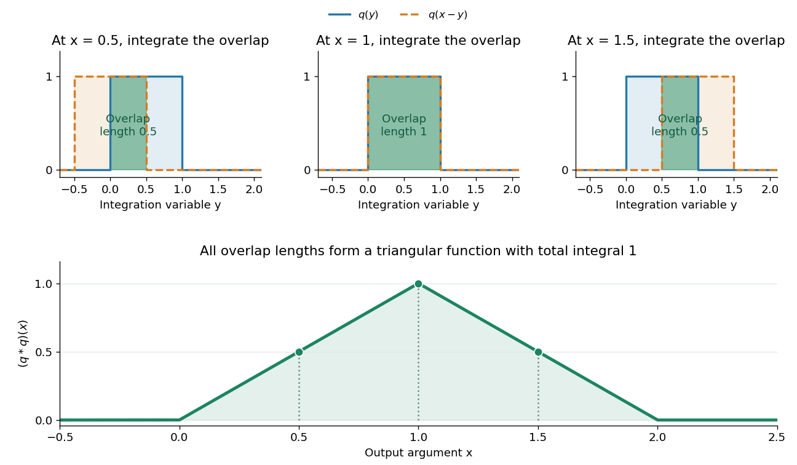

# Convolution

↑ **Parent:** [Fourier analysis](fourier-analysis-split.md)  
ⓦ [Wiki](https://en.wikipedia.org/wiki/Convolution)

Convolution combines two [functions](function-split.md) by adding their products over all ways of splitting an argument. For [Lebesgue integrable functions](lebesgue-integrable-function.md) $f,g$ on the [real line](real-line.md), their convolution is

$$
(f*g)(x)=\int_{\mathbb R}f(y)g(x-y)\,dy.
$$

The arguments $y$ and $x-y$ always add to $x$. For $f,g$ in the [L1 space](l1-space.md), the [integral](integral-split.md) exists [almost everywhere](almost-everywhere.md) and defines another element of the [L1 space](l1-space.md), with $\|f*g\|_1\leq\|f\|_1\|g\|_1$ by [Young's convolution inequality](young-s-convolution-inequality.md). Particular examples below have a value at every $x$.

To see what the [integral](integral-split.md) counts, take the [indicator function](indicator-function.md) $q=\mathbf1_{[0,1]}$. The product $q(y)q(x-y)$ equals one exactly when $y$ belongs to both [intervals](interval-mathematics.md) $[0,1]$ and $[x-1,x]$. Its [integral](integral-split.md) is their overlap [length](length.md), so

$$
(q*q)(x)=\begin{cases}
x,&0\leq x\leq1,\\
2-x,&1<x\leq2,\\
0,&\text{otherwise}.
\end{cases}
$$

At $x=1/2$, the overlap is $[0,1/2]$ and the output is $1/2$; at $x=1$, the two [intervals](interval-mathematics.md) coincide and the output is one. The result is the shifted [triangular function](triangular-function.md) $\operatorname{tri}(x-1)$. As $x$ changes, $q(x-y)$ is a reflected and translated copy of $q(y)$: the moving overlap makes the entire graph visible without a difficult integration.

**[Figure 9](#image-convolving-two-interval-indicators-measures-their-moving-overlap-and-produces-a-triangular-function). Convolving two interval indicators measures their moving overlap and produces a triangular function**.

The same calculation gives the [probability distribution](probability-distribution-split.md) of a sum of two [independent random variables](independent-random-variables.md). If $X,Y$ are [independent random variables](independent-random-variables.md) with the [continuous uniform distribution](continuous-uniform-distribution.md) on $[0,1]$, each has [probability density function](probability-density-function.md) $q$. Their sum has [probability density function](probability-density-function.md) $q*q$ by [convolution of probability densities](convolution-of-independent-random-variables.md). The [probability density function](probability-density-function.md) at one is larger than near zero or two because there are more combinations of the two inputs giving that sum. Its total [integral](integral-split.md) is one; its [expected value](expected-value-split.md) is one and its [variance](variance-split.md) is $1/6$. These follow equally from integrating the [triangular function](triangular-function.md) or from [linearity of expectation](linearity-of-expectation.md) and [variance additivity for independent random variables](variance-additivity-for-independent-random-variables.md).

Convolution also gives a useful averaging operation. For $\varepsilon>0$, let $k_\varepsilon(y)=\mathbf1_{[-\varepsilon,\varepsilon]}(y)/(2\varepsilon)$. Then

$$
(f*k_\varepsilon)(x)=\frac1{2\varepsilon}\int_{x-\varepsilon}^{x+\varepsilon}f(u)\,du,
$$

the mean of $f$ in a neighborhood of $x$. A smaller $\varepsilon$ examines a smaller neighborhood. For a [continuous function](continuous-function.md) $f$, this mean tends to $f(x)$ as $\varepsilon\to0$, an example of an [approximate identity](approximate-identity.md). Integrating a sharp input against a distributed [convolution kernel](convolution-kernel.md) can produce a smoother output; the triangular example turns two discontinuous inputs into a continuous output.

In [signal processing](signal-processing.md), a [linear time-invariant system](linear-time-invariant-system.md) combines shifted copies of its [impulse response](impulse-response.md) by the same rule. In discrete time, an input value at index $m$ contributes a scaled response $a_m h_{n-m}$ at index $n$, and [discrete convolution](discrete-convolution.md) sums these contributions. This is the superposition interpretation developed in [Oppenheim, MIT Signals and Systems, Lecture 4, convolution sums and integrals](https://ocw.mit.edu/courses/res-6-007-signals-and-systems-spring-2011/0400ba59406d52d94c079d99928156ee_MITRES_6_007S11_lec04.pdf). The [convolution theorem](convolution-theorem.md) then gives another description: transform both inputs with a [Fourier transform](fourier-transform-split.md) and multiply their transforms. Combining shifts, combining independent quantities and multiplying frequency descriptions are three faces of the same operation.

**Table of contents**

- [Deconvolution](deconvolution.md)
  - [Regularized spectral deconvolution](regularized-spectral-deconvolution.md)
- [Box smoothing of a two-sided exponential](box-smoothing-of-a-two-sided-exponential.md)
- [Convolution kernel](convolution-kernel.md)
- [Hörmander integral kernel condition](hormander-integral-kernel-condition.md)
  - [Annularly cancelling singular convolution kernel](annularly-cancelling-singular-convolution-kernel.md)
    - [Oscillatory tail estimate for a singular kernel](oscillatory-tail-estimate-for-a-singular-kernel.md)
  - [Calderón–Zygmund weak type criterion for convolution](calderon-zygmund-weak-type-criterion-for-convolution.md)
  - [Cancellation estimate outside a dilated cube](cancellation-estimate-outside-a-dilated-cube.md)
- [Fourier decay of repeated interval convolutions](fourier-decay-of-repeated-interval-convolutions.md)
- [Periodic convolution operator](periodic-convolution-operator.md)
  - [Admissible data for a periodic convolution inverse](admissible-data-for-a-periodic-convolution-inverse.md)
    - [High-frequency obstruction for nonperiodic exponential data](high-frequency-obstruction-for-nonperiodic-exponential-data.md)
- [Convolution of distributions with a compactly supported factor](convolution-of-distributions-with-a-compactly-supported-factor.md)
- [Differentiation commutes with convolution](differentiation-commutes-with-convolution.md)
- [Smoothing convolution with a test function](smoothing-convolution-with-a-test-function.md)
- [Convolution of L infinity and L1 functions](convolution-of-l-infinity-and-l1-functions.md)
  - [Steinhaus theorem](steinhaus-theorem.md)
    - [Difference-set overlap bound on an interval](difference-set-overlap-bound-on-an-interval.md)
- [Approximate identity](approximate-identity.md)
  - [Mass normalization in mollified singular integrals](mass-normalization-in-mollified-singular-integrals.md)
  - [One-sided exponential approximate identity](one-sided-exponential-approximate-identity.md)
  - [Powered-cosine approximate identity on a torus](powered-cosine-approximate-identity-on-a-torus.md)
  - [Sinc approximate identity](sinc-approximate-identity.md)
    - [Sinc-squared summation of a sequence tending to zero](sinc-squared-summation-of-a-sequence-tending-to-zero.md)
  - [Cauchy approximate identity](cauchy-approximate-identity.md)
- [Young's convolution inequality](young-s-convolution-inequality.md)
- [Discrete convolution](discrete-convolution.md)
  - [XOR convolution](xor-convolution.md)
  - [Cyclic convolution](cyclic-convolution.md)
  - [Circular convolution](circular-convolution.md)
  - [Zero padding](zero-padding.md)
- [Convolution theorem](convolution-theorem.md)
  - [Self-convolution of a bilateral exponential](self-convolution-of-a-bilateral-exponential.md)
  - [Exponential kernel convolved with an interval indicator](exponential-kernel-convolved-with-an-interval-indicator.md)
  - [Gamma density from repeated exponential convolution](gamma-density-from-repeated-exponential-convolution.md)

## ↑ Ancestors (5)

1. [Fourier analysis](fourier-analysis-split.md)
2. [Analysis](analysis-split.md)
3. [Area of mathematics](area-of-mathematics.md)
4. [Mathematics](mathematics-split.md)
5. [Codex Wiki](split.md)

## ← Incoming links (191)

- [Annularly cancelling singular convolution kernel](annularly-cancelling-singular-convolution-kernel.md)
- [Back-calculation of infection incidence](back-calculation-of-infection-incidence.md)
- [Box smoothing of a two-sided exponential](box-smoothing-of-a-two-sided-exponential.md)
- [Calderón–Zygmund weak type criterion for convolution](calderon-zygmund-weak-type-criterion-for-convolution.md)
- [Cancellation estimate outside a dilated cube](cancellation-estimate-outside-a-dilated-cube.md)
- [Cauchy convolution semigroup](cauchy-convolution-semigroup.md)
- [Causal extension by zero](causal-extension-by-zero.md)
- [Causal Green function of an overdamped oscillator](causal-green-function-of-an-overdamped-oscillator.md)
- [Causal response of a first-order relaxation equation](causal-response-of-a-first-order-relaxation-equation.md)
- [Character space of an Abelian L1 group algebra](character-space-of-an-abelian-l1-group-algebra.md)
- [Compact continuous-derivative representation of a distribution](compact-continuous-derivative-representation-of-a-distribution.md)
- [Composition of absolutely summable time-series filters](composition-of-absolutely-summable-time-series-filters.md)
- [Confocal excitation and detection point spread function](confocal-excitation-and-detection-point-spread-function.md)
- [Conjugate Poisson kernel on the circle](conjugate-poisson-kernel-on-the-circle.md)
- [Convolution of distributions with a compactly supported factor](convolution-of-distributions-with-a-compactly-supported-factor.md)
- [Convolution of independent random variables](convolution-of-independent-random-variables.md)
- [Convolution proof of uniform Peter-Weyl approximation](convolution-proof-of-uniform-peter-weyl-approximation.md)
- [Convolution theorem for Laplace transforms](convolution-theorem-for-laplace-transforms.md)
- [Critical damping](critical-damping.md)
- [Cyclic Bogolyubov lemma with explicit phase radius](cyclic-bogolyubov-lemma-with-explicit-phase-radius.md)
- [Decaying two-sided Green function of a constant-coefficient ordinary differential equation](decaying-two-sided-green-function-of-a-constant-coefficient-ordinary-differential-equation.md)
- [Differentiation commutes with convolution](differentiation-commutes-with-convolution.md)
- [Dirty image](dirty-image.md)
- [Discrete convolution](discrete-convolution.md)
- [Discrete Green convolution for the period-six recurrence](discrete-green-convolution-for-the-period-six-recurrence.md)
- [Discrete-jump model of Barkhausen noise](discrete-jump-model-of-barkhausen-noise.md)
- [Error-function diffusion front](error-function-diffusion-front.md)
- [Exponential forcing of an underdamped oscillator](exponential-forcing-of-an-underdamped-oscillator.md)
- [Exponential-mixture differential equation for survival probability](exponential-mixture-differential-equation-for-survival-probability.md)
- [Fluorescence instrument response](fluorescence-instrument-response.md)
- [Fluorescent bead experiment for confocal microscopy](fluorescent-bead-experiment-for-confocal-microscopy.md)
- [Fourier analysis](fourier-analysis-split.md)
- [Fourier decay of repeated interval convolutions](fourier-decay-of-repeated-interval-convolutions.md)
- [Fourier inversion theorem](fourier-inversion-theorem.md)
- [Fourier model of a Lyot coronagraph](fourier-model-of-a-lyot-coronagraph.md)
- [Fourier transform on a locally compact abelian group](fourier-transform-on-a-locally-compact-abelian-group.md)
- [Fourth-order Green kernel with two decay scales](fourth-order-green-kernel-with-two-decay-scales.md)
- [Gaussian blur](gaussian-blur.md)
- [Heat-kernel convergence for Gaussian-integrable initial data](heat-kernel-convergence-for-gaussian-integrable-initial-data.md)
- [Heat-kernel convolution](heat-kernel-convolution.md)
- [Heat-kernel solution](heat-kernel-solution.md)
- [Hörmander integral kernel condition](hormander-integral-kernel-condition.md)
- [Impulse response](impulse-response.md)
- [Incoherent imaging](incoherent-imaging.md)
- [Infectious disease renewal equation](infectious-disease-renewal-equation.md)
- [Iodine-cell Doppler calibration](iodine-cell-doppler-calibration.md)
- [Kernel density estimation](kernel-density-estimation.md)
- [Laplace transform](laplace-transform.md)
- [Linear filter](linear-filter.md)
- [Linear time-invariant system](linear-time-invariant-system.md)
- [Lyman-alpha forest](lyman-alpha-forest.md)
- [Maximum of two exponentials as a scaled sum](maximum-of-two-exponentials-as-a-scaled-sum.md)
- [Mollification](mollification.md)
- [Mössbauer velocity scan](mossbauer-velocity-scan.md)
- [Narrow resonance and instrumental resolution](narrow-resonance-and-instrumental-resolution.md)
- [Solution](past-exam-of-the-frontiers-of-observational-astrophysics-course-of-the-university-of-cambridge/2015/paper-1/3/a/solution.md)
- [Solution](past-exam-of-the-mathematics-course-of-the-university-of-cambridge/2001/iii/paper-1/4/solution.md)
- [Solution](past-exam-of-the-mathematics-course-of-the-university-of-cambridge/2002/iii/paper-40/5/solution.md)
- [Solution](past-exam-of-the-mathematics-course-of-the-university-of-cambridge/2002/iii/paper-53/2/solution.md)
- [Solution](past-exam-of-the-mathematics-course-of-the-university-of-cambridge/2002/iii/paper-54/5/solution.md)
- [Solution](past-exam-of-the-mathematics-course-of-the-university-of-cambridge/2002/iii/paper-8/3/solution.md)
- [Solution](past-exam-of-the-mathematics-course-of-the-university-of-cambridge/2003/iii/paper-11/3/solution.md)
- [Solution](past-exam-of-the-mathematics-course-of-the-university-of-cambridge/2003/iii/paper-68/5/solution.md)
- [Solution](past-exam-of-the-mathematics-course-of-the-university-of-cambridge/2004/ib/paper-4/5a/solution.md)
- [Solution](past-exam-of-the-mathematics-course-of-the-university-of-cambridge/2004/iii/paper-20/2/i/solution.md)
- [Solution](past-exam-of-the-mathematics-course-of-the-university-of-cambridge/2004/iii/paper-41/3/solution.md)
- [Solution](past-exam-of-the-mathematics-course-of-the-university-of-cambridge/2004/iii/paper-6/3/iii/solution.md)
- [Solution](past-exam-of-the-mathematics-course-of-the-university-of-cambridge/2004/iii/paper-7/2/solution.md)
- [Solution](past-exam-of-the-mathematics-course-of-the-university-of-cambridge/2004/iii/paper-7/4/i/solution.md)
- [Solution](past-exam-of-the-mathematics-course-of-the-university-of-cambridge/2004/iii/paper-7/4/iii/solution.md)
- [Solution](past-exam-of-the-mathematics-course-of-the-university-of-cambridge/2004/iii/paper-76/1/b/iii/solution.md)
- [Solution](past-exam-of-the-mathematics-course-of-the-university-of-cambridge/2005/ii/paper-2/12j/solution.md)
- [Solution](past-exam-of-the-mathematics-course-of-the-university-of-cambridge/2005/ii/paper-2/30c/solution.md)
- [Solution](past-exam-of-the-mathematics-course-of-the-university-of-cambridge/2005/iii/paper-34/4/b/solution.md)
- [Solution](past-exam-of-the-mathematics-course-of-the-university-of-cambridge/2005/iii/paper-68/1/solution.md)
- [Solution](past-exam-of-the-mathematics-course-of-the-university-of-cambridge/2006/ib/paper-4/15d/a/solution.md)
- [Solution](past-exam-of-the-mathematics-course-of-the-university-of-cambridge/2006/ib/paper-4/15d/b/solution.md)
- [Solution](past-exam-of-the-mathematics-course-of-the-university-of-cambridge/2006/iii/paper-30/1/c/solution.md)
- [Solution](past-exam-of-the-mathematics-course-of-the-university-of-cambridge/2006/iii/paper-42/5/solution.md)
- [Solution](past-exam-of-the-mathematics-course-of-the-university-of-cambridge/2006/iii/paper-7/1/i/solution.md)
- [Solution](past-exam-of-the-mathematics-course-of-the-university-of-cambridge/2007/ia/paper-2/7b/i/solution.md)
- [Solution](past-exam-of-the-mathematics-course-of-the-university-of-cambridge/2007/ii/paper-2/30a/ii/solution.md)
- [Solution](past-exam-of-the-mathematics-course-of-the-university-of-cambridge/2007/iii/paper-30/1/solution.md)
- [Solution](past-exam-of-the-mathematics-course-of-the-university-of-cambridge/2007/iii/paper-45/1/solution.md)
- [Solution](past-exam-of-the-mathematics-course-of-the-university-of-cambridge/2007/iii/paper-45/3/solution.md)
- [Solution](past-exam-of-the-mathematics-course-of-the-university-of-cambridge/2007/iii/paper-49/4/solution.md)
- [Solution](past-exam-of-the-mathematics-course-of-the-university-of-cambridge/2008/iii/paper-13/6/a/solution.md)
- [Solution](past-exam-of-the-mathematics-course-of-the-university-of-cambridge/2008/iii/paper-16/2/iii/solution.md)
- [Solution](past-exam-of-the-mathematics-course-of-the-university-of-cambridge/2008/iii/paper-42/3/solution.md)
- [Solution](past-exam-of-the-mathematics-course-of-the-university-of-cambridge/2009/ia/paper-2/9f/b/solution.md)
- [Solution](past-exam-of-the-mathematics-course-of-the-university-of-cambridge/2009/ib/paper-3/6a/solution.md)
- [Solution](past-exam-of-the-mathematics-course-of-the-university-of-cambridge/2009/ii/paper-3/26j/a/solution.md)
- [Solution](past-exam-of-the-mathematics-course-of-the-university-of-cambridge/2009/iii/paper-7/2/b/solution.md)
- [Solution](past-exam-of-the-mathematics-course-of-the-university-of-cambridge/2009/iii/paper-75/3/solution.md)
- [Solution](past-exam-of-the-mathematics-course-of-the-university-of-cambridge/2010/ii/paper-3/30e/a/solution.md)
- [Solution](past-exam-of-the-mathematics-course-of-the-university-of-cambridge/2010/iii/paper-11/3/solution.md)
- [Solution](past-exam-of-the-mathematics-course-of-the-university-of-cambridge/2010/iii/paper-25/4/solution.md)
- [Solution](past-exam-of-the-mathematics-course-of-the-university-of-cambridge/2010/iii/paper-8/4/ii/solution.md)
- [Solution](past-exam-of-the-mathematics-course-of-the-university-of-cambridge/2012/ia/paper-2/8a/iii/solution.md)
- [Solution](past-exam-of-the-mathematics-course-of-the-university-of-cambridge/2012/iii/paper-40/3/solution.md)
- [Solution](past-exam-of-the-mathematics-course-of-the-university-of-cambridge/2012/iii/paper-68/1/solution.md)
- [Solution](past-exam-of-the-mathematics-course-of-the-university-of-cambridge/2012/iii/paper-7/2/a/solution.md)
- [Solution](past-exam-of-the-mathematics-course-of-the-university-of-cambridge/2012/iii/paper-70/1/solution.md)
- [Solution](past-exam-of-the-mathematics-course-of-the-university-of-cambridge/2012/iii/paper-82/2/solution.md)
- [Solution](past-exam-of-the-mathematics-course-of-the-university-of-cambridge/2013/iii/paper-11/4/solution.md)
- [Solution](past-exam-of-the-mathematics-course-of-the-university-of-cambridge/2013/iii/paper-33/2/solution.md)
- [Solution](past-exam-of-the-mathematics-course-of-the-university-of-cambridge/2013/iii/paper-61/1/1/solution.md)
- [Solution](past-exam-of-the-mathematics-course-of-the-university-of-cambridge/2013/iii/paper-70/3/b/solution.md)
- [Solution](past-exam-of-the-mathematics-course-of-the-university-of-cambridge/2014/ia/paper-2/12f/solution.md)
- [Solution](past-exam-of-the-mathematics-course-of-the-university-of-cambridge/2014/iii/paper-5/2/c/solution.md)
- [Solution](past-exam-of-the-mathematics-course-of-the-university-of-cambridge/2014/iii/paper-64/1/ii/solution.md)
- [Solution](past-exam-of-the-mathematics-course-of-the-university-of-cambridge/2014/iii/paper-67/1/solution.md)
- [Solution](past-exam-of-the-mathematics-course-of-the-university-of-cambridge/2014/iii/paper-69/1/iv/solution.md)
- [Solution](past-exam-of-the-mathematics-course-of-the-university-of-cambridge/2015/iii/paper-35/3/a/solution.md)
- [Solution](past-exam-of-the-mathematics-course-of-the-university-of-cambridge/2015/iii/paper-69/3/solution.md)
- [Solution](past-exam-of-the-mathematics-course-of-the-university-of-cambridge/2015/iii/paper-71/1/solution.md)
- [Solution](past-exam-of-the-mathematics-course-of-the-university-of-cambridge/2015/iii/paper-71/2/a/solution.md)
- [Solution](past-exam-of-the-mathematics-course-of-the-university-of-cambridge/2015/iii/paper-9/6/b/solution.md)
- [Solution](past-exam-of-the-mathematics-course-of-the-university-of-cambridge/2015/iii/paper-9/6/c/solution.md)
- [Solution](past-exam-of-the-mathematics-course-of-the-university-of-cambridge/2016/ib/paper-3/15b/b/solution.md)
- [Solution](past-exam-of-the-mathematics-course-of-the-university-of-cambridge/2017/ii/paper-2/24j/c/solution.md)
- [Solution](past-exam-of-the-mathematics-course-of-the-university-of-cambridge/2017/ii/paper-3/20f/iii/solution.md)
- [Solution](past-exam-of-the-mathematics-course-of-the-university-of-cambridge/2017/iii/paper-210/1/solution.md)
- [Solution](past-exam-of-the-mathematics-course-of-the-university-of-cambridge/2017/iii/paper-327/2/ii/solution.md)
- [Solution](past-exam-of-the-mathematics-course-of-the-university-of-cambridge/2018/ib/paper-1/14c/solution.md)
- [Solution](past-exam-of-the-mathematics-course-of-the-university-of-cambridge/2018/iii/paper-219/2/i/solution.md)
- [Solution](past-exam-of-the-mathematics-course-of-the-university-of-cambridge/2018/iii/paper-312/2/i/solution.md)
- [Solution](past-exam-of-the-mathematics-course-of-the-university-of-cambridge/2018/iii/paper-340/6/solution.md)
- [Solution](past-exam-of-the-mathematics-course-of-the-university-of-cambridge/2020/ib/paper-2/4b/solution.md)
- [Solution](past-exam-of-the-mathematics-course-of-the-university-of-cambridge/2020/ii/paper-1/23i/a/solution.md)
- [Solution](past-exam-of-the-mathematics-course-of-the-university-of-cambridge/2021/ib/paper-4/14c/solution.md)
- [Solution](past-exam-of-the-mathematics-course-of-the-university-of-cambridge/2023/ib/paper-3/14a/a/solution.md)
- [Solution](past-exam-of-the-mathematics-course-of-the-university-of-cambridge/2024/iii/paper-356/1/c/solution.md)
- [Solution](past-exam-of-the-mathematics-course-of-the-university-of-cambridge/2025/iii/paper-207/2/f/solution.md)
- [Solution](past-exam-of-the-mathematics-course-of-the-university-of-cambridge/2025/iii/paper-210/2/solution.md)
- [Solution](past-exam-of-the-mathematics-course-of-the-year-1-of-the-natural-sciences-course-of-the-university-of-cambridge/2012/paper-2/20/a/solution.md)
- [Solution](past-exam-of-the-mathematics-course-of-the-year-2-of-the-natural-sciences-course-of-the-university-of-cambridge/2001/paper-1/2/solution.md)
- [Solution](past-exam-of-the-mathematics-course-of-the-year-2-of-the-natural-sciences-course-of-the-university-of-cambridge/2003/paper-1/3/solution.md)
- [Solution](past-exam-of-the-mathematics-course-of-the-year-2-of-the-natural-sciences-course-of-the-university-of-cambridge/2004/paper-1/3/c/solution.md)
- [Solution](past-exam-of-the-mathematics-course-of-the-year-2-of-the-natural-sciences-course-of-the-university-of-cambridge/2004/paper-2/5/solution.md)
- [Solution](past-exam-of-the-mathematics-course-of-the-year-2-of-the-natural-sciences-course-of-the-university-of-cambridge/2006/paper-1/8/solution.md)
- [Solution](past-exam-of-the-mathematics-course-of-the-year-2-of-the-natural-sciences-course-of-the-university-of-cambridge/2007/paper-1/3/ii/solution.md)
- [Solution](past-exam-of-the-mathematics-course-of-the-year-2-of-the-natural-sciences-course-of-the-university-of-cambridge/2009/paper-2/5/solution.md)
- [Solution](past-exam-of-the-mathematics-course-of-the-year-2-of-the-natural-sciences-course-of-the-university-of-cambridge/2010/paper-2/5/iii/solution.md)
- [Solution](past-exam-of-the-mathematics-course-of-the-year-2-of-the-natural-sciences-course-of-the-university-of-cambridge/2012/paper-2/5/solution.md)
- [Solution](past-exam-of-the-mathematics-course-of-the-year-2-of-the-natural-sciences-course-of-the-university-of-cambridge/2015/paper-1/3/b/i/solution.md)
- [Solution](past-exam-of-the-mathematics-course-of-the-year-2-of-the-natural-sciences-course-of-the-university-of-cambridge/2015/paper-1/4/b/solution.md)
- [Solution](past-exam-of-the-mathematics-course-of-the-year-2-of-the-natural-sciences-course-of-the-university-of-cambridge/2017/paper-1/3/b/solution.md)
- [Solution](past-exam-of-the-mathematics-course-of-the-year-2-of-the-natural-sciences-course-of-the-university-of-cambridge/2017/paper-1/4/b/solution.md)
- [Solution](past-exam-of-the-mathematics-course-of-the-year-2-of-the-natural-sciences-course-of-the-university-of-cambridge/2018/paper-2/5/e/solution.md)
- [Solution](past-exam-of-the-mathematics-course-of-the-year-2-of-the-natural-sciences-course-of-the-university-of-cambridge/2019/paper-1/4/b/solution.md)
- [Solution](past-exam-of-the-mathematics-course-of-the-year-2-of-the-natural-sciences-course-of-the-university-of-cambridge/2019/paper-1/4/e/solution.md)
- [Solution](past-exam-of-the-mathematics-course-of-the-year-2-of-the-natural-sciences-course-of-the-university-of-cambridge/2021/paper-2/5/a/ii/solution.md)
- [Solution](past-exam-of-the-mathematics-course-of-the-year-2-of-the-natural-sciences-course-of-the-university-of-cambridge/2022/paper-1/4/a/solution.md)
- [Solution](past-exam-of-the-mathematics-course-of-the-year-2-of-the-natural-sciences-course-of-the-university-of-cambridge/2022/paper-1/4/b/solution.md)
- [Solution](past-exam-of-the-mathematics-course-of-the-year-2-of-the-natural-sciences-course-of-the-university-of-cambridge/2022/paper-2/5/b/solution.md)
- [Solution](past-exam-of-the-mathematics-course-of-the-year-2-of-the-natural-sciences-course-of-the-university-of-cambridge/2023/paper-1/3/a/solution.md)
- [Solution](past-exam-of-the-mathematics-course-of-the-year-2-of-the-natural-sciences-course-of-the-university-of-cambridge/2024/paper-2/5/a/solution.md)
- [Solution](past-exam-of-the-mathematics-course-of-the-year-2-of-the-natural-sciences-course-of-the-university-of-cambridge/2025/paper-1/4/a/solution.md)
- [Solution](past-exam-of-the-mathematics-course-of-the-year-2-of-the-natural-sciences-course-of-the-university-of-cambridge/2025/paper-1/4/c/solution.md)
- [Solution](past-exam-of-the-mathematics-course-of-the-year-2-of-the-natural-sciences-course-of-the-university-of-cambridge/2025/paper-2/5/a/solution.md)
- [Solution](past-exam-of-the-mphil-in-micro-and-nanotechnology-enterprise-course-of-the-university-of-cambridge/2023/paper-1/section-a-i/2/ii/b/solution.md)
- [Solution](past-exam-of-the-physics-a-course-of-the-university-of-cambridge/2014/paper-2/section-b/b8/solution.md)
- [Solution](past-exam-of-the-physics-a-course-of-the-university-of-cambridge/2018/paper-2/section-d/d13/a/solution.md)
- [Solution](past-exam-of-the-physics-a-course-of-the-university-of-cambridge/2022/paper-2/section-b/b7/b/solution.md)
- [Solution](past-exam-of-the-physics-b-course-of-the-university-of-cambridge/2010/paper-2a/section-d/d17/c/solution.md)
- [Solution](past-exam-of-the-physics-of-the-earth-as-a-planet-course-of-the-university-of-cambridge/2015/paper-1/1/b/ii/solution.md)
- [Solution](past-exam-of-the-theoretical-physics-i-course-of-the-university-of-cambridge/2012/paper-1/6/b/solution.md)
- [Solution](past-exam-of-the-theoretical-physics-i-course-of-the-university-of-cambridge/2016/paper-1/3/b/solution.md)
- [Solution](past-exam-of-the-theoretical-physics-i-course-of-the-university-of-cambridge/2016/paper-1/3/c/solution.md)
- [Solution](past-exam-of-the-theoretical-physics-ii-course-of-the-university-of-cambridge/2015/paper-1/2/b/solution.md)
- [Periodic triangular bump](periodic-triangular-bump.md)
- [Planar vorticity velocity kernel](planar-vorticity-velocity-kernel.md)
- [Point spread function](point-spread-function-split.md)
- [Poisson kernel on the circle](poisson-kernel-on-the-circle.md)
- [Positive diffusivity requirement for the forward heat kernel](positive-diffusivity-requirement-for-the-forward-heat-kernel.md)
- [Power broadening](power-broadening.md)
- [Powered-cosine approximate identity on a torus](powered-cosine-approximate-identity-on-a-torus.md)
- [Rectangular function](rectangular-function.md)
- [Ruin integro-differential equation](ruin-integro-differential-equation.md)
- [Self-convolution of a bilateral exponential](self-convolution-of-a-bilateral-exponential.md)
- [Signal processing](signal-processing.md)
- [Smooth approximation of maps into Euclidean space](smooth-approximation-of-maps-into-euclidean-space.md)
- [Smoothing convolution with a test function](smoothing-convolution-with-a-test-function.md)
- [Source-position-dependent Fourier Green function](source-position-dependent-fourier-green-function.md)
- [Taxi distance convolution on a rectangular road cycle](taxi-distance-convolution-on-a-rectangular-road-cycle.md)
- [Thermal damping of a sinusoidal density of states](thermal-damping-of-a-sinusoidal-density-of-states.md)
- [Time-sliced diffusion path integral](time-sliced-diffusion-path-integral.md)
- [Triangular function](triangular-function.md)
- [Volterra convolution algebra on a finite interval](volterra-convolution-algebra-on-a-finite-interval.md)
- [Weierstrass transform](weierstrass-transform.md)
