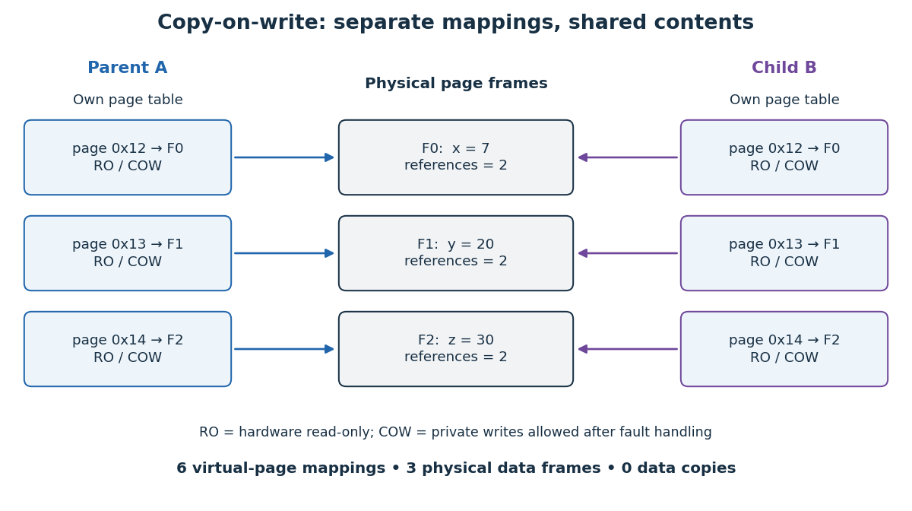
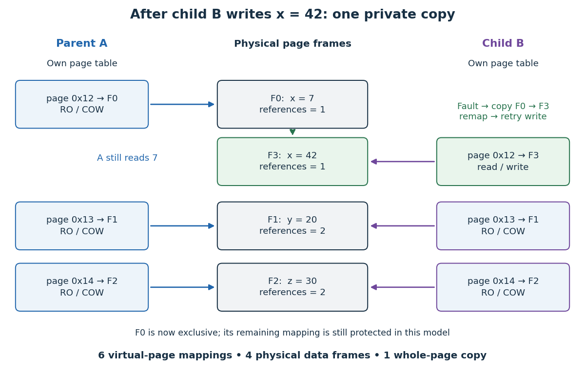

# Copy-on-write

↑ **Parent:** [Virtual memory](virtual-memory.md)  
ⓦ [Wiki](https://en.wikipedia.org/wiki/Copy-on-write)

[Copy-on-write](copy-on-write.md) defers copying until a modification needs private storage. With [paging](paging.md), separate [address spaces](address-space.md) can map their [memory pages](memory-page.md) to the same [page frames](page-frame.md), using [memory protection](memory-protection.md) to prevent writes to the common contents. Reads need no copy. A permitted write to a shared [page frame](page-frame.md) first separates the writer's storage, so the other [operating-system process](process-computing.md) keeps the old contents. Sharing is safe because the common contents remain unchanged while shared; the logical private copies can still evolve independently.[pp. 7–8: protected sharing, copying on a write, and fork/exec motivation](operating-systems-three-easy-pieces-by-remzi-h-arpaci-dusseau-and-others/complete-virtual-memory-systems.md)

Consider a [fork](fork-system-call.md)-like model with parent A and child B. Each has a separate [page table](page-table.md), with three inherited private, logically writable [memory pages](memory-page.md). Both initially map virtual page numbers `0x12`, `0x13`, `0x14` to [page frames](page-frame.md) F0, F1, F2. The [page table entries](page-table-entry.md) temporarily deny writes for [copy-on-write](copy-on-write.md); a read of `x` at offset `0x34` in virtual page `0x12` returns 7 in either [address space](address-space.md). Separate [page tables](page-table.md) do not imply separate stored [bytes](byte.md).

**[Figure 31](#image-before-a-write-two-page-tables-map-six-memory-pages-to-three-shared-page-frames). Before a write: two page tables map six memory pages to three shared page frames**.

Now B writes `x = 42`. In this model, [copy-on-write fault handling](copy-on-write-fault-handling.md) allocates F3, copies all of F0's contents into F3, redirects only B's [page table entry](page-table-entry.md), enables its write, and retries the store. A still reads 7 through F0; B reads 42 through F3 at the same [virtual address](virtual-address.md). F1 and F2 remain shared. The [reference counting](reference-counting.md) labels count mappings in this example: F0 drops from two to one, while F3 starts at one. Updating one [byte](byte.md) can therefore copy a whole [memory page](memory-page.md).

**[Figure 32](#image-after-b-writes-one-new-page-frame-one-whole-page-copy-and-independent-contents-at-the-same-virtual-address). After B writes: one new page frame, one whole-page copy, and independent contents at the same virtual address**.

The attraction is avoiding work that may never be needed. If B only reads, this model makes no data copies; if B replaces its program and discards these mappings, copying them beforehand would have been wasted. [Copy-on-write](copy-on-write.md) trades eager copying for protected sharing and later [page faults](page-fault.md). The [page tables](page-table.md), [reference counting](reference-counting.md), and [operating-system process](process-computing.md) records still cost time and [computer memory](computer-memory.md).[pp. 7–8: a subsequent exec can discard most of the inherited address space](operating-systems-three-easy-pieces-by-remzi-h-arpaci-dusseau-and-others/complete-virtual-memory-systems.md)

For a concrete [operating system](operating-system.md) contract, the `fork(2)` manual for the [Linux kernel](linux-kernel.md) documents [copy-on-write](copy-on-write.md), while its `mmap(2)` manual distinguishes `MAP_PRIVATE` from `MAP_SHARED`. Writes through `MAP_PRIVATE` are not propagated to other mappings or the underlying [file](computer-file.md); writes through `MAP_SHARED` are visible to other [operating-system processes](process-computing.md) mapping that region. An inherited shared mapping therefore retains shared-write behavior. For a private [memory-mapped file](memory-mapped-file.md), visibility of later changes to the underlying [file](computer-file.md) is unspecified: private writes alone do not guarantee a frozen snapshot of the [file](computer-file.md). [fork(2) — Linux manual page](fork-2-linux-manual-page.md)[mmap(2) — Linux manual page](mmap-2-linux-manual-page.md)

Nor does [fork](fork-system-call.md) make every resource independent. With the [Linux kernel](linux-kernel.md), inherited [file descriptors](file-descriptor.md) refer to the same [open file descriptions](open-file-description.md), including shared file positions. Special mapping policies can omit a region from inheritance or zero it in the child. Thus the diagrams describe ordinary inherited private [memory pages](memory-page.md), not every resource reachable by a parent. [fork(2) — Linux manual page](fork-2-linux-manual-page.md)

**Table of contents**

- [Copy-on-write fault handling](copy-on-write-fault-handling.md)
- [Copy-on-write page accounting](copy-on-write-page-accounting.md)

## ↑ Ancestors (4)

1. [Virtual memory](virtual-memory.md)
2. [Operating system](operating-system.md)
3. [Computer science](computer-science-split.md)
4. [Codex Wiki](split.md)

## ← Incoming links (10)

- [Copy-on-write](copy-on-write.md)
- [Copy-on-write fault handling](copy-on-write-fault-handling.md)
- [Fork (system call)](fork-system-call.md)
- [Memory protection](memory-protection.md)
- [Page fault](page-fault.md)
- [Page-replacement cost accounting](page-replacement-cost-accounting.md)
- [Private file mapping](private-file-mapping.md)
- [Process (computing)](process-computing.md)
- [Reference counting](reference-counting.md)
- [Thrashing (computer science)](thrashing-computer-science.md)
