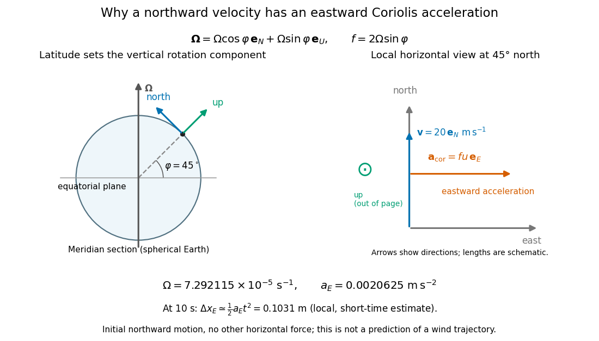

# Coriolis acceleration in local Earth coordinates

↑ **Parent:** [Coriolis acceleration](coriolis-acceleration.md)

Use local east, north, and up [unit vectors](unit-vector.md) $(\mathbf e_E,\mathbf e_N,\mathbf e_U)$, with $\mathbf e_E\times\mathbf e_N=\mathbf e_U$. In a spherical-[Earth](earth.md) approximation at [geographical latitude](geographical-latitude.md) $\varphi$, the [angular velocity](angular-velocity.md) has components $\boldsymbol\Omega=(0,\Omega\cos\varphi,\Omega\sin\varphi)$. Expanding the [cross product](cross-product.md) for relative [velocity](velocity.md) $(v_E,v_N,v_U)$ gives

$$
\begin{aligned}
a_E&=2\Omega\sin\varphi\,v_N-2\Omega\cos\varphi\,v_U,\\
a_N&=-2\Omega\sin\varphi\,v_E,\\
a_U&=2\Omega\cos\varphi\,v_E.
\end{aligned}
$$

These are [Coriolis acceleration](coriolis-acceleration.md) components, not the total [acceleration](acceleration.md). For horizontal motion, the horizontal part is $(fv_N,-fv_E)$, where the [Coriolis parameter](coriolis-parameter.md) is $f=2\Omega\sin\varphi$. Thus northward motion in the northern hemisphere has an eastward [Coriolis acceleration](coriolis-acceleration.md), to the right of its [velocity](velocity.md); in the southern hemisphere the horizontal turning is to the left. At the equator $f=0$, but the full [Coriolis acceleration](coriolis-acceleration.md) need not vanish: vertical or eastward motion still couples through $\Omega\cos\varphi$.

For a numerical example, take the [Earth](earth.md) rotation rate $\Omega=7.292115\times10^{-5}\ \mathrm{s^{-1}}$, [geographical latitude](geographical-latitude.md) $\varphi=45^\circ$, and an initially northward relative [velocity](velocity.md) $\mathbf v_{\rm rot}=20\mathbf e_N\ \mathrm{m\,s^{-1}}$. Then

$$
f\simeq1.03126\times10^{-4}\ \mathrm{s^{-1}},
\qquad
a_E=fu\simeq0.0020625\ \mathrm{m\,s^{-2}}.
$$

**[Figure 10](#image-latitude-local-rotation-geometry-and-the-scale-of-eastward-coriolis-acceleration-for-northward-motion). Latitude, local rotation geometry, and the scale of eastward Coriolis acceleration for northward motion**.

For a local, short-time estimate with no other horizontal [force](force-split.md) and zero initial eastward [velocity](velocity.md), hold the initial northward [velocity](velocity.md) in the leading term: $\Delta x_E\simeq\tfrac12fu t^2$. At $t=10\ \mathrm s$ this gives about $0.1031\ \mathrm m$ eastward. It assumes nearly fixed local axes and [geographical latitude](geographical-latitude.md), negligible changes of height, and $|ft|\ll1$. It is not a complete wind [trajectory](trajectory.md): [pressure gradients](pressure-gradient.md), [friction](friction.md), and evolving [velocity](velocity.md) must enter an atmospheric [equation of motion](equation-of-motion.md). The [effective gravity in a rotating frame](effective-gravity-in-a-rotating-frame.md) already combines ordinary [gravity](gravity.md) with the steady terrestrial [centrifugal acceleration](centrifugal-acceleration.md).

**Table of contents**

- [Coriolis deflection of vertical launch and drop](coriolis-deflection-of-vertical-launch-and-drop.md)

## ↑ Ancestors (7)

1. [Coriolis acceleration](coriolis-acceleration.md)
2. [Coriolis force](coriolis-force.md)
3. [Rotating reference frame](rotating-reference-frame.md)
4. [Reference frame](reference-frame.md)
5. [Mathematical physics](mathematical-physics-split.md)
6. [Physics](physics-split.md)
7. [Codex Wiki](split.md)

## ← Incoming links (4)

- [Coriolis force](coriolis-force.md)
- [Equatorial Coriolis deflection in free fall](equatorial-coriolis-deflection-in-free-fall.md)
- [Latitude law of Foucault precession](latitude-law-of-foucault-precession.md)
- [Solution](past-exam-of-the-physics-b-course-of-the-university-of-cambridge/2017/paper-1/section-c/c10/solution.md)
