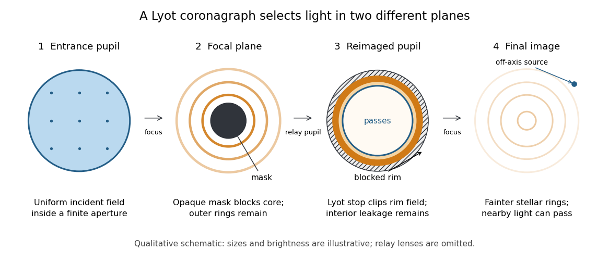

# Coronagraph

↑ **Parent:** [Optics](optics-split.md)  
ⓦ [Wiki](https://en.wikipedia.org/wiki/Coronagraph)

A [coronagraph](coronagraph.md) is an [optical instrument](optical-instrument.md) that suppresses a bright source's [light](light.md) before detection while transmitting some [light](light.md) from nearby directions. Its purpose is to reveal faint structure buried in the bright source's [point spread function](point-spread-function.md), as in [exoplanet direct imaging](exoplanet-direct-imaging.md). A [Lyot coronagraph](lyot-coronagraph.md) combines a [coronagraphic focal plane mask](coronagraphic-focal-plane-mask.md) with a [Lyot stop](lyot-stop.md) in a reimaged [optical pupil](optical-pupil.md); blocking the central image alone does not remove its [diffraction](diffraction.md) rings. [Olivier Guyon, Coronagraph concepts & systems, 2014, PDF pages 3 and 6](https://subarutelescope.org/staff/guyon/15teaching.web/03AstrOptics2014.web/wdir.web/AstrOpt2014_20highcontrast.pdf).

**[Figure 15](#image-the-four-principal-planes-of-a-lyot-coronagraph-a-focal-plane-mask-and-a-reimaged-optical-pupil-stop-select-different-parts-of-the-wave-amplitude-distribution-qualitative-schematic-with-illustrative-sizes-and-brightness). The four principal planes of a Lyot coronagraph: a focal plane mask and a reimaged optical pupil stop select different parts of the wave amplitude distribution. Qualitative schematic, with illustrative sizes and brightness.**

The original motivation was the [solar corona](solar-corona.md): hiding the bright [photosphere](photosphere.md) would allow longer, repeated observations of faint surrounding [light](light.md). In his 1930 paper, Lyot explained that short total eclipses restricted observing time and prevented some long exposures for [spectral lines](spectral-line.md). The attraction is an instrument that makes the faint neighborhood accessible on demand. [Bernard Lyot, La couronne solaire étudiée en dehors des éclipses, 1930, p. 305](https://www.persee.fr/doc/bastr_0245-9760_1930_num_6_1_14031). The [Sun](sun.md) is an extended source; the point-source calculation below illustrates imaging of an unresolved [star](star.md) and is not a quantitative model of the [solar corona](solar-corona.md).

**Table of contents**

- [Lyot coronagraph](lyot-coronagraph.md)
  - [Coronagraphic focal plane mask](coronagraphic-focal-plane-mask.md)
  - [Lyot stop](lyot-stop.md)
  - [Fourier model of a Lyot coronagraph](fourier-model-of-a-lyot-coronagraph.md)
  - [Coronagraph pupil-stop observing experiment](coronagraph-pupil-stop-observing-experiment.md)
- [Coronagraph throughput](coronagraph-throughput.md)
- [Coronagraph inner working angle](coronagraph-inner-working-angle.md)

## ↑ Ancestors (4)

1. [Optics](optics-split.md)
2. [Branches of physics](branches-of-physics.md)
3. [Physics](physics-split.md)
4. [Codex Wiki](split.md)

## ← Incoming links (5)

- [Coronagraph](coronagraph.md)
- [Coronagraph inner working angle](coronagraph-inner-working-angle.md)
- [Fourier model of a Lyot coronagraph](fourier-model-of-a-lyot-coronagraph.md)
- [Solution](past-exam-of-the-mathematics-course-of-the-university-of-cambridge/2015/iii/paper-59/4/i/solution.md)
- [Solution](past-exam-of-the-mathematics-course-of-the-university-of-cambridge/2017/iii/paper-315/3/a/ii/solution.md)
