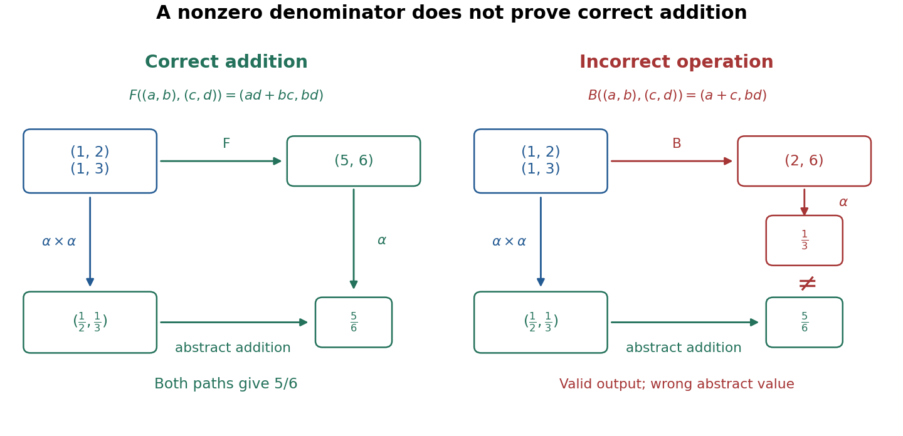

# Correct operations through an abstraction function

↑ **Parent:** [Abstraction function](abstraction-function.md)

For a deterministic [binary operation](binary-operation.md) on an [abstract data type](abstract-data-type.md), let $f$ be its specified operation on abstract values and $F$ the implementation on concrete states. For every permitted valid [input](input-computer-science.md) pair $(r,s)$, require both

$$
I(F(r,s))\qquad\text{and}\qquad \alpha(F(r,s))=f(\alpha(r),\alpha(s)).
$$

The first condition preserves the [representation invariant](representation-invariant.md). The second makes a [commutative diagram](commutative-diagram.md): either execute $F$ and then apply the [abstraction function](abstraction-function.md), or apply the [abstraction function](abstraction-function.md) to both [inputs](input-computer-science.md) and then execute the abstract operation $f$; both paths reach the same value. These conditions state [functional correctness](functional-correctness.md) of a completed operation; termination is an additional obligation for [algorithm correctness](algorithm-correctness.md).[Sections 8.3.3, Commutative Diagrams, and 8.3.4, Representation Invariants: matching abstract results and preservation of valid representations](ocaml-programming-correct-plus-efficient-plus-beautiful-by-michael-r-clarkson-and-others/8-3-module-documentation.md)

For [addition](addition.md) in the [unreduced rational representation](unreduced-rational-representation.md), choose

$$
f(x,y)=x+y,\qquad F((a,b),(c,d))=(ad+bc,bd).
$$

For example, $F((1,2),(1,3))=(5,6)$ represents $5/6$, precisely the [sum](sum.md) of $1/2$ and $1/3$. The short correctness argument uses nonzero [denominators](denominator.md): $b\ne0$ and $d\ne0$ imply $bd\ne0$, preserving the [representation invariant](representation-invariant.md), and

$$
\alpha(F((a,b),(c,d)))=\frac{ad+bc}{bd}=\frac ab+\frac cd=f(\alpha(a,b),\alpha(c,d)).
$$

**[Figure 14](#image-correct-rational-addition-makes-both-paths-agree-an-invariant-preserving-incorrect-operation-gives-a-different-value). Correct rational addition makes both paths agree; an invariant-preserving incorrect operation gives a different value**.

Now consider an incorrect implementation that uses [addition](addition.md) on the [numerators](numerator.md) and [multiplication](multiplication.md) on the [denominators](denominator.md):

$$
B((a,b),(c,d))=(a+c,bd).
$$

It preserves the [representation invariant](representation-invariant.md) for every valid [input](input-computer-science.md) pair because its [denominator](denominator.md) is still $bd\ne0$. Yet $B((1,2),(1,3))=(2,6)$ represents $1/3$, not the specified [sum](sum.md) $5/6$. Even perfect checks of the [representation invariant](representation-invariant.md) before and after this call would miss the error: the result is a legal representation of the wrong [rational number](rational-number.md).

The incorrect operation also exposes an accidental dependence on representation. Replace $(1,2)$ by the equivalent state $(2,4)$ while keeping $(1,3)$. The correct operation gives $(10,12)$, still representing $5/6$; the incorrect operation gives $(3,12)$, representing $1/4$ instead of its previous $1/3$. A correct [addition](addition.md) must yield the same abstract result for equivalent [inputs](input-computer-science.md), although its concrete [outputs](output-computing.md) may differ. This is why checks against the [formal specification](formal-specification.md) should compare abstract values, including unreduced representations and representations with a negative [denominator](denominator.md), rather than demand identical stored pairs.

The calculation assumes exact [integers](integer-split.md). An implementation with bounded storage must additionally specify how it handles products and [sums](sum.md) outside its supported range; the mathematical argument alone does not establish its [functional correctness](functional-correctness.md). The [bounded queue with encapsulation](bounded-queue-with-encapsulation.md) illustrates the corresponding need to account for returned status values and failed operations, alongside the abstract state transition.

## ↑ Ancestors (5)

1. [Abstraction function](abstraction-function.md)
2. [Abstract data type](abstract-data-type.md)
3. [Encapsulation (computer programming)](encapsulation-computer-programming.md)
4. [Computer science](computer-science-split.md)
5. [Codex Wiki](split.md)

## ← Incoming links (1)

- [Abstraction function](abstraction-function.md)
