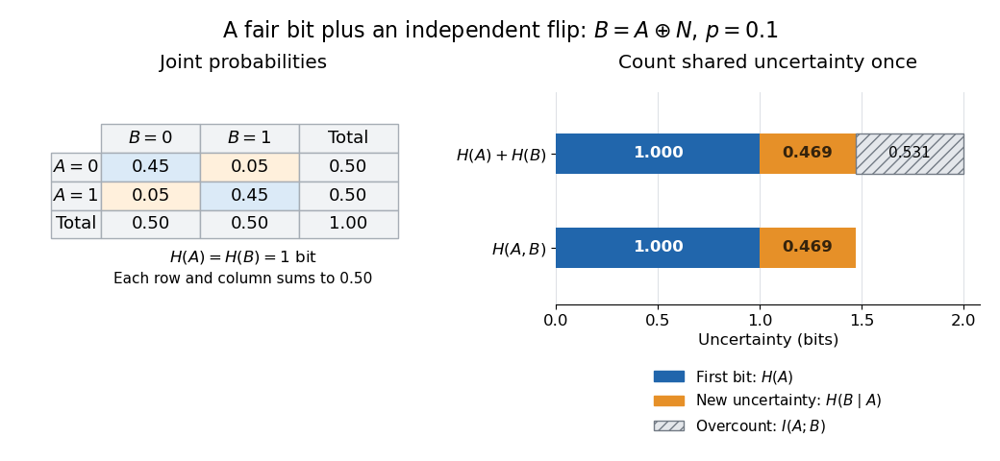
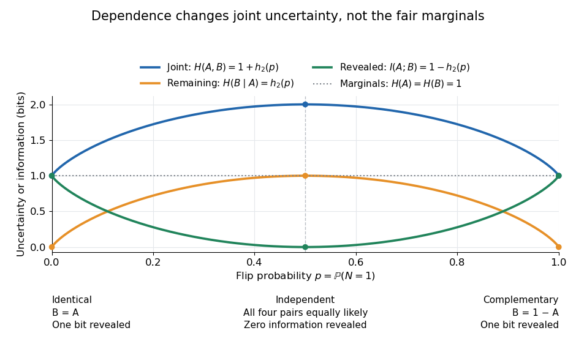

# Correlated binary variables

↑ **Parent:** [Chain rule for information entropy](chain-rule-for-information-entropy.md)

Let $A$ be a fair [bit](bit.md), let $N$ be an [independent](independent-random-variables.md) [Bernoulli random variable](bernoulli-distribution.md) with $\mathbb P(N=1)=p$, and set $B=A\oplus N$, where $\oplus$ is [exclusive or](exclusive-or.md). Thus $N=1$ flips the first [bit](bit.md). This constructs a [binary symmetric channel](binary-symmetric-channel.md) with a fair input, for $0\leq p\leq1$. The [joint probability mass function](joint-probability-mass-function.md) is

$$
\begin{array}{c|cc|c}
& B=0&B=1&\mathbb P(A=a)\\\hline
A=0&(1-p)/2&p/2&1/2\\
A=1&p/2&(1-p)/2&1/2\\\hline
\mathbb P(B=b)&1/2&1/2&1
\end{array}
$$

The column sums show that $B$ is also a fair [bit](bit.md), whatever $p$ is. Both [marginal distributions](marginal-distribution.md) therefore have [information entropy](information-entropy-split.md) one [bit](bit.md). Given $A$, only the flip decision remains unknown, giving [conditional entropy](conditional-entropy.md) $H(B\mid A)=h_2(p)$, where

$$
h_2(p)=-p\log_2p-(1-p)\log_2(1-p)
$$

is the [binary entropy](binary-entropy.md), with $h_2(0)=h_2(1)=0$. The [chain rule for information entropy](chain-rule-for-information-entropy.md) and the definition of [mutual information](mutual-information.md) now give

$$
\boxed{H(A,B)=1+h_2(p),\qquad I(A;B)=1-h_2(p).}
$$

Take $p=1/10$. The four joint [probabilities](probability.md), in row order, are $(0.45,0.05,0.05,0.45)$. Directly from the definition of [joint entropy](joint-entropy.md),

$$
H(A,B)=-2(0.45)\log_2(0.45)-2(0.05)\log_2(0.05)
\approx1.468995594\ \text{bits}.
$$

Conditioning on either value of $A$ gives [probabilities](probability.md) $0.9$ and $0.1$ for the two values of $B$, hence

$$
H(B\mid A)=h_2(0.1)\approx0.468995594\ \text{bits},\qquad
I(A;B)\approx0.531004406\ \text{bits}.
$$

Adding $H(A)+H(B)=2$ would overcount by exactly $I(A;B)$. These are average uncertainties under the stipulated [probability distribution](probability-distribution-split.md); the four possible pairs are still represented by four distinct outcomes.

**[Figure 7](#image-a-correlated-binary-pair-contains-one-bit-plus-the-remaining-flip-uncertainty). A correlated binary pair contains one bit plus the remaining flip uncertainty**. Original exact-model [joint probability mass function](joint-probability-mass-function.md) for $p=0.1$. The bars compare the sum of marginal [information entropies](information-entropy-split.md) with the [joint entropy](joint-entropy.md) from the [chain rule for information entropy](chain-rule-for-information-entropy.md). The hatched portion is the [mutual information](mutual-information.md) counted twice by the marginal sum. Values are calculated, not empirical frequencies.

There is another way to see the decomposition: $(A,B)\mapsto(A,A\oplus B)=(A,N)$ is a [bijection](bijection.md). It merely relabels the four outcomes, so it preserves [joint entropy](joint-entropy.md). The [independence](independent-random-variables.md) of $A$ and $N$ then gives $H(A,B)=H(A,N)=H(A)+H(N)=1+h_2(p)$. Describing the initial [bit](bit.md) and the flip decision separates shared uncertainty from new uncertainty.

At $p=0$, the [bits](bit.md) are identical: $B=A$, so $H(B\mid A)=0$ and $I(A;B)=1$. At $p=1$, they are complementary: $B=1-A$, with exactly the same [conditional entropy](conditional-entropy.md) and [mutual information](mutual-information.md). In either case, observing one determines the other. At $p=1/2$, all four joint [probabilities](probability.md) are $1/4$; the [bits](bit.md) are [independent](independent-random-variables.md), $H(A,B)=2$, and $I(A;B)=0$. Perfect disagreement is therefore just as informative as perfect agreement.

**[Figure 8](#image-identical-and-complementary-bits-both-reveal-one-full-bit-of-information). Identical and complementary bits both reveal one full bit of information**. Original calculated curves for the constructed pair $B=A\oplus N$: [joint entropy](joint-entropy.md) $1+h_2(p)$, [conditional entropy](conditional-entropy.md) $h_2(p)$, and [mutual information](mutual-information.md) $1-h_2(p)$, all in [bits](bit.md). The horizontal line marks the one-bit [information entropy](information-entropy-split.md) of either [marginal distribution](marginal-distribution.md). Reflection about $p=1/2$ exchanges likely agreement with likely disagreement while preserving these quantities.

For $p>1/2$, guessing $A=1-B$ succeeds with [probability](probability.md) $p$, better than guessing $A=B$. Changing $B$ to $1-B$ replaces $p$ by $1-p$ and preserves [mutual information](mutual-information.md), since the relabeling is invertible. What matters is how well the observation distinguishes the input, rather than how often its symbol matches the input. The same symmetry makes the [binary entropy](binary-entropy.md) curve peak at [independence](independent-random-variables.md), while the [mutual information](mutual-information.md) curve reaches its minimum there.

## ↑ Ancestors (7)

1. [Chain rule for information entropy](chain-rule-for-information-entropy.md)
2. [Information entropy](information-entropy-split.md)
3. [Information theory](information-theory-split.md)
4. [Probability and statistics](probability-and-statistics-split.md)
5. [Area of mathematics](area-of-mathematics.md)
6. [Mathematics](mathematics-split.md)
7. [Codex Wiki](split.md)
