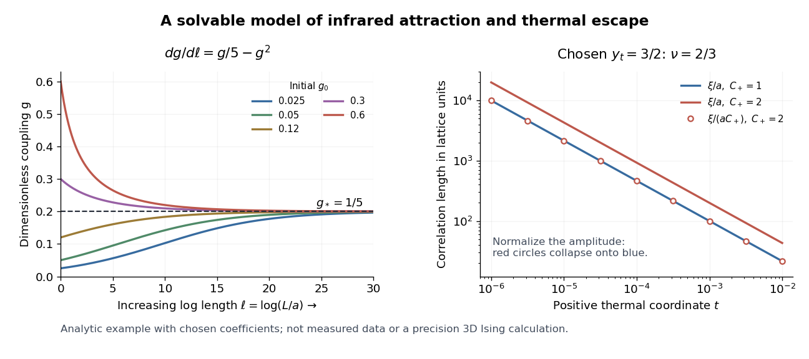

# Correlation-length scaling from a thermal direction

↑ **Parent:** [Renormalization group](renormalization-group.md)

Add a thermal scaling coordinate $t$, with its critical value subtracted, satisfying

$$
\frac{dt}{d\ell}=y_t t,\qquad t(\ell)=b^{y_t}t_0,\qquad y_t>0.
$$

This is a [relevant direction of a fixed point](relevant-direction-of-a-fixed-point.md). A thermal scaling coordinate agrees to leading order with a nonzero multiple of [reduced temperature](reduced-temperature.md); in a general model it can mix several bare parameters. An ordering [conjugate field](field-conjugate-to-an-order-parameter.md) is held at its critical value. The combined [stability matrix](stability-matrix.md) at $(g,t)=(\epsilon,0)$ has [eigenvalues](eigenvalue.md) $-\epsilon$ and $y_t$. Attraction along $g$ therefore does not make the critical point attractive against thermal detuning. The [critical surface](critical-surface.md) in this example is $t=0$.

Let $X=\xi/a$ denote the [correlation length](correlation-length.md) in microscopic lattice units. A [renormalization-group transformation](renormalization-group-transformation.md) of length factor $b$ gives

$$
X(t_0,g_0)=b\,X(b^{y_t}t_0,g(\log b)).
$$

Indeed, a tail with exponential envelope $\exp(-r/\xi)$ becomes $\exp[-r'/(\xi/b)]$ under $r'=r/b$. Choose the stopping scale $b_*=|t_0|^{-1/y_t}$ so that the transformed thermal coordinate is $+1$ or $-1$. If the stopped [correlation length](correlation-length.md) tends to a finite nonzero value $C_\pm$ as the irrelevant coupling approaches $g_*$, then

$$
\frac{\xi}{a}\sim C_\pm |t_0|^{-1/y_t},\qquad \nu=\frac1{y_t}.
$$

The limit requires $|t_0|\ll1$ and enough room between $a$, $\xi$, and the sample size. Singular dependence on a [dangerously irrelevant coupling](dangerously-irrelevant-coupling.md) or a [marginal operator](marginal-operator.md) needs separate analysis. On an ordered branch, use the [connected correlation function](connected-correlation-function.md) in a [pure thermodynamic phase](pure-thermodynamic-phase.md).

For a completely specified illustrative scaling model choose $y_t=3/2$ and $X=C_+t^{-2/3}$ for $t>0$. Then $t=10^{-3}$ gives $X=100C_+$, whereas $t=10^{-6}$ gives $X=10^4C_+$. With $b=4$, $t'=8t$ and $X(t')=X(t)/4$. Models with $C_+=1$ and $C_+=2$ have different lengths but identical curves after plotting $X/C_+$ against $t$. This collapse checks the chosen scaling law; agreement of real data would test that law, rather than follow from this example. Neither $\epsilon=1/5$ nor $y_t=3/2$ is being fitted to a three-dimensional [Ising model](ising-model.md).

**[Figure 4](#image-a-chosen-renormalization-group-flow-loses-coupling-detail-while-a-correlation-length-grows). A chosen renormalization-group flow loses coupling detail while a correlation length grows**. Left: exact positive trajectories of $dg/d\ell=g/5-g^2$ approach $g_*=1/5$ for increasing log length. Right: the chosen $y_t=3/2$ gives $\xi/a=C_+t^{-2/3}$; different amplitudes collapse after division by $C_+$. These are analytic model curves, not experimental data or precision three-dimensional [Ising model](ising-model.md) predictions.

## ↑ Ancestors (6)

1. [Renormalization group](renormalization-group.md)
2. [Critical phenomenon](critical-phenomenon-split.md)
3. [Statistical physics](statistical-physics-split.md)
4. [Branches of physics](branches-of-physics.md)
5. [Physics](physics-split.md)
6. [Codex Wiki](split.md)
