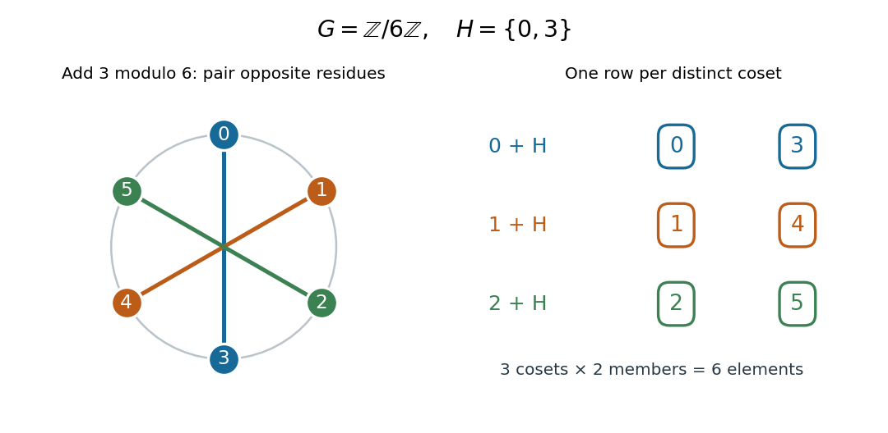
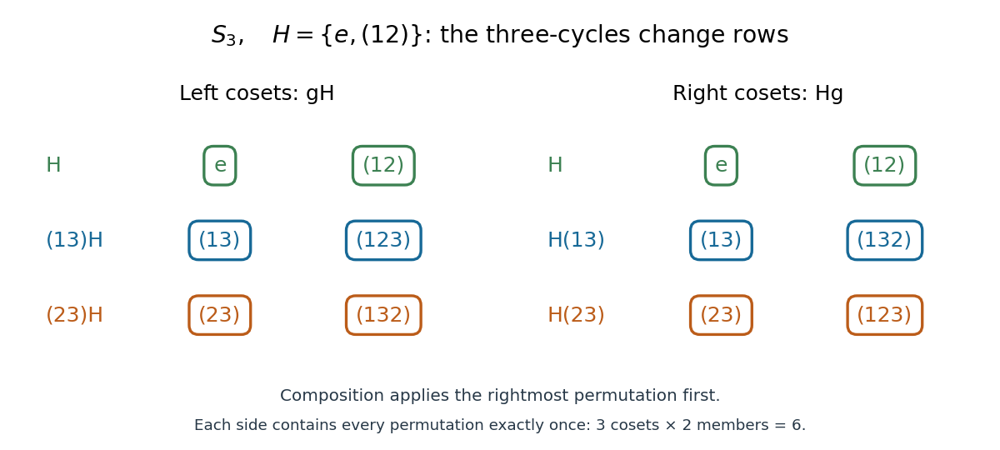

# Coset

↑ **Parent:** [Group theory](group-theory-split.md)  
ⓦ [Wiki](https://en.wikipedia.org/wiki/Coset)

For a [subgroup](subgroup.md) $H\leq G$ of a [group](group-split.md) $G$, a left [coset](coset.md) is $gH=\{gh:h\in H\}$; a right [coset](coset.md) is $Hg=\{hg:h\in H\}$. The name refers to the side on which the representative $g$ multiplies $H$. Think of a [coset](coset.md) as a translated copy of a [subgroup](subgroup.md): it remembers the relative differences allowed by $H$, while moving the whole collection to another location in the [group](group-split.md).

Two left [cosets](coset.md) of the same [subgroup](subgroup.md) are either equal or disjoint. Thus distinct left [cosets](coset.md) form a [partition of a set](partition-of-a-set.md) covering $G$; the same statement holds separately for right [cosets](coset.md). The useful membership test is

$$
aH=bH\quad\Longleftrightarrow\quad b^{-1}a\in H.
$$

This also defines an [equivalence relation](equivalence-relation.md): changing a representative by right multiplication with a member of $H$ leaves its left [coset](coset.md) unchanged. These facts hold even for infinite [groups](group-split.md). See [MIT's coset notes, definitions 3.6 and 3.9](https://ocw.mit.edu/courses/18-703-modern-algebra-spring-2013/df580757da0149c376f1fda29bf82a91_MIT18_703S13_pra_l_3.pdf).

For an explicit additive example, take the [cyclic group](cyclic-group.md) $G=\mathbb Z/6\mathbb Z$, with [modular arithmetic](modular-arithmetic.md), and the [subgroup](subgroup.md) $H=\{0,3\}$. Adding each representative to both members gives exactly

$$
0+H=\{0,3\},\qquad 1+H=\{1,4\},\qquad 2+H=\{2,5\}.
$$

Representatives $3,4,5$ repeat these three [cosets](coset.md), respectively. For example, $4+H=\{4,1\}=1+H$, since $4-1=3\in H$. Every residue appears once in the displayed [partition of a set](partition-of-a-set.md). Each [coset](coset.md) has two members, so the [group order](order-of-a-finite-group.md) of $H$ is $2$ and its [index of a subgroup](index-of-a-subgroup.md) is $3$. Left and right [cosets](coset.md) coincide here because $G$ is an [abelian group](abelian-group.md).

**[Figure 13](#image-three-cosets-of-the-order-two-subgroup-of-the-additive-cyclic-group-of-order-six). Three cosets of the order-two subgroup of the additive cyclic group of order six**.

A [coset](coset.md) need not be a [subgroup](subgroup.md). In this example, $\{1,4\}$ lacks the [identity element](identity-element.md) $0$, and $1+1=2$ leaves it. In fact, the only left or right [coset](coset.md) of $H$ that is a [subgroup](subgroup.md) is $H$ itself: a [subgroup](subgroup.md) must contain the [identity element](identity-element.md), and the [coset](coset.md) containing that element is $H$. Equal sizes come instead from the [bijection](bijection.md) $h\mapsto gh$, whose inverse is $x\mapsto g^{-1}x$; for right [cosets](coset.md), use $h\mapsto hg$ and $x\mapsto xg^{-1}$.

The [nonabelian group](non-abelian-group.md) $S_3$, the [symmetric group](symmetric-group.md) on three letters, separates the two sides. Use [function composition](function-composition.md) with the rightmost [permutation](permutation.md) applied first, and let $H=\{e,(12)\}$. Then $(13)(12)=(123)$ but $(12)(13)=(132)$, giving the differing pair

$$
(13)H=\{(13),(123)\},\qquad H(13)=\{(13),(132)\}.
$$

The complete [partition of a set](partition-of-a-set.md) into left [cosets](coset.md) consists of $H$, $\{(13),(123)\}$ and $\{(23),(132)\}$; the complete [partition of a set](partition-of-a-set.md) into right [cosets](coset.md) consists of $H$, $\{(13),(132)\}$ and $\{(23),(123)\}$. Each lists all six [permutations](permutation.md) exactly once. Both have three parts of size two, although their parts differ.

**[Figure 14](#image-left-and-right-coset-partitions-in-s3-with-rightmost-first-permutation-composition). Left and right coset partitions in S3 with rightmost-first permutation composition**.

Left [cosets](coset.md) support a [group action](group-action.md) by $a\cdot(gH)=(ag)H$ for every [subgroup](subgroup.md), as in the [coset action](coset-action.md). Multiplication of representatives defines a [quotient group](quotient-group.md) operation $(aH)(bH)=(ab)H$ precisely when $H$ is a [normal subgroup](normal-subgroup.md). Otherwise the answer can depend on the representatives: in this $S_3$ example, $e$ and $(12)$ represent the same [coset](coset.md) $H$, yet $e(13)H=(13)H$ and $(12)(13)H=(23)H$ differ. In the additive example, $H$ is a [normal subgroup](normal-subgroup.md), making $(1+H)+(2+H)=3+H=H$ valid. See [MIT's quotient-group notes, theorem 9.1](https://ocw.mit.edu/courses/18-703-modern-algebra-spring-2013/ecdbd211f736b3ac92379dea05b34491_MIT18_703S13_pra_l_9.pdf).

**Table of contents**

- [Right coset transversal](right-coset-transversal.md)
- [Double coset](double-coset.md)
  - [Double-coset counts need not divide group order](double-coset-counts-need-not-divide-group-order.md)
  - [Double-coset sizes not dividing group order](double-coset-sizes-not-dividing-group-order.md)
  - [Double-coset Hecke algebra](double-coset-hecke-algebra.md)
  - [Sylow subgroup of a subgroup from double cosets](sylow-subgroup-of-a-subgroup-from-double-cosets.md)

## ↑ Ancestors (5)

1. [Group theory](group-theory-split.md)
2. [Algebra](algebra-split.md)
3. [Area of mathematics](area-of-mathematics.md)
4. [Mathematics](mathematics-split.md)
5. [Codex Wiki](split.md)

## ← Incoming links (129)

- [Abelianization](abelianization.md)
- [Abelianization of the square symmetry group](abelianization-of-the-square-symmetry-group.md)
- [Breuillard-Green-Tao structure theorem for approximate groups](breuillard-green-tao-structure-theorem-for-approximate-groups.md)
- [Cokernel](cokernel.md)
- [Commutator subgroup of the symmetric group on three letters](commutator-subgroup-of-the-symmetric-group-on-three-letters.md)
- [Conjugacy class](conjugacy-class.md)
- [Conjugate subgroup](conjugate-subgroup.md)
- [Coset](coset.md)
- [Coset multiplication is well-defined exactly for normal subgroups](coset-multiplication-is-well-defined-exactly-for-normal-subgroups.md)
- [Cyclotomic class of a finite field](cyclotomic-class-of-a-finite-field.md)
- [Cyclotomic construction of a Steiner 2-design](cyclotomic-construction-of-a-steiner-2-design.md)
- [Discrete additive subgroup of a real vector space](discrete-additive-subgroup-of-a-real-vector-space.md)
- [Discrete-logarithm Fourier sampling](discrete-logarithm-fourier-sampling.md)
- [Double-coset counts need not divide group order](double-coset-counts-need-not-divide-group-order.md)
- [Doubling constant](doubling-constant.md)
- [Extension of a faithful representation from an open normal subgroup](extension-of-a-faithful-representation-from-an-open-normal-subgroup.md)
- [Fiber of a function](fiber-of-a-function.md)
- [Fibres of a group homomorphism are cosets of its kernel](fibres-of-a-group-homomorphism-are-cosets-of-its-kernel.md)
- [Finite cyclic group](finite-cyclic-group.md)
- [First isomorphism theorem](first-isomorphism-theorem.md)
- [Generators of a finite cyclic group](generators-of-a-finite-cyclic-group.md)
- [Identity component of a Lie group](identity-component-of-a-lie-group.md)
- [Kernel (algebra)](kernel-algebra.md)
- [Lagrange's theorem](lagrange-s-theorem.md)
- [Linearity of a uniform pro-p group](linearity-of-a-uniform-pro-p-group.md)
- [Normal subgroup](normal-subgroup.md)
- [Normalizer](normalizer.md)
- [Normalizer condition for finite p-groups](normalizer-condition-for-finite-p-groups.md)
- [Open normal subgroup](open-normal-subgroup.md)
- [Open subgroup](open-subgroup.md)
- [Orbit-stabilizer theorem](orbit-stabilizer-theorem.md)
- [Order of a finite group](order-of-a-finite-group.md)
- [Order of an element of a finite cyclic group](order-of-an-element-of-a-finite-cyclic-group.md)
- [Solution](past-exam-of-the-mathematics-course-of-the-university-of-cambridge/2001/ia/paper-3/6e/solution.md)
- [Solution](past-exam-of-the-mathematics-course-of-the-university-of-cambridge/2001/ia/paper-3/7e/solution.md)
- [Solution](past-exam-of-the-mathematics-course-of-the-university-of-cambridge/2001/ia/paper-3/8d/i/solution.md)
- [Solution](past-exam-of-the-mathematics-course-of-the-university-of-cambridge/2002/ia/paper-1/1b/a/solution.md)
- [Solution](past-exam-of-the-mathematics-course-of-the-university-of-cambridge/2002/iii/paper-1/1/solution.md)
- [Solution](past-exam-of-the-mathematics-course-of-the-university-of-cambridge/2002/iii/paper-1/3/solution.md)
- [Solution](past-exam-of-the-mathematics-course-of-the-university-of-cambridge/2002/iii/paper-1/4/solution.md)
- [Solution](past-exam-of-the-mathematics-course-of-the-university-of-cambridge/2002/iii/paper-1/5/solution.md)
- [Solution](past-exam-of-the-mathematics-course-of-the-university-of-cambridge/2002/iii/paper-11/1/i/solution.md)
- [Solution](past-exam-of-the-mathematics-course-of-the-university-of-cambridge/2003/ia/paper-1/7b/i/solution.md)
- [Solution](past-exam-of-the-mathematics-course-of-the-university-of-cambridge/2003/iii/paper-4/4/solution.md)
- [Solution](past-exam-of-the-mathematics-course-of-the-university-of-cambridge/2004/ib/paper-1/2f/solution.md)
- [Solution](past-exam-of-the-mathematics-course-of-the-university-of-cambridge/2004/iii/paper-20/1/i/solution.md)
- [Solution](past-exam-of-the-mathematics-course-of-the-university-of-cambridge/2004/iii/paper-4/1/solution.md)
- [Solution](past-exam-of-the-mathematics-course-of-the-university-of-cambridge/2004/iii/paper-4/2/i/solution.md)
- [Solution](past-exam-of-the-mathematics-course-of-the-university-of-cambridge/2004/iii/paper-4/2/iii/solution.md)
- [Solution](past-exam-of-the-mathematics-course-of-the-university-of-cambridge/2004/iii/paper-4/2/iv/solution.md)
- [Solution](past-exam-of-the-mathematics-course-of-the-university-of-cambridge/2004/iii/paper-4/5/solution.md)
- [Solution](past-exam-of-the-mathematics-course-of-the-university-of-cambridge/2004/iii/paper-5/1/solution.md)
- [Solution](past-exam-of-the-mathematics-course-of-the-university-of-cambridge/2004/iii/paper-5/2/solution.md)
- [Solution](past-exam-of-the-mathematics-course-of-the-university-of-cambridge/2005/ia/paper-3/5d/solution.md)
- [Solution](past-exam-of-the-mathematics-course-of-the-university-of-cambridge/2005/ia/paper-4/6e/solution.md)
- [Solution](past-exam-of-the-mathematics-course-of-the-university-of-cambridge/2005/ib/paper-1/10c/solution.md)
- [Solution](past-exam-of-the-mathematics-course-of-the-university-of-cambridge/2005/iii/paper-1/1/solution.md)
- [Solution](past-exam-of-the-mathematics-course-of-the-university-of-cambridge/2005/iii/paper-1/4/solution.md)
- [Solution](past-exam-of-the-mathematics-course-of-the-university-of-cambridge/2005/iii/paper-30/3/solution.md)
- [Solution](past-exam-of-the-mathematics-course-of-the-university-of-cambridge/2006/ii/paper-1/19f/b/i/solution.md)
- [Solution](past-exam-of-the-mathematics-course-of-the-university-of-cambridge/2006/iii/paper-3/1/solution.md)
- [Solution](past-exam-of-the-mathematics-course-of-the-university-of-cambridge/2006/iii/paper-3/2/solution.md)
- [Solution](past-exam-of-the-mathematics-course-of-the-university-of-cambridge/2006/iii/paper-3/3/a/solution.md)
- [Solution](past-exam-of-the-mathematics-course-of-the-university-of-cambridge/2006/iii/paper-3/4/solution.md)
- [Solution](past-exam-of-the-mathematics-course-of-the-university-of-cambridge/2006/iii/paper-3/5/i/solution.md)
- [Solution](past-exam-of-the-mathematics-course-of-the-university-of-cambridge/2006/iii/paper-3/5/ii/solution.md)
- [Solution](past-exam-of-the-mathematics-course-of-the-university-of-cambridge/2006/iii/paper-3/5/solution.md)
- [Solution](past-exam-of-the-mathematics-course-of-the-university-of-cambridge/2007/ia/paper-3/5d/solution.md)
- [Solution](past-exam-of-the-mathematics-course-of-the-university-of-cambridge/2007/ia/paper-3/6d/i/solution.md)
- [Solution](past-exam-of-the-mathematics-course-of-the-university-of-cambridge/2007/ia/paper-3/6d/iv/solution.md)
- [Solution](past-exam-of-the-mathematics-course-of-the-university-of-cambridge/2007/ia/paper-3/6d/solution.md)
- [Solution](past-exam-of-the-mathematics-course-of-the-university-of-cambridge/2007/iii/paper-31/4/solution.md)
- [Solution](past-exam-of-the-mathematics-course-of-the-university-of-cambridge/2007/iii/paper-5/1/i/solution.md)
- [Solution](past-exam-of-the-mathematics-course-of-the-university-of-cambridge/2007/iii/paper-5/1/ii/solution.md)
- [Solution](past-exam-of-the-mathematics-course-of-the-university-of-cambridge/2007/iii/paper-5/1/solution.md)
- [Solution](past-exam-of-the-mathematics-course-of-the-university-of-cambridge/2007/iii/paper-5/4/solution.md)
- [Solution](past-exam-of-the-mathematics-course-of-the-university-of-cambridge/2008/ia/paper-3/5e/i/solution.md)
- [Solution](past-exam-of-the-mathematics-course-of-the-university-of-cambridge/2008/ia/paper-3/5e/solution.md)
- [Solution](past-exam-of-the-mathematics-course-of-the-university-of-cambridge/2008/ia/paper-3/8e/solution.md)
- [Solution](past-exam-of-the-mathematics-course-of-the-university-of-cambridge/2008/iii/paper-32/2/i/solution.md)
- [Solution](past-exam-of-the-mathematics-course-of-the-university-of-cambridge/2008/iii/paper-33/3/solution.md)
- [Solution](past-exam-of-the-mathematics-course-of-the-university-of-cambridge/2008/iii/paper-33/4/solution.md)
- [Solution](past-exam-of-the-mathematics-course-of-the-university-of-cambridge/2008/iii/paper-9/1/b/solution.md)
- [Solution](past-exam-of-the-mathematics-course-of-the-university-of-cambridge/2009/ia/paper-3/2d/solution.md)
- [Solution](past-exam-of-the-mathematics-course-of-the-university-of-cambridge/2009/ia/paper-3/5d/solution.md)
- [Solution](past-exam-of-the-mathematics-course-of-the-university-of-cambridge/2009/ii/paper-4/19f/b/solution.md)
- [Solution](past-exam-of-the-mathematics-course-of-the-university-of-cambridge/2009/ii/paper-4/19f/c/solution.md)
- [Solution](past-exam-of-the-mathematics-course-of-the-university-of-cambridge/2009/iii/paper-5/1/i/solution.md)
- [Solution](past-exam-of-the-mathematics-course-of-the-university-of-cambridge/2009/iii/paper-5/1/ii/solution.md)
- [Solution](past-exam-of-the-mathematics-course-of-the-university-of-cambridge/2009/iii/paper-5/2/solution.md)
- [Solution](past-exam-of-the-mathematics-course-of-the-university-of-cambridge/2010/iii/paper-11/3/solution.md)
- [Solution](past-exam-of-the-mathematics-course-of-the-university-of-cambridge/2010/iii/paper-2/1/solution.md)
- [Solution](past-exam-of-the-mathematics-course-of-the-university-of-cambridge/2010/iii/paper-4/3/i/solution.md)
- [Solution](past-exam-of-the-mathematics-course-of-the-university-of-cambridge/2011/ia/paper-3/2d/solution.md)
- [Solution](past-exam-of-the-mathematics-course-of-the-university-of-cambridge/2011/ia/paper-3/7d/a/solution.md)
- [Solution](past-exam-of-the-mathematics-course-of-the-university-of-cambridge/2011/ia/paper-3/8d/a/solution.md)
- [Solution](past-exam-of-the-mathematics-course-of-the-university-of-cambridge/2012/ia/paper-3/1e/solution.md)
- [Solution](past-exam-of-the-mathematics-course-of-the-university-of-cambridge/2012/ia/paper-3/5e/i/solution.md)
- [Solution](past-exam-of-the-mathematics-course-of-the-university-of-cambridge/2012/iii/paper-67/1/a/solution.md)
- [Solution](past-exam-of-the-mathematics-course-of-the-university-of-cambridge/2013/ia/paper-3/1d/solution.md)
- [Solution](past-exam-of-the-mathematics-course-of-the-university-of-cambridge/2013/iii/paper-16/2/solution.md)
- [Solution](past-exam-of-the-mathematics-course-of-the-university-of-cambridge/2014/ia/paper-3/8d/a/solution.md)
- [Solution](past-exam-of-the-mathematics-course-of-the-university-of-cambridge/2015/ia/paper-3/5d/solution.md)
- [Solution](past-exam-of-the-mathematics-course-of-the-university-of-cambridge/2015/ia/paper-3/7d/a/solution.md)
- [Solution](past-exam-of-the-mathematics-course-of-the-university-of-cambridge/2015/ia/paper-3/7d/b/solution.md)
- [Solution](past-exam-of-the-mathematics-course-of-the-university-of-cambridge/2016/ia/paper-3/1d/ii/solution.md)
- [Solution](past-exam-of-the-mathematics-course-of-the-university-of-cambridge/2016/ia/paper-3/2d/solution.md)
- [Solution](past-exam-of-the-mathematics-course-of-the-university-of-cambridge/2016/ia/paper-3/7d/solution.md)
- [Solution](past-exam-of-the-mathematics-course-of-the-university-of-cambridge/2016/ib/paper-2/11e/a/solution.md)
- [Solution](past-exam-of-the-mathematics-course-of-the-university-of-cambridge/2016/ib/paper-3/1e/solution.md)
- [Solution](past-exam-of-the-mathematics-course-of-the-university-of-cambridge/2016/iii/paper-102/6/solution.md)
- [Solution](past-exam-of-the-mathematics-course-of-the-university-of-cambridge/2016/iii/paper-104/2/solution.md)
- [Solution](past-exam-of-the-mathematics-course-of-the-university-of-cambridge/2017/ia/paper-3/2e/solution.md)
- [Solution](past-exam-of-the-mathematics-course-of-the-university-of-cambridge/2017/ia/paper-3/6e/solution.md)
- [Solution](past-exam-of-the-mathematics-course-of-the-university-of-cambridge/2017/ia/paper-3/7e/a/solution.md)
- [Solution](past-exam-of-the-mathematics-course-of-the-university-of-cambridge/2017/iii/paper-324/1/b/i/solution.md)
- [Solution](past-exam-of-the-mathematics-course-of-the-university-of-cambridge/2019/ia/paper-3/6d/a/solution.md)
- [Solution](past-exam-of-the-mathematics-course-of-the-university-of-cambridge/2019/iii/paper-324/1/a/i/solution.md)
- [Solution](past-exam-of-the-mathematics-course-of-the-university-of-cambridge/2021/ib/paper-3/1g/solution.md)
- [Solution](past-exam-of-the-mathematics-course-of-the-university-of-cambridge/2021/ib/paper-4/9g/solution.md)
- [Solution](past-exam-of-the-mathematics-course-of-the-university-of-cambridge/2022/iii/paper-324/4/b/i/solution.md)
- [Solution](past-exam-of-the-mathematics-course-of-the-university-of-cambridge/2024/iii/paper-324/1/a/solution.md)
- [Solution](past-exam-of-the-mathematics-course-of-the-university-of-cambridge/2025/iii/paper-324/1/a/ii/solution.md)
- [Quaternion construction of an index-five subgroup of PSL2 over F5](quaternion-construction-of-an-index-five-subgroup-of-psl2-over-f5.md)
- [Quotient group](quotient-group.md)
- [Quotient map of groups](quotient-map-of-groups.md)
- [Subgroup](subgroup.md)
- [Transitive group action](transitive-group-action.md)
- [Universal property of abelianization](universal-property-of-abelianization.md)
