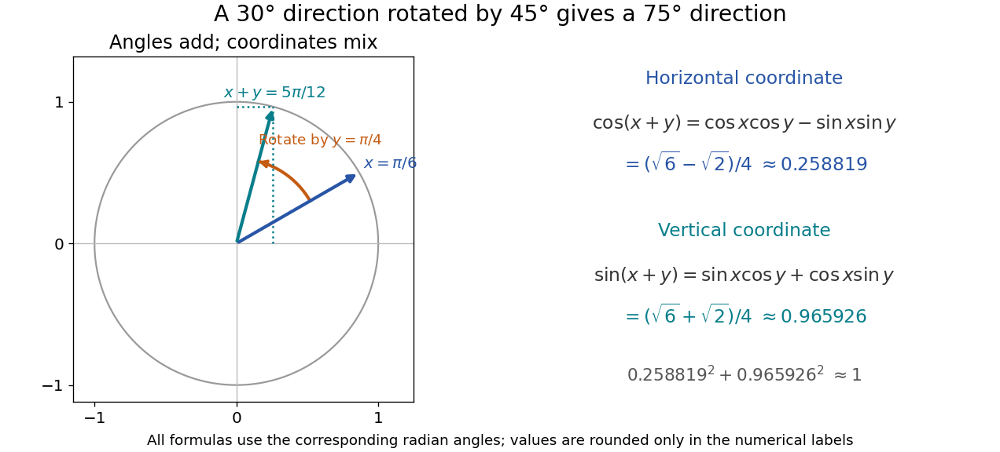

# Cosine addition formula

↑ **Parent:** [Trigonometric function](trigonometric-function.md)

The cosine addition formula gives the horizontal coordinate after two successive [rotations](rotation-mathematics.md):

$$
\boxed{\cos(x+y)=\cos x\cos y-\sin x\sin y.}
$$

The minus sign comes from the way a counterclockwise [rotation](rotation-mathematics.md) mixes horizontal and vertical coordinates:

$$
\begin{pmatrix}\cos y&-\sin y\\ \sin y&\cos y\end{pmatrix}
\begin{pmatrix}\cos x\\ \sin x\end{pmatrix}
=\begin{pmatrix}\cos(x+y)\\ \sin(x+y)\end{pmatrix}.
$$

The two rows recover the [cosine addition formula](cosine-addition-formula.md) and [sine addition formula](sine-addition-formula.md) together.

**[Figure 13](#image-adding-angles-rotates-a-coordinate-pair-and-mixes-its-sine-and-cosine-components). Adding angles rotates a coordinate pair and mixes its sine and cosine components**.

With $x=\pi/6$ and $y=\pi/4$, the resulting [angle](angle.md) is $5\pi/12$, and

$$
\cos(5\pi/12)=\frac{\sqrt6-\sqrt2}{4},\qquad
\sin(5\pi/12)=\frac{\sqrt6+\sqrt2}{4}.
$$

Although the horizontal coordinate becomes small, the vertical one approaches one; their squared sum still obeys the [Pythagorean trigonometric identity](pythagorean-trigonometric-identity.md). Taking $y=-x$ in the [cosine addition formula](cosine-addition-formula.md), together with the [even function](even-function.md) property of [cosine](cosine.md) and [odd function](odd-function.md) property of [sine](sine.md), also recovers that identity.

## ↑ Ancestors (5)

1. [Trigonometric function](trigonometric-function.md)
2. [Geometry and topology](geometry-and-topology-split.md)
3. [Area of mathematics](area-of-mathematics.md)
4. [Mathematics](mathematics-split.md)
5. [Codex Wiki](split.md)

## ← Incoming links (8)

- [Chebyshev polynomial](chebyshev-polynomial.md)
- [Composition of rotation matrices](composition-of-rotation-matrices.md)
- [Cosine addition formula](cosine-addition-formula.md)
- [Declination](declination.md)
- [Euler's formula](euler-s-formula.md)
- [Solution](past-exam-of-the-mathematics-course-of-the-university-of-cambridge/2019/iii/paper-336/3/b/solution.md)
- [Solution](past-exam-of-the-mathematics-course-of-the-university-of-cambridge/2020/ia/paper-1/9d/b/iii/solution.md)
- [Sine addition formula](sine-addition-formula.md)
