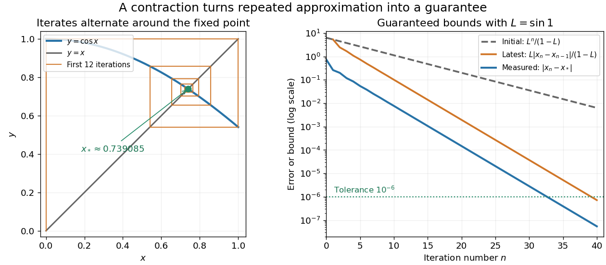

# Cosine fixed-point iteration

↑ **Parent:** [Contraction mapping theorem](contraction-mapping-theorem.md)

Use radians and take $T(x)=\cos x$ on the [closed interval](closed-real-interval.md) $[0,1]$. This is a [complete metric space](complete-metric-space.md) with distance $|x-y|$, and $T([0,1])=[\cos1,1]\subset[0,1]$. The [mean value theorem](mean-value-theorem.md) and $|T'(x)|=\sin x\leq\sin1$ give a [contraction mapping](contraction-mapping.md) with $L=\sin1\approx0.841471<1$. Both the interval and its preservation matter; a small [derivative](derivative.md) by itself would not ensure that all subsequent approximations stay in the chosen space.

Starting at $x_0=0$ gives $x_1=1$, $x_2\approx0.540302$, $x_3\approx0.857553$, and $x_4\approx0.654290$. The [cosine](cosine.md) is decreasing here, so successive iterates alternate around the unique [fixed point](fixed-point.md) $x_*\approx0.739085133215161$. The [contraction iteration error bound](contraction-iteration-error-bound.md) needs no prior knowledge of this numerical value. At step 40, $x_{40}\approx0.739085078689123$ and the latest-step bound is below $7.20\times10^{-7}$, certifying error below one millionth for exact iteration. The initial-step bound requires 91 iterations for the same tolerance. The observed step-40 error is only about $5.45\times10^{-8}$; the guarantees allow less favorable behavior than this example actually exhibits.

**[Figure 10](#image-cosine-iteration-converges-with-computable-error-bounds). Cosine iteration converges with computable error bounds**. The staircase alternates around the intersection of $y=\cos x$ and $y=x$. The error plot compares measured error against the initial-step and latest-step contraction bounds; both bounds hold without knowing the fixed point.

This is the beauty of the [contraction mapping theorem](contraction-mapping-theorem.md): a uniform local improvement controls the entire infinite process. [Completeness](completeness.md) is essential. On the incomplete interval $(0,1)$, the [contraction mapping](contraction-mapping.md) $T(x)=x/2$ keeps every iterate inside but has no [fixed point](fixed-point.md) there; its missing limit is zero. Banach's 1922 paper developed abstract methods for different spaces of functions with applications to [integral equations](integral-equation.md), a motivation still visible whenever repeated approximation is used to construct a function.[Stefan Banach, Sur les opérations dans les ensembles abstraits et leur application aux équations intégrales, Fundamenta Mathematicae 3 (1922), 133–181](https://www.impan.pl/en/publishing-house/journals-and-series/fundamenta-mathematicae/all/3/0/92453/sur-les-operations-dans-les-ensembles-abstraits-et-leur-application-aux-equations-integrales)

## ↑ Ancestors (6)

1. [Contraction mapping theorem](contraction-mapping-theorem.md)
2. [Fixed-point theorem](fixed-point-theorem.md)
3. [Analysis](analysis-split.md)
4. [Area of mathematics](area-of-mathematics.md)
5. [Mathematics](mathematics-split.md)
6. [Codex Wiki](split.md)
