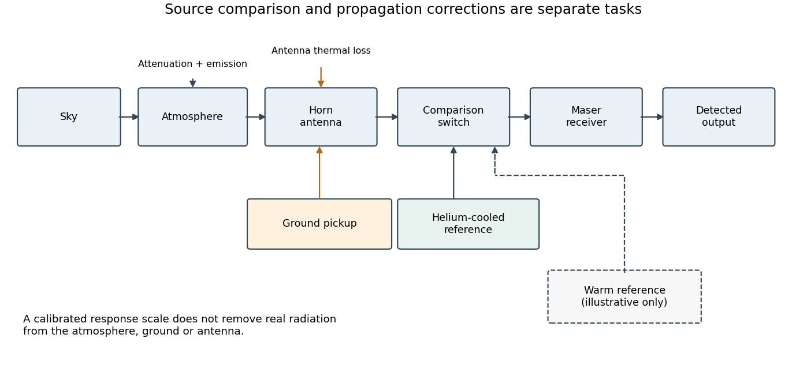
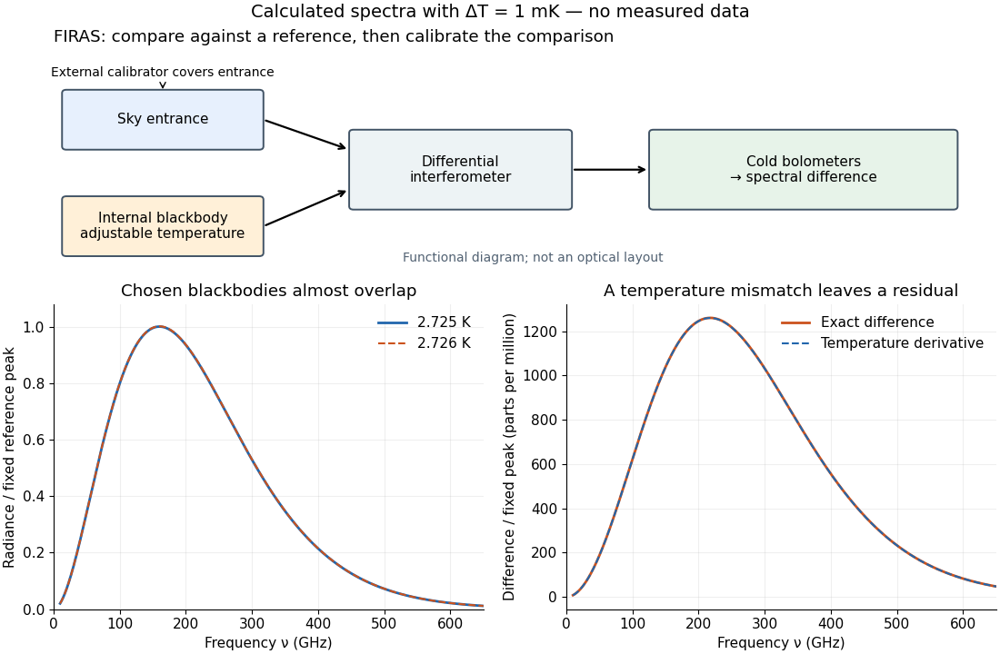

# Cosmic microwave background

↑ **Parent:** [Cosmology](cosmology.md)  
ⓦ [Wiki](https://en.wikipedia.org/wiki/Cosmic_microwave_background)

The [cosmic microwave background](cosmic-microwave-background.md) is nearly isotropic thermal [electromagnetic radiation](electromagnetic-radiation.md). Its spectrum connects [radio receiver](electrical-engineering.md#radio-receiver) measurements with the universe's thermal history: [redshift preservation of a thermal photon spectrum](cosmology.md#redshift-preservation-of-a-thermal-photon-spectrum) cools a [blackbody](astrophysics.md#blackbody) spectrum as space expands. The 1965 Princeton analysis described this relation.[pp.415–416: expansion cools radiation while preserving a thermal spectrum](physics-bibliography.md#cosmic-black-body-radiation-by-r-h-dicke-and-others)

A [radiometer](radiometry.md#radiometer) cannot label a received [photon](quantum-mechanics.md#photon) as cosmic, atmospheric or instrumental. Its measured [power](energy.md#power) combines the incoming radiation with the receiver response. The useful question is which comparisons and controls can isolate a sky contribution. This makes the [Penzias-Wilson microwave background experiment](#penzias-wilson-microwave-background-experiment) an example of both [observational cosmology](cosmology.md#observational-cosmology) and [measurement calibration](physics.md#measurement-calibration).

**Table of contents**

- [Wilkinson Microwave Anisotropy Probe](#wilkinson-microwave-anisotropy-probe)
- [Penzias-Wilson microwave background experiment](#penzias-wilson-microwave-background-experiment)
  - [Microwave radiometer calibration example](#microwave-radiometer-calibration-example)
    - [Thermodynamic and Rayleigh-Jeans antenna temperatures](#thermodynamic-and-rayleigh-jeans-antenna-temperatures)
- [Cosmic Background Explorer](#cosmic-background-explorer)
  - [Far Infrared Absolute Spectrophotometer](#far-infrared-absolute-spectrophotometer)
    - [COBE FIRAS blackbody spectrum experiment](#cobe-firas-blackbody-spectrum-experiment)
      - [Temperature perturbation of a Planck spectrum](#temperature-perturbation-of-a-planck-spectrum)
- [Sunyaev-Zeldovich effect](#sunyaev-zeldovich-effect)
  - [Cluster distance from Sunyaev-Zeldovich and X-ray signals](#cluster-distance-from-sunyaev-zeldovich-and-x-ray-signals)
  - [Kinetic Sunyaev-Zeldovich effect](#kinetic-sunyaev-zeldovich-effect)
  - [Thermal Sunyaev-Zeldovich effect](#thermal-sunyaev-zeldovich-effect)
- [Cosmic microwave background temperature in energy units](#cosmic-microwave-background-temperature-in-energy-units)
- [Reionization](#reionization)
  - [Reionization optical depth in an open matter universe](#reionization-optical-depth-in-an-open-matter-universe)
  - [Photon-budget reionization threshold](#photon-budget-reionization-threshold)
  - [Photoevaporation of a dark-matter minihalo](#photoevaporation-of-a-dark-matter-minihalo)
  - [Reionization damping of cosmic microwave background temperature anisotropy](#reionization-damping-of-cosmic-microwave-background-temperature-anisotropy)
    - [Primordial-amplitude–optical-depth degeneracy](#primordial-amplitude-optical-depth-degeneracy)
- [Cosmic microwave background last-scattering surface](#cosmic-microwave-background-last-scattering-surface)
- [Cosmic microwave background anisotropy](cosmic-microwave-background-anisotropy.md)
  - [Differential Microwave Radiometer](cosmic-microwave-background-anisotropy.md#differential-microwave-radiometer)
    - [COBE DMR sky anisotropy experiment](cosmic-microwave-background-anisotropy.md#cobe-dmr-sky-anisotropy-experiment)
      - [Differential sky map monopole degeneracy](cosmic-microwave-background-anisotropy.md#differential-sky-map-monopole-degeneracy)
  - [Cosmic microwave background quadrupole](cosmic-microwave-background-anisotropy.md#cosmic-microwave-background-quadrupole)
  - [Finite-width last-scattering damping](cosmic-microwave-background-anisotropy.md#finite-width-last-scattering-damping)
  - [Reduced CMB bispectrum](cosmic-microwave-background-anisotropy.md#reduced-cmb-bispectrum)
    - [Full-sky cubic bispectrum estimator](cosmic-microwave-background-anisotropy.md#full-sky-cubic-bispectrum-estimator)
      - [Monopole cancellation of internal cubic-estimator contractions](cosmic-microwave-background-anisotropy.md#monopole-cancellation-of-internal-cubic-estimator-contractions)
    - [Primordial-to-angular bispectrum projection](cosmic-microwave-background-anisotropy.md#primordial-to-angular-bispectrum-projection)
    - [Sachs-Wolfe projection of a constant bispectrum](cosmic-microwave-background-anisotropy.md#sachs-wolfe-projection-of-a-constant-bispectrum)
  - [CMB lensing potential](cosmic-microwave-background-anisotropy.md#cmb-lensing-potential)
  - [Cosmic microwave background power spectrum](cosmic-microwave-background-anisotropy.md#cosmic-microwave-background-power-spectrum)
    - [Sachs-Wolfe plateau](cosmic-microwave-background-anisotropy.md#sachs-wolfe-plateau)
    - [Cosmic variance](cosmic-microwave-background-anisotropy.md#cosmic-variance)
  - [Cosmic microwave background polarization](cosmic-microwave-background-anisotropy.md#cosmic-microwave-background-polarization)
    - [Temperature-to-polarization leakage](cosmic-microwave-background-anisotropy.md#temperature-to-polarization-leakage)
    - [B-mode polarization](cosmic-microwave-background-anisotropy.md#b-mode-polarization)
    - [E-mode polarization](cosmic-microwave-background-anisotropy.md#e-mode-polarization)
      - [Scalar E-mode radial projection](cosmic-microwave-background-anisotropy.md#scalar-e-mode-radial-projection)
      - [Low-multipole kernel of polarization potentials](cosmic-microwave-background-anisotropy.md#low-multipole-kernel-of-polarization-potentials)
  - [Photon temperature multipole](cosmic-microwave-background-anisotropy.md#photon-temperature-multipole)
    - [Photon multipole normalization change](cosmic-microwave-background-anisotropy.md#photon-multipole-normalization-change)
    - [Photon angular temperature moments](cosmic-microwave-background-anisotropy.md#photon-angular-temperature-moments)
      - [Photon temperature perturbation](cosmic-microwave-background-anisotropy.md#photon-temperature-perturbation)
    - [Photon monopole](cosmic-microwave-background-anisotropy.md#photon-monopole)
      - [Sachs-Wolfe combination](cosmic-microwave-background-anisotropy.md#sachs-wolfe-combination)
        - [Sachs-Wolfe radiation-to-matter matching](cosmic-microwave-background-anisotropy.md#sachs-wolfe-radiation-to-matter-matching)
        - [Sachs-Wolfe effect](cosmic-microwave-background-anisotropy.md#sachs-wolfe-effect)
        - [Doppler CMB anisotropy](cosmic-microwave-background-anisotropy.md#doppler-cmb-anisotropy)
        - [Integrated Sachs-Wolfe effect](cosmic-microwave-background-anisotropy.md#integrated-sachs-wolfe-effect)
          - [Late-time CMB-matter cross correlation](cosmic-microwave-background-anisotropy.md#late-time-cmb-matter-cross-correlation)
          - [Rees-Sciama effect](cosmic-microwave-background-anisotropy.md#rees-sciama-effect)
    - [Photon dipole](cosmic-microwave-background-anisotropy.md#photon-dipole)
    - [Photon quadrupole](cosmic-microwave-background-anisotropy.md#photon-quadrupole)
  - [Photon-baryon fluid](cosmic-microwave-background-anisotropy.md#photon-baryon-fluid)
    - [Baryon Euler equation with Thomson drag](cosmic-microwave-background-anisotropy.md#baryon-euler-equation-with-thomson-drag)
    - [Baryon loading parameter](cosmic-microwave-background-anisotropy.md#baryon-loading-parameter)
    - [Thomson scattering](cosmic-microwave-background-anisotropy.md#thomson-scattering)
      - [Thomson cross-section](cosmic-microwave-background-anisotropy.md#thomson-cross-section)
    - [Tight-coupling approximation](cosmic-microwave-background-anisotropy.md#tight-coupling-approximation)
      - [Photon opacity normalization for a velocity potential](cosmic-microwave-background-anisotropy.md#photon-opacity-normalization-for-a-velocity-potential)
      - [Temperature-only tight-coupling quadrupole](cosmic-microwave-background-anisotropy.md#temperature-only-tight-coupling-quadrupole)
      - [Photon-baryon acoustic oscillator](cosmic-microwave-background-anisotropy.md#photon-baryon-acoustic-oscillator)
        - [Coherent initial phases are needed for acoustic variance peaks](cosmic-microwave-background-anisotropy.md#coherent-initial-phases-are-needed-for-acoustic-variance-peaks)
      - [Photon-baryon sound speed](cosmic-microwave-background-anisotropy.md#photon-baryon-sound-speed)
      - [Photon-baryon velocity slip](cosmic-microwave-background-anisotropy.md#photon-baryon-velocity-slip)
      - [Photon quadrupole in tight coupling with polarization](cosmic-microwave-background-anisotropy.md#photon-quadrupole-in-tight-coupling-with-polarization)
      - [Photon-baryon diffusion damping equation](cosmic-microwave-background-anisotropy.md#photon-baryon-diffusion-damping-equation)
        - [Shear-only photon diffusion damping](cosmic-microwave-background-anisotropy.md#shear-only-photon-diffusion-damping)
          - [Slowly varying shear-damped photon oscillator](cosmic-microwave-background-anisotropy.md#slowly-varying-shear-damped-photon-oscillator)
    - [Sound horizon](cosmic-microwave-background-anisotropy.md#sound-horizon)
      - [Sound-horizon angle in an open matter universe](cosmic-microwave-background-anisotropy.md#sound-horizon-angle-in-an-open-matter-universe)
    - [Cosmic microwave background diffusion damping](cosmic-microwave-background-anisotropy.md#cosmic-microwave-background-diffusion-damping)
  - [Adiabatic initial conditions](cosmic-microwave-background-anisotropy.md#adiabatic-initial-conditions)
    - [Adiabatic matter-string density relation](cosmic-microwave-background-anisotropy.md#adiabatic-matter-string-density-relation)
  - [Cosmic microwave background acoustic peak](cosmic-microwave-background-anisotropy.md#cosmic-microwave-background-acoustic-peak)
    - [Angular projection of density and Doppler acoustic sources](cosmic-microwave-background-anisotropy.md#angular-projection-of-density-and-doppler-acoustic-sources)
    - [Adiabatic acoustic-peak spacing](cosmic-microwave-background-anisotropy.md#adiabatic-acoustic-peak-spacing)
  - [Free-streaming photon Boltzmann equation](cosmic-microwave-background-anisotropy.md#free-streaming-photon-boltzmann-equation)
    - [Photon brightness perturbation](cosmic-microwave-background-anisotropy.md#photon-brightness-perturbation)
      - [Synchronous photon brightness equation](cosmic-microwave-background-anisotropy.md#synchronous-photon-brightness-equation)
        - [Photon brightness equation for a negative spatial perturbation](cosmic-microwave-background-anisotropy.md#photon-brightness-equation-for-a-negative-spatial-perturbation)
        - [Synchronous photon momentum redshift](cosmic-microwave-background-anisotropy.md#synchronous-photon-momentum-redshift)
    - [Photon Boltzmann hierarchy](cosmic-microwave-background-anisotropy.md#photon-boltzmann-hierarchy)
      - [Vector photon Boltzmann hierarchy](cosmic-microwave-background-anisotropy.md#vector-photon-boltzmann-hierarchy)
      - [Photon continuity equation](cosmic-microwave-background-anisotropy.md#photon-continuity-equation)
      - [Photon Euler equation](cosmic-microwave-background-anisotropy.md#photon-euler-equation)
    - [Line-of-sight solution for free-streaming photons](cosmic-microwave-background-anisotropy.md#line-of-sight-solution-for-free-streaming-photons)
      - [Polynomial-source photon transport solution](cosmic-microwave-background-anisotropy.md#polynomial-source-photon-transport-solution)
        - [Endpoint monopole and dipole in photon transport](cosmic-microwave-background-anisotropy.md#endpoint-monopole-and-dipole-in-photon-transport)
      - [Matter-era photon endpoint solution](cosmic-microwave-background-anisotropy.md#matter-era-photon-endpoint-solution)
      - [Synchronous Sachs-Wolfe line-of-sight formula](cosmic-microwave-background-anisotropy.md#synchronous-sachs-wolfe-line-of-sight-formula)
        - [Endpoint terms in the synchronous Sachs-Wolfe formula](cosmic-microwave-background-anisotropy.md#endpoint-terms-in-the-synchronous-sachs-wolfe-formula)
    - [Photon Boltzmann equation with Thomson scattering](cosmic-microwave-background-anisotropy.md#photon-boltzmann-equation-with-thomson-scattering)
      - [Cosmological optical depth](cosmic-microwave-background-anisotropy.md#cosmological-optical-depth)
        - [Cosmological visibility function](cosmic-microwave-background-anisotropy.md#cosmological-visibility-function)
          - [Cosmic microwave background line-of-sight solution](cosmic-microwave-background-anisotropy.md#cosmic-microwave-background-line-of-sight-solution)
            - [Tensor CMB line-of-sight source](cosmic-microwave-background-anisotropy.md#tensor-cmb-line-of-sight-source)

## Wilkinson Microwave Anisotropy Probe

↑ **Parent:** [Cosmic microwave background](cosmic-microwave-background.md)

A space mission that mapped the temperature and polarization of the [cosmic microwave background](cosmic-microwave-background.md). Its nine-year analysis separates foreground emission from the microwave sky signal and fits cosmological models to the resulting maps. Combined-data fits additionally use other observations; they are not measurements from microwave maps alone.[Version 1 abstract, maps, foreground separation and combined-data fits](physics-bibliography.md#nine-year-wilkinson-microwave-anisotropy-probe-wmap-observations-final-maps-and-results-by-c-l-bennett-and-others)

## Penzias-Wilson microwave background experiment

↑ **Parent:** [Cosmic microwave background](cosmic-microwave-background.md)

In 1965, [Arno Penzias](physicist.md#arno-allan-penzias) and [Robert Woodrow Wilson](astronomy.md#robert-woodrow-wilson) reported measurements with a 20-foot horn-reflector [antenna](electrical-engineering.md#antenna-radio) at $4.080\,\mathrm{GHz}$. They manually switched a traveling-wave [maser](maser.md) receiver between the horn and a helium-cooled reference. From $6.7\,\mathrm K$ zenith [antenna temperature](electrical-engineering.md#antenna-temperature), atmospheric and antenna/ground contributions left an excess $3.5\pm1.0\,\mathrm K$.[pp.419–420: apparatus, temperature contributions and residual](physics-bibliography.md#a-measurement-of-excess-antenna-temperature-at-4080-mc-per-second-by-arno-allan-penzias-and-robert-woodrow-wilson)

Elevation scans estimated the atmospheric term. Taping horn seams produced no measurable change; a nearby transmitter tested ground response. These controls addressed distinct possible contaminations.[p.420: elevation, seam and back-lobe tests](physics-bibliography.md#a-measurement-of-excess-antenna-temperature-at-4080-mc-per-second-by-arno-allan-penzias-and-robert-woodrow-wilson)

**[Figure 1](#image-comparing-a-sky-horn-with-a-cold-reference-separates-receiver-response-from-incident-radiation). Comparing a sky horn with a cold reference separates receiver response from incident radiation**. Original functional diagram inspired by the reported comparison, not a reconstruction or photograph of the historical apparatus. The added warm reference illustrates a generic [two-load radiometer calibration](radiometry.md#two-load-radiometer-calibration); it is not claimed to have been switched in this form in the original experiment. Radiation from the sky, atmosphere, ground and antenna can contribute at the receiver input.

The comparison does not make all nuisance contributions disappear. A reference can establish a response scale, but atmospheric emission and pickup through unwanted [antenna](electrical-engineering.md#antenna-radio) directions are also real incident radiation. In his later account, [Robert Woodrow Wilson](astronomy.md#robert-woodrow-wilson) describes these competing contributions as central to a [radio astronomy](astrophysics.md#radio-astronomy) measurement.[1978 lecture, introduction and sectionII: sky, ground, atmosphere and instrument contributions](physics-bibliography.md#the-cosmic-microwave-background-radiation-by-robert-woodrow-wilson)

The Princeton group proposed primordial thermal radiation as an interpretation and called for more [wavelength](wave-equation.md#wavelength) measurements. Their separate $3\,\mathrm{cm}$ [radiometer](radiometry.md#radiometer) had not yet produced results.[pp.415–416: interpretation, Princeton apparatus and need for further wavelengths](physics-bibliography.md#cosmic-black-body-radiation-by-r-h-dicke-and-others) A single-frequency excess therefore does not by itself establish a complete [Planck spectrum](statistical-physics.md#blackbody-spectrum). Reproducibility across independent instruments, observing directions and frequencies tests the interpretation further.

### Microwave radiometer calibration example

↑ **Parent:** [Penzias-Wilson microwave background experiment](#penzias-wilson-microwave-background-experiment)

Consider an original idealized narrow-band model for one matched spatial mode and one [polarization of waves](wave.md#polarization-waves). In the classical [Rayleigh-Jeans law](astrophysics.md#rayleigh-jeans-law) regime, an available thermal [power](energy.md#power) can be written $P=k_BT\Delta\nu$, where $\Delta\nu$ is the effective [bandwidth](electrical-engineering.md#bandwidth-signal-processing) and $T$ the equivalent input [noise temperature](radiometry.md#noise-temperature). Assume a linear detector with stable positive gain and absorb its [bandwidth](electrical-engineering.md#bandwidth-signal-processing), [Boltzmann constant](thermodynamics.md#boltzmann-constant) and response factor into $g$. Then the output is $S=g(T+T_r)$, with input-referred [receiver noise temperature](radiometry.md#receiver-noise-temperature) $T_r$. These are model assumptions, not a reconstruction of the historical electronics.

Two references with known [noise temperatures](radiometry.md#noise-temperature) $T_h\ne T_c$ give

$$
S_h=g(T_h+T_r),\qquad S_c=g(T_c+T_r),
$$

so the [two-load radiometer calibration](radiometry.md#two-load-radiometer-calibration) yields

$$
g=\frac{S_h-S_c}{T_h-T_c},\qquad
T_r=\frac{T_hS_c-T_cS_h}{S_h-S_c},\qquad
T_s=T_c+(T_h-T_c)\frac{S_s-S_c}{S_h-S_c}.
$$

Subtracting the reference equations eliminates the unknown receiver term; substituting back determines it. An arbitrary stable output offset can likewise be eliminated from the interpolation for $T_s$, although separating that offset from $T_r$ then requires additional information.

For deliberately chosen inputs, set $T_h=300\,\mathrm K$, $T_c=4.2\,\mathrm K$, $T_r=40\,\mathrm K$ and $g=2\,\mathrm{mV/K}$. These are equivalent [noise temperatures](radiometry.md#noise-temperature); physical load thermometry must be converted consistently at the observing [frequency](wave.md#frequency). The reference outputs are $S_h=680\,\mathrm{mV}$ and $S_c=88.4\,\mathrm{mV}$. A sky-input output $S_s=90\,\mathrm{mV}$ gives $T_s=5.0\,\mathrm K$. If independent estimates assign $1.4\,\mathrm K$ to atmosphere, $0.5\,\mathrm K$ to antenna loss and $0.1\,\mathrm K$ to ground pickup in this lumped additive model, the residual is $3.0\,\mathrm K$.

**[Figure 2](#image-original-calibration-arithmetic-and-the-distinction-between-an-antenna-temperature-and-a-thermodynamic-temperature). Original calibration arithmetic and the distinction between an antenna temperature and a thermodynamic temperature**. Chosen reference temperatures, receiver response and additive contributions; none are fitted historical measurements. The final panel calculates the [Rayleigh-Jeans law](astrophysics.md#rayleigh-jeans-law) equivalent [antenna temperature](electrical-engineering.md#antenna-temperature) of a stipulated $3\,\mathrm K$ [blackbody](astrophysics.md#blackbody). A change in [frequency](wave.md#frequency) changes that equivalent temperature even though the underlying thermodynamic temperature is fixed.

The subtraction exposes what a noise budget must achieve. A $1\,\mathrm K$ error in the assigned atmospheric term becomes a $1\,\mathrm K$ error in the residual, even with exact detector calibration. Multiplicative attenuation requires a different correction: if an isothermal atmosphere has transmission $t$, its ideal contribution is $tT_{\rm cosmic}+(1-t)T_{\rm atm}$ in the same classical equivalent-temperature convention. Recovering $T_{\rm cosmic}$ then requires both subtracting atmospheric emission and dividing by $t$. The additive toy budget applies when its terms already refer to the same receiver input.

There is also a conditioning issue. If $S_h-S_c$ is small, a fixed output error strongly changes the inferred [temperature](temperature.md). Widely separated reference temperatures improve the scale determination only if the receiver remains linear over that range; measuring the reference repeatedly tests stability rather than proving linearity. The experiment therefore motivates a model, a calibration and a set of independent checks, each with its own assumptions.

#### Thermodynamic and Rayleigh-Jeans antenna temperatures

↑ **Parent:** [Microwave radiometer calibration example](#microwave-radiometer-calibration-example)

For a matched receiver accepting one spatial mode and one [polarization of waves](wave.md#polarization-waves), the thermal contribution to the available spectral [power](energy.md#power) of a [blackbody](astrophysics.md#blackbody) is

$$
\frac{dP}{d\nu}=\frac{h\nu}{e^{h\nu/(k_BT)}-1}.
$$

This expression excludes a zero-point term; it is the thermally emitted contribution. Defining the [Rayleigh-Jeans law](astrophysics.md#rayleigh-jeans-law) equivalent [antenna temperature](electrical-engineering.md#antenna-temperature) by $dP/d\nu=k_BT_A$ gives the displayed relation. With $x=h\nu/(k_BT)$,

$$
\frac{T_A}{T}=\frac{x}{e^x-1}=1-\frac x2+\frac{x^2}{12}+O(x^4).
$$

Thus $T_A\simeq T$ requires $x\ll1$. It is an approximation with a frequency-dependent error, rather than a redefinition of thermodynamic [temperature](temperature.md).

For the stipulated $T=3\,\mathrm K$ and $\nu=4.080\,\mathrm{GHz}$, $h\nu/k_B\simeq0.19581\,\mathrm K$ and $T_A\simeq2.90316\,\mathrm K$. Replacing $T_A$ by $T$ here would differ by about $3.23\%$. At much higher [frequencies](wave.md#frequency), the approximation fails more strongly. A real instrument averages over its measured [frequency response](electrical-engineering.md#frequency-response) and [antenna beam pattern](electrical-engineering.md#antenna-beam-pattern), so using a single central [frequency](wave.md#frequency) adds a narrow-band approximation.

## Cosmic Background Explorer

↑ **Parent:** [Cosmic microwave background](cosmic-microwave-background.md)  
ⓦ [Wiki](https://en.wikipedia.org/wiki/Cosmic_Background_Explorer)

The [Cosmic Background Explorer](#cosmic-background-explorer) connected two questions: does the [cosmic microwave background](cosmic-microwave-background.md) follow a [Planck spectrum](statistical-physics.md#blackbody-spectrum), and how does its [temperature](temperature.md) vary across the sky? [John C. Mather](astronomy.md#john-c-mather) and [George F. Smoot](physicist.md#george-f-smoot) shared the 2006 [Nobel Prize in Physics](nobel-prize-in-physics.md) for these discoveries.[2006 award and discovery summary](physics-bibliography.md#george-f-smoot-facts-by-nobel-prize-outreach) The [FIRAS](#far-infrared-absolute-spectrophotometer) and [COBE DMR](cosmic-microwave-background-anisotropy.md#differential-microwave-radiometer) comparisons below explain why measuring spectral shape and measuring angular structure require different information.

### Far Infrared Absolute Spectrophotometer

↑ **Parent:** [Cosmic Background Explorer](#cosmic-background-explorer)

#### COBE FIRAS blackbody spectrum experiment

↑ **Parent:** [Far Infrared Absolute Spectrophotometer](#far-infrared-absolute-spectrophotometer)

[FIRAS](#far-infrared-absolute-spectrophotometer) compared sky radiation with an adjustable internal [blackbody](astrophysics.md#blackbody) using an [interferometer](physical-optics.md#interferometer) and cold [bolometers](optical-instrument.md#bolometer). An external [blackbody](astrophysics.md#blackbody) could cover the sky entrance for [measurement calibration](physics.md#measurement-calibration). The team adjusted the internal [temperature](temperature.md) to minimize the difference signal.[§III.D, pp.1337–1338; §V.A, p.1341](physics-bibliography.md#nobel-lecture-from-the-big-bang-to-the-nobel-prize-and-beyond-by-john-c-mather)

Comparisons across detectors and mirror strokes tested instrumental errors; sky mapping separated [Milky Way](galaxy.md#milky-way) emission. [John C. Mather](astronomy.md#john-c-mather)'s lecture reports a final root-mean-square spectral departure of 50 parts per million of peak brightness. This is neither the preliminary 1990 precision nor a relative error in every spectral bin. Calibration drift and nonideal reference emission required correction.[§V.A, p.1342: calibration checks and final spectrum](physics-bibliography.md#nobel-lecture-from-the-big-bang-to-the-nobel-prize-and-beyond-by-john-c-mather)

**[Figure 3](#image-firas-comparison-principle-and-a-chosen-blackbody-temperature-residual). FIRAS comparison principle and a chosen blackbody temperature residual**. Functional comparison, not an optical layout. Calculated curves use stipulated [temperatures](temperature.md), not measured COBE data.

The advantage of a [null measurement](electrical-engineering.md#null-measurement) is that a small difference can be resolved without assigning the same absolute precision to a large detector output. Nevertheless, matching an internal reference is meaningful only after its relation to an independently calibrated [blackbody](astrophysics.md#blackbody) has been tested. A bound on departures from a [Planck spectrum](statistical-physics.md#blackbody-spectrum) constrains energy redistribution after [thermal equilibrium](thermal-equilibrium.md); it does not require the [cosmic microwave background](cosmic-microwave-background.md) to have exactly the same [temperature](temperature.md) in every direction.

##### Temperature perturbation of a Planck spectrum

↑ **Parent:** [COBE FIRAS blackbody spectrum experiment](#cobe-firas-blackbody-spectrum-experiment)

For a [Planck function](astrophysics.md#planck-function) expressed as [spectral radiance](radiometry.md#spectral-radiance) per [frequency](wave.md#frequency) interval,

$$
B_\nu(T)=\frac{2h\nu^3}{c^2}\frac{1}{e^x-1},\qquad x=\frac{h\nu}{k_BT},
$$

$h$ is the [Planck constant](quantum-mechanics.md#planck-constant), $c$ the [speed of light](special-relativity.md#speed-of-light) and $k_B$ the [Boltzmann constant](thermodynamics.md#boltzmann-constant). Differentiating at fixed [frequency](wave.md#frequency) gives

$$
\frac{\partial B_\nu}{\partial T}=\frac{B_\nu}{T}\frac{x}{1-e^{-x}},\qquad
B_\nu(T+\delta T)-B_\nu(T)=\frac{\partial B_\nu}{\partial T}\delta T+O(\delta T^2).
$$

The proof uses $\partial_Tx=-x/T$ and the [chain rule](calculus.md#chain-rule). At low [frequency](wave.md#frequency), the multiplier tends to one, recovering the [Rayleigh-Jeans law](astrophysics.md#rayleigh-jeans-law). At high [frequency](wave.md#frequency) it grows approximately as $x$: the same fractional [temperature](temperature.md) change has a larger fractional brightness effect on the declining spectral tail.

For an original example choose $T=2.725\,\mathrm K$ and $\delta T=1\,\mathrm{mK}$. At $100\,\mathrm{GHz}$, $x=1.76119$, so the first-order fractional residual is $7.80415\times10^{-4}$. At $300\,\mathrm{GHz}$, $x=5.28357$, it is $1.94881\times10^{-3}$. Both spectra are exact [blackbodies](astrophysics.md#blackbody): this residual is a [temperature](temperature.md) mismatch, not evidence of a nonthermal spectrum. Fitting [temperature](temperature.md) before assessing remaining spectral residuals therefore removes a physically distinct degree of freedom. The figure divides by a fixed peak brightness rather than by the rapidly vanishing high-[frequency](wave.md#frequency) tail.

## Sunyaev-Zeldovich effect

↑ **Parent:** [Cosmic microwave background](cosmic-microwave-background.md)  
ⓦ [Wiki](https://en.wikipedia.org/wiki/Sunyaev-Zeldovich_effect)

Hot [electrons](physics.md#electron) in [galaxy](galaxy.md) clusters scatter [photons](quantum-mechanics.md#photon) of the [cosmic microwave background](cosmic-microwave-background.md), producing a characteristic spectral distortion. The thermal contribution measures a line-of-sight integral of [electron](physics.md#electron) [pressure](pressure.md), whereas X-ray emission depends approximately on the integral of [electron](physics.md#electron) density squared times a temperature-dependent emissivity. Combining the two with a geometrical model can constrain a cluster's physical size and hence its [angular diameter distance](cosmology.md#angular-diameter-distance). [Temperature](temperature.md) structure and departures from the assumed geometry introduce systematic uncertainty.

### Cluster distance from Sunyaev-Zeldovich and X-ray signals

↑ **Parent:** [Sunyaev-Zeldovich effect](#sunyaev-zeldovich-effect)

For a uniform spherical cluster of depth $\ell\propto\theta d_A$, [thermal bremsstrahlung](astrophysics.md#thermal-bremsstrahlung) gives received bolometric flux $S_X\propto n_e^2T_e^{1/2}\ell^3/d_L^2$, while the [Rayleigh-Jeans law](astrophysics.md#rayleigh-jeans-law) limit of the [thermal Sunyaev-Zeldovich effect](#thermal-sunyaev-zeldovich-effect) gives $|\Delta T|\propto n_eT_e\ell$. Eliminating $n_e$ and using $d_L=(1+z)^2d_A$ yields the displayed [angular diameter distance](cosmology.md#angular-diameter-distance). A model for the density profile fixes its numerical coefficient. Clumping, nonsphericity and [temperature](temperature.md) structure can bias this distance because the two observables weight the gas differently.

### Kinetic Sunyaev-Zeldovich effect

↑ **Parent:** [Sunyaev-Zeldovich effect](#sunyaev-zeldovich-effect)

Bulk motion of a scattering electron cloud relative to the [cosmic microwave background](cosmic-microwave-background.md) gives a first-order Doppler [temperature](temperature.md) shift. With positive $v_{\parallel}$ directed away from the observer, the displayed sign applies, and $\tau$ is the [Thomson scattering](cosmic-microwave-background-anisotropy.md#thomson-scattering) [optical depth](astrophysics.md#optical-depth). In the nonrelativistic, single-scattering limit it has the spectrum of a small [blackbody](astrophysics.md#blackbody) temperature change, unlike the [thermal Sunyaev-Zeldovich effect](#thermal-sunyaev-zeldovich-effect).

### Thermal Sunyaev-Zeldovich effect

↑ **Parent:** [Sunyaev-Zeldovich effect](#sunyaev-zeldovich-effect)

For a [Planck photon distribution](statistical-physics.md#planck-photon-distribution), the hot-electron [Kompaneets equation](mathematical-physics.md#kompaneets-equation) gives $\Delta n=yx e^x(e^x-1)^{-2}[x\coth(x/2)-4]$, where $x=h\nu/(k_BT_\gamma)$. The equivalent thermodynamic [temperature](temperature.md) perturbation has the displayed form, while the [Rayleigh-Jeans law](astrophysics.md#rayleigh-jeans-law) gives $\Delta T/T=-2y$. The distortion changes sign at $x\simeq3.830$. This first-order expression assumes a small [Compton y parameter](mathematical-physics.md#compton-y-parameter) and nonrelativistic thermal [electrons](physics.md#electron).

## Cosmic microwave background temperature in energy units

↑ **Parent:** [Cosmic microwave background](cosmic-microwave-background.md)

The [cosmic microwave background](cosmic-microwave-background.md) [temperature](temperature.md) is about $2.725\,\mathrm K$, corresponding to the displayed thermal [energy](energy.md). The conversion uses $k_B\simeq8.61733\times10^{-5}\,\mathrm{eV/K}$. Thus $2.35\,\mathrm{meV}$ would correspond to about $27.3\,\mathrm K$, rather than the present [CMB](cosmic-microwave-background.md). Primary references are [NASA's CMB temperature measurements](https://asd.gsfc.nasa.gov/archive/arcade/cmb_temperature.html) and [NIST's Boltzmann constant in electronvolts per kelvin](https://physics.nist.gov/cgi-bin/cuu/Value?kev).

## Reionization

↑ **Parent:** [Cosmic microwave background](cosmic-microwave-background.md)  
ⓦ [Wiki](https://en.wikipedia.org/wiki/Reionization)

Reionization returns some neutral cosmic gas to an ionized state after [cosmological recombination](cosmology.md#recombination-cosmology). The resulting free electrons increase the [cosmological optical depth](cosmic-microwave-background-anisotropy.md#cosmological-optical-depth) through [Thomson scattering](cosmic-microwave-background-anisotropy.md#thomson-scattering) and create a second contribution to the [cosmological visibility function](cosmic-microwave-background-anisotropy.md#cosmological-visibility-function).

### Reionization optical depth in an open matter universe

↑ **Parent:** [Reionization](#reionization)

For full [hydrogen](chemical-substance.md#hydrogen) [ionization](atomic-physics.md#ionization) after instantaneous [reionization](#reionization), $n_{e0}=3\Omega_bH_0^2/(8\pi Gm_p)$ and $H(z)=H_0(1+z)\sqrt{1+\Omega_mz}$. Integrating [Thomson scattering](cosmic-microwave-background-anisotropy.md#thomson-scattering) gives

$$
\kappa=\frac{\Omega_b C_H}{\Omega_m^2}\{u^3-1-3(1-\Omega_m)(u-1)\},\quad u=\sqrt{1+\Omega_mz_{\rm re}},\quad C_H=\frac{\sigma_TcH_0}{4\pi Gm_p}.
$$

For $\Omega_m=1$, $\kappa=\Omega_bC_H[(1+z_{\rm re})^{3/2}-1]$. At fixed baryon density and redshift, lowering the matter density reduces the expansion rate and increases the [optical depth](astrophysics.md#optical-depth).

// Target: cosmology.bigb

### Photon-budget reionization threshold

↑ **Parent:** [Reionization](#reionization)

If each collapsed baryon supplies $N_\gamma$ effective ionizing photons and $N_{\rm req}$ photons per cosmic baryon are required, the threshold collapsed fraction is $f_{\rm coll}=N_{\rm req}/N_\gamma$. The [Press-Schechter formalism](large-scale-structure-of-the-universe.md#press-schechter-formalism) gives $\operatorname{erfc}[\delta_{\rm sc}/(\sqrt2\sigma(M_{\min},z))]=f_{\rm coll}$. Escape losses and recombinations must either be incorporated in the effective yield/requirement or counted separately, not twice.

### Photoevaporation of a dark-matter minihalo

↑ **Parent:** [Reionization](#reionization)

[Photoionization](atomic-physics.md#photoionization) can heat a shallow halo's gas well above its [virial temperature](classical-mechanics.md#virial-temperature). If the heated [sound speed](compressible-flow.md#speed-of-sound) exceeds the escape-speed scale, the previous [hydrostatic equilibrium](statistical-physics.md#hydrostatic-equilibrium) is lost and a pressure-driven outflow removes gas. A crossing time gives a useful estimate, but photon supply, the gas profile, shielding and recombinations can delay the process. This particularly affects haloes whose [virial temperatures](classical-mechanics.md#virial-temperature) are below the usual atomic cooling threshold and reduces their subsequent [star formation](stellar-astrophysics.md#star-formation).

### Reionization damping of cosmic microwave background temperature anisotropy

↑ **Parent:** [Reionization](#reionization)

Ignoring velocities and evolving potentials, a thin [reionization](#reionization) screen transmits the primary [Cosmic microwave background anisotropy](cosmic-microwave-background-anisotropy.md) with amplitude $e^{-\tau_{\rm re}}$ and adds a direction-averaged source. A plane wave propagating a distance $\Delta\chi$ from recombination to the screen has monopole factor $j_0(k\Delta\chi)=\sin(k\Delta\chi)/(k\Delta\chi)$. This suppresses the rescattered source at $k\Delta\chi\gg1$, while coherent large-scale modes are unchanged to leading order.

<h4 id="primordial-amplitude-optical-depth-degeneracy">Primordial-amplitude–optical-depth degeneracy</h4>

↑ **Parent:** [Reionization damping of cosmic microwave background temperature anisotropy](#reionization-damping-of-cosmic-microwave-background-temperature-anisotropy)

The primary small-scale [Cosmic microwave background power spectrum](cosmic-microwave-background-anisotropy.md#cosmic-microwave-background-power-spectrum) measures the amplitude $A_s e^{-2\tau_{\rm re}}$, because [reionization](#reionization) damps each temperature amplitude once. The unaffected large-scale temperature modes are few and limited by [cosmic variance](cosmic-microwave-background-anisotropy.md#cosmic-variance). Polarization and gravitational lensing provide additional information that partly breaks this degeneracy.

## Cosmic microwave background last-scattering surface

↑ **Parent:** [Cosmic microwave background](cosmic-microwave-background.md)

The cosmic microwave background last-scattering surface is the shell from which the [photons](quantum-mechanics.md#photon) observed in the [cosmic microwave background](cosmic-microwave-background.md) last scattered around [photon decoupling](cosmology.md#photon-decoupling).

## Cosmic microwave background anisotropy

↑ **Parent:** [Cosmic microwave background](cosmic-microwave-background.md)

[This section is present in another page, follow this link to view it.](cosmic-microwave-background-anisotropy.md)

## ↑ Ancestors (4)

1. [Cosmology](cosmology.md)
2. [Branches of physics](physics.md#branches-of-physics)
3. [Physics](physics.md)
4. [Codex Wiki](README.md)

## ← Incoming links (79)

- [Baryon-density consistency between nucleosynthesis and the microwave background](cosmology.md#baryon-density-consistency-between-nucleosynthesis-and-the-microwave-background)
- [Baryon-to-photon dilution by entropy injection](cosmology.md#baryon-to-photon-dilution-by-entropy-injection)
- [Charles L. Bennett](astronomy.md#charles-l-bennett)
- [COBE FIRAS blackbody spectrum experiment](#cobe-firas-blackbody-spectrum-experiment)
- [Compton cooling by the cosmic microwave background](heat.md#compton-cooling-by-the-cosmic-microwave-background)
- [Cosmic Background Explorer](#cosmic-background-explorer)
- [Cosmic microwave background](cosmic-microwave-background.md)
- [Cosmic microwave background last-scattering surface](#cosmic-microwave-background-last-scattering-surface)
- [Cosmic microwave background quadrupole](cosmic-microwave-background-anisotropy.md#cosmic-microwave-background-quadrupole)
- [Cosmic microwave background temperature in energy units](#cosmic-microwave-background-temperature-in-energy-units)
- [Cosmic neutrino background last-scattering surface](cosmology.md#cosmic-neutrino-background-last-scattering-surface)
- [Cosmological lithium problem](cosmology.md#cosmological-lithium-problem)
- [Cosmological surface-brightness dimming](astrophysics.md#cosmological-surface-brightness-dimming)
- [Entropy density of a photon gas](statistical-physics.md#entropy-density-of-a-photon-gas)
- [Galactic thermal dust emission](galaxy.md#galactic-thermal-dust-emission)
- [George F. Smoot](physicist.md#george-f-smoot)
- [Inverse Compton cooling](heat.md#inverse-compton-cooling)
- [John C. Mather](astronomy.md#john-c-mather)
- [Kinetic Sunyaev-Zeldovich effect](#kinetic-sunyaev-zeldovich-effect)
- [Nine-Year Wilkinson Microwave Anisotropy Probe (WMAP) Observations: Final Maps and Results by C. L. Bennett and others](physics-bibliography.md#nine-year-wilkinson-microwave-anisotropy-probe-wmap-observations-final-maps-and-results-by-c-l-bennett-and-others)
- [Nobel Prize in Physics in 1978](nobel-prize-in-physics.md#nobel-prize-in-physics-in-1978)
- [Nobel Prize in Physics in 2006](nobel-prize-in-physics.md#nobel-prize-in-physics-in-2006)
- [Solution](past-exam-of-the-formation-of-structure-in-the-universe-course-of-the-university-of-cambridge/2014/paper-1.md#3/d/solution)
- [Solution](past-exam-of-the-frontiers-of-observational-astrophysics-course-of-the-university-of-cambridge/2013/paper-1.md#3/b/solution)
- [Solution](past-exam-of-the-frontiers-of-observational-astrophysics-course-of-the-university-of-cambridge/2014/paper-1.md#3/a/solution)
- [Solution](past-exam-of-the-mathematics-course-of-the-university-of-cambridge/2001/iii/paper-70.md#4/b/solution)
- [Solution](past-exam-of-the-mathematics-course-of-the-university-of-cambridge/2002/iii/paper-45.md#1/a/solution)
- [Solution](past-exam-of-the-mathematics-course-of-the-university-of-cambridge/2002/iii/paper-45.md#1/d/solution)
- [Solution](past-exam-of-the-mathematics-course-of-the-university-of-cambridge/2002/iii/paper-75.md#1/e/solution)
- [Solution](past-exam-of-the-mathematics-course-of-the-university-of-cambridge/2003/iii/paper-66.md#1/a/solution)
- [Solution](past-exam-of-the-mathematics-course-of-the-university-of-cambridge/2004/iii/paper-67.md#3/b/solution)
- [Solution](past-exam-of-the-mathematics-course-of-the-university-of-cambridge/2005/iii/paper-74.md#3/iii/solution)
- [Solution](past-exam-of-the-mathematics-course-of-the-university-of-cambridge/2005/iii/paper-74.md#4/iii/a/solution)
- [Solution](past-exam-of-the-mathematics-course-of-the-university-of-cambridge/2005/iii/paper-74.md#4/iii/c/solution)
- [Solution](past-exam-of-the-mathematics-course-of-the-university-of-cambridge/2005/iii/paper-74.md#4/iii/solution)
- [Solution](past-exam-of-the-mathematics-course-of-the-university-of-cambridge/2006/iii/paper-72.md#4/i/solution)
- [Solution](past-exam-of-the-mathematics-course-of-the-university-of-cambridge/2006/iii/paper-72.md#4/ii/a/solution)
- [Solution](past-exam-of-the-mathematics-course-of-the-university-of-cambridge/2006/iii/paper-72.md#4/ii/b/solution)
- [Solution](past-exam-of-the-mathematics-course-of-the-university-of-cambridge/2008/iii/paper-73.md#1/vi/b/solution)
- [Solution](past-exam-of-the-mathematics-course-of-the-university-of-cambridge/2008/iii/paper-73.md#4/iii/b/solution)
- [Solution](past-exam-of-the-mathematics-course-of-the-university-of-cambridge/2008/iii/paper-73.md#4/iii/c/solution)
- [Solution](past-exam-of-the-mathematics-course-of-the-university-of-cambridge/2009/iii/paper-66.md#4/iv/b/solution)
- [Solution](past-exam-of-the-mathematics-course-of-the-university-of-cambridge/2009/iii/paper-66.md#4/iv/c/solution)
- [Solution](past-exam-of-the-mathematics-course-of-the-university-of-cambridge/2010/iii/paper-53.md#3/vi/solution)
- [Solution](past-exam-of-the-mathematics-course-of-the-university-of-cambridge/2012/iii/paper-53.md#1/solution)
- [Solution](past-exam-of-the-mathematics-course-of-the-university-of-cambridge/2012/iii/paper-53.md#3/solution)
- [Solution](past-exam-of-the-mathematics-course-of-the-university-of-cambridge/2012/iii/paper-60.md#3/i/solution)
- [Solution](past-exam-of-the-mathematics-course-of-the-university-of-cambridge/2013/iii/paper-55.md#1/ii/i/solution)
- [Solution](past-exam-of-the-mathematics-course-of-the-university-of-cambridge/2013/iii/paper-55.md#1/ii/ii/iii/solution)
- [Solution](past-exam-of-the-mathematics-course-of-the-university-of-cambridge/2014/iii/paper-49.md#1/ii/solution)
- [Solution](past-exam-of-the-mathematics-course-of-the-university-of-cambridge/2018/iii/paper-310.md#3/d/solution)
- [Solution](past-exam-of-the-mathematics-course-of-the-university-of-cambridge/2019/ia/paper-4.md#11a/c/solution)
- [Solution](past-exam-of-the-mathematics-course-of-the-university-of-cambridge/2019/ii/paper-1.md#15b/e/solution)
- [Solution](past-exam-of-the-mathematics-course-of-the-university-of-cambridge/2021/iii/paper-310.md#3/e/solution)
- [Solution](past-exam-of-the-particle-astrophysics-course-of-the-university-of-cambridge/2012/paper-1.md#1/solution)
- [Solution](past-exam-of-the-particle-astrophysics-course-of-the-university-of-cambridge/2012/paper-1.md#3/a/solution)
- [Solution](past-exam-of-the-particle-astrophysics-course-of-the-university-of-cambridge/2012/paper-1.md#3/b/solution)
- [Solution](past-exam-of-the-particle-astrophysics-course-of-the-university-of-cambridge/2013/paper-1.md#2/d/solution)
- [Solution](past-exam-of-the-particle-astrophysics-course-of-the-university-of-cambridge/2014/paper-1.md#2/solution)
- [Solution](past-exam-of-the-particle-astrophysics-course-of-the-university-of-cambridge/2015/paper-1.md#1/solution)
- [Solution](past-exam-of-the-particle-astrophysics-course-of-the-university-of-cambridge/2015/paper-1.md#2/a/solution)
- [Solution](past-exam-of-the-particle-astrophysics-course-of-the-university-of-cambridge/2015/paper-1.md#3/c/solution)
- [Solution](past-exam-of-the-physics-a-course-of-the-university-of-cambridge/2014/paper-1.md#section-c/c10/solution)
- [Solution](past-exam-of-the-relativistic-astrophysics-and-cosmology-course-of-the-university-of-cambridge/2012/paper-1.md#2/solution)
- [Solution](past-exam-of-the-relativistic-astrophysics-and-cosmology-course-of-the-university-of-cambridge/2012/paper-1.md#3/b/solution)
- [Solution](past-exam-of-the-relativistic-astrophysics-and-cosmology-course-of-the-university-of-cambridge/2013/paper-1.md#2/solution)
- [Solution](past-exam-of-the-relativistic-astrophysics-and-cosmology-course-of-the-university-of-cambridge/2013/paper-1.md#3/c/solution)
- [Solution](past-exam-of-the-relativistic-astrophysics-and-cosmology-course-of-the-university-of-cambridge/2013/paper-1.md#3/e/solution)
- [Solution](past-exam-of-the-relativistic-astrophysics-and-cosmology-course-of-the-university-of-cambridge/2014/paper-1.md#2/solution)
- [Solution](past-exam-of-the-relativistic-astrophysics-and-cosmology-course-of-the-university-of-cambridge/2015/paper-1.md#2/solution)
- [Solution](past-exam-of-the-relativistic-astrophysics-and-cosmology-course-of-the-university-of-cambridge/2015/paper-1.md#3/d/solution)
- [Solution](past-exam-of-the-relativity-course-of-the-university-of-cambridge/2022.md#section-b/4/a/solution)
- [Photon gas](statistical-physics.md#photon-gas)
- [Photon-only matter-radiation equality](cosmology.md#photon-only-matter-radiation-equality)
- [Planck 2015 inflation constraints by Planck Collaboration](physics-bibliography.md#planck-2015-inflation-constraints-by-planck-collaboration)
- [Sunyaev-Zeldovich effect](#sunyaev-zeldovich-effect)
- [The Cosmic Microwave Background Spectrum from the Full COBE/FIRAS Data Set by Dale J. Fixsen and others](physics-bibliography.md#the-cosmic-microwave-background-spectrum-from-the-full-cobe-firas-data-set-by-dale-j-fixsen-and-others)
- [Weak gravitational lensing](gravitational-lensing.md#weak-gravitational-lensing)
- [Wilkinson Microwave Anisotropy Probe](#wilkinson-microwave-anisotropy-probe)
