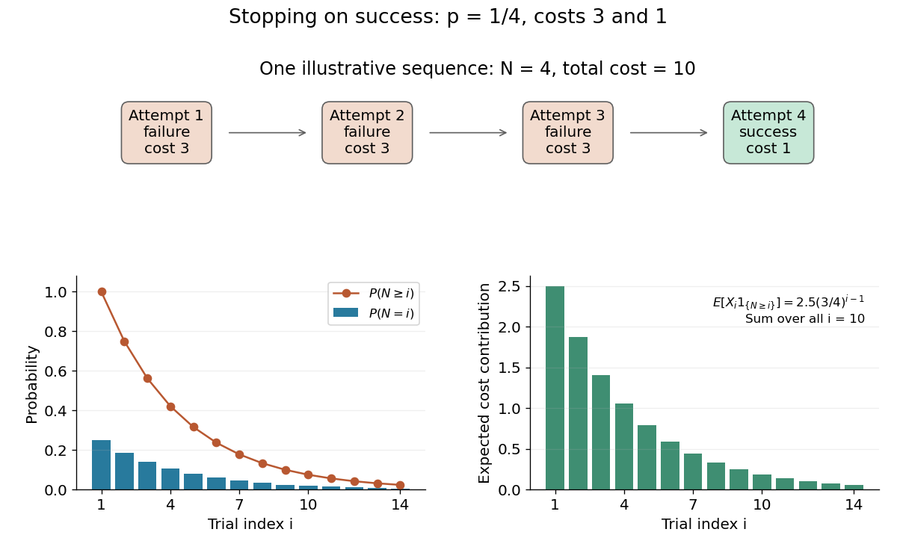

# Cost of trials until the first success

↑ **Parent:** [Wald's equation](wald-s-equation.md)

Consider a stipulated repeated-attempt model, with [independent](independent-random-variables.md) [Bernoulli trials](bernoulli-trial.md) of success [probability](probability.md) $p\in(0,1]$. An unsuccessful attempt costs three units of work, and a successful attempt costs one. Let $B_i$ be its success [indicator function](indicator-function.md), $X_i=3-2B_i$ its cost, and $N=\inf\{i\geq1:B_i=1\}$ the first success. Observing $X_i$ reveals $B_i$, so $N$ is a [stopping time](stopping-time.md) for the costs' [natural filtration](natural-filtration.md). The [geometric distribution](geometric-distribution.md) gives $\mathbb P(N\geq i)=(1-p)^{i-1}$ and $\mathbb E[N]=1/p$, including the deterministic case $p=1$. Thus

$$
\mathbb E[X_1]=3-2p,\qquad \boxed{\mathbb E[S_N]=(3-2p)/p=3/p-2.}
$$

At $p=1/4$, the average is **four attempts and ten units of work**. An independent check uses the pathwise identity $S_N=3(N-1)+1$: there are $N-1$ failures and one final success. No success probabilities or costs in this example are measured data.

**[Figure 11](#image-cost-and-survival-probabilities-for-stopping-at-the-first-success). Cost and survival probabilities for stopping at the first success**. Original stipulated model with success [probability](probability.md) $1/4$, failure cost three, and success cost one. The top shows one illustrative stopped sequence; the lower panels show exact [probabilities](probability.md) and the contributions to the [expected value](expected-value-split.md) from each admitted step.

Here $N$ is not [independent](independent-random-variables.md) of the observed costs. In particular, conditioning on $N=n$ forces every preceding cost to be three and the final cost to be one, so $\mathbb E[S_N\mid N=n]=3n-2$, generally different from $n\mathbb E[X_1]=(5/2)n$ at $p=1/4$. Nevertheless the unconditional identity holds. This distinction explains why conditioning on the total count as though the original cost law remained unchanged is a faulty proof.

## ↑ Ancestors (6)

1. [Wald's equation](wald-s-equation.md)
2. [Probability theory](probability-theory-split.md)
3. [Probability and statistics](probability-and-statistics-split.md)
4. [Area of mathematics](area-of-mathematics.md)
5. [Mathematics](mathematics-split.md)
6. [Codex Wiki](split.md)
