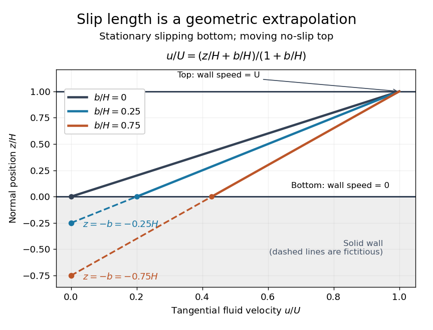

# Couette flow with a slipping lower wall

↑ **Parent:** [Slip length](slip-length.md)

Consider [steady flow](steady-flow.md) of a [Newtonian fluid](newtonian-fluid.md) in [incompressible flow](incompressible-flow.md) with constant [dynamic viscosity](dynamic-viscosity-split.md) $\mu>0$ between parallel plates at $z=0$ and $z=H$. The bottom plate is stationary and obeys the [Navier slip boundary condition](navier-slip-boundary-condition.md) with [slip length](slip-length.md) $b$. The top plate moves at [velocity](velocity.md) $U>0$ and obeys the [no-slip boundary condition](no-slip-boundary-condition.md). There is no streamwise [pressure gradient](pressure-gradient.md) or body [force](force-split.md). The [Couette flow](couette-flow.md) solution is

$$
u(z)=U\frac{z+b}{H+b},\qquad
u(0)=\frac{Ub}{H+b},\qquad
\tau=\mu u'(z)=\frac{\mu U}{H+b}.
$$

Here $\tau$ is the constant [shear stress](shear-stress.md) magnitude. The lower wall's [Navier slip boundary condition](navier-slip-boundary-condition.md) holds exactly because $bu'(0)=bU/(H+b)=u(0)$. At the top, $u(H)=U$ is exactly the prescribed [no-slip boundary condition](no-slip-boundary-condition.md); no finite upper-wall [slip length](slip-length.md) is imposed in this example.

For a numerical example, stipulate $H=10\,\mathrm{\mu m}$, $b=2\,\mathrm{\mu m}$, $U=1\,\mathrm{mm\,s^{-1}}$ and $\mu=10^{-3}\,\mathrm{Pa\,s}$. The bottom [velocity](velocity.md) is $0.167\,\mathrm{mm\,s^{-1}}$ and the [shear stress](shear-stress.md) is $0.0833\,\mathrm{Pa}$, compared with $0.100\,\mathrm{Pa}$ when both plates obey the [no-slip boundary condition](no-slip-boundary-condition.md). The extrapolated profile reaches zero at $z=-2\,\mathrm{\mu m}$.

**[Figure 5](#image-couette-profiles-reveal-slip-length-by-extrapolation-beneath-the-lower-wall). Couette profiles reveal slip length by extrapolation beneath the lower wall**. The bottom wall is stationary with [slip length](slip-length.md) $b$; the upper wall at $z=H$ moves at [velocity](velocity.md) $U$ with a [no-slip boundary condition](no-slip-boundary-condition.md). Solid lines show [Couette flow](couette-flow.md) for $b/H=0$, $0.25$ and $0.75$. Dashed continuations inside the shaded solid reach zero at $z=-b$. Increasing [slip length](slip-length.md) reduces the [shear rate](shear-rate.md) required for the same upper-wall [velocity](velocity.md).

For fixed $H$, $U$ and $\mu$, $b\to0$ recovers $u=Uz/H$. As $b\to\infty$, $u\to U$ throughout the gap and $\tau\to0$: the moving upper wall selects the limiting uniform [velocity](velocity.md), while the lower wall approaches a [stress-free boundary condition](stress-free-boundary-condition.md). The [dynamic viscosity](dynamic-viscosity-split.md) stays positive; the disappearing [shear stress](shear-stress.md) comes from the disappearing [velocity gradient](velocity-gradient.md).

A short derivation uses [unidirectional flow](unidirectional-flow.md): the [convective acceleration](convective-acceleration.md) vanishes and the [Navier-Stokes equation](navier-stokes-equation.md) reduces to $\mu u''=0$. Write $u=Az+B$. The bottom condition gives $B=bA$ and the top condition gives $A(H+b)=U$.

## ↑ Ancestors (6)

1. [Slip length](slip-length.md)
2. [Navier slip boundary condition](navier-slip-boundary-condition.md)
3. [Fluid mechanics](fluid-mechanics-split.md)
4. [Branches of physics](branches-of-physics.md)
5. [Physics](physics-split.md)
6. [Codex Wiki](split.md)

## ← Incoming links (3)

- [Navier slip boundary condition](navier-slip-boundary-condition.md)
- [Planar Poiseuille flow with equal wall slip](planar-poiseuille-flow-with-equal-wall-slip.md)
- [Wall friction in the Navier slip boundary condition](wall-friction-in-the-navier-slip-boundary-condition.md)
