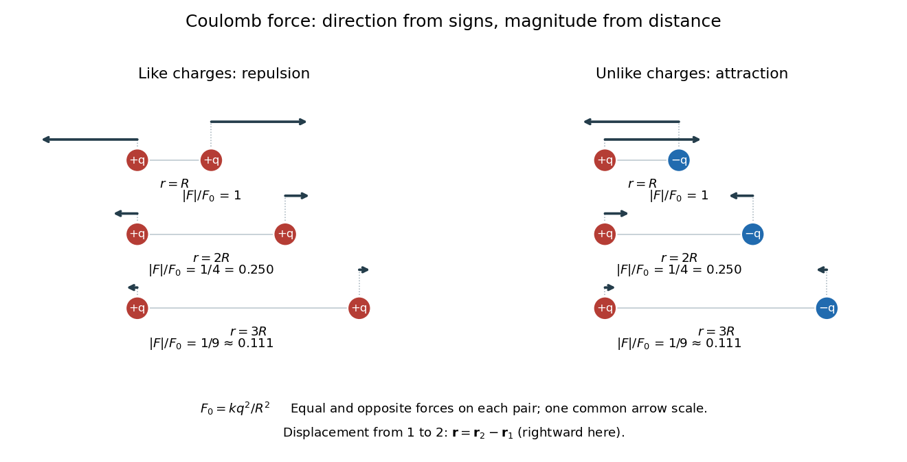

<h1 id="coulomb-s-law">Coulomb's law</h1>

↑ **Parent:** [Electrostatics](electrostatics.md)  
ⓦ [Wiki](https://en.wikipedia.org/wiki/Coulomb's_law)

[Coulomb's law](coulomb-s-law.md) gives the mutual [electric force](electric-force.md) between stationary [point charges](point-charge.md) in [vacuum](vacuum.md). Put [electric charges](electric-charge.md) $q_1$ and $q_2$ at $\mathbf r_1$ and $\mathbf r_2$, and define the [displacement](displacement.md) **from charge 1 to charge 2** by $\mathbf r=\mathbf r_2-\mathbf r_1$, with separation $r=|\mathbf r|>0$ and [unit vector](unit-vector.md) $\widehat{\mathbf r}=\mathbf r/r$. In [SI](international-system-of-units.md) units, the [force](force.md) on charge 2 due to charge 1 is

$$
\boxed{\mathbf F_{2\leftarrow1}=kq_1q_2\frac{\mathbf r}{|\mathbf r|^3}=\frac{kq_1q_2}{r^2}\widehat{\mathbf r},\qquad k=\frac{1}{4\pi\varepsilon_0}.}
$$

Here $\varepsilon_0$ is the [vacuum permittivity](vacuum-permittivity.md). The magnitude is $k|q_1q_2|/r^2$. If $q_1q_2>0$, the [force](force.md) on charge 2 points away from charge 1; if $q_1q_2<0$, it points toward charge 1. Interchanging the charges gives $\mathbf F_{1\leftarrow2}=-\mathbf F_{2\leftarrow1}$, consistent with [Newton's third law](newton-s-third-law.md) in this electrostatic setting. [OpenStax, University Physics II, §5.3: Coulomb's law](https://openstax.org/books/university-physics-volume-2/pages/5-3-coulombs-law).

For a fully computed example, stipulate $q_1=+2\,\mathrm{nC}$, $q_2=-3\,\mathrm{nC}$, $\mathbf r_1=\mathbf0$, $\mathbf r_2=0.20\,\mathrm m\,\widehat{\mathbf x}$ and the approximate value $k=8.99\times10^9\,\mathrm{N\,m^2/C^2}$. Then

$$
\mathbf F_{2\leftarrow1}=\frac{(8.99\times10^9)(2\times10^{-9})(-3\times10^{-9})}{(0.20)^2}\,\mathrm N\,\widehat{\mathbf x}=-1.3485\times10^{-6}\,\mathrm N\,\widehat{\mathbf x}.
$$

The [force](force.md) is attractive, of magnitude $1.3485\times10^{-6}\,\mathrm N$. The source [electric field](electric-field.md) at charge 2 is $\mathbf E_1(\mathbf r_2)=449.5\,\mathrm{N/C}\,\widehat{\mathbf x}$, pointing away from the positive source. Multiplication by the negative $q_2$ reverses the direction to give the attractive [force](force.md). This field excludes charge 2's own self-field.

Holding the [electric charges](electric-charge.md) fixed while changing the separation from $R$ to $2R$ or $3R$ gives the normalized [inverse-square law](inverse-square-law.md) values

$$
\frac{|\mathbf F(R)|}{|\mathbf F(R)|}=1,\qquad \frac{|\mathbf F(2R)|}{|\mathbf F(R)|}=\frac14,\qquad \frac{|\mathbf F(3R)|}{|\mathbf F(R)|}=\frac19.
$$

For the stipulated example, separations $0.20$, $0.40$ and $0.60\,\mathrm m$ give magnitudes $1.3485\times10^{-6}$, $3.37125\times10^{-7}$ and $1.498333\ldots\times10^{-7}\,\mathrm N$. The diagram computes these ratios and uses one common arrow-length scale for both sign choices.

**[Figure 40](#image-equal-and-opposite-coulomb-force-vectors-like-charges-repel-unlike-charges-attract-and-doubling-or-tripling-separation-gives-one-quarter-or-one-ninth-of-the-force). Equal and opposite Coulomb force vectors: like charges repel, unlike charges attract, and doubling or tripling separation gives one quarter or one ninth of the force**.

The [inverse-square law](inverse-square-law.md) has a geometric explanation through [Gauss's law](gauss-s-law.md): a source [point charge](point-charge.md) gives fixed total [electric flux](electric-flux.md) through a concentric [sphere](sphere.md), whose [surface area](surface-area.md) is $4\pi r^2$. Dividing that flux by the area gives a radial [electric field](electric-field.md) proportional to $1/r^2$. This connects a pairwise [force](force.md) calculation to a global conservation-like accounting of field sources. For several stationary [point charges](point-charge.md), the [superposition principle](superposition-principle.md) adds the individual [electric fields](electric-field.md) as [vectors](vector.md), and $\mathbf F_i=q_i\mathbf E_{\mathrm{other}}(\mathbf r_i)$ uses all sources except charge $i$ itself. The [Coulomb potential energy](coulomb-potential-energy.md) gives an alternative route when the desired quantity is [work](work.md) rather than instantaneous [force](force.md).

**Table of contents**

- [Coulomb potential energy](coulomb-potential-energy.md)

## ↑ Ancestors (5)

1. [Electrostatics](electrostatics.md)
2. [Electromagnetism](electromagnetism-split.md)
3. [Branches of physics](branches-of-physics.md)
4. [Physics](physics-split.md)
5. [Codex Wiki](split.md)

## ← Incoming links (25)

- [Coulomb](coulomb.md)
- [Coulomb potential energy](coulomb-potential-energy.md)
- [Coulomb's law](coulomb-s-law.md)
- [Electric charge](electric-charge.md)
- [Electric dipole](electric-dipole.md)
- [Electric flux](electric-flux.md)
- [Electric potential](electric-potential.md)
- [Electromagnetism](electromagnetism-split.md)
- [Electrostatic model of ionic binding](electrostatic-model-of-ionic-binding.md)
- [Electrostatics](electrostatics.md)
- [Image charge for a grounded conducting sphere](image-charge-for-a-grounded-conducting-sphere.md)
- [Ionic Coulomb coupling parameter](ionic-coulomb-coupling-parameter.md)
- [Ionic crystal](ionic-crystal.md)
- [Solution](past-exam-of-the-mathematics-course-of-the-university-of-cambridge/2003/iii/paper-58/6/solution.md)
- [Solution](past-exam-of-the-mathematics-course-of-the-university-of-cambridge/2004/ib/paper-3/9d/solution.md)
- [Solution](past-exam-of-the-mathematics-course-of-the-university-of-cambridge/2008/ib/paper-1/15a/solution.md)
- [Solution](past-exam-of-the-mathematics-course-of-the-university-of-cambridge/2009/ia/paper-4/12a/b/solution.md)
- [Solution](past-exam-of-the-mathematics-course-of-the-university-of-cambridge/2014/iii/paper-55/4/solution.md)
- [Solution](past-exam-of-the-mathematics-course-of-the-university-of-cambridge/2016/ia/paper-4/3b/vii/solution.md)
- [Solution](past-exam-of-the-mathematics-course-of-the-university-of-cambridge/2017/ib/paper-3/17c/ii/solution.md)
- [Solution](past-exam-of-the-mathematics-course-of-the-university-of-cambridge/2019/ia/paper-4/10a/b/i/solution.md)
- [Solution](past-exam-of-the-mathematics-course-of-the-university-of-cambridge/2022/ib/paper-4/4b/a/solution.md)
- [Solution](past-exam-of-the-mathematics-course-of-the-university-of-cambridge/2023/ib/paper-4/5d/c/solution.md)
- [Torsion balance](torsion-balance.md)
- [Vacuum permittivity](vacuum-permittivity.md)
