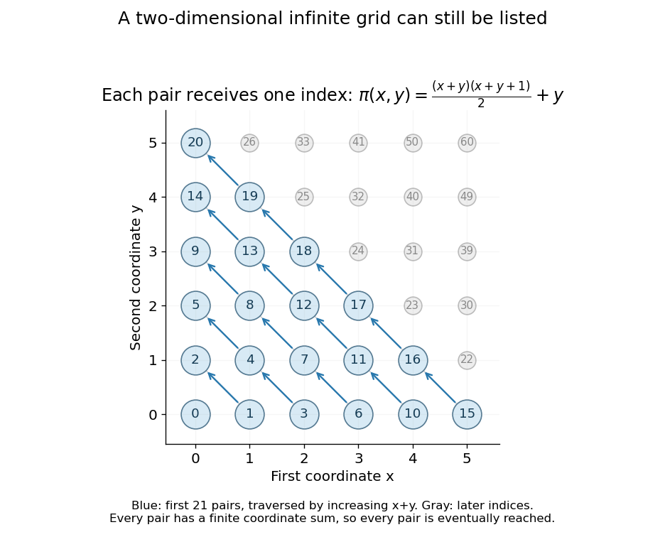

# Countable set

↑ **Parent:** [Cardinal number](cardinal-number-split.md)  
ⓦ [Wiki](https://en.wikipedia.org/wiki/Countable_set)

A countable set is a [set](set-split.md) that admits an [injective function](injective-function.md) into the [natural numbers](natural-number.md). It is therefore either a [finite set](finite-set.md) or a [countably infinite set](countably-infinite-set.md).

For a [countably infinite set](countably-infinite-set.md), countability means that its members can be arranged as a [sequence](sequence.md) in which every member occurs exactly once. The order need not resemble the order already present in the [set](set-split.md). For example, the [integers](integer-split.md) can be listed as $0,1,-1,2,-2,\ldots$. Simply increasing through positive values would never reach a negative one.

The [Cartesian product](cartesian-product.md) $\mathbb N^2$ needs a similar change of strategy. Listing a whole horizontal row first would never finish that row, so later rows would be missed. Instead list pairs by increasing coordinate sum $x+y$, and within each finite diagonal by increasing $y$:

$$
(0,0),\ (1,0),\ (0,1),\ (2,0),\ (1,1),\ (0,2),\ldots.
$$

Every pair has a finite coordinate sum and therefore appears after finitely many earlier pairs. This is the construction made explicit by the [Cantor pairing function](cantor-pairing-function.md). It explains why having two infinite coordinates does not, by itself, mean a larger [cardinality](cardinality.md).

**[Figure 1](#image-enumerating-natural-number-pairs-along-finite-diagonals-reaches-every-point-of-the-infinite-grid). Enumerating natural-number pairs along finite diagonals reaches every point of the infinite grid**.

**Table of contents**

- [Countability of disjoint positive-length intervals](countability-of-disjoint-positive-length-intervals.md)
- [Countability of finite subsets of a countable set](countability-of-finite-subsets-of-a-countable-set.md)
- [Cardinalities of monotone natural-number functions](cardinalities-of-monotone-natural-number-functions.md)
- [Countability of integer polynomial rings](countability-of-integer-polynomial-rings.md)
- [Countable closure under real polynomial roots](countable-closure-under-real-polynomial-roots.md)
- [Countability of pairwise disjoint open disks](countability-of-pairwise-disjoint-open-disks.md)
- [Increasing chain of countable sets](increasing-chain-of-countable-sets.md)
  - [Cardinal bound for an increasing chain of countable sets](cardinal-bound-for-an-increasing-chain-of-countable-sets.md)
- [Finite Cartesian power of a countable set](finite-cartesian-power-of-a-countable-set.md)
- [Countable union of explicitly ordered finite lists without choice](countable-union-of-explicitly-ordered-finite-lists-without-choice.md)
- [Countability from vanishing averages of distinct sequences](countability-from-vanishing-averages-of-distinct-sequences.md)
- [Countably infinite set](countably-infinite-set.md)
  - [Increasing enumeration of an infinite subset of natural numbers](increasing-enumeration-of-an-infinite-subset-of-natural-numbers.md)
- [Countable union of countable sets](countable-union-of-countable-sets.md)
  - [Parabola obstruction to countable line coverings](parabola-obstruction-to-countable-line-coverings.md)
- [Cantor pairing function](cantor-pairing-function.md)
- [Cantor's diagonal argument](cantor-s-diagonal-argument.md)

## ↑ Ancestors (6)

1. [Cardinal number](cardinal-number-split.md)
2. [Set theory](set-theory-split.md)
3. [Foundations of mathematics](foundations-of-mathematics-split.md)
4. [Area of mathematics](area-of-mathematics.md)
5. [Mathematics](mathematics-split.md)
6. [Codex Wiki](split.md)

## ← Incoming links (72)

- [Absolutely normal number](absolutely-normal-number.md)
- [Bounded nondecreasing integer sequences are eventually constant](bounded-nondecreasing-integer-sequences-are-eventually-constant.md)
- [Cantor's diagonal argument](cantor-s-diagonal-argument.md)
- [Cardinality of integer-periodic function spaces](cardinality-of-integer-periodic-function-spaces.md)
- [Countability from vanishing averages of distinct sequences](countability-from-vanishing-averages-of-distinct-sequences.md)
- [Countability of disjoint positive-length intervals](countability-of-disjoint-positive-length-intervals.md)
- [Countability of finite subsets of a countable set](countability-of-finite-subsets-of-a-countable-set.md)
- [Countability of pairwise disjoint open disks](countability-of-pairwise-disjoint-open-disks.md)
- [Countable chain condition for forcing](countable-chain-condition-for-forcing.md)
- [Countable closure under real polynomial roots](countable-closure-under-real-polynomial-roots.md)
- [Countable ordinal](countable-ordinal.md)
- [Dense countable family of cofinite infinite subsets](dense-countable-family-of-cofinite-infinite-subsets.md)
- [Discrete probability distribution](discrete-probability-distribution-split.md)
- [Discrete random variable](discrete-random-variable.md)
- [Discrete subsets of the real line are countable](discrete-subsets-of-the-real-line-are-countable.md)
- [Ergodic invariant probability on a countable state space has finite cyclic support](ergodic-invariant-probability-on-a-countable-state-space-has-finite-cyclic-support.md)
- [Essential infimum and essential supremum](essential-infimum-and-essential-supremum.md)
- [Essentially bounded function](essentially-bounded-function.md)
- [Finite Cartesian power of a countable set](finite-cartesian-power-of-a-countable-set.md)
- [Finitely supported permutation](finitely-supported-permutation.md)
- [First uncountable ordinal is regular](first-uncountable-ordinal-is-regular.md)
- [Foundations of mathematics](foundations-of-mathematics-split.md)
- [Hereditarily countable set](hereditarily-countable-set.md)
- [Independent compound Poisson jumps cannot cancel](independent-compound-poisson-jumps-cannot-cancel.md)
- [Lebesgue measure](lebesgue-measure.md)
- [Solution](past-exam-of-the-mathematics-course-of-the-university-of-cambridge/2002/ia/paper-4/5f/solution.md)
- [Solution](past-exam-of-the-mathematics-course-of-the-university-of-cambridge/2003/ia/paper-4/5c/solution.md)
- [Solution](past-exam-of-the-mathematics-course-of-the-university-of-cambridge/2005/ia/paper-4/5e/solution.md)
- [Solution](past-exam-of-the-mathematics-course-of-the-university-of-cambridge/2005/iii/paper-16/4/c/solution.md)
- [Solution](past-exam-of-the-mathematics-course-of-the-university-of-cambridge/2006/ia/paper-4/8e/solution.md)
- [Solution](past-exam-of-the-mathematics-course-of-the-university-of-cambridge/2007/ia/paper-4/6e/solution.md)
- [Solution](past-exam-of-the-mathematics-course-of-the-university-of-cambridge/2008/ia/paper-4/5d/a/solution.md)
- [Solution](past-exam-of-the-mathematics-course-of-the-university-of-cambridge/2008/ia/paper-4/5d/b/solution.md)
- [Solution](past-exam-of-the-mathematics-course-of-the-university-of-cambridge/2008/ia/paper-4/5d/c/solution.md)
- [Solution](past-exam-of-the-mathematics-course-of-the-university-of-cambridge/2009/ia/paper-4/8e/solution.md)
- [Solution](past-exam-of-the-mathematics-course-of-the-university-of-cambridge/2009/ii/paper-4/16g/solution.md)
- [Solution](past-exam-of-the-mathematics-course-of-the-university-of-cambridge/2010/ia/paper-4/8e/solution.md)
- [Solution](past-exam-of-the-mathematics-course-of-the-university-of-cambridge/2011/ia/paper-4/8e/solution.md)
- [Solution](past-exam-of-the-mathematics-course-of-the-university-of-cambridge/2012/iii/paper-83/2/solution.md)
- [Solution](past-exam-of-the-mathematics-course-of-the-university-of-cambridge/2013/ia/paper-4/7e/i/solution.md)
- [Solution](past-exam-of-the-mathematics-course-of-the-university-of-cambridge/2013/ia/paper-4/7e/ii/solution.md)
- [Solution](past-exam-of-the-mathematics-course-of-the-university-of-cambridge/2014/ia/paper-4/7e/i/solution.md)
- [Solution](past-exam-of-the-mathematics-course-of-the-university-of-cambridge/2014/ia/paper-4/7e/iii/solution.md)
- [8E](past-exam-of-the-mathematics-course-of-the-university-of-cambridge/2015/ia/paper-4/8e.md)
- [Solution](past-exam-of-the-mathematics-course-of-the-university-of-cambridge/2015/ia/paper-4/8e/a/solution.md)
- [Solution](past-exam-of-the-mathematics-course-of-the-university-of-cambridge/2015/ia/paper-4/8e/b/i/solution.md)
- [Solution](past-exam-of-the-mathematics-course-of-the-university-of-cambridge/2015/ia/paper-4/8e/b/ii/solution.md)
- [Solution](past-exam-of-the-mathematics-course-of-the-university-of-cambridge/2015/ia/paper-4/8e/b/solution.md)
- [Solution](past-exam-of-the-mathematics-course-of-the-university-of-cambridge/2017/ia/paper-4/6d/a/solution.md)
- [Solution](past-exam-of-the-mathematics-course-of-the-university-of-cambridge/2017/ib/paper-1/12e/b/solution.md)
- [Solution](past-exam-of-the-mathematics-course-of-the-university-of-cambridge/2017/ii/paper-4/2f/solution.md)
- [Solution](past-exam-of-the-mathematics-course-of-the-university-of-cambridge/2018/ia/paper-4/8e/solution.md)
- [Solution](past-exam-of-the-mathematics-course-of-the-university-of-cambridge/2018/ii/paper-4/26j/e/solution.md)
- [Solution](past-exam-of-the-mathematics-course-of-the-university-of-cambridge/2018/iii/paper-121/3/iv/b/solution.md)
- [Solution](past-exam-of-the-mathematics-course-of-the-university-of-cambridge/2019/ia/paper-4/8e/a/solution.md)
- [Solution](past-exam-of-the-mathematics-course-of-the-university-of-cambridge/2019/iii/paper-121/1/i/e/solution.md)
- [Solution](past-exam-of-the-mathematics-course-of-the-university-of-cambridge/2019/iii/paper-121/1/ii/solution.md)
- [Solution](past-exam-of-the-mathematics-course-of-the-university-of-cambridge/2019/iii/paper-121/1/iii/solution.md)
- [Solution](past-exam-of-the-mathematics-course-of-the-university-of-cambridge/2019/iii/paper-121/2/iii/solution.md)
- [Solution](past-exam-of-the-mathematics-course-of-the-university-of-cambridge/2019/iii/paper-121/3/v/a/solution.md)
- [Solution](past-exam-of-the-mathematics-course-of-the-university-of-cambridge/2020/ia/paper-2/8d/a/solution.md)
- [Solution](past-exam-of-the-mathematics-course-of-the-university-of-cambridge/2022/ia/paper-4/8f/a/solution.md)
- [Solution](past-exam-of-the-mathematics-course-of-the-university-of-cambridge/2023/ii/paper-3/16h/c/i/solution.md)
- [Solution](past-exam-of-the-mathematics-course-of-the-university-of-cambridge/2024/ia/paper-4/8e/a/solution.md)
- [Solution](past-exam-of-the-mathematics-course-of-the-university-of-cambridge/2025/ia/paper-4/8d/solution.md)
- [Solution](past-exam-of-the-mathematics-course-of-the-university-of-cambridge/2026/ia/paper-4/8e/a/solution.md)
- [Plane minus a countable set is path connected](plane-minus-a-countable-set-is-path-connected.md)
- [Probability mass function](probability-mass-function.md)
- [Tail probability](tail-probability.md)
- [Tail-sum formula](tail-sum-formula.md)
- [Universal planar set for countable real sections](universal-planar-set-for-countable-real-sections.md)
- [Upward absoluteness of countability](upward-absoluteness-of-countability.md)
