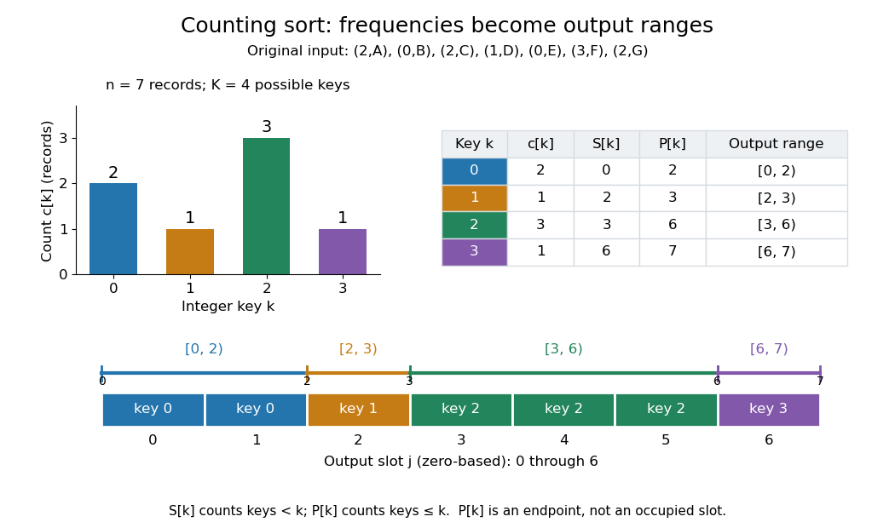

# Counting sort prefix ranges

↑ **Parent:** [Counting sort](counting-sort.md)

For $n\geq0$ [sorting records](sorting-record.md) with [integer](integer-split.md) [sort keys](sort-key.md) in $\{0,\ldots,K-1\}$, where $K\geq1$, let $c_k$ count the [input](input-computer-science.md) occurrences of [sort key](sort-key.md) $k$. Define two [prefix sums](prefix-sum.md):

$$
S_k=\sum_{h=0}^{k-1}c_h,\qquad P_k=\sum_{h=0}^{k}c_h=S_k+c_k.
$$

The [empty sum](empty-sum.md) gives $S_0=0$. Here $c_k,S_k,P_k$ are counts of [sorting records](sorting-record.md). Exactly $S_k$ [sorting records](sorting-record.md) have smaller [sort keys](sort-key.md), so the [output](output-computing.md) positions for [sort key](sort-key.md) $k$ form the half-open [integer interval](integer-interval.md)

$$
\{j\in\mathbb Z:S_k\leq j<P_k\}=[S_k,P_k)\cap\mathbb Z.
$$

Its right endpoint $P_k$ is excluded: the last occupied [array index](array-index.md) is $P_k-1$ when $c_k>0$.[Open Data Structures: An Introduction by Pat Morin; §11.2.1 Counting Sort, paragraphs after Figure 11.7: running sums count keys at most k and determine the output block](open-data-structures-an-introduction-by-pat-morin/11-2-counting-sort-and-radix-sort.md)

For the seven-[sorting record](sorting-record.md) example, the frequency [array](array-data-structure.md), inclusive cumulative count [array](array-data-structure.md), and start [array](array-data-structure.md) are

$$
c=(2,1,3,1),\qquad P=(2,3,6,7),\qquad S=(0,2,3,6).
$$

Thus [sort keys](sort-key.md) zero, one, two and three occupy the [integer intervals](integer-interval.md) $[0,2)$, $[2,3)$, $[3,6)$ and $[6,7)$, respectively. In particular, the three [sorting records](sorting-record.md) with [sort key](sort-key.md) two belong at [array indices](array-index.md) three, four and five. The inclusive cumulative count $P_2=6$ counts all six [sorting records](sorting-record.md) with [sort keys](sort-key.md) at most two; six is the exclusive endpoint, not the final position of a [sorting record](sorting-record.md) with [sort key](sort-key.md) two.

**[Figure 20](#image-frequencies-and-prefix-sums-reserve-disjoint-counting-sort-output-ranges). Frequencies and prefix sums reserve disjoint counting sort output ranges**. Original seven-[sorting record](sorting-record.md) example with $K=4$. The bar heights count [sorting records](sorting-record.md). The table gives the start $S_k$ and exclusive endpoint $P_k$ for each [sort key](sort-key.md); the lower strip shows zero-based [output](output-computing.md) [array indices](array-index.md). The boundary seven lies just beyond the last slot six.

These [integer intervals](integer-interval.md) fit together because $P_k=S_{k+1}$ for $k<K-1$, and $P_{K-1}=n$. Their lengths $P_k-S_k=c_k$ add to $n$, so they partition all [output](output-computing.md) positions without overlaps or gaps. An absent [sort key](sort-key.md) contributes an empty [integer interval](integer-interval.md): with frequencies $(0,2,0,1)$, the endpoints are $(0,2,2,3)$ and [sort key](sort-key.md) two has range $[2,2)$. For empty [input](input-computer-science.md), every count and endpoint is zero; every reserved [integer interval](integer-interval.md) is empty. This makes the same formulas cover missing [sort keys](sort-key.md) and the empty case.

## ↑ Ancestors (5)

1. [Counting sort](counting-sort.md)
2. [Sorting algorithm](sorting-algorithm.md)
3. [Algorithm](algorithm-split.md)
4. [Computer science](computer-science-split.md)
5. [Codex Wiki](split.md)

## ← Incoming links (1)

- [Counting sort](counting-sort.md)
