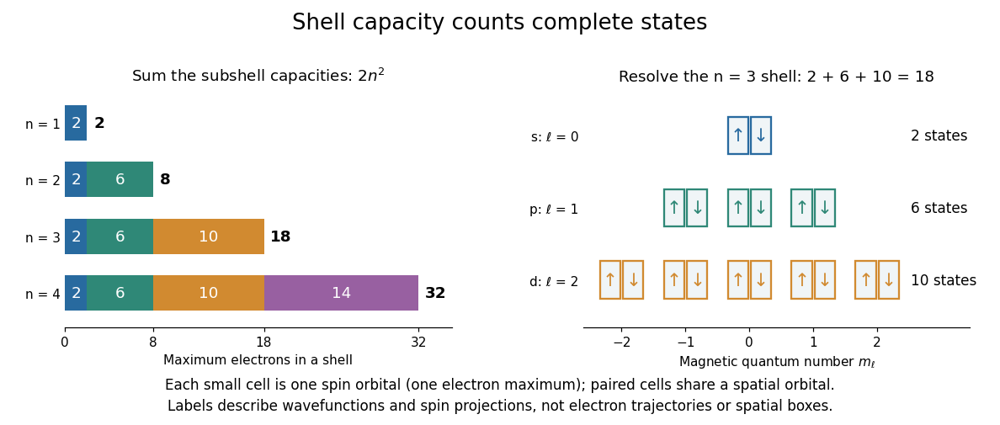

# Counting spin orbitals in an electron shell

↑ **Parent:** [Pauli exclusion principle](pauli-exclusion-principle.md)

Choose the [one-particle states](one-particle-state.md) of a [hydrogen atom](hydrogen-atom.md), or a central-field description of a [chemical atom](atom-physics.md), with labels

$$
n=1,2,\ldots,\qquad \ell=0,1,\ldots,n-1,\qquad m_\ell=-\ell,\ldots,\ell,\qquad m_s=\pm\tfrac12.
$$

The [principal quantum number](principal-quantum-number.md) $n$ identifies the [electron shell](electron-shell.md). The [orbital angular momentum](orbital-angular-momentum.md) label $\ell$ identifies the [electron subshell](electron-subshell.md); the [magnetic quantum number](magnetic-quantum-number.md) $m_\ell$ labels $2\ell+1$ independent [spatial orbitals](spatial-orbital.md). Each has two [spin one-half along an axis](spin-one-half-along-an-axis.md) choices, hence $2(2\ell+1)$ [spin orbitals](spin-orbital.md). Applying the [Pauli exclusion principle](pauli-exclusion-principle.md) once per [spin orbital](spin-orbital.md) gives

$$
N_{\max}(n)=\sum_{\ell=0}^{n-1}2(2\ell+1)=2\left(2\frac{n(n-1)}2+n\right)=2n^2.
$$

These [quantum numbers](quantum-number.md) label [wavefunctions](wave-function-split.md) and [spin](spin.md) projections, not [electron](electron.md) trajectories. They need not resolve exact [energy eigenstates](energy-eigenstate.md) in the presence of [spin-orbit interaction](spin-orbit-interaction.md); changing to coupled [angular momentum eigenstates](angular-momentum-eigenstate.md) preserves the count of independent [one-particle states](one-particle-state.md) within this shell model.

**[Figure 2](#image-counting-complete-spin-orbitals-gives-electron-shell-capacities-2-8-18-32). Counting complete spin orbitals gives electron-shell capacities $2,8,18,32$**. Original counting diagram. The left bars add [electron subshell](electron-subshell.md) capacities $2,6,10,14$; the right panel resolves the $n=3$ [electron shell](electron-shell.md) into eighteen [spin orbitals](spin-orbital.md). Each small cell denotes a label choice, not a region of space.

For example, $n=3$ allows $\ell=0,1,2$, conventionally $3s,3p,3d$. Their [spatial orbital](spatial-orbital.md) counts are $1,3,5$; their [spin orbital](spin-orbital.md) counts are $2,6,10$. The sum is eighteen. The algebra behind “one per complete state” is short: [two-particle antisymmetrization](two-particle-antisymmetrization.md) gives $u\wedge u=(u\otimes u-u\otimes u)/\sqrt2=0$, and the zero [vector](vector.md) cannot be a normalized [quantum state](quantum-state.md). Opposite-[spin](spin.md) [electrons](electron.md) in the same [spatial orbital](spatial-orbital.md) have distinct complete states, so their antisymmetric product survives.

This supplies a structural link to the [periodic table](periodic-table.md): finite [electron subshell](electron-subshell.md) capacities make repeated patterns of occupied [electron configurations](electron-configuration.md) possible. It does not predict the exact [ground state](ground-state.md) [electron configuration](electron-configuration.md) or [energy](energy-split.md) of a many-[electron](electron.md) [chemical atom](atom-physics.md). Different [electron subshells](electron-subshell.md) overlap in [energy](energy-split.md), and [electron](electron.md) interactions change their ordering. In particular, the [periodic table period](period-periodic-table.md) lengths are not simply successive $2n^2$ values: the third [periodic table period](period-periodic-table.md) has eight [chemical elements](chemical-element.md), although the full $n=3$ [electron shell](electron-shell.md) has eighteen available states. A capacity counts available [spin orbitals](spin-orbital.md); an actual filling order requires a [Quantum Hamiltonian](hamiltonian-quantum-mechanics.md).

## ↑ Ancestors (10)

1. [Pauli exclusion principle](pauli-exclusion-principle.md)
2. [Fermion](fermion.md)
3. [Indistinguishable particles](indistinguishable-particles.md)
4. [Particle exchange operator](particle-exchange-operator.md)
5. [Multiparticle quantum state](multiparticle-quantum-state.md)
6. [Tensor product of quantum systems](tensor-product-of-quantum-systems-split.md)
7. [Quantum mechanics](quantum-mechanics-split.md)
8. [Branches of physics](branches-of-physics.md)
9. [Physics](physics-split.md)
10. [Codex Wiki](split.md)
