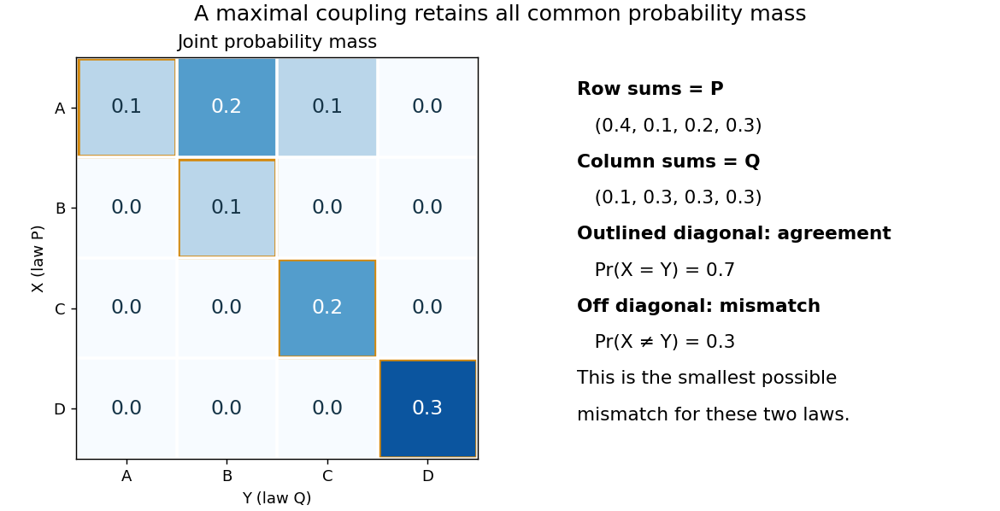

# Coupling characterization of total variation distance

↑ **Parent:** [Total variation distance](total-variation-distance.md)

A [coupling of probability distributions](coupling.md) $P,Q$ is a pair of [random variables](random-variable-split.md) $(X,Y)$ with those [marginal distributions](marginal-distribution.md). On a [finite set](finite-set.md), and more generally on a [standard Borel space](standard-borel-space.md), the least achievable mismatch is

$$
d_{\mathrm{TV}}(P,Q)=\min\{\mathbb P(X\ne Y):(X,Y)\text{ is a coupling of }P,Q\}.
$$

A [maximal coupling](maximal-coupling.md) attains the minimum; maximal here refers to agreement. An arbitrary [coupling](coupling.md) can have a much larger mismatch.[§4.2, Example 4.6 and Proposition 4.7, printed pp. 49–52: finite-state coupling and common-mass construction](markov-chains-and-mixing-times-second-edition-by-david-a-levin-and-others.md)

For the four-outcome example, assign the following joint [probability mass](probability-mass.md): $(A,A)$ gets $0.1$, $(B,B)$ gets $0.1$, $(C,C)$ gets $0.2$, and $(D,D)$ gets $0.3$. The remaining $0.3$ must have $X=A$; place $0.2$ on $(A,B)$ and $0.1$ on $(A,C)$. Row sums give $P$, column sums give $Q$, and the [diagonal](diagonal-subset.md) contains $0.7$. **Agreement can reach 70%; mismatch cannot fall below 30%.**

**[Figure 10](#image-total-variation-maximal-coupling). A maximal coupling of two four-outcome probability distributions**. The original joint-mass example retains all common [probability mass](probability-mass.md) on its diagonal. The two off-diagonal entries account for the minimum mismatch $0.3$.

To see the lower bound, for any [event](event.md) $E$,

$$
|P(E)-Q(E)|=|\mathbb E(\mathbf1_E(X)-\mathbf1_E(Y))|\leq\mathbb P(X\ne Y).
$$

The two [indicator functions](indicator-function.md) agree whenever $X=Y$. To attain the bound on a [finite set](finite-set.md), keep mass $\min\{P(x),Q(x)\}$ at $(x,x)$ and couple the remaining excesses. The two residual [probability distributions](probability-distribution.md) live on disjoint [subsets](subset.md), so their part necessarily mismatches. When the [probability distributions](probability-distribution.md) are identical, the residual part disappears entirely.

This is a choice of joint construction, not a claim that independently drawn observations are usually equal. Two [independent random variables](independent-random-variables.md) with the same [continuous probability distribution](continuous-probability-distribution-split.md) can disagree with [probability](probability.md) one even though their [total variation distance](total-variation-distance.md) is zero. The construction of a [maximal coupling](maximal-coupling.md) deliberately introduces [statistical dependence](statistical-dependence.md) to reveal how similar the marginal laws are.

## ↑ Ancestors (5)

1. [Total variation distance](total-variation-distance.md)
2. [Probability and statistics](probability-and-statistics-split.md)
3. [Area of mathematics](area-of-mathematics.md)
4. [Mathematics](mathematics-split.md)
5. [Codex Wiki](split.md)

## ← Incoming links (5)

- [Coupling inequality for total variation](coupling-inequality-for-total-variation.md)
- [Maximal coupling](maximal-coupling.md)
- [Solution](past-exam-of-the-mathematics-course-of-the-university-of-cambridge/2004/iii/paper-13/1/solution.md)
- [Solution](past-exam-of-the-mathematics-course-of-the-university-of-cambridge/2026/iii/paper-215/4/a/ii/solution.md)
- [Total variation distance](total-variation-distance.md)
