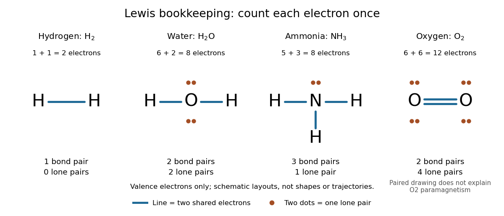
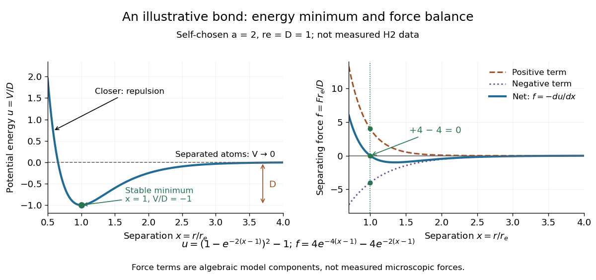

# Covalent bond

↑ **Parent:** [Chemical bond](chemical-bond.md)  
ⓦ [Wiki](https://en.wikipedia.org/wiki/Covalent_bond)

A [covalent bond](covalent-bond.md) joins [chemical atoms](atom-physics.md) through shared [Electrons](electron.md). In the familiar two-centre description, one [bond pair](bond-pair.md) contributes to a connection between two [atomic nuclei](atomic-nucleus.md). Sharing means that the [Electrons](electron.md) belong to the combined arrangement and interact with both [atomic nuclei](atomic-nucleus.md); it does not mean that identifiable dots shuttle along drawn paths. The [IUPAC Gold Book, covalent bond](https://goldbook.iupac.org/terms/view/C01384) emphasizes the concentration of [Electrons](electron.md) between [atomic nuclei](atomic-nucleus.md) and the resulting attraction and characteristic separation. The pair picture is especially useful for simple [molecules](molecule.md), but is not a universal description of every [covalent bond](covalent-bond.md).

A [Lewis structure](lewis-structure.md) turns this picture into practical bookkeeping. Count the [valence electrons](valence-electron.md), indicate which [chemical atoms](atom-physics.md) are connected, and allocate two [Electrons](electron.md) to each line. A [bond pair](bond-pair.md) is shared; a [lone pair](lone-pair.md) is assigned to one [chemical atom](atom-physics.md) without connecting it to another. A double line represents two [bond pairs](bond-pair.md). Dots and lines record allocations, rather than positions, trajectories, or a measured three-dimensional arrangement. [Flowers et al., Chemistry 2e, Lewis symbols and structures](https://openstax.org/books/chemistry-2e/pages/7-3-lewis-symbols-and-structures)

For [molecular hydrogen](molecular-hydrogen.md), $\mathrm H_2$, each neutral [hydrogen](hydrogen.md) [chemical atom](atom-physics.md) supplies one [valence electron](valence-electron.md). Thus $1+1=2$ [valence electrons](valence-electron.md) make one [bond pair](bond-pair.md), represented by $\mathrm{H-H}$, with no [lone pairs](lone-pair.md). Each [hydrogen](hydrogen.md) counts the same shared pair when checking its two-electron arrangement. The [molecule](molecule.md) still contains two [Electrons](electron.md), not four: counting a pair around both endpoints does not create extra [Electrons](electron.md).

For [water](water.md), $\mathrm H_2\mathrm O$, neutral [oxygen](oxygen.md) supplies six [valence electrons](valence-electron.md) and the two [hydrogen](hydrogen.md) [chemical atoms](atom-physics.md) supply one each: $6+1+1=8$. Two O–H connections consume four [Electrons](electron.md) as two [bond pairs](bond-pair.md). The remaining $8-4=4$ [Electrons](electron.md) form two [lone pairs](lone-pair.md) on [oxygen](oxygen.md). Around [oxygen](oxygen.md), the two [bond pairs](bond-pair.md) and two [lone pairs](lone-pair.md) count as eight [Electrons](electron.md); each [hydrogen](hydrogen.md) counts two. The whole [water](water.md) [molecule](molecule.md) has ten [Electrons](electron.md), because two additional [oxygen](oxygen.md) [Electrons](electron.md) are omitted from this [valence electron](valence-electron.md) drawing.

For [ammonia](ammonia.md), $\mathrm{NH}_3$, the total is $5+3\times1=8$ [valence electrons](valence-electron.md): five from [nitrogen](nitrogen.md) and three from [hydrogen](hydrogen.md). Three N–H connections use six [Electrons](electron.md) as three [bond pairs](bond-pair.md), leaving two [Electrons](electron.md) as one [lone pair](lone-pair.md) on [nitrogen](nitrogen.md). Thus [water](water.md) and [ammonia](ammonia.md) have the same total of eight [valence electrons](valence-electron.md) but different allocations: two plus two pairs versus three plus one. This small calculation already distinguishes their connectivity without a detailed [quantum mechanics](quantum-mechanics-split.md) calculation.

**[Figure 25](#image-lewis-structures-count-bond-pairs-and-lone-pairs-in-molecular-hydrogen-water-ammonia-and-molecular-oxygen-schematic-layouts-do-not-specify-molecular-shapes). Lewis structures count bond pairs and lone pairs in molecular hydrogen, water, ammonia, and molecular oxygen; schematic layouts do not specify molecular shapes**.

For [molecular oxygen](molecular-oxygen.md), $\mathrm O_2$, $6+6=12$ [valence electrons](valence-electron.md) give the conventional $\mathrm{O=O}$ [Lewis structure](lewis-structure.md). Its two [bond pairs](bond-pair.md) use four [Electrons](electron.md), leaving eight as four [lone pairs](lone-pair.md), two on each [oxygen](oxygen.md). Each [oxygen](oxygen.md) consequently counts eight [Electrons](electron.md) locally. However, actual [molecular oxygen](molecular-oxygen.md) has two unpaired [Electrons](electron.md) and exhibits [paramagnetism](paramagnetism.md): it is attracted into a stronger [magnetic field](magnetic-field.md). The all-paired [Lewis structure](lewis-structure.md) cannot capture this observation. [Molecular orbital theory](molecular-orbital-theory.md) describes the unpaired [Electrons](electron.md); the successful counting diagram alone is insufficient. [Flowers et al., Chemistry 2e, molecular orbital theory](https://openstax.org/books/chemistry-2e/pages/8-4-molecular-orbital-theory)

Why does sharing produce a stable separation? For [molecular hydrogen](molecular-hydrogen.md), the electronic arrangement responds as the [atomic nuclei](atomic-nucleus.md) approach. Their interactions can lower the [energy](energy.md), but pushing them too close raises it. A curve of [potential energy](potential-energy.md) against separation therefore has a [local minimum](local-minimum.md), rather than falling forever. Attraction and repulsion balance there. This is a statement about the combined system, not a claim that stationary [Electrons](electron.md) sit between otherwise motionless [atomic nuclei](atomic-nucleus.md). [7.2 Covalent Bonding](chemistry-2e-by-paul-flowers-and-others/7-2-covalent-bonding.md)

The following [Morse potential](morse-potential.md) makes those features calculable. Set $x=r/r_e$, where $r$ is separation and $r_e$ its equilibrium value, and let $D$ be the well depth. With the self-chosen parameter $a=2$, define the [dimensionless quantities](dimensionless-quantity.md)

$$
u(x)=\frac{V(r)}{D}=\left(1-e^{-2(x-1)}\right)^2-1,
\qquad f(x)=\frac{F(r)r_e}{D}=-\frac{du}{dx}=4\left(e^{-4(x-1)}-e^{-2(x-1)}\right).
$$

Here $F=-dV/dr$ is the net separating [force](force.md), obtained from the [derivative](derivative.md) of the [potential energy](potential-energy.md). Positive $f$ pushes the [chemical atoms](atom-physics.md) apart; negative $f$ draws them together. These are illustrative curves with $r_e=D=1$ in chosen units, not measured [molecular hydrogen](molecular-hydrogen.md) data or fitted parameters.

**[Figure 26](#image-illustrative-dimensionless-morse-potential-and-its-force-a-stable-local-minimum-short-distance-repulsion-and-separation-toward-zero-potential-energy). Illustrative dimensionless Morse potential and its force: a stable local minimum, short-distance repulsion, and separation toward zero potential energy**.

At $x=1$, $u=-1$ and $f=0$. The [second derivative](second-derivative.md) is $u''(1)=8>0$, confirming a [local minimum](local-minimum.md). At $x=0.5$, $u=(1-e)^2-1\approx1.9525$; at $x=1.5$, $u=(1-e^{-1})^2-1\approx-0.6004$. As $x$ increases without bound, $u$ approaches zero from below. Thus moving from the well bottom to separated [chemical atoms](atom-physics.md) requires an increase of $D$ in this model's [potential energy](potential-energy.md). An actual [quantum mechanics](quantum-mechanics-split.md) dissociation threshold also depends on the initial motion of the [atomic nuclei](atomic-nucleus.md), so the well depth alone is not every measured dissociation [energy](energy.md).

The [force](force.md) panel separates $f$ into a positive term $4e^{-4(x-1)}$ and a negative term $-4e^{-2(x-1)}$. At $x=1$ they are $+4$ and $-4$, cancelling exactly; nearer separations favour the positive term. These are algebraic components of the chosen [Morse potential](morse-potential.md), not separately measured microscopic [forces](force.md). Their usefulness is to show how a balance arises from the slope of one [energy](energy.md) curve.

The beauty of the pair picture is its economy: a few marks summarize connectivity and constrain what a proposed [molecule](molecule.md) can contain. Its historical anchor is Gilbert N. Lewis's 1916 paper [The Atom and the Molecule, Journal of the American Chemical Society 38, 762–785](https://doi.org/10.1021/ja02261a002), also available as an [archived original paper](https://zenodo.org/records/1429068). [Lewis structures](lewis-structure.md) remain useful because they answer counting questions quickly; [quantum mechanics](quantum-mechanics-split.md) supplies the richer account when [energy](energy.md), shape, or unpaired [Electrons](electron.md) matter.

**Table of contents**

- [Phosphodiester bond](phosphodiester-bond.md)
- [Disulfide bond](disulfide-bond.md)
- [Lewis structure](lewis-structure.md)
  - [Valence shell electron pair repulsion theory](valence-shell-electron-pair-repulsion-theory.md)
    - [Electron domain](electron-domain.md)
    - [Electron pair geometry](electron-pair-geometry.md)
  - [Bond pair](bond-pair.md)
  - [Lone pair](lone-pair.md)
  - [Formal charge](formal-charge.md)
  - [Resonance (chemistry)](resonance-chemistry.md)
    - [Resonance structure](resonance-structure.md)
    - [Resonance hybrid](resonance-hybrid.md)
  - [Octet rule](octet-rule.md)

## ↑ Ancestors (3)

1. [Chemical bond](chemical-bond.md)
2. [Chemistry](chemistry-split.md)
3. [Codex Wiki](split.md)

## ← Incoming links (38)

- [Acid (chemistry)](acid-chemistry.md)
- [Active site](active-site.md)
- [Backbone hydrogen bond](backbone-hydrogen-bond.md)
- [Base (chemistry)](base-chemistry.md)
- [Base pairing](base-pairing.md)
- [Benzene](benzene.md)
- [Beta sheet](beta-sheet.md)
- [Bond-dissociation energy](bond-dissociation-energy.md)
- [Bond order](bond-order.md)
- [Carbonyl group](carbonyl-group.md)
- [Chemical bond](chemical-bond.md)
- [Covalent bond](covalent-bond.md)
- [Denaturation (biochemistry)](denaturation-biochemistry.md)
- [Deoxyribonucleic acid](deoxyribonucleic-acid.md)
- [Disulfide bond](disulfide-bond.md)
- [Electron transfer and ionic character](electron-transfer-and-ionic-character.md)
- [Electronegativity](electronegativity.md)
- [Gel electrophoresis](gel-electrophoresis.md)
- [Homolysis](homolysis.md)
- [Hydrogen bond](hydrogen-bond.md)
- [Hydrogen bond acceptor](hydrogen-bond-acceptor.md)
- [Hydrogen bond donor](hydrogen-bond-donor.md)
- [Hydrophilicity](hydrophilicity.md)
- [Hydrophobic effect](hydrophobic-effect.md)
- [Methane chlorination chain](methane-chlorination-chain.md)
- [Molecular orbital theory](molecular-orbital-theory.md)
- [Nitrate](nitrate.md)
- [Nucleic acid](nucleic-acid.md)
- [Oxidation state](oxidation-state.md)
- [Paramagnetism](paramagnetism.md)
- [Peptide bond](peptide-bond.md)
- [Phosphodiester bond](phosphodiester-bond.md)
- [Phospholipid](phospholipid.md)
- [Physical properties of salts](physical-properties-of-salts.md)
- [Protein primary structure](protein-primary-structure.md)
- [Ribonucleic acid](ribonucleic-acid.md)
- [Ribozyme](ribozyme.md)
- [Salt (chemistry)](salt-chemistry.md)
