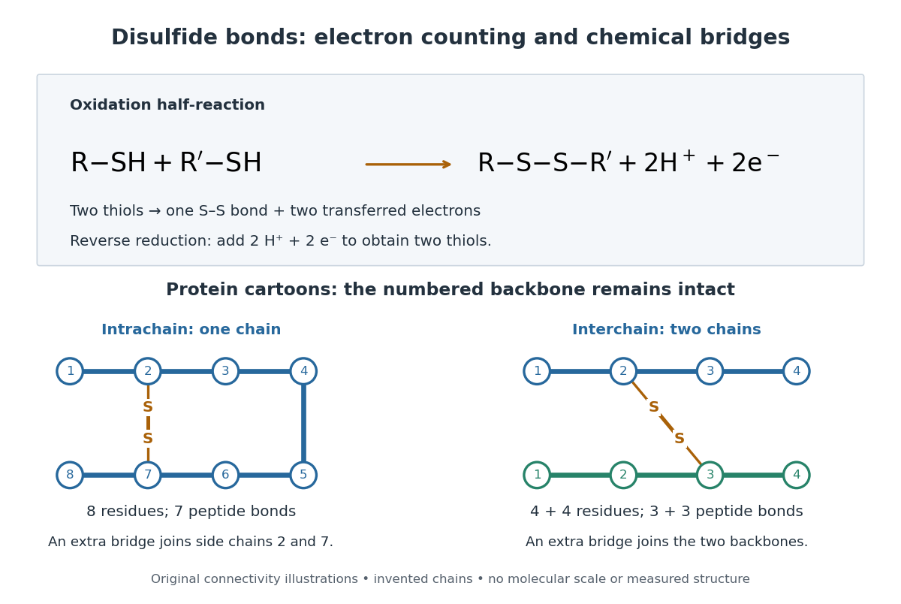
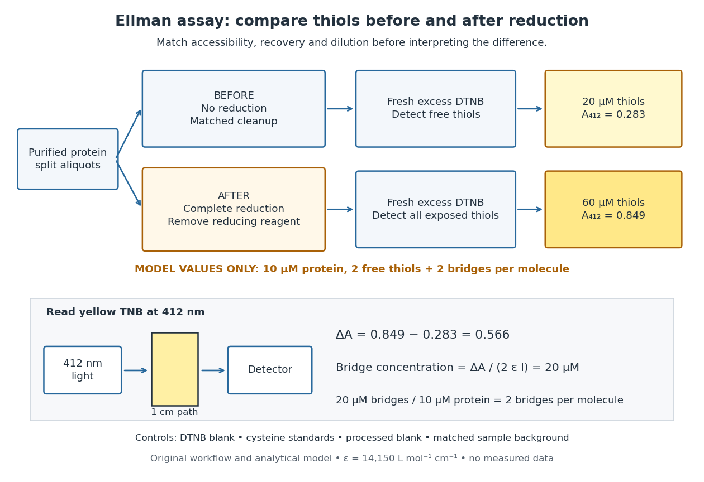
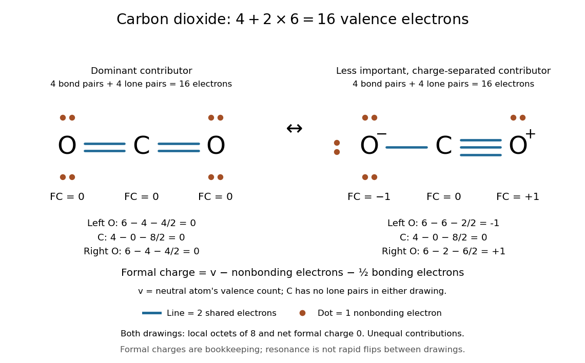

# Covalent bond

↑ **Parent:** [Chemical bond](chemical-bond.md)  
ⓦ [Wiki](https://en.wikipedia.org/wiki/Covalent_bond)

A [covalent bond](covalent-bond.md) joins [chemical atoms](physics.md#atom-physics) through shared [electrons](physics.md#electron). In the familiar two-centre description, one [bond pair](#bond-pair) contributes to a connection between two [atomic nuclei](atomic-nucleus.md). Sharing means that the [electrons](physics.md#electron) belong to the combined arrangement and interact with both [atomic nuclei](atomic-nucleus.md); it does not mean that identifiable dots shuttle along drawn paths. The [IUPAC Gold Book, covalent bond](https://goldbook.iupac.org/terms/view/C01384) emphasizes the concentration of [electrons](physics.md#electron) between [atomic nuclei](atomic-nucleus.md) and the resulting attraction and characteristic separation. The pair picture is especially useful for simple [molecules](molecule.md), but is not a universal description of every [covalent bond](covalent-bond.md).

A [Lewis structure](#lewis-structure) turns this picture into practical bookkeeping. Count the [valence electrons](chemical-bond.md#valence-electron), indicate which [chemical atoms](physics.md#atom-physics) are connected, and allocate two [electrons](physics.md#electron) to each line. A [bond pair](#bond-pair) is shared; a [lone pair](#lone-pair) is assigned to one [chemical atom](physics.md#atom-physics) without connecting it to another. A double line represents two [bond pairs](#bond-pair). Dots and lines record allocations, rather than positions, trajectories, or a measured three-dimensional arrangement. [Flowers et al., Chemistry 2e, Lewis symbols and structures](https://openstax.org/books/chemistry-2e/pages/7-3-lewis-symbols-and-structures)

For [molecular hydrogen](chemical-substance.md#molecular-hydrogen), $\mathrm H_2$, each neutral [hydrogen](chemical-substance.md#hydrogen) [chemical atom](physics.md#atom-physics) supplies one [valence electron](chemical-bond.md#valence-electron). Thus $1+1=2$ [valence electrons](chemical-bond.md#valence-electron) make one [bond pair](#bond-pair), represented by $\mathrm{H-H}$, with no [lone pairs](#lone-pair). Each [hydrogen](chemical-substance.md#hydrogen) counts the same shared pair when checking its two-electron arrangement. The [molecule](molecule.md) still contains two [electrons](physics.md#electron), not four: counting a pair around both endpoints does not create extra [electrons](physics.md#electron).

For [water](chemical-substance.md#water), $\mathrm H_2\mathrm O$, neutral [oxygen](chemical-substance.md#oxygen) supplies six [valence electrons](chemical-bond.md#valence-electron) and the two [hydrogen](chemical-substance.md#hydrogen) [chemical atoms](physics.md#atom-physics) supply one each: $6+1+1=8$. Two O–H connections consume four [electrons](physics.md#electron) as two [bond pairs](#bond-pair). The remaining $8-4=4$ [electrons](physics.md#electron) form two [lone pairs](#lone-pair) on [oxygen](chemical-substance.md#oxygen). Around [oxygen](chemical-substance.md#oxygen), the two [bond pairs](#bond-pair) and two [lone pairs](#lone-pair) count as eight [electrons](physics.md#electron); each [hydrogen](chemical-substance.md#hydrogen) counts two. The whole [water](chemical-substance.md#water) [molecule](molecule.md) has ten [electrons](physics.md#electron), because two additional [oxygen](chemical-substance.md#oxygen) [electrons](physics.md#electron) are omitted from this [valence electron](chemical-bond.md#valence-electron) drawing.

For [ammonia](chemical-substance.md#ammonia), $\mathrm{NH}_3$, the total is $5+3\times1=8$ [valence electrons](chemical-bond.md#valence-electron): five from [nitrogen](chemical-substance.md#nitrogen) and three from [hydrogen](chemical-substance.md#hydrogen). Three N–H connections use six [electrons](physics.md#electron) as three [bond pairs](#bond-pair), leaving two [electrons](physics.md#electron) as one [lone pair](#lone-pair) on [nitrogen](chemical-substance.md#nitrogen). Thus [water](chemical-substance.md#water) and [ammonia](chemical-substance.md#ammonia) have the same total of eight [valence electrons](chemical-bond.md#valence-electron) but different allocations: two plus two pairs versus three plus one. This small calculation already distinguishes their connectivity without a detailed [quantum mechanics](quantum-mechanics.md) calculation.

**[Figure 1](#image-lewis-structures-count-bond-pairs-and-lone-pairs-in-molecular-hydrogen-water-ammonia-and-molecular-oxygen-schematic-layouts-do-not-specify-molecular-shapes). Lewis structures count bond pairs and lone pairs in molecular hydrogen, water, ammonia, and molecular oxygen; schematic layouts do not specify molecular shapes**.

For [molecular oxygen](chemical-substance.md#molecular-oxygen), $\mathrm O_2$, $6+6=12$ [valence electrons](chemical-bond.md#valence-electron) give the conventional $\mathrm{O=O}$ [Lewis structure](#lewis-structure). Its two [bond pairs](#bond-pair) use four [electrons](physics.md#electron), leaving eight as four [lone pairs](#lone-pair), two on each [oxygen](chemical-substance.md#oxygen). Each [oxygen](chemical-substance.md#oxygen) consequently counts eight [electrons](physics.md#electron) locally. However, actual [molecular oxygen](chemical-substance.md#molecular-oxygen) has two unpaired [electrons](physics.md#electron) and exhibits [paramagnetism](electromagnetism.md#paramagnetism): it is attracted into a stronger [magnetic field](magnetic-field.md). The all-paired [Lewis structure](#lewis-structure) cannot capture this observation. [Molecular orbital theory](chemistry.md#molecular-orbital-theory) describes the unpaired [electrons](physics.md#electron); the successful counting diagram alone is insufficient. [Flowers et al., Chemistry 2e, molecular orbital theory](https://openstax.org/books/chemistry-2e/pages/8-4-molecular-orbital-theory)

Why does sharing produce a stable separation? For [molecular hydrogen](chemical-substance.md#molecular-hydrogen), the electronic arrangement responds as the [atomic nuclei](atomic-nucleus.md) approach. Their interactions can lower the [energy](energy.md), but pushing them too close raises it. A curve of [potential energy](energy.md#potential-energy) against separation therefore has a [local minimum](analysis.md#local-minimum), rather than falling forever. Attraction and repulsion balance there. This is a statement about the combined system, not a claim that stationary [electrons](physics.md#electron) sit between otherwise motionless [atomic nuclei](atomic-nucleus.md). [7.2 Covalent Bonding](chemistry-bibliography.md#chemistry-2e-by-paul-flowers-and-others/7-2-covalent-bonding)

The following [Morse potential](quantum-system.md#morse-potential) makes those features calculable. Set $x=r/r_e$, where $r$ is separation and $r_e$ its equilibrium value, and let $D$ be the well depth. With the self-chosen parameter $a=2$, define the [dimensionless quantities](physics.md#dimensionless-quantity)

$$
u(x)=\frac{V(r)}{D}=\left(1-e^{-2(x-1)}\right)^2-1,
\qquad f(x)=\frac{F(r)r_e}{D}=-\frac{du}{dx}=4\left(e^{-4(x-1)}-e^{-2(x-1)}\right).
$$

Here $F=-dV/dr$ is the net separating [force](force.md), obtained from the [derivative](calculus.md#derivative) of the [potential energy](energy.md#potential-energy). Positive $f$ pushes the [chemical atoms](physics.md#atom-physics) apart; negative $f$ draws them together. These are illustrative curves with $r_e=D=1$ in chosen units, not measured [molecular hydrogen](chemical-substance.md#molecular-hydrogen) data or fitted parameters.

**[Figure 2](#image-illustrative-dimensionless-morse-potential-and-its-force-a-stable-local-minimum-short-distance-repulsion-and-separation-toward-zero-potential-energy). Illustrative dimensionless Morse potential and its force: a stable local minimum, short-distance repulsion, and separation toward zero potential energy**.

At $x=1$, $u=-1$ and $f=0$. The [second derivative](calculus.md#second-derivative) is $u''(1)=8>0$, confirming a [local minimum](analysis.md#local-minimum). At $x=0.5$, $u=(1-e)^2-1\approx1.9525$; at $x=1.5$, $u=(1-e^{-1})^2-1\approx-0.6004$. As $x$ increases without bound, $u$ approaches zero from below. Thus moving from the well bottom to separated [chemical atoms](physics.md#atom-physics) requires an increase of $D$ in this model's [potential energy](energy.md#potential-energy). An actual [quantum mechanics](quantum-mechanics.md) dissociation threshold also depends on the initial motion of the [atomic nuclei](atomic-nucleus.md), so the well depth alone is not every measured dissociation [energy](energy.md).

The [force](force.md) panel separates $f$ into a positive term $4e^{-4(x-1)}$ and a negative term $-4e^{-2(x-1)}$. At $x=1$ they are $+4$ and $-4$, cancelling exactly; nearer separations favour the positive term. These are algebraic components of the chosen [Morse potential](quantum-system.md#morse-potential), not separately measured microscopic [forces](force.md). Their usefulness is to show how a balance arises from the slope of one [energy](energy.md) curve.

The beauty of the pair picture is its economy: a few marks summarize connectivity and constrain what a proposed [molecule](molecule.md) can contain. Its historical anchor is Gilbert N. Lewis's 1916 paper [The Atom and the Molecule, Journal of the American Chemical Society 38, 762–785](https://doi.org/10.1021/ja02261a002), also available as an [archived original paper](https://zenodo.org/records/1429068). [Lewis structures](#lewis-structure) remain useful because they answer counting questions quickly; [quantum mechanics](quantum-mechanics.md) supplies the richer account when [energy](energy.md), shape, or unpaired [electrons](physics.md#electron) matter.

**Table of contents**

- [Triple bond](#triple-bond)
- [Single bond](#single-bond)
- [Quintuple bond](#quintuple-bond)
- [Quadruple bond](#quadruple-bond)
- [Delta bond](#delta-bond)
- [Coordinate covalent bond](#coordinate-covalent-bond)
  - [Metal-to-metal dative bond](#metal-to-metal-dative-bond)
  - [Pi donation](#pi-donation)
  - [Pi backbonding](#pi-backbonding)
  - [Sigma donation](#sigma-donation)
- [Pi bond](#pi-bond)
  - [Three-centre four-electron pi bond](#three-centre-four-electron-pi-bond)
- [Sigma bond](#sigma-bond)
- [Glycosidic bond](#glycosidic-bond)
- [Double bond](#double-bond)
- [Phosphodiester bond](#phosphodiester-bond)
- [Disulfide bond](#disulfide-bond)
- [Lewis structure](#lewis-structure)
  - [Valence shell electron pair repulsion theory](#valence-shell-electron-pair-repulsion-theory)
    - [Electron domain](#electron-domain)
    - [Electron pair geometry](#electron-pair-geometry)
  - [Bond pair](#bond-pair)
  - [Lone pair](#lone-pair)
    - [Stereochemically active lone pair](#stereochemically-active-lone-pair)
  - [Formal charge](#formal-charge)
  - [Resonance (chemistry)](#resonance-chemistry)
    - [Resonance donation](#resonance-donation)
    - [Resonance structure](#resonance-structure)
    - [Resonance hybrid](#resonance-hybrid)
  - [Octet rule](#octet-rule)

## Triple bond

↑ **Parent:** [Covalent bond](covalent-bond.md)

A bond with formal [bond order](chemistry.md#bond-order) three. A localized orbital description usually contains one sigma and two pi components.

## Single bond

↑ **Parent:** [Covalent bond](covalent-bond.md)

A bond with formal [bond order](chemistry.md#bond-order) one, conventionally represented by one line. Delocalization can make the actual [bond order](chemistry.md#bond-order) differ from the integer in one Lewis structure.

## Quintuple bond

↑ **Parent:** [Covalent bond](covalent-bond.md)

A formal [bond order](chemistry.md#bond-order) of five. The common d-metal model has one sigma, two pi and two delta bonding orbitals occupied, $\sigma^2\pi^4\delta^4$, with the corresponding antibonding orbitals empty.

## Quadruple bond

↑ **Parent:** [Covalent bond](covalent-bond.md)

A formal fourfold bond. In the familiar d-metal example, one [sigma bond](#sigma-bond), two [pi bonds](#pi-bond) and one [delta bond](#delta-bond) are occupied, giving the configuration $\sigma^2\pi^4\delta^2$ and formal [bond order](chemistry.md#bond-order) four.

## Delta bond

↑ **Parent:** [Covalent bond](covalent-bond.md)

A [delta bond](#delta-bond) involves sideways [orbital overlap](chemistry.md#orbital-overlap) with two nodal planes containing the internuclear axis. In suitable [metal-metal bonds](chemical-bond.md#metal-metal-bond), d-[orbital overlap](chemistry.md#orbital-overlap) can supply this component in addition to sigma and pi bonding.

## Coordinate covalent bond

↑ **Parent:** [Covalent bond](covalent-bond.md)

A [coordinate covalent bond](#coordinate-covalent-bond) is described as forming by donation of a [lone pair](#lone-pair) from one partner into an acceptor orbital of the other. This formation description does not imply that the final [electrons](physics.md#electron) remain distinguishable by origin.

### Metal-to-metal dative bond

↑ **Parent:** [Coordinate covalent bond](#coordinate-covalent-bond)

An electron-pair interaction represented as donation from a metal-base fragment into an orbital of a metal-acid fragment. [electron counting](chemistry.md#electron-counting) must avoid adding a new pair twice to an already occupied donor orbital.

### Pi donation

↑ **Parent:** [Coordinate covalent bond](#coordinate-covalent-bond)

Donation from an occupied ligand orbital into a [metal](chemical-substance.md#metal) orbital of pi symmetry relative to the [metal](chemical-substance.md#metal)–ligand axis. It differs from metal-to-ligand [pi backbonding](#pi-backbonding).

### Pi backbonding

↑ **Parent:** [Coordinate covalent bond](#coordinate-covalent-bond)

[Pi backbonding](#pi-backbonding) is donation from occupied metal orbitals into ligand acceptor orbitals with pi [symmetry](physics.md#symmetry-physics) about the metal–ligand axis. In a [carbonyl ligand](chemistry.md#carbonyl-ligand), occupation of CO $\pi^*$ weakens C–O while strengthening metal–[carbon](chemical-substance.md#carbon) bonding. Lower CO stretching [spectroscopic wavenumber](wave-equation.md#spectroscopic-wavenumber) is therefore a useful comparative probe, with electrostatic and mode-coupling qualifications.

### Sigma donation

↑ **Parent:** [Coordinate covalent bond](#coordinate-covalent-bond)

[Sigma donation](#sigma-donation) transfers [electron](physics.md#electron) density from an occupied ligand orbital into a metal acceptor orbital with the appropriate [symmetry](physics.md#symmetry-physics) along the bond axis. CO uses an occupied carbon-centered $5\sigma$ orbital. Backdonation can occur simultaneously.

## Pi bond

↑ **Parent:** [Covalent bond](covalent-bond.md)

A [covalent bond](covalent-bond.md) formed through side-on overlap of compatible [atomic orbitals](chemistry.md#atomic-orbital), with a nodal plane containing the internuclear axis.

### Three-centre four-electron pi bond

↑ **Parent:** [Pi bond](#pi-bond)

A delocalized pi system made from three compatible p orbitals and four electrons. In the simple orbital construction the bonding and nonbonding combinations are occupied and the antibonding combination is empty.

## Sigma bond

↑ **Parent:** [Covalent bond](covalent-bond.md)

A [covalent bond](covalent-bond.md) with bonding electron density of cylindrical symmetry around the internuclear axis; end-on [orbital overlap](chemistry.md#orbital-overlap) is a common localized construction.

## Glycosidic bond

↑ **Parent:** [Covalent bond](covalent-bond.md)

A [glycosidic bond](#glycosidic-bond) links a sugar to another group through its anomeric centre. In a nucleotide, rotation about the base–sugar linkage contributes to anti and syn conformations; it is distinct from the phosphate links joining successive nucleotides.

## Double bond

↑ **Parent:** [Covalent bond](covalent-bond.md)

A [double bond](#double-bond) is a covalent bond of bond order two. Restricted rotation and substituent geometry at a carbon–carbon double bond can affect acyl-chain packing in a [lipid bilayer](mathematical-biology.md#lipid-bilayer).

## Phosphodiester bond

↑ **Parent:** [Covalent bond](covalent-bond.md)  
ⓦ [Wiki](https://en.wikipedia.org/wiki/Phosphodiester_bond)

A [phosphodiester bond](#phosphodiester-bond) connects two groups through a [phosphate](chemical-substance.md#phosphate) diester. In a [nucleic acid](polymer.md#nucleic-acid) backbone, the bridging [phosphate](chemical-substance.md#phosphate) is connected through [oxygen](chemical-substance.md#oxygen) to the $3'$ [carbon](chemical-substance.md#carbon) position of one [sugar](chemical-substance.md#sugar) and the $5'$ [carbon](chemical-substance.md#carbon) position of another. These [covalent bonds](covalent-bond.md) connect successive [nucleotides](molecule.md#nucleotide) along a strand; they are distinct from the [hydrogen bonds](chemical-bond.md#hydrogen-bond) between paired [nucleobases](molecule.md#nucleotide-base).

## Disulfide bond

↑ **Parent:** [Covalent bond](covalent-bond.md)

A [disulfide bond](#disulfide-bond) is the single [covalent bond](covalent-bond.md) between the two adjacent [sulfur](chemical-substance.md#sulfur) [chemical atoms](physics.md#atom-physics) in a [disulfide](chemical-substance.md#disulfide), conventionally written $\mathrm{R-S-S-R'}$. Here $R$ and $R'$ stand for the attached organic groups; they may belong to the same [molecule](molecule.md) or to initially separate [molecules](molecule.md). A [disulfide bond](#disulfide-bond) is a chemical bridge, rather than a [hydrogen bond](chemical-bond.md#hydrogen-bond) or a mere contact between nearby groups. Two [thiols](chemical-substance.md#thiol), $\mathrm{R-SH}$ and $\mathrm{R'-SH}$, can supply its two [sulfur](chemical-substance.md#sulfur) endpoints. [John McMurry, Organic Chemistry, 18.7: thiol oxidation and disulfides](https://openstax.org/books/organic-chemistry/pages/18-7-thiols-and-sulfides)

The [stoichiometry](chemical-reaction.md#stoichiometry) of forming a [disulfide bond](#disulfide-bond) is especially revealing. Written as an [oxidation](chemical-reaction.md#oxidation) [half-reaction](electrochemistry.md#half-reaction), it is

$$
\mathrm{R-SH+R'-SH\longrightarrow R-S-S-R'+2H^++2e^-}.
$$

The reverse [reduction](chemical-reaction.md#reduction-chemistry) [half-reaction](electrochemistry.md#half-reaction) consumes two [electrons](physics.md#electron) and two [hydrogen ions](chemistry.md#hydrogen-ion) to restore two [thiols](chemical-substance.md#thiol). Both sides contain two [sulfur](chemical-substance.md#sulfur) [chemical atoms](physics.md#atom-physics); the two [hydrogen](chemical-substance.md#hydrogen) [chemical atoms](physics.md#atom-physics) have moved into the two [hydrogen ions](chemistry.md#hydrogen-ion), and the net [electric charge](electric-charge.md) remains zero because $+2-2=0$. Thus one [disulfide bond](#disulfide-bond) corresponds to two [thiol](chemical-substance.md#thiol) groups and two transferred [electrons](physics.md#electron). These [half-reactions](electrochemistry.md#half-reaction) describe [redox](chemical-reaction.md#redox) bookkeeping, not a complete standalone [chemical reaction](chemical-reaction.md): an accompanying [reactant](chemical-reaction.md#reactant) must accept or supply the [electrons](physics.md#electron), and [pH](acid-base-chemistry.md#ph) affects the actual [protonation](chemical-reaction.md#protonation) of the groups. [Mercaptoethanol](chemical-substance.md#2-mercaptoethanol) can promote [reduction](chemical-reaction.md#reduction-chemistry) through exchange of [disulfide bonds](#disulfide-bond), but adequate excess and appropriate conditions are needed; adding it does not by itself prove complete [reduction](chemical-reaction.md#reduction-chemistry). [Jakob R. Winther and Colin Thorpe, Quantification of Thiols and Disulfides (2014), section 3: reducing reagents and completeness](https://pmc.ncbi.nlm.nih.gov/articles/PMC3766385/)

In a [protein disulfide bond](protein.md#protein-disulfide-bond), the endpoints are normally the [amino acid side chains](protein.md#amino-acid-side-chain) of two [cysteine](protein.md#cysteine) [amino acid residues](protein.md#amino-acid-residue). An intrachain [protein disulfide bond](protein.md#protein-disulfide-bond) closes an intramolecular bridge within one [polypeptide chain](protein.md#polypeptide); an interchain [protein disulfide bond](protein.md#protein-disulfide-bond) connects different [polypeptide chains](protein.md#polypeptide), and can arise by intermolecular crosslinking of initially separate [molecules](molecule.md). Forming or reducing these bridges changes [covalent bond](covalent-bond.md) connectivity and can change [protein structure](protein.md#protein-structure), while preserving the order of [amino acid residues](protein.md#amino-acid-residue) and the [peptide bonds](protein.md#peptide-bond) in the [protein backbone](protein.md#protein-backbone). A complete chemical account of [protein primary structure](protein.md#protein-primary-structure) includes crosslinks as well as sequence, so preservation of sequence does not imply preservation of every [covalent bond](covalent-bond.md). Mature [insulin](protein.md#insulin) has two interchain [protein disulfide bonds](protein.md#protein-disulfide-bond) and one intrachain [protein disulfide bond](protein.md#protein-disulfide-bond). [Seung-Gu Chang, Ki-Doo Choi, Seung-Hwan Jang and Hang-Cheol Shin, Role of disulfide bonds in the structure and activity of human insulin (2003)](https://pubmed.ncbi.nlm.nih.gov/14744022/)

**[Figure 3](#image-disulfide-bond-redox-bookkeeping-and-schematic-intrachain-and-interchain-protein-disulfide-bonds). Disulfide bond redox bookkeeping and schematic intrachain and interchain protein disulfide bonds**. Original connectivity cartoons, not measured [protein structures](protein.md#protein-structure). Blue and green traces preserve their numbered [amino acid residues](protein.md#amino-acid-residue); amber S-S links connect [amino acid side chains](protein.md#amino-acid-side-chain) without replacing a [peptide bond](protein.md#peptide-bond). The cartoons are invented examples, not [insulin](protein.md#insulin) coordinates.

A bridge is useful because it constrains which parts of a [polypeptide chain](protein.md#polypeptide) can move apart without breaking a [covalent bond](covalent-bond.md). Its placement therefore matters as well as its presence. The [ribonuclease A refolding experiment](protein.md#ribonuclease-a-refolding-experiment) provides the existing experimental example: breaking and reforming four [protein disulfide bonds](protein.md#protein-disulfide-bond) can accompany loss and recovery of function. Counting four bridges alone cannot tell whether their endpoints have the native pairing. This is an attractive connection between simple chemical counting and the richer problem of [protein folding](protein.md#protein-folding).

How can an experiment reveal an initially hidden [disulfide bond](#disulfide-bond)? [Ellman's reagent](chemical-substance.md#ellman-s-reagent), also called [DTNB](chemical-substance.md#ellman-s-reagent), measures free [thiols](chemical-substance.md#thiol) by producing a yellow absorbing species. Its reactive [disulfide bond](#disulfide-bond) undergoes exchange with the [conjugate base](acid-base-chemistry.md#conjugate-base) $\mathrm{R-S^-}$ of a [thiol](chemical-substance.md#thiol), producing a mixed [disulfide](chemical-substance.md#disulfide) attached to $R$ and one released 2-nitro-5-thiobenzoate species, abbreviated TNB. At the assay [pH](acid-base-chemistry.md#ph), the strongly colored form is the dianion $\mathrm{TNB^{2-}}$: one negative charge is on [sulfur](chemical-substance.md#sulfur) and the other is on the [carboxylic acid](chemical-substance.md#carboxylic-acid)-derived $\mathrm{COO^-}$ group. With excess [DTNB](chemical-substance.md#ellman-s-reagent) and complete reaction, one released TNB reports one reacted [thiol](chemical-substance.md#thiol). George L. Ellman's 1959 paper introduced the tissue assay; it was subsequently reexamined quantitatively. [George L. Ellman, Tissue sulfhydryl groups (1959)](https://pubmed.ncbi.nlm.nih.gov/13650640/) [Pierce Biotechnology, Ellman's Reagent instructions, introduction and reaction diagram](https://assets.thermofisher.com/TFS-Assets/LSG/manuals/MAN0011216_Ellmans_Reag_UG.pdf)

The modern apparatus can be simple: tubes, pipettes, a [buffer solution](acid-base-chemistry.md#buffer-solution), [cysteine](protein.md#cysteine) standards, [DTNB](chemical-substance.md#ellman-s-reagent), and an instrument that measures [absorbance](physical-chemistry.md#absorbance) through a cuvette at [wavelength](wave-equation.md#wavelength) $412\,\mathrm{nm}$. The Pierce protocol uses $50\,\mathrm{\mu L}$ of a $4\,\mathrm{mg\,mL^{-1}}$ [DTNB](chemical-substance.md#ellman-s-reagent) stock, $2.50\,\mathrm{mL}$ of [buffer solution](acid-base-chemistry.md#buffer-solution), and $250\,\mathrm{\mu L}$ of sample. Its [buffer solution](acid-base-chemistry.md#buffer-solution) is $0.1\,\mathrm{mol\,L^{-1}}$ sodium [phosphate](chemical-substance.md#phosphate) at [pH](acid-base-chemistry.md#ph) 8.0 with a metal-binding additive. After 15 minutes at room [temperature](temperature.md), measure [absorbance](physical-chemistry.md#absorbance) against a [buffer solution](acid-base-chemistry.md#buffer-solution) plus [DTNB](chemical-substance.md#ellman-s-reagent) blank; run known [cysteine](protein.md#cysteine) [concentrations](mathematical-physics.md#concentration) in parallel. The observable is increased yellow color and increased blank-corrected [absorbance](physical-chemistry.md#absorbance) as more accessible [thiols](chemical-substance.md#thiol) react, rather than direct imaging of [disulfide bonds](#disulfide-bond). These are published protocol conditions, not measurements performed for this article. [Pierce Biotechnology, Ellman's Reagent instructions, page 2: standard and cuvette procedures](https://assets.thermofisher.com/TFS-Assets/LSG/manuals/MAN0011216_Ellmans_Reag_UG.pdf)

For a before/after test, split a purified [protein](protein.md) sample into matched aliquots. Measure accessible free [thiols](chemical-substance.md#thiol) in one aliquot; subject the other to complete [reduction](chemical-reaction.md#reduction-chemistry) of its [disulfide bonds](#disulfide-bond), remove the reducing [reagent](chemical-reaction.md#reagent), then measure the resulting [thiols](chemical-substance.md#thiol) with fresh [DTNB](chemical-substance.md#ellman-s-reagent). Process the unreduced aliquot through a matching cleanup. Normalize to recovered [protein](protein.md) and known [dilution](mixture.md#dilution), since cleanup can change both. To estimate all reducible [protein disulfide bonds](protein.md#protein-disulfide-bond), expose buried groups using matching [protein denaturation](protein.md#denaturation-biochemistry) conditions in both aliquots and calibrate in that same [chemical solution](mixture.md#solution-chemistry); a native-accessibility measurement answers a different question. A larger corrected reading after [reduction](chemical-reaction.md#reduction-chemistry) supports conversion of previously unreactive groups into detectable [thiols](chemical-substance.md#thiol). Attribution to [disulfide bonds](#disulfide-bond) requires excluding other reducible [sulfur](chemical-substance.md#sulfur) modifications. This is a proposed comparison based on the detection principles, not a reconstruction of Ellman's original tissue measurements. [Winther and Thorpe (2014), sections 1.2 and 4.1: indirect disulfide detection and assay limitations](https://pmc.ncbi.nlm.nih.gov/articles/PMC3766385/)

**[Figure 4](#image-matched-ellman-s-reagent-assay-workflow-and-an-explicitly-hypothetical-disulfide-bond-count). Matched Ellman's reagent assay workflow and an explicitly hypothetical disulfide bond count**. Original apparatus and workflow schematic. The displayed [absorbances](physical-chemistry.md#absorbance) are calculated illustrations for two free [thiols](chemical-substance.md#thiol) and two [disulfide bonds](#disulfide-bond) per model [protein](protein.md) at equal final [protein](protein.md) [concentration](mathematical-physics.md#concentration); they are not measured data or a calibration curve. Reducing [reagent](chemical-reaction.md#reagent) removal and matched accessibility are prerequisites for interpreting the difference.

Under the [Beer-Lambert law](physical-chemistry.md#beer-lambert-law), the blank-corrected [absorbance](physical-chemistry.md#absorbance) is $A=\varepsilon lc$, where $l$ is the cuvette path length, $c$ is the released TNB [concentration](mathematical-physics.md#concentration), and $\varepsilon$ is its molar absorption coefficient. Riddles, Blakeley and Zerner measured $\varepsilon_{412}=14150\,\mathrm{L\,mol^{-1}\,cm^{-1}}$ in dilute aqueous salt [chemical solutions](mixture.md#solution-chemistry), confirming the value independently using [cysteine](protein.md#cysteine). It must not be applied indiscriminately to other [solvents](mixture.md#solvent) or [protein denaturation](protein.md#denaturation-biochemistry) mixtures. [Peter W. Riddles, Robert L. Blakeley and Burt Zerner, Ellman's reagent: a reexamination (1979)](https://www.sciencedirect.com/science/article/pii/0003269779907929) For aliquots compared on the same final volume and [protein](protein.md) [concentration](mathematical-physics.md#concentration) basis, the ideal estimate is

$$
c_{\mathrm{S-S}}=\frac{c_{\mathrm{SH,after}}-c_{\mathrm{SH,before}}}{2}
=\frac{A_{\mathrm{after}}-A_{\mathrm{before}}}{2\varepsilon l},
\qquad
\bar n_{\mathrm{S-S}}=\frac{c_{\mathrm{S-S}}}{c_{\mathrm{protein}}}.
$$

The factor of two follows from the [reduction](chemical-reaction.md#reduction-chemistry) [stoichiometry](chemical-reaction.md#stoichiometry); $\bar n_{\mathrm{S-S}}$ is the number of [disulfide bonds](#disulfide-bond) per [protein](protein.md) [molecule](molecule.md), or an average for a mixed population. If the aliquots have different [dilutions](mixture.md#dilution) or recoveries, convert each reading to a common sample basis before subtracting.

As a hypothetical calculation, choose $c_{\mathrm{protein}}=10\,\mathrm{\mu mol\,L^{-1}}$ in each final cuvette, two free [thiols](chemical-substance.md#thiol) and two [disulfide bonds](#disulfide-bond) per [protein](protein.md) [molecule](molecule.md), and $l=1\,\mathrm{cm}$. Before [reduction](chemical-reaction.md#reduction-chemistry), $c_{\mathrm{SH}}=20\,\mathrm{\mu mol\,L^{-1}}$ gives $A=0.283$; complete [reduction](chemical-reaction.md#reduction-chemistry) adds four [thiols](chemical-substance.md#thiol) per [protein](protein.md) [molecule](molecule.md), so $c_{\mathrm{SH}}=60\,\mathrm{\mu mol\,L^{-1}}$ gives $A=0.849$. The difference $0.566$ gives $c_{\mathrm{S-S}}=20\,\mathrm{\mu mol\,L^{-1}}$ and $\bar n_{\mathrm{S-S}}=2$. The published tube volumes imply a [dilution](mixture.md#dilution) factor $2.80/0.250=11.2$; reversing that [dilution](mixture.md#dilution) multiplies both [thiol](chemical-substance.md#thiol) and [protein](protein.md) [concentrations](mathematical-physics.md#concentration) by 11.2 and leaves the bridge count per [protein](protein.md) [molecule](molecule.md) unchanged.

Controls determine whether that arithmetic has chemical meaning. Use fresh [cysteine](protein.md#cysteine) standards and a processed blank without [protein](protein.md) to detect color generated by residual reducing [reagent](chemical-reaction.md#reagent). Even a reducing [reagent](chemical-reaction.md#reagent) containing no [thiols](chemical-substance.md#thiol) can interfere: Han and Han showed that tris(2-carboxyethyl)phosphine, abbreviated TCEP, reduces [DTNB](chemical-substance.md#ellman-s-reagent) to two TNB equivalents per TCEP. [J. C. Han and G. Y. Han, A Procedure for Quantitative Determination of Tris(2-Carboxyethyl)phosphine (1994)](https://doi.org/10.1006/abio.1994.1290) In the hypothetical model, $5\,\mathrm{\mu mol\,L^{-1}}$ residual TCEP in only the reduced cuvette would add $A=0.1415$ and falsely add $0.5$ bridge per [protein](protein.md) [molecule](molecule.md). A stable endpoint and agreement after a further [reduction](chemical-reaction.md#reduction-chemistry) treatment help check completion. A sample without [DTNB](chemical-substance.md#ellman-s-reagent) checks its own color; cloudy samples can also attenuate light without producing TNB. Match [pH](acid-base-chemistry.md#ph), [temperature](temperature.md), accessibility and calibration [chemical solution](mixture.md#solution-chemistry), and minimize delay that permits reoxidation. If two already-free but buried [thiols](chemical-substance.md#thiol) become accessible only in the reduced aliquot, they mimic one new [disulfide bond](#disulfide-bond) per [protein](protein.md) [molecule](molecule.md). Finally, bulk [absorbance](physical-chemistry.md#absorbance) supplies a count under these assumptions: it does not locate the [cysteine](protein.md#cysteine) endpoints, distinguish intrachain from interchain bridges, or establish the native pairing of a [protein disulfide bond](protein.md#protein-disulfide-bond).

## Lewis structure

↑ **Parent:** [Covalent bond](covalent-bond.md)  
ⓦ [Wiki](https://en.wikipedia.org/wiki/Lewis_structure)

Before calculating electronic [energy](energy.md), ask a simpler question: where can the available [valence electrons](chemical-bond.md#valence-electron) go? A [Lewis structure](#lewis-structure) makes that budget visible, and [nitrate](chemistry.md#nitrate) shows why a correct budget can still require several [resonance structures](#resonance-structure).

A [Lewis structure](#lewis-structure) records which [chemical atoms](physics.md#atom-physics) are connected in a [molecule](molecule.md) or [ion](chemistry.md#ion) and how its [valence electrons](chemical-bond.md#valence-electron) are allocated. One line represents one [bond pair](#bond-pair), two lines two [bond pairs](#bond-pair), and three lines three [bond pairs](#bond-pair); two dots beside a [chemical atom](physics.md#atom-physics) represent one [lone pair](#lone-pair). The marks are a counting language, rather than measured [electron](physics.md#electron) positions. See the [IUPAC Gold Book, Lewis formula](https://goldbook.iupac.org/terms/view/L03513).

For [water](chemical-substance.md#water), $\mathrm H_2\mathrm O$, the budget is $6+2\times1=8$ [valence electrons](chemical-bond.md#valence-electron). Two O–H lines use four [electrons](physics.md#electron); the other four form two [lone pairs](#lone-pair) on [oxygen](chemical-substance.md#oxygen). For [ammonia](chemical-substance.md#ammonia), $\mathrm{NH}_3$, $5+3\times1=8$ [valence electrons](chemical-bond.md#valence-electron) give three N–H lines and one [lone pair](#lone-pair) on [nitrogen](chemical-substance.md#nitrogen). Both [molecules](molecule.md) contain four [electron pairs](chemical-bond.md#electron-pair), but their allocations differ. Each shared [bond pair](#bond-pair) is counted once in the total budget, even though both endpoints count it when checking the [octet rule](#octet-rule).

**[Figure 5](#image-eight-valence-electrons-in-each-molecule-water-has-two-bond-pairs-and-two-lone-pairs-ammonia-has-three-bond-pairs-and-one-lone-pair). Eight valence electrons in each molecule: water has two bond pairs and two lone pairs; ammonia has three bond pairs and one lone pair**. Each blue line represents two [electrons](physics.md#electron); each orange dot represents one [electron](physics.md#electron). The [oxygen](chemical-substance.md#oxygen) and [nitrogen](chemical-substance.md#nitrogen) each count eight [electrons](physics.md#electron) locally, while each [hydrogen](chemical-substance.md#hydrogen) counts two. These are schematic [Lewis structures](#lewis-structure), not predictions of molecular shape or [electron](physics.md#electron) trajectories.

A practical construction method is:
- Add the neutral [chemical atoms](physics.md#atom-physics)' [valence electron](chemical-bond.md#valence-electron) counts. Add one [electron](physics.md#electron) for each unit of negative [electric charge](electric-charge.md), or subtract one for each unit of positive [electric charge](electric-charge.md).
- Choose candidate connections and put one [bond pair](#bond-pair) on each. [Hydrogen](chemical-substance.md#hydrogen) normally has one connection in these simple [Lewis structures](#lewis-structure).
- Place remaining [electrons](physics.md#electron) as [lone pairs](#lone-pair), checking the [octet rule](#octet-rule). If an endpoint has eight [electrons](physics.md#electron) but the central [chemical atom](physics.md#atom-physics) lacks them, try converting an endpoint [lone pair](#lone-pair) into an additional [bond pair](#bond-pair), keeping the total budget fixed.
- Compute every [formal charge](#formal-charge) and check its sum against the net [electric charge](electric-charge.md). Compare reasonable candidates, including [chemical resonance](#resonance-chemistry) when several allocations share the same connections.

For [carbon dioxide](chemical-substance.md#carbon-dioxide), $4+2\times6=16$ [valence electrons](chemical-bond.md#valence-electron). Starting with two single C–O connections leaves twelve [electrons](physics.md#electron), enough for three [lone pairs](#lone-pair) on each [oxygen](chemical-substance.md#oxygen), but only four [electrons](physics.md#electron) around [carbon](chemical-substance.md#carbon). Converting one [lone pair](#lone-pair) from each [oxygen](chemical-substance.md#oxygen) into a second [bond pair](#bond-pair) gives $\mathrm{O=C=O}$. Eight [electrons](physics.md#electron) are in the four [bond pairs](#bond-pair), and eight are in four [lone pairs](#lone-pair), two on each [oxygen](chemical-substance.md#oxygen). [Carbon](chemical-substance.md#carbon) has no [lone pair](#lone-pair); all three [chemical atoms](physics.md#atom-physics) satisfy the [octet rule](#octet-rule), and all three [formal charges](#formal-charge) vanish.

For the [nitrate ion](chemistry.md#nitrate), $\mathrm{NO}_3^-$, the [valence electron](chemical-bond.md#valence-electron) budget is

$$
5+3\times6+1=24.
$$

[Nitrogen](chemical-substance.md#nitrogen) contributes five, the three [oxygen](chemical-substance.md#oxygen) [chemical atoms](physics.md#atom-physics) contribute eighteen, and the negative [electric charge](electric-charge.md) adds one [electron](physics.md#electron). Start with [nitrogen](chemical-substance.md#nitrogen) connected to each [oxygen](chemical-substance.md#oxygen) by one [bond pair](#bond-pair): those three lines use six [electrons](physics.md#electron). Put the remaining eighteen [electrons](physics.md#electron) into three [lone pairs](#lone-pair) on each [oxygen](chemical-substance.md#oxygen). Each [oxygen](chemical-substance.md#oxygen) now satisfies the [octet rule](#octet-rule), but [nitrogen](chemical-substance.md#nitrogen) counts only six [electrons](physics.md#electron). Reassign one [oxygen](chemical-substance.md#oxygen) [lone pair](#lone-pair) as a second [bond pair](#bond-pair) on its N–O connection. This changes the allocation without adding an [electron](physics.md#electron); it applies the construction procedure in [Flowers et al., Chemistry 2e, 7.3: drawing Lewis structures](https://openstax.org/books/chemistry-2e/pages/7-3-lewis-symbols-and-structures).

The resulting [nitrate](chemistry.md#nitrate) [Lewis structure](#lewis-structure) has one N=O connection and two N–O connections. Its four [bond pairs](#bond-pair) use eight [electrons](physics.md#electron), and its eight [lone pairs](#lone-pair) use sixteen: $8+16=24$. The doubly connected [oxygen](chemical-substance.md#oxygen) has two [lone pairs](#lone-pair); each singly connected [oxygen](chemical-substance.md#oxygen) has three; [nitrogen](chemical-substance.md#nitrogen) has none. All four [chemical atoms](physics.md#atom-physics) satisfy the [octet rule](#octet-rule). Any of the three [oxygen](chemical-substance.md#oxygen) [chemical atoms](physics.md#atom-physics) can supply the additional [bond pair](#bond-pair), giving the three equivalent [resonance structures](#resonance-structure) below.

**[Figure 6](#image-three-equivalent-nitrate-resonance-structures-each-with-24-valence-electrons). Three equivalent nitrate resonance structures, each with 24 valence electrons**. The same labelled [chemical atoms](physics.md#atom-physics) occupy the same positions in all three [Lewis structures](#lewis-structure). Each line counts two [electrons](physics.md#electron); each dot counts one. Each drawing has four [bond pairs](#bond-pair), eight [lone pairs](#lone-pair), [formal charge](#formal-charge) $+1$ on [nitrogen](chemical-substance.md#nitrogen), $-1$ on each singly connected [oxygen](chemical-substance.md#oxygen), and zero on the doubly connected [oxygen](chemical-substance.md#oxygen). The brackets give the net [electric charge](electric-charge.md); the arrows indicate [chemical resonance](#resonance-chemistry), not a [chemical reaction](chemical-reaction.md) or elapsed time.

Why not draw three N=O connections to make the [ion](chemistry.md#ion) look symmetric? With two [lone pairs](#lone-pair) on each [oxygen](chemical-substance.md#oxygen), that drawing still spends $12+12=24$ [electrons](physics.md#electron) and has the right total [formal charge](#formal-charge), but places twelve [electrons](physics.md#electron) around [nitrogen](chemical-substance.md#nitrogen). It fails the [octet rule](#octet-rule) for this second-period [chemical element](chemical-substance.md#chemical-element). Three equivalent [resonance structures](#resonance-structure) express the symmetry without that invalid local count.

The economy is beautiful: a handful of dots and lines rules out many impossible counts and identifies [lone pairs](#lone-pair) that can participate in [acid-base chemistry](acid-base-chemistry.md). A [Lewis structure](#lewis-structure) helps choose rational candidate connections before a detailed [quantum chemistry](chemistry.md#quantum-chemistry) calculation. It does not specify a complete many-[electron](physics.md#electron) [wavefunction](wave-function.md), actual [electron density](chemistry.md#electron-density), or molecular geometry. Adding the separate [VSEPR model](#valence-shell-electron-pair-repulsion-theory), described in [Chemistry 2e, 7.6: molecular structure and polarity](https://openstax.org/books/chemistry-2e/pages/7-6-molecular-structure-and-polarity), predicts bent [water](chemical-substance.md#water) and pyramidal [ammonia](chemical-substance.md#ammonia); the layouts above alone make no such prediction. [Molecular orbital theory](chemistry.md#molecular-orbital-theory) supplies a richer electronic description, including the unpaired [electrons](physics.md#electron) of [molecular oxygen](chemical-substance.md#molecular-oxygen) that an all-paired [Lewis structure](#lewis-structure) misses.

In 1916 Gilbert N. Lewis proposed two-dot notation for the shared [electrons](physics.md#electron) of a [chemical bond](chemical-bond.md) and fuller dot formulae for the outer [electrons](physics.md#electron), explicitly relating a shared pair to the existing single-line notation. See [Lewis, The Atom and the Molecule, JACS 38, 762–785 (1916), pp. 777–778](https://doi.org/10.1021/ja02261a002), available as an [archived original paper](https://zenodo.org/records/1429068); the relevant passage is also readable in a [transcription of the original paper](https://www.chemteam.info/Chem-History/Lewis-1916/Lewis-1916.html). The modern [quantum mechanics](quantum-mechanics.md) interpretation should be distinguished from his historical model of fixed outer [electrons](physics.md#electron).

### Valence shell electron pair repulsion theory

↑ **Parent:** [Lewis structure](#lewis-structure)  
ⓦ [Wiki](https://en.wikipedia.org/wiki/VSEPR_theory)

The [VSEPR model](#valence-shell-electron-pair-repulsion-theory) predicts approximate [molecular geometry](molecule.md#molecular-geometry) by arranging the [electron domains](#electron-domain) around a central [chemical atom](physics.md#atom-physics) to reduce their mutual repulsion. Start with a [Lewis structure](#lewis-structure), count the domains, and then distinguish the resulting [electron pair geometry](#electron-pair-geometry) from the positions of the [chemical atoms](physics.md#atom-physics) themselves. A [lone pair](#lone-pair) counts as a domain even though it is not another [chemical atom](physics.md#atom-physics).[MIT 3.091, lecture 11: Lewis structures, domains and molecular shapes](https://ocw.mit.edu/courses/3-091-introduction-to-solid-state-chemistry-fall-2018/g9v8zj6VObw_transcript.pdf)

Three worked counts have the same total of eight [valence electrons](chemical-bond.md#valence-electron). In [methane](chemical-substance.md#methane), [carbon](chemical-substance.md#carbon)'s four plus the contributions of four [hydrogen](chemical-substance.md#hydrogen) [chemical atoms](physics.md#atom-physics) give $4+4=8$: four [bond pairs](#bond-pair), no [lone pairs](#lone-pair), and [tetrahedral molecular geometry](molecule.md#tetrahedral-molecular-geometry). In [ammonia](chemical-substance.md#ammonia), [nitrogen](chemical-substance.md#nitrogen)'s five plus three from [hydrogen](chemical-substance.md#hydrogen) give $5+3=8$: three [bond pairs](#bond-pair) and one [lone pair](#lone-pair), producing [trigonal pyramidal molecular geometry](molecule.md#trigonal-pyramidal-molecular-geometry). In [water](chemical-substance.md#water), [oxygen](chemical-substance.md#oxygen)'s six plus two from [hydrogen](chemical-substance.md#hydrogen) give $6+2=8$: two [bond pairs](#bond-pair) and two [lone pairs](#lone-pair), producing [bent molecular geometry](molecule.md#bent-molecular-geometry). All three have four [electron domains](#electron-domain); their [molecular geometries](molecule.md#molecular-geometry) differ.

**[Figure 7](#image-four-electron-domains-give-three-molecular-shapes-as-lone-pairs-replace-bonded-neighbours). Four electron domains give three molecular shapes as lone pairs replace bonded neighbours**.

The regular tetrahedral directions can be represented by the [unit vectors](vector-space.md#unit-vector)

$$
\frac1{\sqrt3}(1,1,1),\quad
\frac1{\sqrt3}(1,-1,-1),\quad
\frac1{\sqrt3}(-1,1,-1),\quad
\frac1{\sqrt3}(-1,-1,1).
$$

Each pair has [dot product](inner-product.md#dot-product) $-1/3$, so the ideal [bond angle](molecule.md#bond-angle) is $\theta=\arccos(-1/3)\approx109.47^\circ$. This is a geometric calculation, rather than a prediction that every four-domain [molecule](molecule.md) has that exact [bond angle](molecule.md#bond-angle). [Lone pairs](#lone-pair) and different kinds of [chemical bonds](chemical-bond.md) distort the ideal arrangement; [water](chemical-substance.md#water)'s H–O–H angle is about $104.5^\circ$.[Chemistry 2e, 7.6: ideal geometry and water's bond angle](chemistry-bibliography.md#chemistry-2e-by-paul-flowers-and-others)

The model is attractive because small-number bookkeeping produces a spatial prediction without first solving for every [molecular orbital](chemistry.md#molecular-orbital). Shape then helps explain [chemical polarity](physical-chemistry.md#chemical-polarity) and which [hydrogen bond donor](chemical-bond.md#hydrogen-bond-donor) or [hydrogen bond acceptor](chemical-bond.md#hydrogen-bond-acceptor) sites are accessible. It is a qualitative model, not a full calculation of the electronic [energy](energy.md) or a universal solution for every [chemical compound](chemical-substance.md#chemical-compound). Gillespie and Nyholm's 1957 review [Inorganic stereochemistry, Quarterly Reviews 11, 339–380](https://doi.org/10.1039/QR9571100339) is a historical anchor for its development.

#### Electron domain

↑ **Parent:** [Valence shell electron pair repulsion theory](#valence-shell-electron-pair-repulsion-theory)

An [electron domain](#electron-domain) is a region of [electron density](chemistry.md#electron-density) counted around a central [chemical atom](physics.md#atom-physics) in the [VSEPR model](#valence-shell-electron-pair-repulsion-theory). One [lone pair](#lone-pair) counts as one domain; a bond to one neighbour counts as one domain even when its [bond order](chemistry.md#bond-order) is two or three. Domain count is therefore different from simply counting [electron pairs](chemical-bond.md#electron-pair).

#### Electron pair geometry

↑ **Parent:** [Valence shell electron pair repulsion theory](#valence-shell-electron-pair-repulsion-theory)

[Electron pair geometry](#electron-pair-geometry) describes the arrangement of all [electron domains](#electron-domain) in the [VSEPR model](#valence-shell-electron-pair-repulsion-theory), including [lone pairs](#lone-pair). [Molecular geometry](molecule.md#molecular-geometry) instead describes the arrangement of [chemical atoms](physics.md#atom-physics). Four domains have a tetrahedral ideal arrangement, but keeping only the bonded neighbours gives the different [molecular geometries](molecule.md#molecular-geometry) of [methane](chemical-substance.md#methane), [ammonia](chemical-substance.md#ammonia) and [water](chemical-substance.md#water).

### Bond pair

↑ **Parent:** [Lewis structure](#lewis-structure)

A [bond pair](#bond-pair) is an [electron pair](chemical-bond.md#electron-pair) allocated to a connection between two [chemical atoms](physics.md#atom-physics) in a [Lewis structure](#lewis-structure). A single line stands for one [bond pair](#bond-pair), or two [electrons](physics.md#electron). A double connection contains two [bond pairs](#bond-pair), or four [electrons](physics.md#electron); a triple connection contains three [bond pairs](#bond-pair), or six [electrons](physics.md#electron). A [bond pair](#bond-pair) is shared bookkeeping for the combined arrangement, rather than two distinguishable [electrons](physics.md#electron) each permanently owned by one endpoint.

In [water](chemical-substance.md#water), two [bond pairs](#bond-pair) use $2\times2=4$ of the eight [valence electrons](chemical-bond.md#valence-electron). In [ammonia](chemical-substance.md#ammonia), three [bond pairs](#bond-pair) use $3\times2=6$ of the eight [valence electrons](chemical-bond.md#valence-electron). In $\mathrm{O=C=O}$, each C=O connection contains two [bond pairs](#bond-pair), so there are four [bond pairs](#bond-pair) in the entire [carbon dioxide](chemical-substance.md#carbon-dioxide) [molecule](molecule.md). Counting connections and counting [bond pairs](#bond-pair) therefore give different answers for multiple connections.

The same [bond pair](#bond-pair) is treated differently for different questions: both endpoints count its two [electrons](physics.md#electron) for the [octet rule](#octet-rule), whereas each endpoint receives just one [electron](physics.md#electron) for [formal charge](#formal-charge). Neither convention asserts equal physical [electron density](chemistry.md#electron-density) at the endpoints. For electronic shapes, occupancy, and [energy](energy.md), see [molecular orbital theory](chemistry.md#molecular-orbital-theory) rather than treating a [bond pair](#bond-pair) line as an entire [wavefunction](wave-function.md).

### Lone pair

↑ **Parent:** [Lewis structure](#lewis-structure)  
ⓦ [Wiki](https://en.wikipedia.org/wiki/Lone_pair)

A [lone pair](#lone-pair) is an [electron pair](chemical-bond.md#electron-pair) assigned to one [chemical atom](physics.md#atom-physics) without a connecting line to another [chemical atom](physics.md#atom-physics) in a [Lewis structure](#lewis-structure). It is usually shown as two dots. [Water](chemical-substance.md#water) has two [lone pairs](#lone-pair) on [oxygen](chemical-substance.md#oxygen), accounting for four [valence electrons](chemical-bond.md#valence-electron); [ammonia](chemical-substance.md#ammonia) has one [lone pair](#lone-pair) on [nitrogen](chemical-substance.md#nitrogen), accounting for two. In $\mathrm{O=C=O}$, each [oxygen](chemical-substance.md#oxygen) has two [lone pairs](#lone-pair), and [carbon](chemical-substance.md#carbon) has none.

A [lone pair](#lone-pair) can be reactive. In [protonation](chemical-reaction.md#protonation) of [ammonia](chemical-substance.md#ammonia), the [nitrogen](chemical-substance.md#nitrogen) [lone pair](#lone-pair) becomes a new [bond pair](#bond-pair) to a [proton](physics.md#proton):

$$
\mathrm{NH}_3+\mathrm H^+\longrightarrow\mathrm{NH}_4^+.
$$

The [proton](physics.md#proton) supplies no [electron](physics.md#electron), so the eight [valence electrons](chemical-bond.md#valence-electron) are retained: three [bond pairs](#bond-pair) plus one [lone pair](#lone-pair) become four [bond pairs](#bond-pair). The resulting [nitrogen](chemical-substance.md#nitrogen) has [formal charge](#formal-charge) $5-0-8/2=+1$; each [hydrogen](chemical-substance.md#hydrogen) has [formal charge](#formal-charge) zero. This is why identifying an available [lone pair](#lone-pair) helps explain the [chemical base](acid-base-chemistry.md#base-chemistry) behaviour of [ammonia](chemical-substance.md#ammonia), rather than merely decorating its formula.

Lewis already used the [ammonia](chemical-substance.md#ammonia) to $\mathrm{NH}_4^+$ example in [The Atom and the Molecule (1916), pp. 777–778](https://zenodo.org/records/1429068). In modern terms the dots identify an allocation of [electrons](physics.md#electron), not two stationary particles or an isolated patch unaffected by the rest of the [molecule](molecule.md). A [molecular orbital](chemistry.md#molecular-orbital) description can spread electronic amplitude over several [chemical atoms](physics.md#atom-physics) while a localized [Lewis structure](#lewis-structure) remains useful for [acid-base chemistry](acid-base-chemistry.md).

#### Stereochemically active lone pair

↑ **Parent:** [Lone pair](#lone-pair)

### Formal charge

↑ **Parent:** [Lewis structure](#lewis-structure)  
ⓦ [Wiki](https://en.wikipedia.org/wiki/Formal_charge)

The [formal charge](#formal-charge) of a [chemical atom](physics.md#atom-physics) in a [Lewis structure](#lewis-structure) assigns it all of its nonbonding [electrons](physics.md#electron) and half of the [electrons](physics.md#electron) in its connections:

$$
\mathrm{FC}=v-n-\frac b2.
$$

Here $v$ is the neutral [chemical atom](physics.md#atom-physics)'s [valence electron](chemical-bond.md#valence-electron) count, $n$ is the number of nonbonding [electrons](physics.md#electron) assigned to it, and $b$ is the number of bonding [electrons](physics.md#electron) incident on it. Count [electrons](physics.md#electron), not [electron pairs](chemical-bond.md#electron-pair): two [lone pairs](#lone-pair) mean $n=4$, and two double connections mean $b=8$. The number $\mathrm{FC}$ gives [electric charge](electric-charge.md) in units of the positive [elementary charge](electric-charge.md#elementary-charge). Equal splitting is a bookkeeping convention, regardless of the actual [electron density](chemistry.md#electron-density). See the [IUPAC Gold Book, formal charge](https://goldbook.iupac.org/terms/view/08169).

**[Figure 8](#image-sixteen-valence-electrons-in-two-carbon-dioxide-lewis-structures-mathrm-o-c-o-has-zero-formal-charges-while-mathrm-o-c-equiv-o-plus-has-separated-formal-charges). Sixteen valence electrons in two carbon dioxide Lewis structures: $\mathrm{O=C=O}$ has zero formal charges, while $\mathrm{O^-{-}C\equiv O^+}$ has separated formal charges**. The first [Lewis structure](#lewis-structure) has two [lone pairs](#lone-pair) on each [oxygen](chemical-substance.md#oxygen). The second has three [lone pairs](#lone-pair) on the singly connected [oxygen](chemical-substance.md#oxygen), one on the triply connected [oxygen](chemical-substance.md#oxygen), and none on [carbon](chemical-substance.md#carbon). Both use four [bond pairs](#bond-pair) and four [lone pairs](#lone-pair); both satisfy the [octet rule](#octet-rule). Their contributions to [chemical resonance](#resonance-chemistry) are unequal, and the drawn [formal charges](#formal-charge) are not [partial atomic charges](chemical-bond.md#partial-atomic-charge).

For $\mathrm{O=C=O}$, each [oxygen](chemical-substance.md#oxygen) has $v=6$, $n=4$, $b=4$, giving [formal charge](#formal-charge) $6-4-4/2=0$. [Carbon](chemical-substance.md#carbon) has $v=4$, $n=0$, $b=8$, giving [formal charge](#formal-charge) $4-0-8/2=0$. For $\mathrm{O^-{-}C\equiv O^+}$, the left [oxygen](chemical-substance.md#oxygen) has [formal charge](#formal-charge) $6-6-2/2=-1$, [carbon](chemical-substance.md#carbon) still has [formal charge](#formal-charge) zero, and the right [oxygen](chemical-substance.md#oxygen) has [formal charge](#formal-charge) $6-2-6/2=+1$. The net [electric charge](electric-charge.md) is zero in either drawing.

The [Lewis structure](#lewis-structure) with no separated [formal charges](#formal-charge) is the dominant contributor in this elementary comparison; the charge-separated drawing is a less important contributor, rather than an equally dominant alternative. This is a qualitative selection rule, not a calculation of [energy](energy.md) or numerical [chemical resonance](#resonance-chemistry) weights. See [Flowers et al., Chemistry 2e, 7.4: comparing carbon dioxide structures](https://openstax.org/books/chemistry-2e/pages/7-4-formal-charges-and-resonance). A zero [formal charge](#formal-charge) does not imply zero [partial atomic charge](chemical-bond.md#partial-atomic-charge): the latter depends on partitioning the actual [electron density](chemistry.md#electron-density), which a [Lewis structure](#lewis-structure) does not supply.

As a short consistency derivation, summing $n+b/2$ over all [chemical atoms](physics.md#atom-physics) counts every drawn [electron](physics.md#electron) once: a nonbonding [electron](physics.md#electron) is assigned once, and a bonding [electron](physics.md#electron) contributes half at each of its two endpoints. Thus

$$
\sum_i\mathrm{FC}_i=\sum_i v_i-N_{\mathrm{valence}},
$$

where $N_{\mathrm{valence}}$ is the total drawn [valence electron](chemical-bond.md#valence-electron) count. The right side is the net [electric charge](electric-charge.md) in units of [elementary charge](electric-charge.md#elementary-charge). This catches a wrong budget even when individual [octet rule](#octet-rule) checks look plausible.

### Resonance (chemistry)

↑ **Parent:** [Lewis structure](#lewis-structure)  
ⓦ [Wiki](https://en.wikipedia.org/wiki/Resonance_(chemistry))

A single [nitrate](chemistry.md#nitrate) [Lewis structure](#lewis-structure) singles out one N=O connection, yet the three N–O [chemical bonds](chemical-bond.md) of the isolated symmetric [ion](chemistry.md#ion) are equivalent. [Chemical resonance](#resonance-chemistry) reconciles that symmetry with the integer [electron pair](chemical-bond.md#electron-pair) allocations of a [Lewis structure](#lewis-structure). The equal [chemical bond](chemical-bond.md) lengths in [nitrate](chemistry.md#nitrate) are discussed in [The Open University, Discovering chemistry: resonance structures](https://www.open.edu/openlearn/mod/oucontent/view.php?id=87848&section=_unit5.2).

[Chemical resonance](#resonance-chemistry) uses several [Lewis structures](#lewis-structure) with the same [chemical atom](physics.md#atom-physics) connections and total [electric charge](electric-charge.md) to describe electronic structure that one allocation cannot fully express. The [chemical atoms](physics.md#atom-physics) stay in place; the positions of [bond pairs](#bond-pair), [lone pairs](#lone-pair), and [formal charges](#formal-charge) differ between drawings. A two-headed arrow $\leftrightarrow$ connects the drawings and is distinct from a [chemical equilibrium](chemical-potential.md#chemical-equilibrium) arrow $\rightleftharpoons$. See the [IUPAC Gold Book, resonance form](https://goldbook.iupac.org/terms/view/08205).

In each [nitrate](chemistry.md#nitrate) [resonance structure](#resonance-structure), use the existing [formal charge](#formal-charge) convention $\mathrm{FC}=v-n-b/2$:

$$
\begin{aligned}
\mathrm{FC}(\mathrm N)&=5-0-8/2=+1,\\
\mathrm{FC}(\text{singly connected O})&=6-6-2/2=-1,\\
\mathrm{FC}(\text{doubly connected O})&=6-4-4/2=0.
\end{aligned}
$$

Here $v$ counts neutral-[chemical atom](physics.md#atom-physics) [valence electrons](chemical-bond.md#valence-electron), $n$ counts nonbonding [electrons](physics.md#electron), and $b$ counts incident bonding [electrons](physics.md#electron). The sum is $+1-1-1+0=-1$, agreeing with the [nitrate ion](chemistry.md#nitrate)'s net [electric charge](electric-charge.md). The [formal charge](#formal-charge) rules and their distinction from actual atomic [electric charge](electric-charge.md) are given in [Flowers et al., Chemistry 2e, 7.4: formal charges and resonance](https://openstax.org/books/chemistry-2e/pages/7-4-formal-charges-and-resonance).

Keep one labelled [oxygen](chemical-substance.md#oxygen) fixed while reading the three [nitrate](chemistry.md#nitrate) [resonance structures](#resonance-structure). Its connection is double in one drawing and single in two. Equal weighting within this three-contributor [Lewis structure](#lewis-structure) model gives the average [bond order](chemistry.md#bond-order)

$$
\overline b_{\mathrm{N-O}}=\frac{2+1+1}{3}=\frac43.
$$

The same calculation applies to all three N–O connections. Averaging the drawn [formal charges](#formal-charge) similarly gives $-2/3$ per [oxygen](chemical-substance.md#oxygen), while [nitrogen](chemical-substance.md#nitrogen) retains $+1$; $+1+3(-2/3)=-1$. These fractions summarize the chosen contributors. They are not a measurement of [partial atomic charge](chemical-bond.md#partial-atomic-charge), a literal fraction of an [electron](physics.md#electron) sitting on an [oxygen](chemical-substance.md#oxygen), or time spent in one drawing.

**[Figure 9](#image-equivalent-n-o-chemical-bonds-in-symmetric-nitrate-the-equal-contributor-bond-order-count-is-4-3). Equivalent N–O chemical bonds in symmetric nitrate: the equal-contributor bond order count is $4/3$**. All three connections have the same graphical treatment. A solid line with a dashed companion is a schematic indication of shared multiple-[chemical bond](chemical-bond.md) character, not a plot of [electron density](chemistry.md#electron-density) or a physical fractional line. The labels $4/3$ record an average within three octet [Lewis structures](#lewis-structure); no universal, directly measured [bond order](chemistry.md#bond-order) of exactly $1.333\ldots$ is asserted.

The [resonance hybrid](#resonance-hybrid) has one spatially continuous [electron density](chemistry.md#electron-density) extending over the [ion](chemistry.md#ion). None of its N–O [chemical bonds](chemical-bond.md) is permanently selected as the double connection of one contributor. The dashed marks above are symbols; [electrons](physics.md#electron) do not travel along them or make the marks float between [chemical atoms](physics.md#atom-physics). For isolated symmetric [nitrate](chemistry.md#nitrate), symmetry makes the three N–O [chemical bonds](chemical-bond.md) equivalent; an environment that distinguishes the [oxygen](chemical-substance.md#oxygen) sites can remove that equivalence. The fraction $4/3$ alone predicts neither a [chemical bond](chemical-bond.md) length nor a dissociation [energy](energy.md). The general relation between multiple [chemical bonds](chemical-bond.md), lengths, and strengths is discussed in [7.5 Strengths of Ionic and Covalent Bonds](chemistry-bibliography.md#chemistry-2e-by-paul-flowers-and-others/7-5-strengths-of-ionic-and-covalent-bonds); its tabulated averages are not a nitrate-specific calibration of $4/3$.

[Ozone](chemical-substance.md#ozone) provides a useful two-contributor comparison. Its $3\times6=18$ [valence electrons](chemical-bond.md#valence-electron) give three [bond pairs](#bond-pair) and six [lone pairs](#lone-pair). One [resonance structure](#resonance-structure) has a double O–O connection on the left and a single one on the right; the other reverses these allocations while retaining the same [chemical atom](physics.md#atom-physics) positions and connections. The central [oxygen](chemical-substance.md#oxygen) has one [lone pair](#lone-pair) and [formal charge](#formal-charge) $+1$; the singly connected terminal [oxygen](chemical-substance.md#oxygen) has three [lone pairs](#lone-pair) and [formal charge](#formal-charge) $-1$; the doubly connected terminal [oxygen](chemical-substance.md#oxygen) has two [lone pairs](#lone-pair) and [formal charge](#formal-charge) zero. Thus $6+12=18$ [electrons](physics.md#electron) and zero net [electric charge](electric-charge.md) are conserved. The equal-contributor [bond order](chemistry.md#bond-order) count is $(2+1)/2=3/2$ for either connection. See [MIT 5.111, lecture 10, pp. 4–5: ozone resonance structures](https://ocw.mit.edu/courses/5-111sc-principles-of-chemical-science-fall-2014/3549685d450773a066a716832634203f_MIT5_111F14_Lec10.pdf).

For [carbon dioxide](chemical-substance.md#carbon-dioxide), $\mathrm{O=C=O}$ and $\mathrm{O^-{-}C\equiv O^+}$ share sixteen [valence electrons](chemical-bond.md#valence-electron) and the same O–C–O connections. The mirror drawing $\mathrm{O^+\equiv C{-}O^-}$ is also possible. The two charge-separated drawings are equivalent to one another for an isolated symmetric [carbon dioxide](chemical-substance.md#carbon-dioxide) [molecule](molecule.md), but neither is equally dominant with $\mathrm{O=C=O}$ in the elementary [formal charge](#formal-charge) comparison.

[Chemical resonance](#resonance-chemistry) does not mean that a [molecule](molecule.md) rapidly flips between drawings, nor that separate [molecules](molecule.md) at [chemical equilibrium](chemical-potential.md#chemical-equilibrium) carry the individual drawings. The actual [electron density](chemistry.md#electron-density) belongs to one combined electronic description. In a [quantum mechanics](quantum-mechanics.md) treatment, contributors enter a [linear combination](vector-space.md#linear-combination) of many-[electron](physics.md#electron) [wavefunctions](wave-function.md); a [molecular orbital](chemistry.md#molecular-orbital) treatment can describe the extended electronic arrangement through [molecular orbitals](chemistry.md#molecular-orbital). The drawings alone provide neither a measured density nor numerical weights. Their usefulness is to expose the limitations of one localized allocation without pretending that every algebraically allowed [Lewis structure](#lewis-structure) contributes equally.

#### Resonance donation

↑ **Parent:** [Resonance (chemistry)](#resonance-chemistry)

[Resonance donation](#resonance-donation) is electron-pair delocalization from a substituent into an adjacent conjugated system. Drawing electron-pair arrows into the system gives contributing charge-separated structures; their stabilization can change reaction rates and preferred sites.

#### Resonance structure

↑ **Parent:** [Resonance (chemistry)](#resonance-chemistry)

A [resonance structure](#resonance-structure) is one [Lewis structure](#lewis-structure) contributing to a [chemical resonance](#resonance-chemistry) description. The contributors retain the same [atomic nuclei](atomic-nucleus.md) in the same positions, the same connections, and the same total [valence electron](chemical-bond.md#valence-electron) count and [electric charge](electric-charge.md); allocations of [bond pairs](#bond-pair), [lone pairs](#lone-pair), and [formal charges](#formal-charge) differ. They are alternative representations of one electronic structure, not distinct substances with different atomic arrangements. See [Chemistry 2e, 7.4: resonance forms](https://openstax.org/books/chemistry-2e/pages/7-4-formal-charges-and-resonance).

#### Resonance hybrid

↑ **Parent:** [Resonance (chemistry)](#resonance-chemistry)

A [resonance hybrid](#resonance-hybrid) is the combined electronic description expressed using several [resonance structures](#resonance-structure). The word does not describe a mixture of separate [molecules](molecule.md) or [ions](chemistry.md#ion): a [nitrate ion](chemistry.md#nitrate) has one [electron density](chemistry.md#electron-density), rather than three species in [chemical equilibrium](chemical-potential.md#chemical-equilibrium). Equal weighting is appropriate for the equivalent [nitrate](chemistry.md#nitrate) contributors in the elementary model; the unequal [carbon dioxide](chemical-substance.md#carbon-dioxide) contributors illustrate why it is not a general rule. See [Chemistry 2e, 7.4: resonance hybrids do not fluctuate between forms](https://openstax.org/books/chemistry-2e/pages/7-4-formal-charges-and-resonance).

### Octet rule

↑ **Parent:** [Lewis structure](#lewis-structure)  
ⓦ [Wiki](https://en.wikipedia.org/wiki/Octet_rule)

The [octet rule](#octet-rule) is a useful empirical guide: many [Lewis structures](#lewis-structure) of [chemical compounds](chemical-substance.md#chemical-compound) containing [carbon](chemical-substance.md#carbon), [nitrogen](chemical-substance.md#nitrogen), and [oxygen](chemical-substance.md#oxygen) give each of those [chemical atoms](physics.md#atom-physics) eight [electrons](physics.md#electron) when nonbonding [electrons](physics.md#electron) and all incident bonding [electrons](physics.md#electron) are counted. [Hydrogen](chemical-substance.md#hydrogen) instead normally counts two [electrons](physics.md#electron). These are local counts, not independent budgets: a shared [bond pair](#bond-pair) counts at both endpoints but only once in the [molecule](molecule.md)'s [valence electron](chemical-bond.md#valence-electron) total.

In [water](chemical-substance.md#water), [oxygen](chemical-substance.md#oxygen) counts $4+4=8$ [electrons](physics.md#electron); in [ammonia](chemical-substance.md#ammonia), [nitrogen](chemical-substance.md#nitrogen) counts $2+6=8$; in $\mathrm{O=C=O}$, [carbon](chemical-substance.md#carbon) counts $0+8=8$ and each [oxygen](chemical-substance.md#oxygen) counts $4+4=8$. The charge-separated [carbon dioxide](chemical-substance.md#carbon-dioxide) drawing also satisfies the [octet rule](#octet-rule), so the [octet rule](#octet-rule) alone cannot select the dominant contributor. [Formal charge](#formal-charge) provides another check.

The [octet rule](#octet-rule) is a heuristic rather than a theorem about every [chemical bond](chemical-bond.md). Odd [valence electron](chemical-bond.md#valence-electron) totals cannot be partitioned entirely into [electron pairs](chemical-bond.md#electron-pair), and some valid [Lewis structures](#lewis-structure) have fewer or more than eight [electrons](physics.md#electron) around a [chemical atom](physics.md#atom-physics). See [Chemistry 2e, 7.3: exceptions to the octet rule](https://openstax.org/books/chemistry-2e/pages/7-3-lewis-symbols-and-structures). The capacity of the $s$ and $p$ [electron subshells](chemistry.md#electron-subshell), $2+6=8$, helps motivate the guide for these [chemical elements](chemical-substance.md#chemical-element), but does not prove universal compliance. Lewis discussed a stable outer group of eight, together with a two-[electron](physics.md#electron) arrangement for [hydrogen](chemical-substance.md#hydrogen), in [The Atom and the Molecule (1916), pp. 768 and 774](https://zenodo.org/records/1429068).

## ↑ Ancestors (3)

1. [Chemical bond](chemical-bond.md)
2. [Chemistry](chemistry.md)
3. [Codex Wiki](README.md)

## ← Incoming links (61)

- [Acid (chemistry)](acid-base-chemistry.md#acid-chemistry)
- [Active site](enzyme.md#active-site)
- [Alcohol](chemical-substance.md#alcohol)
- [Allene](chemical-substance.md#allene)
- [Backbone hydrogen bond](protein.md#backbone-hydrogen-bond)
- [Base (chemistry)](acid-base-chemistry.md#base-chemistry)
- [Base pairing](polymer.md#base-pairing)
- [Benzene](chemical-substance.md#benzene)
- [Beryllium dimer](molecule.md#beryllium-dimer)
- [Beta sheet](protein.md#beta-sheet)
- [Bond-dissociation energy](chemical-bond.md#bond-dissociation-energy)
- [Bond order](chemistry.md#bond-order)
- [Carbonyl group](chemical-bond.md#carbonyl-group)
- [Chemical bond](chemical-bond.md)
- [Covalent bond](covalent-bond.md)
- [Cross-link](polymer.md#cross-link)
- [Denaturation (biochemistry)](protein.md#denaturation-biochemistry)
- [Deoxyribonucleic acid](polymer.md#deoxyribonucleic-acid)
- [Disulfide bond](#disulfide-bond)
- [Electron transfer and ionic character](ionic-bonding.md#electron-transfer-and-ionic-character)
- [Electronegativity](electronegativity.md)
- [Gel electrophoresis](biology.md#gel-electrophoresis)
- [Graphite](chemical-substance.md#graphite)
- [Helium dimer](molecule.md#helium-dimer)
- [Homolysis](chemical-bond.md#homolysis)
- [Hydrogen bond](chemical-bond.md#hydrogen-bond)
- [Hydrogen bond acceptor](chemical-bond.md#hydrogen-bond-acceptor)
- [Hydrogen bond donor](chemical-bond.md#hydrogen-bond-donor)
- [Hydrophilicity](physical-chemistry.md#hydrophilicity)
- [Hydrophobic effect](physical-chemistry.md#hydrophobic-effect)
- [Macromolecule](molecule.md#macromolecule)
- [Methane chlorination chain](chemistry.md#methane-chlorination-chain)
- [Molecular orbital theory](chemistry.md#molecular-orbital-theory)
- [Molecule](molecule.md)
- [Nitrate](chemistry.md#nitrate)
- [Nucleic acid](polymer.md#nucleic-acid)
- [Nucleophile](chemical-reaction.md#nucleophile)
- [Oxidation state](chemical-reaction.md#oxidation-state)
- [Paramagnetism](electromagnetism.md#paramagnetism)
- [Solution](past-exam-of-the-chemistry-b-course-of-the-university-of-cambridge/2022/paper-1.md#b5/a/iii/solution)
- [Solution](past-exam-of-the-chemistry-course-of-the-year-1-of-the-natural-sciences-course-of-the-university-of-cambridge/2021/paper-1.md#2/a/iv/solution)
- [Solution](past-exam-of-the-chemistry-course-of-the-year-1-of-the-natural-sciences-course-of-the-university-of-cambridge/2021/paper-1.md#2/a/v/solution)
- [Solution](past-exam-of-the-chemistry-course-of-the-year-1-of-the-natural-sciences-course-of-the-university-of-cambridge/2023/paper-1.md#2/a/ii/solution)
- [Solution](past-exam-of-the-chemistry-course-of-the-year-1-of-the-natural-sciences-course-of-the-university-of-cambridge/2023/paper-1.md#6/c/solution)
- [Solution](past-exam-of-the-chemistry-course-of-the-year-1-of-the-natural-sciences-course-of-the-university-of-cambridge/2025.md#6/b/i/solution)
- [Solution](past-exam-of-the-chemistry-course-of-the-year-3-of-the-natural-sciences-course-of-the-university-of-cambridge/2022/paper-2b.md#section-a/31/solution)
- [Solution](past-exam-of-the-materials-science-course-of-the-university-of-cambridge/2019/paper-1.md#1/a/i/solution)
- [Solution](past-exam-of-the-quantum-condensed-matter-course-of-the-university-of-cambridge/2014.md#2/a/solution)
- [Peptide bond](protein.md#peptide-bond)
- [Phosphodiester bond](#phosphodiester-bond)
- [Phospholipid](chemical-substance.md#phospholipid)
- [Physical properties of salts](ionic-bonding.md#physical-properties-of-salts)
- [Pi bond](#pi-bond)
- [Polar covalent bond](electronegativity.md#polar-covalent-bond)
- [Protein primary structure](protein.md#protein-primary-structure)
- [Redox](chemical-reaction.md#redox)
- [Ribonucleic acid](polymer.md#ribonucleic-acid)
- [Ribozyme](enzyme.md#ribozyme)
- [Salt (chemistry)](ionic-bonding.md#salt-chemistry)
- [Sigma bond](#sigma-bond)
- [The weakest bond: experimental observation of helium dimer by Fei Luo and colleagues](chemistry-bibliography.md#the-weakest-bond-experimental-observation-of-helium-dimer-by-fei-luo-and-colleagues)
