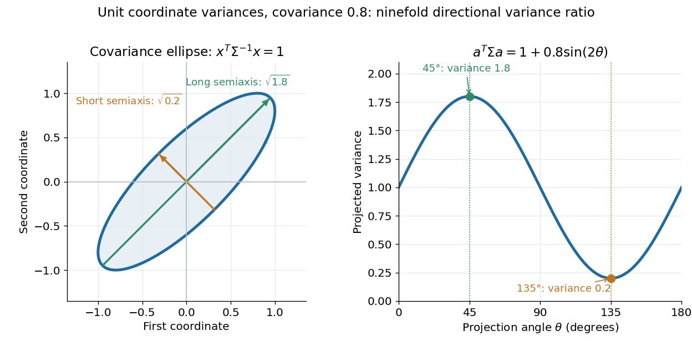

# Covariance matrix

↑ **Parent:** [Covariance](covariance.md)  
ⓦ [Wiki](https://en.wikipedia.org/wiki/Covariance_matrix)

For a real [random vector](random-vector.md) $X=(X_1,\ldots,X_p)^T$ with finite [second moments](second-moment.md), its [covariance matrix](covariance-matrix.md) collects all pairwise [covariances](covariance.md):

$$
\Sigma=\mathbb E[(X-\mathbb EX)(X-\mathbb EX)^T],\qquad
\Sigma_{ij}=\operatorname{Cov}(X_i,X_j).
$$

The diagonal entries are [variances](variance-split.md). The [covariance matrix](covariance-matrix.md) is a [symmetric matrix](symmetric-matrix.md) and a [positive semidefinite matrix](positive-semidefinite-matrix.md), because for every real [vector](vector.md) $a$,

$$
a^T\Sigma a=\operatorname{Var}(a^TX)\geq0.
$$

Thus one [matrix](matrix.md) describes the [variance](variance-split.md) of every [linear combination](linear-combination.md) of the coordinates. It is a [positive-definite matrix](positive-definite-matrix.md) exactly when no nonzero [linear combination](linear-combination.md) is constant [almost surely](almost-sure-convergence.md). A deterministic linear relation produces a zero [eigenvalue](eigenvalue.md).

For example,

$$
\Sigma=\begin{pmatrix}1&0.8\\0.8&1\end{pmatrix}
$$

has unit coordinate [variances](variance-split.md), [covariance](covariance.md) $0.8$, and [eigenvalues](eigenvalue.md) $1.8$ and $0.2$. Its unit [eigenvectors](eigenvector.md) $(1,1)^T/\sqrt2$ and $(1,-1)^T/\sqrt2$ describe directions of greatest and least projected [variance](variance-split.md). For a unit [vector](vector.md) $a=(\cos\theta,\sin\theta)^T$, direct multiplication gives $a^T\Sigma a=1+0.8\sin(2\theta)$: the variation in the sum direction is nine times that in the difference direction.

**[Figure 3](#image-a-covariance-matrix-encodes-projected-variance-in-every-direction). A covariance matrix encodes projected variance in every direction**. Left: the [covariance ellipse](covariance-ellipse.md) has a [semi-major axis](semi-major-axis.md) of [length](length.md) $\sqrt{1.8}$ and a [semi-minor axis](semi-minor-axis.md) of [length](length.md) $\sqrt{0.2}$ along the [eigenvectors](eigenvector.md) of $\Sigma$. Right: the [variance](variance-split.md) of the unit-direction projection is $1+0.8\sin(2\theta)$. This is exact [matrix](matrix.md) geometry for the stipulated [covariance matrix](covariance-matrix.md), with no sampled observations or claimed probability coverage.

The [spectral theorem](spectral-theorem.md) supplies an [orthonormal basis](orthonormal-basis.md) of these directions. This connects [covariance matrices](covariance-matrix.md) to [principal component analysis](principal-component-analysis.md): its leading [eigenvector](eigenvector.md) identifies the unit-direction projection with the largest [variance](variance-split.md). For a [linear transformation](linear-map.md) $A$, the transformed [random vector](random-vector.md) has [covariance matrix](covariance-matrix.md) $A\Sigma A^T$, so uncertainties propagate through a linear model by [matrix multiplication](matrix-multiplication.md).

**Table of contents**

- [Covariance ellipse](covariance-ellipse.md)
- [Correlation matrix](correlation-matrix.md)
- [Equicorrelation covariance matrix](equicorrelation-covariance-matrix.md)
- [Mahalanobis distance](mahalanobis-distance.md)
- [Compound-symmetry covariance](compound-symmetry-covariance.md)
- [Rank-one covariance spike](rank-one-covariance-spike.md)
- [Sample mean and covariance](sample-mean-and-covariance.md)
  - [Uncentered empirical second-moment matrix](uncentered-empirical-second-moment-matrix.md)
  - [Sample mean](sample-mean.md)
  - [Sample covariance matrix](sample-covariance-matrix.md)
    - [Rank of a centered sample covariance matrix](rank-of-a-centered-sample-covariance-matrix.md)
    - [Sample covariance](sample-covariance.md)
    - [Effective rank of a covariance matrix](effective-rank-of-a-covariance-matrix.md)
      - [Gaussian sample-covariance operator-norm bound](gaussian-sample-covariance-operator-norm-bound.md)
- [Precision matrix](precision-matrix.md)
  - [Gaussian conditional variance from precision](gaussian-conditional-variance-from-precision.md)
  - [Conditional regression coefficients from a Gaussian precision matrix](conditional-regression-coefficients-from-a-gaussian-precision-matrix.md)
  - [Profile likelihood for a Gaussian precision matrix](profile-likelihood-for-a-gaussian-precision-matrix.md)
  - [Gaussian sampling from a precision Cholesky factor](gaussian-sampling-from-a-precision-cholesky-factor.md)
  - [CLIME precision-matrix estimator](clime-precision-matrix-estimator.md)
  - [Graphical Lasso](graphical-lasso.md)
    - [Graphical Lasso column regression](graphical-lasso-column-regression.md)
    - [Graphical-Lasso Karush-Kuhn-Tucker conditions](graphical-lasso-karush-kuhn-tucker-conditions.md)
- [Pearson correlation coefficient](pearson-correlation-coefficient.md)
  - [Conditional correlation](conditional-correlation.md)
  - [Partial correlation](partial-correlation.md)
  - [Perfect positive correlation](perfect-positive-correlation.md)
    - [Terminal proportionality identifies bounded stock volatility](terminal-proportionality-identifies-bounded-stock-volatility.md)
    - [Terminal correlation does not identify adapted stock volatility](terminal-correlation-does-not-identify-adapted-stock-volatility.md)
  - [Serial correlation](serial-correlation.md)
  - [Intraclass correlation coefficient](intraclass-correlation-coefficient.md)

## ↑ Ancestors (8)

1. [Covariance](covariance.md)
2. [Variance](variance-split.md)
3. [Expected value](expected-value.md)
4. [Probability theory](probability-theory-split.md)
5. [Probability and statistics](probability-and-statistics-split.md)
6. [Area of mathematics](area-of-mathematics.md)
7. [Mathematics](mathematics-split.md)
8. [Codex Wiki](split.md)

## ← Incoming links (190)

- [Best affine state estimate](best-affine-state-estimate.md)
- [Best linear unbiased estimator](best-linear-unbiased-estimator.md)
- [Conditional mode of Gaussian random effects](conditional-mode-of-gaussian-random-effects.md)
- [Correlated Gaussian common-mean estimator](correlated-gaussian-common-mean-estimator.md)
- [Correlated random-intercept and random-slope model](correlated-random-intercept-and-random-slope-model.md)
- [Covariance and cross-spectrum of a vector MA(1)](covariance-and-cross-spectrum-of-a-vector-ma-1.md)
- [Covariance criterion for diversification of factor residuals](covariance-criterion-for-diversification-of-factor-residuals.md)
- [Covariance ellipse](covariance-ellipse.md)
- [Covariance function](covariance-function.md)
- [Covariance matrix](covariance-matrix.md)
- [Crossed random effects](crossed-random-effects.md)
- [D-optimal design](d-optimal-design.md)
- [Entropy power](entropy-power.md)
- [Entropy power inequality](entropy-power-inequality.md)
- [Equicorrelation covariance matrix](equicorrelation-covariance-matrix.md)
- [Fieller's theorem](fieller-s-theorem.md)
- [Fitted-residual orthogonality](fitted-residual-orthogonality.md)
- [Fixed-capital quadratic hedge in a one-period market](fixed-capital-quadratic-hedge-in-a-one-period-market.md)
- [Gaussian autoregressive proposal reversible with respect to a standard normal distribution](gaussian-autoregressive-proposal-reversible-with-respect-to-a-standard-normal-distribution.md)
- [Gaussian Brownian drift filter](gaussian-brownian-drift-filter.md)
- [Gaussian diagonal-covariance likelihood-ratio test](gaussian-diagonal-covariance-likelihood-ratio-test.md)
- [Gaussian filtering with exact observations](gaussian-filtering-with-exact-observations.md)
- [Gaussian graphical model](gaussian-graphical-model.md)
- [Gaussian posterior in the zero-noise limit](gaussian-posterior-in-the-zero-noise-limit.md)
- [Gaussian random vector](gaussian-random-vector.md)
- [Gaussian rotation of independent copies](gaussian-rotation-of-independent-copies.md)
- [Generalized estimating equation](generalized-estimating-equation.md)
- [Independent normal and inverse-gamma regression priors](independent-normal-and-inverse-gamma-regression-priors.md)
- [Innovation covariance](innovation-covariance.md)
- [Instantaneous covariance rank in a one-factor rate model](instantaneous-covariance-rank-in-a-one-factor-rate-model.md)
- [Interior moment matching in a finite exponential family](interior-moment-matching-in-a-finite-exponential-family.md)
- [Inverse-Wishart distribution](inverse-wishart-distribution.md)
- [Kalman filter](kalman-filter.md)
- [Kalman measurement update](kalman-measurement-update.md)
- [Least-favourable null configuration](least-favourable-null-configuration.md)
- [Linear regression](linear-regression-split.md)
- [Mahalanobis distance](mahalanobis-distance.md)
- [Mean-vector prediction risk](mean-vector-prediction-risk.md)
- [Minimal exponential family](minimal-exponential-family.md)
- [Minimal martingale measure in a one-period market](minimal-martingale-measure-in-a-one-period-market.md)
- [Multivariate analysis of variance](multivariate-analysis-of-variance.md)
- [Multivariate hypergeometric distribution](multivariate-hypergeometric-distribution.md)
- [Multivariate moving-average model](multivariate-moving-average-model.md)
- [Natural exponential family](natural-exponential-family.md)
- [Normal Q-Q plot](normal-q-q-plot.md)
- [Oja's rule](oja-s-rule.md)
- [One-period quadratic hedge](one-period-quadratic-hedge.md)
- [Optimal experimental design](optimal-experimental-design.md)
- [Ordinary least squares estimators](ordinary-least-squares-estimators.md)
- [Partial correlation](partial-correlation.md)
- [Solution](past-exam-of-the-mathematics-course-of-the-university-of-cambridge/2001/iii/paper-23/3/c/solution.md)
- [Solution](past-exam-of-the-mathematics-course-of-the-university-of-cambridge/2001/iii/paper-30/3/d/solution.md)
- [Solution](past-exam-of-the-mathematics-course-of-the-university-of-cambridge/2002/iii/paper-32/2/a/solution.md)
- [Solution](past-exam-of-the-mathematics-course-of-the-university-of-cambridge/2002/iii/paper-39/2/solution.md)
- [Solution](past-exam-of-the-mathematics-course-of-the-university-of-cambridge/2002/iii/paper-39/6/solution.md)
- [Solution](past-exam-of-the-mathematics-course-of-the-university-of-cambridge/2003/iii/paper-38/5/ii/a/solution.md)
- [Solution](past-exam-of-the-mathematics-course-of-the-university-of-cambridge/2003/iii/paper-42/1/i/solution.md)
- [Solution](past-exam-of-the-mathematics-course-of-the-university-of-cambridge/2003/iii/paper-42/1/ii/solution.md)
- [Solution](past-exam-of-the-mathematics-course-of-the-university-of-cambridge/2003/iii/paper-42/3/ii/solution.md)
- [Solution](past-exam-of-the-mathematics-course-of-the-university-of-cambridge/2003/iii/paper-42/6/solution.md)
- [Solution](past-exam-of-the-mathematics-course-of-the-university-of-cambridge/2004/iii/paper-35/1/a/solution.md)
- [Solution](past-exam-of-the-mathematics-course-of-the-university-of-cambridge/2004/iii/paper-35/1/c/solution.md)
- [Solution](past-exam-of-the-mathematics-course-of-the-university-of-cambridge/2004/iii/paper-35/1/e/solution.md)
- [Solution](past-exam-of-the-mathematics-course-of-the-university-of-cambridge/2004/iii/paper-35/1/g/solution.md)
- [Solution](past-exam-of-the-mathematics-course-of-the-university-of-cambridge/2004/iii/paper-37/1/i/solution.md)
- [Solution](past-exam-of-the-mathematics-course-of-the-university-of-cambridge/2004/iii/paper-37/2/ii/solution.md)
- [Solution](past-exam-of-the-mathematics-course-of-the-university-of-cambridge/2004/iii/paper-43/1/i/solution.md)
- [Solution](past-exam-of-the-mathematics-course-of-the-university-of-cambridge/2004/iii/paper-43/2/i/solution.md)
- [Solution](past-exam-of-the-mathematics-course-of-the-university-of-cambridge/2004/iii/paper-43/2/iii/solution.md)
- [Solution](past-exam-of-the-mathematics-course-of-the-university-of-cambridge/2004/iii/paper-43/4/solution.md)
- [Solution](past-exam-of-the-mathematics-course-of-the-university-of-cambridge/2004/iii/paper-43/5/i/solution.md)
- [Solution](past-exam-of-the-mathematics-course-of-the-university-of-cambridge/2005/ii/paper-4/6e/a/i/solution.md)
- [Solution](past-exam-of-the-mathematics-course-of-the-university-of-cambridge/2005/iii/paper-35/6/solution.md)
- [Solution](past-exam-of-the-mathematics-course-of-the-university-of-cambridge/2005/iii/paper-41/3/iii/solution.md)
- [Solution](past-exam-of-the-mathematics-course-of-the-university-of-cambridge/2005/iii/paper-41/5/ii/solution.md)
- [Solution](past-exam-of-the-mathematics-course-of-the-university-of-cambridge/2005/iii/paper-46/1/i/solution.md)
- [Solution](past-exam-of-the-mathematics-course-of-the-university-of-cambridge/2005/iii/paper-46/2/i/solution.md)
- [Solution](past-exam-of-the-mathematics-course-of-the-university-of-cambridge/2005/iii/paper-46/2/solution.md)
- [Solution](past-exam-of-the-mathematics-course-of-the-university-of-cambridge/2005/iii/paper-46/4/ii/solution.md)
- [Solution](past-exam-of-the-mathematics-course-of-the-university-of-cambridge/2006/ii/paper-4/27j/a/solution.md)
- [Solution](past-exam-of-the-mathematics-course-of-the-university-of-cambridge/2006/ii/paper-4/5i/solution.md)
- [Solution](past-exam-of-the-mathematics-course-of-the-university-of-cambridge/2006/iii/paper-39/1/solution.md)
- [Solution](past-exam-of-the-mathematics-course-of-the-university-of-cambridge/2006/iii/paper-41/1/solution.md)
- [Solution](past-exam-of-the-mathematics-course-of-the-university-of-cambridge/2006/iii/paper-42/2/solution.md)
- [Solution](past-exam-of-the-mathematics-course-of-the-university-of-cambridge/2006/iii/paper-42/4/ii/solution.md)
- [Solution](past-exam-of-the-mathematics-course-of-the-university-of-cambridge/2006/iii/paper-46/1/a/solution.md)
- [Solution](past-exam-of-the-mathematics-course-of-the-university-of-cambridge/2006/iii/paper-46/2/a/solution.md)
- [Solution](past-exam-of-the-mathematics-course-of-the-university-of-cambridge/2006/iii/paper-46/2/b/i/solution.md)
- [Solution](past-exam-of-the-mathematics-course-of-the-university-of-cambridge/2006/iii/paper-46/3/a/solution.md)
- [Solution](past-exam-of-the-mathematics-course-of-the-university-of-cambridge/2006/iii/paper-46/3/b/iii/solution.md)
- [Solution](past-exam-of-the-mathematics-course-of-the-university-of-cambridge/2006/iii/paper-84/4/a/solution.md)
- [Solution](past-exam-of-the-mathematics-course-of-the-university-of-cambridge/2007/ii/paper-1/13i/solution.md)
- [Solution](past-exam-of-the-mathematics-course-of-the-university-of-cambridge/2007/ii/paper-1/5i/solution.md)
- [Solution](past-exam-of-the-mathematics-course-of-the-university-of-cambridge/2007/iii/paper-42/3/solution.md)
- [Solution](past-exam-of-the-mathematics-course-of-the-university-of-cambridge/2007/iii/paper-47/1/b/solution.md)
- [Solution](past-exam-of-the-mathematics-course-of-the-university-of-cambridge/2007/iii/paper-73/4/b/solution.md)
- [Solution](past-exam-of-the-mathematics-course-of-the-university-of-cambridge/2007/iii/paper-74/3/d/solution.md)
- [Solution](past-exam-of-the-mathematics-course-of-the-university-of-cambridge/2008/ib/paper-4/19h/i/solution.md)
- [Solution](past-exam-of-the-mathematics-course-of-the-university-of-cambridge/2008/iii/paper-42/3/solution.md)
- [Solution](past-exam-of-the-mathematics-course-of-the-university-of-cambridge/2008/iii/paper-45/2/b/solution.md)
- [Solution](past-exam-of-the-mathematics-course-of-the-university-of-cambridge/2008/iii/paper-47/5/a/ii/solution.md)
- [Solution](past-exam-of-the-mathematics-course-of-the-university-of-cambridge/2009/ia/paper-2/3f/a/solution.md)
- [Solution](past-exam-of-the-mathematics-course-of-the-university-of-cambridge/2009/ib/paper-2/19h/solution.md)
- [Solution](past-exam-of-the-mathematics-course-of-the-university-of-cambridge/2009/ii/paper-1/29j/a/solution.md)
- [Solution](past-exam-of-the-mathematics-course-of-the-university-of-cambridge/2009/ii/paper-4/29j/solution.md)
- [Solution](past-exam-of-the-mathematics-course-of-the-university-of-cambridge/2009/iii/paper-102/2/b/solution.md)
- [Solution](past-exam-of-the-mathematics-course-of-the-university-of-cambridge/2009/iii/paper-102/4/d/solution.md)
- [Solution](past-exam-of-the-mathematics-course-of-the-university-of-cambridge/2009/iii/paper-39/1/solution.md)
- [Solution](past-exam-of-the-mathematics-course-of-the-university-of-cambridge/2010/ii/paper-4/29i/solution.md)
- [Solution](past-exam-of-the-mathematics-course-of-the-university-of-cambridge/2010/iii/paper-32/1/solution.md)
- [Solution](past-exam-of-the-mathematics-course-of-the-university-of-cambridge/2010/iii/paper-32/3/solution.md)
- [Solution](past-exam-of-the-mathematics-course-of-the-university-of-cambridge/2010/iii/paper-34/1/c/solution.md)
- [Solution](past-exam-of-the-mathematics-course-of-the-university-of-cambridge/2010/iii/paper-36/4/c/solution.md)
- [Solution](past-exam-of-the-mathematics-course-of-the-university-of-cambridge/2010/iii/paper-39/6/a/solution.md)
- [Solution](past-exam-of-the-mathematics-course-of-the-university-of-cambridge/2010/iii/paper-39/6/c/solution.md)
- [Solution](past-exam-of-the-mathematics-course-of-the-university-of-cambridge/2010/iii/paper-39/6/d/solution.md)
- [Solution](past-exam-of-the-mathematics-course-of-the-university-of-cambridge/2010/iii/paper-46/2/solution.md)
- [Solution](past-exam-of-the-mathematics-course-of-the-university-of-cambridge/2012/iii/paper-37/2/solution.md)
- [Solution](past-exam-of-the-mathematics-course-of-the-university-of-cambridge/2012/iii/paper-37/6/a/solution.md)
- [Solution](past-exam-of-the-mathematics-course-of-the-university-of-cambridge/2012/iii/paper-38/2/solution.md)
- [Solution](past-exam-of-the-mathematics-course-of-the-university-of-cambridge/2013/iii/paper-25/1/b/solution.md)
- [Solution](past-exam-of-the-mathematics-course-of-the-university-of-cambridge/2013/iii/paper-30/1/c/solution.md)
- [Solution](past-exam-of-the-mathematics-course-of-the-university-of-cambridge/2013/iii/paper-30/1/d/solution.md)
- [Solution](past-exam-of-the-mathematics-course-of-the-university-of-cambridge/2013/iii/paper-35/1/a/solution.md)
- [Solution](past-exam-of-the-mathematics-course-of-the-university-of-cambridge/2014/ib/paper-4/19h/solution.md)
- [Solution](past-exam-of-the-mathematics-course-of-the-university-of-cambridge/2014/iii/paper-30/1/solution.md)
- [Solution](past-exam-of-the-mathematics-course-of-the-university-of-cambridge/2014/iii/paper-32/1/d/solution.md)
- [Solution](past-exam-of-the-mathematics-course-of-the-university-of-cambridge/2015/ii/paper-3/26k/solution.md)
- [Solution](past-exam-of-the-mathematics-course-of-the-university-of-cambridge/2015/ii/paper-4/10j/solution.md)
- [Solution](past-exam-of-the-mathematics-course-of-the-university-of-cambridge/2015/ii/paper-4/11e/b/solution.md)
- [Solution](past-exam-of-the-mathematics-course-of-the-university-of-cambridge/2015/iii/paper-32/2/solution.md)
- [Solution](past-exam-of-the-mathematics-course-of-the-university-of-cambridge/2015/iii/paper-33/1/solution.md)
- [Solution](past-exam-of-the-mathematics-course-of-the-university-of-cambridge/2015/iii/paper-33/6/b/solution.md)
- [Solution](past-exam-of-the-mathematics-course-of-the-university-of-cambridge/2016/iii/paper-205/1/solution.md)
- [Solution](past-exam-of-the-mathematics-course-of-the-university-of-cambridge/2016/iii/paper-206/2/a/solution.md)
- [Solution](past-exam-of-the-mathematics-course-of-the-university-of-cambridge/2016/iii/paper-206/2/b/solution.md)
- [Solution](past-exam-of-the-mathematics-course-of-the-university-of-cambridge/2016/iii/paper-206/2/f/solution.md)
- [Solution](past-exam-of-the-mathematics-course-of-the-university-of-cambridge/2016/iii/paper-209/2/c/solution.md)
- [Solution](past-exam-of-the-mathematics-course-of-the-university-of-cambridge/2016/iii/paper-210/2/a/solution.md)
- [Solution](past-exam-of-the-mathematics-course-of-the-university-of-cambridge/2016/iii/paper-213/3/solution.md)
- [Solution](past-exam-of-the-mathematics-course-of-the-university-of-cambridge/2017/iii/paper-206/2/d/solution.md)
- [Solution](past-exam-of-the-mathematics-course-of-the-university-of-cambridge/2017/iii/paper-206/3/e/solution.md)
- [Solution](past-exam-of-the-mathematics-course-of-the-university-of-cambridge/2017/iii/paper-206/6/b/solution.md)
- [Solution](past-exam-of-the-mathematics-course-of-the-university-of-cambridge/2017/iii/paper-206/6/e/solution.md)
- [Solution](past-exam-of-the-mathematics-course-of-the-university-of-cambridge/2017/iii/paper-207/3/c/iii/solution.md)
- [Solution](past-exam-of-the-mathematics-course-of-the-university-of-cambridge/2017/iii/paper-216/5/a/solution.md)
- [Solution](past-exam-of-the-mathematics-course-of-the-university-of-cambridge/2017/iii/paper-216/5/b/solution.md)
- [Solution](past-exam-of-the-mathematics-course-of-the-university-of-cambridge/2017/iii/paper-217/1/solution.md)
- [Solution](past-exam-of-the-mathematics-course-of-the-university-of-cambridge/2017/iii/paper-217/4/solution.md)
- [Solution](past-exam-of-the-mathematics-course-of-the-university-of-cambridge/2018/iii/paper-216/4/a/solution.md)
- [Solution](past-exam-of-the-mathematics-course-of-the-university-of-cambridge/2018/iii/paper-216/6/c/solution.md)
- [Solution](past-exam-of-the-mathematics-course-of-the-university-of-cambridge/2018/iii/paper-218/1/c/solution.md)
- [Solution](past-exam-of-the-mathematics-course-of-the-university-of-cambridge/2018/iii/paper-218/4/c/solution.md)
- [Solution](past-exam-of-the-mathematics-course-of-the-university-of-cambridge/2018/iii/paper-219/1/v/solution.md)
- [Solution](past-exam-of-the-mathematics-course-of-the-university-of-cambridge/2018/iii/paper-335/1/i/solution.md)
- [Solution](past-exam-of-the-mathematics-course-of-the-university-of-cambridge/2019/ia/paper-2/11f/a/iii/solution.md)
- [Solution](past-exam-of-the-mathematics-course-of-the-university-of-cambridge/2019/iii/paper-219/1/c/solution.md)
- [Solution](past-exam-of-the-mathematics-course-of-the-university-of-cambridge/2019/iii/paper-349/2/solution.md)
- [Solution](past-exam-of-the-mathematics-course-of-the-university-of-cambridge/2019/iii/paper-350/1/b/solution.md)
- [Solution](past-exam-of-the-mathematics-course-of-the-university-of-cambridge/2019/iii/paper-350/2/a/solution.md)
- [Solution](past-exam-of-the-mathematics-course-of-the-university-of-cambridge/2020/ii/paper-1/30k/a/solution.md)
- [Solution](past-exam-of-the-mathematics-course-of-the-university-of-cambridge/2020/ii/paper-3/28j/ii/solution.md)
- [Solution](past-exam-of-the-mathematics-course-of-the-university-of-cambridge/2022/iii/paper-218/3/d/solution.md)
- [Solution](past-exam-of-the-mathematics-course-of-the-university-of-cambridge/2022/iii/paper-219/1/b/solution.md)
- [Solution](past-exam-of-the-mathematics-course-of-the-university-of-cambridge/2023/iii/paper-218/6/c/i/solution.md)
- [Solution](past-exam-of-the-mathematics-course-of-the-university-of-cambridge/2023/iii/paper-339/1/d/solution.md)
- [Solution](past-exam-of-the-mathematics-course-of-the-university-of-cambridge/2024/iii/paper-218/2/e/solution.md)
- [Population-averaged logistic model for repeated binary outcomes](population-averaged-logistic-model-for-repeated-binary-outcomes.md)
- [Population principal component](population-principal-component.md)
- [Portfolio diversification](portfolio-diversification.md)
- [Portfolio opportunity set](portfolio-opportunity-set.md)
- [Precision matrix](precision-matrix.md)
- [Principal component](principal-component.md)
- [Prior-dependent Gaussian discriminant boundary](prior-dependent-gaussian-discriminant-boundary.md)
- [Propagation of uncertainty](propagation-of-uncertainty.md)
- [Pseudo-covariance](pseudo-covariance.md)
- [Rank-one covariance spike](rank-one-covariance-spike.md)
- [Restricted maximum likelihood](restricted-maximum-likelihood.md)
- [Sign of the normalized tangency portfolio](sign-of-the-normalized-tangency-portfolio.md)
- [Singular covariance and nonexistence of a Gaussian maximum likelihood estimate](singular-covariance-and-nonexistence-of-a-gaussian-maximum-likelihood-estimate.md)
- [Stationary initialization of an ARMA(1,1) state](stationary-initialization-of-an-arma-1-1-state.md)
- [Stationary process](stationary-process.md)
- [Sudakov-Fernique inequality](sudakov-fernique-inequality.md)
- [Treatment contrast](treatment-contrast.md)
- [Treatment interaction contrast in a Poisson regression](treatment-interaction-contrast-in-a-poisson-regression.md)
- [Two-stage residual mixture fitting](two-stage-residual-mixture-fitting.md)
- [Uncentered empirical second-moment matrix](uncentered-empirical-second-moment-matrix.md)
- [Universal kriging](universal-kriging.md)
- [Variance](variance-split.md)
- [Variance of a fitted regression mean](variance-of-a-fitted-regression-mean.md)
