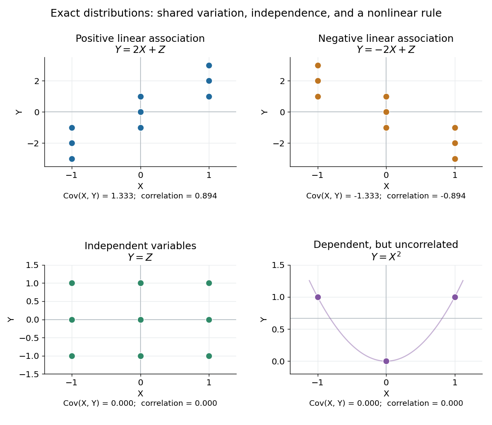

# Covariance

↑ **Parent:** [Variance](variance-split.md)  
ⓦ [Wiki](https://en.wikipedia.org/wiki/Covariance)

The [covariance](covariance.md) measures the average product of two centered deviations. For real [square-integrable](square-integrable-function.md) [random variables](random-variable-split.md) $X$ and $Y$,

$$
\operatorname{Cov}(X,Y)
=\mathbb E[(X-\mathbb EX)(Y-\mathbb EY)]
=\mathbb E[XY]-\mathbb E X\,\mathbb E Y.
$$

Deviations with the same sign contribute positively; deviations with opposite signs contribute negatively. Their magnitudes and [probabilities](probability.md) determine the net result. Taking $Y=X$ recovers the [variance](variance-split.md). The definitions and algebraic properties are presented in [Orloff and Bloom, MIT 18.05, Covariance and Correlation, sections 2–2.1](https://ocw.mit.edu/courses/18-05-introduction-to-probability-and-statistics-spring-2022/mit18_05_s22_class07-prep-b.pdf).

For a worked example, let $X,Z$ be [independent random variables](independent-random-variables.md), each equally likely to be $-1$, $0$ or $1$, and put $Y=2X+Z$. All nine pairs $(X,Z)$ have [probability](probability.md) $1/9$. The [expected values](expected-value.md) are zero, while [linearity of covariance](linearity-of-covariance.md) and the vanishing [covariance](covariance.md) of [independent random variables](independent-random-variables.md) give

$$
\operatorname{Var}(X)=\operatorname{Var}(Z)=\frac23,\qquad
\operatorname{Cov}(X,Y)=2\operatorname{Var}(X)=\frac43,\qquad
\operatorname{Var}(Y)=4\operatorname{Var}(X)+\operatorname{Var}(Z)=\frac{10}{3}.
$$

The shared $X$ term makes large $X$ accompany large $Y$ on average. Replacing $2X$ by $-2X$ reverses the [covariance](covariance.md) to $-4/3$ without changing either [variance](variance-split.md).

**[Figure 2](#image-positive-negative-independent-and-nonlinear-relationships-have-different-covariance-behavior). Positive, negative, independent, and nonlinear relationships have different covariance behavior**. In the first three panels, $X$ and $Z$ independently take $-1$, $0$ and $1$ with equal [probabilities](probability.md); each point has [probability](probability.md) $1/9$. In the last panel, $Y=X^2$, and the three marked outcomes each have [probability](probability.md) $1/3$. The thin curve shows that [quadratic function](quadratic-function.md). Its zero [covariance](covariance.md) leaves strong nonlinear [statistical dependence](statistical-dependence.md) visible.

The [covariance](covariance.md) is useful whenever deviations are added or subtracted. Expanding the square gives

$$
\operatorname{Var}(X+Y)
=\operatorname{Var}(X)+\operatorname{Var}(Y)+2\operatorname{Cov}(X,Y),\qquad
\operatorname{Var}(X-Y)
=\operatorname{Var}(X)+\operatorname{Var}(Y)-2\operatorname{Cov}(X,Y).
$$

For the worked model, these are $20/3$ and $4/3$. Positive [covariance](covariance.md) increases variation in the sum while reducing variation in the difference: the same shared fluctuation reinforces one combination and partly cancels in the other. The identity applies beyond [independent random variables](independent-random-variables.md).

The size of a [covariance](covariance.md) depends on the measurement scale. For constants $a,b,c,d$, [linearity of covariance](linearity-of-covariance.md) gives $\operatorname{Cov}(aX+b,cY+d)=ac\operatorname{Cov}(X,Y)$. Adding offsets has no effect; rescaling either measurement rescales the [covariance](covariance.md). The [Pearson correlation coefficient](pearson-correlation-coefficient.md) divides by both [standard deviations](standard-deviation.md) to describe the standardized linear relationship.

**Table of contents**

- [Law of total covariance](law-of-total-covariance.md)
- [Strict positive covariance with an increasing payoff](strict-positive-covariance-with-an-increasing-payoff.md)
- [Conditional covariance](conditional-covariance.md)
- [Sample correlation coefficient](sample-correlation-coefficient.md)
  - [Sample correlation matrix](sample-correlation-matrix.md)
- [Complex covariance](complex-covariance.md)
  - [Pseudo-covariance](pseudo-covariance.md)
- [Linearity of covariance](linearity-of-covariance.md)
- [Uncorrelated random variables](uncorrelated-random-variables.md)
  - [Bernoulli independence from zero covariance](bernoulli-independence-from-zero-covariance.md)
- [Covariance matrix](covariance-matrix.md)
  - [Covariance ellipse](covariance-ellipse.md)
  - [Correlation matrix](correlation-matrix.md)
  - [Equicorrelation covariance matrix](equicorrelation-covariance-matrix.md)
  - [Mahalanobis distance](mahalanobis-distance.md)
  - [Compound-symmetry covariance](compound-symmetry-covariance.md)
  - [Rank-one covariance spike](rank-one-covariance-spike.md)
  - [Sample mean and covariance](sample-mean-and-covariance.md)
    - [Uncentered empirical second-moment matrix](uncentered-empirical-second-moment-matrix.md)
    - [Sample mean](sample-mean.md)
    - [Sample covariance matrix](sample-covariance-matrix.md)
      - [Rank of a centered sample covariance matrix](rank-of-a-centered-sample-covariance-matrix.md)
      - [Sample covariance](sample-covariance.md)
      - [Effective rank of a covariance matrix](effective-rank-of-a-covariance-matrix.md)
        - [Gaussian sample-covariance operator-norm bound](gaussian-sample-covariance-operator-norm-bound.md)
  - [Precision matrix](precision-matrix.md)
    - [Gaussian conditional variance from precision](gaussian-conditional-variance-from-precision.md)
    - [Conditional regression coefficients from a Gaussian precision matrix](conditional-regression-coefficients-from-a-gaussian-precision-matrix.md)
    - [Profile likelihood for a Gaussian precision matrix](profile-likelihood-for-a-gaussian-precision-matrix.md)
    - [Gaussian sampling from a precision Cholesky factor](gaussian-sampling-from-a-precision-cholesky-factor.md)
    - [CLIME precision-matrix estimator](clime-precision-matrix-estimator.md)
    - [Graphical Lasso](graphical-lasso.md)
      - [Graphical Lasso column regression](graphical-lasso-column-regression.md)
      - [Graphical-Lasso Karush-Kuhn-Tucker conditions](graphical-lasso-karush-kuhn-tucker-conditions.md)
  - [Pearson correlation coefficient](pearson-correlation-coefficient.md)
    - [Conditional correlation](conditional-correlation.md)
    - [Partial correlation](partial-correlation.md)
    - [Perfect positive correlation](perfect-positive-correlation.md)
      - [Terminal proportionality identifies bounded stock volatility](terminal-proportionality-identifies-bounded-stock-volatility.md)
      - [Terminal correlation does not identify adapted stock volatility](terminal-correlation-does-not-identify-adapted-stock-volatility.md)
    - [Serial correlation](serial-correlation.md)
    - [Intraclass correlation coefficient](intraclass-correlation-coefficient.md)

## ↑ Ancestors (7)

1. [Variance](variance-split.md)
2. [Expected value](expected-value.md)
3. [Probability theory](probability-theory-split.md)
4. [Probability and statistics](probability-and-statistics-split.md)
5. [Area of mathematics](area-of-mathematics.md)
6. [Mathematics](mathematics-split.md)
7. [Codex Wiki](split.md)

## ← Incoming links (341)

- [A semivariogram does not determine stationarity](a-semivariogram-does-not-determine-stationarity.md)
- [Allelic correlation](allelic-correlation.md)
- [Antithetic Cauchy-tail integration on a finite interval](antithetic-cauchy-tail-integration-on-a-finite-interval.md)
- [Antithetic variates](antithetic-variates.md)
- [Approximate experimental design](approximate-experimental-design.md)
- [Autocovariance](autocovariance.md)
- [Autocovariance of an MA(1) process](autocovariance-of-an-ma-1-process.md)
- [Autocovariance tail recurrence of a causal ARMA process](autocovariance-tail-recurrence-of-a-causal-arma-process.md)
- [Bayes' theorem](bayes-theorem.md)
- [Bernoulli independence from zero covariance](bernoulli-independence-from-zero-covariance.md)
- [Best linear unbiased estimator](best-linear-unbiased-estimator.md)
- [Bootstrap inference for a product of regression coefficients](bootstrap-inference-for-a-product-of-regression-coefficients.md)
- [Brownian bridge independence from its endpoint](brownian-bridge-independence-from-its-endpoint.md)
- [Brownian endpoint sufficiency for a constant drift](brownian-endpoint-sufficiency-for-a-constant-drift.md)
- [Brownian increment](brownian-increment.md)
- [Capillary height-difference correlation](capillary-height-difference-correlation.md)
- [Conditional covariance](conditional-covariance.md)
- [Constant intensity does not imply independence](constant-intensity-does-not-imply-independence.md)
- [Continuum Gaussian free field](continuum-gaussian-free-field.md)
- [Correlated random-intercept and random-slope model](correlated-random-intercept-and-random-slope-model.md)
- [Correlation matrix](correlation-matrix.md)
- [Covariance](covariance.md)
- [Covariance function](covariance-function.md)
- [Covariance induced by a shared latent variable](covariance-induced-by-a-shared-latent-variable.md)
- [Covariance matrix](covariance-matrix.md)
- [Covariance of two components of a compound Poisson sum](covariance-of-two-components-of-a-compound-poisson-sum.md)
- [Covariance of two uniform order statistics](covariance-of-two-uniform-order-statistics.md)
- [Covariogram](covariogram.md)
- [Cross-fitted combination of unbiased sample means](cross-fitted-combination-of-unbiased-sample-means.md)
- [Cross-spectrum of two stationary time series](cross-spectrum-of-two-stationary-time-series.md)
- [Debiased-Lasso remainder bound](debiased-lasso-remainder-bound.md)
- [Dependence in Poisson thinning](dependence-in-poisson-thinning.md)
- [Discrete Gaussian white noise](discrete-gaussian-white-noise.md)
- [Empirical distribution process](empirical-distribution-process.md)
- [Expected value premium principle](expected-value-premium-principle.md)
- [Exponential tilting of an isonormal Gaussian process](exponential-tilting-of-an-isonormal-gaussian-process.md)
- [F-Brownian bridge](f-brownian-bridge.md)
- [Fieller's theorem](fieller-s-theorem.md)
- [Finite initialization of an AR(1) process](finite-initialization-of-an-ar-1-process.md)
- [Finite population correction](finite-population-correction.md)
- [Finite-record Fourier covariance bound](finite-record-fourier-covariance-bound.md)
- [Finite-sample innovations of an MA(1) process](finite-sample-innovations-of-an-ma-1-process.md)
- [Gaussian filtering with exact observations](gaussian-filtering-with-exact-observations.md)
- [Gaussian independence of linear and quadratic statistics](gaussian-independence-of-linear-and-quadratic-statistics.md)
- [Gaussian innovation likelihood](gaussian-innovation-likelihood.md)
- [Gaussian-process characterization of Brownian motion](gaussian-process-characterization-of-brownian-motion.md)
- [Gaussian rotation of independent copies](gaussian-rotation-of-independent-copies.md)
- [Gaussian semivariogram](gaussian-semivariogram.md)
- [Gaussian white noise model](gaussian-white-noise-model.md)
- [Generalized estimating equation](generalized-estimating-equation.md)
- [Incremental net monetary benefit](incremental-net-monetary-benefit.md)
- [Independent increments of a Gaussian martingale](independent-increments-of-a-gaussian-martingale.md)
- [Independent random-intercept and random-slope model](independent-random-intercept-and-random-slope-model.md)
- [Independent random variables](independent-random-variables.md)
- [Independent subgroup contrast in meta-analysis](independent-subgroup-contrast-in-meta-analysis.md)
- [Indirect treatment comparison](indirect-treatment-comparison.md)
- [Infrared qualification of a scale-invariant covariance](infrared-qualification-of-a-scale-invariant-covariance.md)
- [Innovation covariance](innovation-covariance.md)
- [Integrated Brownian motion](integrated-brownian-motion.md)
- [Isonormal Gaussian process](isonormal-gaussian-process.md)
- [Kalman filter](kalman-filter.md)
- [Kalman measurement update](kalman-measurement-update.md)
- [Latent factor](latent-factor.md)
- [Law of total covariance](law-of-total-covariance.md)
- [Limiting MA(1) innovations coefficient](limiting-ma-1-innovations-coefficient.md)
- [Linear filter of a stationary time series](linear-filter-of-a-stationary-time-series.md)
- [Linkage disequilibrium](linkage-disequilibrium.md)
- [Loewner variation of the Dirichlet Green function](loewner-variation-of-the-dirichlet-green-function.md)
- [Logistic-normal regression with autoregressive random effects](logistic-normal-regression-with-autoregressive-random-effects.md)
- [MCMC trace diagnosis and proposal tuning](mcmc-trace-diagnosis-and-proposal-tuning.md)
- [Mean-square derivative of a Gaussian process](mean-square-derivative-of-a-gaussian-process.md)
- [Mean square in ANOVA](mean-square-in-anova.md)
- [Minimum-variance combination of unbiased sample means](minimum-variance-combination-of-unbiased-sample-means.md)
- [Multinomial aggregation](multinomial-aggregation.md)
- [Multinomial distribution](multinomial-distribution.md)
- [Multivariate hypergeometric distribution](multivariate-hypergeometric-distribution.md)
- [Mutual information](mutual-information.md)
- [Nugget effect](nugget-effect.md)
- [Omitted-variable bias](omitted-variable-bias.md)
- [One-sided spectral density of a real stationary time series](one-sided-spectral-density-of-a-real-stationary-time-series.md)
- [Optical detector pixel](optical-detector-pixel.md)
- [Ornstein-Uhlenbeck stationary initialization](ornstein-uhlenbeck-stationary-initialization.md)
- [Orthogonal basis](orthogonal-basis.md)
- [Orthogonal coefficient blocks in a centered normal linear model](orthogonal-coefficient-blocks-in-a-centered-normal-linear-model.md)
- [Pairwise independent random variables](pairwise-independent-random-variables.md)
- [Parity construction of pairwise independent bits](parity-construction-of-pairwise-independent-bits.md)
- [Parity decomposition of a lag-two ARCH process](parity-decomposition-of-a-lag-two-arch-process.md)
- [Partial correlation](partial-correlation.md)
- [Solution](past-exam-of-the-mathematics-course-of-the-university-of-cambridge/2001/iii/paper-22/6/solution.md)
- [Solution](past-exam-of-the-mathematics-course-of-the-university-of-cambridge/2001/iii/paper-23/4/c/solution.md)
- [Solution](past-exam-of-the-mathematics-course-of-the-university-of-cambridge/2001/iii/paper-32/6/iii/solution.md)
- [Solution](past-exam-of-the-mathematics-course-of-the-university-of-cambridge/2001/iii/paper-33/3/solution.md)
- [Solution](past-exam-of-the-mathematics-course-of-the-university-of-cambridge/2001/iii/paper-33/4/solution.md)
- [Solution](past-exam-of-the-mathematics-course-of-the-university-of-cambridge/2002/iii/paper-27/4/solution.md)
- [Solution](past-exam-of-the-mathematics-course-of-the-university-of-cambridge/2002/iii/paper-29/6/a/solution.md)
- [Solution](past-exam-of-the-mathematics-course-of-the-university-of-cambridge/2002/iii/paper-29/6/b/solution.md)
- [Solution](past-exam-of-the-mathematics-course-of-the-university-of-cambridge/2002/iii/paper-29/6/solution.md)
- [Solution](past-exam-of-the-mathematics-course-of-the-university-of-cambridge/2002/iii/paper-36/1/i/solution.md)
- [Solution](past-exam-of-the-mathematics-course-of-the-university-of-cambridge/2002/iii/paper-36/4/i/solution.md)
- [Solution](past-exam-of-the-mathematics-course-of-the-university-of-cambridge/2002/iii/paper-36/4/ii/solution.md)
- [Solution](past-exam-of-the-mathematics-course-of-the-university-of-cambridge/2002/iii/paper-36/4/iii/solution.md)
- [Solution](past-exam-of-the-mathematics-course-of-the-university-of-cambridge/2002/iii/paper-36/4/iv/solution.md)
- [Solution](past-exam-of-the-mathematics-course-of-the-university-of-cambridge/2002/iii/paper-37/6/iv/solution.md)
- [Solution](past-exam-of-the-mathematics-course-of-the-university-of-cambridge/2002/iii/paper-38/6/i/solution.md)
- [Solution](past-exam-of-the-mathematics-course-of-the-university-of-cambridge/2002/iii/paper-38/6/ii/solution.md)
- [Solution](past-exam-of-the-mathematics-course-of-the-university-of-cambridge/2002/iii/paper-39/1/i/solution.md)
- [Solution](past-exam-of-the-mathematics-course-of-the-university-of-cambridge/2002/iii/paper-39/1/ii/solution.md)
- [Solution](past-exam-of-the-mathematics-course-of-the-university-of-cambridge/2002/iii/paper-39/6/solution.md)
- [Solution](past-exam-of-the-mathematics-course-of-the-university-of-cambridge/2002/iii/paper-40/3/a/iii/solution.md)
- [Solution](past-exam-of-the-mathematics-course-of-the-university-of-cambridge/2002/iii/paper-40/5/solution.md)
- [Solution](past-exam-of-the-mathematics-course-of-the-university-of-cambridge/2002/iii/paper-40/6/solution.md)
- [Solution](past-exam-of-the-mathematics-course-of-the-university-of-cambridge/2002/iii/paper-69/1/c/solution.md)
- [Solution](past-exam-of-the-mathematics-course-of-the-university-of-cambridge/2002/iii/paper-69/1/d/solution.md)
- [Solution](past-exam-of-the-mathematics-course-of-the-university-of-cambridge/2002/iii/paper-69/2/a/solution.md)
- [Solution](past-exam-of-the-mathematics-course-of-the-university-of-cambridge/2002/iii/paper-69/3/c/solution.md)
- [Solution](past-exam-of-the-mathematics-course-of-the-university-of-cambridge/2002/iii/paper-69/4/a/solution.md)
- [Solution](past-exam-of-the-mathematics-course-of-the-university-of-cambridge/2003/ia/paper-2/10f/i/solution.md)
- [Solution](past-exam-of-the-mathematics-course-of-the-university-of-cambridge/2003/ia/paper-2/10f/ii/solution.md)
- [Solution](past-exam-of-the-mathematics-course-of-the-university-of-cambridge/2003/ib/paper-1/3h/solution.md)
- [Solution](past-exam-of-the-mathematics-course-of-the-university-of-cambridge/2003/ib/paper-4/12h/solution.md)
- [Solution](past-exam-of-the-mathematics-course-of-the-university-of-cambridge/2003/iii/paper-38/5/ii/b/solution.md)
- [Solution](past-exam-of-the-mathematics-course-of-the-university-of-cambridge/2003/iii/paper-39/4/solution.md)
- [Solution](past-exam-of-the-mathematics-course-of-the-university-of-cambridge/2004/ia/paper-2/3f/b/solution.md)
- [Solution](past-exam-of-the-mathematics-course-of-the-university-of-cambridge/2004/ia/paper-2/3f/solution.md)
- [Solution](past-exam-of-the-mathematics-course-of-the-university-of-cambridge/2004/iii/paper-30/3/d/solution.md)
- [Solution](past-exam-of-the-mathematics-course-of-the-university-of-cambridge/2004/iii/paper-35/4/d/solution.md)
- [Solution](past-exam-of-the-mathematics-course-of-the-university-of-cambridge/2004/iii/paper-37/4/solution.md)
- [Solution](past-exam-of-the-mathematics-course-of-the-university-of-cambridge/2004/iii/paper-37/5/ii/b/solution.md)
- [Solution](past-exam-of-the-mathematics-course-of-the-university-of-cambridge/2004/iii/paper-40/1/b/solution.md)
- [Solution](past-exam-of-the-mathematics-course-of-the-university-of-cambridge/2004/iii/paper-40/2/a/solution.md)
- [Solution](past-exam-of-the-mathematics-course-of-the-university-of-cambridge/2004/iii/paper-40/2/b/solution.md)
- [Solution](past-exam-of-the-mathematics-course-of-the-university-of-cambridge/2004/iii/paper-40/2/c/solution.md)
- [Solution](past-exam-of-the-mathematics-course-of-the-university-of-cambridge/2004/iii/paper-40/4/vi/solution.md)
- [Solution](past-exam-of-the-mathematics-course-of-the-university-of-cambridge/2004/iii/paper-41/2/solution.md)
- [Solution](past-exam-of-the-mathematics-course-of-the-university-of-cambridge/2004/iii/paper-41/4/solution.md)
- [Solution](past-exam-of-the-mathematics-course-of-the-university-of-cambridge/2004/iii/paper-43/1/i/solution.md)
- [Solution](past-exam-of-the-mathematics-course-of-the-university-of-cambridge/2004/iii/paper-43/1/iii/solution.md)
- [Solution](past-exam-of-the-mathematics-course-of-the-university-of-cambridge/2004/iii/paper-43/4/solution.md)
- [Solution](past-exam-of-the-mathematics-course-of-the-university-of-cambridge/2005/ii/paper-1/28j/solution.md)
- [Solution](past-exam-of-the-mathematics-course-of-the-university-of-cambridge/2005/ii/paper-3/13e/a/solution.md)
- [Solution](past-exam-of-the-mathematics-course-of-the-university-of-cambridge/2005/ii/paper-3/13e/c/solution.md)
- [Solution](past-exam-of-the-mathematics-course-of-the-university-of-cambridge/2005/ii/paper-3/13e/e/solution.md)
- [Solution](past-exam-of-the-mathematics-course-of-the-university-of-cambridge/2005/ii/paper-3/5i/a/solution.md)
- [Solution](past-exam-of-the-mathematics-course-of-the-university-of-cambridge/2005/ii/paper-3/5i/b/solution.md)
- [Solution](past-exam-of-the-mathematics-course-of-the-university-of-cambridge/2005/iii/paper-38/1/b/solution.md)
- [Solution](past-exam-of-the-mathematics-course-of-the-university-of-cambridge/2005/iii/paper-41/3/ii/solution.md)
- [Solution](past-exam-of-the-mathematics-course-of-the-university-of-cambridge/2005/iii/paper-42/6/ii/solution.md)
- [Solution](past-exam-of-the-mathematics-course-of-the-university-of-cambridge/2005/iii/paper-42/6/vii/solution.md)
- [Solution](past-exam-of-the-mathematics-course-of-the-university-of-cambridge/2005/iii/paper-42/6/viii/solution.md)
- [Solution](past-exam-of-the-mathematics-course-of-the-university-of-cambridge/2005/iii/paper-45/4/i/solution.md)
- [Solution](past-exam-of-the-mathematics-course-of-the-university-of-cambridge/2005/iii/paper-46/1/i/solution.md)
- [Solution](past-exam-of-the-mathematics-course-of-the-university-of-cambridge/2005/iii/paper-46/1/ii/solution.md)
- [Solution](past-exam-of-the-mathematics-course-of-the-university-of-cambridge/2005/iii/paper-46/1/solution.md)
- [Solution](past-exam-of-the-mathematics-course-of-the-university-of-cambridge/2005/iii/paper-46/2/solution.md)
- [Solution](past-exam-of-the-mathematics-course-of-the-university-of-cambridge/2005/iii/paper-46/4/i/solution.md)
- [Solution](past-exam-of-the-mathematics-course-of-the-university-of-cambridge/2005/iii/paper-46/4/ii/solution.md)
- [Solution](past-exam-of-the-mathematics-course-of-the-university-of-cambridge/2005/iii/paper-46/4/iii/solution.md)
- [Solution](past-exam-of-the-mathematics-course-of-the-university-of-cambridge/2005/iii/paper-47/4/b/solution.md)
- [Solution](past-exam-of-the-mathematics-course-of-the-university-of-cambridge/2005/iii/paper-47/5/a/ii/solution.md)
- [Solution](past-exam-of-the-mathematics-course-of-the-university-of-cambridge/2006/iii/paper-30/1/c/solution.md)
- [Solution](past-exam-of-the-mathematics-course-of-the-university-of-cambridge/2006/iii/paper-36/3/b/iii/solution.md)
- [Solution](past-exam-of-the-mathematics-course-of-the-university-of-cambridge/2006/iii/paper-39/6/solution.md)
- [Solution](past-exam-of-the-mathematics-course-of-the-university-of-cambridge/2006/iii/paper-41/1/solution.md)
- [Solution](past-exam-of-the-mathematics-course-of-the-university-of-cambridge/2006/iii/paper-41/2/solution.md)
- [Solution](past-exam-of-the-mathematics-course-of-the-university-of-cambridge/2006/iii/paper-42/4/i/solution.md)
- [Solution](past-exam-of-the-mathematics-course-of-the-university-of-cambridge/2006/iii/paper-43/4/solution.md)
- [Solution](past-exam-of-the-mathematics-course-of-the-university-of-cambridge/2006/iii/paper-47/2/a/solution.md)
- [Solution](past-exam-of-the-mathematics-course-of-the-university-of-cambridge/2006/iii/paper-47/2/c/solution.md)
- [Solution](past-exam-of-the-mathematics-course-of-the-university-of-cambridge/2006/iii/paper-47/2/solution.md)
- [Solution](past-exam-of-the-mathematics-course-of-the-university-of-cambridge/2006/iii/paper-47/4/c/solution.md)
- [Solution](past-exam-of-the-mathematics-course-of-the-university-of-cambridge/2006/iii/paper-69/3/a/solution.md)
- [Solution](past-exam-of-the-mathematics-course-of-the-university-of-cambridge/2007/iii/paper-42/3/solution.md)
- [Solution](past-exam-of-the-mathematics-course-of-the-university-of-cambridge/2007/iii/paper-43/1/solution.md)
- [Solution](past-exam-of-the-mathematics-course-of-the-university-of-cambridge/2008/ia/paper-2/11f/solution.md)
- [Solution](past-exam-of-the-mathematics-course-of-the-university-of-cambridge/2008/ii/paper-3/5j/solution.md)
- [Solution](past-exam-of-the-mathematics-course-of-the-university-of-cambridge/2008/iii/paper-41/1/solution.md)
- [Solution](past-exam-of-the-mathematics-course-of-the-university-of-cambridge/2008/iii/paper-41/4/b/solution.md)
- [Solution](past-exam-of-the-mathematics-course-of-the-university-of-cambridge/2008/iii/paper-47/1/solution.md)
- [Solution](past-exam-of-the-mathematics-course-of-the-university-of-cambridge/2008/iii/paper-47/4/d/solution.md)
- [Solution](past-exam-of-the-mathematics-course-of-the-university-of-cambridge/2008/iii/paper-83/2/solution.md)
- [Solution](past-exam-of-the-mathematics-course-of-the-university-of-cambridge/2009/ia/paper-2/3f/b/solution.md)
- [Solution](past-exam-of-the-mathematics-course-of-the-university-of-cambridge/2009/ii/paper-4/13i/solution.md)
- [Solution](past-exam-of-the-mathematics-course-of-the-university-of-cambridge/2009/ii/paper-4/17f/solution.md)
- [Solution](past-exam-of-the-mathematics-course-of-the-university-of-cambridge/2009/ii/paper-4/25j/solution.md)
- [Solution](past-exam-of-the-mathematics-course-of-the-university-of-cambridge/2009/iii/paper-34/1/a/solution.md)
- [Solution](past-exam-of-the-mathematics-course-of-the-university-of-cambridge/2009/iii/paper-34/1/b/solution.md)
- [Solution](past-exam-of-the-mathematics-course-of-the-university-of-cambridge/2009/iii/paper-40/1/solution.md)
- [Solution](past-exam-of-the-mathematics-course-of-the-university-of-cambridge/2009/iii/paper-40/2/solution.md)
- [Solution](past-exam-of-the-mathematics-course-of-the-university-of-cambridge/2009/iii/paper-40/4/c/solution.md)
- [Solution](past-exam-of-the-mathematics-course-of-the-university-of-cambridge/2009/iii/paper-40/5/b/solution.md)
- [Solution](past-exam-of-the-mathematics-course-of-the-university-of-cambridge/2009/iii/paper-40/5/c/solution.md)
- [Solution](past-exam-of-the-mathematics-course-of-the-university-of-cambridge/2009/iii/paper-40/5/d/solution.md)
- [Solution](past-exam-of-the-mathematics-course-of-the-university-of-cambridge/2009/iii/paper-65/3/v/solution.md)
- [Solution](past-exam-of-the-mathematics-course-of-the-university-of-cambridge/2010/ia/paper-2/4f/b/i/solution.md)
- [Solution](past-exam-of-the-mathematics-course-of-the-university-of-cambridge/2010/iii/paper-31/1/solution.md)
- [Solution](past-exam-of-the-mathematics-course-of-the-university-of-cambridge/2010/iii/paper-33/2/solution.md)
- [Solution](past-exam-of-the-mathematics-course-of-the-university-of-cambridge/2010/iii/paper-70/2/a/solution.md)
- [Solution](past-exam-of-the-mathematics-course-of-the-university-of-cambridge/2010/iii/paper-70/2/b/solution.md)
- [Solution](past-exam-of-the-mathematics-course-of-the-university-of-cambridge/2010/iii/paper-70/2/c/solution.md)
- [Solution](past-exam-of-the-mathematics-course-of-the-university-of-cambridge/2011/ii/paper-4/13j/solution.md)
- [Solution](past-exam-of-the-mathematics-course-of-the-university-of-cambridge/2011/ii/paper-4/27k/solution.md)
- [Solution](past-exam-of-the-mathematics-course-of-the-university-of-cambridge/2012/iii/paper-30/2/a/solution.md)
- [Solution](past-exam-of-the-mathematics-course-of-the-university-of-cambridge/2012/iii/paper-35/2/a/solution.md)
- [Solution](past-exam-of-the-mathematics-course-of-the-university-of-cambridge/2012/iii/paper-35/4/solution.md)
- [Solution](past-exam-of-the-mathematics-course-of-the-university-of-cambridge/2012/iii/paper-37/1/c/solution.md)
- [Solution](past-exam-of-the-mathematics-course-of-the-university-of-cambridge/2012/iii/paper-37/1/d/solution.md)
- [Solution](past-exam-of-the-mathematics-course-of-the-university-of-cambridge/2012/iii/paper-37/6/a/solution.md)
- [Solution](past-exam-of-the-mathematics-course-of-the-university-of-cambridge/2012/iii/paper-37/6/b/solution.md)
- [Solution](past-exam-of-the-mathematics-course-of-the-university-of-cambridge/2012/iii/paper-37/6/d/solution.md)
- [Solution](past-exam-of-the-mathematics-course-of-the-university-of-cambridge/2012/iii/paper-38/1/ii/solution.md)
- [Solution](past-exam-of-the-mathematics-course-of-the-university-of-cambridge/2012/iii/paper-38/1/iii/solution.md)
- [Solution](past-exam-of-the-mathematics-course-of-the-university-of-cambridge/2012/iii/paper-38/1/v/solution.md)
- [Solution](past-exam-of-the-mathematics-course-of-the-university-of-cambridge/2012/iii/paper-38/2/solution.md)
- [Solution](past-exam-of-the-mathematics-course-of-the-university-of-cambridge/2012/iii/paper-40/2/c/solution.md)
- [Solution](past-exam-of-the-mathematics-course-of-the-university-of-cambridge/2012/iii/paper-43/2/solution.md)
- [Solution](past-exam-of-the-mathematics-course-of-the-university-of-cambridge/2012/iii/paper-57/3/b/solution.md)
- [Solution](past-exam-of-the-mathematics-course-of-the-university-of-cambridge/2012/iii/paper-57/3/d/solution.md)
- [Solution](past-exam-of-the-mathematics-course-of-the-university-of-cambridge/2012/iii/paper-59/1/solution.md)
- [Solution](past-exam-of-the-mathematics-course-of-the-university-of-cambridge/2012/iii/paper-74/2/c/solution.md)
- [Solution](past-exam-of-the-mathematics-course-of-the-university-of-cambridge/2013/ib/paper-1/19h/solution.md)
- [Solution](past-exam-of-the-mathematics-course-of-the-university-of-cambridge/2013/iii/paper-24/5/b/solution.md)
- [Solution](past-exam-of-the-mathematics-course-of-the-university-of-cambridge/2013/iii/paper-25/1/c/2/solution.md)
- [Solution](past-exam-of-the-mathematics-course-of-the-university-of-cambridge/2013/iii/paper-25/1/d/solution.md)
- [Solution](past-exam-of-the-mathematics-course-of-the-university-of-cambridge/2013/iii/paper-28/4/b/ii/solution.md)
- [Solution](past-exam-of-the-mathematics-course-of-the-university-of-cambridge/2013/iii/paper-29/2/solution.md)
- [Solution](past-exam-of-the-mathematics-course-of-the-university-of-cambridge/2013/iii/paper-30/1/d/solution.md)
- [Solution](past-exam-of-the-mathematics-course-of-the-university-of-cambridge/2013/iii/paper-30/2/b/solution.md)
- [Solution](past-exam-of-the-mathematics-course-of-the-university-of-cambridge/2013/iii/paper-30/4/b/solution.md)
- [Solution](past-exam-of-the-mathematics-course-of-the-university-of-cambridge/2013/iii/paper-30/4/c/solution.md)
- [Solution](past-exam-of-the-mathematics-course-of-the-university-of-cambridge/2014/iii/paper-27/1/b/solution.md)
- [Solution](past-exam-of-the-mathematics-course-of-the-university-of-cambridge/2014/iii/paper-32/1/c/solution.md)
- [Solution](past-exam-of-the-mathematics-course-of-the-university-of-cambridge/2014/iii/paper-32/3/b/iii/solution.md)
- [Solution](past-exam-of-the-mathematics-course-of-the-university-of-cambridge/2014/iii/paper-33/3/c/solution.md)
- [Solution](past-exam-of-the-mathematics-course-of-the-university-of-cambridge/2014/iii/paper-36/1/a/solution.md)
- [Solution](past-exam-of-the-mathematics-course-of-the-university-of-cambridge/2014/iii/paper-36/1/d/solution.md)
- [Solution](past-exam-of-the-mathematics-course-of-the-university-of-cambridge/2014/iii/paper-36/2/a/solution.md)
- [Solution](past-exam-of-the-mathematics-course-of-the-university-of-cambridge/2014/iii/paper-36/2/b/solution.md)
- [Solution](past-exam-of-the-mathematics-course-of-the-university-of-cambridge/2014/iii/paper-36/2/c/solution.md)
- [Solution](past-exam-of-the-mathematics-course-of-the-university-of-cambridge/2014/iii/paper-36/2/d/solution.md)
- [Solution](past-exam-of-the-mathematics-course-of-the-university-of-cambridge/2015/iii/paper-33/2/solution.md)
- [Solution](past-exam-of-the-mathematics-course-of-the-university-of-cambridge/2015/iii/paper-36/2/solution.md)
- [Solution](past-exam-of-the-mathematics-course-of-the-university-of-cambridge/2015/iii/paper-37/2/a/solution.md)
- [Solution](past-exam-of-the-mathematics-course-of-the-university-of-cambridge/2015/iii/paper-37/2/c/solution.md)
- [Solution](past-exam-of-the-mathematics-course-of-the-university-of-cambridge/2015/iii/paper-37/2/e/i/solution.md)
- [Solution](past-exam-of-the-mathematics-course-of-the-university-of-cambridge/2015/iii/paper-37/2/e/ii/solution.md)
- [Solution](past-exam-of-the-mathematics-course-of-the-university-of-cambridge/2015/iii/paper-37/3/a/solution.md)
- [Solution](past-exam-of-the-mathematics-course-of-the-university-of-cambridge/2015/iii/paper-37/3/c/solution.md)
- [Solution](past-exam-of-the-mathematics-course-of-the-university-of-cambridge/2016/ia/paper-2/10f/a/solution.md)
- [Solution](past-exam-of-the-mathematics-course-of-the-university-of-cambridge/2016/iii/paper-112/4/solution.md)
- [Solution](past-exam-of-the-mathematics-course-of-the-university-of-cambridge/2016/iii/paper-205/1/solution.md)
- [Solution](past-exam-of-the-mathematics-course-of-the-university-of-cambridge/2016/iii/paper-206/1/e/solution.md)
- [Solution](past-exam-of-the-mathematics-course-of-the-university-of-cambridge/2016/iii/paper-206/1/f/solution.md)
- [Solution](past-exam-of-the-mathematics-course-of-the-university-of-cambridge/2016/iii/paper-206/2/b/solution.md)
- [Solution](past-exam-of-the-mathematics-course-of-the-university-of-cambridge/2016/iii/paper-207/1/b/i/solution.md)
- [Solution](past-exam-of-the-mathematics-course-of-the-university-of-cambridge/2016/iii/paper-208/1/1/6/solution.md)
- [Solution](past-exam-of-the-mathematics-course-of-the-university-of-cambridge/2016/iii/paper-208/1/1/7/solution.md)
- [Solution](past-exam-of-the-mathematics-course-of-the-university-of-cambridge/2016/iii/paper-208/2/2/3/solution.md)
- [Solution](past-exam-of-the-mathematics-course-of-the-university-of-cambridge/2016/iii/paper-208/2/2/solution.md)
- [Solution](past-exam-of-the-mathematics-course-of-the-university-of-cambridge/2016/iii/paper-208/3/2/solution.md)
- [Solution](past-exam-of-the-mathematics-course-of-the-university-of-cambridge/2016/iii/paper-208/3/3/4/solution.md)
- [Solution](past-exam-of-the-mathematics-course-of-the-university-of-cambridge/2016/iii/paper-208/3/3/solution.md)
- [Solution](past-exam-of-the-mathematics-course-of-the-university-of-cambridge/2016/iii/paper-312/4/a/i/solution.md)
- [Solution](past-exam-of-the-mathematics-course-of-the-university-of-cambridge/2017/ii/paper-3/28k/solution.md)
- [Solution](past-exam-of-the-mathematics-course-of-the-university-of-cambridge/2017/iii/paper-206/3/e/solution.md)
- [Solution](past-exam-of-the-mathematics-course-of-the-university-of-cambridge/2017/iii/paper-206/4/b/solution.md)
- [Solution](past-exam-of-the-mathematics-course-of-the-university-of-cambridge/2017/iii/paper-206/4/d/solution.md)
- [Solution](past-exam-of-the-mathematics-course-of-the-university-of-cambridge/2017/iii/paper-206/5/a/solution.md)
- [Solution](past-exam-of-the-mathematics-course-of-the-university-of-cambridge/2017/iii/paper-206/5/c/solution.md)
- [Solution](past-exam-of-the-mathematics-course-of-the-university-of-cambridge/2017/iii/paper-206/6/a/solution.md)
- [Solution](past-exam-of-the-mathematics-course-of-the-university-of-cambridge/2017/iii/paper-206/6/b/solution.md)
- [Solution](past-exam-of-the-mathematics-course-of-the-university-of-cambridge/2017/iii/paper-206/6/c/solution.md)
- [Solution](past-exam-of-the-mathematics-course-of-the-university-of-cambridge/2017/iii/paper-206/6/d/solution.md)
- [Solution](past-exam-of-the-mathematics-course-of-the-university-of-cambridge/2017/iii/paper-206/6/e/solution.md)
- [Solution](past-exam-of-the-mathematics-course-of-the-university-of-cambridge/2017/iii/paper-207/1/b/solution.md)
- [Solution](past-exam-of-the-mathematics-course-of-the-university-of-cambridge/2017/iii/paper-207/2/a/ii/solution.md)
- [Solution](past-exam-of-the-mathematics-course-of-the-university-of-cambridge/2017/iii/paper-207/3/c/iii/solution.md)
- [Solution](past-exam-of-the-mathematics-course-of-the-university-of-cambridge/2017/iii/paper-216/5/a/solution.md)
- [Solution](past-exam-of-the-mathematics-course-of-the-university-of-cambridge/2017/iii/paper-217/1/solution.md)
- [Solution](past-exam-of-the-mathematics-course-of-the-university-of-cambridge/2017/iii/paper-217/2/solution.md)
- [Solution](past-exam-of-the-mathematics-course-of-the-university-of-cambridge/2017/iii/paper-303/3/b/solution.md)
- [Solution](past-exam-of-the-mathematics-course-of-the-university-of-cambridge/2017/iii/paper-312/4/a/i/solution.md)
- [Solution](past-exam-of-the-mathematics-course-of-the-university-of-cambridge/2017/iii/paper-312/4/a/ii/solution.md)
- [Solution](past-exam-of-the-mathematics-course-of-the-university-of-cambridge/2017/iii/paper-320/4/solution.md)
- [Solution](past-exam-of-the-mathematics-course-of-the-university-of-cambridge/2017/iii/paper-322/1/iii/solution.md)
- [Solution](past-exam-of-the-mathematics-course-of-the-university-of-cambridge/2017/iii/paper-338/3/a/iii/solution.md)
- [Solution](past-exam-of-the-mathematics-course-of-the-university-of-cambridge/2017/iii/paper-338/3/b/i/solution.md)
- [Solution](past-exam-of-the-mathematics-course-of-the-university-of-cambridge/2017/iii/paper-338/3/c/iii/solution.md)
- [Solution](past-exam-of-the-mathematics-course-of-the-university-of-cambridge/2018/iii/paper-202/1/iii/solution.md)
- [Solution](past-exam-of-the-mathematics-course-of-the-university-of-cambridge/2018/iii/paper-203/3/a/iii/solution.md)
- [Solution](past-exam-of-the-mathematics-course-of-the-university-of-cambridge/2018/iii/paper-218/1/a/solution.md)
- [Solution](past-exam-of-the-mathematics-course-of-the-university-of-cambridge/2018/iii/paper-219/1/v/solution.md)
- [Solution](past-exam-of-the-mathematics-course-of-the-university-of-cambridge/2018/iii/paper-219/2/iv/solution.md)
- [Solution](past-exam-of-the-mathematics-course-of-the-university-of-cambridge/2018/iii/paper-219/3/i/b/solution.md)
- [Solution](past-exam-of-the-mathematics-course-of-the-university-of-cambridge/2018/iii/paper-219/3/ii/solution.md)
- [Solution](past-exam-of-the-mathematics-course-of-the-university-of-cambridge/2018/iii/paper-219/3/iii/solution.md)
- [Solution](past-exam-of-the-mathematics-course-of-the-university-of-cambridge/2018/iii/paper-304/1/solution.md)
- [Solution](past-exam-of-the-mathematics-course-of-the-university-of-cambridge/2019/ia/paper-2/11f/a/iii/solution.md)
- [Solution](past-exam-of-the-mathematics-course-of-the-university-of-cambridge/2019/iii/paper-349/2/solution.md)
- [Solution](past-exam-of-the-mathematics-course-of-the-university-of-cambridge/2021/ii/paper-1/13j/b/ii/solution.md)
- [Solution](past-exam-of-the-mathematics-course-of-the-university-of-cambridge/2024/iii/paper-203/4/a/solution.md)
- [Solution](past-exam-of-the-mathematics-course-of-the-university-of-cambridge/2026/iii/paper-226/2/d/solution.md)
- [Solution](past-exam-of-the-mathematics-course-of-the-university-of-cambridge/2026/iii/paper-226/3/a/solution.md)
- [Pearson correlation coefficient](pearson-correlation-coefficient.md)
- [Poisson-kernel expansion of an AR(1) spectrum](poisson-kernel-expansion-of-an-ar-1-spectrum.md)
- [Poisson polar projections share their total count](poisson-polar-projections-share-their-total-count.md)
- [Poisson thinning](poisson-thinning.md)
- [Primordial bispectrum shape function](primordial-bispectrum-shape-function.md)
- [Quasi-likelihood](quasi-likelihood.md)
- [Random slope](random-slope.md)
- [Rigid-motion-projected thermal covariance of a free filament](rigid-motion-projected-thermal-covariance-of-a-free-filament.md)
- [Rotational invariance of Brownian motion](rotational-invariance-of-brownian-motion.md)
- [Sample autocovariance function](sample-autocovariance-function.md)
- [Sandwich variance of an M-estimator](sandwich-variance-of-an-m-estimator.md)
- [Scalar Gaussian Kalman recursion](scalar-gaussian-kalman-recursion.md)
- [Second moment method](second-moment-method.md)
- [Shared random rate gives dependent point counts](shared-random-rate-gives-dependent-point-counts.md)
- [Sill of a semivariogram](sill-of-a-semivariogram.md)
- [Simple kriging](simple-kriging.md)
- [Simple random walk on the integer line](simple-random-walk-on-the-integer-line.md)
- [Singular covariance and nonexistence of a Gaussian maximum likelihood estimate](singular-covariance-and-nonexistence-of-a-gaussian-maximum-likelihood-estimate.md)
- [SLE4 coupling with a Gaussian free field](sle4-coupling-with-a-gaussian-free-field.md)
- [Spectral density transformation under a linear filter](spectral-density-transformation-under-a-linear-filter.md)
- [Stationary process](stationary-process.md)
- [Statistical dependence](statistical-dependence.md)
- [Stellar pressure-energy tensor](stellar-pressure-energy-tensor.md)
- [Stochastic integral representation of a Brownian bridge](stochastic-integral-representation-of-a-brownian-bridge.md)
- [Strict positive covariance with an increasing payoff](strict-positive-covariance-with-an-increasing-payoff.md)
- [Thermally activated phase slip](thermally-activated-phase-slip.md)
- [Time series](time-series-split.md)
- [Transverse tangent correlation of a stretched worm-like chain](transverse-tangent-correlation-of-a-stretched-worm-like-chain.md)
- [Triangle variance in a binomial random graph](triangle-variance-in-a-binomial-random-graph.md)
- [Uncorrelated random variables](uncorrelated-random-variables.md)
- [Uniform balls-in-bins allocation](uniform-balls-in-bins-allocation.md)
- [Variance](variance-split.md)
- [Variance-minimizing retention for shape-three Pareto claims](variance-minimizing-retention-for-shape-three-pareto-claims.md)
- [Variance of hypothetical means](variance-of-hypothetical-means.md)
- [Velocity ellipsoid](velocity-ellipsoid.md)
- [Weakly stationary process](weakly-stationary-process.md)
- [Wiener theorem](wiener-theorem.md)
- [Working correlation matrix](working-correlation-matrix.md)
- [Zero-start Ornstein-Uhlenbeck covariance](zero-start-ornstein-uhlenbeck-covariance.md)
