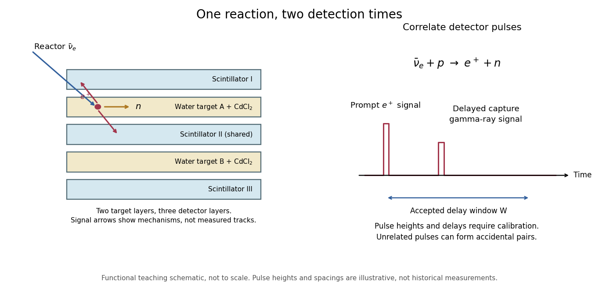

# Cowan-Reines reactor antineutrino experiment

↑ **Parent:** [Inverse beta decay](inverse-beta-decay.md)

[Clyde Cowan](clyde-cowan.md), [Frederick Reines](frederick-reines.md) and collaborators tested whether a particle produced by a [nuclear reactor](nuclear-reactor.md) could interact again after leaving its source. At Savannah River, [water](water.md) targets containing [cadmium chloride](cadmium-chloride.md) lay between [liquid scintillators](liquid-scintillator.md). Opposite detectors recorded prompt [positron annihilation](electron-positron-annihilation.md) [gamma rays](gamma-ray.md); [Neutron moderation](neutron-moderation.md) preceded delayed [neutron capture](neutron-capture.md) signals in [cadmium](cadmium.md). The arrangement used two target layers and three scintillator layers, with the middle scintillator shared.[Printed pp. 210–212, Figs. 4–5; individual Washington reproduction](the-neutrino-from-poltergeist-to-particle-by-frederick-reines.md)

**[Figure 5](#image-separate-prompt-and-delayed-readouts-of-an-antineutrino-interaction). Separate prompt and delayed readouts of an antineutrino interaction**.

The original functional diagram separates the two signal mechanisms and their timing. It omits dimensions and phototube counts, and is not a reproduction of a historical drawing. The measured objects are detector pulses; identifying their common cause also requires calibration and background tests.

The 1956 paper describes positron-source and neutron-source calibrations, pulse-height gates and photographic pulse records. Diluting the target with [heavy water](heavy-water.md) halved the proton density and reactor signal while preserving neutron-detection efficiency. Changing the [cadmium](cadmium.md) concentration altered capture timing; removing it removed the reactor signal. Added shielding tested competing external radiation. These interventions tested the reaction's ingredients, beyond simply observing a reactor-dependent count rate.[pp. 103–104, detector analysis and Experimental Results, tests 2–5](detection-of-the-free-neutrino-a-confirmation-by-clyde-cowan-and-others.md)

**Table of contents**

- [Delayed neutron-capture coincidence window](delayed-neutron-capture-coincidence-window.md)
  - [Optimum capture window in a background-dominated model](optimum-capture-window-in-a-background-dominated-model.md)

## ↑ Ancestors (6)

1. [Inverse beta decay](inverse-beta-decay.md)
2. [Beta decay](beta-decay.md)
3. [Radioactive decay](radioactive-decay.md)
4. [Nuclear physics](nuclear-physics.md)
5. [Physics](physics-split.md)
6. [Codex Wiki](split.md)
