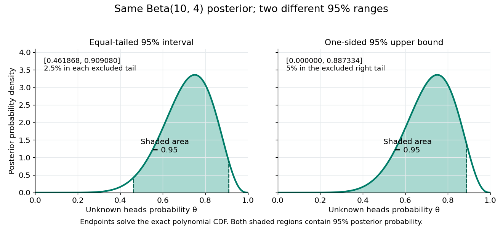

# Credible interval

↑ **Parent:** [Bayesian statistics](bayesian-statistics.md)  
ⓦ [Wiki](https://en.wikipedia.org/wiki/Credible_interval)

A [credible interval](credible-interval.md) is an [interval](interval-mathematics.md) $C(d)$ containing a prescribed amount $1-\alpha$ of [posterior probability](posterior-probability.md) for an unknown scalar [statistical parameter](statistical-parameter.md) $\Theta$. For a continuous [posterior distribution](bayesian-posterior.md) with [posterior density](posterior-density.md) $p(\theta\mid d)$, its endpoints satisfy

$$
\mathbb P(a\leq\Theta\leq b\mid D=d)=\int_a^b p(\theta\mid d)\,d\theta=1-\alpha.
$$

The conditioning includes the chosen [statistical model](statistical-model-split.md) and [prior distribution](prior-probability.md). For a discrete [posterior distribution](bayesian-posterior.md), exact equality may be impossible because of its [probability masses](probability-mass.md); an interval can instead be required to contain at least the requested [posterior probability](posterior-probability.md). An interval compresses the full [posterior distribution](bayesian-posterior.md) into a range whose uncertainty can be communicated in the parameter's own units. See [MIT 18.05, Class 16: probability intervals](https://ocw.mit.edu/courses/18-05-introduction-to-probability-and-statistics-spring-2022/mit18_05_s22_statistics.pdf#page=68).

For the eight-head, two-tail example in [Bayesian statistics](bayesian-statistics.md), the [posterior density](posterior-density.md) is $2860\theta^9(1-\theta)^3$ on $[0,1]$. Its [cumulative distribution function](cumulative-distribution-function.md), obtained by [integration](integral.md) of this [polynomial](polynomial-split.md), is

$$
F(t)=286t^{10}-780t^{11}+715t^{12}-220t^{13},\qquad 0\leq t\leq1.
$$

Solving $F(a)=0.025$ and $F(b)=0.975$ by the [bisection method](bisection-method.md) gives

$$
a\approx0.461868461,\qquad b\approx0.909079605,\qquad F(b)-F(a)=0.95.
$$

These are numerical approximations to the exact [quantiles](quantile-function.md) defined by those equations; the endpoints were computed from the [cumulative distribution function](cumulative-distribution-function.md), rather than read off a plot. The resulting [equal-tailed credible interval](equal-tailed-credible-interval.md) leaves 2.5% [posterior probability](posterior-probability.md) on each side. Its shaded area is 95% of the total area under the [posterior density](posterior-density.md).

**[Figure 10](#image-two-different-95-percent-credible-intervals-for-the-same-beta-10-4-posterior). Two different 95 percent credible intervals for the same Beta(10,4) posterior**.

[Credible intervals](credible-interval.md) are not unique. The [one-sided credible interval](one-sided-credible-interval.md) $[0,F^{-1}(0.95)]\approx[0,0.887334219]$ also has 95% [posterior probability](posterior-probability.md), but leaves all 5% outside it on the right. A [highest density region](highest-density-region.md) instead selects points above a density threshold; it need not be an [equal-tailed credible interval](equal-tailed-credible-interval.md), and when the [posterior density](posterior-density.md) has separated peaks it need not be one [interval](interval-mathematics.md) at all. Thus a reported [credible interval](credible-interval.md) should specify its construction.

A 95% [credible interval](credible-interval.md) makes a statement about the [statistical parameter](statistical-parameter.md) conditional on these observed data and the Bayesian model. A 95% [confidence interval](confidence-interval.md) instead refers to the [coverage probability](coverage-probability.md) of a procedure under repeated sampling at a fixed parameter value. These are different conditioning statements: 95% [posterior probability](posterior-probability.md) does not by itself imply 95% [coverage probability](coverage-probability.md) for every fixed parameter. The [confidence interval](confidence-interval.md) article develops that sampling interpretation.

**Table of contents**

- [Equal-tailed credible interval](equal-tailed-credible-interval.md)
- [One-sided credible interval](one-sided-credible-interval.md)

## ↑ Ancestors (6)

1. [Bayesian statistics](bayesian-statistics.md)
2. [Statistical inference](statistical-inference-split.md)
3. [Probability and statistics](probability-and-statistics-split.md)
4. [Area of mathematics](area-of-mathematics.md)
5. [Mathematics](mathematics-split.md)
6. [Codex Wiki](split.md)

## ← Incoming links (13)

- [Bayesian posterior](bayesian-posterior.md)
- [Bayesian statistics](bayesian-statistics.md)
- [Confidence interval](confidence-interval.md)
- [Credible interval](credible-interval.md)
- [Equal-tailed credible interval](equal-tailed-credible-interval.md)
- [One-sided credible interval](one-sided-credible-interval.md)
- [Solution](past-exam-of-the-mathematics-course-of-the-university-of-cambridge/2001/iii/paper-29/4/i/solution.md)
- [Solution](past-exam-of-the-mathematics-course-of-the-university-of-cambridge/2001/iii/paper-29/4/ii/solution.md)
- [Solution](past-exam-of-the-mathematics-course-of-the-university-of-cambridge/2001/iii/paper-29/4/v/solution.md)
- [Solution](past-exam-of-the-mathematics-course-of-the-university-of-cambridge/2010/iii/paper-36/4/f/solution.md)
- [Solution](past-exam-of-the-mathematics-course-of-the-university-of-cambridge/2014/iii/paper-35/1/h/solution.md)
- [Solution](past-exam-of-the-mathematics-course-of-the-university-of-cambridge/2014/iii/paper-35/2/d/solution.md)
- [Solution](past-exam-of-the-mathematics-course-of-the-university-of-cambridge/2022/iii/paper-218/6/e/solution.md)
