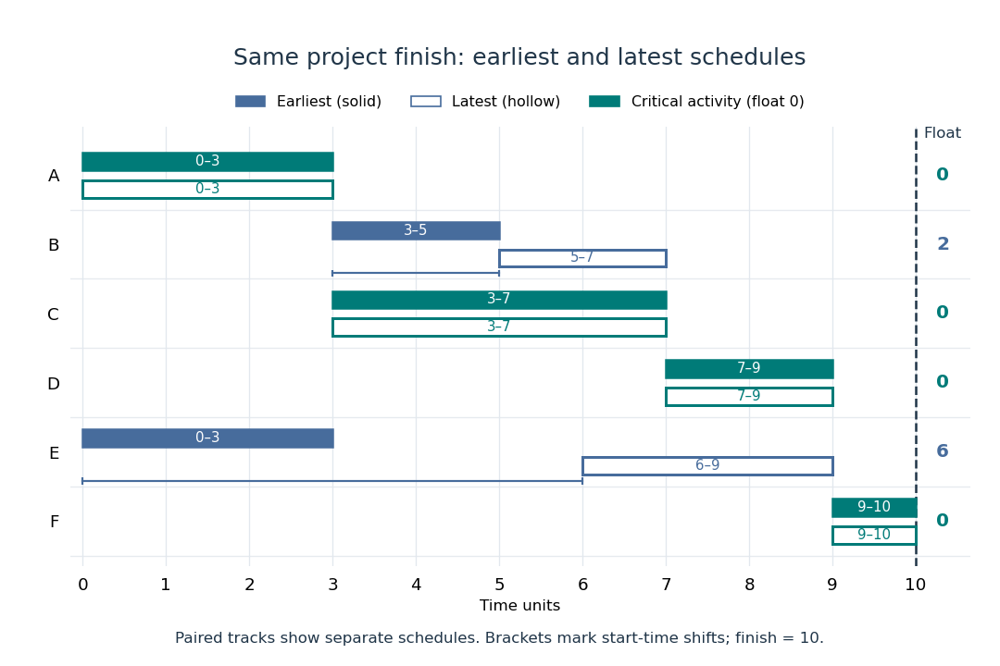

# Critical path method

↑ **Parent:** [Project scheduling](project-scheduling.md)  
ⓦ [Wiki](https://en.wikipedia.org/wiki/Critical_path_method)

The [critical path method](critical-path-method.md) calculates an earliest schedule, a latest schedule for a chosen finish time, and each activity's [task float](task-float.md). A critical path is a start-to-finish [graph path](path-in-a-graph.md) whose total duration is greatest. There can be several such [graph paths](path-in-a-graph.md), and every one constrains completion. In the six-activity [project scheduling](project-scheduling.md) example, the critical [graph path](path-in-a-graph.md) is A-C-D-F, of duration $3+4+2+1=10$.

Add a zero-duration source $s$ before every initial activity and a zero-duration sink $z$ after every terminal activity. Give each [edge](edge-of-a-graph.md) $i\to j$ weight $\tau_i$, including zero weight on [edges](edge-of-a-graph.md) leaving $s$. This produces a [weighted graph](weighted-graph.md) in which a [graph path](path-in-a-graph.md)'s weight counts every activity on it exactly once. The possible source-to-sink [graph paths](path-in-a-graph.md) in our example, omitting the dummy endpoints, are A-B-D-F with weight 8, A-C-D-F with weight 10, and E-F with weight 4.

Every feasible schedule must accommodate each of these sequential chains. Consequently,

$$
T\geq\max_{P:s\leadsto z}\sum_{i\in P\setminus\{z\}}\tau_i.
$$

This bound applies to all source-to-sink [graph paths](path-in-a-graph.md), not just the one we happen to inspect. The [critical path method](critical-path-method.md) attains the bound by setting each activity's earliest start $E_i$ to the [maximum](maximum-of-a-subset-of-a-total-order.md) of its predecessors' earliest finish times:

$$
E_s=0,\qquad E_j=\max_{i\to j}(E_i+\tau_i),\qquad T_*=E_z.
$$

Evaluate this recurrence in a [topological order](topological-order.md), obtained by [topological sorting](topological-sorting.md). Each $E_j$ satisfies every incoming [optimization constraint](optimization-constraint.md), so these times form a [feasible solution](feasible-point.md). The same recurrence calculates the greatest weight of a [graph path](path-in-a-graph.md) from $s$ to $j$; hence the feasible finish $E_z$ matches the lower bound. This is [dynamic programming](dynamic-programming.md) on a [Directed acyclic graph](directed-acyclic-graph.md), rather than an enumeration of all [graph paths](path-in-a-graph.md). See [Paul Johnson, Scheduling and longest paths, longest-path algorithm](https://ptwiddle.github.io/MAS341-Graph-Theory-2017/lecturenotes/lecturex2.html). The [linear programming](linear-programming.md) formulation and its certificate are developed in [project scheduling duality](project-scheduling-duality.md) and [unit-flow certificate for project duration](unit-flow-certificate-for-project-duration.md).

For our [project scheduling](project-scheduling.md) example, $E_A=E_E=0$, $E_B=E_C=3$, and the two merges give

$$
E_D=\max(3+2,3+4)=7,\qquad E_F=\max(7+2,0+3)=9.
$$

F finishes at 10. All six activities are completed, even though E is absent from the critical [graph path](path-in-a-graph.md). Recording which predecessor attains each [maximum](maximum-of-a-subset-of-a-total-order.md) lets us trace a critical [graph path](path-in-a-graph.md) backward from the sink; retaining tied choices exposes multiple critical [graph paths](path-in-a-graph.md).

Now fix the project start at zero and the finish at $T_*=10$. The latest starts $L_i$ come from a backward pass in reverse [topological order](topological-order.md):

$$
L_z=T_*,\qquad L_i=\min_{i\to j}(L_j-\tau_i).
$$

Every activity must finish by the earliest of its successors' latest starts, explaining the [minimum](minimum-of-a-subset-of-a-total-order.md) here. This gives $L_F=9$, $L_D=7$, $L_E=6$, $L_B=5$, $L_C=3$, and $L_A=\min(5-3,3-3)=0$. These latest times themselves form a [feasible solution](feasible-point.md) finishing at 10. The backward calculation depends on the chosen finish time; a later deadline would give different latest times and [task floats](task-float.md). The forward and backward passes are described in [Olivier de Weck, MIT ESD.36 Lecture 2, slides 22–29](https://ocw.mit.edu/courses/esd-36-system-project-management-fall-2012/50d2b3499047b71baaa511aa809f6712_MITESD_36F12_Lec02.pdf#page=22).

| Activity | Earliest start $E_i$ | Earliest finish $E_i+\tau_i$ | Latest start $L_i$ | Latest finish $L_i+\tau_i$ | [Task float](task-float.md) $L_i-E_i$ |
| --- | --- | --- | --- | --- | --- |
| A | 0 | 3 | 0 | 3 | 0 |
| B | 3 | 5 | 5 | 7 | 2 |
| C | 3 | 7 | 3 | 7 | 0 |
| D | 7 | 9 | 7 | 9 | 0 |
| E | 0 | 3 | 6 | 9 | 6 |
| F | 9 | 10 | 9 | 10 | 0 |

**[Figure 3](#image-earliest-solid-and-latest-hollow-activity-bars-for-the-critical-path-method-with-task-floats-of-2-for-b-and-6-for-e). Earliest solid and latest hollow activity bars for the critical path method, with task floats of 2 for B and 6 for E**.

Changing a duration can change which [graph paths](path-in-a-graph.md) are critical. If B's duration becomes 4, A-B-D-F and A-C-D-F both take 10: there are two critical [graph paths](path-in-a-graph.md). Shortening C alone then cannot reduce the finish time, because the chain through B still takes 10. If B's duration instead becomes 5, the earliest starts of D and F become 8 and 10, and the finish becomes 11. A-B-D-F is now the unique critical [graph path](path-in-a-graph.md); C has [task float](task-float.md) 1 relative to that new optimal finish. These calculations show why the [critical path method](critical-path-method.md) is useful for understanding where a duration change matters, even in a project containing many parallel activities.

**Table of contents**

- [Task float](task-float.md)
- [Project scheduling duality](project-scheduling-duality.md)
  - [Unit-flow certificate for project duration](unit-flow-certificate-for-project-duration.md)

## ↑ Ancestors (5)

1. [Project scheduling](project-scheduling.md)
2. [Mathematical optimization](mathematical-optimization-split.md)
3. [Area of mathematics](area-of-mathematics.md)
4. [Mathematics](mathematics-split.md)
5. [Codex Wiki](split.md)

## ← Incoming links (4)

- [Critical path method](critical-path-method.md)
- [Solution](past-exam-of-the-mathematics-course-of-the-university-of-cambridge/2006/iii/paper-38/2/solution.md)
- [Project scheduling](project-scheduling.md)
- [Task float](task-float.md)
