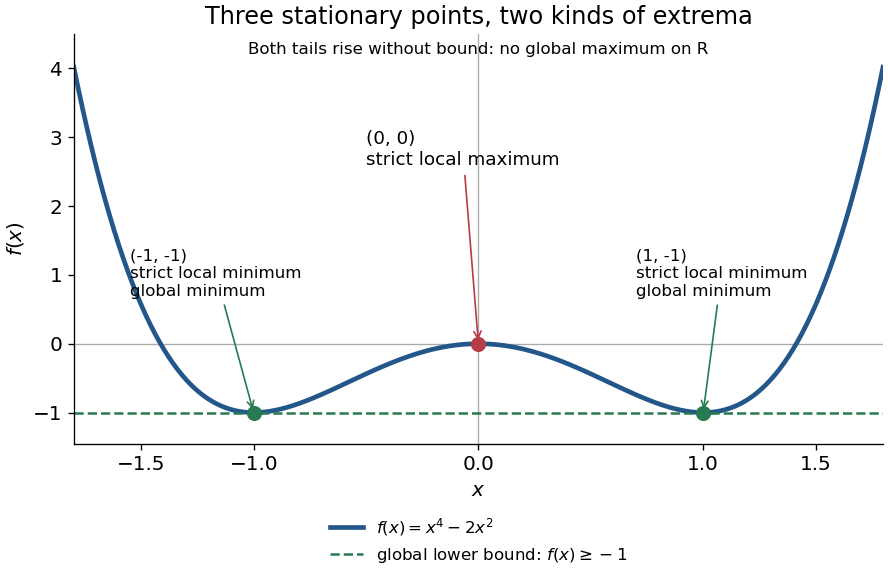
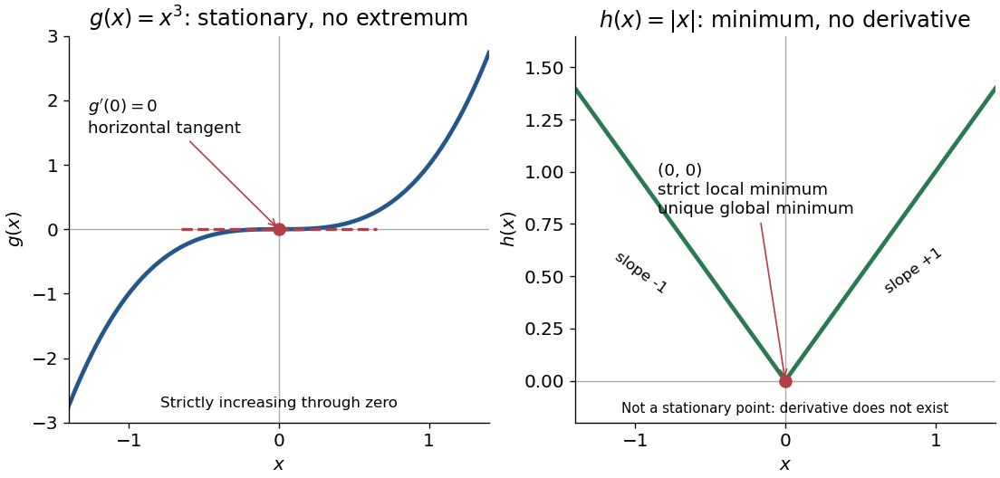

# Critical point

↑ **Parent:** [Analysis](analysis-split.md)  
ⓦ [Wiki](https://en.wikipedia.org/wiki/Critical_point)

For a [smooth function](smooth-function.md) $f:U\to\mathbb R$ on an [open set](open-set.md) $U\subseteq\mathbb R^n$, a critical point is an input $x_*$ where the [gradient](gradient.md) vanishes: $\nabla f(x_*)=0$. Equivalently, every first [partial derivative](partial-derivative.md) is zero. Such a [critical point](critical-point.md) is a [stationary point](stationary-point.md); in one variable the condition is $f'(x_*)=0$.

There is a broader convention in elementary one-variable [calculus](calculus-split.md): a "critical number" is an [interior](interior-topology.md) input where the [derivative](derivative.md) is zero or does not exist, provided the [function](function-split.md) itself is defined there. Thus a corner can be a critical number without being a [stationary point](stationary-point.md). Here the smooth meaning of [critical point](critical-point.md) is used unless the broader convention is explicitly stated. [Gilbert Strang and Edwin Herman, OpenStax Calculus Volume 1, §4.3: critical numbers](https://openstax.org/books/calculus-volume-1/pages/4-3-maxima-and-minima)

For the [polynomial](polynomial-split.md) $f(x)=x^4-2x^2$ on the [real line](real-line.md),

$$
f'(x)=4x(x^2-1),\qquad f'(-1)=f'(0)=f'(1)=0,\qquad f(-1)=f(1)=-1,\quad f(0)=0.
$$

The [stationary points](stationary-point.md) at $x=\pm1$ are strict [local minima](local-minimum.md) and attain the [global minimum](global-minimum.md); the [stationary point](stationary-point.md) at $x=0$ is a strict [local maximum](local-maximum.md). One can check the local classifications from $f''(x)=12x^2-4$, which is positive at $\pm1$ and negative at zero. The identity $f(x)=(x^2-1)^2-1\geq-1$ proves the [global minimum](global-minimum.md) directly. Since $f(x)\to+\infty$ as $|x|\to\infty$, there is no [global maximum](global-maximum.md) on $\mathbb R$.

**[Figure 4](#image-three-stationary-points-of-x-4-2x-2-two-global-minima-and-one-local-maximum). Three stationary points of $x^4-2x^2$: two global minima and one local maximum**.

A zero [derivative](derivative.md) alone does not guarantee an [extremum](maximum-and-minimum.md). The [polynomial](polynomial-split.md) $g(x)=x^3$ has $g'(0)=0$ but is [strictly increasing](strictly-increasing-function.md) through zero: every [neighbourhood](neighbourhood-mathematics.md) of zero contains both positive and negative values, so zero is neither a [local minimum](local-minimum.md) nor a [local maximum](local-maximum.md). Conversely, the [absolute value function](absolute-value.md) $h(x)=|x|$ has a strict [local minimum](local-minimum.md) and a unique [global minimum](global-minimum.md) at zero, but its left and right [derivatives](derivative.md) are $-1$ and $+1$. It is not [differentiable](differentiable-function.md) there, so zero is a critical number under the broader convention and is not a [stationary point](stationary-point.md).

**[Figure 5](#image-a-stationary-point-without-an-extremum-and-a-corner-minimum-without-a-derivative). A stationary point without an extremum, and a corner minimum without a derivative**.

The usefulness of [critical points](critical-point.md) is that they reduce the search for smooth [interior](interior-topology.md) [extrema](maximum-and-minimum.md) to equations. Every [local minimum](local-minimum.md) or [local maximum](local-maximum.md) of a [differentiable function](differentiable-function.md) at an [interior](interior-topology.md) point has zero [gradient](gradient.md); this condition is necessary, and $x^3$ shows that it is not sufficient. The striking feature is that all the first [directional derivatives](directional-derivative.md) must vanish together, even though the surrounding values can form a valley, a peak, or a [saddle point of a scalar function](saddle-point-of-a-scalar-function.md). [Daniel Kleitman, MIT Calculus with Applications, §14.1: necessary conditions for an interior extremum](https://www.ocw.mit.edu/ans7870/18/18.013a/textbook/HTML/chapter14/section01.html)

Proof outline: at an [interior](interior-topology.md) [local minimum](local-minimum.md) $x_*$ in one variable, the [difference quotient](difference-quotient.md) $(f(x_*+h)-f(x_*))/h$ is nonnegative for small $h>0$ and nonpositive for small $h<0$. If the [derivative](derivative.md) exists, the two sides have the same limit, forcing $f'(x_*)=0$. Reverse the inequalities for a [local maximum](local-maximum.md). In several variables, apply this argument along each coordinate line to obtain zero [partial derivatives](partial-derivative.md) and hence zero [gradient](gradient.md). At a [domain boundary](boundary-of-a-domain.md), both directions may not be available: $f(x)=x$ on $[0,1]$ attains its [global minimum](global-minimum.md) at zero although $f'(0)=1$ for its smooth extension.

**Table of contents**

- [Separable quartic landscape with nine stationary points](separable-quartic-landscape-with-nine-stationary-points.md)
- [Quartic double well with bilinear coupling](quartic-double-well-with-bilinear-coupling.md)
- [Quartic surface with axes and a circle as its zero set](quartic-surface-with-axes-and-a-circle-as-its-zero-set.md)
- [Exponential-linear separable potential](exponential-linear-separable-potential.md)
- [Parabolic quartic critical-point classification](parabolic-quartic-critical-point-classification.md)
- [Quartic potential with fourfold symmetry](quartic-potential-with-fourfold-symmetry.md)
- [Saddle point of a scalar function](saddle-point-of-a-scalar-function.md)
  - [Sextic stabilization of a quartic saddle](sextic-stabilization-of-a-quartic-saddle.md)
  - [Higher-order saddle test](higher-order-saddle-test.md)
- [Local maximum](local-maximum.md)
  - [Strict local maximum](strict-local-maximum.md)
- [Nonisolated stationary point](nonisolated-stationary-point.md)
- [Critical set](critical-set.md)
- [Local minimum](local-minimum.md)
  - [Strict local minimum](strict-local-minimum.md)
- [Global minimum](global-minimum.md)
  - [Global minimizer](global-minimizer.md)

## ↑ Ancestors (4)

1. [Analysis](analysis-split.md)
2. [Area of mathematics](area-of-mathematics.md)
3. [Mathematics](mathematics-split.md)
4. [Codex Wiki](split.md)

## ← Incoming links (103)

- [Boundary obstruction for commuting volume-preserving vector fields](boundary-obstruction-for-commuting-volume-preserving-vector-fields.md)
- [Cobordism Morse function](cobordism-morse-function.md)
- [Compact gradient-flow trapping criterion](compact-gradient-flow-trapping-criterion.md)
- [Complex analysis](complex-analysis-split.md)
- [Connected-sum gluing of functions](connected-sum-gluing-of-functions.md)
- [Critical point](critical-point.md)
- [Critical-point criterion for equal conformal connections](critical-point-criterion-for-equal-conformal-connections.md)
- [Critical point of a smooth map](critical-point-of-a-smooth-map.md)
- [Critical points escaping to infinity in a Gaussian-weighted bilinear function](critical-points-escaping-to-infinity-in-a-gaussian-weighted-bilinear-function.md)
- [Critical value](critical-value.md)
- [Diagonal trace Morse function on a complex Grassmannian](diagonal-trace-morse-function-on-a-complex-grassmannian.md)
- [Differential calculus](differential-calculus.md)
- [First variation of geodesic energy](first-variation-of-geodesic-energy.md)
- [Global minimum](global-minimum.md)
- [Gradient-like vector field](gradient-like-vector-field.md)
- [Handle](handle.md)
- [Hessian matrix](hessian-matrix.md)
- [Higher-order saddle test](higher-order-saddle-test.md)
- [Higher-order test for separated extrema](higher-order-test-for-separated-extrema.md)
- [Holomorphic function](holomorphic-function-split.md)
- [Interval exactness of a tent-map core](interval-exactness-of-a-tent-map-core.md)
- [Isothermal compressibility](isothermal-compressibility.md)
- [Level curve](level-curve.md)
- [Liquid-gas critical point](liquid-gas-critical-point.md)
- [Local maximum](local-maximum.md)
- [Lusternik–Schnirelmann critical point theorem](lusternik-schnirelmann-critical-point-theorem.md)
- [Maximum and minimum](maximum-and-minimum.md)
- [Monkey saddle](monkey-saddle.md)
- [Monotonicity of polynomial critical points in their roots](monotonicity-of-polynomial-critical-points-in-their-roots.md)
- [Morse-Bott critical manifold](morse-bott-critical-manifold.md)
- [Morse chain complex](morse-chain-complex.md)
- [Morse function](morse-function.md)
- [Morse handle-attachment theorem](morse-handle-attachment-theorem.md)
- [Morse theory](morse-theory.md)
- [Nondegenerate critical point](nondegenerate-critical-point.md)
- [Orthogonality of regular real and imaginary level curves](orthogonality-of-regular-real-and-imaginary-level-curves.md)
- [Solution](past-exam-of-the-mathematics-course-of-the-university-of-cambridge/2001/ia/paper-3/9c/solution.md)
- [Solution](past-exam-of-the-mathematics-course-of-the-university-of-cambridge/2001/iii/paper-53/1/a/solution.md)
- [Solution](past-exam-of-the-mathematics-course-of-the-university-of-cambridge/2001/iii/paper-53/2/a/solution.md)
- [Solution](past-exam-of-the-mathematics-course-of-the-university-of-cambridge/2001/iii/paper-53/2/b/solution.md)
- [Solution](past-exam-of-the-mathematics-course-of-the-university-of-cambridge/2001/iii/paper-53/2/d/solution.md)
- [Solution](past-exam-of-the-mathematics-course-of-the-university-of-cambridge/2001/iii/paper-71/3/solution.md)
- [Solution](past-exam-of-the-mathematics-course-of-the-university-of-cambridge/2003/iii/paper-27/3/solution.md)
- [Solution](past-exam-of-the-mathematics-course-of-the-university-of-cambridge/2003/iii/paper-27/4/solution.md)
- [Solution](past-exam-of-the-mathematics-course-of-the-university-of-cambridge/2003/iii/paper-27/5/solution.md)
- [Solution](past-exam-of-the-mathematics-course-of-the-university-of-cambridge/2004/iii/paper-24/2/solution.md)
- [Solution](past-exam-of-the-mathematics-course-of-the-university-of-cambridge/2004/iii/paper-24/7/solution.md)
- [Solution](past-exam-of-the-mathematics-course-of-the-university-of-cambridge/2005/ia/paper-3/11a/solution.md)
- [Solution](past-exam-of-the-mathematics-course-of-the-university-of-cambridge/2005/iii/paper-25/1/solution.md)
- [Solution](past-exam-of-the-mathematics-course-of-the-university-of-cambridge/2005/iii/paper-25/2/solution.md)
- [Solution](past-exam-of-the-mathematics-course-of-the-university-of-cambridge/2005/iii/paper-25/4/solution.md)
- [Solution](past-exam-of-the-mathematics-course-of-the-university-of-cambridge/2005/iii/paper-25/5/solution.md)
- [Solution](past-exam-of-the-mathematics-course-of-the-university-of-cambridge/2005/iii/paper-51/1/d/solution.md)
- [Solution](past-exam-of-the-mathematics-course-of-the-university-of-cambridge/2005/iii/paper-51/1/f/solution.md)
- [Solution](past-exam-of-the-mathematics-course-of-the-university-of-cambridge/2005/iii/paper-51/1/solution.md)
- [Solution](past-exam-of-the-mathematics-course-of-the-university-of-cambridge/2007/ii/paper-3/23h/i/solution.md)
- [Solution](past-exam-of-the-mathematics-course-of-the-university-of-cambridge/2008/ia/paper-2/8a/solution.md)
- [Solution](past-exam-of-the-mathematics-course-of-the-university-of-cambridge/2009/iii/paper-12/1/iv/solution.md)
- [Solution](past-exam-of-the-mathematics-course-of-the-university-of-cambridge/2009/iii/paper-12/1/v/solution.md)
- [Solution](past-exam-of-the-mathematics-course-of-the-university-of-cambridge/2009/iii/paper-16/4/1/solution.md)
- [Solution](past-exam-of-the-mathematics-course-of-the-university-of-cambridge/2010/ia/paper-2/8a/a/solution.md)
- [Solution](past-exam-of-the-mathematics-course-of-the-university-of-cambridge/2010/ia/paper-2/8a/b/solution.md)
- [Solution](past-exam-of-the-mathematics-course-of-the-university-of-cambridge/2010/ia/paper-2/8a/c/solution.md)
- [Solution](past-exam-of-the-mathematics-course-of-the-university-of-cambridge/2010/ii/paper-1/25h/iii/solution.md)
- [Solution](past-exam-of-the-mathematics-course-of-the-university-of-cambridge/2011/ii/paper-4/34d/ii/solution.md)
- [Solution](past-exam-of-the-mathematics-course-of-the-university-of-cambridge/2011/ii/paper-4/34d/iv/solution.md)
- [Solution](past-exam-of-the-mathematics-course-of-the-university-of-cambridge/2012/ia/paper-2/6a/solution.md)
- [Solution](past-exam-of-the-mathematics-course-of-the-university-of-cambridge/2012/iii/paper-17/5/2/solution.md)
- [Solution](past-exam-of-the-mathematics-course-of-the-university-of-cambridge/2013/ia/paper-2/6a/solution.md)
- [Solution](past-exam-of-the-mathematics-course-of-the-university-of-cambridge/2014/iii/paper-16/4/c/solution.md)
- [Solution](past-exam-of-the-mathematics-course-of-the-university-of-cambridge/2015/iii/paper-72/1/a/solution.md)
- [Solution](past-exam-of-the-mathematics-course-of-the-university-of-cambridge/2016/iii/paper-116/1/solution.md)
- [Solution](past-exam-of-the-mathematics-course-of-the-university-of-cambridge/2016/iii/paper-116/4/solution.md)
- [Solution](past-exam-of-the-mathematics-course-of-the-university-of-cambridge/2018/iii/paper-115/1/1/2/solution.md)
- [Solution](past-exam-of-the-mathematics-course-of-the-university-of-cambridge/2018/iii/paper-115/1/1/4/solution.md)
- [Solution](past-exam-of-the-mathematics-course-of-the-university-of-cambridge/2021/ii/paper-1/26f/c/i/solution.md)
- [Solution](past-exam-of-the-mathematics-course-of-the-university-of-cambridge/2025/ii/paper-1/26i/a/solution.md)
- [Solution](past-exam-of-the-mathematics-course-of-the-university-of-cambridge/2026/ia/paper-2/6c/i/solution.md)
- [Solution](past-exam-of-the-mathematics-course-of-the-university-of-cambridge/2026/ia/paper-2/6c/ii/solution.md)
- [Solution](past-exam-of-the-mathematics-course-of-the-year-1-of-the-natural-sciences-course-of-the-university-of-cambridge/2006/paper-2/12/a/solution.md)
- [Solution](past-exam-of-the-mathematics-course-of-the-year-1-of-the-natural-sciences-course-of-the-university-of-cambridge/2013/paper-2/18/d/solution.md)
- [Solution](past-exam-of-the-mathematics-course-of-the-year-2-of-the-natural-sciences-course-of-the-university-of-cambridge/2022/paper-1/7/a/solution.md)
- [Solution](past-exam-of-the-mathematics-course-of-the-year-2-of-the-natural-sciences-course-of-the-university-of-cambridge/2025/paper-1/7/a/solution.md)
- [Solution](past-exam-of-the-physics-b-course-of-the-university-of-cambridge/2012/paper-2/section-c/c10/solution.md)
- [Solution](past-exam-of-the-thermal-and-statistical-physics-course-of-the-university-of-cambridge/2012/paper-1/2/a/solution.md)
- [Solution](past-exam-of-the-thermal-and-statistical-physics-course-of-the-university-of-cambridge/2013/paper-1/2/c/solution.md)
- [Solution](past-exam-of-the-thermal-and-statistical-physics-course-of-the-university-of-cambridge/2014/paper-1/4/solution.md)
- [Solution](past-exam-of-the-thermal-and-statistical-physics-course-of-the-university-of-cambridge/2015/paper-1/2/a/solution.md)
- [Solution](past-exam-of-the-thermal-and-statistical-physics-course-of-the-university-of-cambridge/2015/paper-1/4/solution.md)
- [Solution](past-exam-of-the-thermal-and-statistical-physics-course-of-the-university-of-cambridge/2016/paper-1/2/c/solution.md)
- [Perfect Morse function](perfect-morse-function.md)
- [Period-doubling renormalization operator](period-doubling-renormalization-operator.md)
- [Product of Morse functions](product-of-morse-functions.md)
- [Projective quadratic Morse complex](projective-quadratic-morse-complex.md)
- [Rotating point-vortex relative equilibrium](rotating-point-vortex-relative-equilibrium.md)
- [Saddle point](saddle-point.md)
- [Second-derivative test](second-derivative-test.md)
- [Superstable periodic orbit](superstable-periodic-orbit.md)
- [Three-critical-point function on a torus](three-critical-point-function-on-a-torus.md)
- [Trace height on the special orthogonal group](trace-height-on-the-special-orthogonal-group.md)
- [Trivial cobordism](trivial-cobordism.md)
- [Two-critical-point obstruction to a trivial cobordism](two-critical-point-obstruction-to-a-trivial-cobordism.md)
- [Unimodal interval map](unimodal-interval-map.md)
