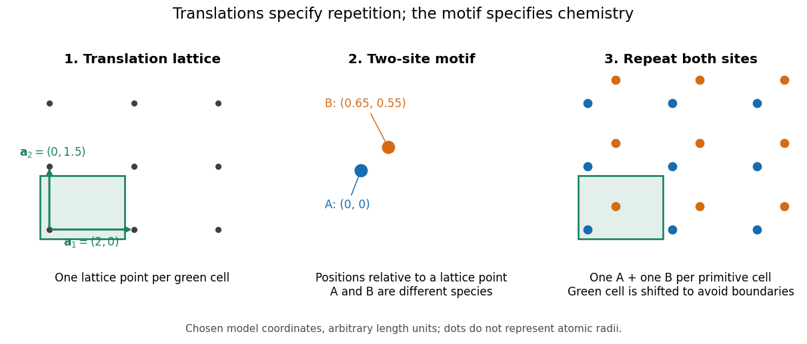

# Crystal structure

↑ **Parent:** [Physical chemistry](physical-chemistry-split.md)  
🏷️ **Tags:** [Solid](solid.md)  
ⓦ [Wiki](https://en.wikipedia.org/wiki/Crystal_structure)

A [crystal structure](crystal-structure.md) specifies the [chemical species](chemical-species.md) and spatial arrangement of the [chemical atoms](atom-physics.md) or [ions](ion.md) in a crystal. For an ideal periodic structure, separate two ingredients: a [Bravais lattice](bravais-lattice.md) specifies the [translations](translation-geometry.md) that repeat the arrangement, and an [atomic basis of a crystal](atomic-basis-of-a-crystal.md) specifies the chemical motif repeated at every [lattice point](lattice-point.md). The outward shape, or [crystal habit](crystal-habit.md), is a different description: the internal arrangement is what this article describes.

For a concrete two-dimensional model, choose [primitive lattice translation vectors](primitive-lattice-translation-vector.md) $a_1=(2,0)$ and $a_2=(0,1.5)$ in arbitrary length units. At every [lattice point](lattice-point.md) $R=ma_1+na_2$, with [integers](integer-split.md) $m,n$, place species A at $R$ and a different species B at $R+(0.65,0.55)$. Translating by $a_1$ or $a_2$ preserves both the positions and their chemical labels. Translating by $(0.65,0.55)$ sends one A position to a B position, so it is not a [translation symmetry](translational-symmetry.md) of the labeled structure. A picture of dots with the labels erased can therefore conceal essential chemical information.

**[Figure 1](#image-crystal-translations-and-two-site-motif). A translation lattice decorated with a two-site chemical motif**. Original two-dimensional model: the same two-site [atomic basis of a crystal](atomic-basis-of-a-crystal.md) is repeated at every [lattice point](lattice-point.md). Each shaded [primitive unit cell](primitive-unit-cell.md) has [area](surface-area.md) $2(1.5)=3$ and contains one A site and one B site; shifting the cell boundary avoids shared boundary sites. Dots are positions, not atomic radii, and the two-site motif need not be a [molecule](molecule-split.md).

A [primitive unit cell](primitive-unit-cell.md) contains one [lattice point](lattice-point.md), but may contain several [chemical atoms](atom-physics.md). A conventional [unit cell](unit-cell.md) can contain several [lattice points](lattice-point.md) to display the [symmetry](symmetry-physics.md) more clearly. Thus the conventional cube of a [face-centered cubic lattice](face-centered-cubic-lattice.md) contains four [lattice points](lattice-point.md), whereas a [body-centered cubic lattice](body-centered-cubic-lattice.md) has two. Neither lattice name alone specifies which [chemical species](chemical-species.md) occupies the repeated motif. The [NaCl conventional cell and coordination](nacl-conventional-cell-and-coordination.md) example makes the distinction explicit.

This separation is useful experimentally: [interplanar spacings](interplanar-spacing.md) constrain the repeating geometry, while relative [wave intensities](intensity-physics.md) also depend on the [atomic basis of a crystal](atomic-basis-of-a-crystal.md) through the [crystal basis structure factor](crystal-basis-structure-factor.md). The [Bragg crystal reflection experiment of 1913](bragg-crystal-reflection-experiment-of-1913.md) describes the [X-ray](x-ray.md) spectrometer, angular scans and detector checks in detail. Its conversion from angle to length is developed under [Bragg's law](bragg-s-law.md); a geometrically possible reflection can still have zero [wave intensity](intensity-physics.md).

[William Lawrence Bragg](william-lawrence-bragg.md)'s 1913 structure determination supplied a complementary test. He directed [X-rays](x-ray.md) through [sodium chloride](sodium-chloride.md) sections cut parallel to a cube face and recorded spots on photographic plates. Comparing section thicknesses tested how transmission altered the pattern: the relative spot strengths changed. Comparing related [salts](salt-chemistry.md) led him to two interpenetrating [face-centered cubic lattices](face-centered-cubic-lattice.md), one for each kind of constituent. He explicitly distinguished evidence for that arrangement from the still-needed identification of a single [chemical atom](atom-physics.md) with each scattering center. The photographs were evidence for a structural model, not direct pictures of labeled [ions](ion.md).[W. L. Bragg (1913), pp. 262–263, Figs. 8–9 and Tables VII–IX: oriented NaCl sections and thickness comparison; pp. 264–265, Fig. 10: two arrays and the remaining atomic-assignment question](the-structure-of-some-crystals-as-indicated-by-their-diffraction-of-x-rays-by-william-lawrence-bragg.md)

**Table of contents**

- [Hard-sphere cubic packing fractions](hard-sphere-cubic-packing-fractions.md)
- [Hexagonal unit-cell volume](hexagonal-unit-cell-volume.md)
- [Tetrahedral interstitial site](tetrahedral-interstitial-site.md)
- [Cubic close-packed structure](cubic-close-packed-structure.md)
- [Close-packed stacking sequence](close-packed-stacking-sequence.md)
- [Crystal interface](crystal-interface.md)
  - [Interfacial energy](interfacial-energy.md)
  - [Incoherent crystal interface](incoherent-crystal-interface.md)
  - [Semicoherent crystal interface](semicoherent-crystal-interface.md)
  - [Coherent crystal interface](coherent-crystal-interface.md)
    - [Coherency strain](coherency-strain.md)
- [Diamond cubic structure](diamond-cubic-structure.md)
  - [Hard-sphere packing fraction of diamond cubic](hard-sphere-packing-fraction-of-diamond-cubic.md)
  - [Bond-centred inversion in diamond cubic](bond-centred-inversion-in-diamond-cubic.md)
  - [Vertical mirrors of the diamond cubic structure](vertical-mirrors-of-the-diamond-cubic-structure.md)
- [Crystal motif](crystal-motif.md)
- [Hexagonal close-packed structure](hexagonal-close-packed-structure.md)
- [Orthorhombic crystal system](orthorhombic-crystal-system.md)
  - [C-centered orthorhombic lattice](c-centered-orthorhombic-lattice.md)
- [Pyrochlore structure](pyrochlore-structure.md)
- [Polytype](polytype.md)
- [L10 crystal structure](l10-crystal-structure.md)
- [Crystallographic texture](crystallographic-texture.md)
- [Lattice constant](lattice-constant.md)
- [Perovskite structure](perovskite-structure.md)
- [Wurtzite](wurtzite.md)
- [Stacking fault](stacking-fault.md)
- [Crystal twinning](crystal-twinning.md)
  - [Multiply twinned particle](multiply-twinned-particle.md)
- [Zone axis](zone-axis.md)
  - [Zone law](zone-law.md)
- [Crystal orientation](crystal-orientation.md)
- [L12 structure](l12-structure.md)
- [Caesium chloride structure](caesium-chloride-structure.md)
- [Fluorite structure](fluorite-structure.md)
  - [Fluorite packing fraction](fluorite-packing-fraction.md)
- [Tetragonal crystal system](tetragonal-crystal-system.md)
  - [Primitive tetragonal lattice](primitive-tetragonal-lattice.md)
- [Crystallographic defect](crystallographic-defect.md)
  - [Antiphase boundary](antiphase-boundary.md)
  - [Grain boundary](grain-boundary.md)
    - [Grain boundary strengthening](grain-boundary-strengthening.md)
      - [Hall-Petch relation](hall-petch-relation.md)
  - [Point defect](point-defect.md)
    - [Graphene vacancy defect](graphene-vacancy-defect.md)
      - [Graphene divacancy](graphene-divacancy.md)
      - [Graphene monovacancy](graphene-monovacancy.md)
    - [Self-interstitial](self-interstitial.md)
    - [Vacancy](vacancy.md)
      - [Vacancy supersaturation](vacancy-supersaturation.md)
    - [Frenkel pair](frenkel-pair.md)
  - [Kröger–Vink notation](kroger-vink-notation.md)
  - [Carbon nanotube vacancy defect](carbon-nanotube-vacancy-defect.md)
  - [Stone-Wales defect](stone-wales-defect.md)
  - [Dislocation](dislocation.md)
    - [Dislocation line-tension estimate](dislocation-line-tension-estimate.md)
    - [Partial dislocation](partial-dislocation.md)
      - [Stair-rod dislocation](stair-rod-dislocation.md)
      - [Shockley partial dislocation](shockley-partial-dislocation.md)
        - [Dissociation of an FCC perfect dislocation](dissociation-of-an-fcc-perfect-dislocation.md)
    - [Superdislocation](superdislocation.md)
    - [Misfit dislocation](misfit-dislocation.md)
    - [Dislocation climb](dislocation-climb.md)
    - [Dislocation density](dislocation-density.md)
    - [Dislocation loop](dislocation-loop.md)
    - [Dislocation junction](dislocation-junction.md)
      - [Lomer-Cottrell lock](lomer-cottrell-lock.md)
    - [Frank's rule](frank-s-rule.md)
    - [Dislocation glide](dislocation-glide.md)
      - [Peierls stress](peierls-stress.md)
      - [Slip system](slip-system.md)
        - [Multiple slip](multiple-slip.md)
        - [Basal slip](basal-slip.md)
        - [Resolved shear stress](resolved-shear-stress.md)
          - [Critical resolved shear stress](critical-resolved-shear-stress.md)
            - [Taylor factor](taylor-factor.md)
          - [Schmid's law](schmid-s-law.md)
            - [Single-slip tensile-axis rotation](single-slip-tensile-axis-rotation.md)
            - [Schmid factor](schmid-factor.md)
    - [Dislocation character](dislocation-character.md)
      - [Mixed dislocation](mixed-dislocation.md)
      - [Edge dislocation](edge-dislocation.md)
      - [Screw dislocation](screw-dislocation.md)
        - [Dislocation cross-slip](dislocation-cross-slip.md)
    - [Burgers vector](burgers-vector.md)
  - [Vacancy defect](vacancy-defect.md)
    - [F center](f-center.md)
    - [Oxygen vacancy](oxygen-vacancy.md)
    - [Equilibrium vacancies with variable lattice size](equilibrium-vacancies-with-variable-lattice-size.md)
      - [Finite-size correction to a variable-site vacancy model](finite-size-correction-to-a-variable-site-vacancy-model.md)
  - [Interstitial defect](interstitial-defect.md)
- [Rutile structure](rutile-structure.md)
- [Corner-sharing tetrahedron](corner-sharing-tetrahedron.md)
- [Zinc blende structure](zinc-blende-structure.md)
- [Surface reconstruction](surface-reconstruction.md)
- [Crystallography](crystallography.md)
  - [Powder diffraction](powder-diffraction.md)
    - [Powder diffraction multiplicity](powder-diffraction-multiplicity.md)
  - [Crystal symmetry](crystal-symmetry.md)
    - [Crystallographic point group](crystallographic-point-group.md)
    - [Glide plane](glide-plane.md)
    - [Screw axis](screw-axis.md)
  - [Direct-methods triplet relationship](direct-methods-triplet-relationship.md)
  - [Direct-methods pair relationship](direct-methods-pair-relationship.md)
  - [Space group](space-group.md)
    - [Nonsymmorphic space group](nonsymmorphic-space-group.md)
    - [Symmorphic space group](symmorphic-space-group.md)
    - [Seitz notation](seitz-notation.md)
  - [Patterson map](patterson-map.md)
  - [Friedel pair](friedel-pair.md)
    - [Friedel's law](friedel-s-law.md)
  - [Anomalous X-ray scattering](anomalous-x-ray-scattering.md)
    - [Multiwavelength anomalous diffraction](multiwavelength-anomalous-diffraction.md)
  - [Crystal system](crystal-system.md)
  - [Crystallographer](crystallographer.md)
    - [List of crystallographers](list-of-crystallographers.md)
      - [R. W. G. Wyckoff](r-w-g-wyckoff.md)
        - [Work by R. W. G. Wyckoff](work-by-r-w-g-wyckoff.md)
      - [Christian Samuel Weiss](christian-samuel-weiss.md)
      - [Gasper J. Piermarini](gasper-j-piermarini.md)
        - [Work by Gasper J. Piermarini](work-by-gasper-j-piermarini.md)
  - [X-ray crystallography](x-ray-crystallography.md)
    - [Single-crystal X-ray diffraction](single-crystal-x-ray-diffraction.md)
    - [Molecular replacement](molecular-replacement.md)
  - [X-ray crystallographic structure inference](x-ray-crystallographic-structure-inference.md)
    - [Lattice constant from two indexed reflections](lattice-constant-from-two-indexed-reflections.md)
    - [Basis intensities and phase ambiguity](basis-intensities-and-phase-ambiguity.md)
    - [Phase problem](phase-problem.md)
    - [Bragg structure inference from measured intensities](bragg-structure-inference-from-measured-intensities.md)
- [Lattice plane](lattice-plane.md)
  - [Interplanar spacing](interplanar-spacing.md)
  - [Miller index](miller-index.md)
    - [Miller-Bravais index](miller-bravais-index.md)
    - [Weiss zone law](weiss-zone-law.md)
- [Atomic basis of a crystal](atomic-basis-of-a-crystal.md)
  - [Fractional crystal coordinate](fractional-crystal-coordinate.md)
  - [NaCl conventional cell and coordination](nacl-conventional-cell-and-coordination.md)
- [Crystal habit](crystal-habit.md)

## ↑ Ancestors (3)

1. [Physical chemistry](physical-chemistry-split.md)
2. [Chemistry](chemistry-split.md)
3. [Codex Wiki](split.md)

## ← Incoming links (51)

- [Adsorption](adsorption.md)
- [Atomic basis of a crystal](atomic-basis-of-a-crystal.md)
- [Bend contour](bend-contour.md)
- [Bragg's law](bragg-s-law.md)
- [Caesium chloride structure](caesium-chloride-structure.md)
- [Calculated transmission Laue pattern](calculated-transmission-laue-pattern.md)
- [Ceramic](ceramic.md)
- [Crystal habit](crystal-habit.md)
- [Crystal orientation](crystal-orientation.md)
- [Crystal polymorph](crystal-polymorph.md)
- [Crystal structure](crystal-structure.md)
- [Crystal symmetry](crystal-symmetry.md)
- [Crystallography](crystallography.md)
- [Cuprate superconductor](cuprate-superconductor.md)
- [Dislocation](dislocation.md)
- [Fluorite structure](fluorite-structure.md)
- [Fractional crystal coordinate](fractional-crystal-coordinate.md)
- [Interstitial defect](interstitial-defect.md)
- [Laue method](laue-method.md)
- [Laue X-ray diffraction experiment of 1912](laue-x-ray-diffraction-experiment-of-1912.md)
- [Magnetic sublattice](magnetic-sublattice.md)
- [Materials science](materials-science.md)
- [Max von Laue](max-von-laue.md)
- [Metal-insulator transition](metal-insulator-transition.md)
- [Nanocrystal](nanocrystal.md)
- [Neutron diffraction](neutron-diffraction.md)
- [Neutron scattering](neutron-scattering.md)
- [Nobel Prize in Physics in 1915](nobel-prize-in-physics-in-1915.md)
- [Oxygen vacancy](oxygen-vacancy.md)
- [Solution](past-exam-of-the-advanced-quantum-condensed-matter-physics-course-of-the-university-of-cambridge/2016/paper-1/3/a/solution.md)
- [Solution](past-exam-of-the-chemistry-b-course-of-the-university-of-cambridge/2021/paper-1/b5/b/i/solution.md)
- [Solution](past-exam-of-the-chemistry-course-of-the-year-1-of-the-natural-sciences-course-of-the-university-of-cambridge/2023/paper-1/6/d/solution.md)
- [Solution](past-exam-of-the-chemistry-course-of-the-year-4-of-the-natural-sciences-course-of-the-university-of-cambridge/2022/paper-3/section-d/43/b/v/solution.md)
- [Solution](past-exam-of-the-materials-science-course-of-the-university-of-cambridge/2018/paper-1/1/a/solution.md)
- [Solution](past-exam-of-the-materials-science-course-of-the-university-of-cambridge/2018/paper-1/4/a/solution.md)
- [Solution](past-exam-of-the-materials-science-course-of-the-university-of-cambridge/2019/paper-1/1/a/i/solution.md)
- [Solution](past-exam-of-the-materials-science-course-of-the-university-of-cambridge/2022/paper-1/1/a/i/solution.md)
- [Solution](past-exam-of-the-materials-science-course-of-the-university-of-cambridge/2022/paper-1/1/a/ii/solution.md)
- [Solution](past-exam-of-the-mphil-in-nuclear-energy-course-of-the-university-of-cambridge/2021/paper-ne3/3/a/solution.md)
- [Solution](past-exam-of-the-mphil-in-nuclear-energy-course-of-the-university-of-cambridge/2021/paper-ne4/3/a/solution.md)
- [Solution](past-exam-of-the-physics-a-course-of-the-university-of-cambridge/2022/paper-2/section-d/d9/b/solution.md)
- [Solution](past-exam-of-the-soft-condensed-matter-course-of-the-university-of-cambridge/2018/section-b/b3/solution.md)
- [Polymorphism (materials science)](polymorphism-materials-science.md)
- [Primitive cubic Bragg peak positions](primitive-cubic-bragg-peak-positions.md)
- [Rutile structure](rutile-structure.md)
- [State of matter](state-of-matter.md)
- [Surface reconstruction](surface-reconstruction.md)
- [Vacancy](vacancy.md)
- [X-ray crystallographic structure inference](x-ray-crystallographic-structure-inference.md)
- [X-ray crystallography](x-ray-crystallography.md)
- [X-ray diffraction](x-ray-diffraction.md)
